<a id="top"></a>

# Agent Execution Plane (AEP)

**Plano de Control de Sistema y Suite de Ejecución de Alta Resiliencia para Agentes de IA sobre Ubuntu/Linux**

> [!IMPORTANT]
> **Arquitectura de Runtime y Plano de Ejecución para Agentes**
> AEP es una **suite de ingeniería de sistemas y runtime agéntico** orientada a
> proveer un plano de ejecución determinista, no-bloqueante, tipado y asíncrono para
> LLMs y agentes autónomos, fundamentado en primitivas estándar de bajo nivel del
> kernel Linux (namespaces, memoria anónima volátil, descriptores y telemetría dinámica)
> sobre entornos Ubuntu/Linux.

---

## Índice

1. [El Reto de Ejecución: Consola Tradicional vs. Runtime Agéntico](#1-el-reto-de-ejecución-consola-tradicional-vs-runtime-agéntico)
2. [Arquitectura Global (4 Capas)](#2-arquitectura-global-4-capas)
3. [Primitivas del Kernel Linux de Alto Rendimiento → Capacidades Agénticas Resilientes](#3-primitivas-del-kernel-linux-de-alto-rendimiento--capacidades-agénticas-resilientes)
4. [Catálogo de 19 Herramientas MCP](#4-catálogo-de-19-herramientas-mcp)
5. [Memoria Semántica Híbrida (sqlite-vec)](#5-memoria-semántica-híbrida-sqlite-vec)
6. [Mejoras de Omarchy (5 Specs Agnósticas)](#6-mejoras-de-omarchy-5-specs-agnósticas)
7. [Modelo de Privilegio de Dos Niveles + Manifiesto](#7-modelo-de-privilegio-de-dos-niveles--manifiesto)
8. [Auto-Plug: Autogestión Atómica del MCP](#8-auto-plug-autogestión-atómica-del-mcp)
9. [Entorno Shell-Agnóstico](#9-entorno-shell-agnóstico)
10. [Instalación desde Cero](#10-instalación-desde-cero)
11. [Estructura del Repositorio](#11-estructura-del-repositorio)
12. [Inventario Sincero de la Fuente de la Verdad](#12-inventario-sincero-de-la-fuente-de-la-verdad)
13. [RE as SDD y Matriz de Inspiración](#13-re-as-sdd-y-matriz-de-inspiración)

---

## 1. El Reto de Ejecución: Consola Tradicional vs. Runtime Agéntico

La consola Unix tradicional fue concebida para operadores humanos interactivos, un paradigma
fundamentalmente hostil para la ejecución autónoma de modelos de lenguaje (LLMs):
- **Procesos bloqueantes**: Pagers interactivos (`less`, `more`), prompts interactivos imprevistos
  y bloqueos de `stdin` detienen indefinidamente los subprocesos del agente.
- **Salida desestructurada y desalineada**: El parseo de texto plano vía pipelines ad-hoc (`grep`,
  `awk`, `sed`) introduce fragilidad sintáctica y consume tokens en ruido de formato en lugar de
  señal estructurada.
- **Dispersión y contención en disco**: La creación de binarios o scripts temporales en el sistema de
  archivos introduce latencia de sincronización de E/S, fragmentación, colisiones de nombres y
  residuos que requieren mantenimiento secundario.

AEP desacopla al agente de la terminal interactiva mediante dos mecanismos principales: **despacho
asíncrono de colas sin bloqueo** (vía Pueue, entregando un `task_id` inmediato) y **ejecución volátil
en memoria RAM** mediante descriptores anónimos (`memfd_create` + `/proc/self/fd/`).

Esta técnica de staging en memoria anónima no es un artificio exótico, sino una **primitiva
estándar de ingeniería de sistemas Linux de alto rendimiento** ampliamente adoptada en infraestructuras
críticas:
- **Compositores Wayland (Weston / wlroots)**: Transferencia zero-copy de buffers de memoria compartida
  (`wl_shm`) entre clientes y compositor mediante paso de descriptores `memfd_create` sobre sockets de
  dominio Unix (`AF_UNIX`).
- **QEMU / KVM (`memory-backend-memfd`)**: Asignación de memoria anónima para RAM invitada en
  virtualización de alto rendimiento, habilitando memoria compartida inter-VM (`ivshmem`) y
  descriptores compartidos para `vhost-user` con DPDK.
- **PulseAudio & PipeWire**: Transferencia de buffers de streaming de audio en tiempo real y cero copia
  entre el servidor de medios y los clientes sin cuellos de botella de sincronización en el sistema de archivos.

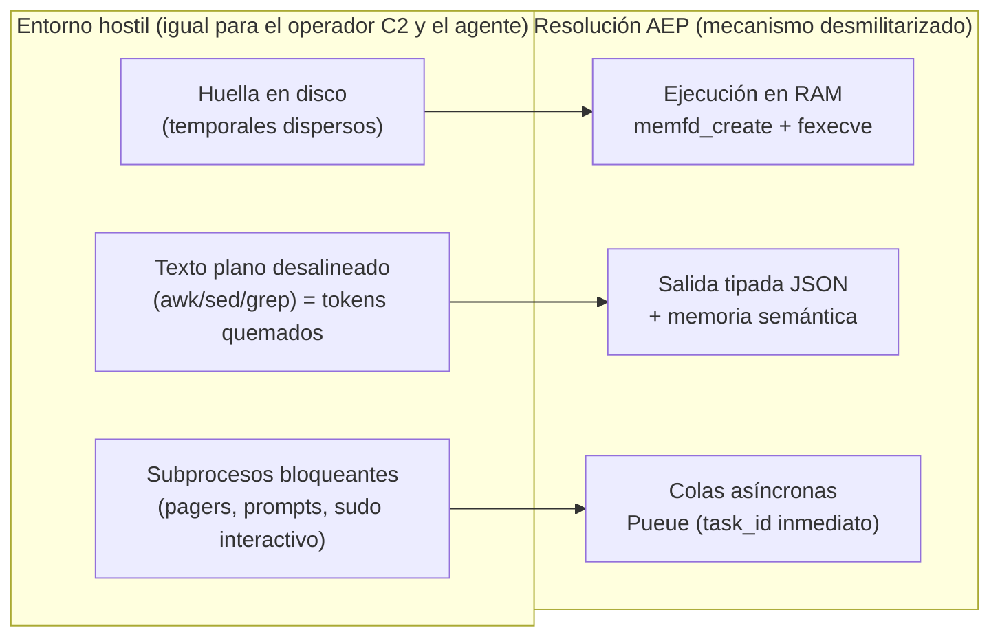

[↑ Volver arriba](#top)

---

## 2. Arquitectura Global (4 Capas)

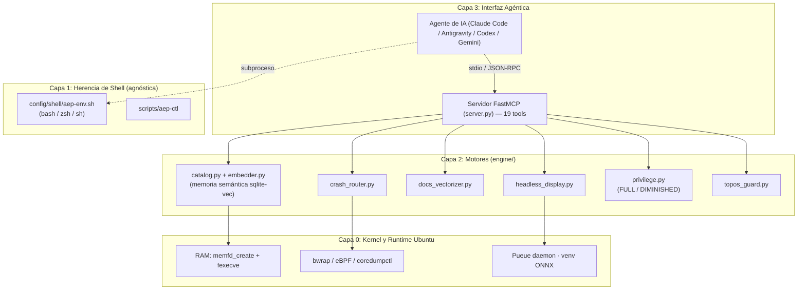

[↑ Volver arriba](#top)

---

## 3. Primitivas del Kernel Linux de Alto Rendimiento → Capacidades Agénticas Resilientes

Las primitivas de bajo nivel del kernel Linux se estructuran y exponen como capacidades de
ejecución agéntica de alta resiliencia gobernadas por un modelo de privilegios de dos niveles.
**Todas verificadas end-to-end.**

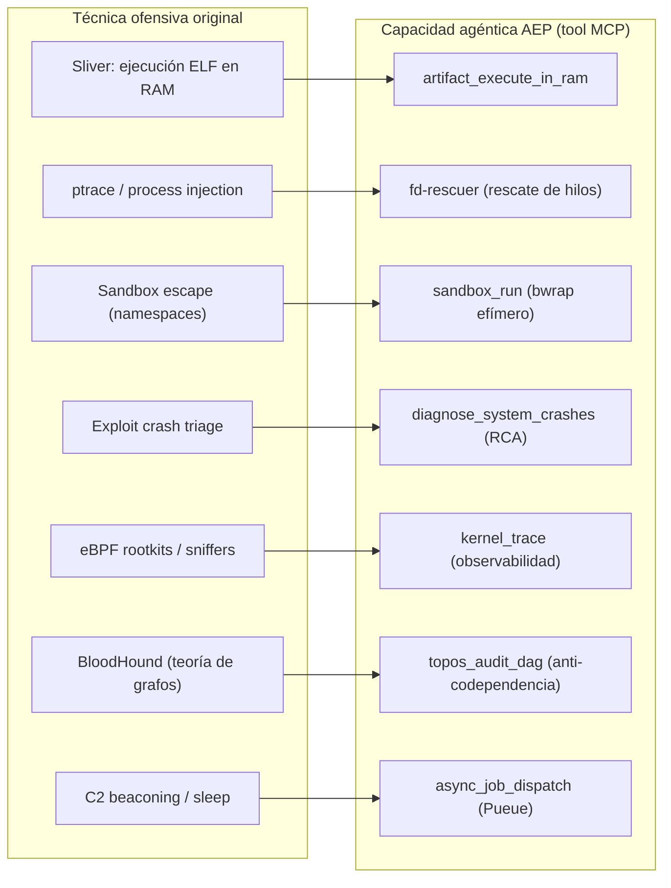

| Primitiva del Kernel / Runtime | Clasificación en Ingeniería de Sistemas | Capacidad Agéntica Resiliente (Tool MCP) | Estado |
| :--- | :--- | :--- | :--- |
| `memfd_create` (glibc 2.27+) | Staging en memoria anónima volátil (cero I/O en disco) | `artifact_execute_in_ram`: Inyección y ejecución directa en RAM | ✅ Operativo |
| `/proc/$PID/fd` + `ptrace` | Introspección no-destructiva y recuperación de hilos | `fd-rescuer`: Rescate no-invasivo de descriptores y estado colgado | ✅ Operativo |
| `bwrap` (Linux namespaces) | Sandbox efímero no-privilegiado (user, pid, mount, net) | `sandbox_run`: Aislamiento determinista en sub-milisegundo | ✅ Operativo |
| `coredumpctl` + `libunwind` | Triaje post-mortem automatizado de coredumps y stack traces | `diagnose_system_crashes`: RCA autónomo y fail-soft | ✅ Operativo |
| eBPF (`bpftrace`) | Telemetría y observabilidad dinámica de kernel no-invasiva | `kernel_trace`: Trazado seguro en tiempo de ejecución | ✅ Operativo (FULL) |
| Teoría de Grafos (DAG) | Análisis de acoplamiento topológico y detección de ciclos | `topos_audit_dag`: Guardián Topos anti-codependencia | ✅ Operativo |
| Cola asíncrona (`Pueue`) | Despacho de tareas basado en eventos y control sin bloqueo | `async_job_dispatch` / `async_job_inspect`: Ejecución en background | ✅ Operativo |

> **Nota sobre `memfd_create(2)`**: Esta primitiva de memoria anónima es el estándar de la
> industria para comunicación y ejecución de alto rendimiento sin sobrecarga de sistema de archivos,
> utilizada por **Wayland** (Weston/wlroots para buffers `wl_shm`), **QEMU / KVM** (asignación de
> RAM invitada para `ivshmem` y `vhost-user`) y **PulseAudio & PipeWire** (buffers de audio en tiempo real).

[↑ Volver arriba](#top)

---

## 4. Catálogo de 19 Herramientas MCP

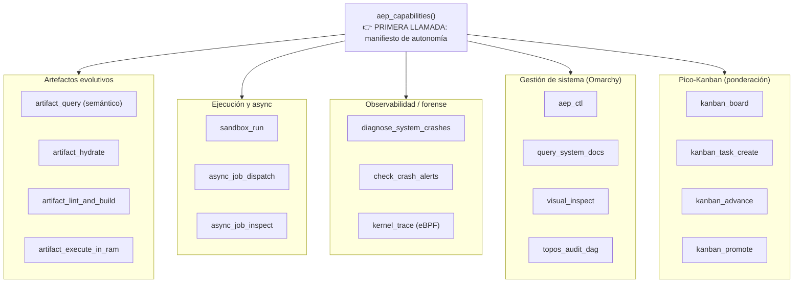

[↑ Volver arriba](#top)

---

## 5. Memoria Semántica Híbrida (sqlite-vec)

Resuelve la fragilidad del hash estricto ante la variabilidad léxica de los LLMs con recuperación
en **2 tiers**: hash exacto `O(1)` y, si falla, KNN coseno sobre `sqlite-vec`.

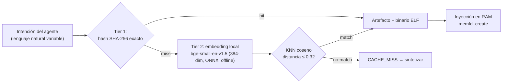

- Umbral `0.32` **calibrado empíricamente** (paráfrasis del mismo intent ~0.28–0.30; intents distintos ≥0.36).
- **Fail-soft total:** sin `sqlite-vec`/embedder, el catálogo opera idéntico al modo solo-hash.

### Persistencia y cómo la lee el agente

La base `~/.local/share/agent-os/artifacts.db` es la **memoria evolutiva** del sistema:

- **Vive fuera del repo** (espacio de usuario, gitignored). Persiste entre sesiones, reinicios
  del MCP (auto-plug) y reboots. Backup = copiar el archivo (un solo fichero ACID, embeddings incluidos).
- **El LLM nunca toca SQL.** La única vía de lectura/escritura son las tools MCP tipadas
  (`artifact_query`, `kanban_board`, …): la capa de tools ES el contrato. Esto erradica
  inyección y alucinación de esquema, y mantiene al agente desacoplado del almacenamiento.
- **Longitudinal:** `execution_metrics` acumula éxito/latencia por artefacto en el tiempo; los
  embeddings permiten recuerdo semántico; el Kanban pondera qué merece reutilizarse.

### Pico-Kanban: ponderación de artefactos (idioma agéntico)

Tablero de estados **abstracto** en la misma DB, transparente para el usuario, que el agente usa
como memoria de trabajo por **tareas atómicas** y para decidir **qué artefacto se promueve** como
plantilla reutilizable. Un artefacto solo se marca `reusable=1` cuando su **ponderación** lo amerita.

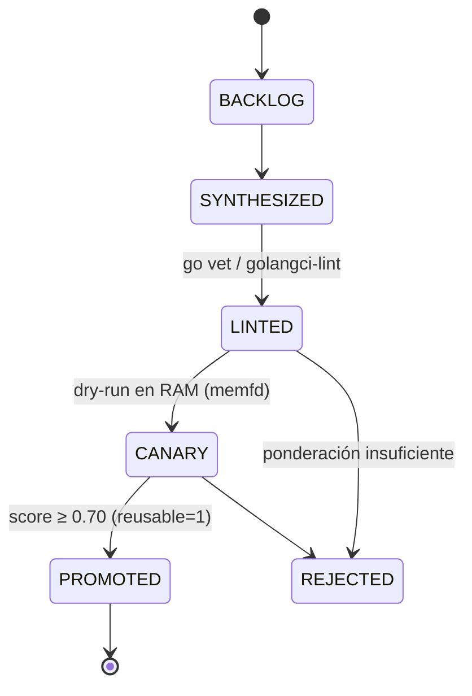

**Ponderación multidimensional consciente de confianza** (adaptada del *trust engine* de
`skill-swarm-mcp` — a su vez inspirado en npms.io / OpenSSF Scorecard / SourceRank):

| Dimensión | Peso | Señal |
| :--- | :---: | :--- |
| `quality` | 0.35 | linters (go vet/golangci) + canary (dry-run en RAM) |
| `reliability` | 0.30 | tasa de éxito histórica |
| `experience` | 0.15 | log-normalizado de ejecuciones (canary da base) |
| `recency` | 0.20 | decaimiento exponencial (half-life 45 días) |

`effective = Σ(dimensión·peso) × confidence`, donde `confidence = dimensiones_con_señal / 4`.
Un artefacto **sin historial** tiene baja confianza aunque su score bruto sea alto → no se promueve a
ciegas. Veredictos: **TRUST ≥ 0.75** (promovido), **CAUTION ≥ 0.50**, **WARNING ≥ 0.25**, **REJECT**.
Un **veto de fiabilidad** impide TRUST si hay fallos demostrados (`éxito < 0.70` con ejecuciones).

[↑ Volver arriba](#top)

---

## 6. Mejoras de Omarchy (5 Specs Agnósticas)

Las innovaciones del "Agentic OS" de Omarchy (acopladas a Arch/Hyprland) descompuestas en 5
especificaciones **distro-agnósticas** sobre Ubuntu.

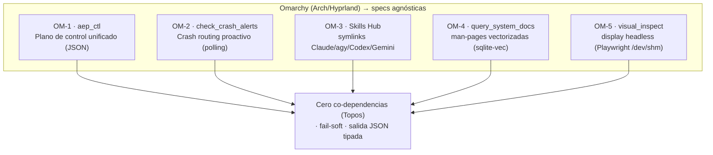

[↑ Volver arriba](#top)

---

## 7. Modelo de Privilegio de Dos Niveles + Manifiesto

Las tools privilegiadas operan en dos niveles (least-privilege por defecto). `aep_capabilities()`
devuelve un **manifiesto auto-descriptivo estilo `chmod`/777** para que la IA consumidora entienda,
en primera vista, qué puede hacer **ahora**.

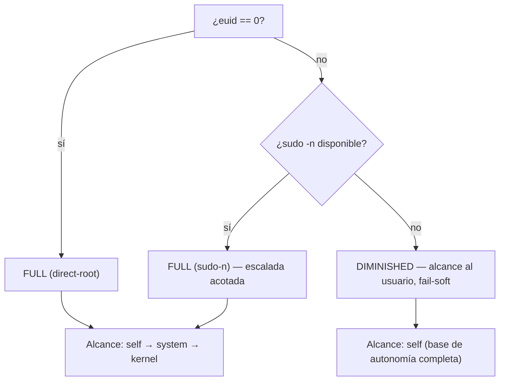

**Códigos de capacidad** (tríada rwx resignificada): `r`=SENSAR, `w`=ACTUAR, `x`=EJECUTAR por caminos no-tradicionales.

| octal | perm | significado |
| :---: | :---: | :--- |
| 7 | `rwx` | sensar + actuar + ejecutar |
| 6 | `rw-` | sensar + actuar |
| 5 | `r-x` | sensar + ejecutar |
| 4 | `r--` | solo sensar |
| 0 | `---` | sin acceso (requiere FULL) |

> La autonomía base opera completa en **DIMINISHED**; el nivel **FULL** solo ensancha
> `kernel_observability` (`0→4`) y `service_control` (`4→6`). El privilegio es **apertura, no prerequisito**.

[↑ Volver arriba](#top)

---

## 8. Auto-Plug: Autogestión Atómica del MCP

Tras cualquier cambio, `aep-sync.sh` **valida** (compila + importa el server) y **solo si pasa**
re-registra el MCP en todos los clientes, apuntando a un launcher estable que resuelve el intérprete
por sí mismo. Un hook `pre-commit` corre la misma validación.

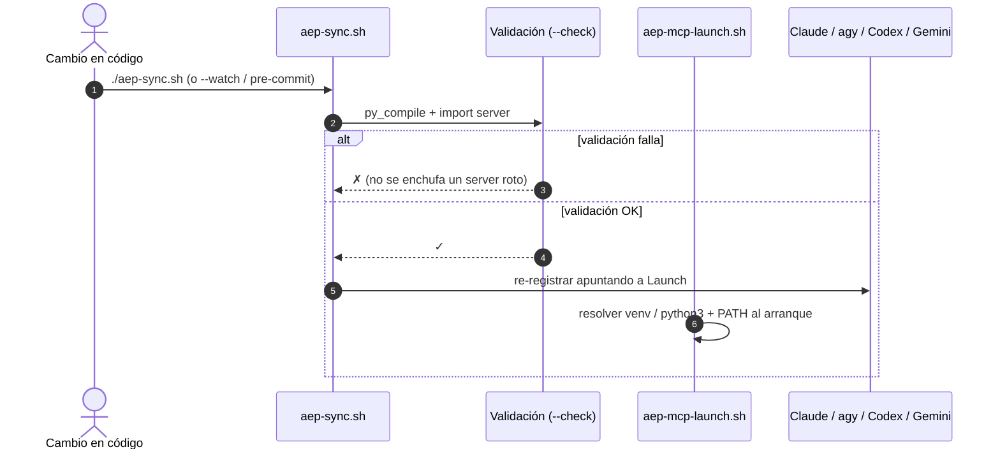

[↑ Volver arriba](#top)

---

## 9. Entorno Shell-Agnóstico

La herencia de entorno **no asume Oh My Zsh**. Un archivo POSIX único se hace `source` desde los rc
nativos. Probado en **bash, zsh y dash**.

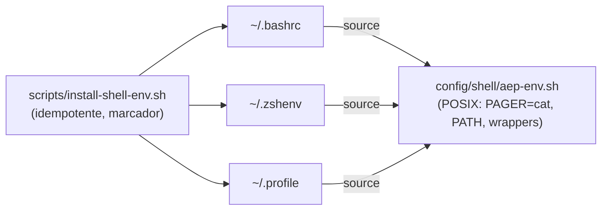

[↑ Volver arriba](#top)

---

## 10. Instalación desde Cero

```bash
cd /ruta/a/agent-execution-plane
./scripts/setup.sh        # idempotente, espacio de usuario, sin sudo en el camino crítico
```

`setup.sh` provisiona el venv semántico (`sqlite-vec` + `fastembed` + Playwright), compila las sondas
Go, descarga Pueue (musl, user-space), instala la herencia de shell agnóstica, el hook pre-commit y
re-registra el MCP en todos los agentes vía `aep-sync.sh`.

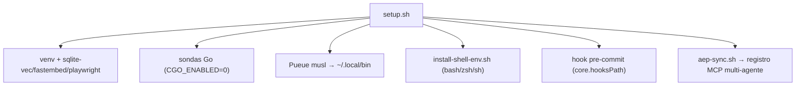

[↑ Volver arriba](#top)

---

## 11. Estructura del Repositorio

```
agent-execution-plane/
├── server.py                       # Servidor FastMCP (19 tools RPC)
├── engine/
│   ├── catalog.py                  # Catálogo + memoria semántica híbrida
│   ├── embedder.py                 # Embedder local ONNX (fail-soft)
│   ├── hydrator.py                 # Hidratador de plantillas Go
│   ├── topos_guard.py              # Detector de co-dependencias DAG
│   ├── privilege.py                # Niveles FULL/DIMINISHED + manifiesto
│   ├── crash_router.py             # Crash routing proactivo (OM-2)
│   ├── docs_vectorizer.py          # Man-pages vectorizadas (OM-4)
│   └── headless_display.py         # Display headless Playwright (OM-5)
├── schemas/
│   ├── database.sql                # DDL (artifacts, metrics, crash_events)
│   └── artifact_contract.cue       # Contratos declarativos CUE
├── templates/                      # Sondas atómicas Go (socket-monitor, fd-rescuer)
├── config/shell/aep-env.sh         # Herencia de entorno POSIX (agnóstica)
├── scripts/
│   ├── setup.sh                    # Instalador idempotente desde cero
│   ├── aep-ctl                     # Plano de control unificado (OM-1)
│   ├── aep-mcp-launch.sh           # Launcher estable (auto-plug)
│   ├── aep-sync.sh                 # Autogestión atómica + registro MCP
│   ├── install-shell-env.sh        # Instalador de herencia de shell
│   └── hooks/pre-commit            # Gate de validación
├── .gitattributes · .gitignore
└── README.md                       # Fuente única de verdad (este archivo)
```

[↑ Volver arriba](#top)

---

## 12. Inventario Sincero de la Fuente de la Verdad

| Componente | Estado Físico Real | Nota |
| :--- | :--- | :--- |
| `memfd_create` (RAM exec) | ✅ Operativo | Primitiva estándar del kernel Linux (glibc 2.27+ / POSIX); staging en memoria anónima (cero I/O en disco) |
| `bwrap` (sandbox) | ✅ Operativo | `sandbox_run` |
| `bpftrace` (eBPF) | ✅ Operativo (FULL) | `kernel_trace`; escala vía `sudo -n`, degrada a DIMINISHED |
| Pueue (async) | ✅ Operativo | musl 4.0.4 en `~/.local/bin`, verificado end-to-end |
| Memoria semántica (`sqlite-vec`) | ✅ Operativo | Recuperación híbrida 2-tier, fail-soft |
| Pico-Kanban (ponderación) | ✅ Operativo | Tablero abstracto en `artifacts.db`; promueve artefactos a `reusable` por score |
| Omarchy (5 specs) | ✅ Operativo | `aep_ctl`, crash routing, hub+Gemini, man-pages, headless |
| Privilegio FULL/DIMINISHED | ✅ Operativo | `privilege.py` + manifiesto `aep_capabilities` |
| Auto-plug MCP | ✅ Operativo | launcher + `aep-sync.sh` (+ `--watch`) |
| Herencia shell agnóstica | ✅ Operativo | bash/zsh/dash; sin Oh My Zsh |
| Nushell (`nu`) / `jc` | ⏳ Pendiente (no crítico) | `aep_ctl` ya entrega JSON tipado |

[↑ Volver arriba](#top)

---

## 13. RE as SDD y Matriz de Inspiración

El desarrollo de AEP aplica Ingeniería Inversa Orientada por Especificaciones (RE as SDD) para
desacoplar primitivas del kernel de dependencias complejas o implementaciones monolíticas:
**(1)** aislar la primitiva del kernel Linux, **(2)** formalizar su especificación agnóstica de plataforma,
y **(3)** construir una implementación minimalista, tipada y verificada end-to-end.

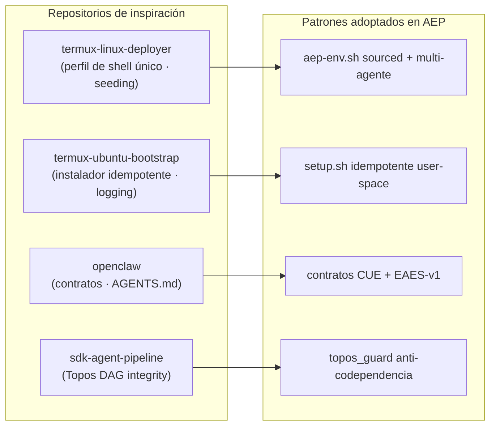

> Este `README.md` es la **fuente única de verdad** del proyecto: toda la especificación,
> arquitectura y auditoría viven aquí, sin documentación dispersa.

[↑ Volver arriba](#top)
