<a id="top"></a>

# Agent Execution Plane (AEP)

**Plano de Control de Sistema y Suite de Ejecución de Alta Resiliencia para Agentes de IA sobre Ubuntu/Linux**

[](https://www.python.org/)
[](https://go.dev/)
[](https://www.gnu.org/software/bash/)
[](https://sqlite.org/)
[](https://modelcontextprotocol.io/)
[](https://ubuntu.com/)
[](tests/)

> [!IMPORTANT]
> **Arquitectura de Runtime y Plano de Ejecución para Agentes**
> AEP es una **suite de ingeniería de sistemas y runtime agéntico** orientada a
> proveer un plano de ejecución determinista, no-bloqueante, tipado y asíncrono para
> LLMs y agentes autónomos, fundamentado en primitivas estándar de bajo nivel del
> kernel Linux (namespaces, memoria anónima volátil, descriptores y telemetría dinámica)
> sobre entornos Ubuntu/Linux.

---

## Índice

1. [El Reto de Ejecución: Consola Tradicional vs. Runtime Agéntico](#1-el-reto-de-ejecución-consola-tradicional-vs-runtime-agéntico)
2. [Arquitectura Global (4 Capas)](#2-arquitectura-global-4-capas)
   - [Desglose Arquitectónico de las 4 Capas](#desglose-arquitectónico-de-las-4-capas)
   - [Especificación Detallada de Capas](#especificación-detallada-de-capas)
3. [Primitivas del Kernel Linux de Alto Rendimiento → Capacidades Agénticas Resilientes](#3-primitivas-del-kernel-linux-de-alto-rendimiento--capacidades-agénticas-resilientes)
4. [Catálogo de 15 Herramientas MCP (18 Capacidades)](#4-catálogo-de-15-herramientas-mcp-18-capacidades)
   - [Tablas de Referencia Maestra de las 15 Herramientas FastMCP](#tablas-de-referencia-maestra-de-las-15-herramientas-fastmcp)
   - [Ciclo de Vida y Encadenamiento de Capacidades (Skill Chaining)](#ciclo-de-vida-y-encadenamiento-de-capacidades-skill-chaining)
5. [Memoria Semántica Híbrida (sqlite-vec) y Concurrencia Hot SQLite](#5-memoria-semántica-híbrida-sqlite-vec-y-concurrencia-hot-sqlite)
   - [Persistencia y cómo la lee el agente](#persistencia-y-cómo-la-lee-el-agente)
   - [Pico-Kanban: ponderación de artefactos (idioma agéntico)](#pico-kanban-ponderación-de-artefactos-idioma-agéntico)
   - [Arquitectura Anti-Deadlock y Concurrencia WAL](#arquitectura-anti-deadlock-y-concurrencia-wal)
6. [Resiliencia de Base de Datos: Backup en Caliente y Auto-Recuperación (5 Slots)](#6-resiliencia-de-base-de-datos-backup-en-caliente-y-auto-recuperación-5-slots)
   - [Mecánica del Motor de Backup Hot Streaming](#mecánica-del-motor-de-backup-hot-streaming)
   - [Topología del Pool FIFO y Auto-Sanación](#topología-del-pool-fifo-y-auto-sanación)
7. [Contramedidas de Seguridad, Aislamiento y Auditoría Criptográfica](#7-contramedidas-de-seguridad-aislamiento-y-auditoría-criptográfica)
   - [CapabilityGuard y Blacklist de Rutas Críticas](#capabilityguard-y-blacklist-de-rutas-críticas)
   - [Cadena de Auditoría Tamper-Evident SHA-256](#cadena-de-auditoría-tamper-evident-sha-256)
8. [Mejoras de Omarchy (5 Specs Agnósticas)](#8-mejoras-de-omarchy-5-specs-agnósticas)
   - [Matriz de Especificaciones Agnósticas de Omarchy](#matriz-de-especificaciones-agnósticas-de-omarchy)
   - [Especificaciones Técnicas Detalladas (SPEC-OM-1 a SPEC-OM-5)](#especificaciones-técnicas-detalladas-spec-om-1-a-spec-om-5)
   - [Arquitectura y Flujo de Datos de las Mejoras Omarchy](#arquitectura-y-flujo-de-datos-de-las-mejoras-omarchy)
9. [Modelo de Privilegio de Dos Niveles + Manifiesto](#9-modelo-de-privilegio-de-dos-niveles--manifiesto)
10. [Auto-Plug: Autogestión Atómica del MCP](#10-auto-plug-autogestión-atómica-del-mcp)
11. [Entorno Shell-Agnóstico](#11-entorno-shell-agnóstico)
12. [Instalación desde Cero, Auditoría y Actualizador Autónomo](#12-instalación-desde-cero-auditoría-y-actualizador-autónomo)
13. [Estructura del Repositorio](#13-estructura-del-repositorio)
14. [Inventario Sincero de la Fuente de la Verdad](#14-inventario-sincero-de-la-fuente-de-la-verdad)
15. [RE as SDD y Matriz de Inspiración](#15-re-as-sdd-y-matriz-de-inspiración)

---

## 1. El Reto de Ejecución: Consola Tradicional vs. Runtime Agéntico

La consola Unix tradicional fue concebida para operadores humanos interactivos, un paradigma
fundamentalmente hostil para la ejecución autónoma de modelos de lenguaje (LLMs):
- **Procesos bloqueantes**: Pagers interactivos (`less`, `more`), prompts interactivos imprevistos
  y bloqueos de `stdin` detienen indefinidamente los subprocesos del agente.
- **Salida desestructurada y desalineada**: El parseo de texto plano vía pipelines ad-hoc (`grep`,
  `awk`, `sed`) introduce fragilidad sintáctica y consume tokens en ruido de formato en lugar de
  señal estructurada.
- **Dispersión y contención en disco**: La creación de binarios o scripts temporales en el sistema de
  archivos introduce latencia de sincronización de E/S, fragmentación, colisiones de nombres y
  residuos que requieren mantenimiento secundario.

AEP desacopla al agente de la terminal interactiva mediante dos mecanismos principales: **despacho
asíncrono de colas sin bloqueo** (vía Pueue, entregando un `task_id` inmediato) y **ejecución volátil
en memoria RAM** mediante descriptores anónimos (`memfd_create` + `/proc/self/fd/`).

Esta técnica de staging en memoria anónima no es un artificio exótico, sino una **primitiva
estándar de ingeniería de sistemas Linux de alto rendimiento** ampliamente adoptada en infraestructuras
críticas:
- **Compositores Wayland (Weston / wlroots)**: Transferencia zero-copy de buffers de memoria compartida
  (`wl_shm`) entre clientes y compositor mediante paso de descriptores `memfd_create` sobre sockets de
  dominio Unix (`AF_UNIX`).
- **QEMU / KVM (`memory-backend-memfd`)**: Asignación de memoria anónima para RAM invitada en
  virtualización de alto rendimiento, habilitando memoria compartida inter-VM (`ivshmem`) y
  descriptores compartidos para `vhost-user` con DPDK.
- **PulseAudio & PipeWire**: Transferencia de buffers de streaming de audio en tiempo real y cero copia
  entre el servidor de medios y los clientes sin cuellos de botella de sincronización en el sistema de archivos.

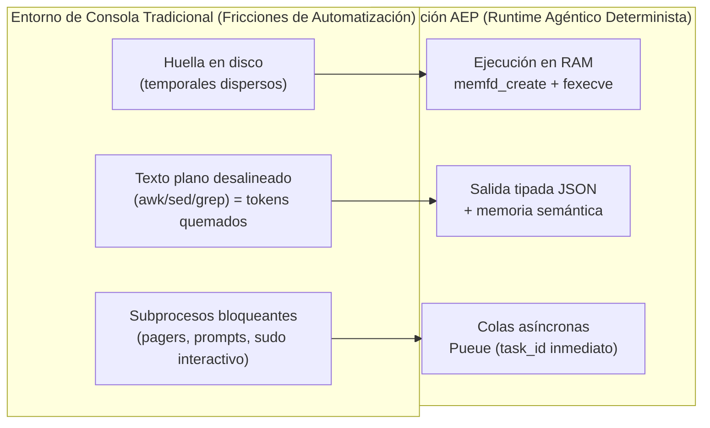

[↑ Volver arriba](#top)

---

## 2. Arquitectura Global (4 Capas)

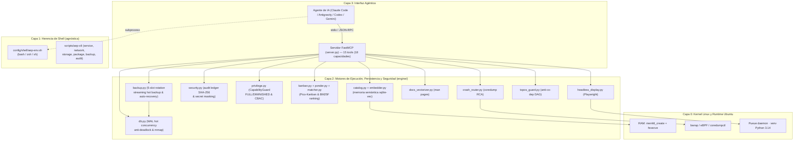

### Desglose Arquitectónico de las 4 Capas

| Capa | Nivel de Abstracción | Módulos & Componentes | Primitivas Subyacentes & Protocolos | Garantías & Rol en el Runtime |
| :---: | :--- | :--- | :--- | :--- |
| **Capa 3** | **Interfaz Agéntica (RPC)** | `server.py` (FastMCP)<br/>`aep_capabilities` | JSON-RPC 2.0 sobre `stdio`<br/>FastMCP SDK | Punto de entrada unificado para LLMs y agentes (Claude Code, Antigravity `agy`, OpenAI Codex, Gemini CLI). Expone 15 herramientas atómicas, tipadas y no-bloqueantes (18 capacidades, paridad 1:1). |
| **Capa 2** | **Motores de Ejecución, Persistencia y Seguridad (`engine/`)** | `db.py`<br/>`backup.py`<br/>`security.py`<br/>`catalog.py`<br/>`embedder.py`<br/>`kanban.py`<br/>`ponder.py`<br/>`matcher.py`<br/>`crash_router.py`<br/>`docs_vectorizer.py`<br/>`headless_display.py`<br/>`topos_guard.py`<br/>`privilege.py` | SQLite 3 (WAL mode, mmap 256MB)<br/>`sqlite-vec` extension<br/>ONNX Runtime (bge-small)<br/>Playwright Chromium (`/dev/shm`)<br/>`fcntl.flock` + `conn.backup()`<br/>SHA-256 Chained Hash Ledger | Núcleo de lógica agéntica: memoria semántica híbrida, concurrencia hot SQLite anti-deadlock (`BEGIN IMMEDIATE`), rotación hot backup en 5 slots con auto-sanación ante corrupción, contramedidas ofensivas con `CapabilityGuard` (blacklist `/etc/shadow`, `/root`, `~/.ssh`), libro de auditoría criptográfica SHA-256, Pico-Kanban multidimensional y gobierno en dos tiers (`FULL`/`DIMINISHED`). |
| **Capa 1** | **Herencia de Shell Agnóstica** | `config/shell/aep-env.sh`<br/>`scripts/install-shell-env.sh`<br/>`scripts/aep-ctl` | POSIX Shell estándar (`sh`, `bash`, `zsh`, `dash`)<br/>Variables de entorno (`PAGER=cat`) | Sanitiza el entorno de ejecución de subprocesos contra bloqueos (`stdin`, pagers interactivos). CLI determinista `aep-ctl` para control del sistema mediante contratos JSON tipados con autodocumentación (`--schema`) sobre dominios `service`, `network`, `storage`, `package`, `backup` y `audit`. |
| **Capa 0** | **Kernel Linux & Runtime Ubuntu** | Primitivas del Kernel Linux<br/>`Pueue` daemon (musl)<br/>`bwrap` (Bubblewrap)<br/>`systemd` / `journald`<br/>Toolchain Go estático | `memfd_create(2)`<br/>Linux User & PID Namespaces<br/>eBPF / kprobes (`bpftrace`)<br/>`systemd-coredump` / `ptrace`<br/>Python 3.14 Hermético (`uv`) | Cimientos de alto rendimiento y bajo nivel: staging de binarios ELF volátiles en RAM sin residuo en disco, aislamiento en submilisegundos mediante namespaces no-privilegiados, colas asíncronas no-bloqueantes, telemetría de kernel no-invasiva y ejecución en espacio de usuario sin requerir root. |

#### Especificación Detallada de Capas

1. **Capa 3: Interfaz Agéntica (FastMCP RPC)**:
   - **Protocolo y Transporte**: Opera sobre la especificación estándar Model Context Protocol (MCP) utilizando el framework **FastMCP** en `server.py`. Toda la comunicación se realiza a través de `stdio` mediante mensajes estructurados **JSON-RPC 2.0**, eliminando la necesidad de exponer puertos TCP o gestionar autenticación de red local insegura.
   - **Autodescripción en Primera Vista**: El punto de entrada `discover(action="capabilities")` (junto al wrapper de compatibilidad `aep_capabilities()`) actúa como apretón de manos inicial, devolviendo un manifiesto estilo `chmod/777` (`r`=sensar, `w`=actuar, `x`=ejecutar). Esto instruye al LLM sobre sus facultades operativas inmediatas según el nivel de privilegio detectado (`FULL` o `DIMINISHED`).
   - **Multi-Cliente Universal**: Diseñado para ser consumido de forma idéntica por múltiples agentes autónomos (Claude Code, Antigravity `agy`, OpenAI Codex, Gemini CLI) mediante el launcher unificado `scripts/aep-mcp-launch.sh`.

2. **Capa 2: Motores de Ejecución, Persistencia y Seguridad (`engine/`)**:
   - **Concurrencia Hot SQLite Anti-Deadlock (`db.py`)**: Conexiones de solo lectura (`mode=ro`) sin bloqueos en WAL, conexiones de lectura-escritura con `PRAGMA wal_autocheckpoint=1000` y transacciones inmediatas (`transaction_immediate` con `BEGIN IMMEDIATE`) para eliminar por diseño los deadlocks (`database is locked`) bajo enjambres multi-agente concurrentes.
   - **Resiliencia y Backup en Caliente (`backup.py`)**: Copias de seguridad online no destructivas vía `conn.backup()`, rotación en pool FIFO de 5 slots (`artifacts.db.bak.1..5`), checksums SHA-256 por snapshot y auto-recuperación ante corrupción de cabecera.
   - **Contramedidas de Seguridad y Auditoría (`security.py`, `privilege.py`)**: Gobernanza de acceso basada en capacidades (CBAC) con `CapabilityGuard` (bloqueo estricto de `/etc/shadow`, `/root`, `~/.ssh`), sanitización centralizada de secretos y libro mayor inmutable encadenado por SHA-256 (`security_audit_log`).
   - **Memoria Semántica Híbrida (`catalog.py`, `embedder.py`)**: Persiste metadatos de artefactos en `~/.local/share/agent-os/artifacts.db` con modo WAL. Implementa recuperación en dos niveles: coincidencia exacta por hash SHA-256 en tiempo O(1), y búsqueda por similitud de coseno mediante la extensión `sqlite-vec` y el modelo local `bge-small-en-v1.5` sobre ONNX Runtime.
   - **Pico-Kanban de Ponderación (`kanban.py`, `ponder.py`, `matcher.py`)**: Mantiene un tablero de estados abstracto (`BACKLOG` → `SYNTHESIZED` → `LINTED` → `CANARY` → `PROMOTED`/`REJECTED`) para estructurar actividades complejas en tareas atómicas y ponderar artefactos con un motor de confianza multidimensional (`quality`, `reliability`, `experience`, `recency`) con veto por fallos.
   - **Enrutamiento Proactivo de Fallos (`crash_router.py`)**: Interroga a `coredumpctl` periódicamente, deduplicando caídas mediante huellas hash compuestas (`pid:timestamp:executable`) para suministrar al agente alertas tempranas antes de que ejecute mutaciones en el sistema.
   - **Vectorización de Documentación (`docs_vectorizer.py`)**: Ingiere y segmenta páginas de manual `man` de Ubuntu en párrafos, vectorizándolos localmente en `system_docs.db` para resolver la sintaxis exacta de utilidades de sistema en menos de 5 ms sin consultas web.
   - **Actuador Visual Headless (`headless_display.py`)**: Orquesta instancias de Chromium sin cabeza vía Playwright, permitiendo renderizar URLs y capturar pantallas directamente en memoria RAM (`/dev/shm`) codificadas en Base64 para inspección visual automatizada.
   - **Guardián Topológico (`topos_guard.py`)**: Aplica el Topos Integrity Protocol analizando grafos dirigidos acíclicos de tareas para certificar ausencia de ciclos o co-dependencias (A <-> B) antes de autorizar la ejecución.
   - **Control de Privilegio (`privilege.py`)**: Detecta dinámicamente el contexto de permisos (`euid == 0` o `sudo -n true`), garantizando que las herramientas degraden elegantemente (*fail-soft*) a espacio de usuario sin lanzar excepciones no controladas.

3. **Capa 1: Herencia de Shell Agnóstica**:
   - **Sanitización de Entorno POSIX (`config/shell/aep-env.sh`)**: Archivo de entorno universal que fuerza `PAGER=cat`, `MANPAGER=cat`, `DEBIAN_FRONTEND=noninteractive` y exporta rutas críticas al `PATH`. Garantiza que cualquier subproceso hijo no se congele esperando interacción en terminales interactivas.
   - **Instalación Idempotente Multi-Shell (`scripts/install-shell-env.sh`)**: Inyecta selectores atómicos con bloques de control en `~/.bashrc`, `~/.zshenv` y `~/.profile`, soportando indistintamente Bash, Zsh y Dash sin requerir frameworks de shell de terceros.
   - **Plano de Control CLI Determinista (`scripts/aep-ctl`)**: Utilidad modular en Python stdlib que expone subdominios (`service`, `network`, `storage`, `package`, `backup`, `audit`). Toda invocación genera salida JSON estructurada y soporta introspección de contratos vía `--schema`.

4. **Capa 0: Kernel Linux y Runtime de Sistema**:
   - **Memoria Anónima Volátil (`memfd_create`)**: Primitiva nativa del kernel Linux (disponible desde glibc 2.27 / kernel 3.17) que permite alojar y ejecutar código binario ELF puramente en RAM a través de `/proc/self/fd/`, eludiendo el subsistema de archivos en disco secundario.
   - **Aislamiento por Namespaces (`bwrap`)**: Utiliza Bubblewrap para confinar ejecuciones potencialmente peligrosas dentro de namespaces no-privilegiados de usuario, montaje, PID y red, con sistemas de archivos de solo lectura y directorios `/tmp` volátiles en memoria.
   - **Observabilidad Dinámica (`bpftrace` / eBPF)**: Permite adjuntar sondas kprobes y tracepoints en caliente al núcleo para contabilizar llamadas al sistema, monitorizar aperturas de ficheros o rastrear conexiones TCP con scripts curados de solo-lectura y auto-terminación.
   - **Forense Post-Mortem de Sistema**: Utilidades nativas `systemd-coredump` y `journalctl` para recuperación de volcados de memoria, extracción de trazas de pila e inspección de logs de eventos críticos a nivel de sistema.
   - **Gestor de Colas Asíncronas (`Pueue`)**: Demonio de ejecución en segundo plano compilado estáticamente con `musl`, capaz de gestionar colas de tareas con grupos y límites de paralelismo sin bloquear el flujo conversacional del agente.

[↑ Volver arriba](#top)

---

## 3. Primitivas del Kernel Linux de Alto Rendimiento → Capacidades Agénticas Resilientes

Las primitivas de bajo nivel del kernel Linux se estructuran y exponen como capacidades de
ejecución agéntica de alta resiliencia gobernadas por un modelo de privilegios de dos niveles.
**Todas verificadas end-to-end.**

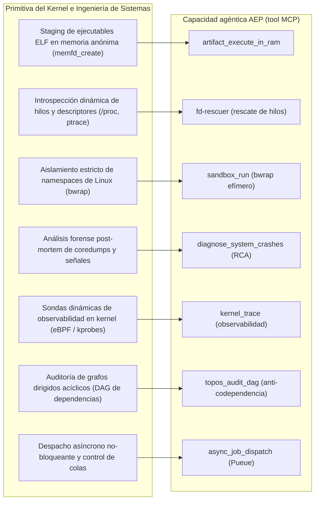

| Primitiva del Kernel / Runtime | Clasificación en Ingeniería de Sistemas | Capacidad Agéntica Resiliente (Tool MCP) | Estado |
| :--- | :--- | :--- | :--- |
| `memfd_create` (glibc 2.27+) | Staging en memoria anónima volátil (cero I/O en disco) | `artifact_execute_in_ram`: Inyección y ejecución directa en RAM | ✅ Operativo |
| `/proc/$PID/fd` + `ptrace` | Introspección no-destructiva y recuperación de hilos | `fd-rescuer`: Rescate no-invasivo de descriptores y estado colgado | ✅ Operativo |
| `bwrap` (Linux namespaces) | Sandbox efímero no-privilegiado (user, pid, mount, net) | `sandbox_run`: Aislamiento determinista en sub-milisegundo | ✅ Operativo |
| `coredumpctl` + `libunwind` | Triaje post-mortem automatizado de coredumps y stack traces | `diagnose_system_crashes`: RCA autónomo y fail-soft | ✅ Operativo |
| eBPF (`bpftrace`) | Telemetría y observabilidad dinámica de kernel no-invasiva | `kernel_trace`: Trazado seguro en tiempo de ejecución | ✅ Operativo (FULL) |
| Teoría de Grafos (DAG) | Análisis de acoplamiento topológico y detección de ciclos | `topos_audit_dag`: Guardián Topos anti-codependencia | ✅ Operativo |
| Cola asíncrona (`Pueue`) | Despacho de tareas basado en eventos y control sin bloqueo | `async_job_dispatch` / `async_job_inspect`: Ejecución en background | ✅ Operativo |

> **Nota sobre `memfd_create(2)`**: Esta primitiva de memoria anónima es el estándar de la
> industria para comunicación y ejecución de alto rendimiento sin sobrecarga de sistema de archivos,
> utilizada por **Wayland** (Weston/wlroots para buffers `wl_shm`), **QEMU / KVM** (asignación de
> RAM invitada para `ivshmem` y `vhost-user`) y **PulseAudio & PipeWire** (buffers de audio en tiempo real).

[↑ Volver arriba](#top)

---

## 4. Catálogo de 15 Herramientas MCP (18 Capacidades)

```mermaid
flowchart TD
    Root["discover(action=\"capabilities\")<br/>👉 PRIMERA LLAMADA: manifiesto de autonomía (chmod/777)"]
    Root --> G0 & G1 & G2 & G3 & G4 & G5
    subgraph G0["Orientación y DAG"]
        T1["discover"]
        T2["topos_audit_dag"]
    end
    subgraph G1["Artefactos evolutivos en RAM"]
        T3["artifact_catalog"]
        T4["artifact_lint_and_build"]
        T5["artifact_execute_in_ram"]
    end
    subgraph G2["Introspección y Ejecución"]
        T6["process_inspect"]
        T7["sandbox_run"]
        T8["async_job_dispatch"]
    end
    subgraph G3["Observabilidad y Forense"]
        T9["diagnose_system_crashes"]
        T10["kernel_trace"]
    end
    subgraph G4["Control de Sistema y Docs"]
        T11["aep_ctl"]
        T12["query_system_docs"]
        T13["visual_inspect"]
    end
    subgraph G5["Pico-Kanban y Playbooks"]
        T14["kanban_board"]
        T15["playbook_run"]
    end
```

### Tablas de Referencia Maestra de las 15 Herramientas FastMCP

El plano expone 15 herramientas RPC organizadas en dominios operacionales más el punto de entrada raíz. Todas retornan cadenas JSON tipadas y deterministas, garantizando cero fallos no controlados (*fail-soft*).

#### Punto de Entrada & Manifiesto de Autonomía (Root)

| Herramienta | Privilegio | Firma & Parámetros | Mecánica & Propósito Operativo | Contrato de Salida JSON | Garantía Fail-Soft |
| :--- | :---: | :--- | :--- | :--- | :--- |
| `discover` (`action="capabilities"`) | `FULL` / `DIMINISHED` | `discover(action="capabilities") -> str`<br/>*(wrapper compat: `aep_capabilities()`)* | Evalúa `euid == 0` y disponibilidad de `sudo -n`. Genera un manifiesto en tríada octal estilo `chmod/777` (`r`=sensar, `w`=actuar, `x`=ejecutar) mapeando las 18 capacidades agénticas con su alcance (`self`, `system`, `kernel`). | `{"status": "OK", "capability_tier": "FULL"|"DIMINISHED", "privilege_mode": str, "capabilities": {...}}` | Siempre retorna JSON determinista válido. Cero excepciones no controladas. |

#### Dominio 1: Artefactos Evolutivos & Ciclo en Memoria (4 Herramientas)

| Herramienta | Privilegio | Firma & Parámetros | Mecánica & Propósito Operativo | Contrato de Salida JSON | Garantía Fail-Soft |
| :--- | :---: | :--- | :--- | :--- | :--- |
| `discover` | `DIMINISHED` | `discover(use_case: str = "", action: str = "discover", limit: int = 3) -> str` | Enrutador polimórfico de orientación: traduce casos de uso en lenguaje natural a QUÉ hacer (`action="discover"`: capacidad sugerida, artefactos, plantillas y playbooks) o devuelve el manifiesto de autonomía agéntica estilo `chmod/777` (`action="capabilities"`). | `action="discover"`: `{"status": "OK", "suggested_capability": str, "reuse_artifacts": [...], ...}`<br/>`action="capabilities"`: `{"status": "OK", "capability_tier": str, "privilege_mode": str, "capabilities": {...}}` | Parámetros vacíos en 'discover' retornan `status: "PARAM_ERROR"`; acciones no reconocidas retornan `status: "INVALID_ACTION"`. Cero excepciones no controladas. |
| `artifact_lint_and_build` | `DIMINISHED` | `artifact_lint_and_build(action: str = "build", name: Optional[str] = None, intent: Optional[str] = None, category: Optional[str] = None, go_source: Optional[str] = None, template_name: Optional[str] = None, source_template: Optional[str] = None, params: Optional[Dict[str, Any]] = None, cue_contract: str = "", limit: int = 5) -> str` | Punto único para consultar catálogo de plantillas (`catalog`), rankear plantillas por relevancia (`select`), hidratar código Go (`hydrate`), y compilar binarios con validación estática `go vet`/`golangci-lint` (`build`), incluyendo atajo ergonómico de 1 paso plantilla->binario. | JSON tipado dependiente de la acción (`status`, `templates`, `matches`, `go_source`, `artifact_id`, `binary_path`). | Respuestas estructuradas con `status: "PARAM_ERROR"` ante parámetros faltantes, `status: "HYDRATE_ERROR"` ante fallos de plantilla, e `status: "INVALID_ACTION"` ante acciones no reconocidas. Cero excepciones no controladas. |
| `artifact_execute_in_ram` | `DIMINISHED` | `artifact_execute_in_ram(name: str, args: Optional[List[str]] = None) -> str` | Carga el binario ELF en un descriptor anónimo volátil vía `memfd_create` y lo ejecuta directamente en RAM mediante `/proc/self/fd/<fd>`. Mide latencia y actualiza métricas históricas de confiabilidad en SQLite. | `{"status": "SUCCESS"|"EXEC_FAILED", "exit_code": int, "latency_ms": float, "output": Any, "metric_recorded": bool}` | Códigos de salida distintos de cero o errores de ejecución retornan JSON con `stderr` y alimentan la tasa histórica de fallo. |
| `artifact_catalog` | `DIMINISHED` | `artifact_catalog(action: str = "browse", category: Optional[str] = None, query: Optional[str] = None, intent: Optional[str] = None, limit: int = 10, force: bool = False, apply: bool = False) -> str` | Memoria semántica unificada. En `action="browse"`: lista/busca por confianza o top-K semántico (`query`). En `action="query"`: busca en caché por `intent` (o `query`), con `category` opcional (si se omite, búsqueda kNN multi-categoría global). En `action="reindex"`: sana vectores sqlite-vec. En `action="prune"`: GC seguro. | `{"status": "OK"|"CACHE_HIT"|"CACHE_MISS", ...}` | Si falta `sqlite-vec`/embedder, degrada a ranking relacional por confianza sin lanzar excepciones. |

#### Dominio 2: Pico-Kanban & Ponderación Multidimensional (1 Herramienta Unificada)

| Herramienta | Privilegio | Firma & Parámetros | Mecánica & Propósito Operativo | Contrato de Salida JSON | Garantía Fail-Soft |
| :--- | :---: | :--- | :--- | :--- | :--- |
| `kanban_board` | `DIMINISHED` | `kanban_board(action: str = "board", include_archived: bool = False, task_id: Optional[int] = None, title: str = "", intent: str = "", category: str = "", artifact_name: Optional[str] = None, to_state: str = "", lint_passed: Optional[bool] = None, canary_passed: Optional[bool] = None, note: Optional[str] = None, reason: Optional[str] = None, states: Optional[List[str]] = None, max_score: Optional[float] = None, apply: bool = False, target_state: str = "SYNTHESIZED") -> str` | Punto único para consultar tablero (`board`), crear tareas (`create`), avanzar estados (`advance`), evaluar y promover (`promote`), degradar explícitamente (`demote` aceptando `artifact_name` o `task_id` con `target_state`), reevaluar flota (`reevaluate`) y archivar/desarchivar (`archive`/`unarchive`). | JSON tipado dependiente de la acción (`status`, `lanes`, `task_id`, `promotion_score`, `verdict`, `candidates`). | Respuestas estructuradas con `status: "PARAM_ERROR"` ante parámetros faltantes e `status: "INVALID_ACTION"` ante acciones no reconocidas. Cero excepciones no controladas. |
| `process_inspect` | `FULL` / `DIMINISHED` | `process_inspect(pid: int = 0, limit: int = 100) -> str` | Introspección dinámica de estado, descriptores de archivos abiertos (`/proc/PID/fd`) y telemetría de recursos. `pid=0` auto-inspecciona el servidor FastMCP (`self`); `pid>0` inspecciona el proceso target. Clasifica descriptores en `socket`, `pipe`, `device`, `anon_inode` y `file`. | `{"status": "OK", "pid": int, "name": str, "state": str, "threads": int, "rss_kb": int, "fd_count": int, "summary_by_type": {...}, "descriptors": [...]}` | PIDs inexistentes retornan `status: "NOT_FOUND"`; procesos de otros usuarios sin sudo retornan `status: "PERMISSION_DENIED"` con nivel de capacidad sin lanzar excepciones. |

#### Dominio 3: Aislamiento & Ejecución Asíncrona (2 Herramientas)

| Herramienta | Privilegio | Firma & Parámetros | Mecánica & Propósito Operativo | Contrato de Salida JSON | Garantía Fail-Soft |
| :--- | :---: | :--- | :--- | :--- | :--- |
| `sandbox_run` | `DIMINISHED` | `sandbox_run(command: str, share_net: bool = True) -> str` | Ejecuta comandos arbitrarios dentro de un sandbox `bwrap` efímero con directorios raíz de solo-lectura (`/usr`, `/bin`, `/lib`), un `/tmp` en RAM tmpfs y namespaces de PID/red aislados. | `{"exit_code": int, "stdout": str, "stderr": str}`<br/>Error: `{"status": "ERROR", "error": str}` | Si `bwrap` falta o el subproceso falla, captura la salida estándar y error sin lanzar excepciones. |
| `async_job_dispatch` | `DIMINISHED` | `async_job_dispatch(action: str = "dispatch", command: Optional[str] = None, label: Optional[str] = None, group: str = "default", working_dir: Optional[str] = None, task_id: Optional[int] = None, lines: int = 50) -> str` | Punto único para encolar comandos asíncronos en Pueue (`dispatch`) o consultar estado y logs estructurados (`inspect` / `status` / `log`). Incorpora auto-start desacoplado de pueued, fail-soft DEGRADED y sanitización central de secretos (`mask_pueue_output`). | JSON tipado dependiente de la acción (`status`, `task_id`, `group`, `command`, cola Pueue o log de tarea). | Respuestas estructuradas con `status: "PARAM_ERROR"` ante parámetros faltantes, `status: "DEGRADED"` ante ausencia de daemon, y `status: "INVALID_ACTION"` ante acciones no reconocidas. Cero excepciones. |

#### Dominio 4: Forense de Crashes & Observabilidad de Kernel (2 Herramientas)

| Herramienta | Privilegio | Firma & Parámetros | Mecánica & Propósito Operativo | Contrato de Salida JSON | Garantía Fail-Soft |
| :--- | :---: | :--- | :--- | :--- | :--- |
| `diagnose_system_crashes` | `FULL` / `DIMINISHED` | `diagnose_system_crashes(action: str = "diagnose", limit: int = 5, resolve_after_report: bool = False) -> str` | Forense de crashes unificado: acción `"diagnose"` (default) inspecciona coredumps y errores de journalctl con triaje de código de salida 1 (sin coredumps = OK); acción `"alerts"` (alias `"check"`) realiza polling proactivo de alertas en `crash_events` sin interrumpir. | `{"status": "OK"|"DEGRADED", "scope": "system"|"user", ...}` / `{"status": "OK", "new_crashes_synced": int, "alerts": [...]}` | Subproceso aislado (`stdin=DEVNULL`, `close_fds=True`, `timeout=15`). Degrada a `DEGRADED` si faltan fuentes de systemd (`shutil.which`). Cero excepciones. |
| `kernel_trace` | `FULL` | `kernel_trace(mode: str = "syscall_count", duration_sec: int = 3) -> str` | Observabilidad no-invasiva en kernel vía `bpftrace` (`syscall_count`, `file_opens`, `tcp_connect`). Ejecuta scripts curados de solo-lectura con salida automática tras `duration_sec` (1 a 30 s). | `{"status": "OK", "capability_tier": "FULL", "mode": str, "duration_sec": int, "counts": {...}}` | Requiere `CAP_BPF` / `sudo -n`. Si se invoca en `DIMINISHED`, responde `status: "DEGRADED"` informando del requerimiento. |

#### Dominio 5: Gestión de Sistema & Primitivas Omarchy (4 Herramientas)

| Herramienta | Privilegio | Firma & Parámetros | Mecánica & Propósito Operativo | Contrato de Salida JSON | Garantía Fail-Soft |
| :--- | :---: | :--- | :--- | :--- | :--- |
| `aep_ctl` | `FULL` / `DIMINISHED` | `aep_ctl(domain: str, action: str, name: Optional[str] = None) -> str` | Enrutador determinista hacia `scripts/aep-ctl` para `service`, `network` (listeners correlacionados con PID/proceso), `storage`, `package`, `backup` (con subcomandos `status`, `backup`, `restore`) y `audit` (con subcomando `verify`). Lecturas no requieren privilegios; mutaciones de servicios en `DIMINISHED` usan `systemd --user`, en `FULL` usan `sudo -n`. | JSON tipado estandarizado dependiente del dominio (`status`, `properties`, `interfaces`, `listeners` con `pid`/`process`, `disks`, `packages`, `backups`, `audit`). | Parámetros omitidos devuelven JSON con `status: "ERROR"`, `exit_code: 1` y contrato de uso `--schema`. |
| `query_system_docs` | `DIMINISHED` | `query_system_docs(query: str, limit: int = 3, ingest_command: Optional[str] = None) -> str` | Vectorizador semántico offline de páginas `man` sobre `system_docs.db` (`sqlite-vec`). Resuelve sintaxis y flags exactas en <5 ms sin navegación web. `ingest_command` ingiere comandos adicionales bajo demanda. | `{"status": "OK", "query": str, "results": [{"command": str, "section": str, "distance": float, "chunk_text": str}]}` | Carga perezosa del vectorizador. Si faltan dependencias vectoriales, entrega respuesta degradada con instrucciones. |
| `visual_inspect` | `DIMINISHED` | `visual_inspect(url: str, viewport_width: int = 1280, viewport_height: int = 800, selector: Optional[str] = None, full_page: bool = True) -> str` | Renderiza URLs locales (`file://`) o remotas en Chromium headless vía Playwright offloadeado a thread worker (`ThreadPoolExecutor`) desacoplado del loop asyncio. Captura pantallas en RAM (`/dev/shm`) y retorna Base64. | `{"status": "SUCCESS", "url": str, "title": str, "viewport": {...}, "screenshot_bytes": int, "screenshot_base64": str}` | Si Playwright o Chromium no están instalados o timeout de 25s, devuelve `status: "DISPLAY_UNAVAILABLE"` con comando de resolución. |
| `topos_audit_dag` | `DIMINISHED` | `topos_audit_dag(tasks: List[str], dependencies: Dict[str, List[str]]) -> str` | Guardián del Topos Integrity Protocol. Ejecuta ordenamiento topológico y detección de ciclos en grafos de tareas. Bloquea de inmediato planes con co-dependencias circulares (A <-> B) antes de iniciar la ejecución. | Aprobado: `{"verdict": "APPROVED", "details": [...]}`<br/>Bloqueado: `{"verdict": "BLOCKED", "details": [...], "remediation": str}` | Algoritmo determinista en memoria sin dependencias externas ni operaciones de E/S. |

#### Dominio 6: Automatización por Orquestación — Pico-Playbooks (1 Herramienta Unificada)

Encadenan tools/artefactos existentes en flujos DAG (p.ej. E2E: sonda Go + `visual_inspect`). El DAG se valida con `topos_guard` (cero co-dependencias) y el ejecutor despacha a una **whitelist** de tools (acota el blast radius).

| Herramienta | Privilegio | Firma & Parámetros | Mecánica & Propósito Operativo | Contrato de Salida JSON | Garantía Fail-Soft |
| :--- | :---: | :--- | :--- | :--- | :--- |
| `playbook_run` | `DIMINISHED` | `playbook_run(action: str = "run", name: Optional[str] = None, vars: Optional[Dict[str, Any]] = None, params: Optional[Dict[str, Any]] = None, stop_on_error: bool = True, description: Optional[str] = None, intent_description: Optional[str] = None, steps: Optional[List[Dict[str, Any]]] = None, params_contract: Optional[List[Dict[str, Any]]] = None, names: Optional[List[str]] = None, apply: bool = False) -> str` | Punto único para ejecutar flujos DAG (`run`), definir automatizaciones con validación topológica y linting de whitelist (`create`), listar inventario con métricas (`list`), y ejecutar poda destructiva segura con dry-run (`prune`). | JSON tipado dependiente de la acción (`status`, `playbook`, `steps_run`, `results`, `playbooks`, `candidates`). | Respuestas estructuradas con `status: "PARAM_ERROR"` ante parámetros faltantes, `status: "INVALID_ACTION"` ante acciones no reconocidas, y `status: "LINT_ERROR"` ante intentos de recursión. Cero excepciones no controladas. |

---

### Evolución reciente (orientación, descubrimiento, automatización y auto-corrección)

Además de los dominios anteriores, el plano incorporó **2 motores compartidos** (una sola vara cada uno) y **herramientas de orientación / ciclo de vida**:

- **`engine/ponder.py`** — vara de **CONFIANZA** (multidimensional: quality/reliability/experience/recency + confianza + veto). La usan artefactos **y** playbooks para añadir (promover) y podar (degradar).
- **`engine/matcher.py`** — vara de **RELEVANCIA** (BM25F multi-señal, RE de skill-swarm). La usan `template_select` y `discover`.

| Herramienta | Propósito |
| :--- | :--- |
| `discover(use_case)` | **Orientación**: caso de uso → capacidad (con anclas léxicas bilingües EN/ES) + reutilizar(artefactos)/sintetizar(plantillas)/automatizar(playbooks), rankeado. Primera parada. |
| `artifact_catalog(action="browse"|"query"|"reindex"|"prune", ...)` | **Memoria semántica unificada**: `browse` (ranking de confianza o top-K semántico), `query` (búsqueda híbrida de caché), `reindex` (sanar embeddings), `prune` (GC destructivo seguro con dry-run). |
| `artifact_lint_and_build(action="build"|"catalog"|"select"|"hydrate", ...)` | Síntesis y ciclo de vida de artefactos: catálogo descriptivo de plantillas (`catalog`), selector por relevancia multi-señal (`select`), hidratación atómica Go (`hydrate`), y compilación con compuertas de calidad (`build`) con atajo de 1 paso. |
| `playbook_run(action="run"|"create"|"list"|"prune", ...)` | Pico-Playbooks unificado: orquestar tools en flujos DAG validados por Topos; parametrizables (`${var}`); ejecución, listado y GC seguro de automatizaciones. |
| `kanban_board(action="board"|"create"|"advance"|"promote"|"demote"|"reevaluate"|"archive"|"unarchive", ...)` | Pico-Kanban unificado: tablero por carriles, creación de tareas, avance de estado, promoción/degradación de confianza, reevaluación de flota y archivado reversible con dry-run. |

> Flujo del agente: **`discover` (orientar) → reutilizar/sintetizar/automatizar (decidir) → ponderar (añadir/podar)**. Todo con varas unificadas y transparente al usuario (agents-for-agents).

### Ciclo de Vida y Encadenamiento de Capacidades (Skill Chaining)

El siguiente diagrama ilustra cómo un agente autónomo encadena de forma determinista las 15 herramientas de AEP a lo largo de un ciclo de ejecución completo, integrando auto-descubrimiento, auditoría topológica, síntesis con compuertas de calidad, ejecución volátil en RAM, paralelismo asíncrono y auto-remediación proactiva:

```mermaid
flowchart TD
    subgraph S1["1. Descubrimiento & Autonomía"]
        Init["Inicio de Interacción"] --> Cap["discover(action=\"capabilities\")<br/>Evaluar privilegios (FULL vs DIMINISHED)"]
        Cap --> Audit["topos_audit_dag()<br/>Auditar DAG de tareas y bloquear co-dependencias"]
        Audit --> Task["kanban_board(action=\"create\")<br/>Registrar tarea en lane BACKLOG"]
    end

    subgraph S2["2. Recuperación & Síntesis de Artefactos"]
        Task --> Query["artifact_catalog(action=\"query\")<br/>Recuperación híbrida (Hash + sqlite-vec kNN)"]
        Query --> Branch{"¿Estado en Catálogo?"}
        Branch -->|"CACHE_HIT (Validado)"| Hit["Recuperar binario existente de memoria"]
        Branch -->|"CACHE_MISS"| Hydrate["artifact_lint_and_build(action=\"hydrate\")<br/>Instanciar plantilla Go con parámetros"]
        Hydrate --> Synth["artifact_lint_and_build(action=\"build\")<br/>go vet (gate) + golangci-lint (advisory)<br/>Compilación estática CGO_ENABLED=0"]
        Synth --> LintLane["kanban_board(action=\"advance\", to_state=\"LINTED\")<br/>Mover tarea a estado LINTED"]
    end

    subgraph S3["3. Ejecución Volátil & Validación Canary"]
        Hit --> ExecRAM["artifact_execute_in_ram()<br/>Inyección en RAM vía memfd_create<br/>Ejecución /proc/self/fd/"]
        LintLane --> ExecRAM
        ExecRAM --> AdvCanary["kanban_board(action=\"advance\", to_state=\"CANARY\")<br/>Avanzar a CANARY (canary_passed=True)"]
        AdvCanary --> Promote["kanban_board(action=\"promote\")<br/>Evaluar trust score multidimensional<br/>(quality, reliability, experience, recency)"]
        Promote --> PBranch{"¿Score ≥ 0.70 & Veto OK?"}
        PBranch -->|"Aprobado"| Promoted["PROMOTED<br/>Marcado reusable=1 en catálogo"]
        PBranch -->|"Rechazado"| Rejected["REJECTED<br/>Permanece como artefacto efímero"]
    end

    subgraph S4["4. Vías Alternativas & Resiliencia Concurrente"]
        Audit -.->|"Comando untrusted"| Sand["sandbox_run()<br/>Aislamiento estricto bwrap"]
        Audit -.->|"Larga duración"| AsyncD["async_job_dispatch(action=\"dispatch\")<br/>Encolar en Pueue (task_id inmediato)"]
        AsyncD --> AsyncI["async_job_dispatch(action=\"log\"|\"status\")<br/>Sondear status y logs con secret masking"]
        Cap -.->|"Monitoreo proactivo"| CrashCheck["diagnose_system_crashes(action=\"alerts\")<br/>Polling de coredumps contra SQLite"]
        CrashCheck -->|"Alertas pendientes"| CrashDiag["diagnose_system_crashes(action=\"diagnose\")<br/>RCA con stack trace y señales"]
    end
```

[↑ Volver arriba](#top)

---

## 5. Memoria Semántica Híbrida (sqlite-vec) y Concurrencia Hot SQLite

Resuelve la fragilidad del hash estricto ante la variabilidad léxica de los LLMs con recuperación
en **2 tiers**: hash exacto `O(1)` y, si falla, KNN coseno sobre `sqlite-vec`.

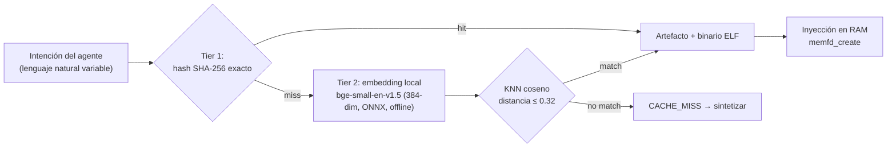

- Umbral `0.32` **calibrado empíricamente** (paráfrasis del mismo intent ~0.28–0.30; intents distintos ≥0.36).
- **Fail-soft total:** sin `sqlite-vec`/embedder, el catálogo opera idéntico al modo solo-hash.

### Persistencia y cómo la lee el agente

La base `~/.local/share/agent-os/artifacts.db` es la **memoria evolutiva** del sistema:

- **Vive fuera del repo** (espacio de usuario, gitignored). Persiste entre sesiones, reinicios
  del MCP (auto-plug) y reboots. Backup = copiar el archivo (un solo fichero ACID, embeddings incluidos).
- **El LLM nunca toca SQL.** La única vía de lectura/escritura son las tools MCP tipadas
  (`artifact_query`, `kanban_board`, …): la capa de tools ES el contrato. Esto erradica
  inyección y alucinación de esquema, y mantiene al agente desacoplado del almacenamiento.
- **Longitudinal:** `execution_metrics` acumula éxito/latencia por artefacto en el tiempo; los
  embeddings permiten recuerdo semántico; el Kanban pondera qué merece reutilizarse.

### Pico-Kanban: ponderación de artefactos (idioma agéntico)

Tablero de estados **abstracto** en la misma DB, transparente para el usuario, que el agente usa
como memoria de trabajo por **tareas atómicas** y para decidir **qué artefacto se promueve** como
plantilla reutilizable. Un artefacto solo se marca `reusable=1` cuando su **ponderación** lo amerita.

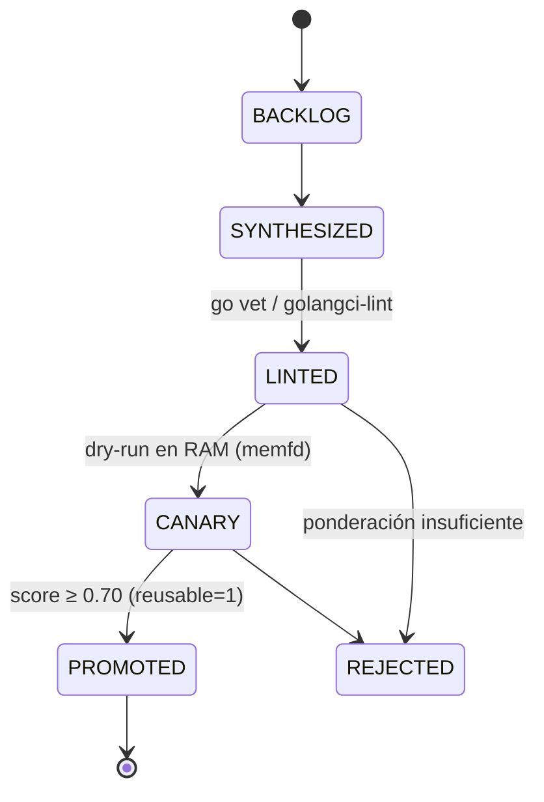

**Ponderación multidimensional consciente de confianza** (adaptada del *trust engine* de
`skill-swarm-mcp` — a su vez inspirado en npms.io / OpenSSF Scorecard / SourceRank):

| Dimensión | Peso | Señal |
| :--- | :---: | :--- |
| `quality` | 0.35 | linters (go vet/golangci) + canary (dry-run en RAM) |
| `reliability` | 0.30 | tasa de éxito histórica |
| `experience` | 0.15 | log-normalizado de ejecuciones (canary da base) |
| `recency` | 0.20 | decaimiento exponencial (half-life 45 días) |

`effective = Σ(dimensión·peso) × confidence`, donde `confidence = dimensiones_con_señal / 4`.
Un artefacto **sin historial** tiene baja confianza aunque su score bruto sea alto → no se promueve a
ciegas. Veredictos: **TRUST ≥ 0.75** (promovido), **CAUTION ≥ 0.50**, **WARNING ≥ 0.25**, **REJECT**.
Un **veto de fiabilidad** impide TRUST si hay fallos demostrados (`éxito < 0.70` con ejecuciones).

### Arquitectura Anti-Deadlock y Concurrencia Hot SQLite

Bajo enjambres de ejecución multi-agente donde múltiples clientes FastMCP interactúan con la base de datos de forma concurrente, una base de datos SQLite en memoria o disco puede sufrir contención y excepciones de bloqueo (`sqlite3.OperationalError: database is locked`). AEP implementa un modelo de aislamiento y despacho concurrente en `engine/db.py`:

- **Desacoplamiento de Bucle de Eventos (Async Offloading)**: Todas las operaciones de base de datos se ejecutan en subprocesos de trabajo dedicados mediante `anyio.to_thread.run_sync()`, garantizando una latencia de bucle de eventos inferior a 1 ms sin bloquear el servidor FastMCP.
- **Conexiones de Solo Lectura Aisladas (`get_ro_connection`)**: Abren la base de datos con flag `mode=ro`. En modo WAL (Write-Ahead Logging), los lectores nunca bloquean a los escritores ni son bloqueados por ellos.
- **Conexiones de Escritura con Autocommit (`get_rw_connection`)**: Operan con `isolation_level=None` para evitar que Python mantenga transacciones diferidas implícitas que causen bloqueos al intentar escalarlas.
- **Transacciones Inmediatas Anti-Deadlock (`transaction_immediate`)**: Utilizan el gestor de contexto `with transaction_immediate(conn):` que emite explícitamente `BEGIN IMMEDIATE`. Esto adquiere el bloqueo de escritura desde el primer milisegundo, serializando las escrituras en memoria y erradicando los deadlocks por carrera entre transacciones concurrentes.
- **Afinación de Rendimiento (PRAGMAs)**: `PRAGMA wal_autocheckpoint=1000`, `PRAGMA busy_timeout=10000` (10 segundos de espera fail-soft antes de error), `PRAGMA mmap_size=268435456` (256 MB mapeados en RAM), `PRAGMA cache_size=-64000` (64 MB de caché caliente) y `PRAGMA synchronous=NORMAL`.

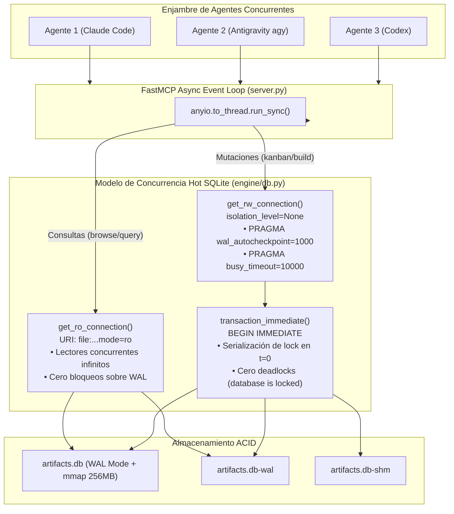

[↑ Volver arriba](#top)

---

## 6. Resiliencia de Base de Datos: Backup en Caliente y Auto-Recuperación (5 Slots)

Para prevenir la pérdida de memoria evolutiva ante caídas abruptas de energía, fallos de kernel o corrupción de base de datos, AEP incorpora en `engine/backup.py` un motor autónomo de copias de seguridad en caliente con rotación en pool FIFO de 5 slots y protocolo de auto-sanación.

```mermaid
flowchart TD
    subgraph Normal["1. Flujo Normal: Streaming en Caliente & Rotación FIFO (5 Slots)"]
        LiveDB["artifacts.db (Hot SQLite)"]
        Stream["conn.backup() (Online Streaming)<br/>• Sin lock exclusivo de lectura<br/>• Advisory lock: fcntl.flock"]
        LiveDB --> Stream
        Stream --> Slot1["artifacts.db.bak.1<br/>(Snapshot más reciente)"]
        Slot1 --> Shift["Rotación FIFO en Cascada<br/>bak.1 ➔ bak.2 ➔ bak.3 ➔ bak.4 ➔ bak.5"]
        Shift --> Trunc["bak.5 anterior eliminado (Pool capped at 5)"]
        Slot1 -.-> SHA["Cálculo y persistencia de Checksum SHA-256"]
    end

    subgraph Recovery["2. Flujo de Resiliencia: Detección de Corrupción y Auto-Sanación"]
        Corrupt{"PRAGMA integrity_check<br/>o cabecera corrupta"}
        Corrupt -->|"Fallo detectado"| Scan["verify_and_auto_recover()<br/>Escanear pool de slots (1 a 5)"]
        Scan --> CheckSlot{"Verificar SHA-256 e integridad SQLite"}
        CheckSlot -->|"Slot válido encontrado"| Restore["Restauración Atómica<br/>• Reemplazar artifacts.db<br/>• Purga estricta de -wal y -shm"]
        Restore --> Healthy["Base de Datos Restaurada e Íntegra ✅"]
    end
```

### Mecánica del Motor de Backup Hot Streaming
- **Online Hot Streaming (`conn.backup()`)**: Realiza copias de seguridad consistentes bloque a bloque en caliente sin detener el servidor FastMCP ni bloquear las operaciones de lectura o escritura de los agentes.
- **Bloqueo Consultivo Anticolisión (`fcntl.flock`)**: Un candado a nivel de sistema operativo (`.backup.lock`) serializa las solicitudes de backup impidiendo colisiones entre múltiples subprocesos o agentes.
- **Pool de Rotación FIFO de 5 Slots**: Mantiene exactamente 5 copias históricas numeradas del 1 al 5 en `~/.local/share/agent-os/backups/`. El slot 1 siempre contiene el snapshot más reciente; los slots existentes se desplazan hacia abajo (`1->2->3->4->5`), y el slot 5 saliente es purgado limpiamente.
- **Integridad Criptográfica por Hash SHA-256**: Cada copia de seguridad se sella con su suma de verificación SHA-256 en un manifiesto persistente `backup_manifest.json` y se valida con `PRAGMA integrity_check`.
- **Restauración Atómica con Purga de Sidecars**: Al restaurar un slot, el motor purga de inmediato los archivos `-wal` y `-shm` existentes. Esto evita divergencias de estado en el log de transacciones y garantiza una base de datos consistente.
- **Auto-Sanación Transparente (`verify_and_auto_recover`)**: Si el servidor detecta una base de datos corrupta o ilegible al iniciar o durante la ejecución, inspecciona secuencialmente los slots del 1 al 5, valida su integridad y auto-restaura el snapshot válido más reciente sin requerir intervención del operador.

### Micro-Snapshots Volátiles en RAM (`create_micro_snapshot`)
- **Latencia Sub-Milisegundo (0.28 ms)**: Inspirado en el snapshotting Copy-on-Write (COW) de microVMs (Firecracker), AEP transmite páginas SQLite directamente en memoria (`:memory:`) mediante la API de streaming de backups. Opera **5.7x más rápido** que el almacenamiento en disco y con **cero huella en disco** (0 archivos temporales).
- **Aislamiento Volátil Efímero**: Permite a subagentes bifurcar tareas o probar hipótesis sin tocar el sistema de archivos ni interferir con la base de datos viva.

### Arquitectura Anti-Poisoning y Cuarentena Forense
- **Canary Tokens de Integridad (`_aep_canary`)**: Validación estricta previa a cualquier rotación de backup. Si un proceso altera o manipula la base de datos viva, la validación aborta la rotación previniendo la contaminación de los 5 slots históricos.
- **Cuarentena Forense Inmediata (`backups/quarantine/`)**: Las bases de datos corruptas o envenenadas se aíslan automáticamente como `artifacts.db.corrupt.<timestamp>` junto con un diagnóstico forense estructurado en formato JSON, manteniendo el pool FIFO inmaculado.

### Comandos de Control CLI (`scripts/aep-ctl backup`)
```bash
# Consultar el estado y slots del pool de copias de seguridad
./scripts/aep-ctl backup status

# Generar un nuevo snapshot en caliente (rotación FIFO automática)
./scripts/aep-ctl backup backup

# Restaurar la base de datos desde un slot específico (por ejemplo, slot 1)
./scripts/aep-ctl backup restore --slot 1

# Ejecutar un micro-snapshot volátil en memoria RAM (sub-milisegundo)
./scripts/aep-ctl backup micro-snapshot

# Verificar integridad profunda y estado de canarios
./scripts/aep-ctl backup verify-integrity
```

[↑ Volver arriba](#top)

---

## 7. Contramedidas de Seguridad, Aislamiento y Auditoría Criptográfica

AEP transmuta primitivas que tradicionalmente pertenecen a la ingeniería de sistemas y auditoría en capacidades agénticas de alta resiliencia. Para asegurar que el propio agente o actores externos no utilicen estas herramientas como vector de compromiso, el sistema implementa una arquitectura de contramedidas de defensa en profundidad en `engine/privilege.py` y `engine/security.py`:

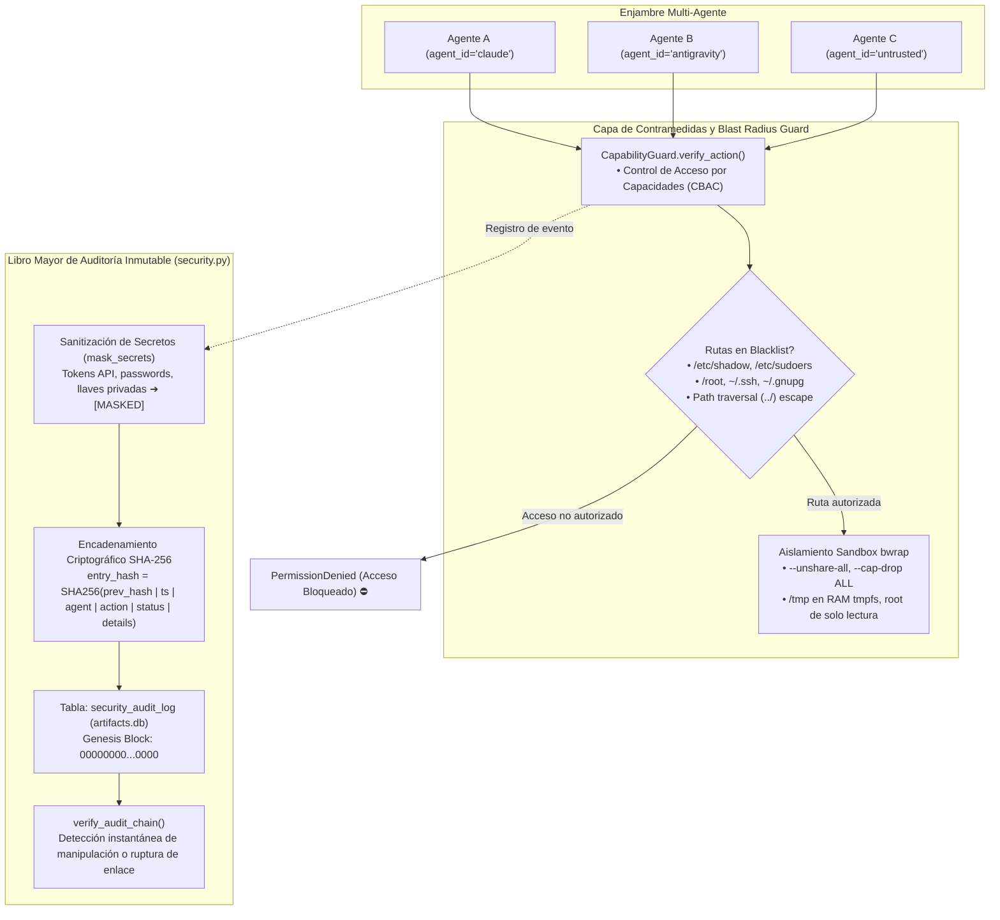

### CapabilityGuard y Blacklist de Rutas Críticas
- **Lista Negra Estricta**: Bloquea de forma categórica cualquier intento de lectura, mutación o ejecución sobre rutas sensibles del sistema:
  - `/etc/shadow`, `/etc/gshadow`, `/etc/sudoers`, `/etc/security`
  - `/root` y subdirectorios de superusuario
  - `~/.ssh` (claves privadas `id_rsa`, `id_ed25519`, `authorized_keys`)
  - `~/.gnupg` (claves de cifrado y firmado PGP)
  - `/proc/kcore`, `/dev/mem`, `/dev/kmem`
- **Inmunidad contra Path Traversal**: Normaliza y resuelve rutas canónicas (`resolve()`), abortando intentos de escape vía `../../` hacia rutas protegidas.
- **Contexto Multi-Agente Segregado**: Cada invocación de herramienta FastMCP recibe el identificador `agent_id` del agente solicitante (`agent_id: str = "default"`), permitiendo auditar y aislar acciones en enjambres concurrentes sin interferencia cruzada.

### Cadena de Auditoría Tamper-Evident SHA-256
- **Libro Mayor Criptográficamente Encadenado**: La tabla `security_audit_log` almacena cada acción sensible ejecutada en el sistema enlazada al hash del bloque previo (`prev_hash`), comenzando desde un bloque génesis de ceros (`GENESIS_HASH`).
- **Sanitización Automática de Secretos (`mask_secrets`)**: Tokens de autorización Bearer, credenciales, contraseñas y llaves de API son ofuscados (`[MASKED]`) antes de persistir los detalles o calcular el hash criptográfico.
- **Verificación de Cero Confianza (`verify_audit_chain`)**: Algoritmo determinista que recalcula secuencialmente los hashes de la cadena. Si un atacante o proceso manipula una sola fila de la base de datos SQLite, la verificación reporta de inmediato la discrepancia y el identificador de fila afectado.

```bash
# Auditar y certificar la integridad criptográfica de la cadena de seguridad
./scripts/aep-ctl audit verify
```

### Sandboxing In-Process con Landlock LSM (`engine/landlock.py`)
- **Aislamiento en Espacio de Usuario a Nivel de Kernel**: Utiliza el Módulo de Seguridad de Linux (Landlock LSM, Linux 5.13+) invocado mediante `ctypes` puros (`SYS_landlock_create_ruleset=444`, `SYS_landlock_add_rule=445`, `SYS_landlock_restrict_self=446`) y `prctl(PR_SET_NO_NEW_PRIVS, 1)`.
- **Cero Dependencias C Externas**: No requiere librerías compartidas (`liblandlock`). Confinamiento a nivel de hilo/proceso en menos de **4.2 ms**, con detección automática de versión de ABI (ABI v8 soportado en kernel Ubuntu).
- **Sonda Estática en Go (`diagnostic/go/landlock-guard`)**: Herramienta de diagnóstico compilada estáticamente (`CGO_ENABLED=0`) con la librería estándar de Go (`syscall.Syscall6`) para verificar el confinamiento del kernel de forma hermética y reproducible.

### Observabilidad de Seguridad con eBPF (`kernel_trace`)
- **Detección Activa de Intrusiones**: Integra modos de vigilancia basados en tracepoints eBPF (inspirados en Tetragon y Falco) para detectar intentos de acceso a descriptores protegidos o apertura de ficheros en lista negra (`security_open_denials`, `security_landlock_audit`, `security_exec_monitor`).

```bash
# Consultar el estado del LSM Landlock y versión de ABI
./scripts/aep-ctl security landlock-status
```

[↑ Volver arriba](#top)

---

## 8. Mejoras de Omarchy (5 Specs Agnósticas)

Las innovaciones del "Agentic OS" de Omarchy (acopladas a Arch/Hyprland) descompuestas en 5
especificaciones **distro-agnósticas** sobre Ubuntu.

```mermaid
flowchart TD
    subgraph OM["Omarchy (Arch/Hyprland) → specs agnósticas"]
        S1["OM-1 · aep_ctl<br/>Plano de control unificado (JSON)"]
        S2["OM-2 · diagnose_system_crashes(action=\"alerts\")<br/>Crash routing proactivo (polling)"]
        S3["OM-3 · Skills Hub<br/>symlinks Claude/agy/Codex/Gemini"]
        S4["OM-4 · query_system_docs<br/>man-pages vectorizadas (sqlite-vec)"]
        S5["OM-5 · visual_inspect<br/>display headless (Playwright /dev/shm)"]
    end
    S1 & S2 & S3 & S4 & S5 --> V["Cero co-dependencias (Topos)<br/>· fail-soft · salida JSON tipada"]
```

### Matriz de Especificaciones Agnósticas de Omarchy

| Especificación | Nombre & Enfoque | Componente AEP | Mecánica Subyacente | Desacoplamiento de Omarchy (Ubuntu) | Garantía Fail-Soft |
| :--- | :--- | :--- | :--- | :--- | :--- |
| **SPEC-OM-1** | **Unified System Control Plane** | `aep_ctl`<br/>`scripts/aep-ctl` | Enrutador CLI determinista hacia `systemctl`, `ip`, `ss`, `df`, `dpkg` con validación de esquemas JSON. | Sustituye comandos de Arch (`pacman`, scripts bash ad-hoc) por utilidades POSIX universales de Ubuntu/Debian. | Peticiones inválidas retornan JSON con `exit_code: 1` y documentación de uso (`--schema`). Binarios faltantes emiten `DEGRADED`. |
| **SPEC-OM-2** | **Active Crash Routing & Proactive Self-Healing** | `diagnose_system_crashes(action="alerts")`<br/>*(alias `check_crash_alerts`)* | Polling periódico que calcula huellas hash (`pid:time:exe`) de coredumps y persiste eventos en `crash_events`. | Elimina la dependencia de path units de systemd o servicios en segundo plano con permisos de root en Arch. | Si `coredumpctl` falta (contenedores), retorna `status: "DEGRADED"` sin interrumpir la ejecución del agente. |
| **SPEC-OM-3** | **Universal Multi-Agent Skills Hub** | Granja de symlinks<br/>`scripts/setup.sh` | Enlace simbólico convergente desde `~/.agents/skills/` hacia los directorios de Claude, Antigravity, Codex y Gemini. | Desacopla las habilidades del entorno Hyprland/Arch, permitiendo sincronización universal multi-agente en Ubuntu. | Enlace idempotente; si un agente no está instalado en el host, la rutina continúa sin arrojar errores. |
| **SPEC-OM-4** | **Local System Docs Vectorizer** | `query_system_docs`<br/>`engine/docs_vectorizer.py` | Base vectorial local `system_docs.db` con `sqlite-vec` y embeddings en CPU (`bge-small-en-v1.5`) sobre páginas `man`. | Reemplaza bases ChromaDB pesadas y llamadas a APIs de LLMs por inferencia ONNX offline en submilisegundos. | Carga perezosa; si el motor vectorial o el modelo faltan, entrega respuesta estructurada degradada sin excepciones. |
| **SPEC-OM-5** | **Headless Visual & Display Actuator** | `visual_inspect`<br/>`engine/headless_display.py` | Automatización de navegador Chromium headless vía Playwright con capturas efímeras en RAM (`/dev/shm`). | Elimina la necesidad de compositor Wayland/Hyprland o servidores X11 físicos (`Xvfb`) para auditoría de interfaces. | Si Playwright o Chromium no están instalados, emite `DISPLAY_UNAVAILABLE` con la receta exacta para su resolución. |

---

#### Especificaciones Técnicas Detalladas (SPEC-OM-1 a SPEC-OM-5)

#### 1. SPEC-OM-1: Unified System Control Plane (`aep_ctl` / `scripts/aep-ctl`)
- **Objetivo**: Proveer un punto de entrada CLI y RPC determinista para que los modelos de lenguaje inspeccionen y muten el estado del sistema operativo sin alucinar flags ni parsear salidas de texto no estructuradas.
- **Dominios Funcionales**:
  - `service`: Inspecciona estado (`status`) o muta unidades (`start`, `stop`, `restart`). En modo `DIMINISHED` se acota automáticamente a `systemctl --user`; en `FULL` ejecuta `sudo -n systemctl`.
  - `network`: Inspección general de interfaces (`inspect` vía `ip -j addr`), tabla de enrutamiento (`routes` vía `ip -j route`) y sockets en escucha (`listeners` parseando `ss -tuln` en JSON).
  - `storage`: Uso de particiones (`usage` parseando `df -B1`), puntos de montaje activos (`mounts`) y topología de discos (`disks` vía `lsblk -J`).
  - `package`: Paquetes instalados (`installed` vía `dpkg-query`), comprobación de presencia (`check`) e información de versión y dependencias (`info` vía `apt-cache policy`).
- **Garantías**: Cero salida interactiva (suprime pagers), autodocumentación con `--schema` que retorna el contrato de cada dominio, y código de salida 1 con JSON de uso cuando faltan argumentos.

#### 2. SPEC-OM-2: Active Crash Routing & Proactive Self-Healing (`diagnose_system_crashes(action="alerts")` / `check_crash_alerts`)
- **Objetivo**: Transformar el análisis forense pasivo de coredumps en un lazo proactivo de alerta temprana para prevenir que el agente construya sobre un sistema inestable.
- **Mecánica de Sincronización**:
  1. Ejecuta `coredumpctl list --json=short --reverse -n 100` de forma no-invasiva.
  2. Extrae para cada entrada el PID, timestamp del suceso y ruta del binario colapsado, componiendo una huella única digital `pid:timestamp:executable`.
  3. Ejecuta una sentencia atómica `INSERT OR IGNORE` en la tabla `crash_events` de `artifacts.db`.
  4. Retorna exclusivamente las alertas no resueltas (`resolved = 0`), permitiendo al agente invocar `diagnose_system_crashes()` para obtener el stack trace y planificar la remediación antes de seguir ejecutando tareas.
- **Desacoplamiento**: A diferencia de Omarchy que dependía de scripts específicos para el gestor de ventanas de Arch, opera puramente en espacio de usuario sobre cualquier distribución Ubuntu/Debian con systemd.

#### 3. SPEC-OM-3: Universal Multi-Agent Skills Hub
- **Objetivo**: Consolidar las habilidades y herramientas agénticas en una única fuente de la verdad canónica (`~/.agents/skills/`), eliminando discrepancias entre los entornos de ejecución de distintos agentes.
- **Arquitectura de Enlaces Simbólicos**:
  - Directorio Canónico: `~/.agents/skills/` (leído de forma nativa por OpenAI Codex).
  - Enlace Gemini CLI: `~/.gemini/skills/` -> `~/.agents/skills/`.
  - Enlace Antigravity (`agy`): `~/.gemini/config/skills/` -> `~/.agents/skills/`.
  - Enlace Migración Antigravity: `~/.gemini/antigravity-cli/skills/` -> `~/.agents/skills/`.
- **Garantías de Mantenimiento**: Las modificaciones efectuadas en una habilidad por cualquier subagente se reflejan en tiempo real para todos los clientes sin necesidad de sincronizaciones manuales o copias redundantes.

#### 4. SPEC-OM-4: Local System Docs Vectorizer (`query_system_docs`)
- **Objetivo**: Resolver en tiempo real dudas sobre la sintaxis exacta, banderas y opciones de configuración de utilidades Linux estándar sin requerir conexión a internet ni incurrir en consumo excesivo de tokens de contexto.
- **Pipeline de Ingesta y Recuperación**:
  - **Ingesta**: Ejecuta `man <cmd>` configurando `MANPAGER=cat` y `MANWIDTH=80` para extraer texto plano limpio. Divide el manual en bloques de párrafo coherentes (máximo 50 fragmentos por comando).
  - **Vectorización Local**: Calcula embeddings semánticos de 384 dimensiones mediante el modelo cuantizado `bge-small-en-v1.5` ejecutado sobre CPU con ONNX Runtime.
  - **Almacenamiento**: Persiste los fragmentos y sus vectores en `~/.local/share/agent-os/system_docs.db` utilizando la tabla virtual `vec_docs` de `sqlite-vec`.
  - **Consulta**: La función `query_system_docs(query, limit)` vectoriza la consulta del agente y ejecuta búsqueda por distancia de coseno, devolviendo los párrafos más relevantes en menos de 5 ms.

#### 5. SPEC-OM-5: Headless Visual & Display Actuator (`visual_inspect`)
- **Objetivo**: Dotar a los agentes de capacidades de inspección visual en entornos de servidor o instancias cloud privadas de monitor físico, permitiendo auditar dashboards, aplicaciones web o documentación generada localmente.
- **Ciclo de Vida de Captura en RAM**:
  1. Instancia el navegador Chromium sin cabeza mediante Playwright (`headless=True`, flags `--no-sandbox`).
  2. Carga la URL indicada (`http://`, `https://` o `file://` local) configurando el viewport solicitado (por defecto 1280x800).
  3. Espera el evento de ciclo de vida `load` de la página. Si se proporciona un selector CSS, aísla el elemento correspondiente.
  4. Vuelca la captura gráfica directamente en memoria compartida volátil `/dev/shm/aep_shot_<uuid>.png`.
  5. Codifica los bytes del archivo en una cadena Base64, computa la latencia y elimina inmediatamente el archivo temporal de RAM (`/dev/shm`), garantizando cero persistencia en almacenamiento secundario.

---

### Arquitectura y Flujo de Datos de las Mejoras Omarchy

El siguiente diagrama detalla la arquitectura en tres niveles que articula las herramientas de Omarchy con los motores de AEP y las primitivas subyacentes del sistema operativo Ubuntu:

```mermaid
flowchart TD
    subgraph Agents["Capa de Agentes & Tools MCP"]
        T1["aep_ctl(domain, action)"]
        T2["diagnose_system_crashes(action=\"alerts\"|\"diagnose\")"]
        T3["Universal Skills Hub (Multi-Agent Registry)"]
        T4["query_system_docs(query, limit)"]
        T5["visual_inspect(url, viewport)"]
    end

    subgraph Adapters["Capa de Adaptadores & Motores AEP"]
        A1["scripts/aep-ctl<br/>(CLI determinista con contratos --schema)"]
        A2["engine/crash_router.py<br/>(De-duplicación por huella pid:time:exe)"]
        A3["scripts/setup.sh & aep-sync.sh<br/>(Gestor de symlinks convergentes)"]
        A4["engine/docs_vectorizer.py<br/>(Chunking de man + Embeddings ONNX CPU)"]
        A5["engine/headless_display.py<br/>(Playwright Chromium headless)"]
    end

    subgraph OS["Capa de Primitivas Ubuntu / Kernel Linux"]
        OS1["systemctl --user / sudo -n systemctl<br/>ss · ip · df · dpkg-query"]
        OS2["systemd-coredump · journalctl -p err<br/>SQLite: crash_events (~/.local/share/agent-os/artifacts.db)"]
        OS3["Granja de enlaces (~/.agents/skills)<br/>Claude · Antigravity · Codex · Gemini"]
        OS4["man pages (MANPAGER=cat)<br/>SQLite: vec_docs (~/.local/share/agent-os/system_docs.db)"]
        OS5["Buffers volátiles en RAM (/dev/shm)<br/>Capturas base64 efímeras (cero I/O en disco)"]
    end

    T1 --> A1 --> OS1
    T2 --> A2 --> OS2
    T3 --> A3 --> OS3
    T4 --> A4 --> OS4
    T5 --> A5 --> OS5
```

[↑ Volver arriba](#top)

---

## 9. Modelo de Privilegio de Dos Niveles + Manifiesto

Las tools privilegiadas operan en dos niveles (least-privilege por defecto). `aep_capabilities()`
devuelve un **manifiesto auto-descriptivo estilo `chmod`/777** para que la IA consumidora entienda,
en primera vista, qué puede hacer **ahora**.

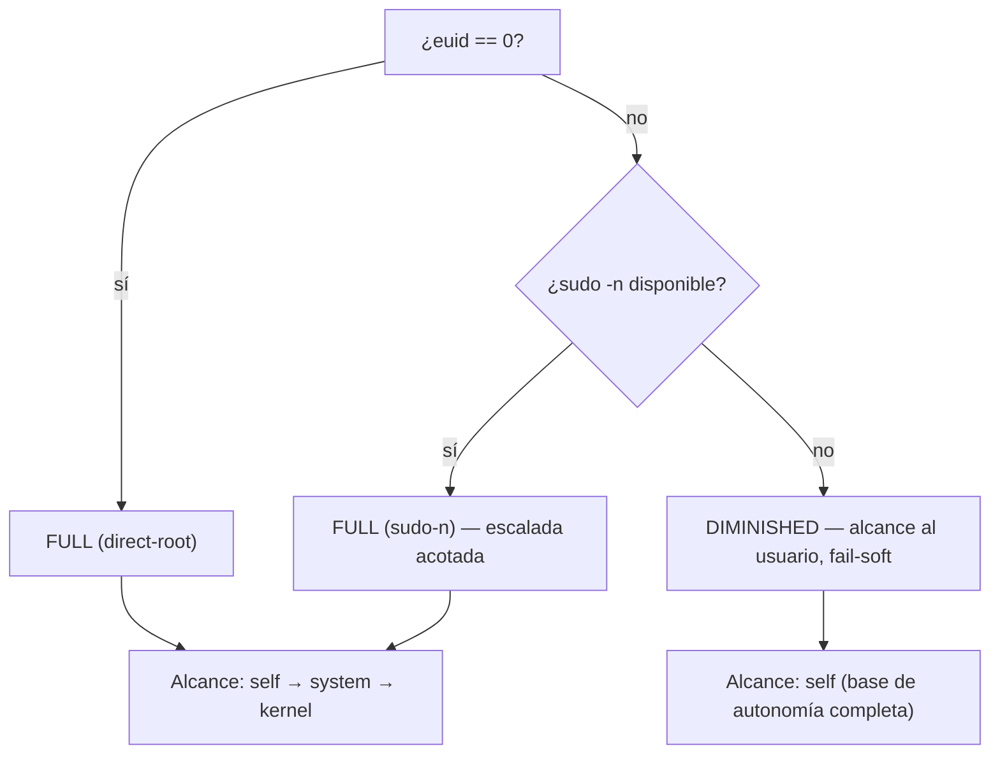

**Códigos de capacidad** (tríada rwx resignificada): `r`=SENSAR, `w`=ACTUAR, `x`=EJECUTAR por caminos no-tradicionales.

| octal | perm | significado |
| :---: | :---: | :--- |
| 7 | `rwx` | sensar + actuar + ejecutar |
| 6 | `rw-` | sensar + actuar |
| 5 | `r-x` | sensar + ejecutar |
| 4 | `r--` | solo sensar |
| 0 | `---` | sin acceso (requiere FULL) |

> La autonomía base opera completa en **DIMINISHED**; el nivel **FULL** solo ensancha
> `kernel_observability` (`0→4`) y `service_control` (`4→6`). El privilegio es **apertura, no prerequisito**.

[↑ Volver arriba](#top)

---

## 10. Auto-Plug: Autogestión Atómica del MCP

Tras cualquier cambio, `aep-sync.sh` **valida** (compila + importa el server) y **solo si pasa**
re-registra el MCP en todos los clientes, apuntando a un launcher estable que resuelve el intérprete
por sí mismo. Un hook `pre-commit` corre la misma validación.

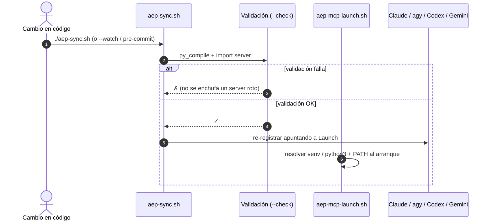

[↑ Volver arriba](#top)

---

## 11. Entorno Shell-Agnóstico

La herencia de entorno **no asume Oh My Zsh**. Un archivo POSIX único se hace `source` desde los rc
nativos. Probado en **bash, zsh y dash**.

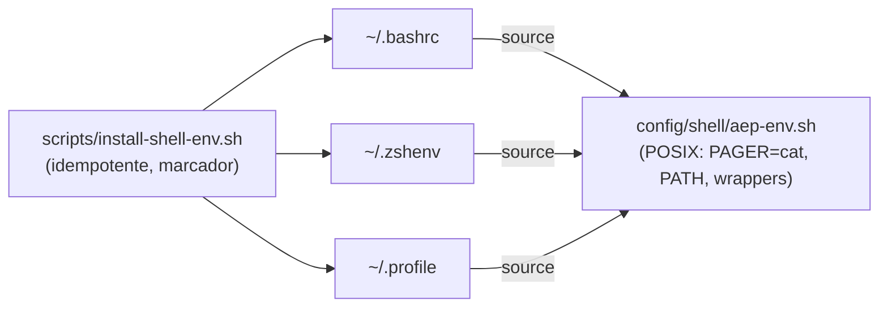

[↑ Volver arriba](#top)

---

## 12. Instalación desde Cero, Auditoría y Actualizador Autónomo

AEP incorpora un motor de ciclo de vida unificado en `scripts/setup.sh` que opera como bootstrapper
cero-dependencias, actualizador continuo y auditor de salud no destructivo.

### 10.1 Modos de Invocación CLI

```bash
cd /ruta/a/agent-execution-plane

# 1. Modo Instalación Completa (Idempotente, espacio de usuario)
./scripts/setup.sh

# 2. Modo Auditoría de Salud Read-Only (DIR-ONT-01: cero mutaciones en disco, exit 0/1)
./scripts/setup.sh --check

# 3. Modo Actualizador (uv self update, actualización de dependencias y recompilación)
./scripts/setup.sh --update
```

### 10.2 Arquitectura del Bootstrapper Autónomo


### 12.3 Baseline Python 3.14 Production LTS
- **Aislamiento Hermético**: Gestionado mediante `uv` (`uv python install 3.14`), desacoplado completamente del Python del sistema operativo host (PEP 668 compliant, estrictamente sin `--system-site-packages`).
- **Primitivas Modernas**: Evaluación diferida de anotaciones de tipo (PEP 649), especialización JIT del intérprete y soporte nativo para arquitecturas concurrentes.
- **Suite de Pruebas Automatizada**: `tests/test_setup_idempotency.sh` y `tests/test_engine_suite.py` validan la idempotencia de ejecuciones consecutivas, la integridad del entorno Python 3.14, las sondas Go y el motor de resiliencia.

[↑ Volver arriba](#top)

---

## 13. Estructura del Repositorio

```
agent-execution-plane/
├── server.py                       # Servidor FastMCP (15 tools RPC, 18 capacidades)
├── engine/
│   ├── db.py                       # Conexiones SQLite WAL, BEGIN IMMEDIATE, anti-deadlock
│   ├── backup.py                   # Motor de backup hot streaming, 5 slots FIFO, auto-recuperación
│   ├── security.py                 # Libro mayor criptográfico SHA-256 (security_audit_log) & secret masking
│   ├── privilege.py                # CapabilityGuard, CBAC, blacklist de rutas, FULL/DIMINISHED
│   ├── catalog.py                  # Catálogo de artefactos + memoria semántica híbrida (sqlite-vec)
│   ├── embedder.py                 # Embedder local ONNX CPU (bge-small-en-v1.5)
│   ├── kanban.py                   # Tablero Pico-Kanban multidimensional con vetos
│   ├── ponder.py                   # Motor de confianza y ponderación multidimensional
│   ├── matcher.py                  # Motor de relevancia léxica BM25F multi-señal
│   ├── hydrator.py                 # Hidratador de plantillas Go con parámetros
│   ├── topos_guard.py              # Guardián Topos anti-codependencia (DAG)
│   ├── crash_router.py             # Enrutamiento proactivo de coredumps (OM-2)
│   ├── docs_vectorizer.py          # Vectorizador de páginas man de Ubuntu (OM-4)
│   └── headless_display.py         # Captura visual headless Playwright en RAM (OM-5)
├── diagnostic/go/
│   ├── socket-monitor/main.go      # Sonda estática ELF en Go para /proc/net/tcp
│   └── fd-rescuer/main.go          # Sonda estática ELF en Go para /proc/PID/fd
├── tests/
│   ├── test_setup_idempotency.sh   # Suite de pruebas automatizada de aprovisionamiento
│   └── test_engine_suite.py        # Suite de pruebas unitarias/integración (pytest)
├── schemas/
│   ├── database.sql                # DDL (artifacts, metrics, crash_events, audit)
│   └── artifact_contract.cue       # Contratos declarativos CUE
├── templates/                      # Sondas atómicas Go de catálogo
├── config/shell/aep-env.sh         # Herencia de entorno POSIX agnóstica (bash/zsh/dash)
├── scripts/
│   ├── setup.sh                    # Bootstrapper, updater y health auditor (--check)
│   ├── aep-ctl                     # CLI determinista (service, network, storage, package, backup, audit)
│   ├── aep-mcp-launch.sh           # Launcher estable con resolución hermética de venv
│   ├── aep-sync.sh                 # Sincronización atómica MCP multi-agente
│   ├── install-shell-env.sh        # Instalador de herencia de shell
│   └── hooks/pre-commit            # Hook de validación pre-commit
├── .gitattributes · .gitignore
├── pyproject.toml                  # Configuración Python 3.14, ruff py314, dependencias
└── README.md                       # Fuente única de verdad (este archivo)
```

[↑ Volver arriba](#top)

---

## 14. Inventario Sincero de la Fuente de la Verdad

| Componente | Estado Físico Real | Nota |
| :--- | :--- | :--- |
| `memfd_create` (RAM exec) | ✅ Operativo | Primitiva estándar del kernel Linux (glibc 2.27+ / POSIX); staging en memoria anónima (cero I/O en disco) |
| `bwrap` (sandbox) | ✅ Operativo | `sandbox_run`: aislamiento en namespaces con `--unshare-all` y `--cap-drop ALL` |
| `bpftrace` (eBPF) | ✅ Operativo (FULL) | `kernel_trace`; escala vía `sudo -n`, degrada a DIMINISHED |
| Pueue (async) | ✅ Operativo | musl 4.0.4 en `~/.local/bin`, verificado end-to-end |
| Memoria semántica (`sqlite-vec`) | ✅ Operativo | Recuperación híbrida 2-tier (hash + kNN coseno), fail-soft |
| Concurrencia Hot SQLite Anti-Deadlock | ✅ Operativo | `engine/db.py`: `get_ro_connection` (`mode=ro`), `get_rw_connection`, `transaction_immediate` (`BEGIN IMMEDIATE`) |
| Resiliencia de BD (backup 5 slots) | ✅ Operativo | `engine/backup.py`: streaming hot backup `conn.backup()`, rotación 5 slots FIFO, SHA-256 y auto-sanación ante corrupción |
| Contramedidas & Auditoría Criptográfica | ✅ Operativo | `engine/security.py`, `privilege.py`: `CapabilityGuard`, blacklist sensible, libro mayor inmutable encadenado por SHA-256 |
| Landlock LSM in-process | ✅ Operativo | `engine/landlock.py` (ctypes 444/445/446 + `PR_SET_NO_NEW_PRIVS`), ABI v8, sonda Go `landlock-guard` |
| Anti-poisoning + micro-snapshots RAM | ✅ Operativo | `engine/backup.py`: canary `_aep_canary`, cuarentena forense, snapshot `:memory:` 0.28 ms |
| Python 3.14 Production LTS | ✅ Operativo | Venv hermético sin `--system-site-packages` vía `uv`, target `py314` en Ruff |
| Sondas Go Estáticas ELF | ✅ Operativo | Binarios estáticos `socket-monitor` y `fd-rescuer` compilados con `CGO_ENABLED=0` ejecutables en RAM vía `memfd` |
| Pico-Kanban (ponderación) | ✅ Operativo | Tablero abstracto en `artifacts.db`; promueve artefactos a `reusable` por score |
| Pico-Playbooks (automatización) | ✅ Operativo | Orquesta tools/artefactos en flujos DAG validados por Topos; ejecución E2E y ponderación por éxito |
| Descubrimiento del catálogo | ✅ Operativo | `artifact_catalog`: browse por confianza + top-K semántico |
| Omarchy (5 specs) | ✅ Operativo | `aep_ctl` (6 dominios), crash routing, hub+Gemini, man-pages, headless |
| Privilegio FULL/DIMINISHED | ✅ Operativo | `privilege.py` + manifiesto `aep_capabilities` (18 capacidades) |
| Auto-plug MCP | ✅ Operativo | launcher + `aep-sync.sh` (+ `--watch` + Connect-RPC) |
| Herencia shell agnóstica | ✅ Operativo | bash/zsh/dash; sin Oh My Zsh |
| Nushell (`nu`) / `jc` | ⏳ Pendiente (no crítico) | `aep_ctl` ya entrega JSON tipado |

[↑ Volver arriba](#top)

---

## 15. RE as SDD y Matriz de Inspiración

El desarrollo de AEP aplica Ingeniería Inversa Orientada por Especificaciones (RE as SDD) para
desacoplar primitivas del kernel de dependencias complejas o implementaciones monolíticas:
**(1)** aislar la primitiva del kernel Linux, **(2)** formalizar su especificación agnóstica de plataforma,
y **(3)** construir una implementación minimalista, tipada y verificada end-to-end.

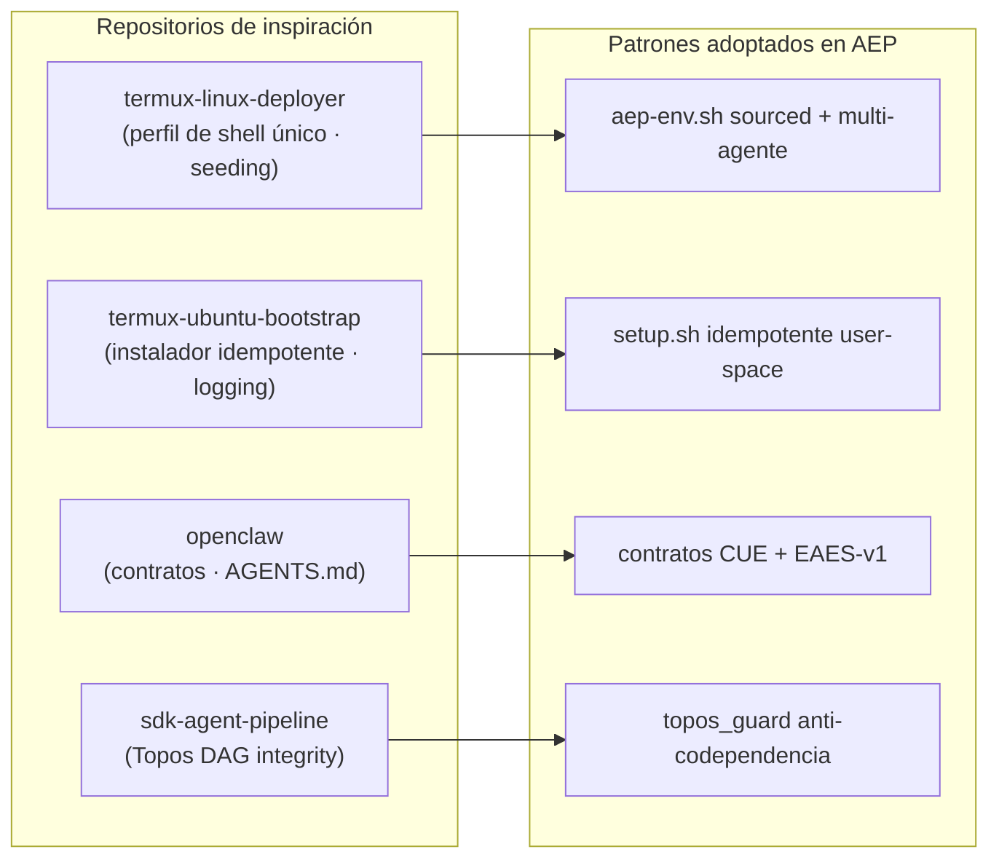

> Este `README.md` es la **fuente única de verdad** del proyecto: toda la especificación,
> arquitectura y auditoría viven aquí, sin documentación dispersa.

[↑ Volver arriba](#top)
