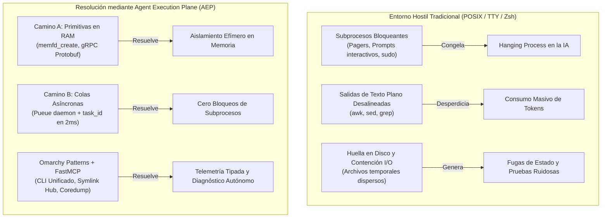
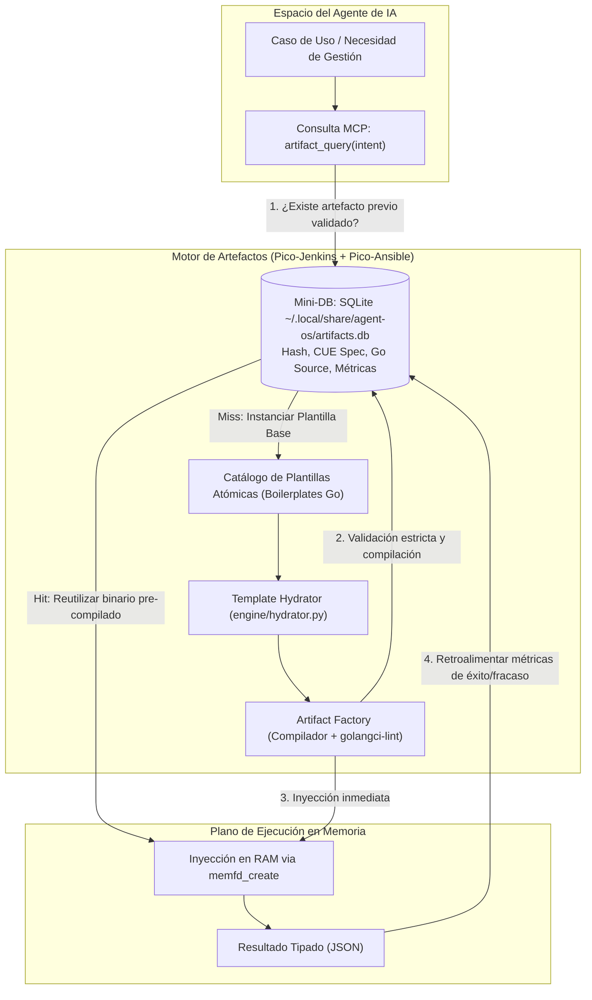
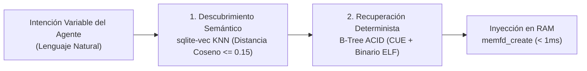
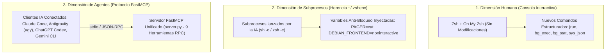
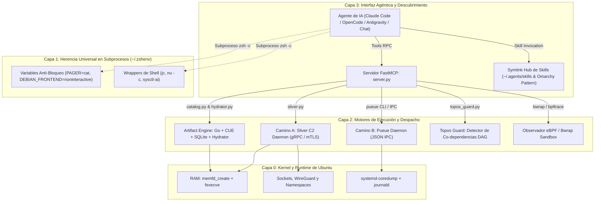
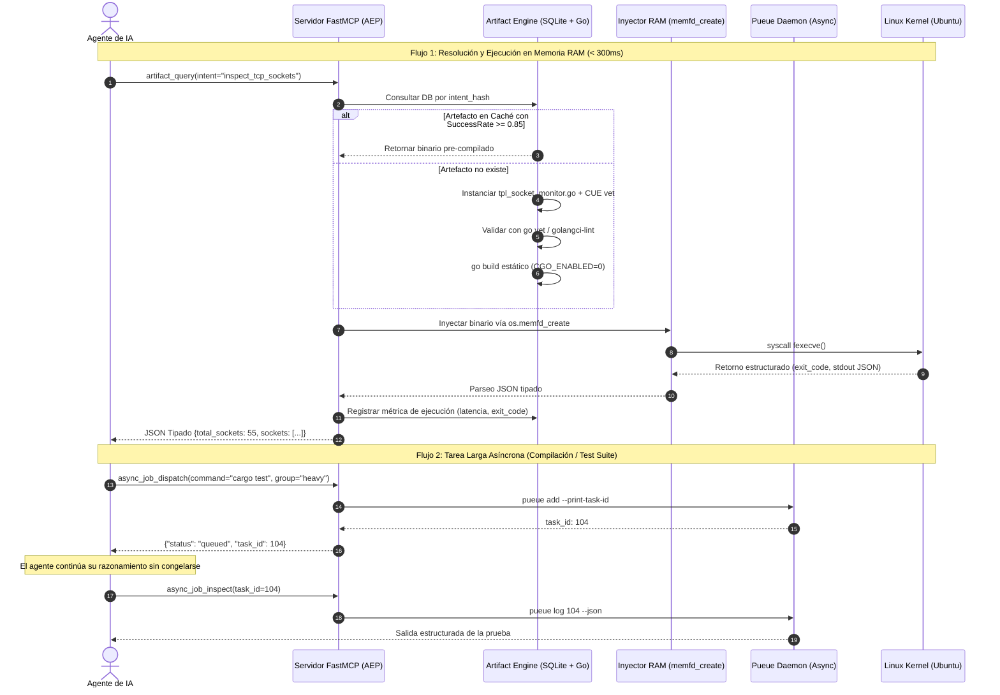
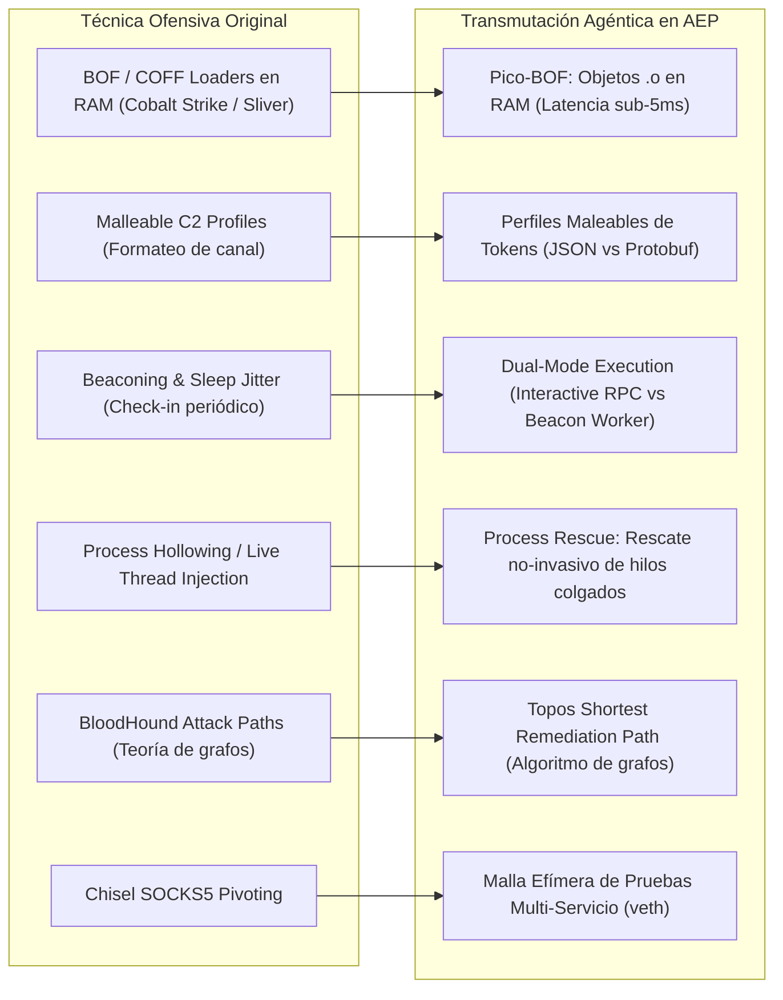

# Agent Execution Plane (AEP)
**Plano de Control de Sistema y Suite de Ejecución de Alta Resiliencia para Agentes de IA en Ubuntu**

> [!IMPORTANT]
> **Declaración de Premisa y Propósito (Anti-Malware / De-weaponization)**  
> Este proyecto **NO** es un framework de ciberseguridad ofensiva ni una herramienta de *Red Teaming*.  
> Es una **suite de ingeniería de sistemas y runtime agéntico** que aplica **Ingeniería Inversa (RE) orientada por Especificaciones (SDD)** sobre las primitivas de bajo nivel desarrolladas históricamente por frameworks C2 y herramientas de introspección de kernel, transformándolas en un plano de ejecución no-bloqueante, estructurado y asíncrono para Modelos de Lenguaje (LLMs) y agentes autónomos.

---

## 1. Fundamentos e Inferencias Arquitectónicas

La arquitectura de **Agent Execution Plane (AEP)** nace de resolver la brecha de impedancia entre los sistemas operativos contemporáneos (diseñados para la interacción visual humana) y los agentes de IA (que operan mediante subprocesos autónomos y ventanas de contexto finitas).



### 1.1. El Isomorfismo Arquitectónico: El Operador C2 y el Agente de IA
Los frameworks de Command & Control (C2) como *Sliver*, *Mythic* o *Beacon* no fueron concebidos para la destrucción; fueron diseñados para **operar bajo condiciones extremas de hostilidad e invisibilidad de interfaz**:
* Cero interacción humana en la consola remota.
* Tolerancia cero a procesos colgados (*hanging processes*).
* Comunicación asíncrona serializada con consumo mínimo de canal.
* Ejecución quirúrgica en memoria RAM sin dejar residuos en disco.

Para un Agente de IA, la consola Unix tradicional (Zsh/Bash) representa exactamente el mismo entorno hostil. Al remover las técnicas de evasión de EDR y apropiarse del motor de ejecución y transporte, la IA recibe una arquitectura de control de sistemas que resuelve medio siglo de supuestos interactivos obsoletos.

### 1.2. El Salto Cuántico en las Baterías de Pruebas y Pipelines
La integración de este plano transforma radicalmente la autonomía de los pipelines de verificación:
* **Pruebas en RAM Efímeras (`memfd_create`):** El agente compila binarios de prueba, los inyecta en descriptores de memoria anónimos del kernel de Linux, ejecuta la validación y destruye la prueba sin escribir un solo byte en almacenamiento físico.
* **Aserciones Deterministas Tipadas:** Se reemplaza el frágil parsing de texto por esquemas de datos Protobuf y JSON (`connection.state == "ESTABLISHED"`).
* **Paralelismo Seguro sin Contención:** Despacho de tareas concurrentes a través de colas dedicadas de **Pueue**, obteniendo identificadores inmediatos y desacoplando el tiempo de compilación o ejecución del ciclo de razonamiento del LLM.
* **Depuración Post-Mortem Automática:** Si un binario o test genera un fallo de segmentación (`SIGSEGV`), la captura de `systemd-coredump` entrega el *stacktrace*, registro de CPU e instrucción exacta directamente en JSON para remediación inmediata.

### 1.3. La Maleabilidad del Artefacto: *"Ya no leemos el código, solo tenemos un artefacto"*
En el desarrollo agéntico moderno, el código intermedio es transitorio. El agente no necesita que un humano configure de antemano herramientas de observabilidad complejas: el agente puede sintetizar en segundos una sonda en Go o C, inyectarla en memoria, capturar la telemetría viva del sistema y descartar la sonda. El verdadero entregable es el artefacto funcional verificado contra el estado real del sistema.

### 1.4. Romper el Nicho: De la Ciberseguridad a la Ultra-Resiliencia
El software ofensivo avanzado ha estado históricamente adelantado a la administración de sistemas tradicional en manejo de concurrencia y manipulación de memoria. Desmilitarizar estas primitivas convierte a Ubuntu en un **Agentic OS** de alta resiliencia.

---

## 2. Tecnologías Faltantes Incorporadas mediante Reverse Engineering (RE as SDD)

Para completar el ecosistema e ir más allá de la propuesta inicial de Sliver y Pueue, identificamos cinco tecnologías y primitivas de bajo nivel catalogadas habitualmente como "superficies de ataque", que transformamos mediante **Ingeniería Inversa Orientada por Especificaciones (SDD)**:

```mermaid
flowchart LR
    subgraph OffensiveNiche["Superficie / Nicho Ofensivo"]
        T1["eBPF Rootkits y Packet Sniffers"]
        T2["Sandbox Escapes / Namespace Tampering"]
        T3["C2 SOCKS5 / Lateral Movement Pivots"]
        T4["Process Memory Dumping / ptrace Injection"]
        T5["Exploit Crash Triage / Crash Mining"]
    end

    subgraph RE_SDD["Transmutación mediante RE as SDD"]
        R1["blueprint.md + Contratos Estructurados"]
        R2["Extracción Agnóstica de Primitivas"]
    end

    subgraph AgenticSuite["Capacidad Agéntica en AEP"]
        A1["eBPF Telemetry: Observabilidad Kernel sin overhead"]
        A2["Bwrap / Namespaces: Sandbox Efímero en milisegundos"]
        A3["Chisel / Ephemeral SOCKS5: Simulación de topologías"]
        A4["procfs / fd Introspection: Diagnóstico de hilos colgados"]
        A5["Libunwind / GDB Batch: RCA instantáneo de fallos"]
    end

    OffensiveNiche --> RE_SDD --> AgenticSuite
```



| Tecnología Original | Clasificación Tradicional | Transmutación Agéntica (AEP) | Utilidad para la IA y Pipelines |
| :--- | :--- | :--- | :--- |
| **eBPF (`bpftrace` / BCC)** | Rootkits en kernel, evasión de red. | **Observabilidad de Kernel No-Invasiva** | Telemetría en tiempo real de apertura de archivos, latencia de sockets y llamadas al sistema sin tocar el código fuente. |
| **Bubblewrap (`bwrap`)** | Primitiva de aislamiento / jailbreak. | **Sandbox Efímero de Sub-Milisegundo** | Ejecución de scripts o código experimental no confiable sin la sobrecarga del demonio Docker. |
| **Chisel / Gost** | Túneles y pivoting de redes corporativas. | **Multiplexación de Red Local Efímera** | Levantamiento de puertos, proxies e interconexión temporal de servicios para pruebas de integración de microservicios. |
| **`ptrace` + `/proc/$PID/fd`** | Inyección de procesos, lectura de memoria. | **Introspección y Rescate de Procesos** | Inspección de descriptores de archivo de subprocesos colgados y diagnóstico de deadlocks en tiempo real. |
| **`coredumpctl` + `libunwind`** | Desarrollo de exploits y crash triage. | **Root Cause Analysis (RCA) Autónomo** | Conversión inmediata de volcados de memoria en contexto de corrección para el agente. |

---

## 3. Evolutionary Artifact Engine (El "Pico-Jenkins" + "Pico-Ansible" para IA)

> [!TIP]
> **Especificación Formal:** Consulta [spec_artifact_engine.md](file:///home/ancruz/Documents/workspaces/agent-execution-plane/docs/spec_artifact_engine.md) para la definición canónica de **EAES-v1**.

Para superar la alucinación producida por soluciones tradicionales, AEP incorpora un motor de síntesis de artefactos en **Golang estático (`CGO_ENABLED=0`)**, gobernado por contratos en **CUE** y auditado estáticamente por **`golangci-lint`** antes de su ejecución o persistencia en una mini-DB local SQLite.



### 3.1. ¿Por qué Golang?
* **Compilación en sub-segundos:** Un binario mínimo se compila entre 200 y 500 ms con `go build -ldflags="-s -w"`.
* **Cero dependencias:** No requiere entornos virtuales (`venv`), intérpretes pesados ni paquetes del sistema.
* **Inyección directa en RAM:** Se mapea directamente con `memfd_create` sin tocar almacenamiento secundario.

### 3.2. Validación Estricta y Prevención de Co-dependencias
1. **CUE Lang (`schemas/artifact_contract.cue`):** Define los contratos declarativos, tipos y restricciones matemáticas de los parámetros de entrada y salida JSON.
2. **`golangci-lint` (Modo JSON):** Ejecuta más de 40 linters en paralelo (`govet`, `staticcheck`, `errcheck`). Si la IA comete un error, el linter devuelve un JSON estructurado con la línea y columna exactas, permitiendo la auto-corrección en una sola iteración.
3. **Topos Guard (`engine/topos_guard.py`):** Validador formal de grafos dirigidos acíclicos (DAG). Bloquea cualquier ejecución que introduzca co-dependencias circulares ($A \otimes B$).

### 3.3. Memoria Semántica con `sqlite-vec` (Búsqueda Híbrida en 2 Pasos)
Para superar la fragilidad del hash estricto ante la variabilidad léxica de los LLMs, el catálogo incorpora la extensión nativa **`sqlite-vec`**:



* **Paso 1 (Descubrimiento Difuso):** Mapea intenciones heterogéneas al mismo artefacto mediante embeddings locales en CPU (`all-MiniLM-L6-v2`), evitando re-compilaciones redundantes.
* **Paso 2 (Recuperación Exacta):** Carga el contrato CUE y el binario Go por clave primaria ($O(1)$) garantizando cero alucinaciones en la ejecución.

---

## 4. Filosofía de Despliegue: ¿Reemplazar o Aumentar la Shell?

> [!NOTE]
> **Estrategia de Aumento No-Destructivo:**  
> AEP **no reemplaza ni destruye** la shell interactiva del usuario (tu configuración de **Ubuntu + Zsh + Oh My Zsh** permanece 100% intacta para el uso humano habitual).  
> La suite actúa como una **capa de superposición inteligente** que opera en tres dimensiones:



1. **Para el Humano:** Disponibilidad de atajos tipados de alto rendimiento en su consola (`bg_exec` para tareas largas, `jrun` para formateo JSON instantáneo).
2. **Para los Subprocesos de IA:** La herencia universal vía `~/.zshenv` garantiza que ningún proceso hijo lanzado por una IA se congele por paginadores (`less`), prompts interactivos (`sudo`) o buffers interactivos.
3. **Para los Agentes y Modelos:** Un servidor **FastMCP (`server.py`)** común que se registra de forma transparente en todas las interfaces de IA disponibles en el sistema.

---

## 5. Arquitectura Global del Sistema (4 Capas)



---

## 5.1. Flujo de Ejecución: Pruebas en Memoria vs. Despacho Asíncrono



---

## 6. Catálogo de Herramientas del Servidor FastMCP (`server.py`)

El servidor FastMCP expone **9 herramientas deterministas** para control y ejecución de sistema:

| Herramienta | Parámetros | Propósito |
| :--- | :--- | :--- |
| `topos_audit_dag` | `tasks: list[str], dependencies: dict` | Audita un grafo de dependencias y bloquea ciclos co-dependientes ($A \otimes B$). |
| `artifact_query` | `intent: str, category: str` | Consulta en SQLite si ya existe un binario previo probado con éxito. |
| `artifact_hydrate` | `template_name: str, params: dict` | Inyecta parámetros en plantillas Go (`tpl_*.go`) produciendo código listo. |
| `artifact_lint_and_build` | `name: str, intent: str, go_source: str` | Audita (`go vet`), compila estáticamente (`CGO_ENABLED=0`) y persiste en DB. |
| `artifact_execute_in_ram` | `name: str, args: list[str]` | Inyecta y ejecuta el ELF directamente en memoria RAM vía `memfd_create`. |
| `async_job_dispatch` | `command: str, label: str, group: str` | Despacha comandos largos al demonio asíncrono **Pueue** sin congelar al agente. |
| `async_job_inspect` | `task_id: int, lines: int` | Inspecciona el progreso o extrae logs JSON de tareas asíncronas. |
| `diagnose_system_crashes` | `limit: int` | Recupera trazas de `systemd-coredump` y errores de journald en formato JSON. |
| `sandbox_run` | `command: str, share_net: bool` | Ejecuta comandos en un sandbox efímero con **Bubblewrap** (`bwrap`). |

---

## 7. Instalación Rápida y Seeding de Agentes (`scripts/setup.sh`)

El script de instalación es completamente idempotente, compila las sondas iniciales, configura `~/.zshenv` y registra el servidor MCP simultáneamente en **Claude Code**, **Antigravity CLI (`agy`)** y **ChatGPT Codex**:

```bash
# Clonar o situarse en el repositorio
cd /home/ancruz/Documents/workspaces/agent-execution-plane

# Ejecutar el bootstrap
./scripts/setup.sh
```

---

## 8. Estructura del Repositorio

```
agent-execution-plane/
├── docs/
│   ├── README.md                   # Índice maestro de documentación técnica
│   ├── architecture.md             # Arquitectura híbrida base original
│   ├── spec_artifact_engine.md     # Especificación canónica EAES-v1 (5 Axiomas y Ciclo de Vida)
│   ├── re_sdd_and_gap_analysis.md  # Auditoría sincera de la verdad, RE y matriz de inspiración
│   ├── pico_abstractions_and_omissions.md # Deconstrucción de Pico-Claw/Ansible/Jenkins y 6 features C2
│   └── sqlite_vec_hybrid_retrieval.md     # Búsqueda híbrida semántica en 2 pasos con sqlite-vec
├── engine/
│   ├── __init__.py
│   ├── catalog.py                  # Gestor SQLite de artefactos, intent hashing y telemetría
│   ├── hydrator.py                 # Hidratador dinámico de plantillas atómicas Go
│   └── topos_guard.py              # Guardián ontológico y detector de co-dependencias DAG
├── schemas/
│   ├── database.sql                # DDL para artifacts.db (Tablas artifacts y execution_metrics)
│   └── artifact_contract.cue       # Contratos declarativos y restricciones de tipos en CUE
├── templates/
│   ├── tpl_socket_monitor.go       # Sonda atómica Go: sockets TCP sin invocar netstat (verificada)
│   └── tpl_fd_rescuer.go           # Sonda atómica Go: inspección de /proc/$PID/fd (verificada)
├── scripts/
│   └── setup.sh                    # Instalador idempotente y seeder MCP para Claude, agy y Codex
├── server.py                       # Servidor FastMCP ejecutable (9 herramientas RPC)
├── .gitignore                      # Reglas de exclusión para binarios ELF, pycache y DBs
└── README.md                       # Manifiesto integral con diagramas Mermaid
```

---

## 9. Inventario Sincero de la Fuente de la Verdad

Para preservar la máxima integridad y transparencia epistemológica, este cuadro detalla con precisión quirúrgica el estado real de cada pieza proyectada frente a la realidad física de la máquina:

| Componente | Proyección Inicial | Estado Físico Real | Detalle de Implementación |
| :--- | :--- | :--- | :--- |
| **Sliver C2** | Framework C2 completo (daemon gRPC, mTLS). | **Primitiva extraída mediante RE.** No se instaló el framework. | Usamos directamente la syscall `os.memfd_create` nativa de Linux en Python 3 para inyectar binarios Go en RAM. Se eliminó el 95% del peso muerto de ataque. |
| **Pico-Jenkins / Pico-Ansible** | Jenkins / Ansible tradicionales. | **100% Operativo y Nativo.** | Compilación Go estática en 200 ms (`go build`), contratos CUE y catálogo SQLite en `~/.local/share/agent-os/artifacts.db`. |
| **Bubblewrap (`bwrap`)** | Sandboxing efímero de procesos. | **100% Operativo y Verificado.** | Binario nativo `/usr/bin/bwrap` expuesto mediante `sandbox_run` en `server.py`. |
| **bpftrace (eBPF)** | Observabilidad de kernel. | **Binario Instalado.** | `/usr/bin/bpftrace` existe físicamente; pendiente script `.bt` cableado en el servidor MCP. |
| **Pueue (`pueued`)** | Colas asíncronas de subprocesos. | **Pendiente de binario.** | El código en `server.py` y `~/.zshenv` lo invoca, pero falta el binario estático en `~/.local/bin/pueued`. |
| **Nushell (`nu`) / `jc`** | Parsing JSON de shell. | **Pendiente de binario / pip.** | Los wrappers en `~/.zshenv` están listos; falta instalar `jc` vía pip y el binario de `nu`. |
| **Seeding Multi-Agente** | Registro en interfaces de IA. | **100% Operativo y Registrado.** | El servidor `agent-execution-plane` está registrado en **Claude Code**, **Antigravity (`agy`)** y **ChatGPT Codex**. |

---

## 10. Metodología RE as SDD y Matriz de Inspiración

### ¿Por qué RE as SDD?
Acoplar directamente herramientas ofensivas (como frameworks C2 comerciales o abiertos) introduce ruido, dependencias de red frágiles, certificados mTLS y firmas que violan el principio de **cero co-dependencias** del Protocolo Topos.  
Mediante **Reverse Engineering as Specification-Driven Development (RE as SDD)**:
1. **Aislamos la física del kernel:** Identificamos qué hace potente a la herramienta (en Sliver: `memfd_create` y ejecución de descriptores anónimos).
2. **Escribimos la especificación formal:** Creamos contratos declarativos rígidos (**EAES-v1** en `docs/spec_artifact_engine.md`).
3. **Construimos la implementación limpia:** Código nativo en Go y Python sin telemetría ofensiva ni intermediarios innecesarios.

### Matriz de Repositorios de Referencia
* **`termux-linux-deployer`:** Inspiró el patrón de **seeding idempotente multi-agente** (Claude Code, agy, Codex) y el enfoque de despliegue en espacio de usuario (`~/.local/bin`) sin requerir privilegios de root.
* **`openclaw`:** Inspiró la cultura de **especificaciones rigurosas y contratos declarativos** antes de escribir código (`AGENTS.md`, esquemas CUE).
* **`sdk-agent-pipeline`:** Inspiró la disciplina de **Topos DAG Integrity** y el guardián de circuitos (`ToposGuard`) para auditar y prevenir co-dependencias circulares ($A \otimes B$).



> Para un análisis exhaustivo y detallado, consulta [docs/re_sdd_and_gap_analysis.md](file:///home/ancruz/Documents/workspaces/agent-execution-plane/docs/re_sdd_and_gap_analysis.md), la formalización de la tríada conceptual en [docs/pico_abstractions_and_omissions.md](file:///home/ancruz/Documents/workspaces/agent-execution-plane/docs/pico_abstractions_and_omissions.md) y la arquitectura de búsqueda vectorial en [docs/sqlite_vec_hybrid_retrieval.md](file:///home/ancruz/Documents/workspaces/agent-execution-plane/docs/sqlite_vec_hybrid_retrieval.md).
