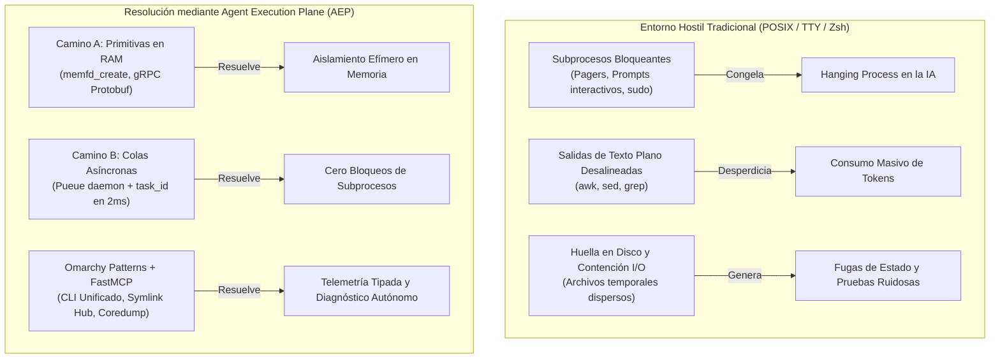
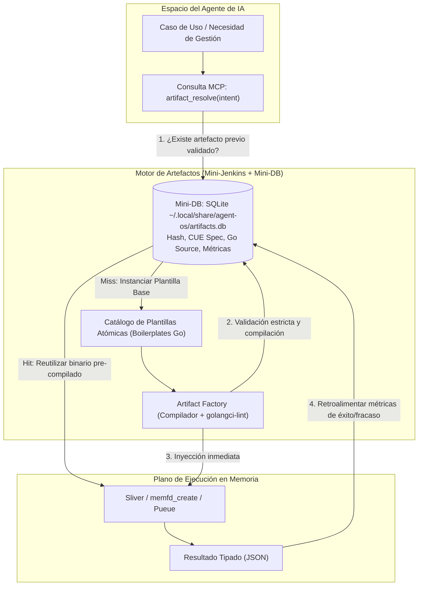
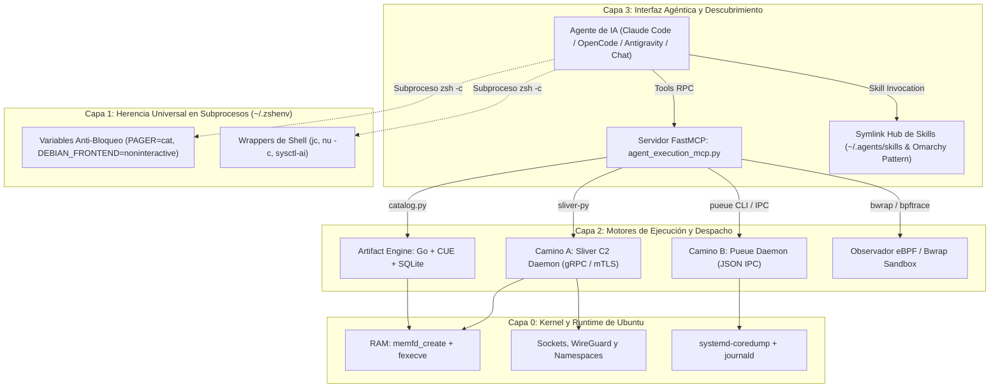
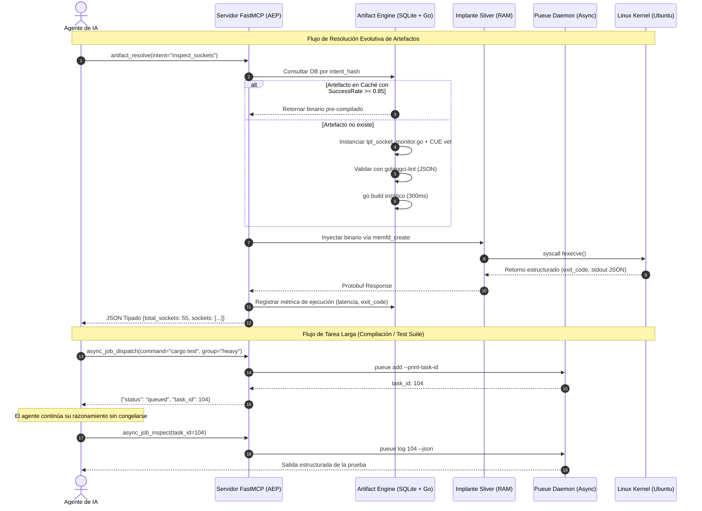

# Agent Execution Plane (AEP)
**Plano de Control de Sistema y Suite de Ejecución de Alta Resiliencia para Agentes de IA en Ubuntu**

> [!IMPORTANT]
> **Declaración de Premisa y Propósito (Anti-Malware / De-weaponization)**  
> Este proyecto **NO** es un framework de ciberseguridad ofensiva ni una herramienta de *Red Teaming*.  
> Es una **suite de ingeniería de sistemas y runtime agéntico** que aplica **Ingeniería Inversa (RE) orientada por Especificaciones (SDD)** sobre las primitivas de bajo nivel desarrolladas históricamente por frameworks C2 y herramientas de introspección de kernel, transformándolas en un plano de ejecución no-bloqueante, estructurado y asíncrono para Modelos de Lenguaje (LLMs) y agentes autónomos.

---

## 1. Fundamentos e Inferencias Arquitectónicas

La arquitectura de **Agent Execution Plane (AEP)** nace de resolver la brecha de impedancia entre los sistemas operativos contemporáneos (diseñados para la interacción visual humana) y los agentes de IA (que operan mediante subprocesos autónomos y ventanas de contexto finitas).



### 1.1. El Isomorfismo Arquitectónico: El Operador C2 y el Agente de IA
Los frameworks de Command & Control (C2) como *Sliver*, *Mythic* o *Beacon* no fueron concebidos para la destrucción; fueron diseñados para **operar bajo condiciones extremas de hostilidad e invisibilidad de interfaz**:
* Cero interacción humana en la consola remota.
* Tolerancia cero a procesos colgados (*hanging processes*).
* Comunicación asíncrona serializada con consumo mínimo de canal.
* Ejecución quirúrgica en memoria RAM sin dejar residuos en disco.

Para un Agente de IA, la consola Unix tradicional (Zsh/Bash) representa exactamente el mismo entorno hostil. Al remover las técnicas de evasión de EDR y apropiarse del motor de ejecución y transporte, la IA recibe una arquitectura de control de sistemas que resuelve medio siglo de supuestos interactivos obsoletos.

### 1.2. El Salto Cuántico en las Baterías de Pruebas y Pipelines
La integración de este plano transforma radicalmente la autonomía de los pipelines de verificación:
* **Pruebas en RAM Efímeras (`memfd_create`):** El agente compila binarios de prueba, los inyecta en descriptores de memoria anónimos del kernel de Linux, ejecuta la validación y destruye la prueba sin escribir un solo byte en almacenamiento físico.
* **Aserciones Deterministas Tipadas:** Se reemplaza el frágil parsing de texto por esquemas de datos Protobuf y JSON (`connection.state == "ESTABLISHED"`).
* **Paralelismo Seguro sin Contención:** Despacho de tareas concurrentes a través de colas dedicadas de **Pueue**, obteniendo identificadores inmediatos y desacoplando el tiempo de compilación o ejecución del ciclo de razonamiento del LLM.
* **Depuración Post-Mortem Automática:** Si un binario o test genera un fallo de segmentación (`SIGSEGV`), la captura de `systemd-coredump` entrega el *stacktrace*, registro de CPU e instrucción exacta directamente en JSON para remediación inmediata.

### 1.3. La Maleabilidad del Artefacto: *"Ya no leemos el código, solo tenemos un artefacto"*
En el desarrollo agéntico moderno, el código intermedio es transitorio. El agente no necesita que un humano configure de antemano herramientas de observabilidad complejas: el agente puede sintetizar en segundos una sonda en Go o C, inyectarla en memoria, capturar la telemetría viva del sistema y descartar la sonda. El verdadero entregable es el artefacto funcional verificado contra el estado real del sistema.

### 1.4. Romper el Nicho: De la Ciberseguridad a la Ultra-Resiliencia
El software ofensivo avanzado ha estado históricamente adelantado a la administración de sistemas tradicional en manejo de concurrencia y manipulación de memoria. Desmilitarizar estas primitivas convierte a Ubuntu en un **Agentic OS** de alta resiliencia.

---

## 2. Tecnologías Faltantes Incorporadas mediante Reverse Engineering (RE as SDD)

Para completar el ecosistema e ir más allá de la propuesta inicial de Sliver y Pueue, identificamos cinco tecnologías y primitivas de bajo nivel catalogadas habitualmente como "superficies de ataque", que transformamos mediante **Ingeniería Inversa Orientada por Especificaciones (SDD)**:

```mermaid
flowchart LR
    subgraph OffensiveNiche["Superficie / Nicho Ofensivo"]
        T1["eBPF Rootkits y Packet Sniffers"]
        T2["Sandbox Escapes / Namespace Tampering"]
        T3["C2 SOCKS5 / Lateral Movement Pivots"]
        T4["Process Memory Dumping / ptrace Injection"]
        T5["Exploit Crash Triage / Crash Mining"]
    end

    subgraph RE_SDD["Transmutación mediante RE as SDD"]
        R1["blueprint.md + Contratos Estructurados"]
        R2["Extracción Agnóstica de Primitivas"]
    end

    subgraph AgenticSuite["Capacidad Agéntica en AEP"]
        A1["eBPF Telemetry: Observabilidad Kernel sin overhead"]
        A2["Bwrap / Namespaces: Sandbox Efímero en milisegundos"]
        A3["Chisel / Ephemeral SOCKS5: Simulación de topologías"]
        A4["procfs / fd Introspection: Diagnóstico de hilos colgados"]
        A5["Libunwind / GDB Batch: RCA instantáneo de fallos"]
    end

    OffensiveNiche --> RE_SDD --> AgenticSuite
```



| Tecnología Original | Clasificación Tradicional | Transmutación Agéntica (AEP) | Utilidad para la IA y Pipelines |
| :--- | :--- | :--- | :--- |
| **eBPF (`bpftrace` / BCC)** | Rootkits en kernel, evasión de red. | **Observabilidad de Kernel No-Invasiva** | Telemetría en tiempo real de apertura de archivos, latencia de sockets y llamadas al sistema sin tocar el código fuente. |
| **Bubblewrap (`bwrap`)** | Primitiva de aislamiento / jailbreak. | **Sandbox Efímero de Sub-Milisegundo** | Ejecución de scripts o código experimental no confiable sin la sobrecarga del demonio Docker. |
| **Chisel / Gost** | Túneles y pivoting de redes corporativas. | **Multiplexación de Red Local Efímera** | Levantamiento de puertos, proxies e interconexión temporal de servicios para pruebas de integración de microservicios. |
| **`ptrace` + `/proc/$PID/fd`** | Inyección de procesos, lectura de memoria. | **Introspección y Rescate de Procesos** | Inspección de descriptores de archivo de subprocesos colgados y diagnóstico de deadlocks en tiempo real. |
| **`coredumpctl` + `libunwind`** | Desarrollo de exploits y crash triage. | **Root Cause Analysis (RCA) Autónomo** | Conversión inmediata de volcados de memoria en contexto de corrección para el agente. |

---

## 3. Evolutionary Artifact Engine (El Mini-Jenkins + Mini-DB para IA)

> [!TIP]
> **Especificación Formal:** Consulta [spec_artifact_engine.md](file:///home/ancruz/Documents/workspaces/agent-execution-plane/docs/spec_artifact_engine.md) para la definición canónica de **EAES-v1**.

Para superar la alucinación producida por soluciones tradicionales, AEP incorpora un motor de síntesis de artefactos en **Golang estático (`CGO_ENABLED=0`)**, gobernado por contratos en **CUE** y auditado estáticamente por **`golangci-lint`** antes de su ejecución o persistencia en una mini-DB local SQLite.



### 3.1. ¿Por qué Golang?
* **Compilación en sub-segundos:** Un binario mínimo se compila entre 200 y 500 ms con `go build -ldflags="-s -w"`.
* **Cero dependencias:** No requiere entornos virtuales (`venv`), intérpretes pesados ni paquetes del sistema.
* **Inyección directa en RAM:** Se mapea directamente con `memfd_create` sin tocar almacenamiento secundario.

### 3.2. Validación Estricta: El "Pydantic" y el "Ansible-Lint" de Go
1. **CUE Lang (`schemas/artifact_contract.cue`):** Define los contratos declarativos, tipos y restricciones matemáticas de los parámetros de entrada y salida JSON.
2. **`golangci-lint` (Modo JSON):** Ejecuta más de 40 linters en paralelo (`govet`, `staticcheck`, `errcheck`). Si la IA comete un error, el linter devuelve un JSON estructurado con la línea y columna exactas, permitiendo la auto-corrección en una sola iteración.

---

## 4. Arquitectura Global del Sistema (4 Capas)



---

## 5. Flujo de Ejecución: Pruebas en Memoria vs. Paradigma Clásico



---

## 6. Catálogo de Herramientas del Servidor FastMCP

El servidor expone herramientas de alto impacto diseñadas para maximizar la resolución y minimizar la saturación del contexto:

1. `c2_implant_inspect(target: "ps" | "netstat" | "ifconfig" | "env")`  
   Inspecciona procesos y sockets directamente desde la memoria mediante llamadas a gRPC, evitando la creación de subprocesos `/bin/*`.
2. `c2_execute_in_memory(elf_path: str, args: list[str])`  
   Ejecuta binarios de validación en memoria mediante `memfd_create` y `fexecve`.
3. `c2_network_pivot(action: "start_socks5" | "stop_socks5" | "portfwd_add", port: int, remote_target: str)`  
   Gestiona túneles efímeros y redirección de puertos sin alterar configuraciones de red globales.
4. `async_job_dispatch(command: str, label: str | None, working_dir: str | None)`  
   Encola tareas pesadas en **Pueue**, liberando inmediatamente al agente con un identificador de seguimiento.
5. `async_job_inspect(task_id: int | None, lines: int)`  
   Recupera el estado o los registros de salida de tareas asíncronas en formato JSON.
6. `diagnose_system_crashes(limit: int)`  
   Consulta volcados de memoria recientes (`coredumpctl`) y errores del *journal* para auto-diagnóstico.
7. `artifact_resolve(intent: str, category: str, params: dict)` *(Evolutionary Engine)*  
   Consulta la base de datos de artefactos (`artifacts.db`) o sintetiza uno nuevo a partir de plantillas en Go.
8. `sandbox_run(command: str, share_net: bool, read_only_paths: list[str])` *(Nueva mediante RE)*  
   Ejecuta comandos de forma segura en un sandbox efímero con **Bubblewrap** (`bwrap`).
9. `kernel_trace_syscall(process_name: str, duration_sec: int)` *(Nueva mediante RE)*  
   Rastrea llamadas al sistema mediante **eBPF/bpftrace** y devuelve un resumen de frecuencias y latencias.

---

## 7. Guía de Instalación y Aprovisionamiento en Ubuntu

### Paso 1: Dependencias del Sistema y Motores Asíncronos
```bash
sudo apt update && sudo apt install -y \
    jq jc ripgrep fd-find pueue systemd-coredump bubblewrap \
    build-essential curl git zsh golang-go

# Instalar Nushell
if ! command -v nu &> /dev/null; then
    curl -fsSL https://apt.fury.io/nushell/gpg.key | sudo gpg --dearmor -o /etc/apt/trusted.gpg.d/fury-nushell.gpg
    echo "deb https://apt.fury.io/nushell/ /" | sudo tee /etc/apt/sources.list.d/fury.list
    sudo apt update && sudo apt install -y nushell
fi

# Instalar golangci-lint (calidad y linting estricto para artefactos)
if ! command -v golangci-lint &> /dev/null; then
    curl -sSfL https://raw.githubusercontent.com/golangci/golangci-lint/master/install.sh | sh -s -- -b $(go env GOPATH)/bin
fi

# Instalar uv (gestor Python de alta velocidad)
if ! command -v uv &> /dev/null; then
    curl -LsSf https://astral.sh/uv/install.sh | sh
fi

# Activar demonio Pueue a nivel de usuario
systemctl --user enable --now pueued || pueued -d
```

### Paso 2: Despliegue de Sliver C2 y Perfil de Operador
```bash
# 1. Instalar Sliver
curl https://sliver.sh/install | sudo bash

# 2. Generar perfil de operador para el orquestador
mkdir -p "$HOME/.sliver-client/configs"
sudo sliver-server operator \
    --name mcp_orchestrator \
    --lhost 127.0.0.1 \
    --save "$HOME/.sliver-client/configs/mcp_orchestrator.cfg"
sudo chown "$USER:$USER" "$HOME/.sliver-client/configs/mcp_orchestrator.cfg"
```

### Paso 3: Configuración de Herencia de Shell (`~/.zshenv`)
Añade las siguientes directivas a tu archivo `~/.zshenv`:
```zsh
# Prevenir paginadores interactivos en cualquier subproceso hijo
export PATH="$HOME/.local/bin:$HOME/.cargo/bin:$(go env GOPATH)/bin:$PATH"
export PAGER="cat"
export SYSTEMD_PAGER="cat"
export GIT_PAGER="cat"
export DEBIAN_FRONTEND="noninteractive"

# Wrappers estructurados
jrun() { jc --pretty "$@"; }
bg_exec() { pueue add --print-task-id -- "$@"; }
bg_stat() { pueue status --json; }
sys_json() { nu -c "sys host | merge (sys mem) | to json"; }
```

### Paso 4: Inicialización del Catálogo Local de Artefactos (SQLite)
```bash
cd /home/ancruz/Documents/workspaces/agent-execution-plane
python3 -c "from engine.catalog import ArtifactCatalog; cat = ArtifactCatalog(); print('Catálogo iniciado en:', cat.db_path)"
```

### Paso 5: Hub Unificado de Skills (Patrón Omarchy)
```bash
mkdir -p "$HOME/.agents/skills"
mkdir -p "$HOME/.claude/skills"
mkdir -p "$HOME/.gemini/skills"

# Enlaces simbólicos para compartir las mismas skills entre agentes
ln -sfn "$HOME/.agents/skills" "$HOME/.claude/skills/shared"
ln -sfn "$HOME/.agents/skills" "$HOME/.gemini/skills/shared"
```

---

## 8. Estructura del Repositorio

```
agent-execution-plane/
├── docs/
│   ├── architecture.md             # Documento de arquitectura original
│   └── spec_artifact_engine.md     # Especificación canónica EAES-v1
├── engine/
│   ├── __init__.py
│   └── catalog.py                  # Gestor SQLite de artefactos y métricas
├── schemas/
│   ├── database.sql                # DDL para artifacts.db
│   └── artifact_contract.cue       # Contratos y tipos en CUE
├── templates/
│   ├── tpl_socket_monitor.go       # Sonda atómica para sockets TCP (/proc/net/tcp)
│   └── tpl_fd_rescuer.go           # Inspector de descriptores (/proc/$PID/fd)
├── README.md                       # Manifiesto y guía maestra
└── .git/
```
