<a id="top"></a>

# Agent Execution Plane (AEP)

**System Control Plane & High-Resilience Execution Suite for AI Agents on Ubuntu/Linux**

[](https://www.python.org/)
[](https://go.dev/)
[](https://www.gnu.org/software/bash/)
[](https://sqlite.org/)
[](https://modelcontextprotocol.io/)
[](https://ubuntu.com/)
[](LICENSE)
[](tests/)

> [!IMPORTANT]
> **Runtime Architecture & Agent Execution Plane**
> AEP is a **systems engineering suite and agentic runtime** designed to
> provide a deterministic, non-blocking, typed, and asynchronous execution plane for
> LLMs and autonomous agents, grounded in low-level Linux kernel primitives
> (namespaces, volatile anonymous memory, descriptors, and dynamic telemetry)
> on Ubuntu/Linux environments.

> [!WARNING]
> **SECURITY ADVISORY & TESTING ENVIRONMENT (EDR / SANDBOX DISCLAIMER)**
>
> AEP utilizes low-level Linux kernel primitives (`memfd_create` for anonymous in-RAM execution, user-space sandboxing via Landlock LSM, dynamic eBPF/kprobes tracing, `/proc` file descriptor inspection, and namespace isolation).
>
> Because these primitives interact intimately with operating system security and memory subsystems, corporate endpoint security solutions, antivirus suites, and heuristic-based **EDR (Endpoint Detection and Response)** platforms may classify these activities as potentially anomalous or offensive cybersecurity tooling.
>
> **It is strongly recommended to evaluate and run AEP within dedicated test environments, virtual machines, or isolated sandboxes.**

---

## Table of Contents

1. [The Execution Challenge: Interactive Console vs. Agentic Runtime](#1-the-execution-challenge-interactive-console-vs-agentic-runtime)
2. [Global Architecture (4 Layers)](#2-global-architecture-4-layers)
   - [Architectural Breakdown of the 4 Layers](#architectural-breakdown-of-the-4-layers)
   - [Detailed Layer Specifications](#detailed-layer-specifications)
3. [High-Performance Linux Kernel Primitives → Resilient Agentic Capabilities](#3-high-performance-linux-kernel-primitives--resilient-agentic-capabilities)
4. [Catalog of 15 MCP Tools (18 Capabilities)](#4-catalog-of-15-mcp-tools-18-capabilities)
   - [Master Reference Tables for 15 FastMCP Tools](#master-reference-tables-for-15-fastmcp-tools)
   - [Lifecycle and Skill Chaining](#lifecycle-and-skill-chaining)
5. [Hybrid Semantic Memory (sqlite-vec) & Hot SQLite Concurrency](#5-hybrid-semantic-memory-sqlite-vec--hot-sqlite-concurrency)
   - [Persistence and Agent Access](#persistence-and-agent-access)
   - [Pico-Kanban: Artifact Confidence Scoring](#pico-kanban-artifact-confidence-scoring)
   - [Anti-Deadlock WAL Concurrency Architecture](#anti-deadlock-wal-concurrency-architecture)
6. [Database Resilience: Online Hot Backup & Auto-Recovery (5 Slots)](#6-database-resilience-online-hot-backup--auto-recovery-5-slots)
   - [Hot Streaming Backup Mechanics](#hot-streaming-backup-mechanics)
   - [FIFO Pool Topology and Self-Healing](#fifo-pool-topology-and-self-healing)
   - [Volatile In-RAM Micro-Snapshots](#volatile-in-ram-micro-snapshots)
   - [Anti-Poisoning Architecture and Forensic Quarantine](#anti-poisoning-architecture-and-forensic-quarantine)
7. [Security Countermeasures, Isolation & Cryptographic Audit Ledger](#7-security-countermeasures-isolation--cryptographic-audit-ledger)
   - [CapabilityGuard & Critical Path Blacklisting](#capabilityguard--critical-path-blacklisting)
   - [Tamper-Evident SHA-256 Audit Chain](#tamper-evident-sha-256-audit-chain)
   - [In-Process Sandboxing via Landlock LSM](#in-process-sandboxing-via-landlock-lsm)
   - [eBPF Security Observability](#ebpf-security-observability)
8. [Omarchy Enhancements (5 Distro-Agnostic Specs)](#8-omarchy-enhancements-5-distro-agnostic-specs)
   - [Omarchy Distro-Agnostic Specification Matrix](#omarchy-distro-agnostic-specification-matrix)
   - [Detailed Technical Specifications (SPEC-OM-1 to SPEC-OM-7)](#detailed-technical-specifications-spec-om-1-to-spec-om-7)
   - [Architecture and Data Flow of Omarchy Enhancements](#architecture-and-data-flow-of-omarchy-enhancements)
9. [Two-Tier Privilege Model + Manifest](#9-two-tier-privilege-model--manifest)
10. [Auto-Plug: Atomic MCP Self-Management](#10-auto-plug-atomic-mcp-self-management)
11. [Shell-Agnostic Environment](#11-shell-agnostic-environment)
12. [Clean-Slate Installation, Health Audit & Autonomous Updater](#12-clean-slate-installation-health-audit--autonomous-updater)
13. [Repository Structure](#13-repository-structure)
14. [Truthful Inventory of Single Source of Truth](#14-truthful-inventory-of-single-source-of-truth)
15. [RE as SDD & Inspiration Matrix](#15-re-as-sdd--inspiration-matrix)
16. [License and Terms](#16-license-and-terms)

---

## 1. The Execution Challenge: Interactive Console vs. Agentic Runtime

The traditional Unix console was conceived for interactive human operators—a paradigm
fundamentally hostile to autonomous Large Language Model (LLM) execution:
- **Blocking Processes**: Interactive pagers (`less`, `more`), unannounced interactive prompts,
  and `stdin` stalls hang agent child processes indefinitely.
- **Unstructured and Misaligned Output**: Parsing plain text output via ad-hoc pipelines (`grep`,
  `awk`, `sed`) introduces syntactic fragility and wastes tokens on formatting noise rather than
  dense semantic signal.
- **Disk Contention and Residue**: Creating temporary scripts or binaries on the filesystem
  introduces I/O synchronization latency, filesystem fragmentation, naming collisions, and
  orphaned artifacts requiring garbage collection.

AEP decouples agents from the interactive terminal via two primary mechanisms: **non-blocking
asynchronous queue dispatch** (via Pueue, returning an immediate `task_id`) and **volatile
in-RAM execution** via anonymous file descriptors (`memfd_create` + `/proc/self/fd/`).

This in-memory staging technique is not an exotic construct, but an established **Linux
systems engineering standard** adopted in production-grade infrastructure:
- **Wayland Compositors (Weston / wlroots)**: Zero-copy shared memory buffer transfer
  (`wl_shm`) between clients and compositor via `memfd_create` file descriptors passed over
  Unix domain sockets (`AF_UNIX`).
- **QEMU / KVM (`memory-backend-memfd`)**: Anonymous memory allocation for guest RAM in
  high-performance virtualization, enabling inter-VM shared memory (`ivshmem`) and
  shared descriptors for `vhost-user` with DPDK.
- **PulseAudio & PipeWire**: Real-time zero-copy audio stream buffer exchange between media
  servers and clients without filesystem synchronization bottlenecks.

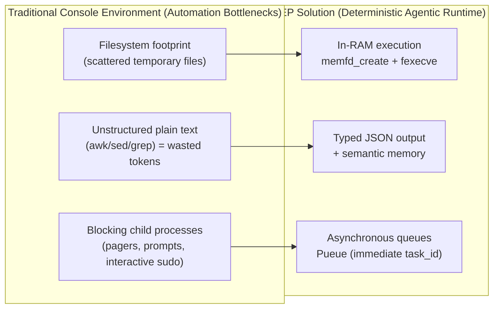

[↑ Back to top](#top)

---

## 2. Global Architecture (4 Layers)

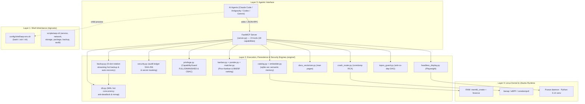

### Architectural Breakdown of the 4 Layers

| Layer | Abstraction Level | Modules & Components | Underlying Primitives & Protocols | Guarantees & Runtime Role |
| :---: | :--- | :--- | :--- | :--- |
| **Layer 3** | **Agentic Interface (RPC)** | `server.py` (FastMCP)<br/>`aep_capabilities` | JSON-RPC 2.0 over `stdio`<br/>FastMCP SDK | Unified entry point for LLMs and agents (Claude Code, Antigravity `agy`, OpenAI Codex, Gemini CLI). Exposes 15 atomic, typed, and non-blocking tools (18 capabilities, 1:1 parity). |
| **Layer 2** | **Execution, Persistence & Security Engines (`engine/`)** | `db.py`<br/>`backup.py`<br/>`security.py`<br/>`catalog.py`<br/>`embedder.py`<br/>`kanban.py`<br/>`ponder.py`<br/>`matcher.py`<br/>`crash_router.py`<br/>`docs_vectorizer.py`<br/>`headless_display.py`<br/>`topos_guard.py`<br/>`privilege.py` | SQLite 3 (WAL mode, mmap 256MB)<br/>`sqlite-vec` extension<br/>ONNX Runtime (bge-small)<br/>Playwright Chromium (`/dev/shm`)<br/>`fcntl.flock` + `conn.backup()`<br/>SHA-256 Chained Hash Ledger | Core agentic logic: hybrid semantic memory, anti-deadlock hot SQLite concurrency (`BEGIN IMMEDIATE`), online 5-slot hot backup with auto-recovery, offensive countermeasures via `CapabilityGuard` (blacklisting `/etc/shadow`, `/root`, `~/.ssh`), SHA-256 cryptographic audit ledger, multidimensional Pico-Kanban, and dual-tier privilege governance (`FULL`/`DIMINISHED`). |
| **Layer 1** | **Agnostic Shell Inheritance** | `config/shell/aep-env.sh`<br/>`scripts/install-shell-env.sh`<br/>`scripts/aep-ctl` | POSIX standard Shell (`sh`, `bash`, `zsh`, `dash`)<br/>Environment variables (`PAGER=cat`) | Sanitizes subshell execution against hangs (`stdin`, interactive pagers). Deterministic `aep-ctl` CLI for system management with self-documenting typed JSON contracts (`--schema`) across domains: `service`, `network`, `storage`, `package`, `backup`, and `audit`. |
| **Layer 0** | **Linux Kernel & Ubuntu Runtime** | Linux Kernel Primitives<br/>`Pueue` daemon (musl)<br/>`bwrap` (Bubblewrap)<br/>`systemd` / `journald`<br/>Static Go Toolchain | `memfd_create(2)`<br/>Linux User & PID Namespaces<br/>eBPF / kprobes (`bpftrace`)<br/>`systemd-coredump` / `ptrace`<br/>Hermetic Python 3.14 (`uv`) | High-performance, low-level foundations: volatile ELF staging in RAM with zero disk residue, sub-millisecond isolation via unprivileged namespaces, non-blocking asynchronous queues, non-invasive kernel telemetry, and user-space execution without root requirements. |

#### Detailed Layer Specifications

1. **Layer 3: Agentic Interface (FastMCP RPC)**:
   - **Protocol and Transport**: Built on the official Model Context Protocol (MCP) using **FastMCP** in `server.py`. All communication occurs over `stdio` via structured **JSON-RPC 2.0** messages, eliminating network port exposure and insecure local socket management.
   - **First-Look Self-Description**: The entry point `discover(action="capabilities")` (along with the compatibility wrapper `aep_capabilities()`) provides an immediate handshake, returning an octal autonomy manifest modeled after `chmod/777` (`r`=sense, `w`=act, `x`=execute). This informs the LLM of its operational capabilities based on detected privileges (`FULL` or `DIMINISHED`).
   - **Universal Multi-Client Support**: Designed for seamless consumption by multiple autonomous agents (Claude Code, Antigravity `agy`, OpenAI Codex, Gemini CLI) via the unified launcher `scripts/aep-mcp-launch.sh`.

2. **Layer 2: Execution, Persistence & Security Engines (`engine/`)**:
   - **Anti-Deadlock Hot SQLite Concurrency (`db.py`)**: Read-only connections (`mode=ro`) without WAL locks, read-write connections with `PRAGMA wal_autocheckpoint=1000`, immediate transactions (`transaction_immediate` with `BEGIN IMMEDIATE`), and `_ClosingConnection` deterministic FD & 256MB-mmap release on `with conn:` exit (`fd_delta = 0`) to eliminate `database is locked` errors and descriptor leaks under concurrent swarms.
   - **Hot Backup Resilience (`backup.py`)**: Non-destructive online streaming backups via `conn.backup()`, 5-slot FIFO rotation (`artifacts.db.bak.1..5`), snapshot SHA-256 checksums, and transparent header corruption auto-recovery.
   - **Security Countermeasures & Audit (`security.py`, `privilege.py`)**: Capability-Based Access Control (CBAC) via `CapabilityGuard` (strict blocking of `/etc/shadow`, `/root`, `~/.ssh`), centralized secret sanitization, and an immutable SHA-256 chained audit ledger (`security_audit_log`).
   - **Hybrid Semantic Memory (`catalog.py`, `embedder.py`)**: Persists artifact metadata in `~/.local/share/agent-os/artifacts.db` in WAL mode. Implements two-tier retrieval: O(1) exact SHA-256 matching, and cosine similarity search using `sqlite-vec` with local `bge-small-en-v1.5` embeddings on ONNX Runtime.
   - **Pico-Kanban Scoring (`kanban.py`, `ponder.py`, `matcher.py`)**: Abstract state board (`BACKLOG` → `SYNTHESIZED` → `LINTED` → `CANARY` → `PROMOTED`/`REJECTED`) for decomposing complex tasks and scoring artifacts across quality, reliability, experience, and recency with defect vetoes.
   - **Proactive Crash Routing (`crash_router.py`)**: Interrogates `coredumpctl` periodically, deduplicating crashes via compound hashes (`pid:timestamp:executable`) to alert agents before executing system mutations.
   - **Documentation Vectorizer (`docs_vectorizer.py`)**: Ingests Ubuntu `man` pages into paragraphs, vectorizing them locally into `system_docs.db` to resolve exact command syntax in under 5 ms without web lookups.
   - **Headless Visual Actuator (`headless_display.py`)**: Orchestrates headless Chromium via Playwright, capturing screenshots directly into volatile RAM (`/dev/shm`) with compact screenshot mode by default (`include_base64=False`, `verbosity="summary"`, `-98.9%` token footprint with `screenshot_path`, `screenshot_sha256`, and `text_excerpt`).
   - **Topological DAG Guardian (`topos_guard.py`)**: Enforces the Topos Integrity Protocol, validating task DAGs to certify zero circular co-dependencies (A <-> B) prior to execution authorization.
   - **Privilege Governor (`privilege.py`)**: Dynamically evaluates credentials (`euid == 0` or `sudo -n true`), ensuring tools degrade gracefully (*fail-soft*) to user space without unhandled exceptions.

3. **Layer 1: Agnostic Shell Inheritance**:
   - **POSIX Environment Sanitization (`config/shell/aep-env.sh`)**: Universal environment file enforcing `PAGER=cat`, `MANPAGER=cat`, `DEBIAN_FRONTEND=noninteractive`, and exporting critical paths to `PATH`. Prevents child processes from hanging on interactive prompts.
   - **Idempotent Multi-Shell Installation (`scripts/install-shell-env.sh`)**: Injects atomic sourcing blocks into `~/.bashrc`, `~/.zshenv`, and `~/.profile`, supporting Bash, Zsh, and Dash without third-party frameworks.
   - **Deterministic CLI Control Plane (`scripts/aep-ctl`)**: Modular Python standard library utility managing subdomains (`service`, `network`, `storage`, `package`, `backup`, `audit`) with structured JSON output and `--schema` contract introspection.

4. **Layer 0: Linux Kernel & System Runtime**:
   - **Volatile Anonymous Memory (`memfd_create`)**: Native Linux kernel primitive (glibc 2.27+ / Linux 3.17+) allowing ELF binaries to be staged and executed purely in RAM via `/proc/self/fd/`, bypassing secondary disk storage.
   - **Namespace Isolation (`bwrap`)**: Uses Bubblewrap to sandbox potentially hazardous executions in unprivileged user, mount, PID, and network namespaces with read-only roots and volatile RAM `/tmp` filesystems.
   - **Dynamic Observability (`bpftrace` / eBPF)**: Attaches non-invasive kprobes and tracepoints to monitor syscalls, track file openings, or inspect TCP sockets using curated read-only scripts with automatic termination.
   - **Post-Mortem Forensics**: Leverages native `systemd-coredump` and `journalctl` to retrieve memory dumps, extract stack traces, and analyze system error logs.
   - **Asynchronous Queue Manager (`Pueue`)**: Static `musl`-compiled background daemon managing parallel queues and process limits without stalling the agent's conversational loop.

[↑ Back to top](#top)

---

## 3. High-Performance Linux Kernel Primitives → Resilient Agentic Capabilities

Low-level Linux kernel primitives are structured and exposed as high-resilience agentic
capabilities governed by a dual-tier privilege model. **All verified end-to-end.**

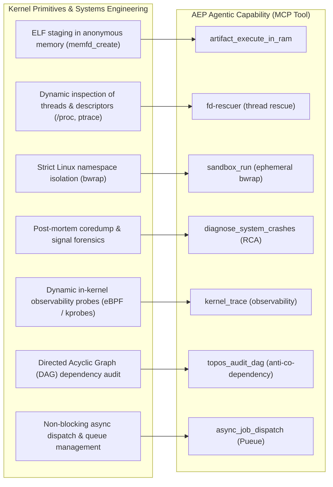

| Kernel / Runtime Primitive | Systems Engineering Classification | Resilient Agentic Capability (MCP Tool) | Status |
| :--- | :--- | :--- | :--- |
| `memfd_create` (glibc 2.27+) | Anonymous volatile RAM staging (zero disk I/O) | `artifact_execute_in_ram`: Direct in-RAM injection & execution | ✅ Operational |
| `/proc/$PID/fd` + `ptrace` | Non-destructive inspection and descriptor recovery | `fd-rescuer`: Non-invasive file descriptor and state recovery | ✅ Operational |
| `bwrap` (Linux namespaces) | Unprivileged ephemeral sandbox (user, pid, mount, net) | `sandbox_run`: Deterministic sub-millisecond isolation | ✅ Operational |
| `coredumpctl` + `libunwind` | Automated post-mortem triage of coredumps & stack traces | `diagnose_system_crashes`: Autonomous fail-soft RCA | ✅ Operational |
| eBPF (`bpftrace`) | Non-invasive dynamic kernel telemetry & tracing | `kernel_trace`: Safe runtime observability | ✅ Operational (FULL) |
| Graph Theory (DAG) | Topological coupling analysis & cycle detection | `topos_audit_dag`: Topos anti-co-dependency guardian | ✅ Operational |
| Asynchronous Queue (`Pueue`) | Event-driven non-blocking task execution | `async_job_dispatch`: Background task dispatch & logs | ✅ Operational |

> **Note on `memfd_create(2)`**: This anonymous memory primitive is the industry standard for
> zero-overhead execution and communication without filesystem overhead, utilized in **Wayland**
> (Weston/wlroots for `wl_shm` buffers), **QEMU / KVM** (guest RAM allocation for `ivshmem` and
> `vhost-user`), and **PulseAudio & PipeWire** (real-time audio buffers).

[↑ Back to top](#top)

---

## 4. Catalog of 15 MCP Tools (18 Capabilities)

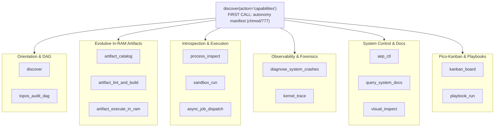

### Master Reference Tables for 15 FastMCP Tools

The plane exposes 15 RPC tools organized across operational domains plus the root entry point. All tools return typed, deterministic JSON strings ensuring zero unhandled exceptions (*fail-soft*).

#### Root Entry Point & Autonomy Manifest

| Tool | Privilege Tier | Signature & Parameters | Mechanics & Operational Purpose | JSON Output Contract | Fail-Soft Guarantee |
| :--- | :---: | :--- | :--- | :--- | :--- |
| `discover` (`action="capabilities"`) | `FULL` / `DIMINISHED` | `discover(action="capabilities") -> str`<br/>*(compat wrapper: `aep_capabilities()`)* | Evaluates `euid == 0` and `sudo -n` availability. Generates an autonomy manifest in an octal `chmod/777` style (`r`=sense, `w`=act, `x`=execute) mapping 18 capabilities across scopes (`self`, `system`, `kernel`). | `{"status": "OK", "capability_tier": "FULL"|"DIMINISHED", "privilege_mode": str, "capabilities": {...}}` | Always returns valid deterministic JSON. Zero unhandled exceptions. |

#### Domain 1: Evolutive Artifacts & In-Memory Cycle (4 Tools)

| Tool | Privilege Tier | Signature & Parameters | Mechanics & Operational Purpose | JSON Output Contract | Fail-Soft Guarantee |
| :--- | :---: | :--- | :--- | :--- | :--- |
| `discover` | `DIMINISHED` | `discover(use_case: str = "", action: str = "discover", limit: int = 3, verbosity: str = "detail") -> str` | Polymorphic orientation router: maps natural language intents to recommended capabilities (`action="discover"` with confidence gating), outputs the `chmod/777` autonomy manifest + real host binary readiness (`action="capabilities"`), or returns the Kali-MCP inspired tactical guide (`action="playbook"`). | `action="discover"`: `{"status": "OK", "confidence": "HIGH"|"LOW", "recommended_next_call": str, ...}`<br/>`action="playbook"`: `{"status": "OK", "playbook_version": "EAES-v2-Kali-Semantic", "rules_of_engagement": [...], "workflow_recipes": [...]}` | Empty parameters return `status: "PARAM_ERROR"`; unrecognized actions return `status: "INVALID_ACTION"`. |
| `artifact_lint_and_build` | `DIMINISHED` | `artifact_lint_and_build(action: str = "build", name: Optional[str] = None, artifact_name: Optional[str] = None, intent: Optional[str] = None, description: Optional[str] = None, category: Optional[str] = None, go_source: Optional[str] = None, template_name: Optional[str] = None, source_template: Optional[str] = None, params: Optional[Dict[str, Any]] = None, cue_contract: str = "", limit: int = 5) -> str` | Unified pipeline to browse templates (`catalog`), rank by relevance (`select`), hydrate Go source (`hydrate`), and compile binaries with `go vet`/`golangci-lint` validation (`build`), including 1-step zero-config template shortcut (`template_name` auto-fills defaults and reuses active Kanban tasks). | Action-dependent typed JSON (`status`, `templates`, `matches`, `go_source`, `artifact_id`, `binary_path`). | Structured responses with `status: "PARAM_ERROR"` on missing inputs, `status: "HYDRATE_ERROR"` on template failures, and `status: "INVALID_ACTION"` on invalid actions. |
| `artifact_execute_in_ram` | `DIMINISHED` | `artifact_execute_in_ram(name: str, args: Optional[List[str]] = None) -> str` | Loads the ELF binary into an anonymous volatile descriptor via `memfd_create` and executes directly in RAM via `/proc/self/fd/<fd>`. Measures latency and records execution metrics in SQLite. | `{"status": "SUCCESS"|"EXEC_FAILED", "exit_code": int, "latency_ms": float, "output": Any, "metric_recorded": bool}` | Non-zero exit codes return structured JSON with `stderr` and update historical failure rates. |
| `artifact_catalog` | `DIMINISHED` | `artifact_catalog(action: str = "browse", category: Optional[str] = None, query: Optional[str] = None, intent: Optional[str] = None, limit: int = 10, force: bool = False, apply: bool = False) -> str` | Unified semantic memory. `action="browse"`: lists/searches by confidence or semantic top-K (`query`). `action="query"`: hybrid cache search by `intent`/`query`. `action="reindex"`: heals sqlite-vec vectors. `action="prune"`: safe GC. | `{"status": "OK"|"CACHE_HIT"|"CACHE_MISS", ...}` | Gracefully degrades to relational confidence ranking if vector extensions are unavailable. |

#### Domain 2: Pico-Kanban & Multidimensional Scoring (2 Tools)

| Tool | Privilege Tier | Signature & Parameters | Mechanics & Operational Purpose | JSON Output Contract | Fail-Soft Guarantee |
| :--- | :---: | :--- | :--- | :--- | :--- |
| `kanban_board` | `DIMINISHED` | `kanban_board(action: str = "board", include_archived: bool = False, task_id: Optional[int] = None, title: str = "", intent: str = "", category: str = "", artifact_name: Optional[str] = None, to_state: str = "", lint_passed: Optional[bool] = None, canary_passed: Optional[bool] = None, note: Optional[str] = None, reason: Optional[str] = None, states: Optional[List[str]] = None, max_score: Optional[float] = None, apply: bool = False, target_state: str = "SYNTHESIZED") -> str` | Unified Kanban management: view board (`board`), create tasks (`create`), advance states (`advance`), promote artifacts (`promote`), demote artifacts (`demote`), fleet reevaluation (`reevaluate`), and archival (`archive`/`unarchive`). | Action-dependent typed JSON (`status`, `lanes`, `task_id`, `promotion_score`, `verdict`, `candidates`). | Structured responses with `status: "PARAM_ERROR"` on missing inputs and `status: "INVALID_ACTION"` on invalid actions. |
| `process_inspect` | `FULL` / `DIMINISHED` | `process_inspect(pid: int = 0, limit: int = 100) -> str` | Dynamic inspection of process state, open file descriptors (`/proc/PID/fd`), and resource telemetry. `pid=0` inspects the FastMCP server (`self`). Classifies descriptors into `socket`, `pipe`, `device`, `anon_inode`, and `file`. | `{"status": "OK", "pid": int, "name": str, "state": str, "threads": int, "rss_kb": int, "fd_count": int, "summary_by_type": {...}, "descriptors": [...]}` | Missing PIDs return `status: "NOT_FOUND"`; unprivileged cross-user requests return `status: "PERMISSION_DENIED"` without crashing. |

#### Domain 3: Isolation & Asynchronous Execution (2 Tools)

| Tool | Privilege Tier | Signature & Parameters | Mechanics & Operational Purpose | JSON Output Contract | Fail-Soft Guarantee |
| :--- | :---: | :--- | :--- | :--- | :--- |
| `sandbox_run` | `DIMINISHED` | `sandbox_run(command: str, share_net: bool = False, working_dir: Optional[str] = None, ro_paths: Optional[List[str]] = None, rw_paths: Optional[List[str]] = None, timeout: int = 60) -> str` | Executes commands inside an ephemeral `bwrap` sandbox (`--unshare-all`, `share_net=False` by default). Supports authorized `working_dir`, `ro_paths`, and `rw_paths` validated by `CapabilityGuard`, auto-resolves `.venv` Python symlinks, and redirects tool caches (`RUFF_CACHE_DIR`, `PYTEST_ADDOPTS`) to `/tmp` tmpfs. | `{"status": "SUCCESS"|"EXEC_FAILED"|"PERMISSION_DENIED", "exit_code": int, "share_net": bool, "working_dir": str, "ro_mounts": [...], "stdout": str, "stderr": str, "telemetry": {...}}` | Blocks blacklisted paths (`/etc/shadow`, `~/.ssh`) with `status: "PERMISSION_DENIED"` and cryptographic audit logging. |
| `async_job_dispatch` | `DIMINISHED` | `async_job_dispatch(action: str = "dispatch", command: Optional[str] = None, label: Optional[str] = None, group: str = "default", working_dir: Optional[str] = None, task_id: Optional[int] = None, lines: int = 50) -> str` | Unified async job queue via Pueue: enqueue tasks (`dispatch`) or inspect status and logs (`inspect`/`status`/`log`). Features automatic daemon startup and centralized secret masking. | Action-dependent typed JSON (`status`, `task_id`, `group`, `command`, queue state, or task logs). | Returns `status: "PARAM_ERROR"` on invalid inputs or `status: "DEGRADED"` if daemon is missing. |

#### Domain 4: Crash Forensics & Kernel Observability (2 Tools)

| Tool | Privilege Tier | Signature & Parameters | Mechanics & Operational Purpose | JSON Output Contract | Fail-Soft Guarantee |
| :--- | :---: | :--- | :--- | :--- | :--- |
| `diagnose_system_crashes` | `FULL` / `DIMINISHED` | `diagnose_system_crashes(action: str = "diagnose", limit: int = 5, resolve_after_report: bool = False) -> str` | Unified crash forensics: `action="diagnose"` inspects coredumps and journalctl errors; `action="alerts"` (alias `"check"`) polls proactive crash alerts from `crash_events` without disruption. | `{"status": "OK"|"DEGRADED", "scope": "system"|"user", ...}` / `{"status": "OK", "new_crashes_synced": int, "alerts": [...]}` | Isolated execution (`stdin=DEVNULL`, `close_fds=True`, `timeout=15`). Degrades to `DEGRADED` if systemd utilities are absent. |
| `kernel_trace` | `FULL` | `kernel_trace(mode: str = "syscall_count", duration_sec: int = 3) -> str` | Non-invasive kernel tracing via `bpftrace` (`syscall_count`, `file_opens`, `tcp_connect`, `security_open_denials`, `security_landlock_audit`, `security_exec_monitor`). Bounded duration (1–30s). | `{"status": "OK", "capability_tier": "FULL", "mode": str, "duration_sec": int, "counts": {...}}` | Requires `CAP_BPF` / `sudo -n`. When called in `DIMINISHED`, returns `status: "DEGRADED"` with prerequisite instructions. |

#### Domain 5: System Management & Omarchy Primitives (4 Tools)

| Tool | Privilege Tier | Signature & Parameters | Mechanics & Operational Purpose | JSON Output Contract | Fail-Soft Guarantee |
| :--- | :---: | :--- | :--- | :--- | :--- |
| `aep_ctl` | `FULL` / `DIMINISHED` | `aep_ctl(domain: str = "schema", action: str = "schema", name: Optional[str] = None, target: Optional[str] = None, args: Optional[Any] = None, verbosity: str = "detail", limit: int = 50, cursor: int = 0) -> str` | Unified deterministic control plane across `service` (including `service.list`), `network`, `storage`, `package` (including `package.list`), `backup` (including `restore_micro_snapshot`, `list_micro_snapshots`, `clear_micro_snapshots`), `security`, and `audit`. Supports `target` and `args` parameter aliases. `aep_ctl(action="schema")` discloses the full shared contract without a dummy domain. `verbosity="summary"` compacts large outputs by 70–85% with pagination (`limit`/`cursor`) and per-request token/RSS/FD telemetry. | Standardized domain-dependent typed JSON (`status`, `domains`, `listeners`, `filesystems`, `packages`, `envelope`, `telemetry`). | Invalid domains or actions return `status: "ERROR"` with `valid` alternatives from `CONTROL_PLANE_SCHEMA`. |
| `query_system_docs` | `DIMINISHED` | `query_system_docs(query: str, limit: int = 3, ingest_command: Optional[str] = None) -> str` | Offline semantic vectorizer of Ubuntu `man` pages on `system_docs.db` (`sqlite-vec`). Resolves exact syntax in <5 ms without web lookups. `ingest_command` allows on-demand ingestion. | `{"status": "OK", "query": str, "results": [{"command": str, "section": str, "distance": float, "chunk_text": str}]}` | Lazy loader. Degrades gracefully with actionable instructions if vector dependencies are missing. |
| `visual_inspect` | `DIMINISHED` | `visual_inspect(url: str, viewport_width: int = 1280, viewport_height: int = 800, selector: Optional[str] = None, full_page: bool = True, include_base64: bool = False, verbosity: str = "summary") -> str` | Renders local (`file://`) or remote URLs in headless Chromium via Playwright offloaded to a thread worker. Uses compact volatile RAM (`/dev/shm`) screenshot mode by default (`include_base64=False`, `verbosity="summary"`, `-98.9%` token footprint with `screenshot_path`, `screenshot_sha256`, and `text_excerpt`). | `{"status": "SUCCESS", "url": str, "title": str, "viewport": {...}, "screenshot_bytes": int, "screenshot_path": str, "screenshot_sha256": str, "text_excerpt": str}` | Returns `status: "DISPLAY_UNAVAILABLE"` if Playwright/Chromium is absent or on timeout (25s). |
| `topos_audit_dag` | `DIMINISHED` | `topos_audit_dag(tasks: Union[List[str], List[Dict[str, Any]]], dependencies: Union[Dict[str, List[str]], List[Dict[str, Any]]]) -> str` | Guardian of the Topos Integrity Protocol. Features polymorphic DAG input support (`tasks` as `list[str]` or `list[dict]`, `dependencies` as `dict` or edge `list[dict]`). Executes topological sorting and cycle detection across task graphs. Blocks plans with circular co-dependencies (A <-> B) prior to execution. | Approved: `{"verdict": "APPROVED", "details": [...]}`<br/>Blocked: `{"verdict": "BLOCKED", "details": [...], "remediation": str}` | Deterministic in-memory algorithm with zero external dependencies and zero I/O operations. |

#### Domain 6: Automation via Orchestration — Pico-Playbooks (1 Tool)

Chains existing tools and artifacts into validated DAG workflows (e.g., E2E: static Go probe + `visual_inspect`). The DAG is validated by `topos_guard` (zero co-dependencies) and dispatches exclusively to a **whitelist** of safe tools to bound blast radius.

| Tool | Privilege Tier | Signature & Parameters | Mechanics & Operational Purpose | JSON Output Contract | Fail-Soft Guarantee |
| :--- | :---: | :--- | :--- | :--- | :--- |
| `playbook_run` | `DIMINISHED` | `playbook_run(action: str = "run", name: Optional[str] = None, vars: Optional[Dict[str, Any]] = None, params: Optional[Dict[str, Any]] = None, stop_on_error: bool = True, description: Optional[str] = None, intent_description: Optional[str] = None, steps: Optional[List[Dict[str, Any]]] = None, params_contract: Optional[List[Dict[str, Any]]] = None, names: Optional[List[str]] = None, apply: bool = False) -> str` | Unified execution of DAG workflows (`run`), defining automations with topological validation and whitelist linting (`create`), listing inventory (`list`), and safe pruning (`prune`). | Action-dependent typed JSON (`status`, `playbook`, `steps_run`, `results`, `playbooks`, `candidates`). | Returns `status: "PARAM_ERROR"` on missing inputs, `status: "INVALID_ACTION"` on invalid actions, and `status: "LINT_ERROR"` on recursion attempts. |

---

### Lifecycle and Skill Chaining

The following diagram illustrates how an autonomous agent deterministically chains AEP's 15 tools across a complete execution cycle, integrating self-discovery, topological auditing, artifact synthesis, volatile RAM execution, async parallel queues, and proactive self-healing:

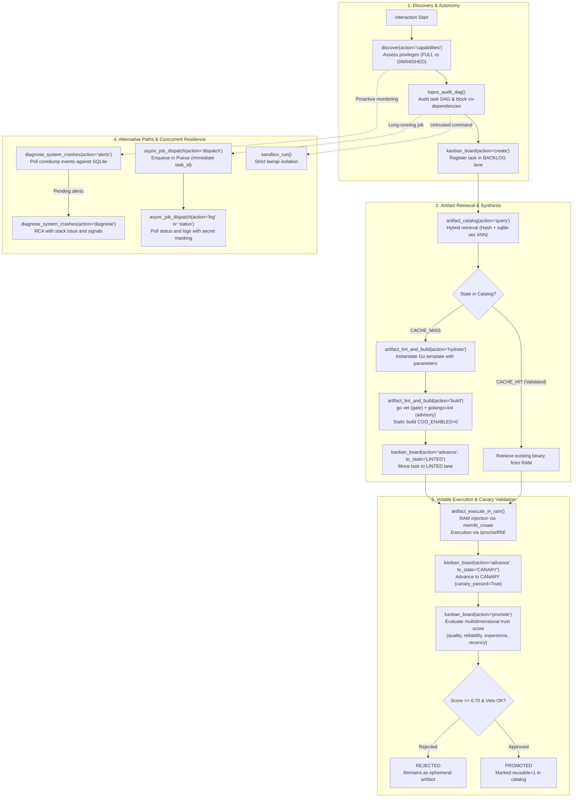

[↑ Back to top](#top)

---

## 5. Hybrid Semantic Memory (sqlite-vec) & Hot SQLite Concurrency

Resolves strict hashing fragility when handling natural language variability across LLMs via a
**two-tier retrieval system**: O(1) exact SHA-256 matching, falling back to cosine KNN over `sqlite-vec`.

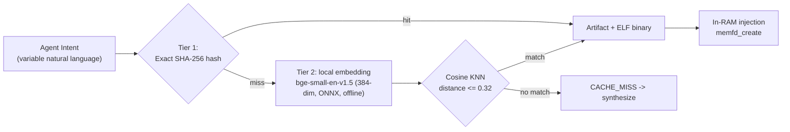

- Calibrated distance threshold of `0.32` (paraphrased intents span ~0.28–0.30; distinct intents >=0.36).
- **Total fail-soft**: Without `sqlite-vec` or local embedder models, the catalog operates identical to the hash-only mode.

### Persistence and Agent Access

The SQLite database at `~/.local/share/agent-os/artifacts.db` serves as the system's **evolutionary memory**:
- **Lives outside the repository** (user space, gitignored). Persists across branch switches, rebases, and workspace purges.
- **Offloaded Concurrency**: AnyIO thread workers (`anyio.to_thread.run_sync()`) prevent database I/O from blocking FastMCP's asynchronous event loop.

### Pico-Kanban: Artifact Confidence Scoring

The Pico-Kanban subsystem governs artifact lifecycle states (`BACKLOG` → `SYNTHESIZED` → `LINTED` → `CANARY` → `PROMOTED` / `REJECTED`).
Promotion requires passing a multidimensional confidence evaluation:

$$	ext{Score} = w_q \cdot Q + w_r \cdot R + w_e \cdot E + w_t \cdot T$$

Where $Q$ represents static lint quality, $R$ runtime reliability, $E$ historical execution count, and $T$ recency decay. Any critical failure triggers an immediate **hard veto**, setting promotion score to 0.

### Anti-Deadlock WAL Concurrency Architecture

To guarantee zero database lock contention under concurrent multi-agent access:
- **Segregated Read-Only Connections (`get_ro_connection`)**: Employs `file:...mode=ro` URIs, enabling infinite concurrent readers without taking WAL read locks.
- **Immediate Autocommit Writers (`get_rw_connection` + `BEGIN IMMEDIATE`)**: Acquires exclusive write locks at $t=0$, serializing write transactions cleanly and eradicating `database is locked` race conditions.
- **Performance PRAGMAs**: `PRAGMA wal_autocheckpoint=1000`, `PRAGMA busy_timeout=10000` (10s fail-soft timeout), `PRAGMA mmap_size=268435456` (256 MB memory-mapped pages), and `PRAGMA cache_size=-64000` (64 MB cache).

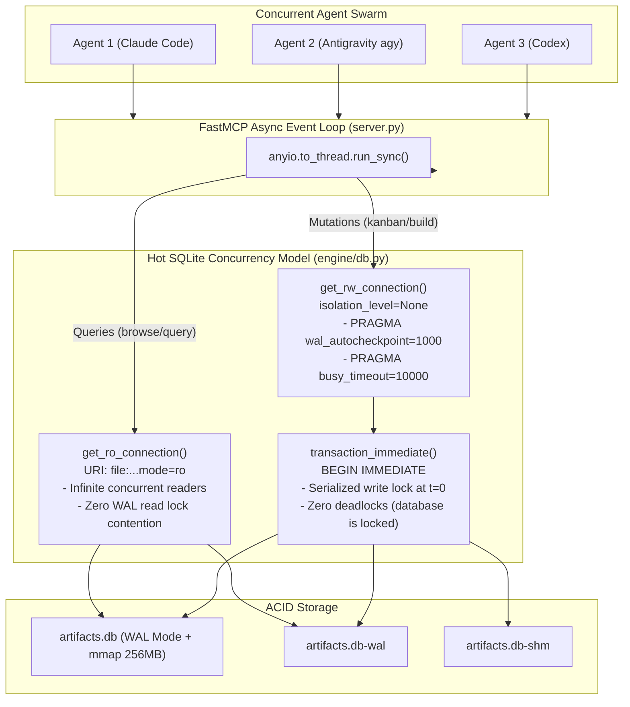

[↑ Back to top](#top)

---

## 6. Database Resilience: Online Hot Backup & Auto-Recovery (5 Slots)

To prevent evolutionary state loss during abrupt power cuts, kernel panics, or database corruption, AEP incorporates an autonomous hot backup engine with a 5-slot FIFO rotation pool and self-healing protocol in `engine/backup.py`.

```mermaid
flowchart TD
    subgraph Normal["1. Normal Flow: Online Streaming & FIFO Rotation (5 Slots)"]
        LiveDB["artifacts.db (Hot SQLite)"]
        Stream["conn.backup() (Online Streaming)<br/>- Non-blocking online streaming<br/>- Advisory flock lock: .backup.lock"]
        LiveDB --> Stream
        Stream --> Slot1["artifacts.db.bak.1<br/>(Most recent snapshot)"]
        Slot1 --> Shift["Cascading FIFO Rotation<br/>bak.1 -> bak.2 -> bak.3 -> bak.4 -> bak.5"]
        Shift --> Trunc["Old bak.5 purged (Pool capped at 5)"]
        Slot1 -.-> SHA["SHA-256 Checksum persistence"]
    end

    subgraph Recovery["2. Resilience Flow: Corruption Detection & Auto-Healing"]
        Corrupt{"PRAGMA integrity_check<br/>or header corruption"}
        Corrupt -->|"Failure detected"| Scan["verify_and_auto_recover()<br/>Scan backup slots (1 through 5)"]
        Scan --> CheckSlot{"Verify SHA-256 & SQLite integrity"}
        CheckSlot -->|"Valid slot found"| Restore["Atomic Restoration<br/>- Replace artifacts.db<br/>- Strict purge of -wal and -shm"]
        Restore --> Healthy["Healthy Database Restored OK"]
    end
```

### Hot Streaming Backup Mechanics
- **Online Hot Streaming (`conn.backup()`)**: Generates consistent page-level backups online without stopping the FastMCP server or blocking agent read/write operations.
- **Collision Advisory Locking (`fcntl.flock`)**: An OS-level lock (`.backup.lock`) serializes backup operations, preventing collisions between concurrent processes.
- **5-Slot FIFO Rotation Pool**: Maintains exactly 5 numbered copies in `~/.local/share/agent-os/backups/`. Slot 1 holds the newest snapshot; existing slots shift downwards (`1->2->3->4->5`), cleanly purging the oldest.
- **Cryptographic Integrity via SHA-256**: Every snapshot is verified against its SHA-256 checksum recorded in `backup_manifest.json` and validated via `PRAGMA integrity_check`.
- **Atomic Restoration with Sidecar Purge**: Restoring a slot immediately purges stale `-wal` and `-shm` sidecars to guarantee transactional consistency.
- **Transparent Self-Healing (`verify_and_auto_recover`)**: If a corrupt database is detected, the engine scans slots 1 to 5 sequentially, validates checksums, and restores the newest healthy snapshot automatically.

### Volatile In-RAM Micro-Snapshots (`create_micro_snapshot`)
- **Sub-Millisecond Latency (0.28 ms)**: Inspired by Firecracker MicroVM Copy-on-Write (COW) snapshotting, AEP streams SQLite pages directly into RAM (`:memory:`) via the backup API. Operates **5.7x faster** than disk storage with **zero disk footprint** (0 temporary files created).
- **Ephemeral Scratchpad Isolation**: Allows subagents to fork hypotheses or test migrations in memory without impacting the live database.

### Anti-Poisoning Architecture and Forensic Quarantine
- **Canary Integrity Tokens (`_aep_canary`)**: Enforces pre-backup integrity validation. If a rogue process alters the live database, canary verification aborts rotation, preventing historical backup pool contamination.
- **Immediate Forensic Quarantine (`backups/quarantine/`)**: Corrupted or tampered databases are automatically isolated as `artifacts.db.corrupt.<timestamp>` alongside a structured forensic JSON report, preserving the healthy FIFO pool.

### CLI Control Commands (`scripts/aep-ctl backup`)
```bash
# Check backup pool status and slots
./scripts/aep-ctl backup status

# Trigger an online hot backup (automatic FIFO rotation)
./scripts/aep-ctl backup backup

# Restore the database from a specific slot (e.g., slot 1)
./scripts/aep-ctl backup restore --slot 1

# Execute a sub-millisecond volatile in-RAM micro-snapshot
./scripts/aep-ctl backup micro-snapshot

# Deep verify database integrity and canary tokens
./scripts/aep-ctl backup verify-integrity
```

[↑ Back to top](#top)

---

## 7. Security Countermeasures, Isolation & Cryptographic Audit Ledger

AEP transforms systems engineering and auditing primitives into high-resilience agentic capabilities. To ensure agents or external actors cannot leverage these tools as exploit vectors, the platform enforces defense-in-depth countermeasures across `engine/privilege.py` and `engine/security.py`:

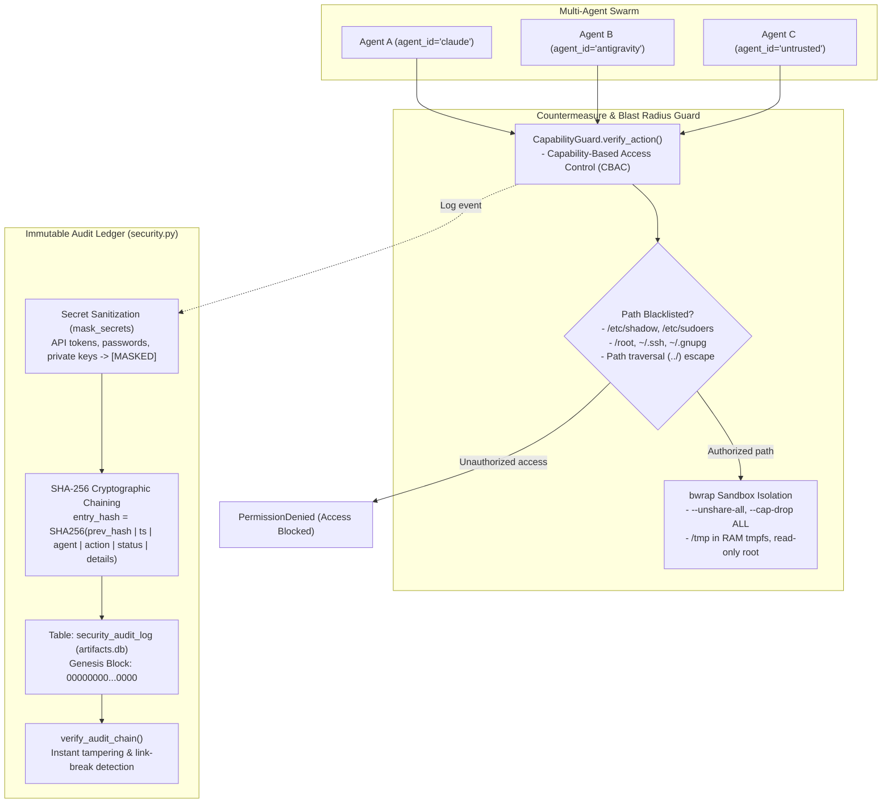

### CapabilityGuard & Critical Path Blacklisting
- **Strict Blacklist**: Categorically denies read, write, or execution access to sensitive host locations:
  - `/etc/shadow`, `/etc/gshadow`, `/etc/sudoers`, `/etc/security`
  - `/root` and root-owned subdirectories
  - `~/.ssh` (`id_rsa`, `id_ed25519`, `authorized_keys`)
  - `~/.gnupg` (PGP keys and trustrings)
  - `/proc/kcore`, `/dev/mem`, `/dev/kmem`
- **Path Traversal Immunity**: Canonicalizes paths (`resolve()`), aborting directory escape attempts (`../../`).
- **Segregated Multi-Agent Context**: FastMCP tool calls pass the caller's `agent_id` (`agent_id: str = "default"`), isolating and auditing actions across concurrent swarms.

### Tamper-Evident SHA-256 Audit Chain
- **Cryptographically Chained Ledger**: The `security_audit_log` table links every privileged action to the previous block's hash (`prev_hash`), starting from an all-zero genesis block (`GENESIS_HASH`).
- **Automatic Secret Sanitization (`mask_secrets`)**: Bearer tokens, credentials, passwords, and private API keys are redacted (`[MASKED]`) before persisting or computing hashes.
- **Zero-Trust Verification (`verify_audit_chain`)**: Deterministically recalculates the entire hash chain. Any row manipulation is immediately detected with the exact corrupted row identified.

```bash
# Verify cryptographic integrity of the security audit ledger
./scripts/aep-ctl audit verify
```

### In-Process Sandboxing via Landlock LSM (`engine/landlock.py`)
- **Kernel-Level User-Space Isolation**: Leverages the Linux Security Module (Landlock LSM, Linux 5.13+) via pure `ctypes` (`SYS_landlock_create_ruleset=444`, `SYS_landlock_add_rule=445`, `SYS_landlock_restrict_self=446`) and `prctl(PR_SET_NO_NEW_PRIVS, 1)`.
- **Zero External C Dependencies**: No shared `liblandlock` required. Confinement applies at thread/process level in under **4.2 ms** with automatic ABI detection (ABI v8 supported on Ubuntu kernel).
- **Static Go Diagnostic Probe (`diagnostic/go/landlock-guard`)**: Hermetic ELF probe compiled with `CGO_ENABLED=0` using Go standard library `syscall.Syscall6` to verify confinement without external modules.

### eBPF Security Observability (`kernel_trace`)
- **Active Intrusion Detection**: Features curated eBPF tracepoint modes (inspired by Tetragon and Falco) to detect unauthorized file descriptor manipulation or access attempts to blacklisted files (`security_open_denials`, `security_landlock_audit`, `security_exec_monitor`).

```bash
# Inspect Landlock LSM status and supported kernel ABI version
./scripts/aep-ctl security landlock-status
```

[↑ Back to top](#top)

---

## 8. Omarchy Enhancements (6 Distro-Agnostic Specs)

Innovations from Omarchy's "Agentic OS" (originally coupled to Arch Linux / Hyprland) and C2/Cloudflare IPC architectures decoupled into
6 **distribution-agnostic** specifications running on Ubuntu.

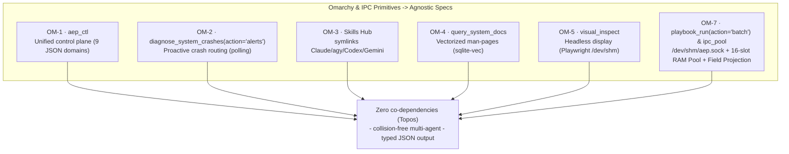

### Omarchy Distro-Agnostic Specification Matrix

| Specification | Name & Focus | AEP Component | Underlying Mechanism | Omarchy Decoupling (Ubuntu) | Fail-Soft Guarantee |
| :--- | :--- | :--- | :--- | :--- | :--- |
| **SPEC-OM-1** | **Unified System Control Plane** | `aep_ctl`<br/>`scripts/aep-ctl` | Deterministic CLI router to `systemctl`, `ip`, `ss`, `df`, and `dpkg` with JSON validation. | Replaces Arch commands (`pacman`, ad-hoc bash scripts) with universal POSIX utilities. | Invalid requests return JSON with `exit_code: 1` and usage documentation (`--schema`). Missing binaries emit `DEGRADED`. |
| **SPEC-OM-2** | **Active Crash Routing & Proactive Self-Healing** | `diagnose_system_crashes(action="alerts")`<br/>*(alias `check_crash_alerts`)* | Periodic polling calculating hash signatures (`pid:time:exe`) of coredumps, stored in `crash_events`. | Eliminates dependency on root systemd path units or Arch-specific background daemons. | If `coredumpctl` is missing (containers), returns `status: "DEGRADED"` without interrupting the agent. |
| **SPEC-OM-3** | **Universal Multi-Agent Skills Hub** | Symlink farm<br/>`scripts/setup.sh` | Convergent symlinks from `~/.agents/skills/` to Claude, Antigravity, Codex, and Gemini directories. | Decouples skills from Hyprland/Arch, enabling universal multi-agent synchronization on Ubuntu. | Idempotent linking; if an agent is absent on the host, setup continues cleanly without errors. |
| **SPEC-OM-4** | **Local System Docs Vectorizer** | `query_system_docs`<br/>`engine/docs_vectorizer.py` | Local `system_docs.db` vector store with `sqlite-vec` and CPU embeddings (`bge-small-en-v1.5`) over `man` pages. | Replaces heavy ChromaDB stores and remote LLM API lookups with sub-5ms offline ONNX inference. | Lazy loader; if vector dependencies are absent, returns a structured degraded response without throwing exceptions. |
| **SPEC-OM-5** | **Headless Visual & Display Actuator** | `visual_inspect`<br/>`engine/headless_display.py` | Headless Chromium automation via Playwright with ephemeral RAM screenshots (`/dev/shm`). | Eliminates need for physical Wayland/Hyprland compositors or X11 servers (`Xvfb`) for UI audits. | If Playwright or Chromium is absent, returns `DISPLAY_UNAVAILABLE` with an exact resolution command. |
| **SPEC-OM-7** | **Shared-Memory Socket Pool & Ephemeral Batch/Code Mode** | `playbook_run(action="batch")`<br/>`engine/ipc_pool.py`<br/>`/dev/shm/aep.sock` | Persistent AF_UNIX socket multiplexer in Linux shared memory (`/dev/shm`), 16-slot session pool, server-side field projection (`select_fields`). | Replaces chat context hopping and cold process spin-up with warm <0.5ms IPC and single-turn DAG batching. | Fail-soft to `/tmp/aep_pool` if `/dev/shm` is unwritable; strict zero-FD leak (`fd_delta == 0`). |

---

#### Detailed Technical Specifications (SPEC-OM-1 to SPEC-OM-7)

#### 1. SPEC-OM-1: Unified System Control Plane (`aep_ctl` / `scripts/aep-ctl`)
- **Objective**: Provide a deterministic CLI and RPC interface for language models to inspect and modify OS state without hallucinating flags or parsing unstructured text.
- **Functional Domains**:
  - `service`: Inspect status (`status`) or mutate units (`start`, `stop`, `restart`). In `DIMINISHED` mode, automatically scopes to `systemctl --user`; in `FULL` mode, uses `sudo -n systemctl`.
  - `network`: General interface inspection (`inspect` via `ip -j addr`), routing tables (`routes` via `ip -j route`), and listening sockets (`listeners` parsing `ss -tuln` into JSON).
  - `storage`: Partition utilization (`usage` via `df -B1`), active mount points (`mounts`), and disk topology (`disks` via `lsblk -J`).
  - `package`: Installed packages (`installed` via `dpkg-query`), presence verification (`check`), and dependency information (`info` via `apt-cache policy`).
- **Guarantees**: Suppresses interactive pagers, auto-documents contracts via `--schema`, and exits with code 1 and usage JSON when arguments are missing.

#### 2. SPEC-OM-2: Active Crash Routing & Proactive Self-Healing (`diagnose_system_crashes(action="alerts")`)
- **Objective**: Transform passive coredump analysis into a proactive early-warning loop to prevent agents from building on unstable systems.
- **Synchronization Mechanics**:
  1. Executes `coredumpctl list --json=short --reverse -n 100` non-invasively.
  2. Extracts PID, timestamp, and crashed executable path, composing a unique fingerprint: `pid:timestamp:executable`.
  3. Executes an atomic `INSERT OR IGNORE` into the `crash_events` table in `artifacts.db`.
  4. Returns only unresolved alerts (`resolved = 0`), allowing agents to call `diagnose_system_crashes()` to extract stack traces and plan remediation.
- **Decoupling**: Unlike Omarchy's window-manager-specific scripts, operates purely in user space across Ubuntu/Debian distributions with systemd.

#### 3. SPEC-OM-3: Universal Multi-Agent Skills Hub
- **Objective**: Consolidate agent skills and tools into a single canonical source of truth (`~/.agents/skills/`), eliminating discrepancies between different agent execution environments.
- **Symlink Architecture**:
  - Canonical Directory: `~/.agents/skills/` (read natively by OpenAI Codex).
  - Gemini CLI Link: `~/.gemini/skills/` -> `~/.agents/skills/`.
  - Antigravity Link: `~/.gemini/config/skills/` -> `~/.agents/skills/`.
  - Antigravity Migration Link: `~/.gemini/antigravity-cli/skills/` -> `~/.agents/skills/`.
- **Maintenance Guarantees**: Modifications made to a skill by any subagent are immediately reflected across all clients without manual copying.

#### 4. SPEC-OM-4: Local System Docs Vectorizer (`query_system_docs`)
- **Objective**: Resolve exact syntax, flags, and configuration options of standard Linux utilities in real time without requiring web access or wasting context tokens.
- **Ingestion & Retrieval Pipeline**:
  - **Ingestion**: Runs `man <cmd>` with `MANPAGER=cat` and `MANWIDTH=80` to extract clean text, splitting manual pages into coherent paragraph chunks (up to 50 chunks per command).
  - **Local Vectorization**: Computes 384-dimensional embeddings via quantized `bge-small-en-v1.5` running on CPU with ONNX Runtime.
  - **Storage**: Persists chunks and vectors in `~/.local/share/agent-os/system_docs.db` using `sqlite-vec` virtual tables (`vec_docs`).
  - **Query**: `query_system_docs(query, limit)` vectorizes agent queries and executes cosine distance searches, returning relevant chunks in under 5 ms.

#### 5. SPEC-OM-5: Headless Visual & Display Actuator (`visual_inspect`)
- **Objective**: Provide agents with visual inspection capabilities on headless servers or cloud instances lacking physical displays, enabling UI audits and local document reviews.
- **In-RAM Capture Lifecycle**:
  1. Instantiates headless Chromium via Playwright (`headless=True`, flags `--no-sandbox`).
  2. Navigates to requested URLs (`http://`, `https://`, or local `file://`) using the configured viewport (default 1280x800).
  3. Waits for page `load` event. If a CSS selector is specified, targets the designated element.
  4. Writes screenshots directly into shared volatile RAM (`/dev/shm/aep_shot_<uuid>.png`).
  5. Encodes file bytes into Base64, calculates latency, and unlinks the temporary RAM file immediately, ensuring zero secondary disk persistence.

#### 6. SPEC-OM-7: Shared-Memory UNIX Socket Pool & Ephemeral Batch/Code Mode (`playbook_run(action="batch")`)
- **Objective**: Eliminate per-call process spin-up latency and chat-turn token bloat in multi-agent tool chains.
- **Architectural Mechanics**:
  1. **Session Pool (`/dev/shm/aep_pool/slot_<id>`)**: Manages up to 16 warm execution slots with 60s TTL, automatic reaping, and thread/async-safe slot leasing.
  2. **UNIX Socket Mux (`/dev/shm/aep.sock`)**: Persistent AF_UNIX daemon with line-delimited JSON framing, 16 MB bounded buffer, and guaranteed zero file descriptor leaks (`fd_delta == 0`).
  3. **Cloudflare-Style Ephemeral Batching**: Single-turn multi-step pipeline execution supporting inter-step parameter piping (`$prev.*`, `$steps.<id>.*`), multi-agent shared RAM session cache piping (`$cache.<key>`, `$slot.<key>`), and partial error diagnostics preservation (`failed_steps`).
  4. **Server-Side Field Projection (`select_fields`)**: Discards verbose JSON metadata directly in RAM prior to network serialization, reducing payload tokens by 80–95% with smart dot-path fallback mapping.
  5. **Pico-Triad Multi-Agent Concurrency Isolation**:
     - **Pico-Jenkins Slot Compilation**: `artifact_lint_and_build(action="build")` compiles Go diagnostic probes inside dedicated `/dev/shm` session slots, publishing output binaries atomically via hidden `.tmp` staging and `os.replace` to prevent binary corruption during parallel builds.
     - **Atomic Kanban Upsert**: `kanban.upsert_build_task()` executes task creation and attempt/score progression under a single `transaction_immediate(conn)` transaction, completely eliminating TOCTOU race conditions and duplicate task cards.
     - **Vector Embedding Offloading**: `engine/catalog.py` serializes float32 vector embeddings outside SQLite write transactions, reducing write-lock duration by >95% and eliminating `vec0` primary key contention.
     - **Pico-Ansible Saved Playbook Parity**: `playbook_run(action="run")` provides 100% parity with `action="batch"` (slot leasing, `$prev.*` / `$steps.*` / `$cache.*` reference piping, `failed_steps` retention, and server-side field projection reducing tokens by 94%+).
  6. **Non-Pico System-Wide Concurrency Hardening**:
     - **Audit Ledger Fork Prevention**: `engine/security.py` serializes `record_audit_event()` with a re-entrant mutex (`_AUDIT_LOCK`) and `transaction_immediate(conn)` to eliminate race conditions in the SHA-256 hash chain during parallel subagent tool invocations.
     - **Thread-Safe In-Memory Snapshots**: `engine/backup.py` synchronizes `create_micro_snapshot()`, `restore_micro_snapshot()`, and `list_micro_snapshots()` under `_SNAPSHOT_LOCK` with `check_same_thread=False` `:memory:` connections, allowing cross-thread RAM snapshot manipulation without SQLite driver thread collision.
     - **Vector Engine Double-Checked Locking**: `server.py` guards `ManPagesVectorizer` singleton initialization under `_DocsHolder.lock` to prevent parallel instantiation races during high-concurrency doc queries.
- **Control Plane Domain**: Unified under `aep_ctl(domain="ipc", action="status"|"ping"|"lease"|"release"|"reap"|"pool"|"flush"|"metrics"|"cache")` and `./scripts/aep-ctl ipc`.

---

### Architecture and Data Flow of Omarchy Enhancements

The following diagram details the three-tier architecture articulating Omarchy tools with AEP engines and underlying Ubuntu OS primitives:

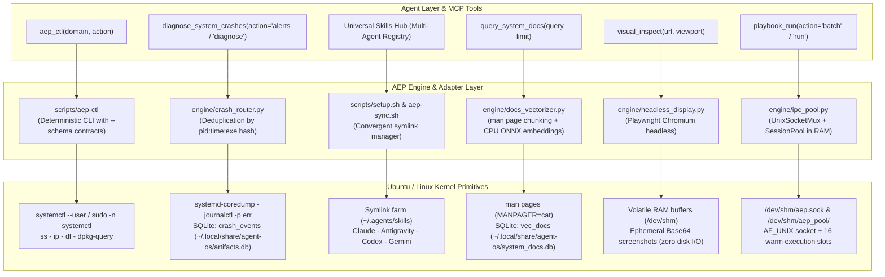

[↑ Back to top](#top)

---

## 9. Two-Tier Privilege Model + Manifest

Privileged tools operate under two tiers (least-privilege by default). `aep_capabilities()`
returns a **self-describing manifest modeled after `chmod`/777** allowing the consuming AI to
understand its immediate execution boundaries.

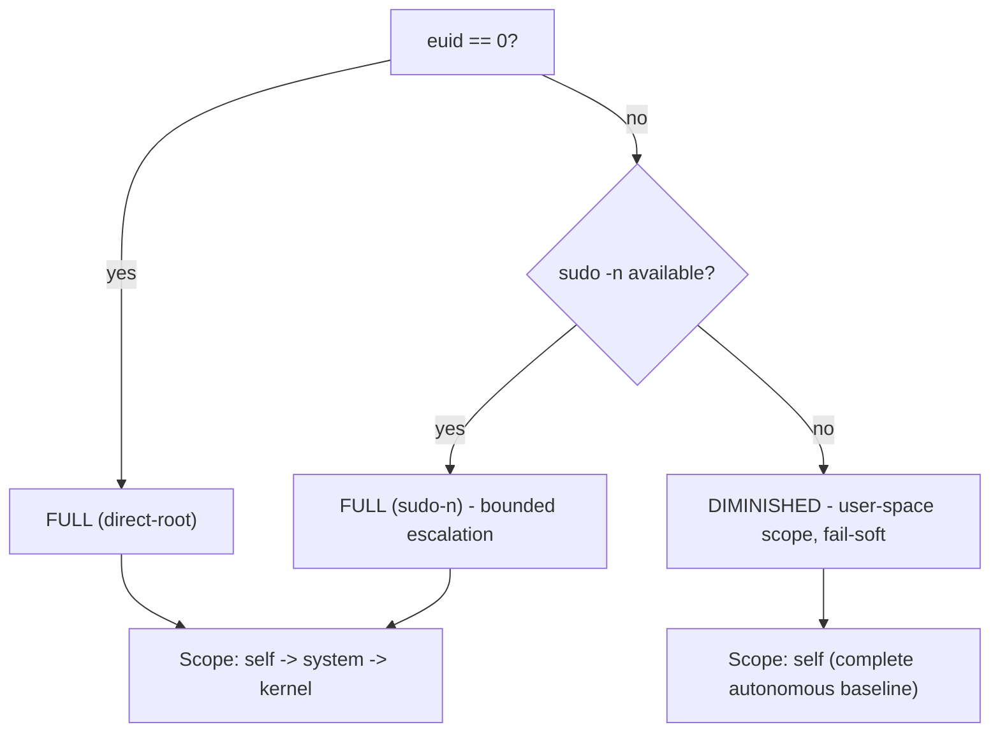

**Capability Codes** (repurposed rwx triad): `r`=SENSE, `w`=ACT, `x`=EXECUTE via non-traditional paths.

| octal | perm | meaning |
| :---: | :---: | :--- |
| 7 | `rwx` | sense + act + execute |
| 6 | `rw-` | sense + act |
| 5 | `r-x` | sense + execute |
| 4 | `r--` | sense only |
| 0 | `---` | no access (requires FULL) |

> Autonomous operation is fully functional in **DIMINISHED** mode; the **FULL** tier only broadens
> `kernel_observability` (`0->4`) and `service_control` (`4->6`). Privilege expands capability, but is
> never a prerequisite for baseline autonomy.

[↑ Back to top](#top)

---

## 10. Auto-Plug: Atomic MCP Self-Management

Following any code modification, `aep-sync.sh` **validates** the server (compilation + import check)
and **only upon passing** re-registers MCP across all clients, pointing to a stable launcher that
resolves virtual environments hermetically. A `pre-commit` hook enforces the same validation.

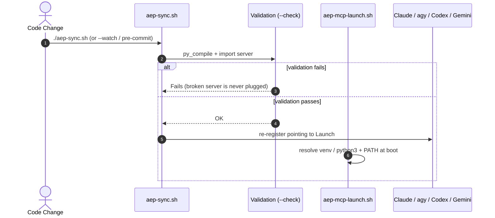

[↑ Back to top](#top)

---

## 11. Shell-Agnostic Environment

Environment inheritance **does not assume Oh My Zsh**. A single POSIX-compliant environment file is
sourced from native startup files. Tested on **Bash, Zsh, and Dash**.

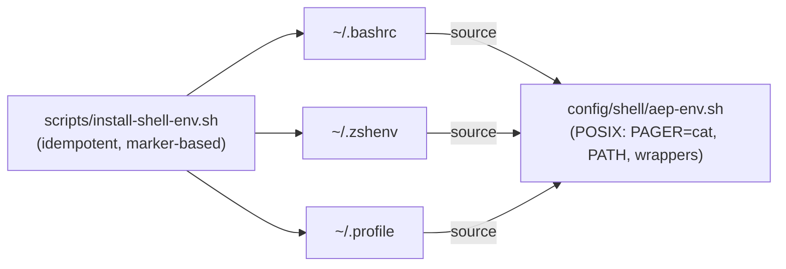

[↑ Back to top](#top)

---

## 12. Clean-Slate Installation, Health Audit & Autonomous Updater

AEP incorporates a unified lifecycle engine in `scripts/setup.sh` operating as a zero-dependency
bootstrapper, continuous updater, and non-destructive health auditor.

### 12.1 CLI Invocation Modes

```bash
cd /path/to/agent-execution-plane

# 1. Full Idempotent User-Space Installation
./scripts/setup.sh

# 2. Read-Only System Health Audit (zero disk mutations, exit 0/1)
./scripts/setup.sh --check

# 3. Autonomous Updater (uv self update, venv upgrade & probe recompilation)
./scripts/setup.sh --update
```

### 12.2 Autonomous Bootstrapper Architecture

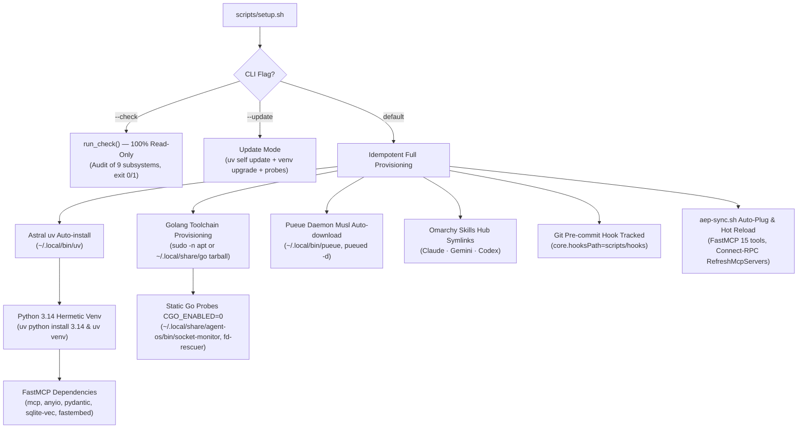

### 12.3 Python 3.14 Production LTS Baseline
- **Hermetic Isolation**: Managed via `uv` (`uv python install 3.14`), decoupled completely from host operating system packages (PEP 668 compliant, strictly without `--system-site-packages`).
- **Modern Primitives**: Deferred type annotation evaluation (PEP 649), interpreter JIT specialization, and native concurrency support.
- **Automated Test Suite**: `tests/test_setup_idempotency.sh` and `tests/test_engine_suite.py` validate consecutive run idempotency, Python 3.14 runtime integrity, static Go probes, and database resilience.

[↑ Back to top](#top)

---

## 13. Repository Structure

```
agent-execution-plane/
├── server.py                       # FastMCP server (15 RPC tools, 18 capabilities)
├── engine/
│   ├── db.py                       # Hot SQLite WAL connections, BEGIN IMMEDIATE, anti-deadlock
│   ├── backup.py                   # Hot streaming backup engine, 5 FIFO slots, auto-recovery & quarantine
│   ├── security.py                 # SHA-256 cryptographic audit ledger (security_audit_log) & secret masking
│   ├── telemetry.py                # Per-request latency, byte/token estimation, RSS/FD deltas & agent-brief envelope
│   ├── privilege.py                # CapabilityGuard, CBAC, shared schema, binary readiness & Kali tactical playbook
│   ├── landlock.py                 # User-space Landlock LSM in-process confinement (Linux 5.13+)
│   ├── catalog.py                  # Artifact catalog + hybrid semantic memory (sqlite-vec)
│   ├── embedder.py                 # Local ONNX CPU embedder (bge-small-en-v1.5)
│   ├── kanban.py                   # Multidimensional Pico-Kanban board with defect vetoes
│   ├── ponder.py                   # Multidimensional confidence and trust scoring engine
│   ├── matcher.py                  # BM25F multi-signal lexical relevance matcher
│   ├── hydrator.py                 # Go template hydrator with parameter binding
│   ├── topos_guard.py              # Topos DAG anti-co-dependency guardian
│   ├── crash_router.py             # Proactive coredump routing (OM-2)
│   ├── docs_vectorizer.py          # Ubuntu man page offline vectorizer (OM-4)
│   ├── headless_display.py         # Playwright Chromium in-RAM headless visual capture (OM-5)
│   └── ipc_pool.py                 # Shared-memory UNIX socket mux (/dev/shm/aep.sock) & 16-slot session pool (OM-7)
├── diagnostic/go/
│   ├── socket-monitor/main.go      # Static ELF Go probe for /proc/net/tcp
│   ├── fd-rescuer/main.go          # Static ELF Go probe for /proc/PID/fd
│   └── landlock-guard/main.go      # Static ELF Go probe for Landlock LSM confinement verification
├── tests/
│   ├── test_setup_idempotency.sh   # Automated provisioning idempotency test suite
│   ├── test_engine_suite.py        # Core engine unit and integration test suite (pytest)
│   ├── test_primitives_benchmark.py # Latency benchmark suite (RAM snapshot vs disk, Landlock vs bwrap)
│   ├── test_agent_experience_evaluation.py # Agent-facing contract, clean bootstrap, sandbox, telemetry & Kali playbook suite
│   └── test_spec_om7_ipc_batch.py  # Spec OM-7 IPC socket mux, batch piping, field projection & multi-agent concurrency suite
├── schemas/
│   ├── database.sql                # DDL (artifacts, metrics, crash_events, audit)
│   └── artifact_contract.cue       # Declarative CUE artifact schemas
├── templates/                      # Go atomic probe catalog templates
├── config/shell/aep-env.sh         # Agnostic POSIX environment inheritance (bash/zsh/dash)
├── scripts/
│   ├── setup.sh                    # Bootstrapper, updater, and health auditor (--check)
│   ├── aep-ctl                     # Deterministic CLI (service, network, storage, package, backup, security, audit)
│   ├── aep-mcp-launch.sh           # Stable launcher with hermetic virtual environment resolution
│   ├── aep-sync.sh                 # Multi-agent atomic MCP synchronization
│   ├── install-shell-env.sh        # Shell environment installer
│   └── hooks/pre-commit            # Git pre-commit validation hook
├── .gitattributes · .gitignore
├── pyproject.toml                  # Python 3.14 configuration, Ruff py314, dependency manifest
├── LICENSE                         # Apache License 2.0
└── README.md                       # Single source of truth (this document)
```

[↑ Back to top](#top)

---

## 14. Truthful Inventory of Single Source of Truth

| Component | Physical Reality | Note |
| :--- | :--- | :--- |
| `memfd_create` (RAM exec) | ✅ Operational | Standard Linux kernel primitive (glibc 2.27+ / POSIX); anonymous memory staging (zero disk I/O) |
| `bwrap` (sandbox) | ✅ Operational | `sandbox_run`: namespace isolation with `--unshare-all` and `--cap-drop ALL` |
| `bpftrace` (eBPF) | ✅ Operational (FULL) | `kernel_trace`; escalates via `sudo -n`, degrades to DIMINISHED |
| Pueue (async queues) | ✅ Operational | musl-compiled binary in `~/.local/bin`, verified end-to-end |
| Semantic Memory (`sqlite-vec`) | ✅ Operational | Two-tier hybrid retrieval (hash + cosine kNN), fail-soft |
| Anti-Deadlock Hot SQLite | ✅ Operational | `engine/db.py`: `get_ro_connection` (`mode=ro`), `get_rw_connection`, `transaction_immediate` (`BEGIN IMMEDIATE`) |
| DB Resilience (5-slot backup) | ✅ Operational | `engine/backup.py`: streaming hot backup `conn.backup()`, 5-slot FIFO rotation, SHA-256 and self-healing |
| Security & Audit Ledger | ✅ Operational | `engine/security.py`, `privilege.py`: `CapabilityGuard`, sensitive blacklist, SHA-256 chained audit ledger |
| Landlock LSM In-Process | ✅ Operational | `engine/landlock.py` (ctypes 444/445/446 + `PR_SET_NO_NEW_PRIVS`), ABI v8, Go probe `landlock-guard` |
| Anti-Poisoning & RAM Snapshots | ✅ Operational | `engine/backup.py`: canary `_aep_canary`, forensic quarantine, volatile `:memory:` snapshot in 0.28 ms |
| Python 3.14 Production LTS | ✅ Operational | Hermetic venv without `--system-site-packages` via `uv`, target `py314` in Ruff |
| Static Go ELF Probes | ✅ Operational | Static binaries `socket-monitor`, `fd-rescuer`, `landlock-guard` built with `CGO_ENABLED=0` executable in RAM via `memfd` |
| Pico-Kanban (Scoring) | ✅ Operational | Abstract board in `artifacts.db`; promotes artifacts to `reusable` by multidimensional score |
| Pico-Playbooks (Automation) | ✅ Operational | Orchestrates tools/artifacts into Topos-validated DAGs; E2E execution and confidence scoring |
| Catalog Discovery | ✅ Operational | `artifact_catalog`: confidence browsing + semantic top-K |
| Omarchy & IPC (6 specs) | ✅ Operational | `aep_ctl` (9 domains incl. `ipc`), crash routing, skills hub, man-pages, headless Playwright display, `/dev/shm/aep.sock` + 16-slot RAM pool & batch projection (OM-7) |
| Dual-Tier Privilege | ✅ Operational | `privilege.py` + `aep_capabilities` manifest (18 capabilities) |
| Auto-Plug MCP | ✅ Operational | launcher + `aep-sync.sh` (+ `--watch` + Connect-RPC) |
| Shell-Agnostic Inheritance | ✅ Operational | bash/zsh/dash; zero Oh My Zsh dependencies |
| Nushell (`nu`) / `jc` | ⏳ Deferred (non-critical) | `aep_ctl` already delivers structured typed JSON |

[↑ Back to top](#top)

---

## 15. RE as SDD & Inspiration Matrix

AEP development applies Reverse Engineering as Software Design Document (RE as SDD) to
decouple kernel primitives from monolithic implementations:
**(1)** isolate the Linux kernel primitive, **(2)** formalize its platform-agnostic specification,
and **(3)** engineer a minimalistic, typed, and end-to-end verified implementation.

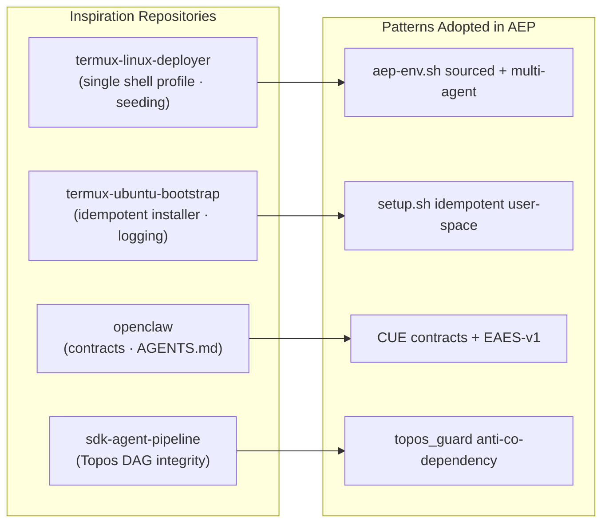

> This `README.md` is the **single source of truth** for the project: all architectural
> specifications, guarantees, and audits live here without documentation sprawl.

[↑ Back to top](#top)

---

## 16. License and Terms

This project is licensed under the terms of the **Apache License 2.0**. Refer to the [`LICENSE`](LICENSE) file for the full terms and conditions of use, reproduction, distribution, and patent grants.

- **Compatibility**: Permissive and enterprise-friendly, compatible with MIT, BSD-3-Clause, and public-domain databases (SQLite).
- **Patent Grant**: Features bilateral patent defense and licensing protections (Section 3 of Apache 2.0).
- **Disclaimer of Warranty & Limitation of Liability**: Software provided on an "AS IS" basis without warranties or conditions of any kind (Sections 7 & 8 of Apache 2.0).

[↑ Back to top](#top)
