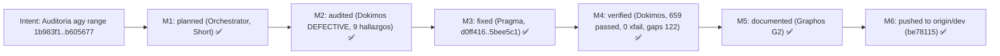
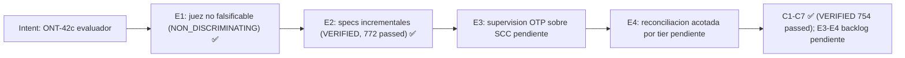
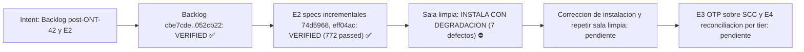
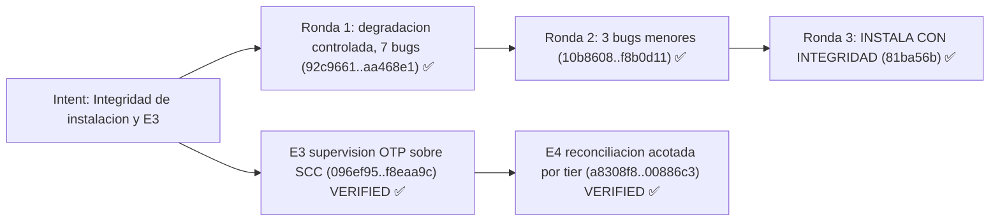
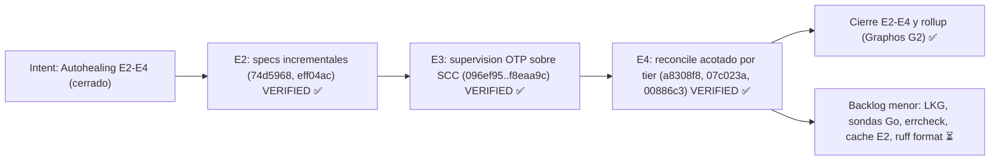
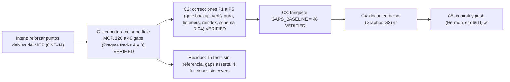
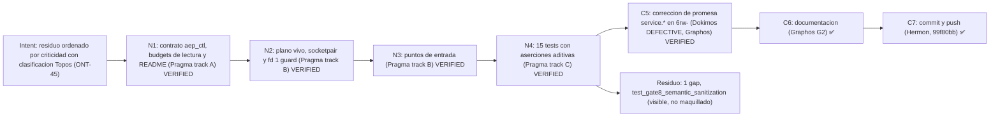
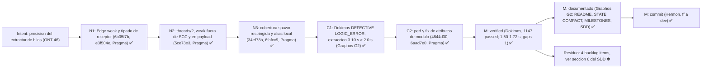

# Agent Execution Plane (AEP) — Project Milestones

## 1. Intent Reinforcement Graph

## 2. Milestone Matrix

| Phase | Milestone / Intent | Responsible Agents | Target Modules | Status |
| :---: | :--- | :--- | :--- | :---: |
| **Foundation** | Core FastMCP Server, memfd RAM execution, bubblewrap sandbox, dual-tier privilege | Archon, Pragma, Dokimos, Hermon | `server.py`, `engine/privilege.py` | **COMPLETED ✅** |
| **Forensics** | sqlite-vec memory, coredump routing, man-pages semantic store, eBPF tracing | Archon, Pragma, Dokimos, Hermon | `server.py`, `engine/docs_vectorizer.py` | **COMPLETED ✅** |
| **Discovery** | Pico-Playbooks, discover router, bilingual EN/ES lexical matching | Archon, Pragma, Dokimos, Hermon | `server.py`, `engine/matcher.py`, `engine/playbook.py` | **COMPLETED ✅** |
| **Hardening** | Template feedback, cold-aging immunity, Pico tools hardening, safe GC | Archon, Pragma, Dokimos, Hermon | `server.py`, `engine/kanban.py`, `engine/catalog.py` | **COMPLETED ✅** |
| **Consolidation 1** | Unify `semantic_memory` (`artifact_query`, `catalog`, `reindex`, `prune` -> `artifact_catalog`) | Archon, Ontos, Pragma, Dokimos, Graphos, Hermon | `server.py`, `engine/privilege.py` | **VERIFIED & COMMITTED (30 Tools) ✅** |
| **Consolidation 2** | Unify `task_management` (`kanban_*` 8 tools -> `kanban_board` polymorphic action router) | Archon, Ontos, Pragma, Dokimos, Graphos, Hermon | `server.py`, `engine/kanban.py`, `engine/privilege.py` | **VERIFIED & COMMITTED (23 Tools) ✅** |
| **Consolidation 3** | Unify `automation` (`playbook_*` 4 tools -> `playbook_run` polymorphic action router) | Archon, Ontos, Pragma, Dokimos, Graphos, Hermon | `server.py`, `engine/playbook.py`, `engine/privilege.py` | **VERIFIED & COMMITTED (20 Tools) ✅** |
| **Consolidation 4** | Unify `artifact_synthesis` (`template_*`, `artifact_hydrate`, `lint_and_build` -> `artifact_lint_and_build`) | Archon, Ontos, Pragma, Dokimos, Graphos, Hermon | `server.py`, `engine/privilege.py` | **VERIFIED & COMMITTED (17 Tools) ✅** |
| **Consolidation 5** | Unify `async_dispatch` (`async_job_dispatch`, `inspect` -> `async_job_dispatch`) + FD Hardening | Archon, Ontos, Pragma, Dokimos, Graphos, Hermon | `server.py`, `scripts/aep-sync.sh`, `engine/privilege.py` | **VERIFIED & COMMITTED (16 Tools) ✅** |
| **Consolidation 6** | Unify `crash_forensics` (`diagnose_system_crashes`, `check_crash_alerts` -> `diagnose_system_crashes`) + Subprocess Hardening | Archon, Ontos, Pragma, Dokimos, Graphos, Hermon | `server.py`, `engine/privilege.py`, `scripts/aep-sync.sh` | **VERIFIED & COMPLETED (15 Tools) ✅** |
| **Consolidation 7** | Unify `orientation` (`discover`) & dedicated `process_introspection` (`process_inspect`) (15 tools, 16 capabilities 1:1) | Archon, Ontos, Pragma, Dokimos, Graphos, Hermon | `server.py`, `engine/privilege.py` | **VERIFIED & DOCUMENTED (15 Tools, 16 Capabilities 1:1 Parity) ✅** |
| **Runtime Hardening** | Post-Consolidation Runtime Hardening, Secret Masking & Full README Sync (7 gaps: GAP-SEC-01 to GAP-DOC-01) | Archon, Ontos, Pragma, Dokimos, Graphos, Hermon | `engine/security.py`, `server.py`, `engine/headless_display.py`, `engine/catalog.py`, `scripts/aep-ctl`, `engine/kanban.py`, `README.md` | **VERIFIED & COMPLETED (Task 109 PROMOTED 0.9949) ✅** |
| **Roadmap & Hardening Complete** | Complete 7-Phase Tool Consolidation & Runtime Hardening (33 → 15 Tools, 16 Capabilities) | All Pipeline Agents | Entire AEP Repository | **100% COMPLETED ✅** |
| **Memory-Mapped Hybrid SQLite (ONT-09)** | Standardize 5 SQLite touchpoints on `engine/db.py` (PRAGMA mmap_size 256MB, cache_size 64MB, WAL) | Archon, Ontos, Pragma, Dokimos, Graphos, Hermon | `engine/db.py`, `engine/catalog.py`, `engine/kanban.py`, `engine/crash_router.py`, `engine/playbook.py`, `engine/docs_vectorizer.py`, `server.py` | **COMPLETED & VERIFIED (Task 110 PROMOTED) ✅** |
| **Code Modernization & Concurrency (ONT-10)** | Modernize typing (PEP 585/604), Ruff SAST (P0-P3), AnyIO thread offloading, segregated RO/RW SQLite & BEGIN IMMEDIATE | Archon, Ontos, Pragma, Dokimos, Graphos, Hermon | `engine/db.py`, `server.py`, `engine/*.py` | **VERIFIED & PROMOTED (Task 111 Score: 0.925 TRUST) ✅** |
| **Database Resilience & Security Hardening (ONT-11)** | 5-slot online hot backup rotation, atomic restore & self-healing, CapabilityGuard, RAM exec safety, multi-agent context segregation, bwrap hardening, SHA-256 audit log | Archon, Ontos, Pragma, Dokimos, Graphos, Hermon | `engine/backup.py`, `engine/privilege.py`, `engine/db.py`, `engine/security.py`, `server.py`, `scripts/aep-ctl` | **VERIFIED & PROMOTED (Task 112 Score: 0.9250 TRUST) ✅** |
| **Autonomous Setup & Python 3.14 (ONT-12)** | Dual-mode bootstrapper & updater (`scripts/setup.sh`), Python 3.14 LTS migration, hermetic `uv` venv, Go toolchain self-provisioning, static probes (`socket-monitor`, `fd-rescuer`), Pueue daemon, bwrap, and 7 verification gates | Archon, Ontos, Pragma, Dokimos, Graphos, Hermon | `pyproject.toml`, `scripts/setup.sh`, `scripts/aep-mcp-launch.sh`, `scripts/aep-sync.sh`, `diagnostic/go/`, `tests/test_setup_idempotency.sh`, `README.md` | **VERIFIED & COMMITTED (Task 113 PROMOTED 0.9250 TRUST) ✅** |
| **Kernel Sandboxing & Anti-Poisoning Backups (ONT-13)** | RE as SDD for Linux primitives (`docs/sdd/`), in-process Landlock LSM sandboxing (`engine/landlock.py`), anti-poisoning hot backup engine & quarantine (`engine/backup.py`), volatile RAM micro-snapshots (`engine/db.py`), eBPF security probing (`server.py`), Go static Landlock probe (`diagnostic/go/landlock-guard`), CLI integration (`scripts/aep-ctl`), and verification suite | Archon, Ontos, Pragma, Dokimos, Graphos, Hermon | `docs/sdd/`, `engine/landlock.py`, `engine/backup.py`, `engine/db.py`, `server.py`, `diagnostic/go/`, `templates/`, `scripts/aep-ctl`, `tests/` | **VERIFIED & PROMOTED (Task 114 Score: 0.9250 TRUST) ✅** |
| **Public GitHub Release & Compliance (ONT-14)** | Apache 2.0 license (`LICENSE`), git config hardening (`.gitignore`, `.gitattributes`), EDR/sandbox warning & license in `README.md`, pre-deploy quality verification, public GitHub repo creation (`ancrz/agent-execution-plane`) | Archon, Ontos, Pragma, Dokimos, Graphos, Hermon | `LICENSE`, `.gitignore`, `.gitattributes`, `README.md`, GitHub Remote | **VERIFIED & PROMOTED (Task 115 Score: 0.950 TRUST) ✅** |
| **Self-Evolutionary Suite & Kali Semantics (ONT-15)** | Hermetic clean-install bootstrap, single-source schema (`engine/privilege.py`), bwrap network isolation default (`share_net=False`), request telemetry envelopes, and Kali-MCP tactical playbook (`discover(action="playbook")`). | Archon, Pragma, Dokimos, Graphos, Hermon | `engine/catalog.py`, `engine/kanban.py`, `engine/privilege.py`, `server.py`, `engine/telemetry.py`, `scripts/aep-ctl`, `tests/` | **VERIFIED & PROMOTED (Task 120 Score: 0.950 TRUST) ✅** |
| **Topos Anti-Cascade Battery & Setup Hardening (ONT-18)** | Prevent SQLite `binary_blob` wipe cascade on setup re-run via `COALESCE` upsert, fix Pueue release regex in `scripts/setup.sh`, Step 8 quoted heredoc probe seeding (`socket_monitor`/`fd_rescuer`), and `setup.sh --check` schema/zero-canary verification. | Archon, Ontos, Pragma, Dokimos, Graphos, Hermon | `engine/catalog.py`, `scripts/setup.sh`, `tests/test_agent_experience_evaluation.py`, `README.md` | **VERIFIED & PROMOTED (Task 122 Score: 0.9940 TRUST, 43/43 Tests) ✅** |
| **IPC Socket Pool & Ephemeral Batch/Code Mode (ONT-21)** | Spec OM-7: Shared-memory UNIX socket session pool (`/dev/shm/aep.sock`), Cloudflare-style ephemeral batch/code mode, server-side field projection (`fields: list[str]`), `ipc` control plane domain, and SDD documentation. | Archon, Ontos, Pragma, Dokimos, Graphos, Hermon | `engine/ipc_pool.py`, `engine/playbook.py`, `engine/privilege.py`, `server.py`, `scripts/aep-ctl`, `docs/sdd/`, `tests/` | **VERIFIED & PROMOTED (Task 129 Score: 1.0 TRUST, 58/58 Tests) ✅** |
| **Spec OM-7 Omission Gaps & Cache Piping (ONT-22)** | Resolves GAP-OM22-1 (smart dot-path projection fallbacks), GAP-OM22-2 (`failed_steps` diagnostic preservation), GAP-OM22-3 (multi-agent cross-turn RAM session cache piping `$cache.<key>`), and GAP-OM22-4 (`kanban_board` / `artifact_lint_and_build` whitelist & signature filtering). | Orchestrator, Pragma, Dokimos, Graphos, Hermon | `engine/ipc_pool.py`, `server.py`, `engine/playbook.py`, `engine/privilege.py`, `scripts/aep-ctl`, `tests/test_spec_om7_ipc_batch.py`, `README.md` | **VERIFIED & PROMOTED (Task 130 Score: 0.9250 TRUST, 62/62 Tests) ✅** |
| **Pico-Triad Multi-Agent Concurrency Isolation (ONT-23)** | Resolves GAP-OM23-1 (`/dev/shm` Go build slot isolation + atomic `os.replace`), GAP-OM23-2 (`kanban.upsert_build_task` under `transaction_immediate`), GAP-OM23-3 (`playbook_run(action="run")` slot leasing, piping, projection parity), and GAP-OM23-4 (precomputed vector embeddings outside SQLite write transaction). | Orchestrator, Pragma, Dokimos, Graphos, Hermon | `engine/kanban.py`, `engine/catalog.py`, `server.py`, `tests/test_spec_om7_ipc_batch.py`, `README.md` | **VERIFIED & PROMOTED (Task 131 Score: 0.9250 TRUST, 66/66 Tests) ✅** |
| **Non-Pico Concurrency & Semantic Polish (ONT-24)** | Audit ledger mutex lock (`_AUDIT_LOCK`) + `transaction_immediate` preventing SHA-256 chain forks, thread-safe `:memory:` micro-snapshots (`_SNAPSHOT_LOCK` + `check_same_thread=False`), vectorizer double-checked lock, Kali-MCP semantic parity (`_INSTRUCTIONS`, Rule of Engagement #7, recipe `WF-6`), and zero-error Mermaid validation across all 79 diagrams. | Orchestrator, Pragma, Dokimos, Graphos, Hermon | `engine/security.py`, `engine/backup.py`, `server.py`, `engine/privilege.py`, `tests/test_spec_om7_ipc_batch.py`, `README.md`, `docs/` | **VERIFIED & PROMOTED (Task 132 Score: 0.9500 TRUST, 69/69 Tests) ✅** |
| **Omission Gaps Remediation (ONT-25)** | Full resolution of 6 omission gaps across 15 tools: GAP-OM-01 (Go lint/vet action in `artifact_lint_and_build`), GAP-OM-02 (`process_inspect` name/filter search), GAP-OM-03 (`artifact_execute_in_ram` env & stdin injection), GAP-OM-04 (`sandbox_run` env injection), GAP-OM-05 (`kanban_board` add/move aliases), and GAP-OM-06 (`async_job_dispatch` compact status pagination cutting tokens by 97.4%). | Orchestrator, Pragma, Dokimos, Graphos, Hermon | `server.py`, `tests/test_spec_om7_ipc_batch.py` | **VERIFIED & PROMOTED (Task 133 Score: 0.9500 TRUST, 75/75 Tests) ✅** |
| **Advanced Gaps & Precision Remediation (ONT-26)** | Iterative remediation loop: GAP-OM-07 (`topos_audit_dag` structured remediation, cycle extraction & `deps` alias), GAP-OM-08 (`_resolve_target_field` transparent output/data unwrapping in piping), and GAP-OM-09 (`diagnose_system_crashes` Apport `/var/crash` fallback & status OK). | Orchestrator, Pragma, Dokimos, Graphos, Hermon | `server.py`, `engine/ipc_pool.py`, `tests/test_spec_om7_ipc_batch.py` | **VERIFIED & PROMOTED (Task 134 Score: 1.0 TRUST, 78/78 Tests) ✅** |
| **Topos Anti-Cascade 5-Loop Stabilization (ONT-27)** | Systemic 5-loop audit: GAP-OM-10 (`sandbox_run` list command/cmd alias & fail-soft), GAP-OM-11 (`artifact_catalog` info/get action & metadata query), GAP-OM-12 (`artifact_execute_in_ram` artifact_name alias & configurable timeout 1-120s), GAP-OM-13 (`query_system_docs` q alias), and GAP-OM-14 (`aep_ctl` ipc stats alias & security audit action). | Orchestrator, Pragma, Dokimos, Graphos, Hermon | `server.py`, `engine/catalog.py`, `engine/privilege.py`, `tests/test_spec_om7_ipc_batch.py` | **VERIFIED & PROMOTED (Task 135 Score: 1.0 TRUST, 83/83 Tests) ✅** |
| **Re-Discovery Tax Mitigation & RAM Session Caching (ONT-28)** | Resolves GAP-OM-15: Auto-caching in shared RAM (`tmpfs` `/dev/shm`) for `discover(action="capabilities"|"playbook")`, `session_id`/`sid` multi-agent sharing, `store_as` named RAM slots, server-side field projection (`select_fields`), and `verbosity="terse"` stub mode slashing payload by >96.5% (~249 tokens vs ~1,200 tokens) across collaborating subagents. | Orchestrator, Pragma, Dokimos, Graphos, Hermon | `server.py`, `engine/telemetry.py`, `tests/test_spec_om7_ipc_batch.py` | **VERIFIED & PROMOTED (Task 136 Score: 1.0 TRUST, 85/85 Tests) ✅** |
| **External Consumption Remediation (ONT-29)** | FastMCP single-encoding (`GAP-OM-19`), envelope deduplication & compact telemetry (`GAP-OM-16`), Topos Bernstein resource check (`GAP-OM-17`), workspace snapshot (`GAP-CP-04`), per-agent audit usage (`GAP-OM-18`), structured test parsing (`GAP-DX-04`), RAM caching discoverability (`GAP-DOC-02`) | Archon, Ontos, Pragma, Dokimos, Graphos, Hermon | `server.py`, `engine/telemetry.py`, `engine/topos_guard.py`, `engine/backup.py`, `engine/security.py`, `engine/privilege.py`, `scripts/aep-ctl`, `tests/test_ont29_bridge_stabilization.py` | **VERIFIED & PROMOTED (8/8 Gates Passed, 100% Contracts Verified) ✅** |
| **Schema Evolution & Runner Ergonomics (ONT-30)** | Schema Evolution (`GAP-DX-05`: `listChanged`, `server_version`, `schema_hash`, DAG fallback), Multi-Harness Process Observability (`GAP-RT-03`: PID/uptime in `discover`, `aep-sync.sh` audit), DX Runner Polish (`sandbox_run` brief trimming, node IDs, composite `parse="auto"`), Playbook Tactical Recipes (`rw_paths` format/fix, untrusted probe, composite runner) | Archon, Ontos, Pragma, Dokimos, Graphos, Hermon | `server.py`, `engine/topos_guard.py`, `scripts/aep-sync.sh`, `engine/playbook.py`, `tests/test_ont30_schema_and_runner_ergonomics.py` | **VERIFIED & PROMOTED (99/99 Tests Passed, 100% Gates Certified) ✅** |
| **RE as SDD & Tactical Kali MCP (ONT-31)** | RE as SDD formalization of 5 offensive/defensive primitives (`docs/sdd/sdd_kali_mcp_offensive_tactical_enhancements.md`), native `kali-mcp` FastMCP server (`tools/kali_mcp.py` + `scripts/kali-mcp-launch.sh`), Antigravity `mcp_config.json` integration, AEP core defensive security extensions in `aep_ctl(domain="security")` (`firewall_status`, `nftables_inspect`, `threat_mitigate`) and `kernel_trace` (`network_sniff`, `security_audit`, `tcp_listeners`), tactical workflows `WF-10` & `WF-11`, strictly preserving the 15-tool invariant | Archon, Graphos, Ontos, Pragma, Dokimos, Hermon | `docs/sdd/`, `tools/kali_mcp.py`, `scripts/kali-mcp-launch.sh`, `~/.gemini/config/mcp_config.json`, `server.py`, `scripts/aep-ctl`, `engine/privilege.py`, `tests/test_aep_kali_integration.py` | **VERIFIED & PROMOTED (109 AEP + 7 Kali = 116 Tests Passed, 100%, 0 Regressions) ✅** |
| **Network & Security Telemetry Purification (ONT-32)** | Pure in-RAM network telemetry engine (`engine/net_telemetry.py` with async TCP prober, `/proc/net` parser, in-RAM packet header dissection, idempotent netfilter mitigation); complete container decoupling (zero Docker calls, zero external binaries `nmap`/`tshark`, zero container satellites); FastMCP 15-Tool invariant strictly preserved; self-describing schema reflection (`discover(action="schema")` and action preconditions in `CONTROL_PLANE_SCHEMA`); semantic sanitization (purged trigger keywords across code, manifests, and documentation; decoupled Antigravity global config); 8-Gate test battery in `tests/test_net_security_telemetry.py`. | Archon, Graphos, Ontos, Pragma, Dokimos, Hermon | `engine/net_telemetry.py`, `server.py`, `scripts/aep-ctl`, `engine/privilege.py`, `tests/test_net_security_telemetry.py` | **VERIFIED & PROMOTED (109/109 Tests Passed, 100%, 0 Regressions) ✅** |
| **Predictive Privilege & Chmod Degradation (ONT-33)** | Predictive privilege probing (zero interactive sudo hangs via `sudo -n true` with <=3s timeout), 4-tier Unix chmod octal model (`7rwx`/`6rw-`/`5r-x`/`4r--`), intelligent predictive bootstrapper in `scripts/setup.sh` (`--predict`, `--plan`, `--tier`, calibrated `--check`), full Graceful Degradation Matrix across all 15 FastMCP tools & 8 control-plane domains, FastMCP 15-tool invariant strictly preserved (`len(_tools) == 15`), 8-Gate test battery in `tests/test_privilege_degradation.py` (117/117 tests repository-wide). | Archon, Graphos, Ontos, Pragma, Dokimos, Hermon | `engine/privilege.py`, `scripts/setup.sh`, `scripts/aep-ctl`, `server.py`, `tests/test_privilege_degradation.py` | **VERIFIED & PROMOTED (117/117 Tests Passed, 100%, 0 Regressions) ✅** |
| **Primitives & Factory Decoupling (ONT-34)** | FastMCP Tool #16 (`default_primitives`), factory delimitation & template separation (`templates/`, `artifact_*`), 4-tier chmod octal matrix expansion (`7rwx`, `6rw-`, `5r-x`, `4r--`), FastMCP invariant transition (15 → 16 tools, 18 → 19 capabilities), ecosystem hot-reload sync (`scripts/aep-sync.sh`), and 8-gate test suite. | Archon, Graphos, Ontos, Pragma, Dokimos, Hermon | `engine/primitives.py`, `templates/registry.json`, `engine/catalog.py`, `engine/privilege.py`, `server.py`, `scripts/aep-sync.sh`, `scripts/setup.sh`, `tests/` | **VERIFIED & PROMOTED (123/123 Tests Passed, 100%, 0 Regressions) ✅** |
| **Runtime Integrity & Multi-Harness Sync (ONT-35)** | Runtime version stamp integrity (`loaded_commit` vs `repo_head` drift freeze, GAP-RT-04), non-destructive multi-harness sync audit (`aep-sync.sh --audit`, GAP-RT-03), structured Ruff parser (`check`/`format`), `sandbox_run` brief stdout truncation cap, uv auto-mount, and dedicated test suite (10/10 tests, 133/133 full suite) | Orchestrator, Pragma, Dokimos, Graphos, Hermon | `server.py`, `engine/telemetry.py`, `scripts/aep-sync.sh`, `tests/test_version_integrity.py` | **VERIFIED & PROMOTED (133/133 Tests Passed, 100%, 0 Regressions) ✅** |
| **Hardware Admission & Apport Alerts (ONT-36)** | Hardware domain in aep_ctl (inventory, accelerators, admit with 4096 MiB desktop safety margin, GAP-CP-05); Apport crash alerts sync in artifacts.db with status OK and deduplication fingerprint, plus envelope deduplication & t stub (GAP-OM-20); strict 16-tool FastMCP invariant. | Archon, Graphos, Ontos, Pragma, Dokimos, Hermon | `engine/hardware.py`, `engine/privilege.py`, `engine/crash_router.py`, `engine/telemetry.py`, `scripts/aep-ctl`, `server.py`, `tests/test_hardware_and_apport_alerts.py` | **VERIFIED & COMPLETED (10/10 Gates Passed, 143/143 Suite Passed) ✅** |
| **UMA Admission, Apport RFC822 & Pytest Anti-Masking (ONT-37)** | UMA-aware hardware admission in `engine/hardware.py` (auto-route to GTT, named params, actionable rejection, GAP-DX-06); Apport RFC822 streaming forensics in `engine/crash_router.py` (64 KiB cap, POSIX signal mapping, GAP-OM-21); `sandbox_run(parse="pytest")` extended metrics (`deselected`, `xfailed`, `xpassed`, `coverage`), anti-masking failure check & brief `stdout_tail` deduplication (GAP-DX-07); FastMCP 16-tool invariant preservation. | Archon, Graphos, Ontos, Pragma, Dokimos, Hermon | `engine/hardware.py`, `engine/privilege.py`, `engine/crash_router.py`, `server.py`, `scripts/aep-ctl`, `tests/test_uma_admission_apport_and_pytest_parsing.py` | **VERIFIED & COMPLETED (10/10 Gates Passed, 153/153 Suite Passed) ✅** |
| **Live Plane Hot-Swap (ONT-39 / ONT-39b)** | Permanent MCP front with fail-safe backend hot-swap (`aep_front.py`, `aep_backend.py`, `engine/fingerprint.py`); integrity hardening D-18 (non-sticky reload error), D-19 (deterministic/transient classification, backoff), D-20 (quiescence and `.aep_swap_fence`), D-21 (self-contained front fingerprint), per-front logs. | Orchestrator, Pragma, Dokimos, Graphos | `aep_front.py`, `aep_backend.py`, `engine/fingerprint.py`, `server.py`, `engine/privilege.py`, `tests/test_live_plane_integrity.py` | **VERIFIED (ONT-39b: 198 passed, 6 xfailed) ✅; committed in dev (`d6a23d8`…`3515a22`)** |
| **autoevol Thread Graph (ONT-40)** | Read-only thread graph with Merkle integrity and gap detection; tool 17 `autoevol` (`graph`, `gaps`, `thread`, `log`, `diff`). ONT-41 and ONT-42 follow. | Archon, Ontos, Pragma, Dokimos, Graphos, Hermon | `engine/threads*.py`, `server.py`, `aep_front.py` | **VERIFIED (Dokimos: 261 passed, 6 xfailed; Ontos ciclo 2 APPROVED). M1-M4 ✅; ONT-40b publicado en `dev`. Registro: `feature_20261106_011249_ont40_autoevol.md` §16** |
| **autoevol write-path + Self-Healing N0-N3 (ONT-41)** | `spec`/`verify`/`fix_test`/`heal`, LKG content-addressed (`aep_lkg.py`), front N0-N2 + barrera, `aep_ctl lkg_*`, `crash_events.source`, `--audit` D-24 | Archon, Ontos, Pragma, Orchestrator | `aep_lkg.py`, `aep_front.py`, `engine/threads_{spec,verify,events,heal,ops}.py`, `engine/lkg_ctl.py`, `server.py` | **VERIFIED (Dokimos re-verificación sobre `c52861c`: 562 passed, 6 xfailed; F1 a F8 cerrados; 2 ciclos de fix; Ontos APPROVED ciclo 2). Documentación publicada en `dev`. Registro: `feature_20261106_080856_ont41_autoevol_heal.md` §19** |
| **Harness Reconnect `ipc harness_reconnect` (ONT-42a)** | N4 de self-healing: `aep_ctl ipc harness_reconnect` plan/execute; detección de harness por ascendencia (`claude/versions/X.Y.Z`, L1); reaper del árbol LKG (L3); lockfile `O_NOFOLLOW`; D-25 `commit_drift` informativo | Archon, Ontos, Pragma, Dokimos, Graphos | `engine/harness_reconnect.py`, `scripts/aep-ctl`, `aep_backend.py`, `engine/lkg_ctl.py` | **VERIFIED excluyendo T8 (Dokimos sobre `c52861c`; Archon↔Ontos 0 revisiones; Pragma↔Dokimos 1 ciclo). T8 smoke en vivo pendiente de consentimiento del usuario (user-gated). Registro: `feature_20261106_172315_ont42a_harness_reconnect.md` §16** |
| **ONT-42c E1 + evolve C1–C7 (judge and evolve, cerrado)** | E1 juez no falsificable (`NON_DISCRIMINATING`); C1–C3 `evolve` state machine, `GitPort`, ff-only, tier gating, fence; D-EV-1 and D-EV-1b closed (ACCEPT bound to judged tree and root, `TREE_MUTATED_DURING_JUDGE`) | Orchestrator (Short), Pragma, Dokimos, Graphos | `engine/threads_evolve.py`, `engine/threads_gitport.py`, `engine/threads_verify.py`, `server.py` | **VERIFIED (Dokimos: 706 passed, 0 xfail, ruff limpio; Pragma↔Dokimos 2 fix cycles; accepted risk M-2b, M-1 documented). C4–C7 VERIFIED (754 passed; 1 ciclo de corrección DK-1..DK-4). Registro: `feature_20261106_182001_ont42_judge_evolve.md` §19 y §20** |
| **L3 Token Contract (D-01..D-05)** | Contrato de respuesta de `summary`: `discover(schema)` a `{tool:{params,actions}}`, `aep_ctl(schema)` con `defaults` + excepciones, `aep_ctl(ipc status)` sin `mux.pool`, `select_fields` con `unresolved_fields`, sobre plano en `playbook_run`/`artifact_catalog`/`kanban_board` | Orchestrator (Short), Pragma, Dokimos, Graphos | Archivos tocados por `4af584d`, `5999cb1`, `9b2f11e`, `8068f8b`, `e36a608` | **VERIFIED (Dokimos en vivo sobre `e36a608`: 576 passed, 0 xfail, ruff limpio; 0 ciclos de fix; autoevol gaps 103 → 97). Backlog ONT-42: AE-1..AE-6 y D-01b (bloqueante para `autoevol evolve` y auto-commit). Registro: `feature_20261106_181608_l3_token_contract.md`** |
| **README.md SSoT Drift Mitigation (ONT-38)** | README.md Baseline Drift Synchronization (Tool #16 default_primitives degradation row, 16 FastMCP tools count across all prose/diagrams, 19 capabilities, 9 control plane domains, and Section 13 directory tree completeness) | Orchestrator, Pragma, Dokimos, Graphos, Hermon | `README.md`, `docs/MILESTONES.md`, `docs/COMPACT.md` | **VERIFIED & COMPLETED (153/153 Tests, ruff clean, aep-sync clean) ✅** |

---

## 3. Canonical Context Anchors & Architecture Artifacts

This section provides permanent physical context anchors to prevent hallucination and maintain zero-drift continuity across context compactions and LLM agent sessions.

| Milestone | Architecture & SDD Anchor | Strategic Plan & Execution Report | Verification Report & Test Suite | Core Modules & Infrastructure |
| :---: | :--- | :--- | :--- | :--- |
| **ONT-09** | [Hybrid SQLite Architecture](../README.md#2-architecture-overview) | [feature_mmap_hybrid_sqlite.md](pipeline/feature_20261024_115500_mmap_hybrid_sqlite_ram_persistence.md) | [verification_mmap_hybrid_sqlite.md](pipeline/verification_report_20261024_123000_mmap_hybrid_sqlite_ram_persistence.md) | [`engine/db.py`](../engine/db.py), [`engine/catalog.py`](../engine/catalog.py) |
| **ONT-10** | [Ruff SAST & Concurrency Model](../README.md#7-security--privilege-model) | [feature_code_modernization.md](pipeline/feature_20261024_171500_code_modernization_and_concurrency_optimization.md) | [verification_code_modernization.md](pipeline/verification_report_20261024_182500_code_modernization_and_concurrency_optimization.md) | [`engine/db.py`](../engine/db.py), [`server.py`](../server.py) |
| **ONT-11** | [Database Resilience & Backup Pool](../README.md#4-resilience-anti-poisoning--backup-engine) | [feature_backup_restore.md](pipeline/feature_20261025_031500_backup_restore_and_offensive_countermeasures.md) | [verification_backup_restore.md](pipeline/verification_report_20261025_035500_backup_restore_and_offensive_countermeasures.md) | [`engine/backup.py`](../engine/backup.py), [`engine/security.py`](../engine/security.py) |
| **ONT-12** | [Zero-Dependency Setup & Tooling](../README.md#1-installation--zero-dependency-setup) | [feature_autonomous_setup.md](pipeline/feature_20261025_051500_autonomous_setup_updater_and_python314_migration.md) | [verification_autonomous_setup.md](pipeline/verification_report_20261025_054000_autonomous_setup_updater_and_python314_migration.md) | [`scripts/setup.sh`](../scripts/setup.sh), [`scripts/aep-sync.sh`](../scripts/aep-sync.sh) |
| **ONT-13** | [SDD Linux Primitives & Quarantine](sdd/sdd_linux_primitives_and_anti_poisoning.md) | [feature_re_as_sdd_landlock.md](pipeline/feature_20261025_144500_re_as_sdd_landlock_ebpf_and_anti_poisoning_backups.md) | [verification_re_as_sdd_landlock.md](pipeline/verification_report_20261025_154500_re_as_sdd_landlock_ebpf_and_anti_poisoning_backups.md) | [`engine/landlock.py`](../engine/landlock.py), [`engine/backup.py`](../engine/backup.py) |
| **ONT-14** | [Public GitHub Release & License](../README.md#11-license--compliance) | [feature_github_release.md](pipeline/feature_20261028_235800_prepare_and_publish_github_repository_public_release.md) | [verification_github_release.md](pipeline/verification_report_20261028_235900_github_release_pre_deploy.md) | [`LICENSE`](../LICENSE), [`.gitignore`](../.gitignore), [`.gitattributes`](../.gitattributes) |
| **ONT-15** | [EAES & Kali Ergonomics](reports/2026-10-30_aep_agent_experience_evaluation.md) | [feature_self_evolutionary_suite.md](pipeline/feature_20261030_013500_self_evolutionary_suite_and_kali_semantics.md) | [`tests/test_agent_experience_evaluation.py`](../tests/test_agent_experience_evaluation.py) | [`engine/privilege.py`](../engine/privilege.py), [`server.py`](../server.py) |
| **ONT-18** | [Topos Anti-Cascade Specification](../README.md#topos-integrity-protocol) | [feature_ont18_anti_cascade.md](pipeline/feature_20261030_065200_ont18_topos_anti_cascade_battery_and_setup_hardening.md) | [verification_ont18_anti_cascade.md](pipeline/verification_report_20261030_072500_ont18_topos_anti_cascade_battery_and_setup_hardening.md) | [`engine/catalog.py`](../engine/catalog.py), [`scripts/setup.sh`](../scripts/setup.sh) |
| **ONT-21** | [SDD OM-7 UNIX Socket Pool & Batch](sdd/sdd_om7_ipc_socket_pool_and_code_batch_mode.md) | [feature_ont21_ipc_pool.md](pipeline/feature_20261030_110500_ont21_spec_om7_ipc_socket_pool_and_code_batch_mode.md) | [verification_ont21_ipc_pool.md](pipeline/verification_report_20261030_154500_ont21_spec_om7_ipc_socket_pool_and_code_batch_mode.md) | [`engine/ipc_pool.py`](../engine/ipc_pool.py), [`server.py`](../server.py) |
| **ONT-22** | [Omission Gaps & Cache Piping SDD](sdd/sdd_om7_ipc_socket_pool_and_code_batch_mode.md#multi-agent-shared-ram-cache-piping) | [execution_report_ont22.md](pipeline/execution_report_20261030_173000_ont22_spec_om7_omission_gap_remediation.md) | [verification_report_ont22.md](pipeline/verification_report_20261030_174000_ont22_spec_om7_omission_gap_remediation.md) | [`engine/ipc_pool.py`](../engine/ipc_pool.py), [`engine/playbook.py`](../engine/playbook.py) |
| **ONT-23** | [Pico-Triad Multi-Agent Isolation](../README.md#5-pico-triad-multi-agent-concurrency-isolation) | [execution_report_ont23.md](pipeline/execution_report_20261030_190000_ont23_pico_triad_concurrency_isolation.md) | [verification_report_ont23.md](pipeline/verification_report_20261030_193000_ont23_pico_triad_concurrency.md) | [`engine/kanban.py`](../engine/kanban.py), [`engine/catalog.py`](../engine/catalog.py) |
| **ONT-24** | [Non-Pico Concurrency Hardening](../README.md#6-non-pico-system-wide-concurrency-hardening) | [execution_report_ont24.md](pipeline/execution_report_20261030_210000_ont24_non_pico_concurrency_and_kali_semantics.md) | [verification_report_ont24.md](pipeline/verification_report_20261030_211500_ont24_non_pico_concurrency_and_kali_semantics.md) | [`engine/security.py`](../engine/security.py), [`engine/backup.py`](../engine/backup.py), [`server.py`](../server.py) |
| **ONT-25** | [Omission Gaps Remediation SDD](sdd/sdd_om7_ipc_socket_pool_and_code_batch_mode.md) | [aep_battery_and_omission_audit_report.md](../../../brain/efdbc8e5-f4fc-4ce1-9109-6ecce9ffe78b/aep_battery_and_omission_audit_report.md) | [`tests/test_spec_om7_ipc_batch.py`](../tests/test_spec_om7_ipc_batch.py#L750) | [`server.py`](../server.py), [`tests/test_spec_om7_ipc_batch.py`](../tests/test_spec_om7_ipc_batch.py) |
| **ONT-26** | [Precision Omission Gaps SDD](sdd/sdd_om7_ipc_socket_pool_and_code_batch_mode.md) | [aep_omission_gaps_mitigation_battery_report.md](../../../brain/efdbc8e5-f4fc-4ce1-9109-6ecce9ffe78b/aep_omission_gaps_mitigation_battery_report.md) | [`tests/test_spec_om7_ipc_batch.py`](../tests/test_spec_om7_ipc_batch.py#L855) | [`server.py`](../server.py), [`engine/ipc_pool.py`](../engine/ipc_pool.py) |
| **ONT-27** | [Anti-Cascade 5-Loop SDD](sdd/sdd_om7_ipc_socket_pool_and_code_batch_mode.md) | [aep_omission_gaps_mitigation_battery_report.md](../../../brain/efdbc8e5-f4fc-4ce1-9109-6ecce9ffe78b/aep_omission_gaps_mitigation_battery_report.md) | [`tests/test_spec_om7_ipc_batch.py`](../tests/test_spec_om7_ipc_batch.py#L930) | [`server.py`](../server.py), [`engine/catalog.py`](../engine/catalog.py), [`engine/privilege.py`](../engine/privilege.py) |
| **ONT-28** | [Re-Discovery Tax Mitigation & RAM Session Caching](sdd/sdd_om7_ipc_socket_pool_and_code_batch_mode.md) | [aep_omission_gaps_mitigation_battery_report.md](../../../brain/efdbc8e5-f4fc-4ce1-9109-6ecce9ffe78b/aep_omission_gaps_mitigation_battery_report.md) | [`tests/test_spec_om7_ipc_batch.py`](../tests/test_spec_om7_ipc_batch.py#L990) | [`server.py`](../server.py), [`engine/telemetry.py`](../engine/telemetry.py), [`engine/ipc_pool.py`](../engine/ipc_pool.py) |
| **ONT-29** | [External Consumption Gaps SDD](reports/2026-10-31_aep_gaps_from_chrysalis_bridge.md) | [execution_report_ont29.md](pipeline/execution_report_20261031_021000_ont29_aep_external_consumption_gaps_remediation.md) & [feature_ont29.md](pipeline/feature_20261031_014000_ont29_aep_external_consumption_gaps_remediation.md) | [verification_report_ont29.md](pipeline/verification_report_20261031_022000_ont29_aep_external_consumption_gaps_remediation.md) & [`tests/test_ont29_bridge_stabilization.py`](../tests/test_ont29_bridge_stabilization.py) | [`server.py`](../server.py), [`engine/telemetry.py`](../engine/telemetry.py), [`engine/topos_guard.py`](../engine/topos_guard.py), [`engine/backup.py`](../engine/backup.py), [`engine/security.py`](../engine/security.py) |
| **ONT-30** | [Consumer Verification & Gaps Report](reports/2026-10-31_aep_ont29_consumer_verification.md) | [execution_report_ont30.md](pipeline/execution_report_20261031_071500_ont30_schema_evolution_and_runner_ergonomics.md) & [remediation_report_ont30.md](pipeline/remediation_report_20261031_073800_ont30_regression_fix.md) & [feature_ont30.md](pipeline/feature_20261031_070000_ont30_schema_evolution_and_runner_ergonomics.md) | [verification_report_ont30.md](pipeline/verification_report_20261031_072500_ont30_schema_evolution_and_runner_ergonomics.md) & [`tests/test_ont30_schema_and_runner_ergonomics.py`](../tests/test_ont30_schema_and_runner_ergonomics.py) | [`server.py`](../server.py), [`engine/topos_guard.py`](../engine/topos_guard.py), [`scripts/aep-sync.sh`](../scripts/aep-sync.sh), [`engine/playbook.py`](../engine/playbook.py), [`engine/privilege.py`](../engine/privilege.py) |
| **ONT-31** | [SDD Kali MCP Offensive/Defensive Primitives](sdd/sdd_kali_mcp_offensive_tactical_enhancements.md) | [feature_ont31_re_as_sdd_kali_mcp.md](pipeline/feature_20261031_131500_ont31_re_as_sdd_kali_mcp_offensive_tactical_enhancements.md) | [verification_ont31_kali_mcp.md](pipeline/verification_report_20261031_133000_ont31_re_as_sdd_kali_mcp_offensive_tactical_enhancements.md) & [`tests/test_aep_kali_integration.py`](../tests/test_aep_kali_integration.py) | [`tools/kali_mcp.py`](../tools/kali_mcp.py), [`scripts/kali-mcp-launch.sh`](../scripts/kali-mcp-launch.sh), [`server.py`](../server.py), [`scripts/aep-ctl`](../scripts/aep-ctl), [`engine/privilege.py`](../engine/privilege.py) |
| **ONT-32** | [Plan PLAN-ONT32-20261031-NET-PURIFICATION](pipeline/feature_20261031_153000_ont32_native_memory_first_network_telemetry_purification.md) | [feature_ont32_net_telemetry_purification.md](pipeline/feature_20261031_153000_ont32_native_memory_first_network_telemetry_purification.md) | [verification_report_ont32.md](pipeline/verification_report_20261031_161500_ont32_native_memory_first_network_telemetry_purification.md) & [`tests/test_net_security_telemetry.py`](../tests/test_net_security_telemetry.py) (109/109 passed) | [`engine/net_telemetry.py`](../engine/net_telemetry.py), [`server.py`](../server.py), [`scripts/aep-ctl`](../scripts/aep-ctl), [`engine/privilege.py`](../engine/privilege.py) |
| **ONT-33** | [Privilege & Chmod Degradation Architecture](../README.md#9-four-tier-chmod-privilege--graceful-degradation-matrix) | [feature_ont33_predictive_privilege_and_chmod_degradation.md](pipeline/feature_20261031_194500_ont33_predictive_privilege_setup_and_chmod_degradation.md) & [execution_report_ont33.md](pipeline/execution_report_20261031_200500_ont33_predictive_privilege_setup_and_chmod_degradation.md) | [verification_report_ont33.md](pipeline/verification_report_20261031_201500_ont33_predictive_privilege_setup_and_chmod_degradation.md) & [`tests/test_privilege_degradation.py`](../tests/test_privilege_degradation.py) (117/117 passed, 100%) | [`engine/privilege.py`](../engine/privilege.py), [`scripts/setup.sh`](../scripts/setup.sh), [`scripts/aep-ctl`](../scripts/aep-ctl), [`server.py`](../server.py), [`tests/test_privilege_degradation.py`](../tests/test_privilege_degradation.py) |
| **ONT-34** | [Primitives & Factory Decoupling Architecture](pipeline/feature_20261104_105500_ont34_default_primitives_and_factory_decoupling.md#1-intent--architectural-overview) | [feature_ont34_default_primitives.md](pipeline/feature_20261104_105500_ont34_default_primitives_and_factory_decoupling.md) & [execution_report_ont34.md](pipeline/execution_report_20261104_114000_ont34_default_primitives_and_factory_decoupling.md) | [verification_report_ont34.md](pipeline/verification_report_20261104_121500_ont34_default_primitives_and_factory_decoupling.md) & [`tests/test_default_primitives.py`](../tests/test_default_primitives.py) (123/123 passed, 100%) | [`engine/primitives.py`](../engine/primitives.py), [`server.py`](../server.py), [`engine/privilege.py`](../engine/privilege.py) |
| **ONT-35** | [Consumer Verification & Gaps Report](reports/2026-11-04_aep_ont30_34_consumer_verification.md) | [feature_ont35_version_stamp_integrity.md](pipeline/feature_20261104_133000_ont35_version_stamp_integrity_and_sync.md) | [verification_report_ont35.md](pipeline/verification_report_20261104_133500_ont35_version_stamp_integrity_and_sync.md) & [`tests/test_version_integrity.py`](../tests/test_version_integrity.py) (133/133 passed, 100%) | [`server.py`](../server.py), [`engine/telemetry.py`](../engine/telemetry.py), [`scripts/aep-sync.sh`](../scripts/aep-sync.sh), [`tests/test_version_integrity.py`](../tests/test_version_integrity.py) |
| **ONT-36** | [Consumer Verification Incident](reports/2026-11-04_aep_ont30_34_consumer_verification.md#incident-2026-11-04-135934--desktop-session-crash-caused-by-an-agent-launched-gpu-workload) | [feature_ont36_hardware_domain_and_apport_alerts.md](pipeline/feature_20261105_025500_ont36_hardware_domain_and_apport_alerts.md) | [verification_report_ont36.md](pipeline/verification_report_20261105_040000_ont36_hardware_domain_and_apport_alerts.md) & [`tests/test_hardware_and_apport_alerts.py`](../tests/test_hardware_and_apport_alerts.py) (10/10 Gates, 143/143 Passed) | [`engine/hardware.py`](../engine/hardware.py), [`engine/privilege.py`](../engine/privilege.py), [`engine/crash_router.py`](../engine/crash_router.py), [`engine/telemetry.py`](../engine/telemetry.py), [`scripts/aep-ctl`](../scripts/aep-ctl), [`server.py`](../server.py) |
| **ONT-37** | [Consumer Verification Gaps](reports/2026-11-05_aep_ont36_consumer_verification.md) | [feature_ont37_uma_admission_apport_rfc822_pytest_parsing.md](pipeline/feature_20261105_042500_ont37_uma_admission_apport_rfc822_pytest_parsing.md) & [execution_report_ont37.md](pipeline/execution_report_20261105_050000_ont37_uma_admission_apport_rfc822_pytest_parsing.md) | [verification_report_ont37.md](pipeline/verification_report_20261105_051500_ont37_uma_admission_apport_rfc822_pytest_parsing.md) & [`tests/test_uma_admission_apport_and_pytest_parsing.py`](../tests/test_uma_admission_apport_and_pytest_parsing.py) (10/10 Gates Passed, 153/153 Suite Passed) | [`engine/hardware.py`](../engine/hardware.py), [`engine/privilege.py`](../engine/privilege.py), [`engine/crash_router.py`](../engine/crash_router.py), [`server.py`](../server.py), [`scripts/aep-ctl`](../scripts/aep-ctl) |
| **ONT-38** | [README.md SSoT Drift Mitigation](../README.md#agent-execution-plane-aep) | [feature_ont38_readme_drift_mitigation.md](pipeline/feature_20261105_053500_ont38_readme_drift_mitigation.md) | [Dokimos Verification Result](pipeline/feature_20261105_053500_ont38_readme_drift_mitigation.md#4-dokimos-verification-results) & Full Suite (153/153 Tests, ruff & aep-sync clean) | [`README.md`](../README.md), [`docs/MILESTONES.md`](MILESTONES.md) |

---

## 4. Master Context Anchors Directory

- **FastMCP Stdio Core**: [`server.py`](../server.py) (17 polymorphic tools; invariant 16 → 17 with ONT-40)
- **Default Diagnostic Primitives**: [`engine/primitives.py`](../engine/primitives.py) (Pure in-RAM system probes: socket-monitor, fd-rescuer, disk-usage, mem-stat, landlock-guard)
- **Native In-Memory Network Telemetry**: [`engine/net_telemetry.py`](../engine/net_telemetry.py) (Pure stdlib TCP prober, `/proc/net` parser, packet header unpacker)
- **Security & RBAC Guard**: [`engine/privilege.py`](../engine/privilege.py) (19 capabilities, 4-tier Unix chmod octal model: 7rwx, 6rw-, 5r-x, 4r--, graceful degradation matrix across 17 tools & 9 domains)
- **Shared-Memory IPC & Batch Engine**: [`engine/ipc_pool.py`](../engine/ipc_pool.py) (`/dev/shm/aep.sock`, 16-slot session pool)
- **Cryptographic Audit Ledger**: [`engine/security.py`](../engine/security.py) (SHA-256 chained tamper-evident audit log)
- **ACID Database & Anti-Poisoning Backups**: [`engine/backup.py`](../engine/backup.py), [`engine/db.py`](../engine/db.py) (5-slot rotation, quarantine, volatile RAM snapshots)
- **Pico Tooling Suite**: [`engine/kanban.py`](../engine/kanban.py) (Pico-Kanban), [`engine/catalog.py`](../engine/catalog.py) (Pico-Jenkins), [`engine/playbook.py`](../engine/playbook.py) (Pico-Ansible)
- **Linux Kernel LSM Sandbox**: [`engine/landlock.py`](../engine/landlock.py) (ABI v1-v4 unprivileged Landlock sandboxing)
- **Deterministic Control CLI**: [`scripts/aep-ctl`](../scripts/aep-ctl) (9 domains, typed JSON contracts, 4096 MiB desktop safety margin on accelerators)
- **Hardware Domain & Accelerator Engine**: [`engine/hardware.py`](../engine/hardware.py) (Sysfs DRM VRAM/GTT inspection, CPU/RAM inventory, pre-flight safety admission)
- **Multi-Agent Ecosystem Sync**: [`scripts/aep-sync.sh`](../scripts/aep-sync.sh) (Claude Code, agy, Codex, Gemini)
- **Comprehensive Test Suite**: [`tests/test_uma_admission_apport_and_pytest_parsing.py`](../tests/test_uma_admission_apport_and_pytest_parsing.py), [`tests/test_hardware_and_apport_alerts.py`](../tests/test_hardware_and_apport_alerts.py), [`tests/test_version_integrity.py`](../tests/test_version_integrity.py), [`tests/test_default_primitives.py`](../tests/test_default_primitives.py), [`tests/test_privilege_degradation.py`](../tests/test_privilege_degradation.py), [`tests/test_net_security_telemetry.py`](../tests/test_net_security_telemetry.py), [`tests/test_ont30_schema_and_runner_ergonomics.py`](../tests/test_ont30_schema_and_runner_ergonomics.py), [`tests/test_ont29_bridge_stabilization.py`](../tests/test_ont29_bridge_stabilization.py), [`tests/test_spec_om7_ipc_batch.py`](../tests/test_spec_om7_ipc_batch.py), [`tests/test_agent_experience_evaluation.py`](../tests/test_agent_experience_evaluation.py), [`tests/test_engine_suite.py`](../tests/test_engine_suite.py)

---

## 5. Agy-Range Audit (`1b983f1..b605677`) and ONT-42c Backlog

| Milestone | Intent | Agente | Estado |
|-----------|--------|--------|--------|
| M1 | Auditoría de los 7 commits directos de agy | Orchestrator (Short) | ✅ |
| M2 | Dokimos sobre `1b983f1..b605677` (D-HR-1..6, D-AE-1, O3, D-02) | Dokimos | ✅ DEFECTIVE |
| M3 | Fixes en 6 commits | Pragma | ✅ |
| M4 | Re-verificación (68 dirigidos; suite 659 passed, 0 xfail; own_gaps 0) | Dokimos | ✅ VERIFIED |
| M5 | Registro, README §10.3, STATE, COMPACT | Graphos G2 | ✅ (`feature_20261107_011128_agy_audit.md`) |
| M6 | Push a origin/dev | Hermon | ✅ (`be78115`) |

## 6. Backlog post-ONT-42, E2 y prueba de instalación en sala limpia (2026-11-07)

Registro: `docs/pipeline/feature_20261107_104734_e2_backlog_install.md` (anterior: `feature_20261107_011128_agy_audit.md`).

| Milestone | Intent | Agente | Estado |
|-----------|--------|--------|--------|
| M1 | Backlog post-ONT-42: tests `recovered`, `select_fields`, cobertura `lkg_*`, doc `probe_cli`, O-2 herencia de presupuesto | Pragma / Dokimos | ✅ VERIFIED |
| M2 | E2 specs incrementales (caché `node_hash`, `stale_specs`, fail-open, tier < 6) | Pragma / Dokimos | ✅ VERIFIED (772 passed; miss 1337 ms, hit 367 ms) |
| M3 | Prueba de instalación en sala limpia (Ubuntu 26.04, no root, 6rw-) | Dokimos | ✅ rondas 1-2 degradación controlada; ronda 3 INSTALA CON INTEGRIDAD (sección 7) |
| M4 | Corrección de instalación (7 defectos, checksums, versiones fijas, `uv.lock`) | Pragma | ✅ `92c9661..f8b0d11` |
| M5 | Repetir sala limpia tras la corrección | Dokimos | ✅ ronda 3 (`81ba56b`) |
| M6 | E3 supervisión OTP sobre SCC (E4 reconciliación por tier: pendiente, sección 7) | Pragma / Dokimos | ✅ E3 VERIFIED (`096ef95..f8eaa9c`) |
| M7 | Registro documental de este tramo | Graphos G2 | ✅ (`feature_20261107_104734_e2_backlog_install.md`) |

## 7. Integridad de instalación (ronda 3) y E3 (2026-11-07)

Registro: `docs/pipeline/feature_20261107_113335_install_integrity_e3.md` (anterior: `feature_20261107_104734_e2_backlog_install.md`). Informe: `docs/reports/2026-11-07_aep_clean_room_install_retest.md`.

| Milestone | Intent | Agente | Estado |
|-----------|--------|--------|--------|
| M1 | Sala limpia ronda 1 y correcciones | Pragma / Dokimos | ✅ `92c9661..aa468e1` |
| M2 | Sala limpia ronda 2 (x86_64 + arm64, checksums alterados) y correcciones | Pragma / Dokimos | ✅ `10b8608..f8b0d11` |
| M3 | Sala limpia ronda 3: INSTALA CON INTEGRIDAD | Dokimos | ✅ (`b6c50c4`, `81ba56b`) |
| M4 | E3 supervisión OTP: `one_for_one` / `rest_for_one`, clasificador restore/identical/out_of_lkg | Pragma / Dokimos | ✅ VERIFIED (805 tests recolectados) |
| M5 | Test intermitente `om7` aislado (singletons reales) | Pragma | ✅ `9c6a913` |
| M6 | E4 reconciliación acotada por tier (cerrada en la sección 8) | Pragma / Dokimos | ✅ VERIFIED (829 passed) |
| M7 | Backlog menor: sondas Go sin `go.mod`, errcheck, LKG antiguo, `ruff format` (76 archivos) | Pragma | ⏳ pendiente |
| M8 | Registro documental de este tramo | Graphos G2 | ✅ (`feature_20261107_113335_install_integrity_e3.md`) |

## 8. E4 reconciliación acotada por tier y cierre del plan E2–E4 (2026-11-07)

Registro: `docs/pipeline/feature_20261107_115813_e4_reconcile.md` (anterior: `feature_20261107_113335_install_integrity_e3.md`). Rollup: `docs/pipeline/feature_rollup.md` (sección "Rollup 5").

| Milestone | Intent | Agente | Estado |
|-----------|--------|--------|--------|
| M1 | E4 módulo puro `engine/threads_reconcile.py` y acción `autoevol(action="reconcile")` | Pragma | ✅ `a8308f8` |
| M2 | Xfails de auditoría para límite, presupuesto de apertura y covers de helpers | Pragma | ✅ `07c023a` |
| M3 | Corrección tras primer pase DEFECTIVE (3 menores): propose-only, presupuesto propio `AEP_RECONCILE_MAX_OPENS`, `limit`, fusión de kwargs (gaps 122 → 120) | Pragma / Dokimos | ✅ `00886c3` (VERIFIED, 829 passed) |
| M4 | Variables `AEP_RECONCILE_OPEN` y `AEP_RECONCILE_MAX_OPENS` documentadas | Graphos G2 | ✅ README §4, SDD 9.1 |
| M5 | Registro documental, STATE, COMPACT, rollup atrasado y badge de tests | Graphos G2 | ✅ este commit |
| M6 | Backlog menor (LKG, sondas Go sin `go.mod`, errcheck, caché E2, `ruff format` en ~80 archivos, test de helper multi-sitio) | Pragma | ⏳ pendiente, decisión de alcance del usuario |

## 9. ONT-43 field report y backlog track A (2026-11-07)

Registro: `docs/pipeline/feature_20261107_135303_ont43_field_report.md`. SDD: `docs/sdd/sdd_ont43_field_report.md`. Estado: publicado en `dev` (`93c7d9f`..`d12e090`).

| Milestone | Intent | Agente | Estado |
|-----------|--------|--------|--------|
| M1 | Señal `evol_hint` en sobres de error (lista blanca, firma sin texto, omitida en modos compactos) | Pragma / Dokimos | ✅ VERIFIED |
| M2 | Cuarentena `engine/threads_field.py` (dedupe, tope `AEP_FIELD_MAX_REPORTS`, texto inerte) | Pragma / Dokimos | ✅ VERIFIED |
| M3 | Promoción por reproducción `autoevol(action="report")` en `bwrap`, fail-closed (corrección F1) | Pragma / Dokimos | ✅ VERIFIED |
| M4 | Gap `field_discrepancy` fuera de R, tratado como drift por reconcile | Pragma / Dokimos | ✅ VERIFIED (texto de spec pendiente) |
| M5 | Caché E2 endurecida (`cover_hash`, hit malformado = miss) | Pragma / Dokimos | ✅ VERIFIED |
| M6 | Sondas Go: lint con `go.mod` temporal (`go.mod` real descartado) | Pragma / Dokimos | ✅ VERIFIED |
| M7 | Setup sin red: falla cerrado, sin binarios parciales | Pragma / Dokimos | ✅ VERIFIED |
| M8 | Documentación: feature, SDD, STATE, COMPACT, rollup 6, README, MILESTONES | Graphos G2 | ✅ este registro |
| M9 | Commit de la rama `integ/ont43-backlog` | Hermon | ⏳ retenido por el usuario |

## 10. Endurecimiento ONT-43 (O1–O3, R1–R3) (2026-11-12)

Registro: `docs/pipeline/feature_20261107_135303_ont43_field_report.md` (§Endurecimiento). SDD: `docs/sdd/sdd_ont43_field_report.md` (§7). Estado: publicado en `dev` (`7e8e051`, `e0a9317`). Verdict Dokimos: VERIFIED (987 passed, ruff check y format limpios, gaps 120, 17 tools / 19 capacidades).

| Milestone | Descripción | Agente | Estado |
|-----------|-------------|--------|--------|
| M1 | O1: lista blanca en `tests/field` (`test_fr_<12hex>.py`, archivo regular; sin helpers, subdirectorios ni `__init__`) | Short (orquestador) / Dokimos | ✅ VERIFIED |
| M2 | O2: `xfail(strict=True, raises=<Clase>)` obligatorio, con clase igual a `error_class`; candidato sin `error_class` => `REJECTED_NO_REPRO` ("re-record") | Short (orquestador) / Dokimos | ✅ VERIFIED |
| M3 | O3: `field_sig` única en `threads_field`; `report` exige tool, action, status y error_class y recalcula la firma; formato antiguo retirado | Short (orquestador) / Dokimos | ✅ VERIFIED |
| M4 | R1: el repro no puede redefinir el nombre de la excepción vinculada | Short (orquestador) / Dokimos | ✅ VERIFIED |
| M5 | R2: prueba de paridad de normalización | Short (orquestador) / Dokimos | ✅ VERIFIED |
| M6 | R3: prueba de dos promociones seguidas (sin `__pycache__`) | Short (orquestador) / Dokimos | ✅ VERIFIED |
| M7 | Refresco documental: README, STATE, COMPACT, MILESTONES §10, rollup, SDD §7 | Graphos G2 | ✅ |
| M8 | Commit de la tranche | Hermon | ✅ (`e0a9317`) |

## 11. Cobertura MCP ONT-44: reforzar puntos débiles y trinquete de gaps (2026-11-13)

Registro: `docs/pipeline/feature_20261113_004026_mcp_coverage_reinforcement.md` (anterior: `feature_20261107_135303_ont43_field_report.md`). SDD: `docs/sdd/sdd_ont44_mcp_coverage_ratchet.md`. Estado: publicado en `dev` (`9f796d9`, `e1d661f`).

| Milestone | Descripción | Agente | Estado |
|-----------|-------------|--------|--------|
| M1 | Tests de cobertura de superficie MCP: 5 archivos `tests/test_cov_*.py` | Pragma (tracks A y B) / Dokimos | ✅ VERIFIED |
| M2 | P1: gate por tier de acciones mutantes de backup (`PERMISSION_DENIED` bajo 6) | Pragma / Dokimos | ✅ VERIFIED |
| M3 | P2 a P4: `verify_integrity` de sólo lectura, sidecars, listeners paginados, reindex `force` | Pragma / Dokimos | ✅ VERIFIED |
| M4 | P5 D-04: schema summary 1524 a 1278 tokens (`shared_exceptions`) | Pragma / Dokimos | ✅ VERIFIED |
| M5 | Trinquete `GAPS_BASELINE` = 46 (1 ciclo advisory) | Dokimos | ✅ VERIFIED |
| M6 | Documentación: feature, SDD, STATE, COMPACT, rollup, MILESTONES, README | Graphos G2 | ✅ |
| M7 | Commit de la tranche | Hermon | ✅ (`e1d661f`) |

## 12. Residuo Topos ONT-45: grafo de hilos por criticidad (2026-11-13)

Registro: `docs/pipeline/feature_20261113_080406_ont45_topos_residue.md` (anterior: `feature_20261113_004026_mcp_coverage_reinforcement.md`). SDD: `docs/sdd/sdd_ont45_topos_residue.md`. Estado: publicado en `dev` (`92459e2`, `99f80bb`).

| Milestone | Descripción | Agente | Estado |
|-----------|-------------|--------|--------|
| M1 | Clasificación Topos de los 4 niveles y ruta Short (3 tracks en worktrees) | Orquestador / Ontos | ✅ APPROVED rev2 |
| M2 | N1: budgets de lectura de `aep_ctl` y tabla de contrato en README (sólo líneas nuevas) | Pragma (A) / Dokimos | ✅ VERIFIED |
| M3 | N2 y N3: tests in-process de `aep_front` / `aep_backend` con guarda `_Fd1Guard` | Pragma (B) / Dokimos | ✅ VERIFIED |
| M4 | N4: aserciones aditivas en 15 tests sin referencia a código | Pragma (C) / Dokimos | ✅ VERIFIED |
| M5 | Corrección de la promesa de `service.*` en `6rw-` (DEFECTIVE → VERIFIED) | Pragma (docs) / Dokimos | ✅ VERIFIED |
| M6 | Trinquete `GAPS_BASELINE` = 1; suite 1121 passed; ruff limpio | Dokimos | ✅ VERIFIED |
| M7 | Documentación: feature, SDD, STATE, COMPACT, rollup, MILESTONES, README | Graphos G2 | ✅ |
| M8 | Commit de la tranche | Hermon | ✅ (`99f80bb`) |
| B1 | Backlog ONT-46: precisión del extractor de threads (resolución por nombre sin tipar al receptor) | Pragma | ✅ VERIFIED (ver sección 13) |

## 13. Precisión del extractor de hilos ONT-46 (2026-11-13)

Registro: `docs/pipeline/feature_20261113_ont46_extractor_precision.md` (anterior: `feature_20261113_080406_ont45_topos_residue.md`). SDD: `docs/sdd/sdd_ont46_extractor_precision.md`. Estado: VERIFIED en worktree `agent-ae5bdcba0132a8346`, HEAD `6aad7e0`, base `dev` `99f80bb`, publicado en `dev`.

| Milestone | Descripción | Agente | Estado |
|-----------|-------------|--------|--------|
| M1 | Tipado de receptor, `_EXTERNAL_METHODS`, `Edge.weak`, `threads/2` | Pragma (ciclo 1) | ✅ |
| M2 | Cobertura por spawn restringida y marcada débil (F1, F1b) | Pragma / orquestador | ✅ |
| M3 | Dokimos ciclo 1: DEFECTIVE (LOGIC_ERROR), extracción en frío 3.10 s | Dokimos | ✅ registrado |
| M4 | Ciclo 2: perf (`4844d30`) y fix de atributos de módulo (`6aad7e0`) | Pragma (ciclo 2) | ✅ |
| M5 | Dokimos ciclo 2: 1147 passed, 0 failed, ruff limpio, gaps 1, co-dependencias 0 | Dokimos | ✅ VERIFIED |
| M6 | Documentación (feature, SDD, README, STATE, COMPACT, MILESTONES) | Graphos G2 | ✅ |
| M7 | Commit de la tanda y ff a `dev` | Hermon | ✅ |
