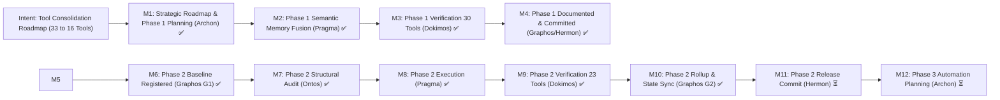

# Agent Execution Plane (AEP) — Project Milestones

## 1. Intent Reinforcement Graph

## 2. Milestone Matrix

| Phase | Milestone / Intent | Responsible Agents | Target Modules | Status |
| :---: | :--- | :--- | :--- | :---: |
| **Foundation** | Core FastMCP Server, memfd RAM execution, bubblewrap sandbox, dual-tier privilege | Archon, Pragma, Dokimos, Hermon | `server.py`, `engine/privilege.py` | **COMPLETED ✅** |
| **Forensics** | sqlite-vec memory, coredump routing, man-pages semantic store, eBPF tracing | Archon, Pragma, Dokimos, Hermon | `server.py`, `engine/docs_vectorizer.py` | **COMPLETED ✅** |
| **Discovery** | Pico-Playbooks, discover router, bilingual EN/ES lexical matching | Archon, Pragma, Dokimos, Hermon | `server.py`, `engine/matcher.py`, `engine/playbook.py` | **COMPLETED ✅** |
| **Hardening** | Template feedback, cold-aging immunity, Pico tools hardening, safe GC | Archon, Pragma, Dokimos, Hermon | `server.py`, `engine/kanban.py`, `engine/catalog.py` | **COMPLETED ✅** |
| **Consolidation 1** | Unify `semantic_memory` (`artifact_query`, `catalog`, `reindex`, `prune` -> `artifact_catalog`) | Archon, Ontos, Pragma, Dokimos, Graphos, Hermon | `server.py`, `engine/privilege.py` | **VERIFIED & COMMITTED (30 Tools) ✅** |
| **Consolidation 2** | Unify `task_management` (`kanban_*` 8 tools -> `kanban_board` polymorphic action router) | Archon, Ontos, Pragma, Dokimos, Graphos, Hermon | `server.py`, `engine/kanban.py`, `engine/privilege.py` | **VERIFIED & COMPLETED (23 Tools) ✅** |
| **Consolidation 3** | Unify `automation` (`playbook_*` 4 tools -> `playbook_run`) | Archon, Ontos, Pragma, Dokimos, Graphos, Hermon | `server.py`, `engine/playbook.py`, `engine/privilege.py` | **NEXT TARGET (Target: 20 Tools) ⏳** |
| **Consolidation 4** | Unify `artifact_synthesis` (`template_*`, `artifact_hydrate`, `lint_and_build` -> `artifact_synthesize`) | Archon, Ontos, Pragma, Dokimos, Graphos, Hermon | `server.py`, `engine/hydrator.py` | **QUEUED (Target: 17 Tools)** |
| **Consolidation 5** | Unify `async_dispatch` (`async_job_dispatch`, `inspect` -> `async_job`) | Archon, Ontos, Pragma, Dokimos, Graphos, Hermon | `server.py`, `engine/privilege.py` | **QUEUED (Target: 16 Tools)** |
| **Consolidation 6** | Unify `crash_forensics` (`diagnose_system_crashes`, `check_crash_alerts` -> `crash_forensics`) | Archon, Ontos, Pragma, Dokimos, Graphos, Hermon | `server.py`, `engine/privilege.py` | **QUEUED (Target: 15 Tools)** |
| **Consolidation 7** | Unify `orientation` & align `process_introspection` (1:1 capability parity) | Archon, Ontos, Pragma, Dokimos, Graphos, Hermon | `server.py`, `engine/privilege.py` | **QUEUED (Target: 16 Tools Parity)** |
