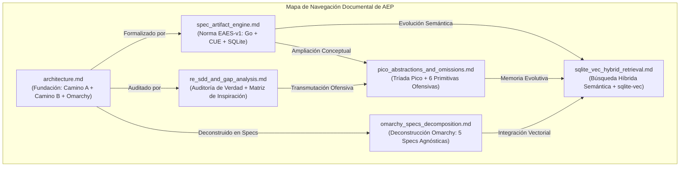

# Índice de Documentación Técnica — Agent Execution Plane (AEP)

Este directorio alberga la especificación canónica, la justificación arquitectónica y los análisis de fuente de la verdad que rigen el proyecto **Agent Execution Plane (AEP)**.

---

## Documentos Disponibles

### 1. [architecture.md](file:///home/ancruz/Documents/workspaces/agent-execution-plane/docs/architecture.md)
* **Título:** Arquitectura Híbrida de Control de Sistema para Agentes de IA en Ubuntu
* **Propósito:** Documento fundacional que establece la fusión entre el **Camino A** (Plano C2 de bajo nivel en memoria), el **Camino B** (Plano asíncrono y de usuario con colas y serialización estructurada) y la adopción de los patrones de **Omarchy**.
* **Contenido clave:** Matriz de fusión técnica, límites del kernel de Linux, catálogo inicial de herramientas MCP y consideraciones de diseño.

### 2. [spec_artifact_engine.md](file:///home/ancruz/Documents/workspaces/agent-execution-plane/docs/spec_artifact_engine.md)
* **Título:** Evolutionary Artifact Engine Specification (EAES-v1)
* **Propósito:** Norma formal que prohíbe la generación de scripts ad-hoc de Bash y establece el estándar de **Artefactos Atómicos en Golang** gobernados por contratos **CUE**.
* **Contenido clave:** Los 5 Axiomas contra la alucinación, diagrama de estados del ciclo de vida del artefacto, DDL de SQLite para `artifacts.db` y protocolo de calidad con `golangci-lint` en modo JSON.

### 3. [re_sdd_and_gap_analysis.md](file:///home/ancruz/Documents/workspaces/agent-execution-plane/docs/re_sdd_and_gap_analysis.md)
* **Título:** Análisis de Fuente de la Verdad, Metodología RE as SDD y Matriz de Inspiración
* **Propósito:** Auditoría transparente de la realidad física del sistema, justificación del por qué aplicamos ingeniería inversa en lugar de acoplar frameworks ofensivos pesados, y análisis de lecciones aprendidas de repositorios de referencia.
* **Contenido clave:**
  * **Inventario sincero:** Qué está 100% operativo, qué fue transmutado y qué queda pendiente de cableado.
  * **RE as SDD:** Descarte del peso muerto de Sliver C2 y extracción de la syscall pura `memfd_create`.
  * **Matriz de inspiración:** Lecciones de `termux-linux-deployer` (seeding y aislamiento en espacio de usuario), `openclaw` (rigor de contratos y `AGENTS.md`) y `sdk-agent-pipeline` (Topos DAG integrity y prevención de co-dependencias).
  * **Hoja de ruta:** Pasos técnicos para el cierre definitivo de brechas.

### 4. [pico_abstractions_and_omissions.md](file:///home/ancruz/Documents/workspaces/agent-execution-plane/docs/pico_abstractions_and_omissions.md)
* **Título:** Abstracciones Pico (Claw, Ansible, Jenkins) y Deconstrucción de Primitivas Ofensivas Omitidas
* **Propósito:** Formalización de la tríada conceptual (Pico-Claw + Pico-Ansible + Pico-Jenkins) y descomposición técnica de 6 capacidades de bajo nivel de frameworks ofensivos (BOFs, Malleable C2, Beaconing, Process Hollowing, BloodHound, Chisel) transmutadas en mejoras agénticas.
* **Contenido clave:**
  * **Pico-Claw:** Principio de *One Owner*, arquitectura *Small Core / Capable Plugins* y el bucle sensorial-actuador.
  * **Pico-Ansible:** Contrato de idempotencia (`changed: bool`), subsistema *Pico-Facts* y playbooks DAG.
  * **Pico-Jenkins:** Staging efímero en RAM y rollback por métricas de éxito.
  * **Las 6 mejoras ofensivas omitidas:** Deconstrucción de BOFs a objetos en memoria de 2 ms, perfiles maleables de tokens, telemetría tipo beacon, rescate de hilos colgados en caliente, camino más corto de remediación Topos y mallas efímeras de pruebas.

### 5. [sqlite_vec_hybrid_retrieval.md](file:///home/ancruz/Documents/workspaces/agent-execution-plane/docs/sqlite_vec_hybrid_retrieval.md)
* **Título:** Búsqueda Híbrida y Memoria Semántica de Artefactos con `sqlite-vec`
* **Propósito:** Resolución del problema de variabilidad estocástica en los prompts de los LLMs mediante la integración de la extensión vectorial nativa `sqlite-vec`.
* **Contenido clave:**
  * **El dilema de eficiencia:** B-Tree relacional ($<0.1\text{ ms}$, rígido) vs. similitud vectorial ($5\text{ a }15\text{ ms}$, flexible y semántico).
  * **Patrón de Búsqueda Híbrida en 2 Pasos:** Paso 1 (Descubrimiento difuso por similitud coseno) $\to$ Paso 2 (Recuperación determinista ACID de CUE y binarios Go).
  * **Inferencia Local en CPU:** Uso de ONNX Runtime (`all-MiniLM-L6-v2`) con cero costo de API y privacidad 100% offline.
  * **Esquema DDL Híbrido:** Tabla relacional `artifacts` + tabla virtual `vec_artifacts USING vec0`.

### 6. [omarchy_specs_decomposition.md](file:///home/ancruz/Documents/workspaces/agent-execution-plane/docs/omarchy_specs_decomposition.md)
* **Título:** Descomposición de Mejoras de Omarchy como Especificaciones Agnósticas (Specs / SDD) para Ubuntu
* **Propósito:** Deconstrucción modular de las innovaciones del sistema operativo para agentes de Omarchy (Arch/Hyprland) transformadas en 5 especificaciones agnósticas de distribución y hardware visual.
* **Contenido clave:**
  * **SPEC-OM-1:** Unified System Control Plane (`aep-ctl`) con flags `--json` y `--schema`.
  * **SPEC-OM-2:** Active Crash Routing & Proactive Self-Healing con `systemd-coredump` y tickets automáticos.
  * **SPEC-OM-3:** Universal Multi-Agent Skills Hub y protocolo de reconciliación simbiótica.
  * **SPEC-OM-4:** Local System Documentation Vectorizer con `sqlite-vec` para manuales `man` de Ubuntu en < 5ms.
  * **SPEC-OM-5:** Headless Visual & Display Actuator (Virtual Framebuffer efímero en RAM con Xvfb/cage).
  * **Matriz de Conformidad Topos:** Clasificación ontológica demostrando cero co-dependencias ($A \otimes B$).
