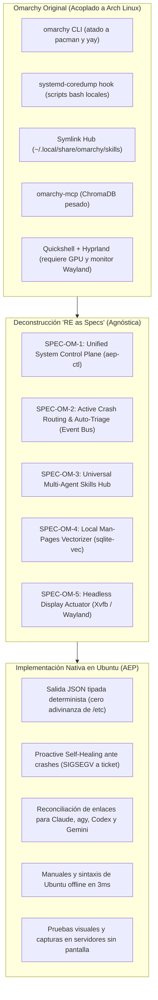
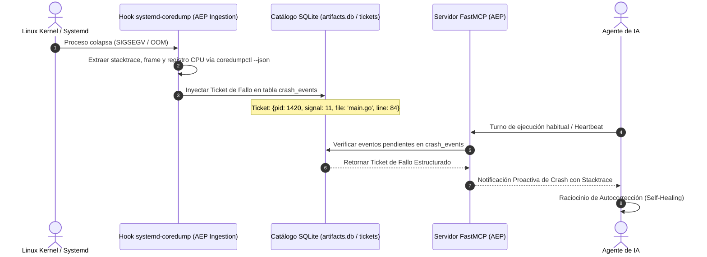
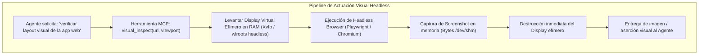

# Descomposición de Mejoras de Omarchy como Especificaciones Agnósticas (Specs / SDD) para Ubuntu

> **Fecha:** 2026-10-22  
> **Estado:** Documentación Técnica de Mejora Arquitectónica (Enhancement)  
> **Proyecto:** Agent Execution Plane (AEP) — Runtime Ubuntu

---

## 1. Premisa: Del Monolito Arch/Hyprland al Ecosistema Agéntico Distro-Agnóstico

**Omarchy** (creada por DHH en 2025/2026) demostró al mundo el concepto del **"Agentic OS"**: un sistema operativo donde el agente de IA no es un visitante foráneo que raspa texto en una consola humana, sino un ciudadano de primer orden con un plano de control unificado.

Sin embargo, Omarchy cometió tres errores de arquitectura fundamentales:
1. **Acoplamiento a una Distribución Específica:** Está profundamente atado a **Arch Linux** (`pacman`, `yay`), rompiéndose de inmediato en sistemas Debian/Ubuntu.
2. **Dependencia de Hardware Gráfico Físico:** Asume un entorno de escritorio con un monitor conectado gestionado por el compositor Wayland **Hyprland** y la barra **Quickshell**, volviéndose inútil en servidores headless, contenedores o entornos cloud de integración continua.
3. **Pila de Software Pesada:** Para la documentación local utilizó **ChromaDB**, arrastrando frameworks pesados de Python y PyTorch que sobrecargan la memoria del sistema.

### La Solución AEP: Deconstrucción "RE as Specs"

Mediante **Ingeniería Inversa Orientada por Especificaciones (SDD)**, no intentamos "portar scripts de Bash" de Arch a Ubuntu; **extraemos los contratos conceptuales de Omarchy y los formulamos como 5 Especificaciones Modulares** regidas por el Protocolo Topos:



---

## 2. SPEC-OM-1: Unified System Control Plane (`aep-ctl`)

### 2.1. El Problema que Resuelve
En Linux tradicional, la IA debe "adivinar" heurísticamente dónde residen los archivos de configuración y qué utilidades invocar para cada tarea:
* ¿La red se configura en `/etc/netplan/` o en `/etc/network/interfaces`?
* ¿Los servicios se administran con `systemctl`, `service` o `init.d`?
* ¿El almacenamiento se monitorea con `df`, `lsblk` o `mount`?

Esta incertidumbre genera dispersión de contexto y **alucinación de rutas y flags**.

### 2.2. La Especificación Formal
Se define un único punto de entrada CLI para la IA: `aep-ctl` (o `sysctl-ai`), con tres garantías absolutas:
1. **Autodocumentación:** Toda invocación con `--schema` devuelve la especificación en JSONSchema/CUE de las opciones válidas.
2. **Determinismo:** Toda salida soporta el flag `--json`, emitiendo diccionarios estructurados sin secuencias de escape ANSI.
3. **No-Interactividad:** Prohibición estricta de prompts interactivos; si falta un parámetro, falla de inmediato con `exit_code: 1` y un mensaje de remediación en JSON.

```mermaid
flowchart LR
    Agent["Agente de IA"] -->|aep-ctl service restart redis --json| Controller["Controlador Unificado (aep-ctl)"]
    Controller -->|Traducción Determinista| UbuntuCore["systemctl restart redis"]
    UbuntuCore -->|Status| Controller
    Controller -->|JSON Tipado: {service: 'redis', status: 'active', pid: 4812}| Agent
```

### 2.3. Subcomandos Fundamentales
* `aep-ctl service [status|start|stop|restart] <name> --json`
* `aep-ctl network [inspect|routes|listeners] --json`
* `aep-ctl storage [usage|mounts|disks] --json`
* `aep-ctl package [installed|check|info] <name> --json`

---

## 3. SPEC-OM-2: Active Crash Routing & Proactive Self-Healing

### 3.1. El Problema que Resuelve
Actualmente, los diagnósticos de caídas del sistema son **reactivos y pasivos**: el agente de IA solo se entera de un fallo si el usuario le pide inspeccionar o si la prueba actual falla explícitamente. Si un demonio secundario colapsa silenciosamente con un fallo de segmentación (`SIGSEGV`), la IA queda ciega.

### 3.2. La Especificación Formal
Transformar `systemd-coredump` en un **Bus de Eventos Proactivo hacia el Agente**:



1. **Captura Inmediata:** Un wrapper ligero intercepta la señal de volcado del kernel.
2. **Extracción Estructurada:** Ejecuta `coredumpctl info <PID> --json=short` y `gdb --batch -ex "bt"` para resolver símbolos.
3. **Despacho al Catálogo:** Registra el evento en la tabla `crash_events` de `artifacts.db`.
4. **Notificación en el Siguiente Turno:** El servidor FastMCP expone `check_crash_alerts()`, entregando el contexto de corrección antes de que el agente intente una acción inválida.

---

## 4. SPEC-OM-3: Universal Multi-Agent Skills Hub

### 4.1. El Problema que Resuelve
Cada cliente de IA implementa su propia estructura de carpetas para herramientas:
* Claude Code busca en `~/.claude/skills/`.
* Antigravity CLI busca en `~/.gemini/config/skills/` o `~/.agents/skills/`.
* ChatGPT Codex busca en `~/.codex/skills/`.

Mantener copias manuales dispersas conduce a **desfase de versiones** y herramientas desactualizadas.

### 4.2. La Especificación Formal (Protocolo de Reconciliación)
1. **Single Source of Truth:** Un único directorio canónico alberga las definiciones oficiales en Markdown con YAML frontmatter:
   $$\text{Directorio Canónico} = \text{\$HOME/.agents/skills/}$$
2. **Proyección Idempotente:** El instalador `scripts/setup.sh` ejecuta la reconciliación simbiótica mediante enlaces simbólicos forzados (`ln -sfn`):
   ```bash
   ln -sfn "$HOME/.agents/skills" "$HOME/.claude/skills/shared"
   ln -sfn "$HOME/.agents/skills" "$HOME/.gemini/skills/shared"
   ln -sfn "$HOME/.agents/skills" "$HOME/.codex/skills/shared"
   ```
3. **Cero Duplicación:** Cualquier habilidad creada por un agente (por ejemplo, mediante `workflow-skill-creator`) queda disponible automáticamente para todos los demás modelos instalados en la máquina.

---

## 5. SPEC-OM-4: Local System Documentation Vectorizer (`sqlite-vec` + Man Pages)

### 5.1. El Problema que Resuelve
Cuando un LLM no está seguro de la sintaxis exacta de una herramienta de bajo nivel (`iptables`, `tc`, `systemd.unit`), suele recurrir a:
* Alucinar parámetros obsoletos o inexistentes.
* Gastar miles de tokens y tiempo de red navegando por Internet.

Omarchy resolvió esto indexando wikis con ChromaDB, pero ChromaDB añade una sobrecarga inaceptable de dependencias.

### 5.2. La Especificación Formal (Superando a Omarchy con `sqlite-vec`)
Utilizar el motor vectorial integrado de **`sqlite-vec`** para crear una **base de datos semántica local de manuales del sistema**:

```mermaid
flowchart TD
    subgraph Ingestion["Fase de Ingestión (Offline, una sola vez)"]
        ManPages["Páginas de Manual de Ubuntu (/usr/share/man)"] --> Stripper["Parser de texto limpio (groff/mandoc)"]
        Stripper --> Chunker["Chunker semántico por comandos y flags"]
        Chunker --> ONNXEmbed["Embeddings locales en CPU (all-MiniLM-L6-v2: 3ms)"]
        ONNXEmbed --> VecDB["Base de Datos: ~/.local/share/agent-os/system_docs.db<br/>Tabla virtual vec0 con sqlite-vec"]
    end

    subgraph Query["Fase de Consulta Agéntica (Tiempo Real)"]
        AgentQuery["Agente pregunta: 'cómo abrir un puerto en ufw'"] --> LocalEmb["Inferencia de Vector en CPU (3ms)"]
        LocalEmb --> KNN["Búsqueda KNN en system_docs.db"]
        KNN --> Snippet["Fragmento exacto del manual con sintaxis verificada"]
        Snippet --> AgentAnswer["Respuesta sin alucinación en < 5ms"]
    end
```



* **Ventajas frente a Omarchy:**
  * No requiere Python pesado ni GPU.
  * Funciona 100% offline dentro de un único archivo `.db`.
  * La latencia de consulta pasa de $150 \text{ ms}$ en ChromaDB a **$< 5 \text{ ms}$** en `sqlite-vec`.

---

## 6. SPEC-OM-5: Headless Visual & Display Actuator (Virtual Framebuffer)

### 6.1. El Problema que Resuelve
Omarchy permite a la IA interactuar con ventanas y tomar capturas mediante Hyprland y Wayland. Sin embargo, en un servidor Ubuntu Headless (sin monitor físico) no existe compositor gráfico activo, impidiendo que el agente realice pruebas visuales, verifique layouts web o capture evidencia de interfaces.

### 6.2. La Especificación Formal (Agnóstica de Hardware)
Desacoplar la visión de la máquina física mediante un **Virtual Framebuffer efímero en RAM**:



1. **Display Efímero:** Creación de un display virtual en `/dev/shm` (RAM pura) mediante `Xvfb` o `cage` (Wayland kiosk headless).
2. **Aserción Visual:** La IA renderiza la aplicación, extrae el bounding box del elemento o la captura completa.
3. **Cero Residuos:** El display se destruye en cuanto termina la prueba, liberando memoria instantáneamente.

---

## 7. Matriz de Conformidad Topos (Aislamiento y No-Codependencia)

Para garantizar que estas 5 mejoras no introduzcan fragilidad en el sistema, aplicamos la clasificación ontológica del **Topos Integrity Protocol**:

| Especificación | Tipo de Relación con el Core AEP | Comportamiento ante Fallo | Veredicto Topos |
| :--- | :--- | :--- | :--- |
| **SPEC-OM-1 (aep-ctl)** | **Dependencia Unidireccional ($A \to B$)** | Si falla un subcomando, retorna JSON tipado con error; nunca bloquea la shell. | **VÁLIDO** |
| **SPEC-OM-2 (Crash Routing)** | **Dependencia Asíncrona ($A \to B$)** | Fail-Open: Si el hook falla, el sistema operativo genera su coredump habitual sin interrumpir procesos. | **VÁLIDO** |
| **SPEC-OM-3 (Skills Hub)** | **Dependencia de Enlaces Simbólicos** | Si un symlink se rompe, el agente usa su copia canónica en `~/.agents/skills/`. | **VÁLIDO** |
| **SPEC-OM-4 (Docs Vectorizer)** | **Dependencia Aislada ($A \to B$)** | Si `system_docs.db` no existe, el agente pasa al modo fallback habitual (consulta estándar). | **VÁLIDO** |
| **SPEC-OM-5 (Headless Display)** | **Dependencia Efímera en Memoria** | Si `Xvfb` no inicia, reporta `DISPLAY_UNAVAILABLE` sin congelar el subproceso. | **VÁLIDO** |

> **Conclusión:** Ninguna de las 5 especificaciones genera co-dependencias ($A \otimes B$). Cada módulo es estrictamente desacoplado, fail-soft y diseñado para operar de forma nativa en Ubuntu.
