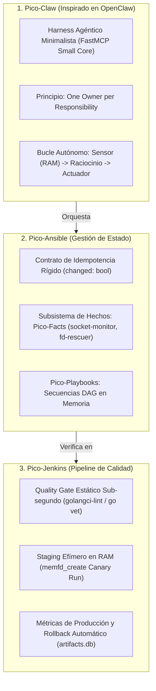
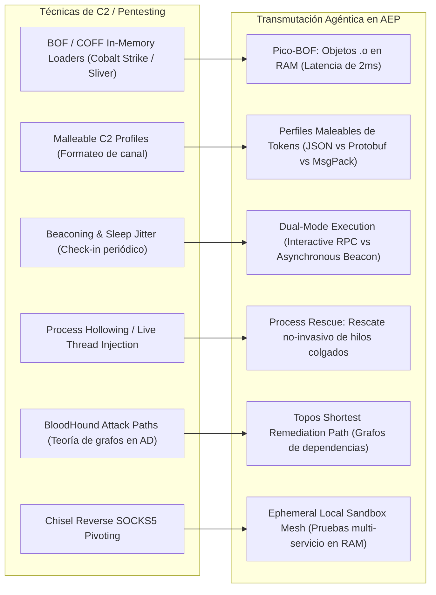

# Abstracciones Pico (Claw, Ansible, Jenkins) y Deconstrucción de Primitivas Ofensivas Omitidas

> **Fecha:** 2026-10-22  
> **Estado:** Documentación Técnica de Arquitectura Avanzada  
> **Proyecto:** Agent Execution Plane (AEP)

---

## 1. Dónde Quedaron Documentadas las Analogías y Qué se Omitió

Las analogías de **Pico-Jenkins** y **Pico-Ansible** se habían introducido de forma inicial en `docs/spec_artifact_engine.md` y `README.md`, pero **su formalización rigurosa junto con Pico-Claw había quedado pendiente**. 

A continuación se establece la definición canónica de cada una y los principios de diseño que se habían omitido:

### 1.1. Lo que se Omitió de "Pico-Claw" (Patrón OpenClaw)
1. **Un Solo Dueño por Responsabilidad (*One Owner per Responsibility*):**
   * **Omisión:** No habíamos delimitado quién es la autoridad final sobre cada estado del sistema.
   * **Definición canónica:**
     * `artifacts.db` (SQLite) es el **único dueño** del catálogo, contratos y código.
     * `Pueue` es el **único dueño** del ciclo de vida y los PIDs de los procesos asíncronos.
     * `server.py` (FastMCP) es un **adaptador de transporte puro**; no retiene estado mutable en memoria.
2. **Núcleo Minimalista con Plugins en los Extremos (*Small Core, Capable Plugins*):**
   * **Omisión:** El riesgo de engordar el servidor MCP con lógica de negocio pesada en Python.
   * **Definición canónica:** El servidor MCP solo expone el mecanismo de carga; toda nueva habilidad se sintetiza como una **sonda o plugin atómico en Go**.
3. **El Bucle Sensorial-Actuador Cerrado (*The Claw Loop*):**
   * **Omisión:** Concebir la consola solo como una herramienta reactiva a las preguntas del usuario.
   * **Definición canónica:** Un agente AEP opera en ciclo autónomo continuo:  
     $$\text{Sensor (Sonda Go en RAM)} \longrightarrow \text{Evaluación (LLM)} \longrightarrow \text{Actuación (Sandbox / Pueue)} \longrightarrow \text{Verificación Tipada}$$

### 1.2. Lo que se Omitió de "Pico-Ansible"
1. **El Contrato de Idempotencia (`changed: bool`):**
   * **Omisión:** Tratar a las sondas Go como simples scripts de lectura/escritura sin reportar mutaciones.
   * **Definición canónica:** Todo artefacto que modifique el sistema debe devolver explícitamente `changed: true` si alteró el estado, o `changed: false` si el sistema ya se encontraba en el estado deseado.
2. **El Subsistema de Hechos (*Pico-Facts*):**
   * **Omisión:** No formalizar que `socket-monitor` y `fd-rescuer` no son "herramientas aisladas", sino el motor de **Facts del Sistema**. La IA consulta los facts antes de ejecutar cualquier acción para erradicar la alucinación.
3. **Pico-Playbooks (Secuencias DAG):**
   * **Omisión:** No documentar cómo encadenar múltiples artefactos en una coreografía declarativa validada por `topos_guard.py`.

### 1.3. Lo que se Omitió de "Pico-Jenkins"
1. **Staging Efímero tipo Canary en Memoria:**
   * **Omisión:** No explicar cómo se prueba un artefacto antes de catalogarlo.
   * **Definición canónica:** La syscall `memfd_create` actúa como el entorno de *Canary/Staging*: el binario compilado corre primero en memoria en un sandbox aislado; si su salida tipada cumple el contrato CUE, se registra en la base de datos con `success_rate = 1.0`.

---

## 2. Deconstrucción de Primitivas Ofensivas Omitidas (Del Pentesting a la Ingeniería Agéntica)

Al analizar frameworks ofensivos como **Sliver C2**, **Cobalt Strike**, **Havoc C2**, **Mythic**, **Chisel** y **BloodHound**, identificamos **6 capacidades avanzadas de bajo nivel que habíamos omitido** y que pueden transmutarse en superpoderes para la consola de la IA:

---

### Desglose Detallado de las 6 Mejoras Omitidas:

### 1. Pico-BOFs (Beacon Object Files) / Carga Directa de Objetos `.o`
* **En el nicho ofensivo (Cobalt Strike / Sliver):**  
  En lugar de compilar un binario ejecutable completo (ELF o EXE) que arrastra cabeceras, tablas de secciones y runtime, un *BOF* es un archivo objeto reubicable (`.o`) de apenas 5 a 20 KB. El agente C2 lo enlaza dinámicamente en memoria en menos de **2 milisegundos**.
* **La mejora omitida para la IA:**  
  Actualmente compilamos binarios Go completos (`go build`, ~2 MB, 300 ms de compilación).  
  **Mejora futura:** Incorporar soporte para compilar pequeños archivos objeto en C o Go (`go build -buildmode=c-shared` o `gcc -c`) y cargarlos directamente en el proceso del servidor mediante `dlopen` sobre memoria anónima (`/proc/self/fd/<fd>`). Latencia de preparación: **de 300 ms a 5 ms**.

### 2. Perfiles Maleables de Tráfico $\longrightarrow$ Perfiles de Presupuesto de Tokens
* **En el nicho ofensivo (Malleable C2):**  
  Permite al operador cambiar sobre la marcha cómo se serializan los datos (disfrazándolos de imágenes JPEG, XML, JSON o Base64) para adaptarse a proxies o restricciones del canal.
* **La mejora omitida para la IA:**  
  **Adaptive Token Profiles (Moldeado de Salidas según Contexto):**  
  El servidor MCP debe ajustar su serialización según el presupuesto de tokens restante del agente:
  * *Alto presupuesto de tokens:* Salida JSON expandida con documentación detallada de cada campo.
  * *Bajo presupuesto de tokens:* Salida ultra-compacta en array tabular o Protobuf binario comprimido.
  * *Modo de alta velocidad:* Salida binaria cruda directa hacia la siguiente herramienta sin pasar por la ventana de contexto del LLM.

### 3. Modo Interactivo vs. Modo Beaconing (Telemetría con Jitter)
* **En el nicho ofensivo:**  
  Un implante no se mantiene permanentemente conectado si no es necesario; entra en *Beacon Mode* durmiendo $N$ segundos para no alertar al tráfico de red y reporta periódicamente su estado.
* **La mejora omitida para la IA:**  
  **Ejecución Dual (RPC Inmediato vs. Beacon Worker):**  
  * Para comandos rápidos (< 2 seg): FastMCP síncrono.
  * Para tareas de 40 minutos (compilaciones masivas de C++, descargas de modelos, migraciones de bases de datos): En lugar de que el agente gaste tokens consultando en un bucle ciego (*polling*), el worker adopta el patrón *Beacon*: Pueue emite un evento o *webhook local* cuando la tarea termina o cuando detecta anomalías.

### 4. Process Injection $\longrightarrow$ Process Rescue (Rescate de Procesos Colgados)
* **En el nicho ofensivo:**  
  Inyección de código en procesos activos (`ptrace`, `process hollowing`) para ejecutar payloads bajo la identidad de otro binario.
* **La mejora omitida para la IA:**  
  **Introspección y Desbloqueo en Caliente (*Process Rescue*):**  
  Si un proceso de Python o una tarea de compilación se queda colgada:
  * La shell normal solo ofrece `kill -9 <PID>`, perdiendo todo el trabajo realizado.
  * Aplicando la técnica ofensiva pero en modo diagnóstico: El agente se adjunta temporalmente con `ptrace(PTRACE_ATTACH)`, lee `/proc/$PID/stack`, identifica exactamente el cerrojo o descriptor que causa el *deadlock* e inyecta una señal o libera el descriptor para que el proceso continúe sin matarlo.

### 5. BloodHound (Teoría de Grafos en Directorio Activo) $\longrightarrow$ Topos Shortest Remediation Path
* **En el nicho ofensivo (BloodHound / SharpHound):**  
  Mapea relaciones en Active Directory como un grafo dirigido (nodos y aristas) y utiliza algoritmos de grafos (Dijkstra) para encontrar el *camino más corto de ataque*.
* **La mejora omitida para la IA:**  
  **Camino Más Corto de Remediación Ontológica:**  
  Nuestro `topos_guard.py` actual solo **detecta ciclos** (co-dependencias).  
  La mejora inspirada en BloodHound es calcular la **ruta óptima de descomposición**: si hay un conflicto de versiones de dependencias o puertos entre 5 servicios, el algoritmo de grafos le indica a la IA el orden exacto de refactorización con menor impacto sistémico.

### 6. SOCKS5 Pivoting (Chisel / Gost) $\longrightarrow$ Malla Efímera de Pruebas Multi-Servicio
* **En el nicho ofensivo:**  
  Abrir túneles reversos SOCKS5 y WireGuard para saltar de una máquina comprometida a redes internas aisladas.
* **La mejora omitida para la IA:**  
  **Topologías Distribuidas en Memoria:**  
  Permitir al agente levantar un micro-entorno de pruebas en Ubuntu (un frontend simulado, un backend Go y una base de datos) conectados entre sí mediante interfaces virtuales (`veth`) y túneles en memoria, sin colisionar con los puertos reales de la máquina física ni requerir Docker.

---

## 3. Matriz de Integración Futura en el Repositorio

| Primitiva Ofensiva Original | Mejora Agéntica AEP | Componente Destino en el Repo | Estado Actual |
| :--- | :--- | :--- | :--- |
| **BOF / COFF Loader** | Carga de `.o` en RAM (sub-5ms) | `engine/bof_loader.py` | Propuesto / Roadmap |
| **Malleable C2** | Perfiles de serialización por tokens | `server.py` (`TokenProfile`) | Propuesto / Roadmap |
| **Beaconing / Sleep** | Event-driven callbacks con Pueue | `server.py` (`async_job_watch`) | Propuesto / Roadmap |
| **Process Hollowing** | Process Rescue (`/proc/$PID/stack`) | `templates/tpl_thread_rescuer.go` | Propuesto / Roadmap |
| **BloodHound** | Topos Shortest Remediation Path | `engine/topos_guard.py` | Ampliación de algoritmo |
| **Chisel SOCKS5** | Malla de pruebas en memoria (`veth`) | `templates/tpl_net_mesh.go` | Propuesto / Roadmap |
