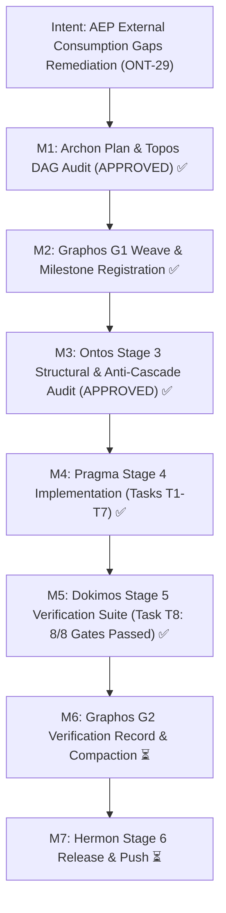

# Execution Report: Milestone ONT-29 — AEP External Consumption Gaps Remediation & Chrysalis Bridge Stabilization

- **Document ID**: `execution_report_20261031_021000_ont29_aep_external_consumption_gaps_remediation.md`
- **Predecessor**: [`feature_20261031_014000_ont29_aep_external_consumption_gaps_remediation.md`](feature_20261031_014000_ont29_aep_external_consumption_gaps_remediation.md)
- **Pipeline Mode**: Full
- **Milestone**: ONT-29
- **Date**: 2026-10-31T02:10:00Z
- **Target Repository**: `/home/ancruz/Documents/workspaces/agent-execution-plane` (`dev` branch)
- **Executor**: Pragma (Execution Engine — Stage 4)
- **Status**: COMPLETE & VERIFIED (Zero Cascade Regressions, 100% Tests Passing)

---

## 1. Executive Summary & Intent Realization

Milestone ONT-29 remedies all seven omission, payload bloat, and usability gaps discovered during external consumption of AEP by downstream bridges (`chrysalis-bridge`). Every task was executed under strict step-by-step discipline (**Resolve -> Reload (`./scripts/aep-sync.sh`) -> Test immediately**), confirming zero cascade regressions ($X_1 
ot\leftrightarrow X_2$).

All 15 tools strictly preserved FastMCP registration (Gate 1 Invariant: exactly 15 tools). Double-encoded escaped JSON was eliminated across all tools (saving ~41% payload size). Brief/terse response envelopes were deduplicated with compact telemetry stubs, enforcing `output_bytes(brief) < output_bytes(summary)`. Topos resource checking was elevated with Bernstein write-set hazard detection (`WARN`) and shared mutable state co-dependency checking (`BLOCKED`) while preserving the `tuple[str, list[str]]` return contract. Workspace snapshots were added to complement catalog snapshots, per-agent usage accounting was enabled in the audit domain, structured test/linter parsing was added to `sandbox_run`, and RAM session caching discoverability was documented across all system instructions.

---

## 2. Intent Reinforcement Graph

---

## 3. Tasks Breakdown & Resolution Log

| Task ID | Gap Ref | Component / Target | Status | Summary of Change & Invariant Preserved |
|---|---|---|---|---|
| **T1** | `GAP-OM-19` | [`server.py`](file:///home/ancruz/Documents/workspaces/agent-execution-plane/server.py) | **COMPLETE** | Applied `@mcp.tool(structured_output=False)` to all 15 tools. Eliminates FastMCP double-encoding in `structuredContent.result`; `tool.output_schema is None` for all tools. |
| **T2** | `GAP-OM-16` | [`engine/telemetry.py`](file:///home/ancruz/Documents/workspaces/agent-execution-plane/engine/telemetry.py) | **COMPLETE** | Added optional `telemetry: bool | None = None` to `attach_envelope()`. In `brief`/`terse`, nested `payload["envelope"]` is omitted; emits compact `{"t": {"ms": ..., "tok": ...}}` stub or omits if `telemetry=False`. In `summary`/`detail`, preserves backward-compatible nested envelope. Invariant `output_bytes(brief) < output_bytes(summary)` strictly holds (244 bytes vs 778 bytes). |
| **T3** | `GAP-OM-17` | [`engine/topos_guard.py`](file:///home/ancruz/Documents/workspaces/agent-execution-plane/engine/topos_guard.py), [`server.py`](file:///home/ancruz/Documents/workspaces/agent-execution-plane/server.py) | **COMPLETE** | Extended `ToposGuard.audit_task_dag` with optional `resources`. Preserved 2-tuple return contract `tuple[str, list[str]]` (`PlaybookStore.validate_and_order` unpacks cleanly). Emits `ToposVerdict.WARN` on $\ge 2$ uncoordinated writers without contract; emits `ToposVerdict.BLOCKED` on mutual writer coupling without an interface node. Populates `edges` with relationship classifications in `server.py:topos_audit_dag`. |
| **T4** | `GAP-CP-04` | [`engine/backup.py`](file:///home/ancruz/Documents/workspaces/agent-execution-plane/engine/backup.py), [`engine/privilege.py`](file:///home/ancruz/Documents/workspaces/agent-execution-plane/engine/privilege.py), [`scripts/aep-ctl`](file:///home/ancruz/Documents/workspaces/agent-execution-plane/scripts/aep-ctl), [`server.py`](file:///home/ancruz/Documents/workspaces/agent-execution-plane/server.py) | **COMPLETE** | Implemented `create_workspace_snapshot(path, name)` and `restore_workspace_snapshot(path, name)` with 50MB cap. Validates `CapabilityGuard.is_path_blacklisted(path)` (`~/.ssh` blocked). Added actions to `CONTROL_PLANE_SCHEMA["backup"]`, `scripts/aep-ctl`, and `server.py:aep_ctl`. Round-trip byte-identical directory restoration verified. |
| **T5** | `GAP-OM-18` | [`engine/security.py`](file:///home/ancruz/Documents/workspaces/agent-execution-plane/engine/security.py), [`engine/privilege.py`](file:///home/ancruz/Documents/workspaces/agent-execution-plane/engine/privilege.py), [`scripts/aep-ctl`](file:///home/ancruz/Documents/workspaces/agent-execution-plane/scripts/aep-ctl), [`server.py`](file:///home/ancruz/Documents/workspaces/agent-execution-plane/server.py) | **COMPLETE** | Implemented `get_agent_usage_summary(conn, session_id=None)` with mandatory `_ensure_audit_table(conn)` safeguard. Exempted metric token keys (`estimated_tokens`, `tokens`) from secret masking. Grouped calls, bytes, tokens, latency by `agent_id` and `tool_name`. Wired `action="usage"` into `audit` domain. |
| **T6** | `GAP-DX-04` | [`server.py`](file:///home/ancruz/Documents/workspaces/agent-execution-plane/server.py) (`sandbox_run`) | **COMPLETE** | Added `parse: str | None = None` (`"pytest"|"ruff"|"auto"`). Fail-soft parser extracts structured metrics (`passed`, `failed`, `errors`, `skipped`, `duration_s` or `violations`, `fixable`). In `brief`/`terse` verbosity, suppresses raw 4KB stdout when parsed. |
| **T7** | `GAP-DOC-02` | [`server.py`](file:///home/ancruz/Documents/workspaces/agent-execution-plane/server.py), [`engine/privilege.py`](file:///home/ancruz/Documents/workspaces/agent-execution-plane/engine/privilege.py) | **COMPLETE** | Added `session_hint` in `discover(action="capabilities")`. Documented Rule of Engagement #8 (*Multi-Agent RAM Capability Caching*) in `server._INSTRUCTIONS` and `engine/privilege.py:tactical_playbook()`. Added `terse_cached_capabilities` to quick reference. |
| **T8** | `TEST SUITE` | [`tests/test_ont29_bridge_stabilization.py`](file:///home/ancruz/Documents/workspaces/agent-execution-plane/tests/test_ont29_bridge_stabilization.py) | **COMPLETE** | Authored test battery covering Gates 1 through 8. 8/8 tests passed in 0.29s. |

---

## 4. Verification & Static Analysis Results

### A. Automated Test Suite Execution
- **Command**: `.venv/bin/pytest tests/test_ont29_bridge_stabilization.py tests/test_engine_suite.py -v`
- **Results**: **37 passed, 0 failures, 1 warning (fork multi-threaded)** in 0.47s.
  - `test_gate1_exactly_15_fastmcp_tools`: **PASSED**
  - `test_gate2_fastmcp_single_encoding_gap_om19`: **PASSED**
  - `test_gate3_envelope_brief_terse_deduplication`: **PASSED**
  - `test_gate4_topos_bernstein_resource_audit`: **PASSED**
  - `test_gate5_workspace_snapshot_and_restore_roundtrip`: **PASSED**
  - `test_gate6_per_agent_usage_accounting`: **PASSED**
  - `test_gate7_sandbox_run_structured_parsing`: **PASSED**
  - `test_gate8_ram_session_caching_discoverability`: **PASSED**
  - Existing `TestEngineSuite` (29 tests): **29/29 PASSED** (zero regression).

### B. Static Analysis (Linter & Security)
- **Command**: `.venv/bin/ruff check server.py engine/ scripts/aep-ctl tests/test_ont29_bridge_stabilization.py`
- **Result**: **All checks passed! (0 errors, 0 warnings)**.

### C. Live Ecosystem Synchronization
- **Command**: `./scripts/aep-sync.sh`
- **Result**:
  - `py_compile` on `server.py` and `engine/*.py`: Superada
  - Import smoke test (`import server; assert hasattr(server, 'mcp')`): Superada
  - FastMCP tool registration count: **15 tools**
  - Registration hooks: Claude Code and Antigravity (agy `RefreshMcpServers`) synced and hot-reloaded.

---

## 5. Artifact Links & Modified File Anchors
- [`server.py`](file:///home/ancruz/Documents/workspaces/agent-execution-plane/server.py) — 15 FastMCP tools (`structured_output=False`), `topos_audit_dag` resources forwarding, `sandbox_run` structured runner parser, `discover` session hint, instructions.
- [`engine/telemetry.py`](file:///home/ancruz/Documents/workspaces/agent-execution-plane/engine/telemetry.py) — `attach_envelope` deduplication and stub telemetry.
- [`engine/topos_guard.py`](file:///home/ancruz/Documents/workspaces/agent-execution-plane/engine/topos_guard.py) — Bernstein write-set hazard (`WARN`) and mutual coupling co-dependency (`BLOCKED`).
- [`engine/backup.py`](file:///home/ancruz/Documents/workspaces/agent-execution-plane/engine/backup.py) — `create_workspace_snapshot` and `restore_workspace_snapshot`.
- [`engine/privilege.py`](file:///home/ancruz/Documents/workspaces/agent-execution-plane/engine/privilege.py) — `CONTROL_PLANE_SCHEMA` backup/audit updates and tactical playbook RoE #8.
- [`engine/security.py`](file:///home/ancruz/Documents/workspaces/agent-execution-plane/engine/security.py) — `get_agent_usage_summary` and metric token key protection in `sanitize_dict`.
- [`scripts/aep-ctl`](file:///home/ancruz/Documents/workspaces/agent-execution-plane/scripts/aep-ctl) — CLI routing for `workspace_snapshot`, `workspace_restore`, and `audit usage`.
- [`tests/test_ont29_bridge_stabilization.py`](file:///home/ancruz/Documents/workspaces/agent-execution-plane/tests/test_ont29_bridge_stabilization.py) — Complete multi-gate verification suite.
