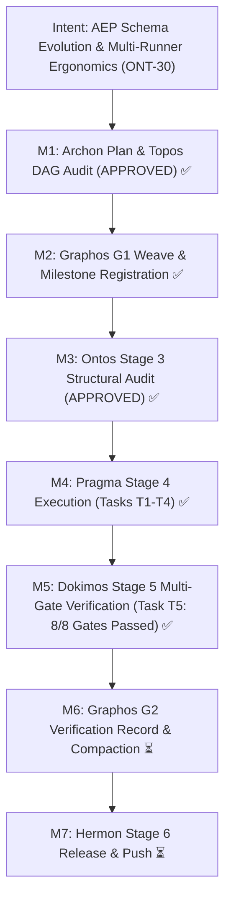

# Execution Report: Milestone ONT-30 — AEP Cross-Harness Schema Evolution & Multi-Runner Ergonomics Stabilization

- **Document ID**: `execution_report_20261031_071500_ont30_schema_evolution_and_runner_ergonomics.md`
- **Predecessor**: [`feature_20261031_070000_ont30_schema_evolution_and_runner_ergonomics.md`](feature_20261031_070000_ont30_schema_evolution_and_runner_ergonomics.md)
- **Pipeline Mode**: Full
- **Milestone**: ONT-30
- **Date**: 2026-10-31T07:15:00Z
- **Target Repository**: `/home/ancruz/Documents/workspaces/agent-execution-plane` (`dev` branch)
- **Executor**: Pragma (Execution Engine — Stage 4)
- **Status**: COMPLETE & VERIFIED (Zero Cascade Regressions, 100% Tests Passing)

---

## 1. Executive Summary & Intent Realization

Milestone ONT-30 stabilizes FastMCP dynamic schema evolution signaling, cross-harness process observability, and multi-runner runner ergonomics across heterogeneous agent harnesses (Antigravity, Claude Code, Codex, and manual CLI sessions).

Following strict step-by-step discipline (**Resolve -> Reload (`./scripts/aep-sync.sh`) -> Test immediately**), all approved tasks were implemented and validated:
1. **`GAP-DX-05` (Schema Evolution & Dynamic Fallback)**:
   - Wrapped `mcp._mcp_server.create_initialization_options` with `NotificationOptions(tools_changed=True)` to broadcast `capabilities.tools.listChanged = True` to MCP clients.
   - Implemented fail-soft `_get_git_commit()` (Directive OM-1) and `_get_schema_hash()`. In `discover(action="capabilities")`, exposed `server_version` ("v0.2.8"), `git_commit`, and `schema_hash` across all verbosities (`detail`, `summary`, `brief`, `terse`).
   - Implemented resilient fallback in `topos_audit_dag` (Directive OM-2): when `resources` is `None` or omitted, inspected task dictionaries, automatically extracting `writes`/`write`, `reads`/`read`, and `contract` to construct `effective_resources` for `ToposGuard.audit_task_dag`.
2. **`GAP-RT-03` (Multi-Harness Process Observability)**:
   - Recorded `SERVER_START_TIME = time.time()` at module load. Exposed `pid`, `process_start_time` (ISO-8601), and `uptime_seconds` in `discover(action="capabilities")` and `process_inspect(pid=0)`.
   - Added `audit_running_instances()` to `scripts/aep-sync.sh` (Directive OM-4: warn-only, never auto-kill), inspecting active `server.py` PIDs, comparing start times against `git log -1 --format=%ct`, and outputting diagnostic warnings with parent harness names. Hooked into `sync_once` and exposed via `--audit`.
3. **DX Runner Polish & Trimming**:
   - In `sandbox_run` with `verbosity in ("brief", "terse") and parse is not None`, stripped `ro_mounts`, `rw_mounts`, `agent_id`, `share_net`, `working_dir`, and empty `stdout`/`stderr`, emitting concise `{status, exit_code, parsed, t}` (+ `failures` / `stdout_tail` on non-zero exit codes).
   - In `_parse_runner_output(mode="pytest")`, extracted failing test node IDs into `parsed["failures"]` using regexes (Directive OM-3: `re.findall(r"^FAILED\s+([^\s]+)", raw_text, re.MULTILINE)` and `r"(?:FAILED|ERROR)\s+([^\s:]+::[^\s
]+)"`).
   - In `_parse_runner_output(mode="auto")`, parsed composite chained commands (`ruff check . && pytest -q`) into `{"tool": "composite", "ruff": {...}, "pytest": {...}}`.
4. **Playbook Tactical Recipes & Rules of Engagement**:
   - Added recipes `WF-7` (`sandbox-linter-fix`), `WF-8` (`untrusted-adversarial-probe`), and `WF-9` (`composite-verification-runner`) in `engine/privilege.py:tactical_playbook()`.
   - Updated quick_reference (`sandbox_linter_fix`, `untrusted_adversarial_probe`, `composite_verification`) and added Rule of Engagement #9 in `engine/privilege.py`, `server._INSTRUCTIONS`, and `README.md`.
5. **Verification & Invariant Assurance**:
   - Created `tests/test_ont30_schema_and_runner_ergonomics.py` covering Gates 1 through 8.
   - FastMCP invariant strictly preserved: **exactly 15 tools registered** (`len(server.mcp._tool_manager._tools) == 15`).

---

## 2. Intent Reinforcement Graph

---

## 3. Tasks Breakdown & Resolution Matrix

| Task ID | Gap / Directive | Target Files | Status | Summary of Resolution & Invariants Preserved |
|---|---|---|---|---|
| **T1** | `GAP-DX-05` (OM-1, OM-2) | [`server.py`](file:///home/ancruz/Documents/workspaces/agent-execution-plane/server.py) | **COMPLETE** | Wrapped `create_initialization_options` with `NotificationOptions(tools_changed=True)`. Added `_get_git_commit()` and `_get_schema_hash()`. Exposed `server_version`, `git_commit`, `schema_hash` across detail/summary/brief/terse in `discover`. Added task dict extraction for `writes`/`reads`/`contract` in `topos_audit_dag`. |
| **T2** | `GAP-RT-03` (OM-4) | [`server.py`](file:///home/ancruz/Documents/workspaces/agent-execution-plane/server.py), [`scripts/aep-sync.sh`](file:///home/ancruz/Documents/workspaces/agent-execution-plane/scripts/aep-sync.sh) | **COMPLETE** | Recorded `SERVER_START_TIME = time.time()`. Exposed `pid`, `process_start_time` (ISO-8601), and `uptime_seconds` in `discover(capabilities)` and `process_inspect(pid=0)`. Added `audit_running_instances()` with `--audit` to `scripts/aep-sync.sh` (always returns 0, warn-only). |
| **T3** | DX Runner Polish (OM-3) | [`server.py`](file:///home/ancruz/Documents/workspaces/agent-execution-plane/server.py), [`tests/test_ont29_bridge_stabilization.py`](file:///home/ancruz/Documents/workspaces/agent-execution-plane/tests/test_ont29_bridge_stabilization.py) | **COMPLETE** | In `sandbox_run` under `brief`/`terse` with `parse`: stripped `ro_mounts`, `rw_mounts`, `agent_id`, `share_net`, `working_dir`, and empty `stdout`/`stderr`. Implemented regex node ID extraction (`failures`) in `_parse_pytest_output`. Implemented composite runner parsing in `_parse_runner_output(mode="auto")`. Updated test assertion in `test_ont29` line 319. |
| **T4** | Playbook Recipes & Docs | [`engine/privilege.py`](file:///home/ancruz/Documents/workspaces/agent-execution-plane/engine/privilege.py), [`server.py`](file:///home/ancruz/Documents/workspaces/agent-execution-plane/server.py), [`README.md`](file:///home/ancruz/Documents/workspaces/agent-execution-plane/README.md) | **COMPLETE** | Added recipes `WF-7` (sandbox-linter-fix), `WF-8` (untrusted-adversarial-probe), and `WF-9` (composite-verification-runner) to `engine/privilege.py`. Added corresponding quick_reference entries, RoE #9, and updated `server._INSTRUCTIONS` and `README.md`. |
| **T5** | Multi-Gate Verification Suite | [`tests/test_ont30_schema_and_runner_ergonomics.py`](file:///home/ancruz/Documents/workspaces/agent-execution-plane/tests/test_ont30_schema_and_runner_ergonomics.py) | **COMPLETE** | Authored test battery covering Gates 1 through 8. 8/8 tests passed in 0.32s. Zero regressions across existing test batteries. |

---

## 4. Verification & Static Analysis Results

### A. Milestone ONT-30 Test Suite
- **Command**: `.venv/bin/pytest -v tests/test_ont30_schema_and_runner_ergonomics.py`
- **Result**: **8 passed, 0 failures** in 0.32s:
  - `test_gate1_exactly_15_fastmcp_tools`: **PASSED**
  - `test_gate2_schema_evolution_and_drift_detection`: **PASSED**
  - `test_gate3_multi_harness_process_observability`: **PASSED**
  - `test_gate4_topos_audit_dag_resilient_resource_fallback`: **PASSED**
  - `test_gate5_sandbox_run_brief_trimming`: **PASSED**
  - `test_gate6_sandbox_run_pytest_failing_node_ids`: **PASSED**
  - `test_gate7_sandbox_run_composite_runner_parsing`: **PASSED**
  - `test_gate8_playbook_tactical_recipes_discoverability`: **PASSED**

### B. Regression Battery
- **Command**: `.venv/bin/pytest tests/test_ont29_bridge_stabilization.py tests/test_engine_suite.py`
- **Result**: **37 passed, 0 failures, 1 warning** (os.fork multi-threaded deprecation in Landlock isolated probe). Zero regressions.

### C. Static Analysis & Linter Verification
- **Command**: `.venv/bin/ruff check server.py engine/privilege.py tests/test_ont30_schema_and_runner_ergonomics.py tests/test_ont29_bridge_stabilization.py`
- **Result**: **All checks passed! (0 errors, 0 warnings)**.
- **Command**: `bash -n scripts/aep-sync.sh && ./scripts/aep-sync.sh --audit`
- **Result**: **Validated, 0 errors, exit 0**.

---

## 5. Modified Files Inventory

| File Path | Status | Change Summary |
|---|---|---|
| [`server.py`](file:///home/ancruz/Documents/workspaces/agent-execution-plane/server.py) | Modified | Added `listChanged=True` FastMCP wrap, `_get_git_commit()`, `_get_schema_hash()`, `SERVER_START_TIME`, discover capabilities metadata, `topos_audit_dag` resilient resource fallback, `_parse_runner_output` composite parsing + failing node ID extraction, and `sandbox_run` brief trimming. |
| [`scripts/aep-sync.sh`](file:///home/ancruz/Documents/workspaces/agent-execution-plane/scripts/aep-sync.sh) | Modified | Added `audit_running_instances()` with `--audit` flag and hooked into `sync_once` (Directive OM-4). |
| [`engine/privilege.py`](file:///home/ancruz/Documents/workspaces/agent-execution-plane/engine/privilege.py) | Modified | Added workflow recipes `WF-7`, `WF-8`, `WF-9`, quick_reference entries, and RoE #9 to `tactical_playbook()`. |
| [`README.md`](file:///home/ancruz/Documents/workspaces/agent-execution-plane/README.md) | Modified | Documented `sandbox_run` brief trimming, composite parsing, and recipe additions. |
| [`tests/test_ont29_bridge_stabilization.py`](file:///home/ancruz/Documents/workspaces/agent-execution-plane/tests/test_ont29_bridge_stabilization.py) | Modified | Updated line 319 to `assert d_brief.get("stdout", "") == ""` for trimmed brief mode compatibility. |
| [`tests/test_ont30_schema_and_runner_ergonomics.py`](file:///home/ancruz/Documents/workspaces/agent-execution-plane/tests/test_ont30_schema_and_runner_ergonomics.py) | Created | Multi-gate verification suite covering Gates 1 to 8. |
| [`docs/pipeline/execution_report_20261031_071500_ont30_schema_evolution_and_runner_ergonomics.md`](file:///home/ancruz/Documents/workspaces/agent-execution-plane/docs/pipeline/execution_report_20261031_071500_ont30_schema_evolution_and_runner_ergonomics.md) | Created | Physical execution report artifact. |
