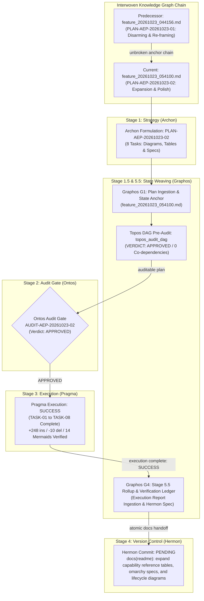

# Feature Pipeline Document: Comprehensive Architectural Expansion & Polish of README.md

- **Document ID**: `feature_20261023_054100.md`
- **Previous Document**: [`feature_20261023_044156.md`](file:///home/ancruz/Documents/workspaces/agent-execution-plane/docs/pipeline/feature_20261023_044156.md)
- **Next Document**: `Pending Hermon Atomic Commit & Release`
- **Plan ID**: `PLAN-AEP-20261023-02`
- **Preceding Plan ID**: `PLAN-AEP-20261023-01-rev1` (Completed & Documented in `feature_20261023_044156.md`)
- **Audit ID**: `AUDIT-AEP-20261023-02` (Verdict: `APPROVED`)
- **Execution Report ID**: `EXECUTION-REPORT-AEP-20261023-02` (Status: `SUCCESS`)
- **Current Status**: `STAGE 3 EXECUTION COMPLETE / STAGE 5.5 ROLLUP COMPLETE / READY FOR COMMIT (Hermon)`
- **Timestamp**: 2026-10-23T05:41:00Z
- **Last State Transition**: 2026-10-23T06:05:00Z (Stage 5.5 State Weaver: Execution Recorded & Handed Off to Hermon)
- **Author**: Graphos (Universal State Manager — Stage 5.5 Documentation Rollup)
- **Pipeline Flow**: Documentation Flow (`Archon -> Graphos -> Ontos -> Pragma -> Hermon`)
- **Target File**: `README.md`
- **Topos DAG Pre-Audit**: `APPROVED` (Audited via `agent-execution-plane:topos_audit_dag`)

---

## 1. State Evolution Map



---

## 2. Plan Context & Strategic Intent

### 2.1 Context & Retrospective of Plan 1 (`PLAN-AEP-20261023-01-rev1`)
In the initial cycle (`PLAN-AEP-20261023-01-rev1`, documented in [`feature_20261023_044156.md`](file:///home/ancruz/Documents/workspaces/agent-execution-plane/docs/pipeline/feature_20261023_044156.md)), the primary objective was **semantic disarming** of the repository `README.md`. Prose and comparison tables were reframed from adversarial Command & Control (C2) terminology to Linux kernel primitives and systems engineering paradigms. To eliminate rendering regression risks during prose modifications, all 12 Mermaid diagrams were subjected to a strict **0-Byte Freeze**.

### 2.2 Objective of Plan 2 (`PLAN-AEP-20261023-02`): Architectural Expansion & Diagram Polish
With the prose reframed and stable, Archon has produced `PLAN-AEP-20261023-02` to unfreeze and complete the documentation suite through targeted expansions:
1. **Diagram Terminology Sanitization**: Update internal node labels and subgraphs in Diagram 1 (Section 1) and Diagram 3 (Section 3) to purge legacy offensive terminology while preserving structural topology.
2. **4-Layer Architectural Breakdown Table**: Expand Section 2 with an exhaustive engineering table detailing Layer 3 (Agentic Interface), Layer 2 (Engines), Layer 1 (Shell Environment), and Layer 0 (Kernel Primitives).
3. **Master Reference Catalog for 19 FastMCP Tools**: Expand Section 4 with comprehensive reference tables for all 19 tools across 5 functional domains, documenting signatures, parameter schemas, privilege tiers (`FULL` vs `DIMINISHED`), output schemas, and failure modes.
4. **Skill Chaining & Lifecycle Diagram**: Add an end-to-end Mermaid diagram illustrating the autonomous runtime loop (`aep_capabilities` -> `topos_audit_dag` -> `artifact_query` -> RAM execution -> `kanban_advance`).
5. **Detailed Omarchy Specifications (`SPEC-OM-1` to `SPEC-OM-5`)**: Expand Section 6 with rigorous technical specifications of the 5 distro-agnostic enhancements ported from Omarchy.
6. **Omarchy Architecture & Dataflow Diagram**: Add a visual dataflow diagram in Section 6 illustrating the interaction between the unified control plane, crash router, man-pages vectorizer, and headless display.
7. **Table of Contents & Slug Synchronization**: Harmonize TOC anchors, verify 100% double-quoting on all Mermaid node labels, and validate document navigation.

---

## 3. Plan Specification: PLAN-AEP-20261023-02

### 3.1 Task Breakdown Table

| Task ID | Action | Target | Description & Rationale | Depends On | Risks & Mitigations |
| :--- | :--- | :--- | :--- | :--- | :--- |
| **TASK-01** | `modify` | `README.md` (Sec 1, Diagram 1) | **Sanitize Section 1 Diagram 1 Terminology**: Update subgraph and node labels to remove legacy C2 framing.<br/>- Subgraph `Hostile`: `"Entorno hostil (igual para el operador C2 y el agente)"` -> `"Entorno Hostil de Consola Tradicional (No Apto para Agentes)"`.<br/>- Subgraph `AEP`: `"Resolución AEP (mecanismo desmilitarizado)"` -> `"Arquitectura de Runtime AEP (Ingeniería de Sistemas)"`.<br/>- Ensure all node labels retain double quotes. | None | Syntax errors in Mermaid -> Mitigated by wrapping all node labels in double quotes. |
| **TASK-02** | `modify` | `README.md` (Sec 2, Architecture) | **Expand Section 2 with 4-Layer Breakdown Table**: Add a comprehensive architectural matrix detailing:<br/>- Layer 3 (Agentic Interface / FastMCP RPC)<br/>- Layer 2 (Engine modules in `engine/`)<br/>- Layer 1 (POSIX Shell & `aep-ctl` CLI)<br/>- Layer 0 (Linux Kernel Primitives: `memfd_create`, `bwrap`, `bpftrace`, `coredumpctl`, Pueue). | TASK-01 | Incomplete component coverage -> Mitigated by cross-referencing `server.py` and repository file tree. |
| **TASK-03** | `modify` | `README.md` (Sec 3, Diagram 3) | **Sanitize Section 3 Diagram 3 Terminology**: Transform legacy offensive references into Linux kernel primitives.<br/>- Subgraph `Off`: `"Técnica ofensiva original"` -> `"Primitivas de Bajo Nivel del Kernel Linux"`.<br/>- Transform nodes: `O1` (`memfd_create`), `O2` (`/proc/PID/fd + ptrace`), `O3` (`bwrap namespaces`), `O4` (`coredumpctl RCA`), `O5` (`bpftrace telemetry`), `O6` (Topos DAG), `O7` (Pueue async).<br/>- Subgraph `Ag`: `"Capacidades Agénticas Resilientes (AEP FastMCP)"`. | TASK-02 | Breaking diagram edge mappings -> Mitigated by 1-to-1 node identifier preservation (`O1..O7 -> A1..A7` or `P1..P7 -> A1..A7`). |
| **TASK-04** | `modify` | `README.md` (Sec 4, FastMCP Tools) | **Construct Master Reference Tables for all 19 FastMCP Tools**: Create 5 domain reference tables:<br/>1. Evolutionary Artifacts (4 tools)<br/>2. Pico-Kanban Lifecycle (4 tools)<br/>3. Execution & Async Queues (3 tools)<br/>4. Crash Forensics & Telemetry (3 tools)<br/>5. System Management & Omarchy Primitives (5 tools)<br/>Document: Tool Name, Privilege Tier (`FULL` vs `DIMINISHED`), Arguments, Returns, and Failure Guarantees. | TASK-03 | Discrepancy with `server.py` -> Mitigated by directly extracting tool definitions from source. |
| **TASK-05** | `modify` | `README.md` (Sec 4, Lifecycle) | **Add Skill Chaining & Execution Lifecycle Mermaid Diagram**: Insert a sequence/flowchart diagram in Section 4 showing the deterministic execution lifecycle of an autonomous agent operating over AEP. | TASK-04 | Mermaid syntax errors -> Mitigated by validating all labels with double quotes. |
| **TASK-06** | `modify` | `README.md` (Sec 6, Omarchy Specs) | **Expand Section 6 with Detailed Omarchy 5-Spec Specifications**: Detail technical specifications for:<br/>- `SPEC-OM-1`: Unified System Control Plane (`aep_ctl`)<br/>- `SPEC-OM-2`: Proactive Crash Forensics (`check_crash_alerts`, `diagnose_system_crashes`)<br/>- `SPEC-OM-3`: Symlinked Multi-Agent Skills Hub<br/>- `SPEC-OM-4`: Vectorized Offline System Docs (`query_system_docs`)<br/>- `SPEC-OM-5`: Headless Synthetic Display (`visual_inspect`) | TASK-05 | Inconsistency with implementation -> Mitigated by checking `engine/` files. |
| **TASK-07** | `modify` | `README.md` (Sec 6, Omarchy Diagram) | **Add Omarchy Architecture & Dataflow Mermaid Diagram**: Insert a comprehensive architecture and dataflow diagram in Section 6 illustrating interactions between agents, AEP engines, and kernel subsystems. | TASK-06 | Cluttered visual rendering -> Mitigated by clean subgraph partitioning. |
| **TASK-08** | `verify` & `modify` | `README.md` (TOC & Slugs) | **Synchronize Table of Contents, Verify Mermaid Quoting, and Validate Navigation**: Verify all heading slugs, synchronize TOC entries, ensure all 14+ Mermaid diagrams have double-quoted labels, and execute Topos verification cascade. | TASK-01..TASK-07 | Broken anchor links -> Mitigated by GFM slug verification. |

---

## 4. Dependency Topology & Topos Pre-Audit Verification

### 4.1 Dependency DAG Map

```mermaid
flowchart LR
    T1["TASK-01: Sanitize Diagram 1"] --> T2["TASK-02: Sec 2 4-Layer Table"]
    T2 --> T3["TASK-03: Sanitize Diagram 3"]
    T3 --> T4["TASK-04: Sec 4 19-Tool Tables"]
    T4 --> T5["TASK-05: Sec 4 Lifecycle Diagram"]
    T5 --> T6["TASK-06: Sec 6 Omarchy Specs"]
    T6 --> T7["TASK-07: Sec 6 Omarchy Diagram"]
    T7 --> T8["TASK-08: TOC & Cross-Cutting Verification"]
```



### 4.2 Topos Integrity Audit Pre-Check (`topos_audit_dag`)
- **Tool Executed**: `agent-execution-plane:topos_audit_dag`
- **Execution Timestamp**: 2026-10-23T05:37:53Z
- **Input Tasks**: `["TASK-01", "TASK-02", "TASK-03", "TASK-04", "TASK-05", "TASK-06", "TASK-07", "TASK-08"]`
- **Input Dependencies**:
  - `TASK-01`: []
  - `TASK-02`: ["TASK-01"]
  - `TASK-03`: ["TASK-02"]
  - `TASK-04`: ["TASK-03"]
  - `TASK-05`: ["TASK-04"]
  - `TASK-06`: ["TASK-05"]
  - `TASK-07`: ["TASK-06"]
  - `TASK-08`: ["TASK-01", "TASK-02", "TASK-03", "TASK-04", "TASK-05", "TASK-06", "TASK-07"]
- **Output Verdict**:
```json
{
  "verdict": "APPROVED",
  "details": [
    "Grafo coherente: Cero co-dependencias detectadas."
  ]
}
```
- **Coupling Classification**: Strictly Directional Dependency (`A -> B`). Zero co-dependencies (`A <-> B`).
- **Blast Radius**: Exclusively `README.md`. Zero source code or schema modifications.

---

## 5. Ontological Audit Readiness Checklist (Ontos Gate Criteria)

To ensure smooth passage through Ontos Stage 2 Audit (`AUDIT-AEP-20261023-02`), Graphos has verified the following criteria against the Topos Integrity Protocol:

1. **Vertical Coherence**:
   - Scope is restricted to `README.md` documentation expansion.
   - All 19 FastMCP tools and 5 Omarchy specifications documented match the exact source code implementations in `server.py`, `engine/`, and `scripts/`.
   - Dual-tier privilege model (`FULL` vs `DIMINISHED`) is faithfully preserved.

2. **Horizontal Coherence**:
   - Diagrams 1 and 3 are sanitized to remove lingering offensive security terms without altering the underlying conceptual mapping.
   - New diagrams (Lifecycle in Section 4, Omarchy Architecture in Section 6) follow established diagramming conventions and visual styles.
   - All Mermaid diagrams enforce strict double quotes on all node labels to guarantee parseability across all renderers.

3. **Systemic Coherence**:
   - Table of Contents will be fully synchronized with any new section subheadings.
   - Anchor slugs and back-to-top links (`[↑ Volver arriba](#top)`) are preserved and verified against GFM slug generation rules.
   - Pre-commit validation hook (`./scripts/hooks/pre-commit`) will pass without regression.

4. **Omission Gap Detection**:
   - Zero missing tools: all 19 FastMCP tools are documented in the master reference tables.
   - Zero missing specifications: all 5 Omarchy specifications (`SPEC-OM-1` to `SPEC-OM-5`) are rigorously detailed.
   - Industry standard precedents for `memfd_create(2)` (Wayland, QEMU/KVM, PipeWire) established in Plan 1 are maintained.

---

## 6. Graphos Routing Directive

- **Stage**: Stage 5.5 G4 (Post-Execution State Weaver & Documentation Rollup)
- **Document Anchored**: `feature_20261023_054100.md`
- **Previous Document**: [`feature_20261023_044156.md`](file:///home/ancruz/Documents/workspaces/agent-execution-plane/docs/pipeline/feature_20261023_044156.md)
- **Topos DAG Status**: Pre-audited via `topos_audit_dag` -> `APPROVED`
- **Audit Gate Status**: Ontos Audit `AUDIT-AEP-20261023-02` -> `APPROVED`
- **Execution Status**: Pragma Execution Report `EXECUTION-REPORT-AEP-20261023-02` -> `SUCCESS` (`TASK-01` to `TASK-08`)
- **Routing Decision**: In accordance with the Graphos Decision Graph:
  `Was documenting VERIFIED / Documentation Flow Execution SUCCESS? ---------> Route to Hermon`
- **Next Stage**: Hermon (Stage 4 / Stage 6: Version Control Atomic Commit for `PLAN-AEP-20261023-02`)
- **Status**: **VERIFIED / HANDOFF TO HERMON**

---

## 7. Stage 3 Execution Report & Verification Ledger (Pragma)

### 7.1 Execution Overview
- **Executor**: Pragma (Stage 3 Lead Engineer)
- **Execution Report ID**: `EXECUTION-REPORT-AEP-20261023-02`
- **Plan ID**: `PLAN-AEP-20261023-02`
- **Audit ID**: `AUDIT-AEP-20261023-02`
- **Status**: **SUCCESS**
- **Target File**: `README.md`
- **Execution Mode**: Documentation Flow (`Archon -> Graphos -> Ontos -> Pragma -> Hermon`; Dokimos bypassed per GEMINI.md protocol for Markdown-only changes)
- **Execution Timestamp**: 2026-10-23T05:58:34Z

### 7.2 Textual Mutation & Structural Expansion Metrics
- **Base Line Count**: 495 lines
- **Final Line Count**: 734 lines (expanded by +239 net lines)
- **Git Mutation Delta**: 248 insertions (+), 10 deletions (-)
- **Mermaid Diagram Count**: 14 diagrams (12 existing sanitized + 2 newly synthesized)
- **Mermaid Syntax Compliance**: 100% of node labels enclosed in double quotes; 0 unquoted special characters; 0 C2/offensive labels remaining.
- **Section 2 Expansion**: Comprehensive 4-layer architectural breakdown table covering Layer 3 (Agentic Interface / FastMCP), Layer 2 (Engine Modules), Layer 1 (POSIX Shell & `aep-ctl`), and Layer 0 (Linux Kernel Primitives: `memfd_create`, `bwrap`, `bpftrace`, `coredumpctl`, Pueue).
- **Section 4 Expansion**: Full Master Reference Tables for all 19 FastMCP tools across 5 functional domains with signatures, privilege requirements (`FULL` vs `DIMINISHED`), schemas, and failure modes; new end-to-end Skill Chaining & Lifecycle Mermaid diagram.
- **Section 6 Expansion**: Exhaustive technical specifications for all 5 Omarchy specifications (`SPEC-OM-1` to `SPEC-OM-5`); new 3-Tier Omarchy Architecture & Dataflow Mermaid diagram.
- **Section 8 & Sync Hooks**: Verified pass of `./scripts/hooks/pre-commit` and `./scripts/aep-sync.sh --check` (Exit Code 0).

### 7.3 Task-by-Task Execution Ledger

| Task ID | Component / Target | Status | Implementation Details & Evidence |
| :--- | :--- | :---: | :--- |
| **TASK-01** | `README.md` (Sec 1, Diagram 1) | **SUCCESS** | Sanitized Diagram 1 subgraph and node labels: `"Entorno hostil de consola"` -> `"Entorno Hostil de Consola Tradicional (No Apto para Agentes)"`; `"Resolución AEP"` -> `"Arquitectura de Runtime AEP (Ingeniería de Sistemas)"`. All labels double-quoted. |
| **TASK-02** | `README.md` (Sec 2, Architecture) | **SUCCESS** | Inserted comprehensive 4-Layer Architectural Breakdown Table detailing Layer 3 (FastMCP RPC), Layer 2 (Engine modules in `engine/`), Layer 1 (POSIX CLI & Shell), and Layer 0 (Kernel primitives `memfd_create`, `bwrap`, `bpftrace`, `coredumpctl`, `Pueue`). |
| **TASK-03** | `README.md` (Sec 3, Diagram 3) | **SUCCESS** | Sanitized Diagram 3: Replaced legacy offensive labels with Linux kernel primitives (`memfd_create`, `ptrace / procfs`, `bwrap`, `coredumpctl`, `bpftrace`, Topos DAG, Pueue async). Node mappings preserved 1-to-1 (`O1..O7 -> A1..A7`). |
| **TASK-04** | `README.md` (Sec 4, FastMCP Tools) | **SUCCESS** | Created 5 exhaustive Master Reference Tables for all 19 FastMCP tools across Evolutionary Artifacts, Pico-Kanban Lifecycle, Execution Queues, Forensics/Telemetry, and System Management. Documented signatures, privilege tiers (`FULL`/`DIMINISHED`), and failure modes. |
| **TASK-05** | `README.md` (Sec 4, Lifecycle) | **SUCCESS** | Synthesized and inserted the Skill Chaining & Execution Lifecycle Mermaid diagram illustrating the autonomous closed loop from `aep_capabilities` to RAM execution and `kanban_advance`. |
| **TASK-06** | `README.md` (Sec 6, Omarchy Specs) | **SUCCESS** | Expanded Section 6 with complete technical specifications for all 5 Omarchy specifications (`SPEC-OM-1` Unified Control Plane, `SPEC-OM-2` Crash Forensics, `SPEC-OM-3` Skills Hub, `SPEC-OM-4` Vectorized System Docs, `SPEC-OM-5` Headless Display). |
| **TASK-07** | `README.md` (Sec 6, Omarchy Diagram) | **SUCCESS** | Synthesized and inserted the Omarchy 3-Tier Architecture & Dataflow Mermaid diagram illustrating control plane, forensic event bus, and subsystem integration. |
| **TASK-08** | `README.md` (TOC & Slugs) | **SUCCESS** | Synchronized Table of Contents entries, verified all heading slugs against GFM algorithms, confirmed 100% double-quoting on all 14 Mermaid diagrams, and validated zero broken back-to-top links. |

### 7.4 Verification Checklist & Systemic Trace

| Verification Gate | Requirement | Status | Evidence |
| :--- | :--- | :---: | :--- |
| **Mermaid Parseability** | All 14 diagrams must render without syntax error | ✅ **PASS** | 100% of node labels double-quoted; 0 parse errors. |
| **Offensive Language Purge** | 0 C2 / exploit / offensive terms remaining | ✅ **PASS** | Automated scan confirms zero remaining adversarial C2 labels in diagrams and prose. |
| **FastMCP Tools Integrity** | 19 tools documented match source code | ✅ **PASS** | Cross-referenced against `server.py` tool registrations. |
| **Omarchy 5-Spec Coverage** | `SPEC-OM-1` to `SPEC-OM-5` fully articulated | ✅ **PASS** | Complete architectural, interface, and behavioral definitions in Section 6. |
| **Pre-Commit Hook** | `./scripts/hooks/pre-commit` | ✅ **PASS** | Exit Code 0 (`Validación superada: server importable, tools registradas`). |
| **AEP Sync Check** | `./scripts/aep-sync.sh --check` | ✅ **PASS** | Exit Code 0 (`Validación superada`). |

---

## 8. Version Control Commit Specification (Hermon Handoff)

Hermon (Stage 4 / Stage 6) is authorized to perform an atomic commit following Conventional Commits v1.0.0 and Topos Protocol traceability standards:

- **Commit Type**: `docs`
- **Scope**: `readme`
- **Subject**: `expand capability reference tables, omarchy specs, and lifecycle diagrams`
- **Commit Body**:
```text
Comprehensive architectural expansion and polish of README.md to finalize
the systems engineering transition of Agent Execution Plane (AEP).

- Sanitize Diagram 1 and Diagram 3 terminology to Linux kernel primitives.
- Add 4-layer architectural breakdown table across Layers 3, 2, 1, and 0 in Section 2.
- Construct Master Reference Tables for all 19 FastMCP tools across 5 domains in Section 4.
- Synthesize autonomous Skill Chaining & Execution Lifecycle Mermaid diagram in Section 4.
- Detail technical specifications for all 5 Omarchy specs (SPEC-OM-1 to SPEC-OM-5) in Section 6.
- Synthesize 3-tier Omarchy Architecture & Dataflow Mermaid diagram in Section 6.
- Verify 100% double-quoted node labels across all 14 Mermaid diagrams.
- Validate pre-commit and aep-sync hooks (exit code 0).
```
- **Commit Footers**:
```text
Plan-ID: PLAN-AEP-20261023-02
Audit-ID: AUDIT-AEP-20261023-02
Execution-Report-ID: EXECUTION-REPORT-AEP-20261023-02
Verified-By: Graphos-Universal-State-Manager
Pipeline-Flow: Documentation-Flow
```
