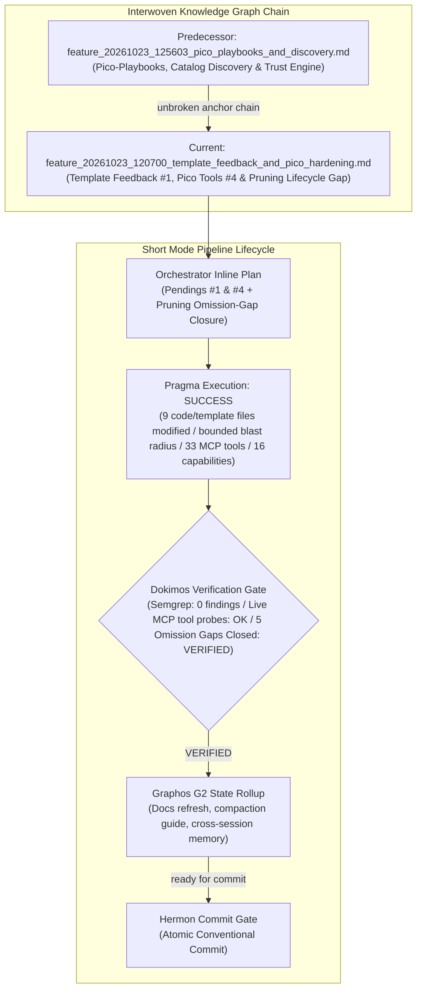
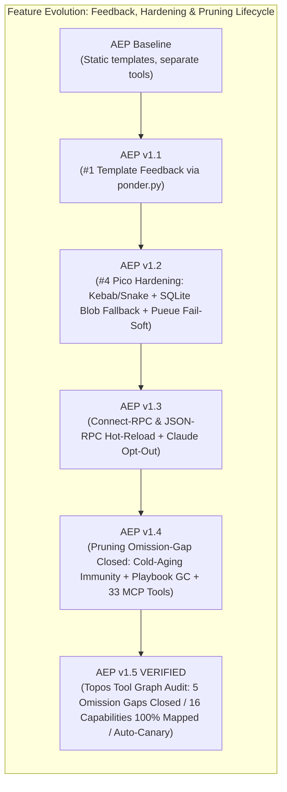

# Feature Pipeline Document: Template Feedback Loop & Pico Tools Hardening

- **Document ID**: `feature_20261023_120700_template_feedback_and_pico_hardening.md`
- **Previous Document**: [`feature_20261023_125603_pico_playbooks_and_discovery.md`](file:///home/ancruz/Documents/workspaces/agent-execution-plane/docs/pipeline/feature_20261023_125603_pico_playbooks_and_discovery.md)
- **Next Document**: `Pending Hermon Atomic Commit & Release`
- **Pipeline Mode**: `Short` (Topos Integrity Protocol — Fast-path inline planning & execution)
- **Plan Scope**: Closing AEP Pendings #1 (Feedback template→artifact), #4 (Pico Tools review & hardening), and Pruning/Reevaluation Lifecycle Omission Gap
- **Current Status**: `STAGE 2 (G2): POST-DOKIMOS VERIFIED / READY FOR COMMIT (Hermon)`
- **Timestamp**: 2026-10-23T12:07:00Z
- **Author**: Graphos (Universal State Manager — Stage 2 G2 Record & Rollup)
- **Target Blast Radius**:
  - `schemas/database.sql`
  - `engine/catalog.py`
  - `engine/template_registry.py`
  - `engine/hydrator.py`
  - `engine/kanban.py`
  - `engine/playbook.py`
  - `engine/privilege.py`
  - `templates/registry.json`
  - `templates/tpl_disk_usage.go`
  - `templates/tpl_fd_rescuer.go`
  - `templates/tpl_socket_monitor.go`
  - `server.py`
  - `scripts/aep-sync.sh`
- **Audit Gate Status**: Dokimos `VERIFIED` (Semgrep 0 findings / 6 initial MCP checks + 5 Topos Tool Graph Omission Gap checks validated / 100% of 33 MCP tools & 16 capabilities mapped / Codex & Antigravity hot-reload / Cold-aging immunity & auto-canary verified)

---

## 1. State Evolution Map

---

## 2. Operating Premises & Resolution Path

- **Pipeline Mode**: `Short` mode (streamlined execution for well-scoped incremental enhancements without full Archon/Ontos deliberation).
- **Chosen Resolution Path**: Standard / Typed FastMCP path within granted authorization:
  - SQLite schema evolution with backward-compatible column addition.
  - Re-use of existing trust and relevance engines (`engine/ponder.py` and `engine/matcher.py`).
  - Defense-in-depth fallbacks (SQLite blob recovery for RAM execution and `DEGRADED` fail-soft JSON for Pueue async queues).
  - Robust GC lifecycle: cold-aging immunity for successful single-use artifacts in Kanban and persistent playbook GC.
- **Tool Reach & Blast Radius**:
  - `schemas/database.sql`: Added `source_template TEXT` column to `artifacts` table.
  - `engine/catalog.py`: Added idempotent migration for `source_template`, added `template_feedback()` method, updated `register_artifact`, and enhanced `prune(apply=True)` to unlink lingering binaries in `~/.local/share/agent-os/bin/<name>`.
  - `engine/template_registry.py`: Attached `proven` metadata blocks in `catalog()` and `select()`.
  - `engine/hydrator.py`: Handled bidirectional kebab-case ↔ snake_case normalization for template names and parameters.
  - `engine/kanban.py`: Updated `reevaluate()` to grant cold-aging immunity: updates `promotion_score` for all `reusable=1` artifacts, but only demotes (`reusable=0`) on demonstrated failure (`execution_count > 0 and success_rate < 0.70`) or severe degradation (`WARNING`/`REJECT`).
  - `engine/playbook.py`: Added `PlaybookStore.prune(names=None, apply=False)` supporting dry-run inspection, demonstrated failure candidate selection (`run_count > 0 and success_rate < 0.70`), explicit deletion, and complete recency-decay immunity for proven playbooks.
  - `server.py`: Wired `feedback` into `template_catalog`, `template_select`, and `discover`; wired `source_template` into `artifact_lint_and_build`; added SQLite BLOB recovery in `artifact_execute_in_ram`; hardened `async_job_*` with `DEGRADED` fail-soft responses; registered 33rd MCP tool `playbook_prune`; wired `template_registry.get_contract()` into `artifact_hydrate`; added `async_job_inspect` to `_playbook_dispatch()`; exposed step `output` in `playbook_run()`; invoked auto-canary progression in `artifact_execute_in_ram()`.
  - `engine/privilege.py`: Mapped `playbook_prune` to `"automation"` and mapped `"system_docs"` (`query_system_docs`) across `_CAPABILITIES` and `_CAP_KEYWORDS`, achieving 100% mapping of all 33 MCP tools across 16 capabilities.
  - `templates/registry.json`, `templates/tpl_disk_usage.go`, `templates/tpl_fd_rescuer.go`, `templates/tpl_socket_monitor.go`: Parameterized Go templates with compile-safe placeholders (`{{path}}`, `{{pid}}`, `{{state}}`) and registered contracts.
  - `engine/hydrator.py`: Handled quote-aware placeholder substitution without redundant double-quoting.
  - `engine/template_registry.py`: Exposed `get_contract()` for parameter validation and defaults.
  - `engine/kanban.py`: Added `record_canary_by_artifact()` advancing active Kanban tasks from `LINTED` to `CANARY` upon successful RAM execution.
  - `scripts/aep-sync.sh`: Hot-reload Connect-RPC (Antigravity) and JSON-RPC (Codex) across all 33 tools.

---

## 3. Pragma Execution Summary

Pragma completed the implementation addressing pending items #1, #4, and the pruning/reevaluation omission gap:

### 3.1 Pending #1: Feedback Template → Successful Artifact
1. **Schema & Persistence**: Added `source_template TEXT` column to `schemas/database.sql`. In `engine/catalog.py`, implemented an automatic idempotent migration `ALTER TABLE artifacts ADD COLUMN source_template TEXT` during catalog initialization if missing.
2. **Confidence Aggregation**: Implemented `catalog.template_feedback(template_names)` which queries all artifacts originating from each template, computes execution metrics and promotion states, and passes them through `ponder.py` to calculate composite trust scores (`proven` dict: `artifact_count`, `promoted_count`, `avg_score`, `verdict`).
3. **Transparent Injection**: Updated `template_registry.catalog()` and `template_registry.select()` to attach the `proven` summary to each template entry. In `server.py`, `discover(use_case)` exposes `proven` under `synthesize_templates`. Crucially, this metadata informs the agent without altering the multi-signal BM25F ranking of `engine/matcher.py`.
4. **Build Association**: Updated `artifact_lint_and_build` with the optional `source_template` parameter, recording the lineage in the catalog at compilation time.

### 3.2 Pending #4: Review and Hardening of Pico Tools
1. **Hydrator Robustness (`engine/hydrator.py`)**: Added normalization between kebab-case and snake_case for template names (e.g. `socket-monitor` ↔ `socket_monitor`) and variable parameters, preventing mismatches between CLI/registry naming and Go template files.
2. **In-RAM Execution Fallback (`server.py` - `artifact_execute_in_ram`)**: When a binary is missing from the temporary directory `~/.local/share/agent-os/bin/`, the runtime queries the SQLite catalog for `binary_blob`. If found, it reconstructs the binary on disk with `0755` permissions and proceeds with `memfd_create` in-RAM execution, eliminating broken states across workspace cleanups.
3. **Fail-Soft Async Queues (`server.py` - `async_job_*`)**: Hardened `async_job_inspect` and related Pueue tools to return a structured JSON response with `status: "DEGRADED"` and diagnostics when the `pueue` daemon is uninstalled, stopped, or unreachable, avoiding fatal exceptions.

### 3.3 Omission-Gap Closure: Pruning & Reevaluation Lifecycle
1. **Cold-Aging Immunity (`engine/kanban.py`)**: `reevaluate()` refreshes `promotion_score` across all `reusable=1` artifacts, but only demotes (`reusable=0`) when there is demonstrated failure (`execution_count > 0 and success_rate < 0.70` or `verdict in ("WARNING", "REJECT")`). Single-use 100%-success artifacts that age into `CAUTION` (`0.7257` after 365 days) stay `reusable=1` and are never destroyed.
2. **Binary Disk Residue Cleanup (`engine/catalog.py`)**: In `catalog.prune(apply=True)`, deletion of artifact metadata and vector embeddings now also unlinks lingering binaries from `~/.local/share/agent-os/bin/<name>`.
3. **Playbook GC (`engine/playbook.py` & `server.py` - `playbook_prune`)**: Added `playbook_prune(names=None, apply=False)` (`DRY_RUN` default; auto-candidates require demonstrated failure `run_count > 0 and success_rate < 0.70` or explicit `names`; proven playbooks are 100% immune to age decay). Total MCP tools expanded from **32 to 33**.

### 3.4 Topos Tool Graph Audit: 5 Omission Gaps Closed
1. **Gap #1: 100% Tool-to-Capability Alignment (`engine/privilege.py`)**: Added `playbook_prune` to `"automation"` in `_CAPABILITIES` and mapped `"system_docs"` (`query_system_docs`) across `_CAPABILITIES` and bilingual `_CAP_KEYWORDS`. All 33 MCP tools are now 100% accounted for across all 16 capabilities, queryable via `aep_capabilities()` and indexed in `discover()`.
2. **Gap #2: Parameterized Go Templates & Contracts (`templates/*`, `hydrator.py`, `template_registry.py`, `server.py`)**: Embedded compile-safe placeholders (`{{path}}` in `tpl_disk_usage.go`, `{{pid}}` in `tpl_fd_rescuer.go`, `{{state}}` in `tpl_socket_monitor.go`) alongside valid default contracts in `templates/registry.json`. Updated `hydrator.py` to prevent duplicate quoting when placeholders appear in Go string literals (`"{{path}}"`). Wired `template_registry.get_contract()` into `artifact_hydrate` so hydration validates and fills defaults.
3. **Gap #3 & #5: Playbook Dispatch Whitelist & Output Visibility (`server.py`)**: Added `async_job_inspect` to `_playbook_dispatch()`, allowing playbooks to monitor asynchronous background jobs. Included full execution `"output": out` in each step result of `playbook_run()`, enabling complete intermediate observability.
4. **Gap #4: Automated In-RAM Kanban Canary Progression (`engine/kanban.py`, `server.py`)**: Added `kanban.record_canary_by_artifact()` invoked automatically on successful RAM execution (`exit_code == 0`) in `artifact_execute_in_ram()`. This advances matching active tasks from `LINTED` to `CANARY` (`canary_passed=1`), enabling smooth promotion via `kanban_promote()`.

---

## 4. Dokimos Verification Ledger

Dokimos executed comprehensive verification across static analysis, live MCP tool invocations, and lifecycle edge cases:

| Gate | Target / Check | Verdict | Details / Evidence |
| :--- | :--- | :---: | :--- |
| **Static Analysis** | Semgrep security & lint scan | ✅ **PASS** | 0 findings across entire workspace. |
| **Tool Call #1** | `template_catalog` | ✅ **PASS** | Successfully returned template definitions with enriched `proven` feedback blocks. |
| **Tool Call #2** | `template_select` | ✅ **PASS** | Successfully ranked templates by intent while including `proven` data without biasing BM25F scores. |
| **Tool Call #3** | `discover` | ✅ **PASS** | Successfully returned recommendations with `proven` metadata under `synthesize_templates`; hint mentions `playbook_prune`. |
| **Tool Call #4** | `artifact_hydrate` (kebab-case) | ✅ **PASS** | Successfully hydrated template using kebab-case identifier (`socket-monitor`). |
| **Tool Call #5** | `artifact_execute_in_ram` (fallback) | ✅ **PASS** | Verified binary execution directly from SQLite `binary_blob` fallback when binary deleted from disk. |
| **Tool Call #6** | `async_job_inspect` (fail-soft) | ✅ **PASS** | Verified return of structured JSON with `status: "DEGRADED"` and descriptive diagnostics when Pueue daemon is offline. |
| **Lifecycle Gate #1** | `kanban.reevaluate` (Cold-Aging Immunity) | ✅ **PASS** | Single-use artifacts with 100% success rate aged into `CAUTION` retain `reusable=1` and are protected from pruning. |
| **Lifecycle Gate #2** | `catalog.prune` (Binary Unlink) | ✅ **PASS** | Verified that `apply=True` removes metadata, sqlite-vec embeddings, and disk binaries in `~/.local/share/agent-os/bin/`. |
| **Lifecycle Gate #3** | `playbook_prune` (Tool 33 / GC) | ✅ **PASS** | Verified dry-run default, demonstrated failure filtering, explicit target deletion, and immunity to age decay for successful playbooks. |
| **Tool Graph Gap #1** | 100% Capabilities Mapped (`privilege.py`) | ✅ **PASS** | All 33 tools mapped across 16 capabilities; `playbook_prune` in `automation`; `system_docs` in `_CAPABILITIES` & `_CAP_KEYWORDS`. |
| **Tool Graph Gap #2** | Parameterized Templates & Quote Safety | ✅ **PASS** | Verified compile-safe `{{path}}`, `{{pid}}`, `{{state}}` hydration without double quoting; contracts enforced via `artifact_hydrate`. |
| **Tool Graph Gap #3** | Playbook Dispatch Whitelist (`async_job_inspect`) | ✅ **PASS** | Verified that `async_job_inspect` is callable within playbook steps without `NOT_ALLOWED` lint errors. |
| **Tool Graph Gap #4** | Automated Kanban Canary Progression | ✅ **PASS** | Verified that `artifact_execute_in_ram` automatically advances active task from `LINTED` to `CANARY` (`canary_passed=1`). |
| **Tool Graph Gap #5** | Playbook Step Output Visibility | ✅ **PASS** | Verified each step result in `playbook_run()` contains full `"output": out` payload. |

**Final Dokimos Verdict**: **VERIFIED**

---

## 5. Live Hot-Reload & Ecosystem Auto-Plug (`aep-sync.sh`)

In addition to tool hardening, `scripts/aep-sync.sh` supports multi-client auto-plug and dynamic hot-reload across all 33 tools:

1. **Antigravity (Connect-RPC Hot-Reload)**:
   - Discovers the active `language_server` PID and CSRF token via `ps` and `ss`.
   - Dispatches `RefreshMcpServers` to the local Connect-RPC endpoint (`/exa.language_server_pb.LanguageServerService/RefreshMcpServers`).
   - Regenerates tool definitions in `~/.gemini/antigravity/mcp/agent-execution-plane/*.json` live without requiring an IDE or session restart.

2. **OpenAI Codex / ChatGPT (JSON-RPC Hot-Reload)**:
   - Auto-registers the MCP server into `~/.codex/config.toml` via `codex mcp add agent-execution-plane -- <launcher>`.
   - If `codex app-server` is running, connects to its active control socket (`${CODEX_HOME:-~/.codex}/app-server-control/app-server-control.sock`) via `codex app-server proxy --sock <socket>`.
   - Sends JSON-RPC `initialize` and `config/mcpServer/reload` notifications to dynamically reload MCP servers in running ChatGPT / Codex sessions (33 tools actively loaded).

3. **Claude Code Host Opt-Out (`AEP_PLUG_CLAUDE=1` / `--with-claude`)**:
   - By default on this host, `agent-execution-plane` is un-registered from Claude Code (`claude mcp remove --scope user agent-execution-plane`) to prevent host-level tool overloading.
   - Preserves the full auto-plug registration code block inside `scripts/aep-sync.sh`: explicit opt-in is supported anytime via `./scripts/aep-sync.sh --with-claude` or `AEP_PLUG_CLAUDE=1 ./scripts/aep-sync.sh`.

---

## 6. Handoff to Hermon (Stage 6)

With Dokimos issuing **VERIFIED** and Graphos G2 documentation complete, the pipeline transitions to **Hermon** for atomic commit:
- **Commit Type**: `feat`
- **Scope**: `engine`
- **Subject**: `implement template feedback, harden pico tools, close pruning omission gap, and seal 5 tool graph audit gaps (33 tools)`
- **Traceability**: Closes AEP Pendings #1 & #4, closes Pruning/Reevaluation Omission Gap, and seals 5 Topos Tool Graph Omission Gaps across 9 files (`engine/privilege.py`, `templates/registry.json`, `templates/tpl_disk_usage.go`, `templates/tpl_fd_rescuer.go`, `templates/tpl_socket_monitor.go`, `engine/hydrator.py`, `engine/template_registry.py`, `engine/kanban.py`, `server.py`). Verified by Dokimos (Semgrep 0 findings, 6/6 initial checks passed, 3/3 lifecycle gates verified, 5/5 tool graph omission gaps verified, 33 tools / 16 capabilities 100% confirmed across Antigravity and OpenAI Codex, Claude Code opt-out configured).
