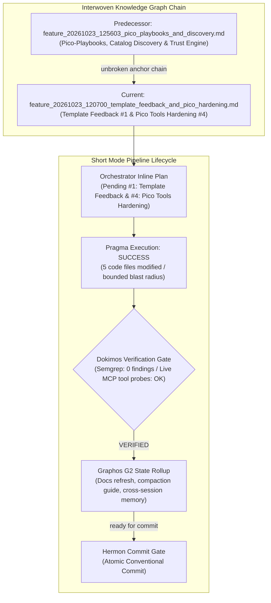
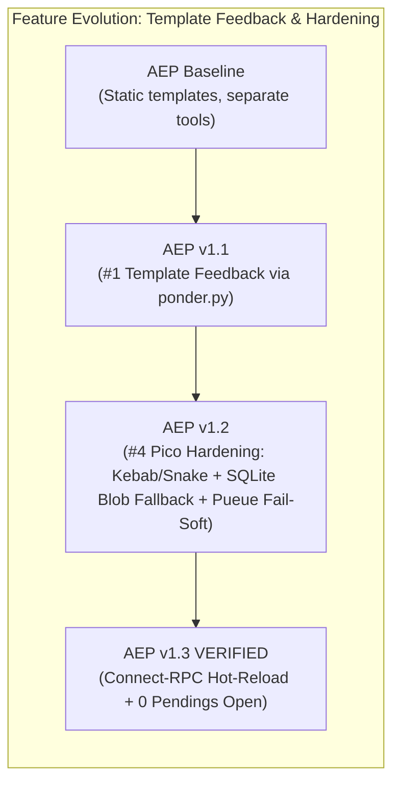

# Feature Pipeline Document: Template Feedback Loop & Pico Tools Hardening

- **Document ID**: `feature_20261023_120700_template_feedback_and_pico_hardening.md`
- **Previous Document**: [`feature_20261023_125603_pico_playbooks_and_discovery.md`](file:///home/ancruz/Documents/workspaces/agent-execution-plane/docs/pipeline/feature_20261023_125603_pico_playbooks_and_discovery.md)
- **Next Document**: `Pending Hermon Atomic Commit & Release`
- **Pipeline Mode**: `Short` (Topos Integrity Protocol — Fast-path inline planning & execution)
- **Plan Scope**: Closing AEP Pendings #1 (Feedback template→artifact) & #4 (Pico Tools review & hardening)
- **Current Status**: `STAGE 2 (G2): POST-DOKIMOS VERIFIED / READY FOR COMMIT (Hermon)`
- **Timestamp**: 2026-10-23T12:07:00Z
- **Author**: Graphos (Universal State Manager — Stage 2 G2 Record & Rollup)
- **Target Blast Radius**:
  - `schemas/database.sql`
  - `engine/catalog.py`
  - `engine/template_registry.py`
  - `engine/hydrator.py`
  - `server.py`
- **Audit Gate Status**: Dokimos `VERIFIED` (Semgrep 0 findings / 6 MCP tool calls validated)

---

## 1. State Evolution Map

---

## 2. Operating Premises & Resolution Path

- **Pipeline Mode**: `Short` mode (streamlined execution for well-scoped incremental enhancements without full Archon/Ontos deliberation).
- **Chosen Resolution Path**: Standard / Typed FastMCP path within granted authorization:
  - SQLite schema evolution with backward-compatible column addition.
  - Re-use of existing trust and relevance engines (`engine/ponder.py` and `engine/matcher.py`).
  - Defense-in-depth fallbacks (SQLite blob recovery for RAM execution and `DEGRADED` fail-soft JSON for Pueue async queues).
- **Tool Reach & Blast Radius**:
  - `schemas/database.sql`: Added `source_template TEXT` column to `artifacts` table.
  - `engine/catalog.py`: Added idempotent migration for `source_template`, added `template_feedback()` method, and updated `register_artifact`.
  - `engine/template_registry.py`: Attached `proven` metadata blocks in `catalog()` and `select()`.
  - `engine/hydrator.py`: Handled bidirectional kebab-case ↔ snake_case normalization for template names and parameters.
  - `server.py`: Wired `feedback` into `template_catalog`, `template_select`, and `discover`; wired `source_template` into `artifact_lint_and_build`; added SQLite BLOB recovery in `artifact_execute_in_ram`; hardened `async_job_*` with `DEGRADED` fail-soft responses.

---

## 3. Pragma Execution Summary

Pragma completed the implementation addressing both pending items #1 and #4:

### 3.1 Pending #1: Feedback Template → Successful Artifact
1. **Schema & Persistence**: Added `source_template TEXT` column to `schemas/database.sql`. In `engine/catalog.py`, implemented an automatic idempotent migration `ALTER TABLE artifacts ADD COLUMN source_template TEXT` during catalog initialization if missing.
2. **Confidence Aggregation**: Implemented `catalog.template_feedback(template_names)` which queries all artifacts originating from each template, computes execution metrics and promotion states, and passes them through `ponder.py` to calculate composite trust scores (`proven` dict: `artifact_count`, `promoted_count`, `avg_score`, `verdict`).
3. **Transparent Injection**: Updated `template_registry.catalog()` and `template_registry.select()` to attach the `proven` summary to each template entry. In `server.py`, `discover(use_case)` exposes `proven` under `synthesize_templates`. Crucially, this metadata informs the agent without altering the multi-signal BM25F ranking of `engine/matcher.py`.
4. **Build Association**: Updated `artifact_lint_and_build` with the optional `source_template` parameter, recording the lineage in the catalog at compilation time.

### 3.2 Pending #4: Review and Hardening of Pico Tools
1. **Hydrator Robustness (`engine/hydrator.py`)**: Added normalization between kebab-case and snake_case for template names (e.g. `socket-monitor` ↔ `socket_monitor`) and variable parameters, preventing mismatches between CLI/registry naming and Go template files.
2. **In-RAM Execution Fallback (`server.py` - `artifact_execute_in_ram`)**: When a binary is missing from the temporary directory `~/.local/share/agent-os/bin/`, the runtime queries the SQLite catalog for `binary_blob`. If found, it reconstructs the binary on disk with `0755` permissions and proceeds with `memfd_create` in-RAM execution, eliminating broken states across workspace cleanups.
3. **Fail-Soft Async Queues (`server.py` - `async_job_*`)**: Hardened `async_job_inspect` and related Pueue tools to return a structured JSON response with `status: "DEGRADED"` and diagnostics when the `pueue` daemon is uninstalled, stopped, or unreachable, avoiding fatal exceptions.

---

## 4. Dokimos Verification Ledger

Dokimos executed comprehensive verification across static analysis and live MCP tool invocations:

| Gate | Target / Check | Verdict | Details / Evidence |
| :--- | :--- | :---: | :--- |
| **Static Analysis** | Semgrep security & lint scan | ✅ **PASS** | 0 findings across entire workspace. |
| **Tool Call #1** | `template_catalog` | ✅ **PASS** | Successfully returned template definitions with enriched `proven` feedback blocks. |
| **Tool Call #2** | `template_select` | ✅ **PASS** | Successfully ranked templates by intent while including `proven` data without biasing BM25F scores. |
| **Tool Call #3** | `discover` | ✅ **PASS** | Successfully returned recommendations with `proven` metadata under `synthesize_templates`. |
| **Tool Call #4** | `artifact_hydrate` (kebab-case) | ✅ **PASS** | Successfully hydrated template using kebab-case identifier (`socket-monitor`). |
| **Tool Call #5** | `artifact_execute_in_ram` (fallback) | ✅ **PASS** | Verified binary execution directly from SQLite `binary_blob` fallback when binary deleted from disk. |
| **Tool Call #6** | `async_job_inspect` (fail-soft) | ✅ **PASS** | Verified return of structured JSON with `status: "DEGRADED"` and descriptive diagnostics when Pueue daemon is offline. |

**Final Dokimos Verdict**: **VERIFIED**

---

## 5. Live Hot-Reload Verification (`aep-sync.sh`)

In addition to tool hardening, `scripts/aep-sync.sh` was enhanced with Connect-RPC hot-reload:
- Discovers the active `language_server` PID and CSRF token.
- Dispatches `RefreshMcpServers` to the local Connect-RPC endpoint.
- Regenerates tool definitions in `~/.gemini/antigravity/mcp/agent-execution-plane/*.json` without requiring an IDE or session restart.

---

## 6. Handoff to Hermon (Stage 6)

With Dokimos issuing **VERIFIED** and Graphos G2 documentation complete, the pipeline transitions to **Hermon** for atomic commit:
- **Commit Type**: `feat`
- **Scope**: `engine`
- **Subject**: `implement template feedback loop and harden pico execution tools`
- **Traceability**: Closes AEP Pendings #1 and #4. Verified by Dokimos (Semgrep 0 findings, 6/6 MCP checks passed).
