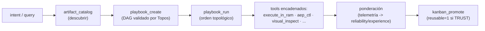

# Feature: Pico-Playbooks, Descubrimiento de Catálogo y Ponderación de Confianza

> Estado: Operativo (verificado) · MCP tools: 23 · Fecha: 2026-10-23

## Entregado en este arco
1. **Memoria semántica híbrida** (`sqlite-vec`) con recuperación 2-tier (hash + KNN coseno).
2. **Ponderación multidimensional consciente de confianza** del Pico-Kanban (adaptada del
   trust engine de `skill-swarm-mcp`): dimensiones `quality`/`reliability`/`experience`/`recency`,
   `effective = Σ(dim·peso) × confidence`, bandas TRUST/CAUTION/WARNING/REJECT, veto de fiabilidad.
3. **Lazo de telemetría cerrado**: `artifact_execute_in_ram` registra ejecuciones
   (`execution_metrics`) que alimentan `reliability`/`experience`.
4. **Descubrimiento** (`artifact_catalog`): browse por confianza + top-K semántico.
5. **Pico-Playbooks** (`playbook_create`/`run`/`list`): orquestación de tools/artefactos en
   flujos DAG validados por `topos_guard`, ejecutables de un tiro, ponderados por éxito.
   Lint en creación (tools contra whitelist) + validación DAG = "linter" del playbook.
6. **Optimización SQLite** (WAL, mmap, busy_timeout, foreign_keys) y auto-plug del MCP.

## Pendientes
- **#3** Playbook E2E pre-cargado (visual_inspect GUI + sonda Go) como demostración.
- **#5** Plantillas Go mínimas pre-cargadas ancladas a cada capacidad del manifiesto.
- Indexar playbooks en `sqlite-vec` (descubrimiento semántico de automatizaciones).
- Unificar la ponderación de playbooks con el modelo multidimensional de artefactos.

## Decisiones firmes
- **WebSockets de Go: NO requeridos.** El MCP es stdio (correcto para local). Para push/streaming
  futuro: MCP progress notifications + Streamable HTTP; WS de Go solo para un dashboard aparte.
- README co-mantenido por otro agente (blindaje semántico); coordinar.
- Las tools nuevas entran MCP-live tras reiniciar la sesión del cliente.
