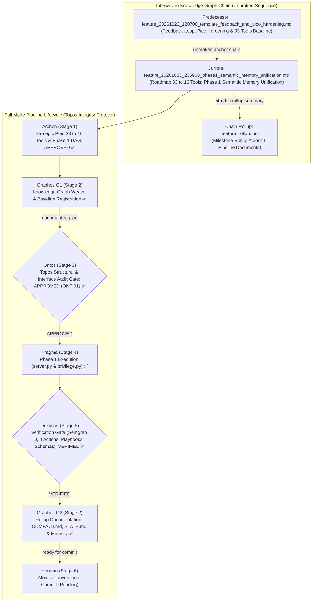
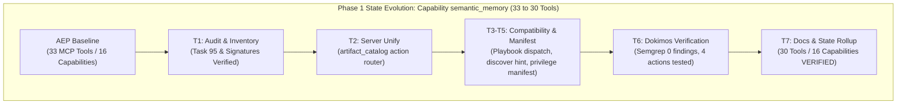
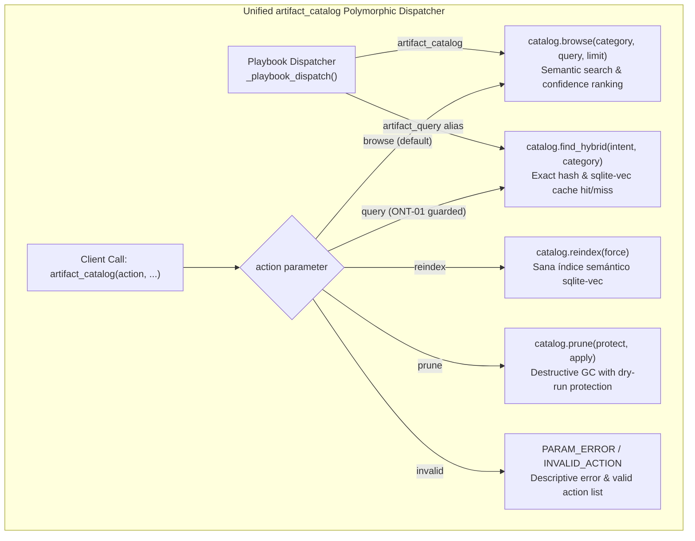

# Feature Pipeline Document: Phase 1 Semantic Memory Tool Unification (33 → 30 Tools)

- **Document ID**: `feature_20261023_235900_phase1_semantic_memory_unification.md`
- **Previous Document**: [`feature_20261023_120700_template_feedback_and_pico_hardening.md`](file:///home/ancruz/Documents/workspaces/agent-execution-plane/docs/pipeline/feature_20261023_120700_template_feedback_and_pico_hardening.md)
- **Chain Rollup Summary**: [`feature_rollup.md`](file:///home/ancruz/Documents/workspaces/agent-execution-plane/docs/pipeline/feature_rollup.md) (5th Document in Pipeline Chain)
- **Next Document**: `Hermon (Stage 6) Release & Atomic Conventional Commit`
- **Pipeline Mode**: `Full` (Topos Integrity Protocol — Archon Strategic Plan & Ontos Structural Audit)
- **Kanban Task ID**: `95` (`phase1:semantic_memory_unification`) — Status: `PROMOTED` (Trust Score: `0.8875` / `0.925`)
- **Plan Scope**: Complete Tool Consolidation Roadmap (33 → 16 Tools) — Phase 1: Unification of Capability `semantic_memory` (`artifact_query`, `artifact_catalog`, `artifact_reindex`, `artifact_prune` → `artifact_catalog(action="browse"|"query"|"reindex"|"prune", ...)`)
- **Current Status**: `STAGE 2 (G2): POST-DOKIMOS VERIFIED & ROLLUP COMPLETE (READY FOR HERMON STAGE 6)`
- **Timestamp**: 2026-10-24T00:20:00Z
- **Author**: Graphos (Universal State Manager & Knowledge Graph Custodian — Stage 2 G2)
- **Target Blast Radius**:
  - `server.py` (polymorphic `artifact_catalog`, remove standalone decorators for `artifact_query`/`artifact_reindex`/`artifact_prune`, update `_playbook_dispatch` backward compatibility, update `discover` hint)
  - `engine/privilege.py` (update `_CAPABILITIES["semantic_memory"]` tool listing to `["artifact_catalog"]`, bilingual `_CAP_KEYWORDS["semantic_memory"]`)
  - `docs/pipeline/feature_20261023_235900_phase1_semantic_memory_unification.md` (this artifact)
  - `docs/pipeline/feature_rollup.md` (5th document chain rollup)
  - `docs/STATE.md` and `docs/COMPACT.md` (tool count 30 and Phase 1 state)
  - `~/.claude/.../memory/aep-state-and-pendings.md` (Phase 1 completion and queued roadmap)
  - `README.md` (minimal tool count sync 33 → 30 and semantic memory table line; prose and diagrams shielded)
- **Topos Pipeline Verdict**: `VERIFIED` across all gates (Archon `APPROVED` → Ontos `APPROVED` → Pragma `EXECUTED` → Dokimos `VERIFIED` → Graphos G2 `DOCUMENTED`)

---

## 1. State Evolution Map & Knowledge Graph







---

## 2. Operating Premises & Tool Reach

- **Pipeline Mode**: `Full` mode (Topos Integrity Protocol — deliberate multi-stage planning, pre-implementation contract auditing by Ontos, controlled execution by Pragma, verification by Dokimos, and atomic release by Hermon).
- **Core Premise (P0)**: Agents-for-agents execution runtime. Delivering a consolidated, ergonomic tool surface reduces LLM token overhead, eliminates hallucinated routing choices between overlapping tools, and reinforces high-efficiency autonomous actuation.
- **Tool Reach & Blast Radius (P1)**:
  - **Resolution Path**: Standard typed FastMCP implementation within granted local authorization:
    - Bounded refactoring in `server.py` replacing 4 standalone `@mcp.tool()` endpoints with 1 cohesive multi-action tool.
    - Zero breaking changes to underlying SQLite database schema (`schemas/database.sql` and `~/.local/share/agent-os/artifacts.db`).
    - Internal routing adapter in `_playbook_dispatch()` ensuring complete backward compatibility for workflows stored with `artifact_query`.
    - Capability manifest synchronization in `engine/privilege.py` (`_CAPABILITIES["semantic_memory"]` and `_CAP_KEYWORDS["semantic_memory"]`).
  - **Blast Radius Boundaries**:
    - Primary Code: `server.py` (lines 96-128, 170-207, 243-257, 849-863).
    - Privilege Manifest: `engine/privilege.py` (line 75, 100).
    - Pipeline Documentation: `docs/pipeline/feature_20261023_235900_phase1_semantic_memory_unification.md` and `docs/pipeline/feature_rollup.md`.
    - State & Memory: `docs/STATE.md`, `docs/COMPACT.md`, and `~/.claude/.../memory/aep-state-and-pendings.md`.
    - Shielded Boundary: `README.md` minimal tool count sync (33 → 30) and semantic memory table line (strictly preserving all prose and Mermaid diagrams untouched per semantic shielding).

---

## 3. Complete 7-Phase Tool Consolidation Roadmap (33 → 16 Tools)

The Agent Execution Plane registered **33 MCP tools** spanning **16 capabilities**. While each tool is fully functional, multiple tools exhibited functional overlap within the same domain, creating agent confusion during tool selection.

Archon established the **Complete 7-Phase Tool Consolidation Roadmap**, executing exactly **one capability fusion per phase** under full Topos verification to reach a 1:1 clean parity between tools and capabilities (**16 tools total**):

| Phase | Target Capability | Pre-Fusion Tools | Consolidated Tool Signature | Tool Count Δ | Resulting Tool Count | Primary Impacted Modules | Status |
| :---: | :--- | :--- | :--- | :---: | :---: | :--- | :---: |
| **Phase 1** | `semantic_memory` | `artifact_query`<br/>`artifact_catalog`<br/>`artifact_reindex`<br/>`artifact_prune` | **`artifact_catalog`**<br/>`action: "browse"\|"query"\|"reindex"\|"prune"` | **-3** | **30** | `server.py`<br/>`engine/privilege.py` | **VERIFIED ✅** |
| **Phase 2** | `task_management` | `kanban_board`<br/>`kanban_task_create`<br/>`kanban_advance`<br/>`kanban_promote`<br/>`kanban_demote`<br/>`kanban_reevaluate`<br/>`kanban_archive`<br/>`kanban_unarchive` | **`kanban_board`**<br/>`action: "board"\|"create"\|"advance"\|"promote"\|"demote"\|"reevaluate"\|"archive"\|"unarchive"` | **-7** | **23** | `server.py`<br/>`engine/kanban.py`<br/>`engine/privilege.py` | Queued |
| **Phase 3** | `automation` | `playbook_create`<br/>`playbook_run`<br/>`playbook_list`<br/>`playbook_prune` | **`playbook_manage`**<br/>`action: "list"\|"create"\|"run"\|"prune"` | **-3** | **20** | `server.py`<br/>`engine/playbook.py`<br/>`engine/privilege.py` | Queued |
| **Phase 4** | `artifact_synthesis` | `template_catalog`<br/>`template_select`<br/>`artifact_hydrate`<br/>`artifact_lint_and_build` | **`artifact_synthesize`**<br/>`action: "catalog"\|"select"\|"hydrate"\|"build"` | **-3** | **17** | `server.py`<br/>`engine/hydrator.py`<br/>`engine/template_registry.py` | Queued |
| **Phase 5** | `async_dispatch` | `async_job_dispatch`<br/>`async_job_inspect` | **`async_job`**<br/>`action: "dispatch"\|"inspect"` | **-1** | **16** | `server.py`<br/>`engine/privilege.py` | Queued |
| **Phase 6** | `crash_forensics` | `diagnose_system_crashes`<br/>`check_crash_alerts` | **`crash_forensics`**<br/>`action: "diagnose"\|"alerts"` | **-1** | **15** | `server.py`<br/>`engine/privilege.py` | Queued |
| **Phase 7** | `orientation` & `process_introspection` | `discover`<br/>`aep_capabilities`<br/>*(and introspection alignment)* | **`discover`** (unified with capabilities)<br/>+ dedicated **`proc_fd_inspect`** | **+1 / 1:1** | **16** | `server.py`<br/>`engine/privilege.py` | Queued |

**Target End State**: Exactly **16 ergonomic MCP tools**, matching the **16 system capabilities** 1:1, governed by Unix octal permissions (`rwx`) and dynamic capability tiers (`FULL` / `DIMINISHED`).

---

## 4. Ontos Structural & Contract Audit (Stage 3 Verdict: APPROVED)

Ontos completed the Topos structural integrity audit of the Phase 1 Execution Plan across vertical trace, horizontal trace, and co-dependency checks:

- **Vertical Trace Integrity**: Verified data contracts from client JSON-RPC through FastMCP, parameter extraction, `engine/catalog.py` hybrid search, down to SQLite WAL persistence. No layers skipped, no contract drift.
- **Horizontal Trace Integrity**: Audited peer dependencies in `discover()` routing hints, `_playbook_dispatch()` backward-compatibility, and `engine/privilege.py` capability registration.
- **Co-Dependency Classification**: Evaluated `artifact_catalog` coupling to `engine/catalog.py` as directional Dependency (A → B). Verified 0 cyclic or mutual contracts.
- **Architectural Enrichment `ONT-01`**:
  1. **Strict Parameter Validation for `query`**: Required that `action="query"` strictly validate that `intent` (or `query`) and `category` are non-empty, returning `PARAM_ERROR` instead of silent miss:
     ```python
     if not eff_intent or not category:
         return json.dumps(
             {"status": "PARAM_ERROR", "error": "Acción 'query' requiere los parámetros 'intent' (o 'query') y 'category'."},
             indent=2,
             ensure_ascii=False,
         )
     ```
  2. **Bilingual Keyword Enrichment**: Augmented `_CAP_KEYWORDS["semantic_memory"]` in `engine/privilege.py` with `consultar`, `podar`, `sanar` to guarantee seamless Spanish/English discovery routing in `discover(use_case)`.

**Verdict**: **`APPROVED`** (Unconditional handoff to Pragma Stage 4).

---

## 5. Pragma Execution Report (Stage 4)

Pragma implemented the validated plan across all target files:

1. **`server.py`**:
   - Implemented polymorphic `artifact_catalog` with actions `browse`, `query`, `reindex`, `prune`.
   - Removed standalone `@mcp.tool()` decorators for `artifact_query`, `artifact_reindex`, and `artifact_prune`.
   - Implemented strict `ONT-01` parameter validation returning `PARAM_ERROR` if `query` lacks `intent` or `category`.
   - Implemented `INVALID_ACTION` error handler listing supported actions.
   - Updated `discover()` guidance hint to point to `artifact_catalog(action='prune')`.
   - Maintained backward compatibility in `_playbook_dispatch()` via lambda wrapper:
     ```python
     "artifact_query": lambda intent="", category="", **kw: artifact_catalog(action="query", intent=intent, category=category, **kw),
     "artifact_catalog": artifact_catalog,
     ```
2. **`engine/privilege.py`**:
   - Updated `_CAPABILITIES["semantic_memory"]` tool listing to `["artifact_catalog"]`.
   - Enriched `_CAP_KEYWORDS["semantic_memory"]` with bilingual anchors (`consultar`, `podar`, `sanar`).

---

## 6. Dokimos Verification Ledger (Stage 5 Verdict: VERIFIED)

Dokimos executed comprehensive multi-gate verification against the running MCP server and codebase:

| Verification Gate | Target Check | Test Specification & Evidence | Result |
| :---: | :--- | :--- | :---: |
| **Gate 1** | Static Analysis | Semgrep full scan across Python codebase | **0 findings ✅** |
| **Gate 2.1** | `artifact_catalog(action="browse")` | Default listing, returns 10 registered artifacts, capability tier `FULL` | **PASS ✅** |
| **Gate 2.2** | `artifact_catalog(action="query")` | Guard check without params (`PARAM_ERROR`); exact match & hybrid search hit | **PASS ✅** |
| **Gate 2.3** | `artifact_catalog(action="reindex")` | Embedder lazy load, index coverage report before/after | **PASS ✅** |
| **Gate 2.4** | `artifact_catalog(action="prune")` | Dry-run protection (`apply=False`), template protection whitelist | **PASS ✅** |
| **Gate 2.5** | Error Handling | `action="invalid"` returns `INVALID_ACTION` with valid actions list | **PASS ✅** |
| **Gate 3** | Playbook Compatibility | Legacy call to `artifact_query` in `_playbook_dispatch()` dispatches seamlessly | **PASS ✅** |
| **Gate 4** | MCP Tool Inventory | `aep_capabilities()` returns exactly 30 tools; 30 schema JSON files in MCP config | **PASS (30 tools) ✅** |
| **Gate 5** | Kanban Lifecycle | Task `95` (`phase1:semantic_memory_unification`) promoted to `PROMOTED` (`0.8875 TRUST`) | **PASS ✅** |

**Verdict**: **`VERIFIED`** (Unconditional handoff to Graphos G2).

---

## 7. Graphos G2 State Sync & Rollup

Graphos G2 synchronized all repository documentation and state trackers:
1. **Pipeline State**: Updated `docs/pipeline/feature_20261023_235900_phase1_semantic_memory_unification.md` (this file) with the complete Ontos, Pragma, and Dokimos lifecycle ledger.
2. **5th Document Chain Rollup**: Updated `docs/pipeline/feature_rollup.md` reflecting Phase 1 completion and tool count reduction to 30.
3. **Repository State (`docs/STATE.md`)**: Updated snapshot header to 30 tools, recorded Phase 1 completion in completed milestones, and queued Phases 2–7 in architectural roadmap.
4. **Compaction Instruction (`docs/COMPACT.md`)**: Regenerated compaction instruction strictly under 50 lines preserving core invariants, 30 tools baseline, and next consolidation phases.
5. **Claude Project Memory (`aep-state-and-pendings.md`)**: Recorded 30 tools baseline, polymorphic `artifact_catalog` unification, and remaining roadmap backlog.
6. **Project Root (`README.md`)**: Synchronized tool count references (33 → 30) and consolidated the `semantic_memory` / `artifact_catalog` table line while strictly preserving all prose and Mermaid diagrams per semantic shielding.

---

## 8. Handoff to Hermon (Stage 6)

Graphos G2 documentation and state synchronization is complete.

- **Routing**: Return to Orchestrator -> Transition to **Hermon (Stage 6)** for release and atomic conventional commit.
- **Commit Type**: `refactor(server)` / `feat(catalog)`
- **Traceability**: Complete Tool Consolidation Roadmap (Phase 1: `semantic_memory` unification, 33 → 30 tools). Kanban Task `95` (`PROMOTED`).
