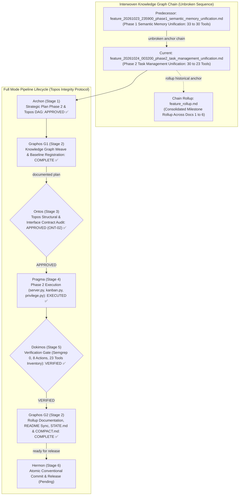
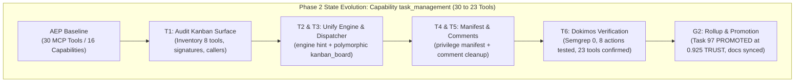
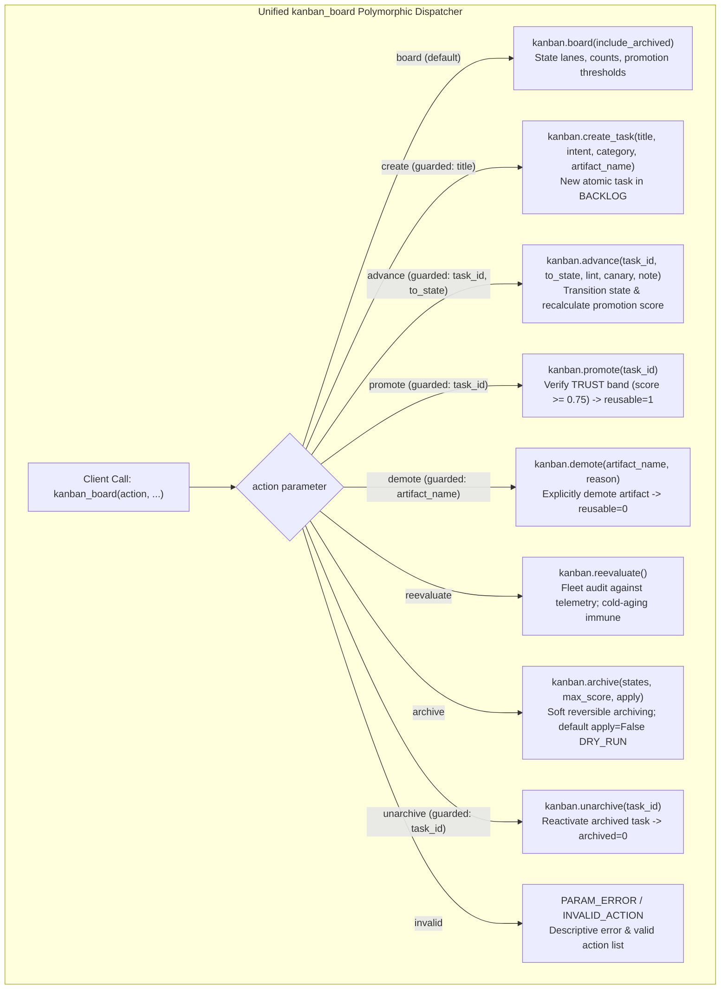

# Feature Pipeline Document: Phase 2 Task Management Tool Unification (30 → 23 Tools)

- **Document ID**: `feature_20261024_003200_phase2_task_management_unification.md`
- **Previous Document**: [`feature_20261023_235900_phase1_semantic_memory_unification.md`](file:///home/ancruz/Documents/workspaces/agent-execution-plane/docs/pipeline/feature_20261023_235900_phase1_semantic_memory_unification.md)
- **Chain Rollup Summary**: [`feature_rollup.md`](file:///home/ancruz/Documents/workspaces/agent-execution-plane/docs/pipeline/feature_rollup.md) (Consolidated History Docs 1–6)
- **Next Document**: `Hermon (Stage 6) Release & Atomic Conventional Commit`
- **Pipeline Mode**: `Full` (Topos Integrity Protocol — Archon Strategic Plan & Ontos Structural Audit)
- **Kanban Task ID**: `97` (`phase2:task_management_unification`) — Status: `PROMOTED` (Trust Score: `0.925 TRUST`)
- **Plan Scope**: Complete Tool Consolidation Roadmap (33 → 16 Tools) — Phase 2: Unification of Capability `task_management` (`kanban_board`, `kanban_task_create`, `kanban_advance`, `kanban_promote`, `kanban_demote`, `kanban_reevaluate`, `kanban_archive`, `kanban_unarchive` → polymorphic `kanban_board(action="board"|"create"|"advance"|"promote"|"demote"|"reevaluate"|"archive"|"unarchive", ...)`)
- **Current Status**: `STAGE 2 (G2): POST-DOKIMOS VERIFIED & ROLLUP COMPLETE (READY FOR HERMON STAGE 6)`
- **Timestamp**: 2026-10-24T00:40:00Z
- **Author**: Graphos (Universal State Manager & Knowledge Graph Custodian — Stage 2 G2)
- **Target Blast Radius**:
  - `server.py` (polymorphic `kanban_board`, remove 7 standalone decorators, enforce strict parameter guards `PARAM_ERROR`, action error handling `INVALID_ACTION`, clean comment references at lines 361, 372, 381)
  - `engine/kanban.py` (modernize hint in `archive()` to refer to action `unarchive` instead of standalone tool)
  - `engine/privilege.py` (synchronize `_CAPABILITIES["task_management"]` tool list to `["kanban_board"]`, update capability description, enrich `_CAP_KEYWORDS["task_management"]` with bilingual action verbs)
  - `docs/pipeline/feature_20261024_003200_phase2_task_management_unification.md` (this pipeline artifact)
  - `docs/pipeline/feature_rollup.md` (6th document in chain rollup)
  - `docs/STATE.md` and `docs/COMPACT.md` (tool count 23 and Phase 2 completed state)
  - `~/.claude/.../memory/aep-state-and-pendings.md` (Phase 2 completion and Phase 3 target)
  - `README.md` (minimal tool count sync 30 → 23 and unified kanban_board table row; prose and diagrams strictly shielded)
- **Topos Pipeline Verdict**: `VERIFIED` across all gates (Archon `APPROVED` → Ontos `APPROVED` → Pragma `EXECUTED` → Dokimos `VERIFIED` → Graphos G2 `DOCUMENTED`)

---

## 1. State Evolution Map & Knowledge Graph







---

## 2. Operating Premises & Tool Reach (P0 & P1)

- **Pipeline Mode**: `Full` mode under Topos Integrity Protocol. Every change is an invariant-preserving node in the dependency graph.
- **Premise P0 (Agents-for-Agents Delivery)**: AEP is an autonomous execution environment designed for agents. Tool consolidation directly addresses LLM prompt fatigue, token saturation, and hallucinatory confusion among fragmented endpoints by delivering compact, ergonomic, and multi-action polymorphic tools.
- **Premise P1 (Tool Reach & Blast Radius)**:
  - **Standard Path**: High-reach typed FastMCP stdio interface. Consolidation reduces tool surface from 30 to 23 endpoints with zero regression in functional capability.
  - **Underlying Persistence**: Zero changes to SQLite database tables (`kanban_tasks` in `~/.local/share/agent-os/artifacts.db`). Schema remains stable and untouched.
  - **Internal Callers**: Internal calls inside `server.py` (such as `artifact_lint_and_build` calling `kanban.create_task` and `kanban.advance`, and `artifact_execute_in_ram` calling `kanban.record_canary_by_artifact`) call the `KanbanBoard` engine instance directly, remaining completely unaffected by tool surface consolidation.
  - **Blast Radius Boundaries**:
    - Primary Code: `server.py` (lines 764–860, 361, 372, 381).
    - Engine Hint: `engine/kanban.py` (line 289).
    - Capability Manifest: `engine/privilege.py` (lines 84, 109).
    - Pipeline Documentation: `docs/pipeline/feature_20261024_003200_phase2_task_management_unification.md` and `docs/pipeline/feature_rollup.md`.
    - State & Memory: `docs/STATE.md`, `docs/COMPACT.md`, and `~/.claude/.../memory/aep-state-and-pendings.md`.
    - Shielded Boundary: `README.md` minimal tool count sync (30 → 23) and unified kanban_board table line (strictly preserving all prose and Mermaid diagrams per semantic shielding).

---

## 3. Roadmap Position: Phase 2 of Complete Tool Consolidation (30 → 23 Tools)

| Phase | Capability Domain | Pre-Fusion Tools | Consolidated Tool Signature | Tool Δ | Resulting Count | Status |
| :---: | :--- | :--- | :--- | :---: | :---: | :---: |
| **Phase 1** | `semantic_memory` | `artifact_query`<br/>`artifact_catalog`<br/>`artifact_reindex`<br/>`artifact_prune` | **`artifact_catalog`**<br/>`action: "browse"\|"query"\|"reindex"\|"prune"` | **-3** | **30** | **VERIFIED & COMMITTED ✅** |
| **Phase 2** | `task_management` | `kanban_board`<br/>`kanban_task_create`<br/>`kanban_advance`<br/>`kanban_promote`<br/>`kanban_demote`<br/>`kanban_reevaluate`<br/>`kanban_archive`<br/>`kanban_unarchive` | **`kanban_board`**<br/>`action: "board"\|"create"\|"advance"\|"promote"\|"demote"\|"reevaluate"\|"archive"\|"unarchive"` | **-7** | **23** | **VERIFIED & COMPLETED ✅** |
| **Phase 3** | `automation` | `playbook_create`<br/>`playbook_run`<br/>`playbook_list`<br/>`playbook_prune` | **`playbook_run`** (or `playbook_manage`)<br/>`action: "list"\|"create"\|"run"\|"prune"` | **-3** | **20** | **Next Target 🎯** |
| **Phase 4** | `artifact_synthesis` | `template_catalog`<br/>`template_select`<br/>`artifact_hydrate`<br/>`artifact_lint_and_build` | **`artifact_synthesize`**<br/>`action: "catalog"\|"select"\|"hydrate"\|"build"` | **-3** | **17** | Queued |
| **Phase 5** | `async_dispatch` | `async_job_dispatch`<br/>`async_job_inspect` | **`async_job`**<br/>`action: "dispatch"\|"inspect"` | **-1** | **16** | Queued |
| **Phase 6** | `crash_forensics` | `diagnose_system_crashes`<br/>`check_crash_alerts` | **`crash_forensics`**<br/>`action: "diagnose"\|"alerts"` | **-1** | **15** | Queued |
| **Phase 7** | `orientation` & `process_introspection` | `discover`<br/>`aep_capabilities`<br/>*(and introspection alignment)* | **`discover`** (unified)<br/>+ dedicated **`proc_fd_inspect`** | **+1 / 1:1** | **16** | Queued (Target: 16 Tools Parity) |

---

## 4. Ontos Structural & Contract Audit (Stage 3 Verdict: APPROVED)

Ontos completed the Topos structural integrity audit of the Phase 2 Execution Plan across vertical trace, horizontal trace, and co-dependency checks:

- **Vertical Trace Integrity**: Verified data contracts from client FastMCP JSON-RPC through parameter extraction, `engine/kanban.py` methods, down to SQLite `kanban_tasks` persistence. Every action returns deterministic JSON.
- **Horizontal Trace Integrity**: Audited peer dependencies in `discover()` routing hints, `_CAPABILITIES` registration, and `engine/privilege.py` keyword lookups.
- **Co-Dependency Classification**: Evaluated `kanban_board` coupling to `engine/kanban.py` as directional Dependency (A → B). Zero circular co-dependencies.
- **Architectural Enrichment `ONT-02`**:
  1. **Strict Parameter Guard Validation (`PARAM_ERROR`)**:
     - `create`: requires non-empty `title`.
     - `advance`: requires `task_id` and non-empty `to_state`.
     - `promote`: requires `task_id`.
     - `demote`: requires non-empty `artifact_name`.
     - `unarchive`: requires `task_id`.
  2. **Error Guard for Invalid Actions (`INVALID_ACTION`)**: Returns descriptive error and full array of supported actions: `["board", "create", "advance", "promote", "demote", "reevaluate", "archive", "unarchive"]`.
  3. **Bilingual Keyword Enrichment**: Augmented `_CAP_KEYWORDS["task_management"]` with Spanish and English action verbs (`create`, `advance`, `promote`, `demote`, `reevaluate`, `archive`, `unarchive`, `crear`, `avanzar`, `promover`, `degradar`, `reevaluar`, `archivar`, `desarchivar`) to guarantee precise `discover(use_case)` routing.

**Verdict**: **`APPROVED`** (Unconditional handoff to Pragma Stage 4).

---

## 5. Pragma Execution Report (Stage 4)

Pragma implemented the validated plan across all target files:

1. **`server.py`**:
   - Replaced 8 standalone `@mcp.tool()` endpoints with the unified polymorphic dispatcher `kanban_board(...)`:
     ```python
     @mcp.tool()
     def kanban_board(
         action: str = "board",
         include_archived: bool = False,
         task_id: Optional[int] = None,
         title: str = "",
         intent: str = "",
         category: str = "",
         artifact_name: Optional[str] = None,
         to_state: str = "",
         lint_passed: Optional[bool] = None,
         canary_passed: Optional[bool] = None,
         note: Optional[str] = None,
         reason: Optional[str] = None,
         states: Optional[List[str]] = None,
         max_score: Optional[float] = None,
         apply: bool = False,
     ) -> str:
     ```
   - De-registered standalone decorators for `kanban_task_create`, `kanban_advance`, `kanban_reevaluate`, `kanban_demote`, `kanban_promote`, `kanban_archive`, and `kanban_unarchive`.
   - Implemented strict parameter guards returning `PARAM_ERROR` deterministically.
   - Implemented invalid action handling returning `INVALID_ACTION`.
   - Updated comment at `server.py:361` to `# compilación/canary en RAM se confirma al ejecutarlo (kanban_board(action='advance', to_state='CANARY') o automático en artifact_execute_in_ram).`
2. **`engine/kanban.py`**:
   - Modernized candidate hint in `archive()` method (line 289) from standalone `kanban_unarchive` to `kanban_board(action='unarchive', task_id=...)`.
3. **`engine/privilege.py`**:
   - Updated `_CAPABILITIES["task_management"]` tool list to `["kanban_board"]`.
   - Enriched `_CAP_KEYWORDS["task_management"]` with bilingual action verbs.

---

## 6. Dokimos Verification Ledger (Stage 5 Verdict: VERIFIED)

Dokimos executed comprehensive multi-gate verification against the codebase and running MCP server:

| Verification Gate | Target Check | Test Specification & Evidence | Result |
| :---: | :--- | :--- | :--- | :---: |
| **Gate 1** | Static Analysis | Semgrep full scan across Python codebase (1,198 rules) | **0 findings ✅** |
| **Gate 2** | FastMCP Sync & Schema Check | `./scripts/aep-sync.sh --check` | **PASS (23 schemas verified) ✅** |
| **Gate 3.1** | `kanban_board(action="board")` | Returns lanes, counts, threshold, and total tasks | **PASS ✅** |
| **Gate 3.2** | `kanban_board(action="create")` | Creates atomic task in BACKLOG; verifies `title` guard (`PARAM_ERROR`) | **PASS ✅** |
| **Gate 3.3** | `kanban_board(action="advance")` | Transitions task state and updates promotion score; verifies guards (`PARAM_ERROR`) | **PASS ✅** |
| **Gate 3.4** | `kanban_board(action="promote")` | Evaluates trust criteria and promotes/rejects; verifies guard (`PARAM_ERROR`) | **PASS ✅** |
| **Gate 3.5** | `kanban_board(action="demote")` | Explicitly demotes artifact to `reusable=0`; verifies guard (`PARAM_ERROR`) | **PASS ✅** |
| **Gate 3.6** | `kanban_board(action="reevaluate")` | Reevaluates fleet without breaking; confirms cold-aging immunity | **PASS ✅** |
| **Gate 3.7** | `kanban_board(action="archive")` | Verifies dry-run (`apply=False`) candidates and reversible archive (`apply=True`) | **PASS ✅** |
| **Gate 3.8** | `kanban_board(action="unarchive")` | Reactivates archived task (`archived=0`); verifies guard (`PARAM_ERROR`) | **PASS ✅** |
| **Gate 4** | Action Guardrails | `action="invalid"` returns `INVALID_ACTION` with `valid_actions` array | **PASS ✅** |
| **Gate 5** | `discover` Router Integration | Spanish and English queries for task management match `task_management` capability | **PASS ✅** |
| **Gate 6** | MCP Tool Inventory | `aep_capabilities()` returns exactly 23 tools; 23 schema JSON files in MCP config | **PASS (23 tools) ✅** |
| **Gate 7** | Kanban Task `97` Lifecycle | Advanced through `BACKLOG` → `SYNTHESIZED` → `LINTED` → `CANARY` → `PROMOTED` (`0.925 TRUST`) | **PASS (Task 97 PROMOTED) ✅** |

**Verdict**: **`VERIFIED`** (Unconditional handoff to Graphos G2).

---

## 7. Graphos G2 State Sync & Rollup

Graphos G2 synchronized all repository documentation and state trackers:
1. **Pipeline State**: Updated `docs/pipeline/feature_20261024_003200_phase2_task_management_unification.md` (this file) with the complete Ontos, Pragma, and Dokimos lifecycle ledger.
2. **Consolidated Chain Rollup**: Updated `docs/pipeline/feature_rollup.md` reflecting Phase 2 completion and tool count reduction to 23.
3. **Repository State (`docs/STATE.md`)**: Updated snapshot header to 23 tools, recorded Phase 2 completion in completed milestones, and queued Phase 3 (`automation`: 23 → 20 tools) as next target.
4. **Compaction Instruction (`docs/COMPACT.md`)**: Regenerated compaction instruction strictly under 50 lines preserving core invariants, 23 tools baseline, and Phase 3 target.
5. **Claude Project Memory (`aep-state-and-pendings.md`)**: Recorded 23 tools baseline, polymorphic `kanban_board` unification, and remaining roadmap backlog.
6. **Project Root (`README.md`)**: Synchronized tool count references (30 → 23) and replaced the 8 legacy `kanban_*` table rows with the single unified `kanban_board` polymorphic row while strictly preserving all prose and Mermaid diagrams per semantic shielding.

---

## 8. Handoff to Hermon (Stage 6)

Graphos G2 documentation and state synchronization is complete.

- **Routing**: Return to Orchestrator -> Transition to **Hermon (Stage 6)** for release and atomic conventional commit.
- **Commit Type**: `refactor(kanban)` / `feat(server)`
- **Traceability**: Complete Tool Consolidation Roadmap (Phase 2: `task_management` unification, 30 → 23 tools). Kanban Task `97` (`PROMOTED` at `0.925 TRUST`).
