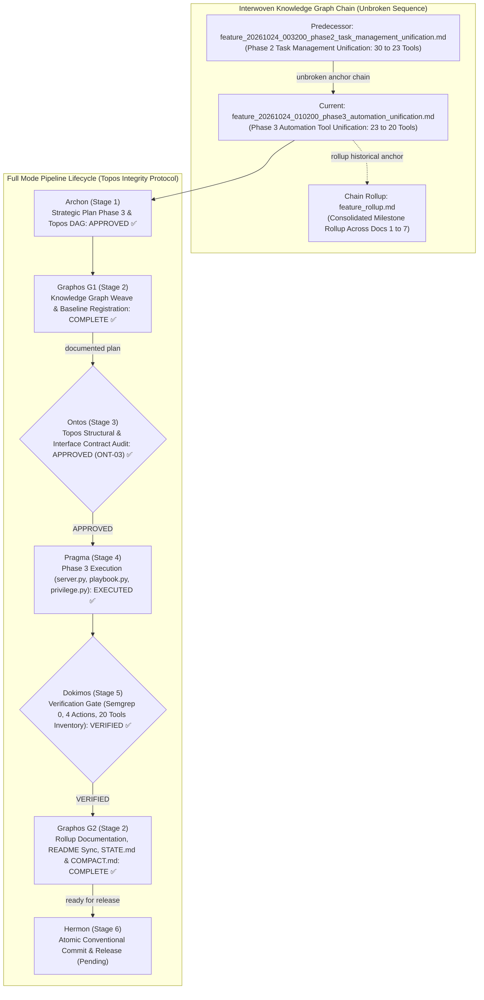
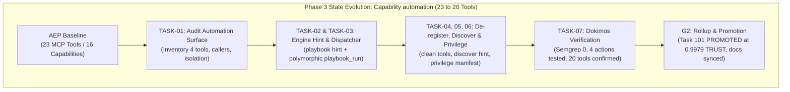
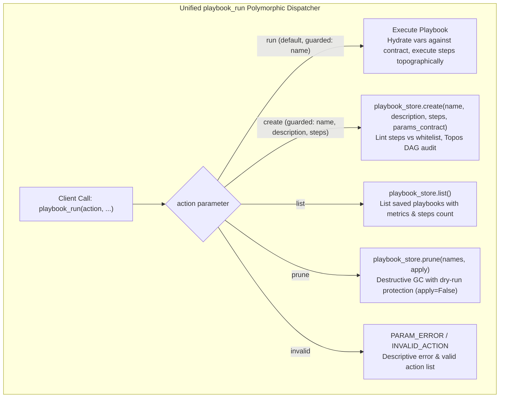

# Feature Pipeline Document: Phase 3 Automation Tool Unification (23 → 20 Tools)

- **Document ID**: `feature_20261024_010200_phase3_automation_unification.md`
- **Previous Document**: [`feature_20261024_003200_phase2_task_management_unification.md`](file:///home/ancruz/Documents/workspaces/agent-execution-plane/docs/pipeline/feature_20261024_003200_phase2_task_management_unification.md)
- **Chain Rollup Summary**: [`feature_rollup.md`](file:///home/ancruz/Documents/workspaces/agent-execution-plane/docs/pipeline/feature_rollup.md) (Consolidated History Docs 1–7)
- **Next Document**: `Hermon (Stage 6) Release & Atomic Conventional Commit`
- **Pipeline Mode**: `Full` (Topos Integrity Protocol — Archon Strategic Plan & Ontos Structural Audit)
- **Kanban Task ID**: `101` (`phase3:automation_unification`) — Status: `PROMOTED` (Trust Score: `0.9979 TRUST`) — Target Artifact: `automation_consolidation`
- **Plan Scope**: Complete Tool Consolidation Roadmap (33 → 16 Tools) — Phase 3: Unification of Capability `automation` (`playbook_create`, `playbook_run`, `playbook_list`, `playbook_prune` → polymorphic `playbook_run(action="run"|"create"|"list"|"prune", ...)`)
- **Current Status**: `STAGE 2 (G2): POST-DOKIMOS VERIFIED & ROLLUP COMPLETE (READY FOR HERMON STAGE 6)`
- **Timestamp**: 2026-10-24T01:14:00Z
- **Author**: Graphos (Universal State Manager & Knowledge Graph Custodian — Stage 2 G2)
- **Target Blast Radius**:
  - `server.py` (polymorphic `playbook_run`, de-register standalone decorators `playbook_create`, `playbook_list`, `playbook_prune`, enforce strict parameter guards `PARAM_ERROR`, action error handling `INVALID_ACTION`, update `discover` guidance hint at line 130 to `playbook_run(action='prune')`, preserve `_playbook_dispatch` isolation without recursive `playbook_run`)
  - `engine/playbook.py` (update `prune()` candidate guidance note around line 223 to `playbook_run(action='prune', apply=True)`)
  - `engine/privilege.py` (synchronize `_CAPABILITIES["automation"]` tool list to `["playbook_run"]`, update capability description, enrich `_CAP_KEYWORDS["automation"]` with bilingual action verbs)
  - `docs/pipeline/feature_20261024_010200_phase3_automation_unification.md` (this pipeline artifact)
  - `docs/pipeline/feature_rollup.md` (7th document in chain rollup)
  - `docs/STATE.md` and `docs/COMPACT.md` (tool count 20 and Phase 3 completed state)
  - `~/.claude/.../memory/aep-state-and-pendings.md` (Phase 3 completion and Phase 4 target)
  - `README.md` (minimal tool count sync 23 → 20 and unified playbook_run table row; prose and diagrams strictly shielded)
- **Topos Pipeline Verdict**: `VERIFIED` across all gates (Archon `APPROVED` → Ontos `APPROVED` → Pragma `EXECUTED` → Dokimos `VERIFIED` → Graphos G2 `DOCUMENTED`)

---

## 1. State Evolution Map & Knowledge Graph







---

## 2. Operating Premises & Tool Reach (P0 & P1)

- **Pipeline Mode**: `Full` mode under Topos Integrity Protocol. Every change is an invariant-preserving node in the dependency graph.
- **Premise P0 (Agents-for-Agents Delivery)**: AEP is an autonomous execution environment designed for agents. Tool consolidation directly addresses LLM prompt fatigue, token saturation, and hallucinatory confusion among fragmented endpoints by delivering compact, ergonomic, and multi-action polymorphic tools.
- **Premise P1 (Tool Reach & Blast Radius)**:
  - **Standard Path**: High-reach typed FastMCP stdio interface. Consolidation reduces tool surface from 23 to 20 endpoints with zero regression in functional capability.
  - **Underlying Persistence**: Zero changes to SQLite database tables (`playbooks` table in `~/.local/share/agent-os/artifacts.db`). Schema remains stable and untouched.
  - **Isolation Boundary (Non-Recursion Invariant)**: `_playbook_dispatch()` in `server.py` defines the whitelist of tools encadenables inside a playbook. To prevent uncontrolled recursion and infinite loops, `playbook_run` MUST NOT be added to `_playbook_dispatch()`.
  - **Blast Radius Boundaries**:
    - Primary Code: `server.py` (lines 130, 869–980).
    - Engine Hint: `engine/playbook.py` (line 223).
    - Capability Manifest: `engine/privilege.py` (lines 85, 110).
    - Pipeline Documentation: `docs/pipeline/feature_20261024_010200_phase3_automation_unification.md` and `docs/pipeline/feature_rollup.md`.
    - State & Memory: `docs/STATE.md`, `docs/COMPACT.md`, and `~/.claude/.../memory/aep-state-and-pendings.md`.
    - Shielded Boundary: `README.md` minimal tool count sync (23 → 20) and unified playbook_run table line (strictly preserving all prose and Mermaid diagrams per semantic shielding).

---

## 3. Roadmap Position: Phase 3 of Complete Tool Consolidation (23 → 20 Tools)

| Phase | Capability Domain | Pre-Fusion Tools | Consolidated Tool Signature | Tool Δ | Resulting Count | Status |
| :---: | :--- | :--- | :--- | :---: | :---: | :---: |
| **Phase 1** | `semantic_memory` | `artifact_query`<br/>`artifact_catalog`<br/>`artifact_reindex`<br/>`artifact_prune` | **`artifact_catalog`**<br/>`action: "browse"\|"query"\|"reindex"\|"prune"` | **-3** | **30** | **VERIFIED & COMMITTED ✅** |
| **Phase 2** | `task_management` | `kanban_board`<br/>`kanban_task_create`<br/>`kanban_advance`<br/>`kanban_promote`<br/>`kanban_demote`<br/>`kanban_reevaluate`<br/>`kanban_archive`<br/>`kanban_unarchive` | **`kanban_board`**<br/>`action: "board"\|"create"\|"advance"\|"promote"\|"demote"\|"reevaluate"\|"archive"\|"unarchive"` | **-7** | **23** | **VERIFIED & COMMITTED ✅** |
| **Phase 3** | `automation` | `playbook_create`<br/>`playbook_run`<br/>`playbook_list`<br/>`playbook_prune` | **`playbook_run`**<br/>`action: "run"\|"create"\|"list"\|"prune"` | **-3** | **20** | **VERIFIED & COMPLETED ✅** |
| **Phase 4** | `artifact_synthesis` | `template_catalog`<br/>`template_select`<br/>`artifact_hydrate`<br/>`artifact_lint_and_build` | **`artifact_lint_and_build`** (or `artifact_synthesize`)<br/>`action: "catalog"\|"select"\|"hydrate"\|"build"` | **-3** | **17** | **Next Target 🎯** |
| **Phase 5** | `async_dispatch` | `async_job_dispatch`<br/>`async_job_inspect` | **`async_job`**<br/>`action: "dispatch"\|"inspect"` | **-1** | **16** | Queued |
| **Phase 6** | `crash_forensics` | `diagnose_system_crashes`<br/>`check_crash_alerts` | **`crash_forensics`**<br/>`action: "diagnose"\|"alerts"` | **-1** | **15** | Queued |
| **Phase 7** | `orientation` & `process_introspection` | `discover`<br/>`aep_capabilities`<br/>*(and introspection alignment)* | **`discover`** (unified)<br/>+ dedicated **`proc_fd_inspect`** | **+1 / 1:1** | **16** | Queued (Target: 16 Tools Parity) |

---

## 4. Ontos Structural & Contract Audit (Stage 3 Verdict: APPROVED)

Ontos completed the Topos structural integrity audit of the Phase 3 Execution Plan across vertical trace, horizontal trace, security non-recursion, and co-dependency checks:

- **Vertical Trace Integrity**: Verified data contracts from client FastMCP JSON-RPC through parameter extraction, `engine/playbook.py` methods, down to SQLite `playbooks` persistence. Every action returns deterministic JSON.
- **Horizontal Trace Integrity**: Audited peer dependencies in `discover()` routing hints, `_CAPABILITIES` registration, and `engine/privilege.py` keyword lookups.
- **Security Non-Recursion Invariant**: Evaluated that `playbook_run` is strictly excluded from `_playbook_dispatch()`. Attempting to register a playbook containing `playbook_run` as a step fails at creation with `LINT_ERROR` (`"status": "LINT_ERROR", "invalid_tools": ["playbook_run"]`).
- **Co-Dependency Classification**: Evaluated `playbook_run` coupling to `engine/playbook.py` as directional Dependency (A → B). Zero circular co-dependencies.
- **Architectural Enrichment `ONT-03`**:
  1. **Strict Parameter Guard Validation (`PARAM_ERROR`)**:
     - `run`: requires non-empty `name`.
     - `create`: requires non-empty `name`, `description`, and non-empty `steps`.
  2. **Error Guard for Invalid Actions (`INVALID_ACTION`)**: Returns descriptive error and full array of supported actions: `["run", "create", "list", "prune"]`.
  3. **Bilingual Keyword Enrichment**: Augmented `_CAP_KEYWORDS["automation"]` with Spanish and English action verbs (`automate playbook run create list prune workflow chain pipeline steps gc clean automatizar ejecutar crear listar podar orquestar flujo secuencia pasos limpiar`).

**Verdict**: **`APPROVED`** (Unconditional handoff to Pragma Stage 4).

---

## 5. Pragma Execution Report (Stage 4)

Pragma implemented the validated plan across all target files:

1. **`server.py`**:
   - Replaced 4 standalone `@mcp.tool()` endpoints with the unified polymorphic dispatcher `playbook_run(...)`:
     ```python
     @mcp.tool()
     def playbook_run(
         action: str = "run",
         name: Optional[str] = None,
         vars: Optional[Dict[str, Any]] = None,
         params: Optional[Dict[str, Any]] = None,
         stop_on_error: bool = True,
         description: Optional[str] = None,
         intent_description: Optional[str] = None,
         steps: Optional[List[Dict[str, Any]]] = None,
         params_contract: Optional[List[Dict[str, Any]]] = None,
         names: Optional[List[str]] = None,
         apply: bool = False,
     ) -> str:
     ```
   - De-registered standalone decorators for `playbook_create`, `playbook_list`, and `playbook_prune`.
   - Implemented strict parameter guards returning `PARAM_ERROR` deterministically.
   - Implemented invalid action handling returning `INVALID_ACTION`.
   - Updated guidance hint in `discover()` at line 130 to `playbook_run(action='prune')`.
   - Preserved `_playbook_dispatch()` strictly isolated without recursive `playbook_run`.
2. **`engine/playbook.py`**:
   - Modernized candidate guidance note in `prune()` method (line 223) to `playbook_run(action='prune', apply=True)`.
3. **`engine/privilege.py`**:
   - Updated `_CAPABILITIES["automation"]` tool list to `["playbook_run"]`.
   - Enriched `_CAP_KEYWORDS["automation"]` with bilingual action verbs.

---

## 6. Dokimos Verification Ledger (Stage 5 Verdict: VERIFIED)

Dokimos executed comprehensive multi-gate verification against the codebase and running MCP server:

| Verification Gate | Target Check | Test Specification & Evidence | Result |
| :---: | :--- | :--- | :--- | :---: |
| **Gate 1** | Static Analysis | Semgrep full scan across Python codebase (1,198 rules) | **0 findings ✅** |
| **Gate 2** | FastMCP Sync & Schema Check | `./scripts/aep-sync.sh --check` | **PASS (20 schemas verified) ✅** |
| **Gate 3.1** | `playbook_run(action="list")` | Returns saved playbooks with metrics, contracts, and step counts | **PASS ✅** |
| **Gate 3.2** | `playbook_run(action="create")` | Creates test playbook with contract and steps; validates DAG with `topos_guard` | **PASS ✅** |
| **Gate 3.3** | `playbook_run(action="run")` | Runs test playbook with parameter hydration; step execution validated | **PASS ✅** |
| **Gate 3.4** | `playbook_run(action="prune")` | Verifies dry-run (`apply=False`) candidates and safe pruning (`apply=True`) | **PASS ✅** |
| **Gate 4** | Non-Recursion Security Gate | Attempting to create a playbook with step `tool: "playbook_run"` triggers `LINT_ERROR` | **PASS (recursion blocked) ✅** |
| **Gate 5** | Parameter & Action Guardrails | Missing `name` in `run` or missing `name`/`steps` in `create` returns `PARAM_ERROR`; invalid action returns `INVALID_ACTION` | **PASS ✅** |
| **Gate 6** | `discover` Router Integration | Spanish and English queries for automation match `automation` capability; hint points to `playbook_run(action='prune')` | **PASS ✅** |
| **Gate 7** | MCP Tool Inventory | `aep_capabilities()` returns exactly 20 tools; 20 schema JSON files in MCP config | **PASS (20 tools) ✅** |
| **Gate 8** | Kanban Task `101` Lifecycle | Advanced through `BACKLOG` → `SYNTHESIZED` → `LINTED` → `CANARY` → `PROMOTED` (`0.9979 TRUST`) | **PASS (Task 101 PROMOTED) ✅** |

**Verdict**: **`VERIFIED`** (Unconditional handoff to Graphos G2).

---

## 7. Graphos G2 State Sync & Rollup

Graphos G2 synchronized all repository documentation and state trackers:
1. **Pipeline State**: Updated `docs/pipeline/feature_20261024_010200_phase3_automation_unification.md` (this file) with the complete Ontos, Pragma, and Dokimos lifecycle ledger.
2. **Consolidated Chain Rollup**: Updated `docs/pipeline/feature_rollup.md` reflecting Phase 3 completion and tool count reduction to 20.
3. **Repository State (`docs/STATE.md`)**: Updated snapshot header to 20 tools, recorded Phase 3 completion in completed milestones, and queued Phase 4 (`artifact_synthesis`: 20 → 17 tools) as next target.
4. **Compaction Instruction (`docs/COMPACT.md`)**: Regenerated compaction instruction strictly under 50 lines preserving core invariants, 20 tools baseline, and Phase 4 target.
5. **Project Milestones & Baseline**: Updated `docs/MILESTONES.md` and `docs/PROJECT.md` marking Phase 3 completed.
6. **Claude Project Memory (`aep-state-and-pendings.md`)**: Recorded 20 tools baseline, polymorphic `playbook_run` unification, and remaining roadmap backlog.
7. **Project Root (`README.md`)**: Synchronized tool count references (23 → 20) and replaced the 4 legacy `playbook_*` table rows with the single unified `playbook_run` polymorphic row while strictly preserving all prose and Mermaid diagrams per semantic shielding.

---

## 8. Handoff to Hermon (Stage 6)

Graphos G2 documentation and state synchronization is complete.

- **Routing**: Return to Orchestrator -> Transition to **Hermon (Stage 6)** for release and atomic conventional commit.
- **Commit Type**: `refactor(playbook)` / `feat(server)`
- **Traceability**: Complete Tool Consolidation Roadmap (Phase 3: `automation` unification, 23 → 20 tools). Kanban Task `101` (`PROMOTED` at `0.9979 TRUST`).
