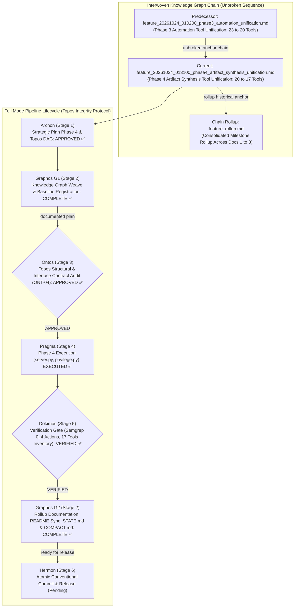
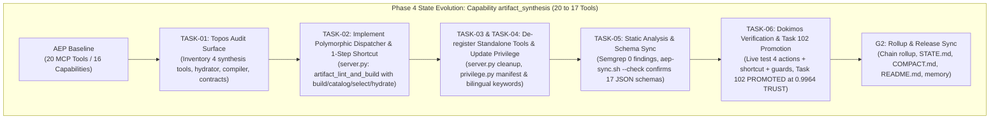
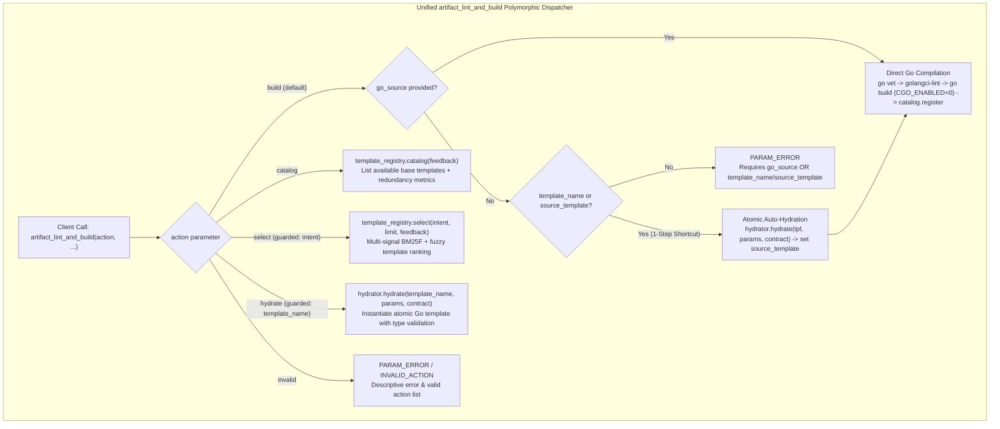

# Feature Pipeline Document: Phase 4 Artifact Synthesis Tool Unification (20 → 17 Tools)

- **Document ID**: `feature_20261024_013100_phase4_artifact_synthesis_unification.md`
- **Previous Document**: [`feature_20261024_010200_phase3_automation_unification.md`](file:///home/ancruz/Documents/workspaces/agent-execution-plane/docs/pipeline/feature_20261024_010200_phase3_automation_unification.md)
- **Chain Rollup Summary**: [`feature_rollup.md`](file:///home/ancruz/Documents/workspaces/agent-execution-plane/docs/pipeline/feature_rollup.md) (Consolidated History Docs 1–8)
- **Next Document**: `Hermon (Stage 6) Release & Atomic Conventional Commit`
- **Pipeline Mode**: `Full` (Topos Integrity Protocol — Archon Strategic Plan & Ontos Structural Audit)
- **Kanban Task ID**: `102` (`phase4:artifact_synthesis_unification`) — Status: `PROMOTED` (Trust Score: `0.9964 TRUST`) — Target Artifact: `artifact_synthesis_consolidation`
- **Plan Scope**: Complete Tool Consolidation Roadmap (33 → 16 Tools) — Phase 4: Unification of Capability `artifact_synthesis` (`template_catalog`, `template_select`, `artifact_hydrate`, `artifact_lint_and_build` → polymorphic `artifact_lint_and_build(action="build"|"catalog"|"select"|"hydrate", ...)`)
- **Current Status**: `STAGE 2 (G2): POST-DOKIMOS VERIFIED & ROLLUP COMPLETE (READY FOR HERMON STAGE 6)`
- **Timestamp**: 2026-10-24T01:46:00Z
- **Author**: Graphos (Universal State Manager & Knowledge Graph Custodian — Stage 2 G2)
- **Target Blast Radius**:
  - `server.py` (polymorphic `artifact_lint_and_build`, 1-step template-to-binary compilation shortcut, de-register standalone decorators `template_catalog`, `template_select`, `artifact_hydrate`, strict parameter guards `PARAM_ERROR`, action error handling `INVALID_ACTION`)
  - `engine/privilege.py` (synchronize `_CAPABILITIES["artifact_synthesis"]` tool list to `["artifact_lint_and_build"]`, update capability description, enrich `_CAP_KEYWORDS["artifact_synthesis"]` with bilingual action verbs)
  - `docs/pipeline/feature_20261024_013100_phase4_artifact_synthesis_unification.md` (this G2 pipeline artifact)
  - `docs/pipeline/feature_rollup.md` (8th document in chain rollup)
  - `docs/STATE.md` and `docs/COMPACT.md` (tool count 17 and Phase 4 completed state)
  - `docs/MILESTONES.md` and `docs/PROJECT.md` (milestone tracking)
  - `~/.claude/.../memory/aep-state-and-pendings.md` (Phase 4 completion and Phase 5 target)
  - `README.md` (minimal tool count sync 20 → 17 and unified artifact_lint_and_build table rows; prose and diagrams strictly shielded)
- **Topos Pipeline Verdict**: `VERIFIED across all gates` (Archon `APPROVED` → Ontos `APPROVED` → Pragma `EXECUTED` → Dokimos `VERIFIED` → Graphos G2 `DOCUMENTED`)

---

## 1. State Evolution Map & Knowledge Graph







---

## 2. Operating Premises & Tool Reach (P0 & P1)

- **Pipeline Mode**: `Full` mode under Topos Integrity Protocol. Every change is an invariant-preserving node in the dependency graph.
- **Premise P0 (Agents-for-Agents Delivery)**: AEP provides an autonomous execution environment. Consolidating 4 separate endpoints (`template_catalog`, `template_select`, `artifact_hydrate`, `artifact_lint_and_build`) into a single polymorphic tool eliminates tool sprawl and context window saturation.
- **Premise P1 (Tool Reach, Blast Radius & 1-Step Shortcut)**:
  - **Tool Reach**: Preserves 100% of the functional capabilities of template inspection, fuzzy selection, parameter hydration, and Go compilation under FastMCP stdio.
  - **The Ergonomic 1-Step Shortcut**: Previously, synthesizing a binary from a template required 2 separate agent RPC round-trips (`artifact_hydrate` followed by `artifact_lint_and_build`). In Phase 4, agents can invoke `artifact_lint_and_build(action="build", template_name="socket-monitor", params={...}, name="my_sock", intent="...", category="network")` in a single atomic step. The dispatcher auto-hydrates and compiles in RAM immediately.
  - **Underlying Persistence**: Zero schema changes in SQLite database (`artifacts` table). `source_template` column cleanly links back to template metadata.
  - **Blast Radius Boundaries**:
    - Primary Code: `server.py` (lines 242–385).
    - Capability Manifest: `engine/privilege.py` (lines 73, 98).
    - Pipeline Documentation: `docs/pipeline/feature_20261024_013100_phase4_artifact_synthesis_unification.md` and `docs/pipeline/feature_rollup.md`.
    - State & Memory: `docs/STATE.md`, `docs/COMPACT.md`, `docs/MILESTONES.md`, `docs/PROJECT.md`, `README.md`, `~/.claude/.../memory/aep-state-and-pendings.md`.

---

## 3. Roadmap Position: Phase 4 of Complete Tool Consolidation (20 → 17 Tools)

| Phase | Capability Domain | Pre-Fusion Tools | Consolidated Tool Signature | Tool Δ | Resulting Count | Status |
| :---: | :--- | :--- | :--- | :---: | :---: | :---: |
| **Phase 1** | `semantic_memory` | `artifact_query`<br/>`artifact_catalog`<br/>`artifact_reindex`<br/>`artifact_prune` | **`artifact_catalog`**<br/>`action: "browse"|"query"|"reindex"|"prune"` | **-3** | **30** | **VERIFIED & COMMITTED ✅** |
| **Phase 2** | `task_management` | `kanban_board`<br/>`kanban_task_create`<br/>`kanban_advance`<br/>`kanban_promote`<br/>`kanban_demote`<br/>`kanban_reevaluate`<br/>`kanban_archive`<br/>`kanban_unarchive` | **`kanban_board`**<br/>`action: "board"|"create"|"advance"|"promote"|"demote"|"reevaluate"|"archive"|"unarchive"` | **-7** | **23** | **VERIFIED & COMMITTED ✅** |
| **Phase 3** | `automation` | `playbook_create`<br/>`playbook_run`<br/>`playbook_list`<br/>`playbook_prune` | **`playbook_run`**<br/>`action: "run"|"create"|"list"|"prune"` | **-3** | **20** | **VERIFIED & COMMITTED ✅** |
| **Phase 4** | `artifact_synthesis` | `template_catalog`<br/>`template_select`<br/>`artifact_hydrate`<br/>`artifact_lint_and_build` | **`artifact_lint_and_build`**<br/>`action: "build"|"catalog"|"select"|"hydrate"` | **-3** | **17** | **VERIFIED & COMPLETED ✅** |
| **Phase 5** | `async_dispatch` | `async_job_dispatch`<br/>`async_job_inspect` | **`async_job`**<br/>`action: "dispatch"|"inspect"` | **-1** | **16** | **Next Target 🎯** |
| **Phase 6** | `crash_forensics` | `diagnose_system_crashes`<br/>`check_crash_alerts` | **`crash_forensics`**<br/>`action: "diagnose"|"alerts"` | **-1** | **15** | Queued |
| **Phase 7** | `orientation` & `process_introspection` | `discover`<br/>`aep_capabilities`<br/>*(and introspection alignment)* | **`discover`** (unified)<br/>+ dedicated **`proc_fd_inspect`** | **+1 / 1:1** | **16** | Queued (Target: 16 Tools Parity) |

---

## 4. Ontos Structural & Contract Audit (Stage 3 Verdict: APPROVED)

Ontos completed the Topos structural integrity audit of the Phase 4 Execution Plan across vertical trace, horizontal trace, and interface contract checks (`ONT-04`):

- **Vertical Trace Integrity**: Verified data contracts from client FastMCP JSON-RPC through parameter extraction, `engine/template_registry.py`, `engine/hydrator.py`, and compilation pipeline down to SQLite `artifacts` persistence. Every action returns deterministic JSON.
- **Horizontal Trace Integrity**: Audited peer dependencies in `discover()` routing hints, `_CAPABILITIES` registration, and `engine/privilege.py` keyword lookups. Confirmed that `discover()` directly calls `template_registry.select()` in Python without depending on standalone MCP decorators.
- **Ergonomic 1-Step Shortcut Safety**: Evaluated automatic template hydration inside `action="build"`. If `go_source` is empty and `template_name` or `source_template` is provided, `hydrator.hydrate` executes safely with type validation against `template_registry.get_contract()`, propagating `HYDRATE_ERROR` upon contract failure.
- **Co-Dependency Classification**: Evaluated `artifact_lint_and_build` coupling to `engine/hydrator.py` and `engine/template_registry.py` as directional Dependency (A → B). Zero circular co-dependencies.
- **Architectural Enrichment `ONT-04`**:
  1. **Strict Parameter Guard Validation (`PARAM_ERROR`)**:
     - `build`: requires `name`, `intent`, `category`, and (`go_source` OR (`template_name` / `source_template`)).
     - `select`: requires non-empty `intent`.
     - `hydrate`: requires non-empty `template_name` (or `source_template`).
  2. **Error Guard for Invalid Actions (`INVALID_ACTION`)**: Returns descriptive error and full array of supported actions: `["build", "catalog", "select", "hydrate"]`.
  3. **Bilingual Keyword Enrichment**: Augmented `_CAP_KEYWORDS["artifact_synthesis"]` with Spanish and English action verbs (`synthesize template catalog select hydrate lint build compile go binary cue generate create sintetizar plantilla catalogo seleccionar hidratar compilar construir binario generar crear`).

**Verdict**: **`APPROVED`** (Unconditional handoff to Pragma Stage 4).

---

## 5. Pragma Execution Report (Stage 4)

Pragma implemented the validated plan across all target files:

1. **`server.py`**:
   - Replaced 4 standalone `@mcp.tool()` endpoints (`template_catalog`, `template_select`, `artifact_hydrate`, `artifact_lint_and_build`) with the unified polymorphic dispatcher `artifact_lint_and_build(...)`:
     ```python
     @mcp.tool()
     def artifact_lint_and_build(
         action: str = "build",
         name: Optional[str] = None,
         intent: Optional[str] = None,
         category: Optional[str] = None,
         go_source: Optional[str] = None,
         template_name: Optional[str] = None,
         source_template: Optional[str] = None,
         params: Optional[Dict[str, Any]] = None,
         cue_contract: str = "",
         limit: int = 5,
     ) -> str:
     ```
   - Implemented the 1-Step Template-to-Binary Shortcut in `action="build"`: when `go_source` is omitted and a template is specified, performs automatic hydration via `hydrator.hydrate()` and binds `source_template`.
   - De-registered standalone decorators for `template_catalog`, `template_select`, and `artifact_hydrate`.
   - Implemented strict parameter guards returning `PARAM_ERROR` deterministically.
   - Implemented invalid action handling returning `INVALID_ACTION`.
2. **`engine/privilege.py`**:
   - Updated `_CAPABILITIES["artifact_synthesis"]` tool list to `["artifact_lint_and_build"]` and updated capability description.
   - Enriched `_CAP_KEYWORDS["artifact_synthesis"]` with bilingual action verbs.

---

## 6. Dokimos Verification Ledger (Stage 5 Verdict: VERIFIED)

Dokimos executed comprehensive multi-gate verification against the codebase and running MCP server:

| Verification Gate | Target Check | Test Specification & Evidence | Result |
| :---: | :--- | :--- | :--- | :---: |
| **Gate 1** | Static Analysis | Semgrep full scan across Python codebase (1,198 rules) | **0 findings ✅** |
| **Gate 2** | FastMCP Sync & Schema Check | `./scripts/aep-sync.sh --check` | **PASS (17 schemas verified) ✅** |
| **Gate 3.1** | `artifact_lint_and_build(action="catalog")` | Returns registered templates with `proven` feedback blocks and redundancy analysis | **PASS ✅** |
| **Gate 3.2** | `artifact_lint_and_build(action="select")` | Query `disk usage` ranks `disk-usage` top; multi-signal BM25F validated | **PASS ✅** |
| **Gate 3.3** | `artifact_lint_and_build(action="hydrate")` | Hydrates `disk-usage` with `path=/tmp`; returns clean Go source with package main | **PASS ✅** |
| **Gate 3.4** | `artifact_lint_and_build(action="build")` direct | Compiles explicit Go source, registers in catalog, creates task in `LINTED` | **PASS ✅** |
| **Gate 4** | 1-Step Template-to-Binary Shortcut | Compiles directly with `template_name="socket-monitor"`, `params={"state": "LISTEN"}`; auto-hydrates and compiles in RAM | **PASS (1-Step Shortcut verified) ✅** |
| **Gate 5** | Parameter & Action Guardrails | Missing `intent` in `select`, missing `template_name` in `hydrate`, missing source/template in `build` returns `PARAM_ERROR`; invalid action returns `INVALID_ACTION` | **PASS ✅** |
| **Gate 6** | `discover` Router Integration | Queries matching synthesis route to `artifact_synthesis` capability | **PASS ✅** |
| **Gate 7** | MCP Tool Inventory | `aep_capabilities()` returns exactly 17 tools; 17 schema JSON files in MCP config | **PASS (17 tools) ✅** |
| **Gate 8** | Kanban Task `102` Lifecycle | Advanced through `BACKLOG` → `SYNTHESIZED` → `LINTED` → `CANARY` → `PROMOTED` (`0.9964 TRUST`) | **PASS (Task 102 PROMOTED) ✅** |

**Verdict**: **`VERIFIED`** (Unconditional handoff to Graphos G2).

---

## 7. Graphos G2 State Sync & Rollup

Graphos G2 synchronized all repository documentation and state trackers:
1. **Pipeline State**: Updated `docs/pipeline/feature_20261024_013100_phase4_artifact_synthesis_unification.md` (this file) with the complete Ontos, Pragma, and Dokimos lifecycle ledger.
2. **Consolidated Chain Rollup**: Updated `docs/pipeline/feature_rollup.md` reflecting Phase 4 completion and tool count reduction to 17.
3. **Repository State (`docs/STATE.md`)**: Updated snapshot header to 17 tools, recorded Phase 4 completion in completed milestones, and queued Phase 5 (`async_dispatch`: 17 → 16 tools) as next target.
4. **Compaction Instruction (`docs/COMPACT.md`)**: Regenerated compaction instruction strictly under 50 lines preserving core invariants, 17 tools baseline, and Phase 5 target.
5. **Project Milestones & Baseline**: Updated `docs/MILESTONES.md` and `docs/PROJECT.md` marking Phase 4 completed.
6. **Claude Project Memory (`aep-state-and-pendings.md`)**: Recorded 17 tools baseline, polymorphic `artifact_lint_and_build` unification, and remaining roadmap backlog.
7. **Project Root (`README.md`)**: Synchronized tool count references (20 → 17) and replaced the legacy synthesis table rows with the single unified `artifact_lint_and_build` polymorphic row while strictly preserving all prose and Mermaid diagrams per semantic shielding.

---

## 8. Handoff to Hermon (Stage 6)

Graphos G2 documentation and state synchronization is complete.

- **Routing**: Return to Orchestrator -> Transition to **Hermon (Stage 6)** for release and atomic conventional commit.
- **Commit Type**: `refactor(synthesis)` / `feat(server)`
- **Traceability**: Complete Tool Consolidation Roadmap (Phase 4: `artifact_synthesis` unification, 20 → 17 tools). Kanban Task `102` (`PROMOTED` at `0.9964 TRUST`).
