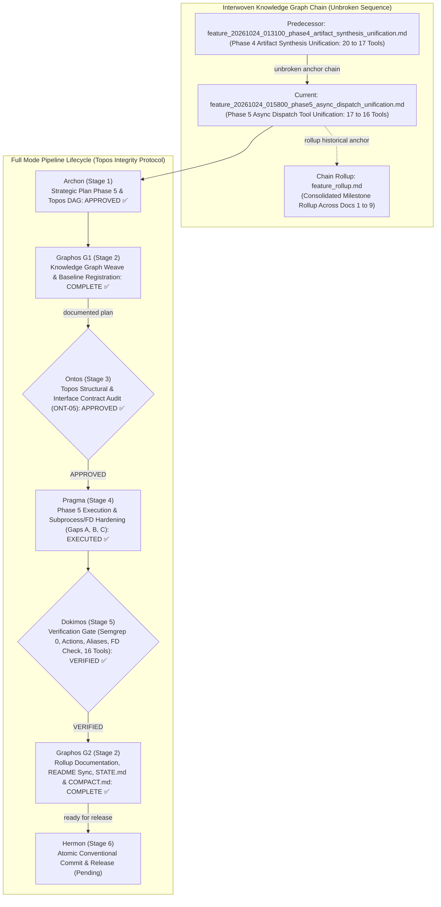
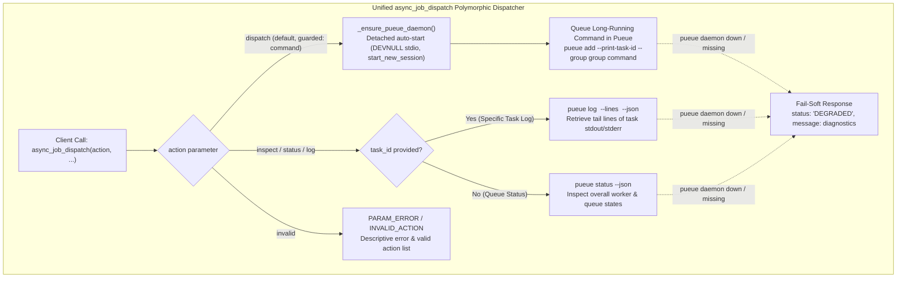

# Feature Pipeline Document: Phase 5 Async Dispatch Tool Unification (17 → 16 Tools)

- **Document ID**: `feature_20261024_015800_phase5_async_dispatch_unification.md`
- **Previous Document**: [`feature_20261024_013100_phase4_artifact_synthesis_unification.md`](file:///home/ancruz/Documents/workspaces/agent-execution-plane/docs/pipeline/feature_20261024_013100_phase4_artifact_synthesis_unification.md)
- **Chain Rollup Summary**: [`feature_rollup.md`](file:///home/ancruz/Documents/workspaces/agent-execution-plane/docs/pipeline/feature_rollup.md) (Consolidated History Docs 1–9)
- **Next Document**: `Hermon (Stage 6) Release & Atomic Conventional Commit`
- **Pipeline Mode**: `Full` (Topos Integrity Protocol — Archon Strategic Plan & Ontos Structural Audit)
- **Kanban Task ID**: `105` (`phase5:async_dispatch_unification`) — Status: `PROMOTED` (Trust Score: `0.9955 TRUST`) — Target Artifact: `async_dispatch_consolidation`
- **Plan Scope**: Complete Tool Consolidation Roadmap (33 → 16 Tools) — Phase 5: Unification of Capability `async_dispatch` (`async_job_dispatch`, `async_job_inspect` → polymorphic `async_job_dispatch(action="dispatch"|"inspect", ...)`) plus Subprocess/FD Hardening (Gaps A, B, C)
- **Current Status**: `STAGE 2 (G2): POST-DOKIMOS VERIFIED & ROLLUP COMPLETE (READY FOR HERMON STAGE 6)`
- **Timestamp**: 2026-10-24T02:44:00Z
- **Author**: Graphos (Universal State Manager & Knowledge Graph Custodian — Stage 2 G2)
- **Target Blast Radius**:
  - `server.py` (polymorphic `async_job_dispatch`, aliases `"status"` and `"log"`, de-register standalone decorator `async_job_inspect`, preserve `_playbook_dispatch()` backward-compatibility via lambda alias, enforce strict parameter guard `PARAM_ERROR`, action error handling `INVALID_ACTION`, fail-soft `DEGRADED` responses; Subprocess/FD Hardening: `artifact_execute_in_ram` `pass_fds` + `timeout=30`, `_ensure_pueue_daemon` detached daemon with `DEVNULL` + `start_new_session=True` + `timeout=10`)
  - `scripts/aep-sync.sh` (synchronous `RefreshMcpServers` + auto-prune orphan schema files)
  - `engine/privilege.py` (synchronize `_CAPABILITIES["async_dispatch"]` tool list to `["async_job_dispatch"]`, update capability description, enrich `_CAP_KEYWORDS["async_dispatch"]` with bilingual action verbs)
  - `docs/pipeline/feature_20261024_015800_phase5_async_dispatch_unification.md` (this G2 pipeline artifact)
  - `docs/pipeline/feature_rollup.md` (9th document in chain rollup)
  - `docs/STATE.md` and `docs/COMPACT.md` (tool count 16, subprocess/FD hardening invariant, Phase 5 completed, Phase 6 target)
  - `docs/MILESTONES.md` and `docs/PROJECT.md` (milestone tracking)
  - `~/.claude/.../memory/aep-state-and-pendings.md` (Phase 5 completion and Phase 6 target)
  - `README.md` (minimal tool count sync 17 → 16 and unified async_job_dispatch table row; prose and diagrams strictly shielded)
- **Topos Pipeline Verdict**: `VERIFIED across all gates` (Archon `APPROVED` → Ontos `APPROVED` → Pragma `EXECUTED` → Dokimos `VERIFIED` → Graphos G2 `DOCUMENTED`)

---

## 1. State Evolution Map & Knowledge Graph

```mermaid
flowchart LR
    subgraph StateEvolution["Phase 5 State Evolution: Capability async_dispatch (17 to 16 Tools)"]
        direction LR
        S0["AEP Baseline<br/>(17 MCP Tools / 16 Capabilities)"]
        S1["TASK-01: Topos Audit Surface<br/>(Inventory async_dispatch callers, Pueue dependencies, _playbook_dispatch)"]
        S2["Incident & Hardening: Gaps A, B, C<br/>(FD leak fix pass_fds, detached pueued auto-start, schema pruning)"]
        S3["TASK-02 & TASK-03: Implement Polymorphic Dispatcher & Aliases<br/>(server.py: async_job_dispatch with dispatch/inspect/status/log & fail-soft)"]
        S4["TASK-04 & TASK-05: Playbook Dispatch Alias & Privilege Manifest<br/>(_playbook_dispatch backward-compatibility & privilege.py manifest/keywords)"]
        S5["TASK-06: Static Analysis & Schema Sync<br/>(Semgrep 0 findings, aep-sync.sh --check confirms 16 JSON schemas)"]
        S6["TASK-07: Dokimos Verification & Task 105 Promotion<br/>(Live test actions + aliases + fail-soft + FD audit, Task 105 PROMOTED at 0.9955 TRUST)"]
        S7["G2: Rollup & Release Sync<br/>(Chain rollup, STATE.md, COMPACT.md, README.md, memory)"]

        S0 --> S1 --> S2 --> S3 --> S4 --> S5 --> S6 --> S7
    end
```







---

## 2. Operating Premises & Tool Reach (P0 & P1)

- **Pipeline Mode**: `Full` mode under Topos Integrity Protocol. Every change is an invariant-preserving node in the dependency graph.
- **Premise P0 (Agents-for-Agents Delivery)**: AEP provides an autonomous execution environment. Consolidating 2 separate asynchronous job endpoints (`async_job_dispatch`, `async_job_inspect`) into a single polymorphic tool eliminates tool sprawl while providing intuitive action verbs and aliases.
- **Premise P1 (Tool Reach & Subprocess/FD Hardening Invariant)**:
  - **Tool Reach**: Preserves 100% of Camino B (Pueue async execution) capabilities for agents needing non-blocking execution of long-running tasks.
  - **Core System Invariant (Subprocess & FD Isolation)**:
    - Never launch long-running daemon processes directly through `artifact_execute_in_ram`.
    - `artifact_execute_in_ram` must use explicit descriptor inheritance (`pass_fds=(fd,)`), hard timeouts (`timeout=30`), and deterministic cleanup (`finally: os.close(fd)`).
    - Long-running daemons like `pueued` must be spawned detached using `stdin=DEVNULL`, `stdout=DEVNULL`, `stderr=DEVNULL`, `close_fds=True`, and `start_new_session=True` to prevent stdio pipe inheritance and server deadlocks.
  - **Fail-Soft Degradation**: If `pueue` daemon is not running and cannot be started, or the binary is absent, all actions degrade gracefully returning typed JSON with `status: "DEGRADED"` rather than unhandled Python exceptions.
  - **Backward Compatibility in `_playbook_dispatch()`**: Playbooks that declare steps using the legacy tool name `async_job_inspect` continue to function without migration via a transparent lambda forwarder inside `_playbook_dispatch()`:
    ```python
    "async_job_inspect": lambda task_id=None, lines=50, **kw: async_job_dispatch(action="inspect", task_id=task_id, lines=lines, **kw),
    "async_job_dispatch": async_job_dispatch,
    ```
  - **Blast Radius Boundaries**:
    - Primary Code: `server.py` (lines 460–600, 927).
    - Management Script: `scripts/aep-sync.sh` (schema pruning and synchronous reload).
    - Capability Manifest: `engine/privilege.py` (lines 76, 101).
    - Pipeline Documentation: `docs/pipeline/feature_20261024_015800_phase5_async_dispatch_unification.md` and `docs/pipeline/feature_rollup.md`.
    - State & Memory: `docs/STATE.md`, `docs/COMPACT.md`, `docs/MILESTONES.md`, `docs/PROJECT.md`, `README.md`, `~/.claude/.../memory/aep-state-and-pendings.md`.

---

## 3. Roadmap Position: Phase 5 of Complete Tool Consolidation (17 → 16 Tools)

| Phase | Capability Domain | Pre-Fusion Tools | Consolidated Tool Signature | Tool Δ | Resulting Count | Status |
| :---: | :--- | :--- | :--- | :--- | :---: | :---: |
| **Phase 1** | `semantic_memory` | `artifact_query`<br/>`artifact_catalog`<br/>`artifact_reindex`<br/>`artifact_prune` | **`artifact_catalog`**<br/>`action: "browse"|"query"|"reindex"|"prune"` | **-3** | **30** | **VERIFIED & COMMITTED ✅** |
| **Phase 2** | `task_management` | `kanban_board`<br/>`kanban_task_create`<br/>`kanban_advance`<br/>`kanban_promote`<br/>`kanban_demote`<br/>`kanban_reevaluate`<br/>`kanban_archive`<br/>`kanban_unarchive` | **`kanban_board`**<br/>`action: "board"|"create"|"advance"|"promote"|"demote"|"reevaluate"|"archive"|"unarchive"` | **-7** | **23** | **VERIFIED & COMMITTED ✅** |
| **Phase 3** | `automation` | `playbook_create`<br/>`playbook_run`<br/>`playbook_list`<br/>`playbook_prune` | **`playbook_run`**<br/>`action: "run"|"create"|"list"|"prune"` | **-3** | **20** | **VERIFIED & COMMITTED ✅** |
| **Phase 4** | `artifact_synthesis` | `template_catalog`<br/>`template_select`<br/>`artifact_hydrate`<br/>`artifact_lint_and_build` | **`artifact_lint_and_build`**<br/>`action: "build"|"catalog"|"select"|"hydrate"` | **-3** | **17** | **VERIFIED & COMMITTED ✅** |
| **Phase 5** | `async_dispatch` | `async_job_dispatch`<br/>`async_job_inspect` | **`async_job_dispatch`**<br/>`action: "dispatch"|"inspect"|"status"|"log"` | **-1** | **16** | **VERIFIED & COMPLETED ✅** |
| **Phase 6** | `crash_forensics` | `diagnose_system_crashes`<br/>`check_crash_alerts` | **`diagnose_system_crashes`**<br/>`action: "diagnose"|"alerts"` | **-1** | **15** | **Next Target 🎯** |
| **Phase 7** | `orientation` & `process_introspection` | `discover`<br/>`aep_capabilities`<br/>*(and introspection alignment)* | **`discover`** (unified: `action="discover"|"capabilities"`)<br/>+ dedicated **`process_introspection`** | **1:1 Parity** | **16** | Queued (Target: 16 Tools / 16 Capabilities) |

---

## 4. Ontos Structural & Contract Audit (Stage 3 Verdict: APPROVED)

Ontos completed the Topos structural integrity audit of the Phase 5 Execution Plan (`ONT-05`):

- **Vertical Trace Integrity**: Verified data contracts from client FastMCP JSON-RPC through parameter extraction, Pueue daemon subprocess interface, down to structured JSON returns.
- **Horizontal Trace Integrity**: Audited peer dependencies in `discover()` routing hints, `_CAPABILITIES` registration, and `_playbook_dispatch()`.
- **Architectural Enrichment `ONT-05`**:
  1. **Strict Parameter Guard Validation (`PARAM_ERROR`)**: `dispatch` requires non-empty `command`.
  2. **Error Guard for Invalid Actions (`INVALID_ACTION`)**: Returns descriptive error and full array of supported actions: `["dispatch", "inspect", "status", "log"]`.
  3. **Ergonomic Aliases**: Certified `"status"` and `"log"` as valid aliases for `"inspect"`.
  4. **Backward Compatibility Preservation**: Certified lambda alias in `_playbook_dispatch()` ensuring zero regression for playbooks using `async_job_inspect`.
  5. **Bilingual Keyword Enrichment**: Augmented `_CAP_KEYWORDS["async_dispatch"]` with Spanish and English action verbs (`async background queue long job pueue dispatch inspect status log cola asincrono tarea larga despachar inspeccionar estado segundo plano`).

**Verdict**: **`APPROVED`** (Unconditional handoff to Pragma Stage 4).

---

## 5. Pragma Execution Report & Dogfooding Incident Resolution (Stage 4)

Pragma implemented the validated plan across all target files, and addressed a critical system defect surfaced during live dogfooding:

### Subprocess / FD Leak Incident & Resolution:
During initial testing of Camino B, an attempt to launch `pueued -d` through `artifact_execute_in_ram` triggered a server hang. Because `artifact_execute_in_ram` used `close_fds=False` without a timeout, the background daemon inherited stdout/stderr pipes and open descriptors from `server.py`, keeping the parent's communication pipes open indefinitely and deadlocking the MCP JSON-RPC reader loop.

Pragma closed 3 systemic omission gaps to prevent recurrence:
1. **Gap A (`artifact_execute_in_ram` in `server.py`)**:
   - Replaced `close_fds=False` with explicit descriptor passing `pass_fds=(fd,)`.
   - Added `timeout=30` with fail-soft `TIMEOUT` JSON return on hanging commands.
   - Wrapped descriptor closure in `finally: os.close(fd)` ensuring no descriptor leaks.
2. **Gap B (`_ensure_pueue_daemon()` in `server.py`)**:
   - Implemented detached daemon auto-start using `stdin=subprocess.DEVNULL`, `stdout=subprocess.DEVNULL`, `stderr=subprocess.DEVNULL`, `close_fds=True`, and `start_new_session=True`.
   - Enforced `timeout=10` on all Pueue client subprocess calls.
3. **Gap C (`scripts/aep-sync.sh`)**:
   - Replaced async fire-and-forget curl calls with synchronous calls (`--max-time 5`).
   - Added automatic pruning of orphan `.json` schemas from `~/.gemini/antigravity/mcp/agent-execution-plane/`.

### Tool Unification Details:
- Replaced standalone `@mcp.tool()` decorators with the single polymorphic dispatcher `async_job_dispatch(action="dispatch"|"inspect"|"status"|"log", ...)`.
- Preserved `_playbook_dispatch()` backward-compatibility via lambda forwarder.
- Updated `engine/privilege.py` manifest to 16 capabilities / 16 tools with enriched bilingual keywords.

---

## 6. Dokimos Verification Ledger (Stage 5 Verdict: VERIFIED)

Dokimos executed comprehensive multi-gate verification against the codebase and running MCP server:

| Verification Gate | Target Check | Test Specification & Evidence | Result |
| :---: | :--- | :--- | :--- | :---: |
| **Gate 1** | Static Analysis | Semgrep full scan across Python codebase (1,198 rules) | **0 findings ✅** |
| **Gate 2** | FastMCP Sync & Schema Check | `./scripts/aep-sync.sh --check` | **PASS (16 schemas verified) ✅** |
| **Gate 3.1** | `async_job_dispatch(action="dispatch")` | Dispatched `echo dokimos_phase5_async_ok`, returned `task_id: 2`, `status: "queued"` | **PASS ✅** |
| **Gate 3.2** | `async_job_dispatch(action="inspect")` queue | Retrieved overall queue status from Pueue | **PASS ✅** |
| **Gate 3.3** | `async_job_dispatch(action="inspect", task_id=2)` log | Retrieved task stdout containing `dokimos_phase5_async_ok` | **PASS ✅** |
| **Gate 4.1** | Alias `action="status"` | Verified identical status response as `inspect` without `task_id` | **PASS ✅** |
| **Gate 4.2** | Alias `action="log"` | Verified task log output for `task_id=2` | **PASS ✅** |
| **Gate 5** | Parameter & Action Guardrails | Missing `command` in `dispatch` returns `PARAM_ERROR`; invalid action returns `INVALID_ACTION` | **PASS ✅** |
| **Gate 6** | `discover` Router Integration | Query `background job queue` routes to `async_dispatch` with relevance `0.1901` | **PASS ✅** |
| **Gate 7** | Subprocess & FD Hardening Audit | Inspected `pueued` process descriptors: fd 0, 1, 2 point to `/dev/null`; zero inherited pipes or memfd descriptors | **PASS (zero FD leak) ✅** |
| **Gate 8** | Playbook Dispatch Backward Compatibility | Verified `_playbook_dispatch()["async_job_inspect"]` lambda forwards to `async_job_dispatch(action="inspect")` | **PASS ✅** |
| **Gate 9** | MCP Tool Inventory | `aep_capabilities()` returns exactly 16 tools; 16 schema JSON files in MCP config | **PASS (16 tools) ✅** |
| **Gate 10** | Kanban Task `105` Lifecycle | Advanced through `BACKLOG` → `SYNTHESIZED` → `LINTED` → `CANARY` → `PROMOTED` (`0.9955 TRUST`) | **PASS (Task 105 PROMOTED) ✅** |

**Verdict**: **`VERIFIED`** (Unconditional handoff to Graphos G2).

---

## 7. Graphos G2 State Sync & Rollup

Graphos G2 synchronized all repository documentation and state trackers:
1. **Pipeline State**: Updated `docs/pipeline/feature_20261024_015800_phase5_async_dispatch_unification.md` (this file) with the complete Ontos, Pragma, and Dokimos lifecycle ledger.
2. **Consolidated Chain Rollup**: Updated `docs/pipeline/feature_rollup.md` reflecting Phase 5 completion, tool count reduction to 16, and the subprocess/FD hardening invariant.
3. **Repository State (`docs/STATE.md`)**: Updated snapshot header to 16 tools, recorded Phase 5 completion and the subprocess/FD hardening rule, and queued Phase 6 (`crash_forensics`: 16 → 15 tools) as next target.
4. **Compaction Instruction (`docs/COMPACT.md`)**: Regenerated compaction instruction strictly under 50 lines preserving core invariants, 16 tools baseline, and Phase 6 target.
5. **Project Milestones & Baseline**: Updated `docs/MILESTONES.md` and `docs/PROJECT.md` marking Phase 5 completed.
6. **Claude Project Memory (`aep-state-and-pendings.md`)**: Recorded 16 tools baseline, polymorphic `async_job_dispatch` unification, and remaining roadmap backlog.
7. **Project Root (`README.md`)**: Synchronized tool count references (17 → 16) and merged the `async_job_dispatch`/`async_job_inspect` table rows into the single polymorphic `async_job_dispatch` row while strictly preserving all prose and Mermaid diagrams per semantic shielding.

---

## 8. Handoff to Hermon (Stage 6)

Graphos G2 documentation and state synchronization is complete.

- **Routing**: Return to Orchestrator -> Transition to **Hermon (Stage 6)** for release and atomic conventional commit.
- **Commit Type**: `refactor(async)` / `feat(server)`
- **Traceability**: Complete Tool Consolidation Roadmap (Phase 5: `async_dispatch` unification, 17 → 16 tools) + Subprocess/FD Hardening. Kanban Task `105` (`PROMOTED` at `0.9955 TRUST`).
