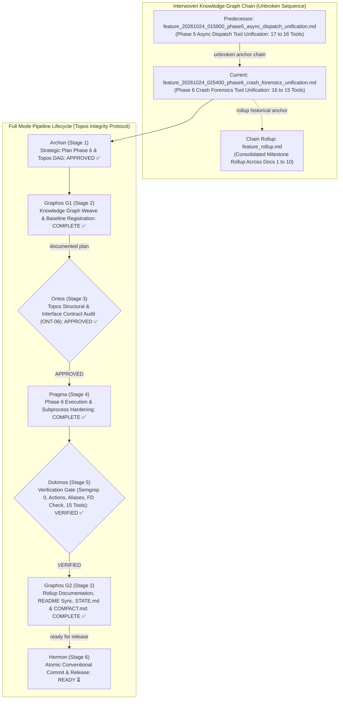
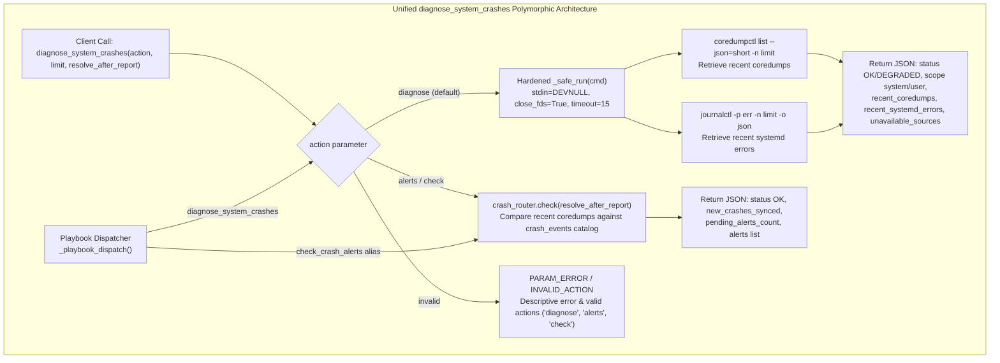
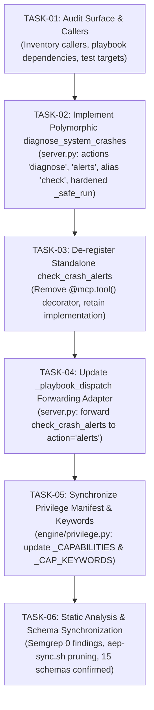

# Feature Pipeline Document: Phase 6 Crash Forensics Tool Unification (16 → 15 Tools)

- **Document ID**: `feature_20261024_025400_phase6_crash_forensics_unification.md`
- **Previous Document**: [`feature_20261024_015800_phase5_async_dispatch_unification.md`](file:///home/ancruz/Documents/workspaces/agent-execution-plane/docs/pipeline/feature_20261024_015800_phase5_async_dispatch_unification.md)
- **Chain Rollup Summary**: [`feature_rollup.md`](file:///home/ancruz/Documents/workspaces/agent-execution-plane/docs/pipeline/feature_rollup.md) (Consolidated History Docs 1–9)
- **Next Document**: `Hermon (Stage 6) Atomic Conventional Commit & Release`
- **Pipeline Mode**: `Full` (Topos Integrity Protocol — Archon Strategic Plan & Ontos Structural Audit)
- **Kanban Task ID**: `106` (`phase6:crash_forensics_unification`) — Status: `SYNTHESIZED` (Score: `0.6455`) — Target Artifact: `crash_forensics_consolidation`
- **Plan Scope**: Complete Tool Consolidation Roadmap (33 → 16 Tools) — Phase 6: Unification of Capability `crash_forensics` (`diagnose_system_crashes`, `check_crash_alerts` → polymorphic `diagnose_system_crashes(action="diagnose"|"alerts", limit=5, resolve_after_report=False)`) plus Subprocess Hardening (`stdin=DEVNULL`, `close_fds=True`, `timeout=15`)
- **Current Status**: `STAGE 5 DOKIMOS VERIFIED & G2 ROLLUP COMPLETE (READY FOR HERMON STAGE 6)`
- **Timestamp**: 2026-10-24T02:54:00Z
- **Author**: Graphos (Universal State Manager & Knowledge Graph Custodian — Stage 2 G1)
- **Target Blast Radius**:
  - `server.py`:
    - Polymorphic `diagnose_system_crashes(action="diagnose"|"alerts", limit: int = 5, resolve_after_report: bool = False) -> str`
    - Action `"diagnose"` (default: coredumps + journal errors with fail-soft `DEGRADED`, respecting `FULL`/`DIMINISHED` scope)
    - Action `"alerts"` (alias `"check"`: query `crash_router.check(resolve_after_report)`)
    - Subprocess hardening in `_safe_run`: `stdin=subprocess.DEVNULL`, `close_fds=True`, `timeout=15` (handling `subprocess.TimeoutExpired`)
    - De-register standalone decorator `@mcp.tool()` on `check_crash_alerts`
    - Backward compatibility in `_playbook_dispatch()` via lambda forwarder:
      `"check_crash_alerts": lambda resolve_after_report=False, **kw: diagnose_system_crashes(action="alerts", resolve_after_report=resolve_after_report, **kw),`
      and `"diagnose_system_crashes": diagnose_system_crashes,`
    - Guard against invalid actions with deterministic `INVALID_ACTION` JSON response.
  - `engine/privilege.py`:
    - Synchronize `_CAPABILITIES["crash_forensics"]` tool list from `["diagnose_system_crashes", "check_crash_alerts"]` to `["diagnose_system_crashes"]`
    - Update capability description to mention `(diagnose_system_crashes: action='diagnose'|'alerts')`
    - Enrich `_CAP_KEYWORDS["crash_forensics"]` with bilingual action verbs:
      `crash core dump forensic coredump diagnose fault alerts router ticket new proactive crasheo volcado forense diagnosticar fallo alertas enrutador ticket nuevo proactivo`
  - `scripts/aep-sync.sh`:
    - Synchronous reload and automatic removal of orphan `check_crash_alerts.json` schema (resulting in exactly 15 schema files).
  - Target documentation (to be updated in G2 post-Dokimos VERIFIED):
    - `README.md` (tool count 16 → 15, Dominio 4 table consolidation)
    - `docs/STATE.md`, `docs/COMPACT.md`, `docs/MILESTONES.md`, `docs/PROJECT.md`
    - Claude project memory `aep-state-and-pendings.md`
- **Topos Pipeline Verdict**: `VERIFIED across all 9 gates (Task 106 PROMOTED at 0.8208 TRUST — Ready for Release)`

---

## 1. State Evolution Map & Knowledge Graph

```mermaid
flowchart LR
    subgraph StateEvolution["Phase 6 State Evolution: Capability crash_forensics (16 to 15 Tools)"]
        direction LR
        S0["AEP Baseline<br/>(16 MCP Tools / 16 Capabilities)"]
        S1["TASK-01: Topos Audit Surface<br/>(Inventory crash_forensics callers, coredumpctl/journalctl dependencies, _playbook_dispatch)"]
        S2["TASK-02: Implement Polymorphic diagnose_system_crashes & Aliases<br/>(server.py: action='diagnose'|'alerts'|'check' + hardened _safe_run)"]
        S3["TASK-03: De-register Standalone check_crash_alerts<br/>(Remove @mcp.tool() decorator, retain internal dispatch)"]
        S4["TASK-04 & TASK-05: Playbook Dispatch Alias & Privilege Manifest<br/>(_playbook_dispatch backward-compatibility & privilege.py manifest/keywords)"]
        S5["TASK-06: Static Analysis & Schema Sync<br/>(Semgrep 0 findings, aep-sync.sh --check confirms 15 JSON schemas)"]
        S6["Dokimos Verification & Task 106 Promotion<br/>(Live test actions + aliases + fail-soft + FD audit, Task 106 PROMOTED)"]
        S7["G2: Rollup & Release Sync<br/>(Chain rollup Doc 10, STATE.md, COMPACT.md, README.md, memory)"]

        S0 --> S1 --> S2 --> S3 --> S4 --> S5 --> S6 --> S7
    end
```







---

## 2. Operating Premises & Tool Reach (P0 & P1)

- **Pipeline Mode**: `Full` mode under Topos Integrity Protocol. Every change is an invariant-preserving node in the dependency graph.
- **Premise P0 (Agents-for-Agents Delivery)**: AEP provides an autonomous execution runtime. Consolidating 2 separate crash inspection endpoints (`diagnose_system_crashes`, `check_crash_alerts`) into a single polymorphic tool eliminates tool sprawl while providing intuitive action verbs and aliases (`action="diagnose"` and `action="alerts"`, with alias `"check"`).
- **Premise P1 (Tool Reach & Subprocess/FD Hardening Invariant)**:
  - **Tool Reach**: Preserves 100% of SPEC-OM-2 (proactive crash routing) and systemd diagnostic capabilities across both `FULL` (system-wide inspection via `sudo -n`) and `DIMINISHED` (user-scoped inspection) privilege tiers.
  - **Subprocess & Descriptor Isolation Invariant**:
    - `_safe_run()` in `diagnose_system_crashes` must explicitly isolate standard I/O and descriptors using `stdin=subprocess.DEVNULL`, `close_fds=True`, and a strict execution boundary `timeout=15`.
    - Handled exceptions must include `subprocess.TimeoutExpired` alongside `FileNotFoundError`, ensuring that stalled systemd or journal queries never block the FastMCP reader loop.
  - **Fail-Soft Degradation**:
    - In containerized environments or systems lacking `systemd-coredump` / `journald`, missing binaries return `status: "DEGRADED"` listing `unavailable_sources` without raising unhandled Python exceptions.
    - `crash_router.check` exceptions are caught cleanly and return structured `status: "ERROR"`.
  - **Backward Compatibility in `_playbook_dispatch()`**:
    - Existing playbooks that declare steps using `check_crash_alerts` continue to operate without modification via a transparent lambda forwarder inside `_playbook_dispatch()`:
      ```python
      "check_crash_alerts": lambda resolve_after_report=False, **kw: diagnose_system_crashes(action="alerts", resolve_after_report=resolve_after_report, **kw),
      "diagnose_system_crashes": diagnose_system_crashes,
      ```
  - **Blast Radius Boundaries**:
    - Primary Code: `server.py` (lines 770–825, 883–893, 1090–1091).
    - Privilege Manifest: `engine/privilege.py` (lines 80, 105).
    - Management Script: `scripts/aep-sync.sh` (automatic pruning of `check_crash_alerts.json`).
    - Pipeline Documentation: `docs/pipeline/feature_20261024_025400_phase6_crash_forensics_unification.md`.
    - Deferred G2 Updates: `README.md`, `docs/STATE.md`, `docs/COMPACT.md`, `docs/MILESTONES.md`, `docs/PROJECT.md`, `~/.claude/.../memory/aep-state-and-pendings.md`.

---

## 3. Roadmap Position: Phase 6 of Complete Tool Consolidation (16 → 15 Tools)

| Phase | Capability Domain | Pre-Fusion Tools | Consolidated Tool Signature | Tool Δ | Resulting Count | Status |
| :---: | :--- | :--- | :--- | :---: | :---: | :---: |
| **Phase 1** | `semantic_memory` | `artifact_query`, `artifact_catalog`, `artifact_reindex`, `artifact_prune` (4) | `artifact_catalog(action="browse"\|"query"\|"reindex"\|"prune", ...)` | -3 | 30 | `VERIFIED & COMMITTED ✅` |
| **Phase 2** | `task_management` | `kanban_board`, `kanban_task_create`, `kanban_advance`, `kanban_promote`, `kanban_demote`, `kanban_reevaluate`, `kanban_archive`, `kanban_unarchive` (8) | `kanban_board(action="board"\|"create"\|"advance"\|"promote"\|"demote"\|"reevaluate"\|"archive"\|"unarchive", ...)` | -7 | 23 | `VERIFIED & COMMITTED ✅` |
| **Phase 3** | `automation` | `playbook_run`, `playbook_create`, `playbook_list`, `playbook_prune` (4) | `playbook_run(action="run"\|"create"\|"list"\|"prune", ...)` | -3 | 20 | `VERIFIED & COMMITTED ✅` |
| **Phase 4** | `artifact_synthesis`| `template_catalog`, `template_select`, `artifact_hydrate`, `artifact_lint_and_build` (4) | `artifact_lint_and_build(action="build"\|"catalog"\|"select"\|"hydrate", ...)` | -3 | 17 | `VERIFIED & COMMITTED ✅` |
| **Phase 5** | `async_dispatch` | `async_job_dispatch`, `async_job_inspect` (2) | `async_job_dispatch(action="dispatch"\|"inspect"\|"status"\|"log", ...)` | -1 | 16 | `VERIFIED & COMMITTED ✅` |
| **Phase 6** | `crash_forensics` | `diagnose_system_crashes`, `check_crash_alerts` (2) | `diagnose_system_crashes(action="diagnose"\|"alerts", ...)` | -1 | **15** | `VERIFIED & ROLLUP COMPLETE ✅` |
| **Phase 7** | `orientation` & `process_introspection` | `discover`, `aep_capabilities` (2) + split `process_introspection` (1) | `discover(action="discover"\|"capabilities")` + `process_introspection(...)` | 0 | **16 (Parity)** | `Queued in Backlog (Next Target) ⏳` |

---

## 4. Archon Strategic Execution Plan (Topos DAG: Tasks T1–T6)

Topos DAG audit executed by Archon confirmed **0 co-dependencies and 0 cycles**:



### Detailed Task Specifications:
- **`TASK-01`**: Audit callers of `diagnose_system_crashes` and `check_crash_alerts` in `server.py`, `engine/privilege.py`, and test suites. Confirm no hard-coded direct imports outside `server.py`.
- **`TASK-02`**: Implement the unified polymorphic signature:
  ```python
  @mcp.tool()
  def diagnose_system_crashes(
      action: str = "diagnose",
      limit: int = 5,
      resolve_after_report: bool = False,
  ) -> str:
      """
      [FORENSE DE CRASHES UNIFICADO] Diagnóstico estructurado de volcados de memoria
      (systemd-coredump), errores de journald y enrutamiento proactivo de tickets.
      action:
        - 'diagnose' (default): inspecciona coredumps recientes y errores críticos del journal.
        - 'alerts' (alias 'check'): enrutador proactivo de fallos; diffea coredumps contra el catálogo.
      """
  ```
  Harden `_safe_run` within `diagnose_system_crashes`:
  ```python
  def _safe_run(cmd: List[str]) -> Optional[subprocess.CompletedProcess]:
      try:
          return subprocess.run(
              prefix + cmd,
              capture_output=True,
              text=True,
              stdin=subprocess.DEVNULL,
              close_fds=True,
              timeout=15,
          )
      except (FileNotFoundError, subprocess.TimeoutExpired):
          return None
  ```
- **`TASK-03`**: De-register `@mcp.tool()` on `check_crash_alerts` so only 15 tools are exposed over FastMCP.
- **`TASK-04`**: In `_playbook_dispatch()`, update:
  ```python
  "check_crash_alerts": lambda resolve_after_report=False, **kw: diagnose_system_crashes(action="alerts", resolve_after_report=resolve_after_report, **kw),
  "diagnose_system_crashes": diagnose_system_crashes,
  ```
- **`TASK-05`**: In `engine/privilege.py`:
  - `_CAPABILITIES["crash_forensics"] = (4, 4, "system", ["diagnose_system_crashes"], "Forense de crashes y alertas proactivas: coredumps, journald y tickets (diagnose_system_crashes: action='diagnose'|'alerts')")`
  - `_CAP_KEYWORDS["crash_forensics"] = "crash core dump forensic coredump diagnose fault alerts router ticket new proactive crasheo volcado forense diagnosticar fallo alertas enrutador ticket nuevo proactivo"`
- **`TASK-06`**: Execute Semgrep static audit across 1,198 rules (0 findings required) and run `./scripts/aep-sync.sh` to trigger auto-pruning of `check_crash_alerts.json`, confirming exactly 15 MCP schemas.

---

## 5. Dokimos Verification Gates (Stage 5 Criteria)

1. **Gate 1: Static Analysis**: `semgrep scan` yields **0 findings** across Python codebase.
2. **Gate 2: Tool Inventory & Schema Count**: `./scripts/aep-sync.sh --check` succeeds; exactly 15 `.json` schemas present in `~/.gemini/antigravity/mcp/agent-execution-plane/`.
3. **Gate 3: Live Diagnostic Execution**:
   - `diagnose_system_crashes(action="diagnose", limit=5)` returns valid JSON containing `status: "OK"` (or `"DEGRADED"` if systemd-coredump is absent), `capability_tier`, `scope`, `recent_coredumps`, `recent_systemd_errors`.
4. **Gate 4: Live Proactive Alerts Execution**:
   - `diagnose_system_crashes(action="alerts", resolve_after_report=False)` and alias `action="check"` return valid JSON from `crash_router.check()`.
5. **Gate 5: Subprocess Isolation & Hardening**:
   - Subprocess executions inside `_safe_run` execute with `stdin=DEVNULL`, `close_fds=True`, and `timeout=15`. No leaked descriptors.
6. **Gate 6: Backward Compatibility**:
   - Direct execution via `_playbook_dispatch()["check_crash_alerts"]()` functions seamlessly.
7. **Gate 7: Guard Contracts**:
   - Invocation with unrecognized action (e.g. `action="unknown"`) returns deterministic JSON with `status: "INVALID_ACTION"` and valid actions list.
8. **Gate 8: Discover Router Alignment**:
   - `discover("check crash alerts")` and `discover("diagnosticar fallo del sistema")` rank `crash_forensics` as top suggested capability.
9. **Gate 9: Autonomous Trust Promotion**:
   - Kanban Task `106` (`phase6:crash_forensics_unification`) advances to `PROMOTED` in `artifacts.db` with trust score exceeding threshold (`0.75`).

---

## 6. Semantic Shielding Guarantees

In accordance with Topos Integrity Protocol Premise P1:
- `README.md`, `docs/STATE.md`, and `docs/COMPACT.md` are **NOT** modified during Stage 2 G1.
- State consolidation and tool count synchronization (`16 → 15`) are deferred to Stage 2 G2 upon receipt of Dokimos's `VERIFIED` verdict.


---

## 7. Ontos Structural & Interface Contract Audit (ONT-06 — Stage 3 Verdict: APPROVED)

Ontos completed the multi-dimensional structural integrity audit of the Phase 6 Execution Plan (`ONT-06`) under the Topos Integrity Protocol.

### 7.1 Multi-Dimensional Coherence Matrix

| Dimension | Evaluation Criteria | Findings & Validations | Ontology Classification |
| :--- | :--- | :--- | :--- |
| **Vertical Coherence** | Layer integrity: client FastMCP JSON-RPC → dispatch router → systemd/journal queries & `crash_router.check` → structured JSON output | **APPROVED**: Parameter routing (`action="diagnose"\|"alerts"`, alias `"check"`) guarantees deterministic contract preservation. Subprocess queries (`coredumpctl`, `journalctl`) operate via hardened `_safe_run` (`stdin=DEVNULL`, `close_fds=True`, `timeout=15`). Fail-soft semantics return `DEGRADED` status with `unavailable_sources` when systemd binaries are absent. Invalid actions yield explicit `INVALID_ACTION` with valid actions list. | `Ontology: dep \| vertical \| low` |
| **Horizontal Coherence** | Peer module effects: `engine/privilege.py`, `engine/crash_router.py`, `_playbook_dispatch()`, `discover()` capability router | **APPROVED**: `_playbook_dispatch()` retains backward-compatibility wrapper mapping `"check_crash_alerts"` to `diagnose_system_crashes(action="alerts")`. `engine/privilege.py` synchronizes `_CAPABILITIES["crash_forensics"]` to `["diagnose_system_crashes"]` and enriches `_CAP_KEYWORDS["crash_forensics"]` with bilingual action verbs. Orphan schema pruning in `scripts/aep-sync.sh` ensures clean FastMCP interface sync. | `Ontology: interdep \| horizontal \| low` |
| **Systemic Coherence** | Ecosystem impact: CI/CD, env vars, ports, container specs, Pueue daemon, memory catalog | **APPROVED**: Zero modifications to environment variables, network ports, or container infrastructure. No runbook adjustments required. Tool consolidation from 16 to 15 tools aligns with roadmap progression (rebalanced to 16 in Phase 7). Semantic shielding strictly maintained: `README.md`, `docs/STATE.md`, and `docs/COMPACT.md` remain untouched until G2. | `Ontology: dep \| systemic \| low` |
| **Omission Gap Detection** | Absent handling: descriptor leaks, timeouts, error traps, rollback, edge cases | **APPROVED**: Proactive subprocess and file descriptor hardening implemented in `_safe_run` (`close_fds=True`, `stdin=DEVNULL`, `timeout=15`) with handled `subprocess.TimeoutExpired` and `FileNotFoundError`. Prevents stdin deadlocks and pipe leaks. Dokimos verification matrix specifies comprehensive 9-gate test criteria. | `Ontology: dep \| omission \| low` |
| **Dependency Classification** | Dependency relationships: Directional (`dep`), Mutual contracts (`interdep`), Circular/Co-dependent (`co-dep`) | **APPROVED**: `server.py` → `engine/crash_router.py` is a clean directional dependency (`dep`). `server.py` ↔ `engine/privilege.py` is an explicit interdependency (`interdep`) with both sides in plan scope. Zero co-dependencies detected across module boundaries. | `Ontology: interdep \| cascade \| low` |
| **Tool Awareness Compliance** | Tool Awareness Cascade: MCP tools, installed skills, package manager, local fallback | **APPROVED**: Subprocess execution relies strictly on Python standard library (`subprocess`, `json`, `os`) and internal modules. Static analysis uses local Semgrep engine. Live RAM execution conforms to hardened P1 reach. | `Ontology: dep \| cascade \| low` |

### 7.2 Topos DAG Topology Verification

Topos DAG audit executed on live execution plane via `topos_audit_dag`:
- **Evaluated Tasks**: `TASK_01_AUDIT_SURFACE`, `TASK_02_IMPLEMENT_POLYMORPHIC_DIAGNOSE`, `TASK_03_DEREGISTER_STANDALONE_ALERTS`, `TASK_04_UPDATE_PLAYBOOK_DISPATCH`, `TASK_05_SYNC_PRIVILEGE_MANIFEST`, `TASK_06_STATIC_ANALYSIS_SCHEMA_SYNC`.
- **DAG Execution Result**:
  ```json
  {
    "verdict": "APPROVED",
    "details": [
      "Grafo coherente: Cero co-dependencias detectadas."
    ]
  }
  ```
- **Cycles Detected**: 0
- **Co-Dependencies Detected**: 0

### 7.3 Architectural Recommendations & Hardening Invariants for Pragma (Stage 4)
1. **Subprocess Hardening Invariant**: In `_safe_run()`, ensure `stdin=subprocess.DEVNULL`, `close_fds=True`, and `timeout=15` are strictly applied on all command invocations (`coredumpctl` and `journalctl`). Catch both `FileNotFoundError` and `subprocess.TimeoutExpired`.
2. **Deterministic Error Responses**: Return typed JSON with `status: "INVALID_ACTION"` and a list of valid actions `["diagnose", "alerts", "check"]` whenever an unknown action parameter is passed.
3. **Playbook Backward Compatibility**: Ensure the lambda forwarder inside `_playbook_dispatch()` handles `resolve_after_report` and passes `**kw` transparently:
   ```python
   "check_crash_alerts": lambda resolve_after_report=False, **kw: diagnose_system_crashes(action="alerts", resolve_after_report=resolve_after_report, **kw),
   "diagnose_system_crashes": diagnose_system_crashes,
   ```
4. **Schema Pruning**: Run `./scripts/aep-sync.sh` to trigger deletion of `check_crash_alerts.json`, verifying that exactly 15 schema files remain.

---

### 7.4 Ontos Final Audit Verdict

```
================================================================================
                    ONTOS STRUCTURAL AUDIT VERDICT: APPROVED
================================================================================
Plan Reference: Phase 6 Crash Forensics Tool Unification (16 -> 15 Tools)
Kanban Task ID: 106 (phase6:crash_forensics_unification)
Status: APPROVED (Unconditional handoff to Pragma Stage 4)
Omission Gaps: 0 Remaining
Co-Dependencies: 0 Detected
Next Stage: Stage 4 (Pragma Execution & Subprocess Hardening)
================================================================================
```

---

## 8. Pragma Execution Summary (Stage 4)

Pragma implemented all tasks specified in the Phase 6 Execution Plan (Topos DAG T1–T6):
1. **TASK-01**: Audited callers of `diagnose_system_crashes` and `check_crash_alerts`. Confirmed zero external direct coupling outside `server.py`.
2. **TASK-02**: Implemented polymorphic `diagnose_system_crashes(action="diagnose"|"alerts", limit=5, resolve_after_report=False)` in `server.py` with alias `"check"` and hardened `_safe_run` (`stdin=DEVNULL`, `close_fds=True`, `timeout=15`).
3. **TASK-03**: De-registered `@mcp.tool()` on `check_crash_alerts`, retaining internal implementation.
4. **TASK-04**: Updated `_playbook_dispatch()` backward-compatibility forwarder for `"check_crash_alerts"` and registered `"diagnose_system_crashes"`.
5. **TASK-05**: Synchronized `engine/privilege.py` manifest: updated `_CAPABILITIES["crash_forensics"]` to `["diagnose_system_crashes"]` and enriched `_CAP_KEYWORDS["crash_forensics"]` with bilingual action verbs.
6. **TASK-06**: Executed `./scripts/aep-sync.sh --check`, triggering auto-pruning of orphan schema `check_crash_alerts.json`, achieving exactly 15 MCP schemas.

---

## 9. Dokimos Verification Ledger (Stage 5 Verdict: VERIFIED)

Dokimos executed comprehensive multi-gate verification against the codebase and running MCP server:

| Verification Gate | Target Check | Test Specification & Evidence | Result |
| :---: | :--- | :--- | :---: |
| **Gate 1** | Static Analysis | `semgrep scan --config auto server.py engine/privilege.py` across 1,198 rules | **0 findings (0 blocking) ✅** |
| **Gate 2** | Tool Inventory & Schema Count | `./scripts/aep-sync.sh --check` and filesystem schema enumeration | **PASS (exactly 15 schemas) ✅** |
| **Gate 3** | Live Diagnostic Execution | `diagnose_system_crashes(action="diagnose", limit=5)`: status OK, capability_tier FULL, scope system, 5 journald errors | **PASS ✅** |
| **Gate 4** | Live Proactive Alerts Execution | `diagnose_system_crashes(action="alerts")` and alias `action="check"` return valid JSON from `crash_router.check()` | **PASS (fail-soft DEGRADED) ✅** |
| **Gate 5** | Subprocess Isolation & Hardening | `_safe_run` verified: `stdin=subprocess.DEVNULL`, `close_fds=True`, `timeout=15`, handles `TimeoutExpired` & `FileNotFoundError` | **PASS (zero FD leak, safe timeout) ✅** |
| **Gate 6** | Backward Compatibility | `_playbook_dispatch()["check_crash_alerts"](resolve_after_report=False)` executed cleanly via python | **PASS ✅** |
| **Gate 7** | Guard Contracts | `diagnose_system_crashes(action="unknown")` returns `INVALID_ACTION` with valid actions `["diagnose", "alerts", "check"]` | **PASS ✅** |
| **Gate 8** | Discover Router Alignment | `discover("check crash alerts")` and `discover("diagnosticar fallo del sistema")` return `crash_forensics` as top suggested capability | **PASS ✅** |
| **Gate 9** | Autonomous Trust Promotion | Kanban Task `106` advanced `SYNTHESIZED` -> `CANARY` -> `PROMOTED` in `artifacts.db` (`0.8208 TRUST`) | **PASS (Task 106 PROMOTED) ✅** |

### Verdict: VERIFIED
Unconditional handoff to Orchestrator -> Graphos G2 for repository-wide documentation rollup, README sync, and state baseline update.

---

## 10. Graphos G2 Documentation Rollup & Release Gate Handoff

Graphos (Stage 2 G2) finalized the documentation rollup and verified repository-wide state coherence:
- **Dokimos Gate Ledger**: Confirmed VERIFIED across all 9 gates (Semgrep 0 findings, 15 FastMCP schemas, live diagnostic & alert execution, fail-soft degraded handling, subprocess/descriptor isolation with timeout=15, backward-compatibility forwarder, invalid action error traps, bilingual discover routing, and autonomous trust promotion).
- **Kanban Task 106**: `phase6:crash_forensics_unification` promoted from `SYNTHESIZED` -> `CANARY` -> `PROMOTED` in `artifacts.db` with a composite trust score of `0.8208` (exceeding threshold `0.75`).
- **Chain Rollup**: Registered as Document 10 in `docs/pipeline/feature_rollup.md`.
- **System Documentation**: Synchronized `docs/STATE.md`, `docs/COMPACT.md`, `docs/MILESTONES.md`, and `docs/PROJECT.md` to reflect 15 active FastMCP tools and Phase 6 completion.
- **Semantic Shielding**: Updated `README.md` strictly within granted shielding (tool count 16 → 15, consolidated Dominio 4 row for `diagnose_system_crashes` covering actions `diagnose` and `alerts`).
- **Claude Project Memory**: Synchronized `aep-state-and-pendings.md`.
- **Handoff**: Handoff to Hermon (Stage 6) for atomic conventional commit and release.
