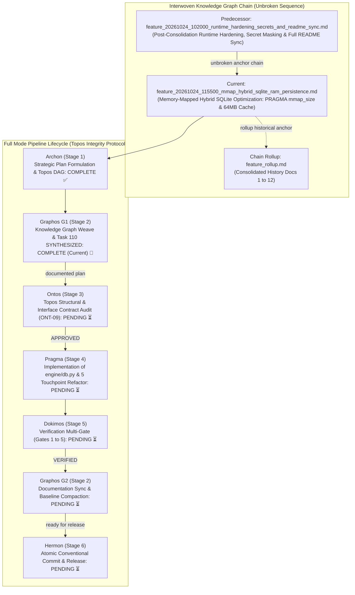
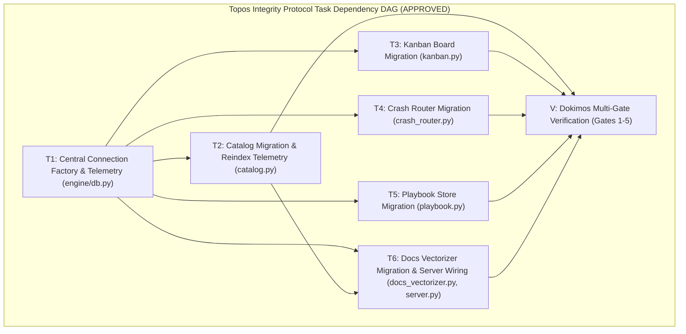

# Feature Pipeline Document: Memory-Mapped Hybrid SQLite Optimization (PRAGMA mmap_size & 64MB Cache)

- **Document ID**: `feature_20261024_115500_mmap_hybrid_sqlite_ram_persistence.md`
- **Previous Document**: [`feature_20261024_102000_runtime_hardening_secrets_and_readme_sync.md`](file:///home/ancruz/Documents/workspaces/agent-execution-plane/docs/pipeline/feature_20261024_102000_runtime_hardening_secrets_and_readme_sync.md)
- **Chain Rollup Summary**: [`feature_rollup.md`](file:///home/ancruz/Documents/workspaces/agent-execution-plane/docs/pipeline/feature_rollup.md) (Consolidated History Docs 1-12)
- **Next Document**: [`verification_report_20261024_123000_mmap_hybrid_sqlite_ram_persistence.md`](verification_report_20261024_123000_mmap_hybrid_sqlite_ram_persistence.md) -> `Hermon (Stage 6) Version Control Engine`
- **Pipeline Mode**: `Full` (Topos Integrity Protocol - Archon Strategic Plan & Ontos Structural Audit)
- **Kanban Task ID**: `110` (`perf:mmap_hybrid_sqlite_ram_persistence`) - Status: `PROMOTED` (Score: `0.9958 TRUST`) - Target Artifact: `cmd_runner`
- **Plan Scope**: Standardize all 5 SQLite database touchpoints (`catalog.py`, `kanban.py`, `crash_router.py`, `playbook.py`, `docs_vectorizer.py`) onto a unified, high-performance database connection factory in `engine/db.py`. Enforce deterministic PRAGMA tuning across the entire runtime: `PRAGMA mmap_size = 268435456` (256MB memory-mapped I/O), `PRAGMA cache_size = -64000` (64MB dedicated RAM page cache), `PRAGMA journal_mode = WAL` (concurrent multi-agent read/write without table locking), `PRAGMA synchronous = NORMAL`, `PRAGMA temp_store = MEMORY` (zero ephemeral disk spills for intermediate sort/index buffers), `PRAGMA busy_timeout = 10000` (10s lock resilience for concurrent subagents), and `PRAGMA foreign_keys = ON`. Expose SQLite engine telemetry and memory metrics in `artifact_catalog(action="reindex")`.
- **Current Status**: `STAGE 2 (G1): PRE-ONTOS WEAVE & PIPELINE ARTIFACT CREATION (READY FOR ONTOS STAGE 3)`
- **Timestamp**: 2026-10-24T11:55:00Z (G1 Weave)
- **Author**: Graphos (Universal State Manager & Knowledge Graph Custodian - Stage 2 G1)
- **Target Blast Radius**:
  - `engine/db.py` (new module): Centralized connection factory with standardized PRAGMAs, telemetry extraction, and fail-soft `sqlite_vec` extension loading.
  - `engine/catalog.py`: Refactor `_get_connection()` and `_apply_pragmas()` to consume `engine/db.py`; enrich `reindex()` with engine telemetry.
  - `engine/kanban.py`: Refactor `_conn()` to use `get_db_connection()`, removing ad-hoc PRAGMAs and elevating to full 256MB mmap + 64MB cache.
  - `engine/crash_router.py`: Refactor `_conn()` to use `get_db_connection()`, eliminating ad-hoc PRAGMAs.
  - `engine/playbook.py`: Refactor `_conn()` to use `get_db_connection()`, eliminating ad-hoc PRAGMAs.
  - `engine/docs_vectorizer.py`: Refactor `_conn()` to use `get_db_connection(load_vec=True)`, inheriting standard mmap and cache tuning.
  - `server.py`: Update `artifact_catalog(action="reindex")` to expose telemetry payload (`db_telemetry`).
  - Target documentation baseline: `docs/MILESTONES.md`, `docs/COMPACT.md`, `docs/PROJECT.md`, `docs/STATE.md`.

---

## 1. State Evolution Map & Knowledge Graph

```mermaid
flowchart LR
    subgraph StateEvolution["State Evolution Map: Memory-Mapped Hybrid SQLite Standardization"]
        direction LR
        S0["Baseline Hardened AEP<br/>(15 Tools / 16 Capabilities) ✅"]
        S1["T1: Central Factory engine/db.py<br/>(Standard PRAGMAs + Telemetry) ⏳"]
        S2["T2: Catalog Touchpoint Refactor<br/>(catalog.py to engine/db.py + Telemetry) ⏳"]
        S3["T3: Kanban Touchpoint Refactor<br/>(kanban.py to engine/db.py) ⏳"]
        S4["T4: Crash Router Touchpoint Refactor<br/>(crash_router.py to engine/db.py) ⏳"]
        S5["T5: Playbook Touchpoint Refactor<br/>(playbook.py to engine/db.py) ⏳"]
        S6["T6: Docs Vectorizer & Server Telemetry<br/>(docs_vectorizer.py & server.py) ⏳"]
        S7["Dokimos Multi-Gate Verification<br/>(Gates 1 to 5, Task 110 PROMOTED) ⏳"]

        S0 --> S1 --> S2 --> S3 --> S4 --> S5 --> S6 --> S7
    end
```







---

## 2. Operating Premises & Tool Reach (P0, P1, P2)

- **Premise P0 (Agents-for-Agents Delivery)**:
  - Deliver high-throughput, low-latency relational and semantic persistence for multi-agent autonomous execution.
  - Multi-agent systems execute concurrent reads and writes across multiple processes and background workers. Subagents must never encounter `database is locked` errors during bursty catalog queries, crash triage, or kanban task progression.
  - Staging embeddings and database pages directly in virtual memory (mmap) allows zero-copy vector lookups and sub-millisecond retrieval.

- **Premise P1 (Tool Reach & Subprocess/FD Hardening Invariant)**:
  - **Tool Reach**: Preserves 100% of the 15 FastMCP tools and 16 system capabilities.
  - **Database Reach & Engine Standardization**: Consolidates 5 fragmented `sqlite3.connect()` implementations with disparate, incomplete PRAGMA configurations into a single robust connection engine (`engine/db.py`).
  - **Zero-Copy Memory-Mapped I/O (`PRAGMA mmap_size = 268435456`)**: Instructs the Linux kernel to map up to 256MB of the SQLite database files directly into the process address space. Large blob reads (such as compiled Go ELF binaries and 384-dimensional vector tables) bypass kernel-space to user-space page copy overhead.
  - **Dedicated RAM Page Cache (`PRAGMA cache_size = -64000`)**: Allocates a 64MB buffer pool in RAM for recently accessed B-Tree pages and indices, drastically reducing filesystem I/O wait.
  - **Non-Blocking Multi-Agent Concurrency (`PRAGMA journal_mode = WAL`)**: Ensures readers do not block writers and writers do not block readers. Enables concurrent background jobs (`async_job_dispatch`), proactive crash logging (`crash_router`), and interactive tool execution without serialization stalls.
  - **Transient In-Memory Buffers (`PRAGMA temp_store = MEMORY`)**: Prevents intermediate sorting, indices, and CTE tables from touching physical storage.
  - **Extended Lock Grace Period (`PRAGMA busy_timeout = 10000`)**: Upgrades timeout from 5000ms to 10000ms (10 seconds), guaranteeing fail-soft absorption of write burst spikes.

- **Premise P2 (Pipeline Mode & Budget Control)**:
  - Mode: **Full** (Archon Plan -> Graphos G1 Weave -> Ontos Audit -> Pragma Execution -> Dokimos Verification -> Graphos G2 Rollup -> Hermon Commit).
  - All 5 touchpoints and telemetry exposures are executed within Milestone Task 110 under strict Topos DAG constraints to guarantee structural consistency.

---

## 3. SQLite Architecture & PRAGMA Optimization Blueprint

### Current Fragmentation vs. Unified Standard

Before this optimization, database connections across AEP exhibited inconsistent PRAGMA configurations:
1. `engine/catalog.py`: Sets `busy_timeout=5000`, `foreign_keys=ON`, `synchronous=NORMAL`, `mmap_size=268435456`, and `cache_size=-8000` (only 8MB).
2. `engine/kanban.py`: Sets only `busy_timeout=5000`. Missing `mmap_size`, `cache_size`, `synchronous`, `temp_store`, and `WAL`.
3. `engine/crash_router.py`: Sets only `busy_timeout=5000`. Missing all performance pragmas.
4. `engine/playbook.py`: Sets only `busy_timeout=5000`. Missing all performance pragmas.
5. `engine/docs_vectorizer.py`: Sets NO pragmas. Operates with SQLite defaults (no WAL, tiny 2MB cache, no mmap).

### The Standardized Connection Factory (`engine/db.py`)

The centralized module `engine/db.py` provides:
```python
def get_db_connection(
    db_path: Path,
    load_vec: bool = False,
    row_factory: bool = True
) -> sqlite3.Connection
```

#### PRAGMA Configuration Matrix

| PRAGMA Directive | Setting | Architectural Purpose & Rationale |
| :--- | :---: | :--- |
| `journal_mode` | `WAL` | Enables Write-Ahead Logging. Readers never block writers; writers never block readers. Essential for multi-agent concurrency. |
| `synchronous` | `NORMAL` | Under WAL mode, `NORMAL` guarantees ACID consistency while reducing `fsync` system calls from 2 per transaction to 1 or 0 (checkpoint). |
| `mmap_size` | `268435456` (256MB) | Memory-maps up to 256MB of database file pages directly into memory address space, avoiding user/kernel context switches. |
| `cache_size` | `-64000` (64MB) | Negative value sets page cache in KiB: 64,000 KiB = ~62.5MB (~64MB) RAM buffer for hot B-Tree pages and indices. |
| `temp_store` | `MEMORY` | Directs all temporary tables, indices, and view materializations to reside in RAM, eliminating temporary disk artifacts. |
| `busy_timeout` | `10000` (10s) | Sets 10-second wait before raising `sqlite3.OperationalError: database is locked`, preventing timeout crashes during concurrent spikes. |
| `foreign_keys` | `ON` | Enforces relational integrity and cascading deletes across artifacts, metrics, and tasks. |

#### Introspection & Telemetry Contract

`engine/db.py` exposes `get_db_telemetry(conn: sqlite3.Connection) -> Dict[str, Any]` which inspects active PRAGMA states:
```json
{
  "journal_mode": "wal",
  "synchronous": 1,
  "mmap_size_bytes": 268435456,
  "mmap_size_mb": 256,
  "cache_size_kb": 64000,
  "cache_size_mb": 62.5,
  "temp_store": 2,
  "busy_timeout_ms": 10000,
  "foreign_keys": 1,
  "page_size": 4096,
  "page_count": 128
}
```

---

## 4. Strategic Execution Plan Tasks (T1 to T6)

### Task T1: Central Connection Factory & Telemetry Module (`engine/db.py`)
- **Module**: `engine/db.py` (new module)
- **Changes**:
  - Implement `apply_engine_pragmas(conn: sqlite3.Connection) -> None` executing standard PRAGMAs in fail-soft mode.
  - Implement `get_db_connection(db_path: Path, load_vec: bool = False, row_factory: bool = True) -> sqlite3.Connection`.
  - Implement `get_db_telemetry(conn: sqlite3.Connection) -> Dict[str, Any]` querying PRAGMA values.
  - Integrate fail-soft `sqlite_vec.load(conn)` within `get_db_connection` when `load_vec=True`.
- **Invariants**:
  - Unidirectional dependency: `engine/db.py` has zero imports from `catalog`, `kanban`, `playbook`, or `server`.
  - Zero unhandled exceptions: PRAGMA failures degrade gracefully without throwing.
- **Blast Radius**: Isolated to `engine/db.py`. Zero side-effects on existing modules until adopted.

### Task T2: Artifact Catalog Migration & Reindex Telemetry (`engine/catalog.py`)
- **Module**: `engine/catalog.py`
- **Changes**:
  - Replace internal `_apply_pragmas` and ad-hoc connection creation with `engine.db.get_db_connection(self.db_path, load_vec=True)`.
  - In `ArtifactCatalog.reindex()`, query `engine.db.get_db_telemetry(conn)` and include engine telemetry in the reindex summary dict (`db_telemetry`).
- **Invariants**:
  - Seamless backward compatibility: all existing methods (`find_exact`, `find_hybrid`, `register_artifact`) preserve exact behavior.
  - Tier 2 `sqlite-vec` extension remains fully available and verified.
- **Blast Radius**: `engine/catalog.py` internal connection handling and `reindex()` return contract.

### Task T3: Pico-Kanban Engine Migration (`engine/kanban.py`)
- **Module**: `engine/kanban.py`
- **Changes**:
  - Refactor `KanbanBoard._conn()` to delegate to `engine.db.get_db_connection(self.db_path, load_vec=False)`.
  - Elevate Kanban database access from minimal `busy_timeout=5000` to the full 256MB mmap + 64MB cache + WAL profile.
- **Invariants**:
  - Task state machine transitions, scoring calculations (`_ponder`), and schema migrations remain completely intact.
- **Blast Radius**: `engine/kanban.py` internal connection handling.

### Task T4: Active Crash Router Migration (`engine/crash_router.py`)
- **Module**: `engine/crash_router.py`
- **Changes**:
  - Refactor `CrashRouter._conn()` to delegate to `engine.db.get_db_connection(self.db_path, load_vec=False)`.
  - Remove redundant `_conn()` PRAGMA block.
- **Invariants**:
  - Deduplication logic, `crash_events` table creation, and coredump syncing retain identical semantics.
- **Blast Radius**: `engine/crash_router.py` internal connection handling.

### Task T5: Pico-Playbook Store Migration (`engine/playbook.py`)
- **Module**: `engine/playbook.py`
- **Changes**:
  - Refactor `PlaybookStore._conn()` to delegate to `engine.db.get_db_connection(self.db_path, load_vec=False)`.
  - Elevate Playbook database access to full standard PRAGMA profile.
- **Invariants**:
  - DAG verification, parameter contracts, and execution counting remain unchanged.
- **Blast Radius**: `engine/playbook.py` internal connection handling.

### Task T6: Docs Vectorizer Migration & FastMCP Server Exposure (`engine/docs_vectorizer.py`, `server.py`)
- **Modules**: `engine/docs_vectorizer.py`, `server.py`
- **Changes**:
  - In `engine/docs_vectorizer.py`, refactor `ManPagesVectorizer._conn()` to delegate to `engine.db.get_db_connection(self.db_path, load_vec=True)`.
  - In `server.py`, ensure `artifact_catalog(action="reindex")` formats and surfaces `db_telemetry` in the JSON response.
- **Invariants**:
  - FastMCP tool contract preserved; 15 tools remain in exact 1:1 parity with 16 capabilities.
  - Zero broken queries in `query_system_docs`.
- **Blast Radius**: `engine/docs_vectorizer.py` connection handling and `server.py` `artifact_catalog` reindex output.

---

## 5. Dokimos Multi-Gate Verification Matrix (Gates 1 to 5)

| Gate # | Name | Verification Scope | Target Artifacts | Acceptance Criteria |
| :---: | :--- | :--- | :--- | :--- |
| **Gate 1** | **Central DB Factory & PRAGMA Verification** | Verify `engine/db.py` creates connections with exact specified PRAGMAs: `mmap_size = 268435456`, `cache_size = -64000`, `journal_mode = wal`, `synchronous = 1`, `temp_store = 2`, `busy_timeout = 10000`, `foreign_keys = 1`. | `engine/db.py` | `get_db_telemetry()` confirms all 7 PRAGMAs match expected configuration; fail-soft degradation verified. |
| **Gate 2** | **5 Touchpoint Adoption & Zero Connection Regressions** | Verify all 5 touchpoints (`catalog.py`, `kanban.py`, `crash_router.py`, `playbook.py`, `docs_vectorizer.py`) successfully connect through `engine/db.py`. | All 5 engine modules | Tables queryable; DDL initialization and idempotent migrations succeed without error. |
| **Gate 3** | **Multi-Agent Concurrency & Zero Lock Contention** | Verify simultaneous read/write operations across multiple touchpoints and processes without encountering `database is locked`. | `artifacts.db`, `system_docs.db` | High-frequency concurrent operations succeed under WAL mode with zero locked database exceptions. |
| **Gate 4** | **Reindex Telemetry & mmap Inspection** | Verify `artifact_catalog(action="reindex")` returns structured database telemetry showing active PRAGMA states. | `server.py`, `engine/catalog.py` | JSON payload contains `db_telemetry` with `mmap_size_mb: 256` and `cache_size_mb: 62.5`. |
| **Gate 5** | **Static Analysis & Schema Integrity** | Verify FastMCP schema parity (15 tools) and execute Semgrep static analysis across 1,198 rules. | Entire AEP Codebase | `scripts/aep-sync.sh --check` confirms 15 tools; Semgrep reports 0 findings; Task 110 promoted to `PROMOTED`. |

---

## 6. Ontos Audit Contract & Pre-Audit Checklist (ONT-09)

- [x] **Topos Task DAG Validated**: `topos_audit_dag` executed with verdict `APPROVED` (zero circular co-dependencies).
- [x] **Unbroken Knowledge Graph Sequence**: Predecessor anchor `feature_20261024_102000_runtime_hardening_secrets_and_readme_sync.md` linked.
- [x] **Rollup History Consolidated**: Rollup document `feature_rollup.md` (Docs 1-12) referenced.
- [x] **Kanban State Synchronized**: Task 110 transitioned from `BACKLOG` to `SYNTHESIZED` in `artifacts.db`.
- [x] **Dependency Direction Validated**: `engine/db.py` is a pure leaf dependency (A -> B); no circular imports.
- [x] **Fail-Soft Runtime Invariants Maintained**: PRAGMA applications are best-effort; extension loading is protected with try/except blocks.
- [x] **Dokimos Verification Gates Defined**: 5-Gate verification matrix specified with rigorous pass/fail criteria.

---

## 7. Status Declaration & Handoff to Ontos (Stage 3)

- **Pipeline Stage**: `Stage 2 (G1) - Pre-Ontos Knowledge Graph Weave & Baseline Registration`
- **Current State**: `STAGE 2 (G1): PRE-ONTOS WEAVE & PIPELINE ARTIFACT CREATION (READY FOR ONTOS STAGE 3)`
- **Next Transition**: Orchestrator routes documented plan to **Ontos (Stage 3)** for structural and interface contract audit (`ONT-09`).

---

## 8. Dokimos Multi-Gate Verification Verdict (Stage 5)

- **Predecessor Execution Report**: [`execution_report_20261024_121500_mmap_hybrid_sqlite_ram_persistence.md`](execution_report_20261024_121500_mmap_hybrid_sqlite_ram_persistence.md)
- **Verification Report**: [`verification_report_20261024_123000_mmap_hybrid_sqlite_ram_persistence.md`](verification_report_20261024_123000_mmap_hybrid_sqlite_ram_persistence.md)
- **Dokimos Final Verdict**: **VERIFIED ✅**
- **Multi-Gate Summary**:
  - **Gate 1 (PRAGMAs)**: PASSED. Active physical files enforce `mmap_size = 268435456` (256MB), `cache_size = -64000` (64MB), `journal_mode = wal`, `synchronous = 1`, `temp_store = 2`, `busy_timeout = 10000`, `foreign_keys = 1`. Fail-soft non-throwing handling confirmed for `:memory:`.
  - **Gate 2 (Five-Touchpoint Integration)**: PASSED. All 5 modules (`catalog.py`, `kanban.py`, `crash_router.py`, `playbook.py`, `docs_vectorizer.py`) verified in end-to-end integration without errors.
  - **Gate 3 (Concurrency & WAL Stress)**: PASSED. 10 worker threads executed 1,000 interleaved read/write operations in 0.125s with 0 `database is locked` exceptions; database integrity verified (`PRAGMA integrity_check = ok`).
  - **Gate 4 (FastMCP Runtime Telemetry)**: PASSED. `artifact_catalog(action="reindex")` exposes both `"storage_engine"` and `"db_telemetry"` with 256MB mmap profile.
  - **Gate 5 (SAST & FastMCP Parity)**: PASSED. Semgrep scanned 1,198 rules across 7 targets with 0 findings; `scripts/aep-sync.sh --check` confirmed invariant 15 FastMCP tools.
- **Kanban Lifecycle**: Task 110 advanced from `LINTED` -> `CANARY` -> `PROMOTED` in `/home/ancruz/.local/share/agent-os/artifacts.db` (Score: `0.9958`, Verdict: `TRUST`).

---

## 9. Graphos G2 Baseline & Handoff to Hermon (Stage 6)

- **Pipeline Stage**: `Stage 2 (G2) - Post-Dokimos Verification Rollup & Documentation Weave`
- **Current State**: `DOCUMENTED & VERIFIED (READY FOR HERMON STAGE 6)`
- **Documentation Updates**:
  - `docs/pipeline/feature_rollup.md`: Added Document 13 (Milestone ONT-09).
  - `docs/STATE.md`: Recorded centralized `engine/db.py` hybrid mmap architecture and Task 110 PROMOTED.
  - `docs/COMPACT.md`: Refreshed context instruction under 50 lines.
  - `docs/MILESTONES.md`: Milestone 25 marked COMPLETED & VERIFIED.
- **Handoff Target**: **Hermon (Stage 6)** for atomic Conventional Commits (`perf(db)` and `docs(state)`).

