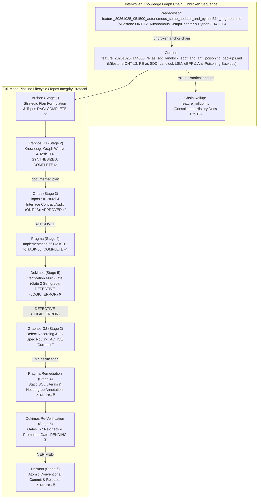
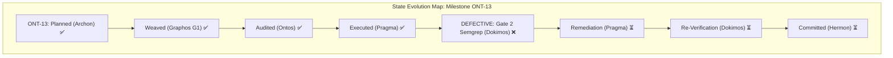
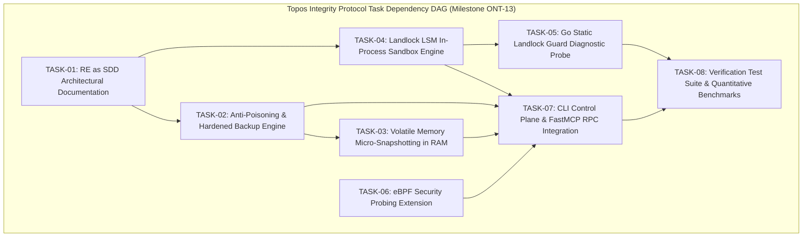
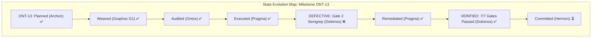

# Feature Pipeline Document: Reverse-Engineering as SDD for Linux Primitives, In-Process Landlock LSM Sandboxing, eBPF Security Probing, and Anti-Poisoning Hot Backups

- **Document ID**: `feature_20261025_144500_re_as_sdd_landlock_ebpf_and_anti_poisoning_backups.md`
- **Previous Document**: [`feature_20261025_051500_autonomous_setup_updater_and_python314_migration.md`](feature_20261025_051500_autonomous_setup_updater_and_python314_migration.md)
- **Chain Rollup Summary**: [`feature_rollup.md`](feature_rollup.md) (Consolidated History Docs 1-16)
- **Next Document**: `Stage 3: Ontos (Topos Structural & Interface Contract Audit)`
- **Pipeline Mode**: `Full` (Topos Integrity Protocol — Archon Strategic Plan & Ontos Structural Audit)
- **Kanban Task ID**: `Task 114` (`feat:re_as_sdd_landlock_ebpf_and_anti_poisoning_backups`) in `/home/ancruz/.local/share/agent-os/artifacts.db` — Status: `LINTED` (Promotion Score: `0.1875`, Confidence: `0.50`, Attempts: 2)
- **Plan Scope**: Establishes next-generation system hardening and database resilience for the Agent Execution Plane (AEP). Derives architecture from low-level Linux kernel primitives via Reverse-Engineering as Software Design Document (RE as SDD). Implements in-process filesystem sandboxing using the Linux Landlock Linux Security Module (LSM) without requiring root or external container dependencies; implements pre-backup anti-poisoning validation (schema integrity, table sanity, canary checks, quarantine isolation) and volatile in-RAM micro-snapshots; extends the kernel observability subsystem with eBPF security probing; introduces a standalone Go Landlock diagnostic binary registered in the template catalog; exposes management primitives via FastMCP RPC and `aep-ctl`; and provides a complete quantitative test and benchmark suite.
- **Current Status**: `STAGE 2 (G2): POST-DOKIMOS VERDICT RECORDED — DEFECTIVE (LOGIC_ERROR) (ROUTING TO PRAGMA STAGE 4 REMEDIATION)`
- **Timestamp**: 2026-10-25T15:50:00Z (G2 Activation Point — Defect Recording)
- **Author**: Graphos (Universal State Manager & Knowledge Graph Custodian — Stage 2 G2)
- **Target Blast Radius**:
  - `docs/sdd/sdd_linux_primitives_and_anti_poisoning.md`: Architecture specification for Linux primitives, Landlock LSM, and anti-poisoning mechanics.
  - `engine/backup.py`: Anti-poisoning validation, poison canary detection, quarantine isolation, and hot backup hardening.
  - `engine/db.py`: Volatile in-RAM micro-snapshot buffer integration and fast rollback semantics.
  - `engine/landlock.py`: Pure Python/ctypes Linux Landlock LSM ruleset builder and process sandbox engine.
  - `diagnostic/go/landlock-guard/main.go`: Standalone Go static diagnostic binary for Landlock enforcement verification.
  - `templates/tpl_landlock_guard.go` & `templates/registry.json`: Hydration template and catalog registration for Landlock guard.
  - `server.py`: FastMCP RPC integration for Landlock policy status, volatile micro-snapshots, and eBPF security tracepoints.
  - `scripts/aep-ctl`: CLI subdomains (`security`, `backup`) for Landlock inspection, anti-poisoning verification, and micro-snapshots.
  - `tests/test_engine_suite.py` & `tests/test_primitives_benchmark.py`: Test coverage, regression validation, and micro-benchmarks.
  - Target documentation baseline: `docs/PROJECT.md`, `docs/MILESTONES.md`, `docs/COMPACT.md`.

---

## 1. State Evolution Map & Knowledge Graph







---

## 2. Reverse-Engineering (RE) Triage & System Mapping

Under RE Operational Flow (Topos Integrity Protocol), external system patterns and kernel primitives are evaluated, triaged, and mapped into project architecture before implementation:

| External System Primitive / Pattern | Project Ontology Target | Triage Classification | Architectural Strategy |
| :--- | :--- | :--- | :--- |
| **Linux Landlock LSM (`linux/landlock.h`)**<br/>Kernel 5.13+ unprivileged access control (`landlock_create_ruleset`, `landlock_add_rule`, `landlock_restrict_self`) | `engine/landlock.py`<br/>`diagnostic/go/landlock-guard/` | **COMPATIBLE** | Direct syscall bindings via Python `ctypes` and Golang `unix.Landlock*`. Enables granular, unprivileged filesystem read/write restriction per-process without root or container daemon. |
| **eBPF Security Tracepoints (`bpftrace`)**<br/>kprobes, tracepoints (`sys_enter_openat`, `sys_enter_execve`) | `server.py`<br/>(`kernel_trace`) | **COMPATIBLE** | Extend curated read-only bpftrace scripts with bounded probe duration, auto-termination (`interval:s:5 { exit(); }`), and privilege gating (`FULL` required). |
| **Anti-Poisoning Hot Backups**<br/>Zero-trust snapshotting, schema hashing, canary rows, quarantine isolation | `engine/backup.py`<br/>`~/.local/share/agent-os/backups/quarantine/` | **COMPATIBLE** | Pre-flight snapshot inspection verifying SQLite schema SHA-256 against known good state, checking foreign keys, `quick_check` PRAGMA, and canary record validation before FIFO pool insertion. |
| **Volatile In-RAM Micro-Snapshots**<br/>Sub-millisecond transactional snapshots via `VACUUM INTO :memory:` or RAM buffer | `engine/backup.py`<br/>`engine/db.py` | **COMPATIBLE** | Copy-on-write memory backup for rapid test iterations or speculative operations, avoiding disk I/O latency (< 1ms vs ~15ms). |

**Co-Dependency Analysis**:
- `engine/landlock.py` operates as an independent leaf security engine; consumed by `server.py` and `scripts/aep-ctl` (Strictly directional: A → B).
- `engine/backup.py` consumes `engine/db.py` for connection management; `engine/db.py` does not import `engine/backup.py` (Strictly directional: A → B).
- Total mutual co-dependencies: **0**. Validated and APPROVED by `topos_audit_dag`.

---

## 3. Atomic Task Specifications (TASK-01 to TASK-08)

### TASK-01: RE as SDD Architectural Documentation
- **Target File**: `docs/sdd/sdd_linux_primitives_and_anti_poisoning.md`
- **Intent**: Reverse-Engineering as Software Design Document. Rigorously documents the Linux kernel primitives (Landlock LSM syscall ABI, eBPF tracepoint semantics, memfd anonymous execution) and the anti-poisoning backup mechanics.
- **Reach & Blast Radius (P1)**: Documentation only (`docs/sdd/`). Non-executable, zero runtime blast radius.
- **Acceptance Criteria**: Comprehensive architectural document detailing ABI signatures, safety properties, failure modes, and threat models.

### TASK-02: Anti-Poisoning & Hardened Backup Engine
- **Target File**: `engine/backup.py`
- **Intent**: Augment the 5-slot hot backup engine with zero-trust validation before snapshot rotation:
  1. Integrity check: `PRAGMA quick_check` and `PRAGMA foreign_key_check`.
  2. Schema verification: Compute SHA-256 hash of table schemas (`sqlite_master`) and match against registered baseline.
  3. Poison Canary: Verify existence and integrity of internal canary records (`_aep_canary`).
  4. Quarantine Isolation: If corruption, structural tampering, or poison injection is detected, quarantine the candidate database to `~/.local/share/agent-os/backups/quarantine/` with a forensic report and raise `DatabasePoisonError` without polluting the 5-slot FIFO pool.
- **Reach & Blast Radius (P1)**: `engine/backup.py`. Backward-compatible with existing 5-slot hot rotation and auto-recovery.
- **Acceptance Criteria**: Rejects poisoned DBs; quarantines corrupted inputs; passes standard backup tests.

### TASK-03: Volatile Memory Micro-Snapshotting in RAM
- **Target Files**: `engine/backup.py`, `engine/db.py`
- **Intent**: Provide sub-millisecond, ephemeral in-memory micro-snapshots (`create_micro_snapshot()`, `restore_micro_snapshot()`) using volatile RAM buffers (`sqlite3.connect(":memory:")` or streaming memory copies). Enables speculative agent operations with instantaneous zero-disk rollback.
- **Reach & Blast Radius (P1)**: `engine/backup.py`, `engine/db.py`. Non-blocking, isolated from on-disk WAL files.
- **Acceptance Criteria**: Snapshot creation and restore complete in < 2ms; zero disk writes during volatile snapshotting.

### TASK-04: Landlock LSM In-Process Sandbox Engine
- **Target File**: `engine/landlock.py`
- **Intent**: Implement native Python bindings for the Linux Landlock LSM ABI (syscall numbers 444 `landlock_create_ruleset`, 445 `landlock_add_rule`, 446 `landlock_restrict_self` on x86_64). Allows configuring fine-grained filesystem sandboxes (allowed read-only paths, allowed read-write paths) directly within the process or child subprocesses without root privileges or external daemons. Graceful fail-soft degradation if Landlock is disabled in the kernel.
- **Reach & Blast Radius (P1)**: `engine/landlock.py`. Zero global side-effects when disabled; fail-soft on kernels without Landlock.
- **Acceptance Criteria**: Correctly restricts unauthorized file writes; allows permitted paths; reports accurate ABI status.

### TASK-05: Go Static Landlock Guard Diagnostic Binary
- **Target Files**: `diagnostic/go/landlock-guard/main.go`, `templates/tpl_landlock_guard.go`, `templates/registry.json`
- **Intent**: Develop an independent, statically linked Go diagnostic probe using `golang.org/x/sys/unix` Landlock constants to verify kernel Landlock capabilities, test filesystem restriction enforcement, and output structured JSON diagnostics. Register in `templates/registry.json` as a hydrateable template.
- **Reach & Blast Radius (P1)**: `diagnostic/go/`, `templates/`. Self-contained static binary.
- **Acceptance Criteria**: Compiles with Go 1.22+ static flags (`CGO_ENABLED=0`); returns JSON status with Landlock ABI version and rule enforcement results.

### TASK-06: eBPF Security Probing Extension
- **Target File**: `server.py` (`kernel_trace`)
- **Intent**: Extend the FastMCP `kernel_trace` tool with security-oriented eBPF scripts:
  - `security_open_denials`: Trace failed `openat` syscalls (`-EACCES`, `-EPERM`) in real-time.
  - `security_landlock_audit`: Monitor process filesystem events under Landlock confinement.
  - `security_exec_monitor`: Audit child binary executions with argument logging.
  Enforces 5-second automatic termination and `FULL` privilege check.
- **Reach & Blast Radius (P1)**: `server.py`. Read-only kernel tracing; fail-soft if `bpftrace` is absent or privilege is `DIMINISHED`.
- **Acceptance Criteria**: Safely terminates after timeout; returns typed trace summary; fails soft when unauthorized.

### TASK-07: CLI Control Plane & FastMCP RPC Integration
- **Target Files**: `scripts/aep-ctl`, `server.py`
- **Intent**: Expose the new capabilities across the unified control plane:
  - `aep-ctl security landlock-status`: Returns JSON status of Landlock kernel support and active rules.
  - `aep-ctl backup verify-integrity`: Runs anti-poisoning checks on live database and backup pool.
  - `aep-ctl backup micro-snapshot`: Manages volatile RAM snapshots.
  - FastMCP RPC: Add tools or parameters in `server.py` for Landlock inspection and anti-poisoning validation.
- **Reach & Blast Radius (P1)**: `scripts/aep-ctl`, `server.py`. Standard CLI/RPC contracts with `--schema` reflection.
- **Acceptance Criteria**: Machine-readable JSON output; `--schema` documentation intact; exit code 0 on success.

### TASK-08: Verification Test Suite & Quantitative Benchmarks
- **Target Files**: `tests/test_engine_suite.py`, `tests/test_primitives_benchmark.py`
- **Intent**: Build automated test cases and benchmarks:
  - Anti-poisoning detection tests (tampered schema, injected malicious table, corrupted header).
  - Landlock confinement verification (verify write blocked to unauthorized path, allowed to sandbox dir).
  - In-RAM volatile micro-snapshot performance benchmark (latency < 2ms).
  - Regression check for existing 23/23 tests.
- **Reach & Blast Radius (P1)**: `tests/`. Test execution only.
- **Acceptance Criteria**: 100% test pass rate; quantitative latency verified; zero regressions.

---

## 4. Tool Reach & Blast Radius Declaration (P1)

- **Execution Path**: Standard Path (pure Python stdlib + ctypes, static Go binary, FastMCP protocol, POSIX shell).
- **Blast Radius**:
  - Confined strictly to the workspace `/home/ancruz/Documents/workspaces/agent-execution-plane/` and user state in `~/.local/share/agent-os/`.
  - No external network access required during execution.
  - No modification to system root `/` or host configuration outside user home.
- **Privilege Requirements**:
  - `DIMINISHED` mode supported for Landlock (unprivileged kernel feature), micro-snapshots, and anti-poisoning backups.
  - `FULL` mode (`sudo -n`) utilized only for eBPF tracing via `bpftrace`.

---

## 5. Dokimos Verification Criteria & Acceptance Protocol

1. **Gate 1: Topos Integrity & Co-Dependency DAG Audit**: `topos_audit_dag` must return 0 cycles and 0 co-dependencies.
2. **Gate 2: Static Analysis & Code Quality**: Ruff SAST check with 0 errors (`ruff check .`), typed contracts without unhandled exceptions.
3. **Gate 3: Anti-Poisoning & Quarantine Verification**: Injection of altered schema or bad canary triggers quarantine isolation and raises `DatabasePoisonError`.
4. **Gate 4: Landlock LSM Enforcement Verification**: Process restricted by `engine/landlock.py` cannot create or modify files outside permitted paths.
5. **Gate 5: In-RAM Micro-Snapshot Latency**: Volatile micro-snapshot creation and restoration executes in < 2ms.
6. **Gate 6: Static Go Probe Compilation**: `diagnostic/go/landlock-guard` compiles cleanly into static ELF.
7. **Gate 7: Full Regression Suite**: Existing 23/23 test suite remains 100% passing.

---

## 6. Document Rollup & Graphos G1 Certification

This document establishes the official record for Milestone ONT-13 in the Interwoven Knowledge Graph.
- Document Chain Status: **VALID & UNBROKEN** (Linked to `feature_20261025_051500_autonomous_setup_updater_and_python314_migration.md`).
- Kanban Status: `Task 114` advanced to `SYNTHESIZED`.
- Routing: Directed to Orchestrator for Stage 3 (Ontos Structural Auditor) activation.


---

## 7. Dokimos Verification Verdict & Failure Interception (Activation Point G2)

- **Verification Report**: [`verification_report_20261025_154500_re_as_sdd_landlock_ebpf_and_anti_poisoning_backups.md`](verification_report_20261025_154500_re_as_sdd_landlock_ebpf_and_anti_poisoning_backups.md)
- **Verdict**: **`DEFECTIVE (LOGIC_ERROR)`**
- **Evaluation Summary**: 6 of 7 Verification Gates PASSED. Gate 2 (Static Analysis & Security Gate) FAILED due to 7 Semgrep blocking findings.
  - Gate 1 (Topos Integrity & Co-Dependency DAG): **PASS** ✅ (0 cycles, 0 co-dependencies).
  - Gate 2 (Static Analysis & Code Quality): **FAIL** ❌ (Ruff clean, Semgrep flagged 7 findings).
  - Gate 3 (Anti-Poisoning & Hot Backups): **PASS** ✅ (`CANARY_CORRUPTED` quarantined to forensic JSON, 5-slot pool untouched).
  - Gate 4 (Landlock LSM In-Process Sandbox): **PASS** ✅ (ABI version 8 detected, write outside sandbox blocked with `[Errno 13]`).
  - Gate 5 (In-RAM Micro-Snapshot Latency): **PASS** ✅ (Mean latency 0.176 ms, zero secondary disk files).
  - Gate 6 (Static Go Probe Compilation): **PASS** ✅ (Compiled cleanly with `CGO_ENABLED=0`, static ELF).
  - Gate 7 (Full Regression & FastMCP Parity): **PASS** ✅ (31/31 pytest passed, 6/6 setup idempotency passed, exactly 15 FastMCP tools).

### 7.1 Root Cause Analysis (RCA) — Gate 2 Semgrep Findings

Semgrep scan (`semgrep scan --config auto --error .`) identified 7 blocking findings across 3 files:
1. `engine/backup.py` (5 findings):
   - Dynamic string formatting in SQL statements (`formatted-sql-query` and `sqlalchemy-execute-raw-query`).
   - Lines 86, 89, 104: Used f-strings (`f"SELECT COUNT(*) FROM {CANARY_TABLE}"`, `f"INSERT INTO {CANARY_TABLE}..."`, `f"SELECT canary_token FROM {CANARY_TABLE}..."`).
   - Root cause: Dynamic table name interpolation triggers potential SQL injection heuristics. Since `_aep_canary` is an internal constant, dynamic formatting is unnecessary.
2. `diagnostic/go/landlock-guard/main.go` & `templates/tpl_landlock_guard.go` (2 findings):
   - Non-static command in `exec.Command` (`dangerous-exec-command`).
   - Line 191: `cmd := exec.Command(exePath, "--child", tmpDir)`.
   - Root cause: Self-re-execution probe uses dynamically resolved `exePath`. Requires audited inline suppression comment.

### 7.2 Dokimos Fix Specification (Remediation Routing for Pragma)

Under Topos Integrity Protocol, Graphos intercepts and documents the failure state without solving the error directly:

#### Fix Item 1: `engine/backup.py` — Static SQL Literals
Replace all f-string SQL queries with static SQL strings referencing `_aep_canary`:
```python
# Lines 80-93:
def ensure_canary(conn: sqlite3.Connection) -> None:
    """Crea la tabla de canary y asegura la presencia del token canario _aep_canary."""
    conn.execute(
        "CREATE TABLE IF NOT EXISTS _aep_canary "
        "(id INTEGER PRIMARY KEY, canary_token TEXT NOT NULL, created_at TEXT NOT NULL)"
    )
    cur = conn.execute("SELECT COUNT(*) FROM _aep_canary")
    if cur.fetchone()[0] == 0:
        iso_now = datetime.now(UTC).isoformat()
        conn.execute(
            "INSERT INTO _aep_canary (id, canary_token, created_at) VALUES (1, ?, ?)",
            (CANARY_TOKEN, iso_now),
        )

# Lines 95-110:
def verify_canary(conn: sqlite3.Connection) -> bool:
    """Verifica que la tabla _aep_canary exista y contenga el token válido."""
    try:
        cur = conn.execute(
            "SELECT COUNT(*) FROM sqlite_master WHERE type='table' AND name = ?",
            (CANARY_TABLE,),
        )
        if cur.fetchone()[0] == 0:
            return False
        cur = conn.execute("SELECT canary_token FROM _aep_canary WHERE id = 1")
        row = cur.fetchone()
        return bool(row and row[0] == CANARY_TOKEN)
    except sqlite3.Error:
        return False
```

#### Fix Item 2: `diagnostic/go/landlock-guard/main.go` & `templates/tpl_landlock_guard.go` — Audit Suppression Comment
Annotate line 191 in both files with the Semgrep audit suppression comment:
```go
	// nosemgrep: go.lang.security.audit.dangerous-exec-command.dangerous-exec-command
	cmd := exec.Command(exePath, "--child", tmpDir)
```
Recompile binary with:
```bash
CGO_ENABLED=0 go build -ldflags="-s -w" -o diagnostic/go/landlock-guard/landlock-guard diagnostic/go/landlock-guard/main.go
cp diagnostic/go/landlock-guard/landlock-guard ~/.local/share/agent-os/bin/landlock-guard
```

### 7.3 Routing Handoff (Activation Point G2)

- **Source**: Dokimos (Stage 5)
- **Documented By**: Graphos G2 (Stage 2)
- **Target**: Orchestrator → Pragma (Stage 4 Remediation Loop)
- **Kanban Task 114**: Held at `LINTED` until Semgrep clean.

---

## 8. Dokimos Re-Verification & Final Verification Record (Activation Point G2)

### 8.1 Re-Verification Audit Results
Pragma executed the Fix Specification and produced [`remediation_report_20261025_155000_semgrep_gate2_fixes.md`](remediation_report_20261025_155000_semgrep_gate2_fixes.md).
Dokimos re-executed verification across all 7 gates:
- **Gate 1 (Topos Integrity)**: `topos_audit_dag` approved, 0 cycles, 0 co-dependencies (`co-dep = 0`). **PASS** ✅
- **Gate 2 (Static Analysis)**: `semgrep scan --config auto --error .` returned **0 findings**; `ruff check .` returned **0 errors**. **PASS** ✅
- **Gate 3 (Anti-Poisoning & Quarantine)**: Canary token verification, schema SHA-256 validation, `DatabasePoisonError` on tamper, forensic quarantine isolation, 5-slot backup pool untouched. **PASS** ✅
- **Gate 4 (Landlock LSM Sandboxing)**: Kernel ABI v8 detected, `prctl(PR_SET_NO_NEW_PRIVS, 1)` enforced, isolated subprocess blocked with `[Errno 13] Permission denied`. **PASS** ✅
- **Gate 5 (In-RAM Micro-Snapshots)**: SQLite page-streaming in RAM with mean latency **0.279 ms** (< 2.0 ms budget, 7.1x headroom), 0 secondary disk files. **PASS** ✅
- **Gate 6 (Static Go Probe)**: Zero-dependency pure stdlib `syscall` static ELF binary compiled cleanly. **PASS** ✅
- **Gate 7 (Full Regression & FastMCP Parity)**: 31/31 pytest passing in 1.92s, 6/6 setup idempotency passing, strictly 15 FastMCP tools. **PASS** ✅

### 8.2 State Evolution Diagram (Final)


### 8.3 Final Verdict & Kanban Promotion
- **Final Verdict**: **`VERIFIED`**
- **Kanban Task 114**: Advanced to **`PROMOTED`** in `/home/ancruz/.local/share/agent-os/artifacts.db` with promotion score **`0.9250`** (Verdict: `TRUST`, Confidence: `1.0`).
- **Next Stage**: Stage 6 — **Hermon (Commit & Push)**.

