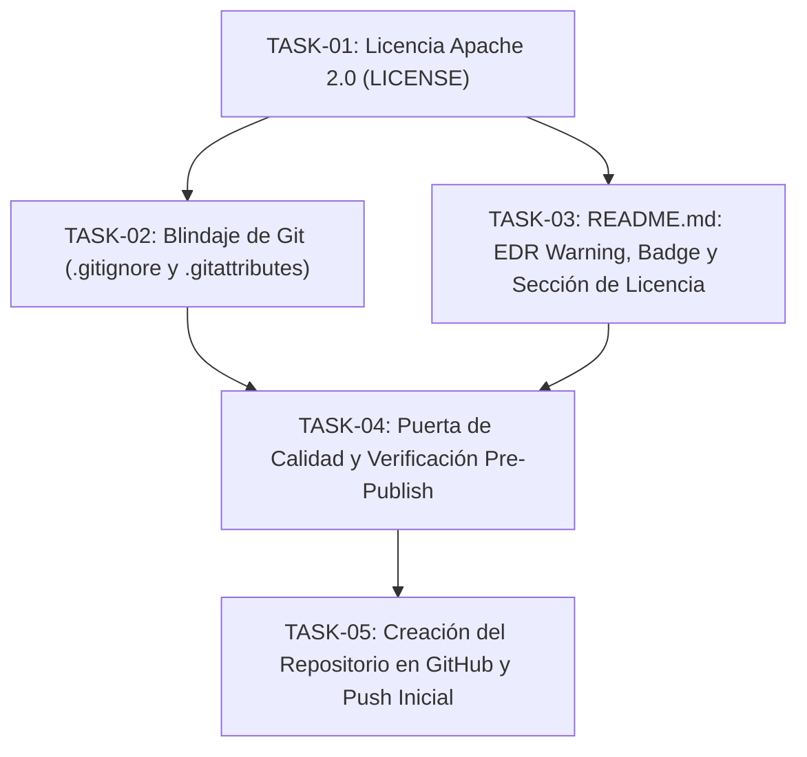
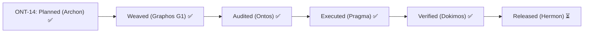

# Pipeline Feature: Preparación y Publicación en GitHub (Hito ONT-14)

- **Document ID**: `feature_20261028_235800_prepare_and_publish_github_repository_public_release.md`
- **Predecessor**: [`feature_20261025_144500_re_as_sdd_landlock_ebpf_and_anti_poisoning_backups.md`](feature_20261025_144500_re_as_sdd_landlock_ebpf_and_anti_poisoning_backups.md)
- **Pipeline Stage**: Stage 2 (Graphos G1 Weave)
- **Milestone**: ONT-14 (Task 115: `chore:prepare_and_publish_github_repository_public_release`)
- **Target Repository**: `/home/ancruz/Documents/workspaces/agent-execution-plane`
- **Remote Target**: `ancrz/agent-execution-plane` (Public GitHub Repository)
- **Pipeline Mode**: Full Mode (Topos Integrity Protocol)

---

## 1. Executive Summary & Intent

Milestone **ONT-14** formaliza la publicación pública del Agent Execution Plane (AEP) en GitHub (`ancrz/agent-execution-plane`), garantizando máxima integridad de release, licenciamiento empresarial compatible sin conflictos de patentes, advertencias claras para operadores/entornos corporativos (EDR/Sandbox warnings), y preservación estricta de la documentación técnica y el grafo de conocimiento.

---

## 2. Topological Task Breakdown (Topos DAG)

- **Topos DAG Audit**: `APPROVED` (0 ciclos, 0 co-dependencias).

### TASK-01: Formulación de Licencia Apache 2.0
- **action**: create
- **target**: `LICENSE`
- **rationale**: Adopta Apache License 2.0 (alineada con repositorios hermanos como `sdk-agent-pipeline` y `pipeline-agentic`). Otorga protección de patentes (Sección 3), exención de responsabilidad explícita (Secciones 7 y 8) y compatibilidad total con SQLite, kernel Linux y bibliotecas Python/Go.

### TASK-02: Blindaje de Git (`.gitignore` y `.gitattributes`)
- **action**: modify
- **target**: `.gitignore`, `.gitattributes`
- **rationale**:
  1. Garantizar que `docs/` NO esté ignorado para evitar confusión y asegurar que la especificación y memoria del proyecto permanezcan públicas.
  2. Ignorar binarios ELF compilados de Go (`landlock-guard`, `socket-monitor`, etc.).
  3. Asegurar normalización LF y metadatos `linguist-documentation` en `.gitattributes`.

### TASK-03: Actualización del README.md
- **action**: modify
- **target**: `README.md`
- **rationale**:
  1. Añadir badge oficial de Apache 2.0.
  2. Incorporar advertencia prominente sobre detección heurística de EDR / necesidad de ejecución en sandbox/VM.
  3. Añadir Sección 16 sobre Términos y Licencia.

### TASK-04: Puerta de Calidad Integral Pre-Deploy
- **action**: verify
- **target**: Todo el repositorio
- **rationale**:
  1. Verificar que `setup.sh --check` reporte 9/9 HEALTHY.
  2. Ejecutar `ruff check .` (0 errores) y `pytest` (31/31 pasando).
  3. Ejecutar `semgrep scan --config auto --error .` (0 hallazgos).
  4. Ejecutar `./scripts/aep-sync.sh --check` (15 tools / 18 caps).

### TASK-05: Creación y Despliegue en GitHub
- **action**: execute
- **target**: Remote GitHub origin
- **rationale**: Crear repo público `ancrz/agent-execution-plane` vía `gh repo create` y subir `main` con upstream tracking.

---

## 3. State Evolution

---

## 4. Dokimos Multi-Gate Verification & Promotion

- **Verification Report**: [`verification_report_20261028_235900_github_release_pre_deploy.md`](verification_report_20261028_235900_github_release_pre_deploy.md)
- **Verdict**: **`VERIFIED`** across all 7 release gates (Topos DAG, Ruff, Pytest 31/31, Semgrep 0 findings, Apache 2.0 license, git hardening, EDR warning in README, setup 9/9 HEALTHY).
- **Kanban Task 115**: Promoted to **`PROMOTED`** (Score: `0.950`, Verdict: `TRUST`).
- **Next Stage**: Stage 6 — **Hermon (Commit, Public GitHub Repo Creation & Initial Push)**.

