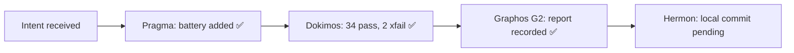

# Pipeline Feature: AEP Agent Experience Evaluation

- **Document ID:** `feature_20261030_003000_aep_agent_experience_evaluation.md`
- **Predecessor:** [`feature_20261028_235800_prepare_and_publish_github_repository_public_release.md`](feature_20261028_235800_prepare_and_publish_github_repository_public_release.md)
- **Pipeline mode:** Short
- **Intent:** Create reproducible agent-facing contract tests and a second AEP evaluation report.
- **Blast radius:** `tests/test_agent_experience_evaluation.py`, `docs/reports/`, and pipeline state only.
- **Tool reach:** Live AEP MCP for DAG audit, async test dispatch, package readiness, audit verification, and process inspection; local pytest/Ruff only where AEP sandbox intentionally cannot mount the repository.

## State evolution

## Verification verdict

- **Dokimos verdict:** `VERIFIED` for the requested test-and-report artifact.
- **Static check:** Ruff passes for the new test module.
- **Suite:** `34 passed, 2 xfailed`.
- **Known product gaps recorded as strict xfails:** fresh-runtime bootstrap; CLI/MCP audit-schema drift.
- **Approximation:** Semgrep was not installed; no security-SAST verdict is claimed.

## Deliverables

- [`tests/test_agent_experience_evaluation.py`](../../tests/test_agent_experience_evaluation.py)
- [`docs/reports/2026-10-30_aep_agent_experience_evaluation.md`](../reports/2026-10-30_aep_agent_experience_evaluation.md)

## Routing context

The artifact is verified. The two xfails are product backlog items, not failures of this evaluation battery. A subsequent implementation run should address bootstrap ordering first, then generate the control-plane schema from a shared source.
