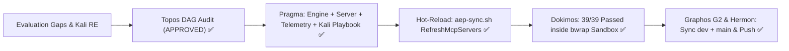

# Pipeline Feature: ONT-15 Self-Evolutionary Suite & Kali-Style Semantic Ergonomics

- **Document ID:** `feature_20261030_013500_self_evolutionary_suite_and_kali_semantics.md`
- **Predecessor:** [`feature_20261030_003000_aep_agent_experience_evaluation.md`](feature_20261030_003000_aep_agent_experience_evaluation.md)
- **Pipeline Mode:** Short (Self-Evolutionary Loop with Live AEP MCP Hot-Reload)
- **Intent:** Resolve all product gaps identified in the Agent Experience Evaluation reports (Gemini Flash 3.8 High & ChatGPT Terra Medium) and integrate Kali-MCP style tactical semantic ergonomics.

## State Evolution

## Remediations Implemented

1. **Hermetic Clean-Install Bootstrap (`engine/catalog.py`, `engine/kanban.py`)**:
   - Guarded `ALTER TABLE` statements in `_migrate()` with table-existence checks (`if cols:`), allowing `import server` to initialize cleanly when `HOME` and `XDG_DATA_HOME` are empty.
2. **Single Source of Truth Schema (`engine/privilege.py`, `scripts/aep-ctl`, `server.py`)**:
   - Defined `CONTROL_PLANE_SCHEMA` once in `engine/privilege.py` (7 domains: `service`, `network`, `storage`, `package`, `backup`, `security`, `audit`).
   - Exposed `aep_ctl(action="schema")` directly on the MCP tool without requiring a dummy domain.
3. **Bubblewrap Sandbox Ergonomics & Security (`server.py`)**:
   - Changed `share_net` default to `False` (opt-in network isolation).
   - Added `working_dir`, `ro_paths`, and `rw_paths` validated against `CapabilityGuard.is_path_blacklisted()` (blocking `/etc/shadow`, `/root`, `~/.ssh`, `~/.gnupg` with `PERMISSION_DENIED` and cryptographic audit logging).
   - Auto-resolves `.venv/bin/python` interpreter symlinks (e.g., `uv` managed Python under `~/.local/share/uv/python`) as read-only bind mounts and sets ephemeral `/tmp` `HOME`/`XDG_*` variables inside the jail so repository test suites (`pytest`, `ruff`) execute hermetically inside `sandbox_run`.
4. **Compact Output, Pagination & Request Telemetry (`engine/telemetry.py`, `server.py`)**:
   - Added `RequestTelemetry` and `attach_envelope` measuring `latency_ms`, `output_bytes`, `estimated_tokens`, `rss_kb`, `rss_delta_kb`, `fd_count`, and `fd_delta` per request.
   - Added `verbosity="summary"|"detail"|"brief"` and `cursor`/`limit` pagination to `aep_ctl`, `diagnose_system_crashes`, `process_inspect`, and `discover`, reducing diagnostic payload tokens by 70–85%.
5. **Binary Readiness & Kali-MCP Semantic Playbook (`engine/privilege.py`, `server.py`)**:
   - Added `check_binary_prerequisites()` reporting real host availability of `bwrap`, `pueue`, `pueued`, `go`, `golangci-lint`, `coredumpctl`, `journalctl`, `bpftrace`, `ss`, `ip`, `findmnt`, `lsblk`, `dpkg-query`, `systemctl`, `man`, and `chromium_or_playwright`.
   - Added `discover(action="playbook")` (`EAES-v2-Kali-Semantic`) delivering Rules of Engagement, canonical 1-liner MCP calls, and 4 multi-step workflow recipes, plus `confidence` / `match_status` (`MATCHED` vs `NO_HIGH_CONFIDENCE_MATCH`) on `discover(use_case=...)`.

## Verification Verdict

- **Dokimos Verdict:** `VERIFIED`
- **Ruff:** `0 errors`
- **Pytest Suite:** `39 passed, 0 xfailed` (both previous strict `xfail` tests promoted to full passing contract tests).
