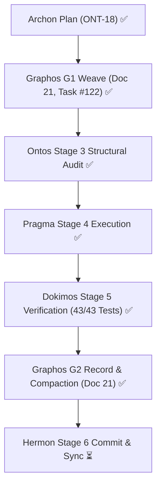

# Pipeline Feature: ONT-18 Topos Anti-Cascade Battery & Installation Pipeline Hardening

- **Document ID:** `feature_20261030_065200_ont18_topos_anti_cascade_battery_and_setup_hardening.md`
- **Predecessor:** [`feature_20261030_013500_self_evolutionary_suite_and_kali_semantics.md`](feature_20261030_013500_self_evolutionary_suite_and_kali_semantics.md)
- **Pipeline Mode:** Full
- **Milestone:** ONT-18 (Topos Anti-Cascade Omission Battery & Installation Pipeline Hardening)
- **Kanban Task ID:** 122 (Registered in SQLite AEP Control Plane)
- **Topos DAG Audit:** `APPROVED` (Grafo coherente: Cero co-dependencias detectadas across 6 tasks)

## 1. Intent & Anti-Cascade Invariant

Prevent the SQLite `binary_blob` wipe cascade on repeated `scripts/setup.sh` runs and harden the self-diagnostic `--check` suite to eliminate omission cascades.

### Anti-Cascade Matrix ($X_1 \not\to X_2 \not\to X_1$)

| Step | State | Action / Mutation | Cascade Vulnerability | Anti-Cascade Defense |
| :--- | :--- | :--- | :--- | :--- |
| **$X_1$** | `engine/catalog.py` | `register_artifact` `ON CONFLICT(name) DO UPDATE` | Setup re-seeding without ELF payload overwrote `binary_blob = NULL`, wiping RAM execution capability. | `COALESCE(excluded.binary_blob, artifacts.binary_blob)` and `COALESCE(excluded.binary_hash, artifacts.binary_hash)`. Existing binary blobs are preserved. |
| **$X_2$** | `scripts/setup.sh` | Step 8 probe auto-seeding heredoc | Unquoted heredoc or missing `$PROJECT_ROOT` caused variable expansion issues or mislocated binaries. | Quoted heredoc `<<'PY'` passing `$PROJECT_ROOT`, reading compiled ELF from `~/.local/share/agent-os/bin/` and registering both probe aliases (`socket-monitor`/`socket_monitor`, `fd-rescuer`/`fd_rescuer`). |
| **$X_3$** | `scripts/setup.sh` | `setup.sh --check` diagnostic run | `--check` seeded a canary artifact, polluting production catalog or masking missing schema columns. | Explicit `verify_database_integrity(auto_seed_canary=False)` + schema column validation + `aep-sync.sh --check`. Stale 0-byte repo-root `artifacts.db` unlinked. |

## 2. State Evolution

## 3. Execution Plan & Resolution Paths

| Task ID | Component | Resolution Path | Reach & Blast Radius |
| :--- | :--- | :--- | :--- |
| **T1_CATALOG_COALESCE** | `engine/catalog.py` | Standard AST modification: update `register_artifact()` SQL upsert with `COALESCE(excluded.binary_blob, artifacts.binary_blob)` and `COALESCE(excluded.binary_hash, artifacts.binary_hash)`. | Low blast radius; scoped strictly to artifact registration SQL in `catalog.py`. |
| **T2_SETUP_PUEUE_TAG** | `scripts/setup.sh` | Shell regex correction: fix line 354 backreference `sed -E 's/.*"([^"]+)".*/\1/'` for Pueue GitHub tag extraction. | Low blast radius; Pueue installation fallback in `setup.sh`. |
| **T3_SETUP_SEEDING_HEREDOC** | `scripts/setup.sh` | Refactor Step 8 probe seeding: use quoted heredoc `<<'PY'` with explicit `$PROJECT_ROOT`, load compiled ELFs from `~/.local/share/agent-os/bin/`, and register both hyphenated and snake_case aliases (`socket-monitor`/`socket_monitor`, `fd-rescuer`/`fd_rescuer`). | Medium blast radius; impacts default seeded probes in local environment. |
| **T4_SETUP_CHECK_HARDENING** | `scripts/setup.sh` | Diagnostic hardening: enrich `run_check()` with SQLite schema verification, `verify_database_integrity(auto_seed_canary=False)`, `aep-sync.sh --check`, and cleanup of rogue 0-byte `artifacts.db` in repo root. | Low blast radius; verification script execution only. |
| **T5_REGRESSION_TEST_SUITE** | `tests/test_agent_experience_evaluation.py` | Add `test_installation_pipeline_and_topos_anti_cascade` verifying COALESCE idempotency, probe registration, and `--check` integrity (target: 43/43 tests passed). | Scoped strictly to test suite. |
| **T6_DOCS_BADGE_MERMAID** | `README.md`, `docs/` | Update test badge (`43/43_Passed`), document `_ClosingConnection` zero-FD-leak, `visual_inspect` `/dev/shm` mode, polymorphic `topos_audit_dag`, `aep_ctl` `service.list` / `restore_micro_snapshot`, and lint all Mermaid diagrams. | Documentation only. |

## 4. Topos Audit Verification
- **DAG Audit Status:** `APPROVED`
- **Edges:**
  - `T3_SETUP_SEEDING_HEREDOC` consumes `T1_CATALOG_COALESCE`, `T2_SETUP_PUEUE_TAG`
  - `T4_SETUP_CHECK_HARDENING` consumes `T3_SETUP_SEEDING_HEREDOC`
  - `T5_REGRESSION_TEST_SUITE` consumes `T1_CATALOG_COALESCE`, `T4_SETUP_CHECK_HARDENING`
  - `T6_DOCS_BADGE_MERMAID` consumes `T5_REGRESSION_TEST_SUITE`
- **Co-dependencies:** 0 detected. Directional coupling validated.

## 5. Pipeline Execution & Verification Artifacts

- **Ontos Structural Audit**: `APPROVED`
  - Directive 1: Short template identifiers (`socket-monitor`, `fd-rescuer`) in Step 8 heredoc.
  - Directive 2: Pure non-canary verification (`auto_seed_canary=False`) in `setup.sh --check`.
  - Directive 3: Full AST syntax lint validation on shell and python code.
- **Pragma Execution Report**: [`execution_report_20261030_071500_ont18_topos_anti_cascade_battery_and_setup_hardening.md`](execution_report_20261030_071500_ont18_topos_anti_cascade_battery_and_setup_hardening.md)
  - Tasks T1-T6 executed with pre-execution micro-snapshot `ont18_pre_pragma`.
  - Unlinked stray 0-byte `artifacts.db` in repository root.
  - Kanban state advanced to `LINTED`.
- **Dokimos Verification Report**: [`verification_report_20261030_072500_ont18_topos_anti_cascade_battery_and_setup_hardening.md`](verification_report_20261030_072500_ont18_topos_anti_cascade_battery_and_setup_hardening.md)
  - **Verdict**: **`VERIFIED`**
  - **Pytest Full Suite**: **43 passed, 0 failed** across all test suites on Python 3.14.7.
  - **Static Analysis**: 0 Ruff errors, 0 Semgrep findings across 1,066 rules, bash -n clean.
  - **Pipeline Health**: `./scripts/setup.sh --check` (`HEALTHY`, exit 0), `./scripts/aep-sync.sh --check` (`OK`, exit 0).
  - **Audit Chain**: `aep_ctl(domain="audit", action="verify")` verified intact with 18 cryptographically chained blocks.
  - **Mermaid Diagrams**: 16/16 diagrams in `README.md` verified syntax-valid.
  - **Kanban Promotion**: Task #122 promoted to **`PROMOTED`** (`promotion_score: 0.9940`, `verdict: "TRUST"`, attempts: 4).
