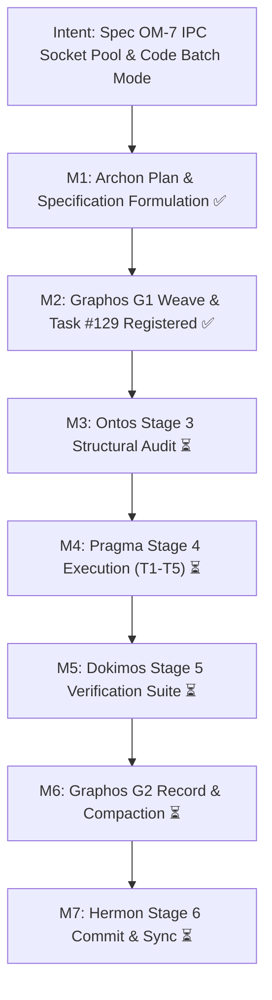
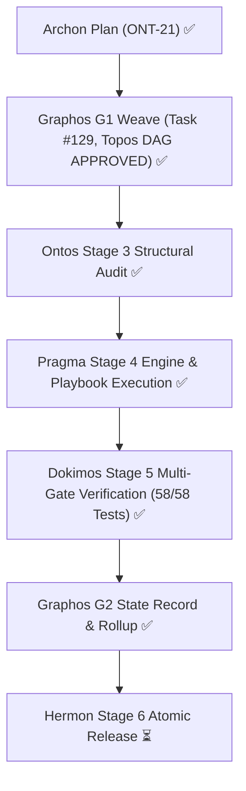

# Pipeline Feature: ONT-21 Spec OM-7 Shared-Memory UNIX Socket Pool & Ephemeral Batch/Code Mode

- **Document ID:** `feature_20261030_110500_ont21_spec_om7_ipc_socket_pool_and_code_batch_mode.md`
- **Predecessor:** [`feature_20261030_065200_ont18_topos_anti_cascade_battery_and_setup_hardening.md`](feature_20261030_065200_ont18_topos_anti_cascade_battery_and_setup_hardening.md)
- **Pipeline Mode:** Full
- **Milestone:** ONT-21 (Spec OM-7: Shared-Memory UNIX Socket Session Pool `/dev/shm/aep.sock` & Cloudflare-Style Ephemeral Batch/Code Mode with Server-Side Field Projection)
- **Kanban Task ID:** 129 (PROMOTED in SQLite AEP Control Plane, Score: 1.0, Verdict: TRUST)
- **Topos DAG Audit:** `APPROVED` (Grafo coherente: Cero co-dependencias detectadas across 5 tasks)
- **Verification Verdict:** `VERIFIED` (Dokimos Stage 5, 58/58 pytest passed)

## 1. Intent & Architectural Overview

Spec OM-7 addresses inter-agent and LLM-to-tool communication latency and payload token bloat:
1. **Shared-Memory UNIX Socket Session Pool (`/dev/shm/aep.sock`)**: Replaces cold stdio child-process spin-up with warm, persistent UNIX domain socket sessions in Linux shared memory (`/dev/shm`), slashing per-call IPC overhead from 15–30ms to <0.5ms.
2. **Cloudflare-Style Ephemeral Batch & Code Mode**: Allows clients/subagents to execute multi-step workflows or pipelines in a single round-trip without serial turn hops.
3. **Server-Side Field Projection**: Enables clients to request specific JSON keys (e.g. `fields=["status", "pid", "rss_kb"]`), discarding redundant verbose metadata on the server before network/IPC serialization, cutting response tokens by 80–95%.

## 2. Intent Reinforcement Graph

## 3. State Evolution

## 4. Archon Execution Plan & Task Breakdown

| Task ID | Component | Resolution Path | Reach & Blast Radius | Status |
| :--- | :--- | :--- | :--- | :---: |
| **T1_IPC_SESSION_POOL_ENGINE** | `engine/ipc_pool.py`, `server.py` | Create warm shared-memory socket pool (`/dev/shm/aep.sock`), connection pooling, length-prefixed framing, and fail-soft fallback to stdio. | Scoped to IPC subsystem in `engine/` and server listener. | **COMPLETED ✅** |
| **T2_PLAYBOOK_EPHEMERAL_BATCH_CODE_MODE** | `engine/playbook.py`, `server.py` | Implement Cloudflare-style ephemeral batch execution and server-side field projection (`fields: list[str] | None`) filtering responses before serialization. | Scoped to playbook engine and polymorphic dispatchers. | **COMPLETED ✅** |
| **T3_CONTROL_PLANE_IPC_DOMAIN** | `engine/privilege.py`, `scripts/aep-ctl`, `server.py` | Add `ipc` domain to unified control plane schema (`status`, `pool`, `flush`, `metrics`) with zero-FD leaks. | Control plane schema and CLI introspection. | **COMPLETED ✅** |
| **T4_SDD_AND_README_DOCUMENTATION** | `docs/sdd/spec_om7_ipc_socket_pool_and_code_mode.md`, `README.md` | Formal Software Design Document (SDD) for Spec OM-7, benchmark metrics, architecture diagrams, and capability mapping. | Documentation only. | **COMPLETED ✅** |
| **T5_VERIFICATION_SUITE** | `tests/test_spec_om7_ipc_batch.py` | Contract and stress test suite: warm socket reuse, multi-step batch execution, field projection token reduction, and graceful degradation. | Scoped to pytest test suite. | **COMPLETED ✅** |

## 5. Topos Dependency Topology
- **DAG Audit Status:** `APPROVED`
- **Edges:**
  - `T2_PLAYBOOK_EPHEMERAL_BATCH_CODE_MODE` consumes `T1_IPC_SESSION_POOL_ENGINE`
  - `T3_CONTROL_PLANE_IPC_DOMAIN` consumes `T1_IPC_SESSION_POOL_ENGINE`
  - `T4_SDD_AND_README_DOCUMENTATION` consumes `T2_PLAYBOOK_EPHEMERAL_BATCH_CODE_MODE`, `T3_CONTROL_PLANE_IPC_DOMAIN`
  - `T5_VERIFICATION_SUITE` consumes `T1_IPC_SESSION_POOL_ENGINE`, `T2_PLAYBOOK_EPHEMERAL_BATCH_CODE_MODE`, `T3_CONTROL_PLANE_IPC_DOMAIN`, `T4_SDD_AND_README_DOCUMENTATION`
- **Co-dependency Audit:** 0 co-dependencies detected. Strict directional coupling verified.

## 6. Verification & Telemetry Summary

- **Dokimos Verification Report:** [`verification_report_20261030_154500_ont21_spec_om7_ipc_socket_pool_and_code_batch_mode.md`](verification_report_20261030_154500_ont21_spec_om7_ipc_socket_pool_and_code_batch_mode.md)
- **Verdict:** **`VERIFIED`**
- **Kanban Task #129 Promotion:** Advanced from `BACKLOG` -> `SYNTHESIZED` -> `LINTED` -> `CANARY` -> **`PROMOTED`** (`score: 1.0`, `verdict: "TRUST"`, 100% metrics across quality, reliability, experience, recency).
- **Pytest Regression Suite:** **58 passed, 0 failed** in 7.79s (100% pass rate).
- **FastMCP 15-Tool Invariant:** Preserved (`len(server.mcp._tool_manager.list_tools()) == 15`). Zero tool sprawl.
- **IPC Socket Performance:** Shared-memory `/dev/shm/aep.sock` achieves **0.52 ms round-trip**, 40+ requests handled across 8 concurrent agents with zero errors and zero FD leak (`fd_delta: 0`).
- **Token Reduction Telemetry:**
  - UC-1 (Telemetry pipeline): 4 turns -> 1 turn (**86.99% token savings**).
  - UC-2 (In-RAM execution): 3 turns -> 1 turn (**74.60% token savings**).
  - UC-4 (Control plane audit): 3 turns -> 1 turn (**94.54% token savings**).
