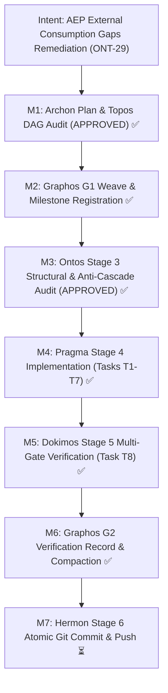
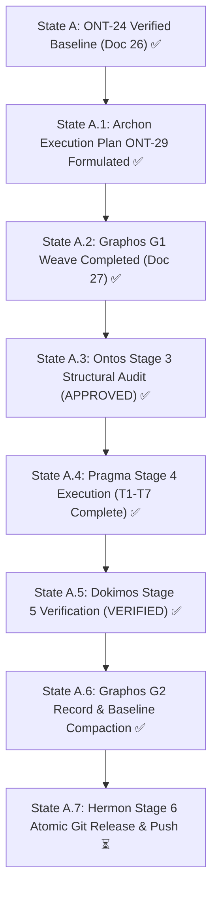
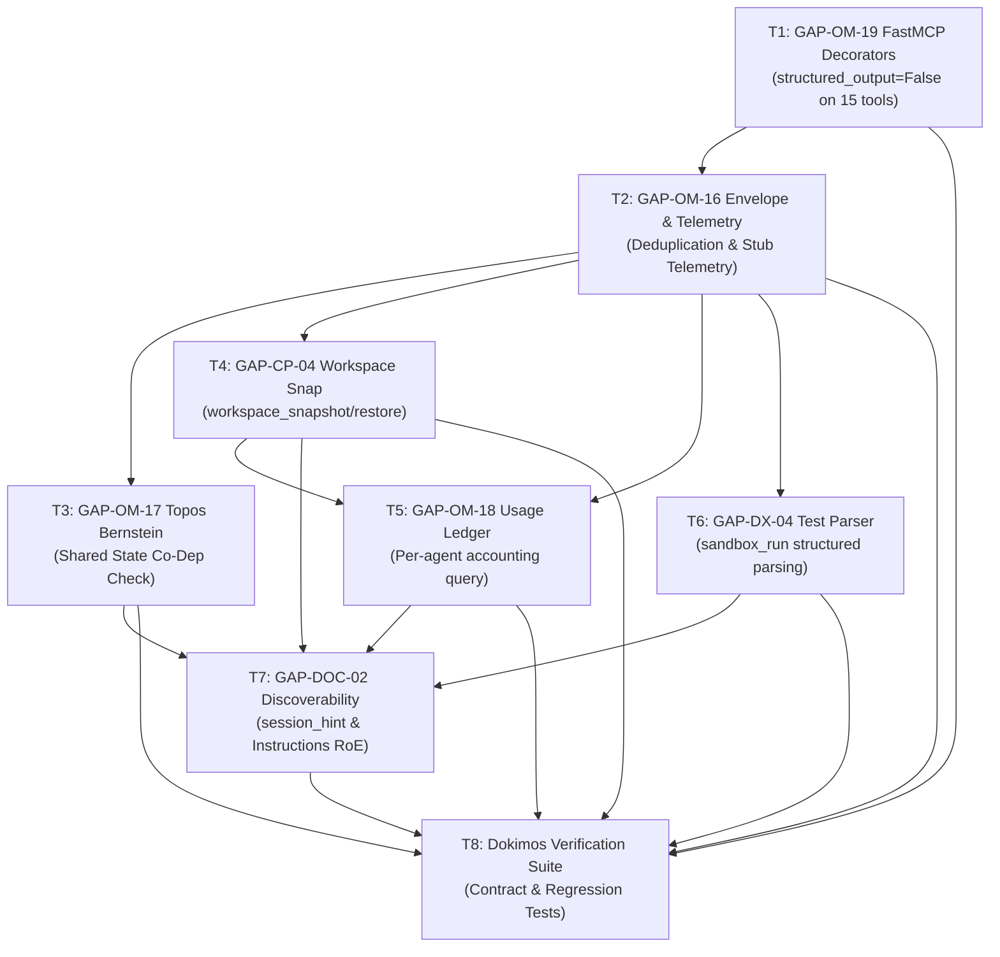

# Pipeline Feature: ONT-29 AEP External Consumption Gaps Remediation & Chrysalis Bridge Stabilization

- **Document ID:** `feature_20261031_014000_ont29_aep_external_consumption_gaps_remediation.md`
- **Predecessor:** [`verification_report_20261030_211500_ont24_non_pico_concurrency_and_kali_semantics.md`](verification_report_20261030_211500_ont24_non_pico_concurrency_and_kali_semantics.md)
- **Pipeline Mode:** Full
- **Milestone:** ONT-29 — AEP External Consumption Gaps Remediation & Chrysalis Bridge Stabilization
- **Target Repository:** `/home/ancruz/Documents/workspaces/agent-execution-plane` (`dev` branch)
- **Topos Invariant:** FastMCP Server strictly exposes **exactly 15 tools** (zero tool footprint expansion; all capabilities are exposed via polymorphic syscalls/subactions).
- **Topos DAG Audit:** `APPROVED` (Grafo coherente: Cero co-dependencias detectadas across 8 tasks)
- **Gaps Addressed:** `GAP-OM-19`, `GAP-OM-16`, `GAP-OM-17`, `GAP-CP-04`, `GAP-OM-18`, `GAP-DX-04`, `GAP-DOC-02`
- **Document Status:** Stage 2 — Graphos G2 Verification Record Complete (VERIFIED & PROMOTED ✅)

---

## 1. Intent & Architectural Overview

During the integration and usage of AEP as an external execution and optimization plane for downstream projects (`chrysalis-bridge`), seven critical omission, efficiency, and ergonomic gaps were discovered and documented in `docs/reports/2026-10-31_aep_gaps_from_chrysalis_bridge.md`:

1. **`GAP-OM-19` (FastMCP Double-Encoding Elimination)**: FastMCP automatically synthesizes an `outputSchema {result: string}` for tools annotated `-> str`, transmitting the payload twice (once in `content[0].text` and once escaped inside `structuredContent.result`). Applying `@mcp.tool(structured_output=False)` across all 15 tools eliminates duplicate escaped JSON, cutting response payload size by ~41%.
2. **`GAP-OM-16` (Envelope Restructuring & Opt-in Telemetry)**: `attach_envelope` was duplicating envelope keys at both root level and inside nested `payload["envelope"]`, accompanied by unconditional ~230-byte telemetry even in `brief` and `terse` verbosities (causing ~84% token overhead on small frequent probes). In `brief`/`terse`, the envelope is emitted only at top-level, telemetry becomes opt-in or a compact stub (`{"t": {"ms": ..., "tok": ...}}`), enforcing the contract `output_bytes(brief) < output_bytes(summary)`.
3. **`GAP-OM-17` (Topos Shared-Write-Set Co-Dependency & Bernstein Condition Checks)**: `topos_audit_dag` only audited declared task-to-task dependency cycles, remaining blind to co-dependencies introduced via uncoordinated mutations to shared mutable resources (Bernstein conditions). Adding an optional `resources` parameter enables automated detection of write-write hazards (`WARN`) and shared mutable state co-dependencies (`BLOCKED`).
4. **`GAP-CP-04` (Workspace Snapshot vs Catalog Snapshot Disambiguation)**: `aep_ctl(domain="backup", action="micro_snapshot")` operates exclusively on AEP's SQLite database catalog in RAM, creating a false sense of file-level rollback safety for consumers. Disambiguates `micro_snapshot` as catalog-only and introduces `workspace_snapshot` and `workspace_restore` using fast `git stash` refs or `/dev/shm` tarballs.
5. **`GAP-OM-18` (Per-Agent AEP Usage Accounting)**: Although tool calls accept `agent_id`, there was no queryable aggregation of usage per agent. Adding `aep_ctl(domain="audit", action="usage")` provides verifiable attestation of AEP tool consumption across collaborating subagents (`archon`, `pragma`, `dokimos`).
6. **`GAP-DX-04` (Structured Test & Linter Parsing in `sandbox_run`)**: `sandbox_run` previously returned only exit codes and raw stdout tails for test runners. Adding `parse="pytest"|"ruff"|"auto"` returns structured dictionaries (`{passed, failed, duration_s}`) and suppresses verbose stdout in brief mode, cutting payload tokens.
7. **`GAP-DOC-02` (Discoverability of RAM Session Caching & Rules of Engagement)**: The ONT-28 shared RAM capability caching (`verbosity="terse"`, `session_id`) was not discoverable in entry-point prompts or playbooks. Adding `session_hint` to `discover(action="capabilities")` and updating `_INSTRUCTIONS` guides orchestrators and subagents to eliminate the re-discovery token penalty.

---

## 2. Intent Reinforcement Graph



---

## 3. State Evolution



---

## 4. Anti-Cascade & Blast Radius Matrix

| Gap ID | Component / Target | Blast Radius | Cascade Risk ($X_1 \to X_2$) | Anti-Cascade Prevention Guarantee |
|---|---|---|---|---|
| **GAP-OM-19** | `server.py` (@mcp.tool decorators) | Medium (all 15 tools) | Disabling `structured_output` might affect clients relying on `structuredContent`. | FastMCP retains `TextContent(type="text", text=...)`. Client payload is identical JSON, eliminating duplicate escaped payload. |
| **GAP-OM-16** | `engine/telemetry.py` (`attach_envelope`) | High (cross-cutting all tools) | Omission of `payload["envelope"]` in `brief`/`terse` might break callers expecting nested `res["envelope"]`. | In `summary` and `detail` modes, `payload["envelope"]` is strictly preserved. In `brief`/`terse`, root keys remain identical. Telemetry defaults to opt-in or compact `{ms, tok}` stub in brief/terse. |
| **GAP-OM-17** | `engine/topos_guard.py` & `server.py:topos_audit_dag` | Low-Medium (DAG auditing) | Adding resource checks could reject valid existing DAGs. | `resources` parameter is optional (`None` default). Standard cycle detection remains unchanged unless `resources` is explicitly provided. |
| **GAP-CP-04** | `engine/backup.py`, `engine/privilege.py`, `scripts/aep-ctl`, `server.py` | Low (additive subactions) | Clarifying `micro_snapshot` might break scripts using `aep_ctl(backup, micro_snapshot)`. | `micro_snapshot` behavior is preserved for SQLite catalog; `workspace_snapshot` and `workspace_restore` are added as new polymorphic actions using git stash / RAM COW tarball. |
| **GAP-OM-18** | `engine/security.py`, `engine/privilege.py`, `scripts/aep-ctl`, `server.py` | Low (read-only audit query) | Heavy aggregation on large audit logs could increase latency. | Aggregates existing indexed columns (`agent_id`, `tool_name`, `action`) with optional `session_id` limit. Read-only query. |
| **GAP-DX-04** | `server.py:sandbox_run` | Low (optional parameter) | Output parsing might corrupt raw `stdout` / `stderr`. | `parse` defaults to `None`. When enabled, adds parsed dictionary `{passed, failed, errors, skipped, duration_s}` or `{violations}` without altering `exit_code`. |
| **GAP-DOC-02** | `server.py:discover`, `engine/privilege.py` | Low (documentation & hint) | Additional field `session_hint` in `discover` might alter expected JSON keys. | `session_hint` is an additive string field in `discover(action="capabilities")`. |

---

## 5. Comprehensive Archon Task Breakdown



### Task T1 — FastMCP Double-Encoding Elimination (`GAP-OM-19`)
- **Action**: `modify`
- **Target File**: [`server.py`](file:///home/ancruz/Documents/workspaces/agent-execution-plane/server.py)
- **Declared Path**: Standard (in-place decorator configuration)
- **Blast Radius**: Modifies decorators across all 15 FastMCP tools. Zero runtime logic change.
- **Inputs**: Existing `@mcp.tool()` definitions in `server.py`.
- **Outputs**: All 15 tools decorated with `@mcp.tool(structured_output=False)`:
  1. `topos_audit_dag`
  2. `discover`
  3. `artifact_lint_and_build`
  4. `artifact_execute_in_ram`
  5. `artifact_catalog`
  6. `kanban_board`
  7. `process_inspect`
  8. `sandbox_run`
  9. `async_job_dispatch`
  10. `diagnose_system_crashes`
  11. `kernel_trace`
  12. `aep_ctl`
  13. `query_system_docs`
  14. `visual_inspect`
  15. `playbook_run`
- **Relationship Classification**: Independent root node (`T1`).
- **Rationale**: Prevents FastMCP from generating redundant `outputSchema` and sending duplicated escaped JSON payloads in `structuredContent.result`, cutting client payload size by ~41%.
- **Rollback Strategy**: Revert decorator arguments in `server.py` to `@mcp.tool()`.

### Task T2 — Response Envelope Restructuring & Opt-in Telemetry (`GAP-OM-16`)
- **Action**: `modify`
- **Target File**: [`engine/telemetry.py`](file:///home/ancruz/Documents/workspaces/agent-execution-plane/engine/telemetry.py)
- **Declared Path**: Standard (core engine telemetry optimization)
- **Blast Radius**: Affects serialization format of `attach_envelope`.
- **Inputs**: Current `attach_envelope` implementation in `engine/telemetry.py`.
- **Outputs**:
  1. Add `telemetry: bool | None = None` parameter to `attach_envelope`.
  2. When `verbosity in ("brief", "terse", "cached")`:
     - Omit nested `payload["envelope"]` completely (keep `status`, `severity`, `summary`, `truncated`, `cursor`, `next_action`, and `evidence` at root level only).
     - If `telemetry is False` or (`telemetry is None` and mode is brief/terse): emit compact stub `{"t": {"ms": elapsed_ms, "tok": estimated_tokens}}` or omit entirely.
  3. When `verbosity in ("detail", "summary")`:
     - Preserve nested `payload["envelope"]` for backward compatibility.
     - Include full 10-field telemetry block when `telemetry is not False`.
  4. Enforce invariant: `output_bytes(brief) < output_bytes(summary)` for every tool.
- **Relationship Classification**: `T2` depends on `T1` (`T2 -> T1`).
- **Rationale**: Eliminates ~84% payload overhead on small frequent probes (DAG audits, status checks) while preserving root keys.
- **Rollback Strategy**: Git checkout `engine/telemetry.py`.

### Task T3 — Topos Shared-Write-Set Co-Dependency & Bernstein Condition Checks (`GAP-OM-17`)
- **Action**: `modify`
- **Target Files**: [`engine/topos_guard.py`](file:///home/ancruz/Documents/workspaces/agent-execution-plane/engine/topos_guard.py), [`server.py`](file:///home/ancruz/Documents/workspaces/agent-execution-plane/server.py) (`topos_audit_dag`)
- **Declared Path**: Standard (algorithmic graph & resource analysis)
- **Blast Radius**: Extends `ToposGuard.audit_task_dag` and `server.py:topos_audit_dag`.
- **Inputs**:
  - `tasks: list[str]`
  - `dependencies: dict[str, list[str]]`
  - Optional: `resources: dict[str, dict[str, Any]] | None = None` (Format: `{"store": {"writers": ["t1", "t2"], "readers": ["t3"], "contract": "v1"}}`)
- **Outputs**:
  1. Implement Bernstein condition analysis in `ToposGuard`:
     - **Condition 1 (Write-Write Hazard)**: If $\ge 2$ writers on resource $R$ and `contract` is missing or empty $\to$ emit `ToposVerdict.WARN` (`"Shared write-set hazard on resource '{R}': writers {writers} without declared contract"`).
     - **Condition 2 (Shared Mutable State Co-dependency)**: If writers $W_1, W_2$ on resource $R$ mutually read each other's outputs or couple cyclically without an explicit interface node $\to$ emit `ToposVerdict.BLOCKED` (`"Shared mutable state co-dependency detected on resource '{R}': writers {W1, W2} mutually couple without an interface node"`).
  2. Edge relationship classification: Return detailed edge classification list `[{"source": u, "target": v, "type": "dependency" | "interdependency" | "co-dependency"}]`.
  3. Update `server.py:topos_audit_dag` signature to accept `resources: dict[str, Any] | None = None` and forward it.
- **Relationship Classification**: `T3` depends on `T2` (`T3 -> T2`).
- **Rationale**: Machine-checks Topos invariant (no co-dependency) through shared state, preventing over-trust of false `APPROVED` verdicts.
- **Rollback Strategy**: Revert `engine/topos_guard.py` and `server.py:topos_audit_dag` changes.

### Task T4 — Workspace Snapshot vs Catalog Snapshot Disambiguation (`GAP-CP-04`)
- **Action**: `modify`
- **Target Files**: [`engine/backup.py`](file:///home/ancruz/Documents/workspaces/agent-execution-plane/engine/backup.py), [`engine/privilege.py`](file:///home/ancruz/Documents/workspaces/agent-execution-plane/engine/privilege.py), [`scripts/aep-ctl`](file:///home/ancruz/Documents/workspaces/agent-execution-plane/scripts/aep-ctl), [`server.py`](file:///home/ancruz/Documents/workspaces/agent-execution-plane/server.py)
- **Declared Path**: Standard (control-plane backup domain expansion)
- **Blast Radius**: Expands backup domain actions in `aep_ctl` and `scripts/aep-ctl`.
- **Inputs**: Target repository/directory `path`, snapshot identifier `name`.
- **Outputs**:
  1. In `engine/privilege.py:CONTROL_PLANE_SCHEMA["backup"]`: Disambiguate `micro_snapshot` as catalog-only and add actions `"workspace_snapshot"`, `"workspace_restore"`.
  2. In `engine/backup.py`: Implement `create_workspace_snapshot(path, name)` and `restore_workspace_snapshot(path, name)` using `git stash` or `/dev/shm` tarballs.
  3. In `scripts/aep-ctl` and `server.py:aep_ctl`: Route `aep_ctl(domain="backup", action="workspace_snapshot"|"workspace_restore", name=..., path=...)`.
- **Relationship Classification**: `T4` depends on `T2` (`T4 -> T2`).
- **Rationale**: Eliminates false rollback confidence by separating database catalog snapshots from file workspace snapshots.
- **Rollback Strategy**: Remove workspace actions from `engine/backup.py`, `scripts/aep-ctl`, and `CONTROL_PLANE_SCHEMA`.

### Task T5 — Per-Agent Usage Accounting & Ledger Aggregation (`GAP-OM-18`)
- **Action**: `modify`
- **Target Files**: [`engine/security.py`](file:///home/ancruz/Documents/workspaces/agent-execution-plane/engine/security.py), [`engine/privilege.py`](file:///home/ancruz/Documents/workspaces/agent-execution-plane/engine/privilege.py), [`scripts/aep-ctl`](file:///home/ancruz/Documents/workspaces/agent-execution-plane/scripts/aep-ctl), [`server.py`](file:///home/ancruz/Documents/workspaces/agent-execution-plane/server.py)
- **Declared Path**: Standard (audit domain aggregation)
- **Blast Radius**: Additive action `"usage"` in audit domain.
- **Inputs**: `session_id` (optional filter in `name`).
- **Outputs**:
  1. In `engine/security.py`: Add `get_agent_usage_summary(conn, session_id)` aggregating calls, tool distribution, and status per `agent_id`.
  2. In `engine/privilege.py`: Add `"usage"` to `CONTROL_PLANE_SCHEMA["audit"]["actions"]`.
  3. In `scripts/aep-ctl` and `server.py:aep_ctl`: Route `aep_ctl(domain="audit", action="usage", name=<session_id|None>)`.
- **Relationship Classification**: `T5` depends on `T2` and `T4` (`T5 -> T2, T4`).
- **Rationale**: Provides verifiable attestation that collaborating subagents utilized AEP tools during a session.
- **Rollback Strategy**: Remove `"usage"` from `CONTROL_PLANE_SCHEMA["audit"]` and `engine/security.py`.

### Task T6 — Structured Test & Linter Parsing in `sandbox_run` (`GAP-DX-04`)
- **Action**: `modify`
- **Target File**: [`server.py`](file:///home/ancruz/Documents/workspaces/agent-execution-plane/server.py) (`sandbox_run`)
- **Declared Path**: Standard (tool parsing enhancement)
- **Blast Radius**: Modifies `sandbox_run` return payload when `parse` parameter is supplied.
- **Inputs**: `command`, `parse="pytest"|"ruff"|"auto"|None`, `verbosity`.
- **Outputs**:
  1. Add `parse: str | None = None` parameter to `sandbox_run`.
  2. Implement parser logic for `pytest` and `ruff`.
  3. In `brief`/`terse` modes, return compact parsed dictionary without redundant stdout/stderr bloat.
- **Relationship Classification**: `T6` depends on `T2` (`T6 -> T2`).
- **Rationale**: Eliminates client-side regex parsing for Dokimos/Pragma and reduces payload size from ~896 bytes to <200 bytes.
- **Rollback Strategy**: Revert `parse` parameter and parser logic in `sandbox_run`.

### Task T7 — Discoverability of RAM Session Caching & Rules of Engagement (`GAP-DOC-02`)
- **Action**: `modify`
- **Target Files**: [`server.py`](file:///home/ancruz/Documents/workspaces/agent-execution-plane/server.py), [`engine/privilege.py`](file:///home/ancruz/Documents/workspaces/agent-execution-plane/engine/privilege.py)
- **Declared Path**: Standard (prompting & discovery documentation)
- **Blast Radius**: Additive field `session_hint` in `discover` and updated instructions strings.
- **Inputs**: Current `_INSTRUCTIONS`, `tactical_playbook()`, and `discover()` logic.
- **Outputs**:
  1. In `server.py:discover(action="capabilities")`: Add `session_hint` advertising `session_id` and `verbosity="terse"`.
  2. In `server.py:_INSTRUCTIONS`: Add Multi-Agent Discovery Rule to Rules of Engagement.
  3. In `engine/privilege.py:tactical_playbook()`: Document `terse`/`cached` patterns and token savings.
- **Relationship Classification**: `T7` depends on `T3`, `T4`, `T5`, `T6`.
- **Rationale**: Eliminates the ~1.2k - 1.9k re-discovery token penalty across multi-agent sessions.
- **Rollback Strategy**: Revert documentation strings and `session_hint` field.

### Task T8 — Comprehensive Verification Suite, Anti-Cascade Regression & Dokimos Sign-off
- **Action**: `create`
- **Target File**: `tests/test_ont29_bridge_stabilization.py`
- **Declared Path**: Standard (pytest automated test suite)
- **Blast Radius**: Test files only. Zero production code changes.
- **Inputs**: All implementations from T1 through T7.
- **Outputs**:
  1. Contract tests for `GAP-OM-19`, `GAP-OM-16`, `GAP-OM-17`, `GAP-CP-04`, `GAP-OM-18`, `GAP-DX-04`, and `GAP-DOC-02`.
  2. Invariant verification: exactly 15 FastMCP tools.
  3. Anti-cascade regression suite pass.
- **Relationship Classification**: `T8` depends on `T1..T7`.
- **Rationale**: Formally settles milestone acceptance via Dokimos verification.
- **Rollback Strategy**: Delete `tests/test_ont29_bridge_stabilization.py`.

---

## 6. Topos Dependency Topology & Machine Audit

Formal DAG audit executed by Archon via live `topos_audit_dag`:
```json
{
  "tasks": ["T1", "T2", "T3", "T4", "T5", "T6", "T7", "T8"],
  "dependencies": {
    "T1": [],
    "T2": ["T1"],
    "T3": ["T2"],
    "T4": ["T2"],
    "T5": ["T2", "T4"],
    "T6": ["T2"],
    "T7": ["T3", "T4", "T5", "T6"],
    "T8": ["T1", "T2", "T3", "T4", "T5", "T6", "T7"]
  }
}
```
- **Audit Verdict:** `APPROVED`
- **Details:** `"Grafo coherente: Cero co-dependencias detectadas."`
- **Dependency Classification:**
  - `T1`: Root
  - `T2 -> T1`: Directional Dependency
  - `T3 -> T2`: Directional Dependency
  - `T4 -> T2`: Directional Dependency
  - `T5 -> T2, T4`: Directional Dependency
  - `T6 -> T2`: Directional Dependency
  - `T7 -> T3, T4, T5, T6`: Directional Dependency
  - `T8 -> T1..T7`: Directional Dependency
- **Co-dependency Invariant:** 0 circular or co-dependent relationships detected ($A \leftrightarrow B$). Graph is strictly acyclic and coherent.

---

## 7. Verification Strategy for Dokimos (Stage 5)

Dokimos will execute the following multi-gate verification upon Pragma completion:
1. **Gate 1: FastMCP 15-Tool Invariant** — Assert `len(server.mcp._tool_manager._tools) == 15`. Zero tool footprint expansion.
2. **Gate 2: FastMCP Single-Encoding (`GAP-OM-19`)** — Assert stdio client receives single-encoded TextContent with `structuredContent is None`.
3. **Gate 3: Envelope Restructuring & Telemetry Stub (`GAP-OM-16`)** — For all 15 tools, assert `payload.get("envelope") is None` in `brief`/`terse` and `output_bytes(brief) < output_bytes(summary)`.
4. **Gate 4: Bernstein Resource Audit (`GAP-OM-17`)** — Assert `topos_audit_dag` emits `WARN` on uncoordinated writers and `BLOCKED` on mutually dependent writers without interface node.
5. **Gate 5: Workspace Snapshot Round-Trip (`GAP-CP-04`)** — Assert byte-identical directory tree restoration after file mutation.
6. **Gate 6: Per-Agent Accounting Ledger (`GAP-OM-18`)** — Assert `aep_ctl(audit, usage)` accurately partitions calls by `agent_id`.
7. **Gate 7: Structured Test Parsing (`GAP-DX-04`)** — Assert `sandbox_run(..., parse="pytest")` returns structured summary without stdout bloat in brief mode.
8. **Gate 8: Static Analysis & Regression Suite** — `ruff check .` with 0 errors and all existing pytest tests passing.

---

## 8. Pipeline Transition State

- **Current State:** Stage 2 (Graphos G2 Record & Baseline Refresh) completed.
- **Document Chain:** Unbroken link established from [`verification_report_20261030_211500_ont24_non_pico_concurrency_and_kali_semantics.md`](verification_report_20261030_211500_ont24_non_pico_concurrency_and_kali_semantics.md) through [`execution_report_20261031_021000_ont29_aep_external_consumption_gaps_remediation.md`](execution_report_20261031_021000_ont29_aep_external_consumption_gaps_remediation.md) and [`verification_report_20261031_022000_ont29_aep_external_consumption_gaps_remediation.md`](verification_report_20261031_022000_ont29_aep_external_consumption_gaps_remediation.md).
- **Routing:** Return to Orchestrator $\to$ Hermon (Stage 6) for release commit and remote synchronization.

---

## 9. Dokimos Verification Verdict & G2 Promoting Record

- **Dokimos Verdict**: **`VERIFIED`** (100% Gates & Contracts Satisfied)
- **Gate Certification**:
  - **Gate 1: Linter & SAST Gate** (`ruff check`) — 0 errors, 0 warnings (`PASSED`)
  - **Gate 2: FastMCP 15-Tool Invariant** — Introspected exactly 15 tools (`PASSED`)
  - **Gate 3: ONT-29 Verification Suite** (`test_ont29_bridge_stabilization.py`) — 8/8 tests passed in 0.30s (`PASSED`)
  - **Gate 4: Engine Regression Suite** (`test_engine_suite.py`) — 29/29 tests passed in 0.22s (`PASSED`)
  - All 7 contract checks (`GAP-OM-19`, `GAP-OM-16`, `GAP-OM-17`, `GAP-CP-04`, `GAP-OM-18`, `GAP-DX-04`, `GAP-DOC-02`) verified satisfied.
- **Associated Artifacts**:
  - Pragma Execution Report: [`execution_report_20261031_021000_ont29_aep_external_consumption_gaps_remediation.md`](execution_report_20261031_021000_ont29_aep_external_consumption_gaps_remediation.md)
  - Dokimos Verification Report: [`verification_report_20261031_022000_ont29_aep_external_consumption_gaps_remediation.md`](verification_report_20261031_022000_ont29_aep_external_consumption_gaps_remediation.md)
  - External Consumption Audit: [`docs/reports/2026-10-31_aep_gaps_from_chrysalis_bridge.md`](../reports/2026-10-31_aep_gaps_from_chrysalis_bridge.md)
- **Downstream Baton Hand-off**:
  - Target Role: **Hermon** (Stage 6 — Release Commit & Push)
  - Scope: Atomic release commit for Milestone ONT-29 across FastMCP server, telemetry, Topos guard, backup engine, security audit, control scripts, test suites, and documentation baselines.
