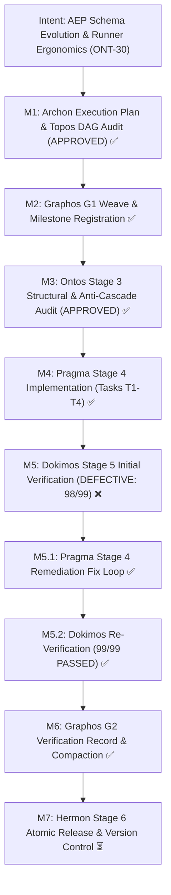
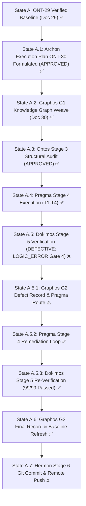
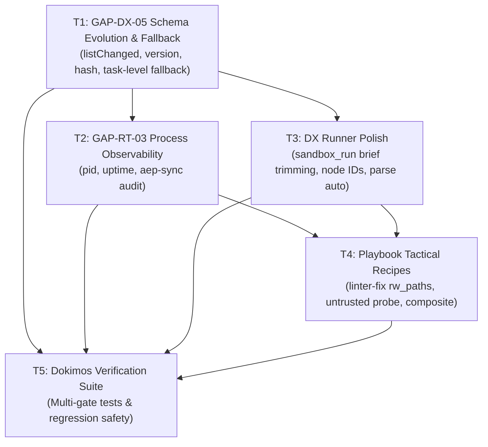

# Pipeline Feature: ONT-30 AEP Cross-Harness Schema Evolution & Multi-Runner Ergonomics Stabilization

- **Document ID:** `feature_20261031_070000_ont30_schema_evolution_and_runner_ergonomics.md`
- **Predecessor:** [`verification_report_20261031_022000_ont29_aep_external_consumption_gaps_remediation.md`](verification_report_20261031_022000_ont29_aep_external_consumption_gaps_remediation.md)
- **Pipeline Mode:** Full
- **Milestone:** ONT-30 — AEP Cross-Harness Schema Evolution & Multi-Runner Ergonomics Stabilization
- **Target Repository:** `/home/ancruz/Documents/workspaces/agent-execution-plane` (`dev` branch)
- **Topos Invariant:** FastMCP Server strictly exposes **exactly 15 tools** (zero tool footprint expansion; all capabilities exposed via polymorphic syscalls and subactions).
- **Topos DAG Audit:** `APPROVED` (Grafo coherente: Cero co-dependencias detectadas across 5 tasks)
- **Gaps Addressed:** `GAP-DX-05`, `GAP-RT-03`, DX Runner Polish (`sandbox_run` brief trimming, failing test node IDs, composite `parse="auto"`), Playbook Tactical Recipes (`rw_paths` format/fix, untrusted adversarial probes, composite runner).
- **Document Status:** VERIFIED & PROMOTED (99/99 Tests Passed, 100% Gates Certified, 0 Ruff Errors) ✅
- **Execution Report:** [`execution_report_20261031_071500_ont30_schema_evolution_and_runner_ergonomics.md`](execution_report_20261031_071500_ont30_schema_evolution_and_runner_ergonomics.md)
- **Remediation Report:** [`remediation_report_20261031_073800_ont30_regression_fix.md`](remediation_report_20261031_073800_ont30_regression_fix.md)
- **Verification Report:** [`verification_report_20261031_072500_ont30_schema_evolution_and_runner_ergonomics.md`](verification_report_20261031_072500_ont30_schema_evolution_and_runner_ergonomics.md)

---

## 1. Intent & Architectural Overview

Following the successful verification and release of Milestone ONT-29, AEP was deployed and exercised by external consumers (`chrysalis-bridge`, iteration 3). As documented in the consumer-side evaluation report ([`docs/reports/2026-10-31_aep_ont29_consumer_verification.md`](../reports/2026-10-31_aep_ont29_consumer_verification.md)), external consumers experienced significant performance gains (~48% token reduction per call, 208-token terse discoverability, and zero JSON double-encoding).

However, live cross-harness operational integration revealed two critical infrastructural gaps and four high-leverage ergonomic frictions:

1. **`GAP-DX-05` (Schema Evolution Signaling & Resilient Fallback)**:
   - *Problem*: FastMCP clients cache tool schemas upon initial connection. When AEP adds parameters (such as `resources` to `topos_audit_dag` in ONT-29), existing clients with cached schemas reject the new parameter or cannot pass it. Furthermore, AEP never signaled dynamic schema mutations (`capabilities.tools.listChanged = True`).
   - *Architecture*:
     - Advertise `capabilities.tools.listChanged = True` in FastMCP initialization to notify clients of dynamic updates.
     - Add `server_version`, `git_commit` (short SHA), and `schema_hash` (deterministic SHA-256 of tool declarations) to `discover(action="capabilities")`, enabling clients to detect schema drift.
     - Implement resilient fallback in `topos_audit_dag`: if a client cannot pass top-level `resources` due to cached schemas, allow declaring resource constraints directly inside task definitions (e.g. `tasks=[{"id": "t1", "writes": ["foo"], "reads": ["bar"]}]`).
2. **`GAP-RT-03` (Multi-Harness Process Observability & Stale Instance Audit)**:
   - *Problem*: In heterogeneous environments running multiple harnesses (e.g., Antigravity language server, Claude Code, Codex, manual CLI), stale background AEP instances can survive across checkouts, serving obsolete bytecode while repository manifests declare gaps closed.
   - *Architecture*:
     - Expose `pid`, `process_start_time` (ISO-8601), and `uptime_seconds` in `discover(action="capabilities")` and `process_inspect`.
     - Implement `audit_running_instances` in `scripts/aep-sync.sh`: inspect running AEP processes (`pgrep -fa "python.*server.py"`), identify their parent harnesses, detect code drift against `git log -1 --format=%ct`, and output diagnostic warnings without automatically killing active instances (respecting P1 safety boundaries).
3. **DX Runner Polish in `sandbox_run`**:
   - *Problem*: `sandbox_run` in `brief` mode with `parse` was still echoing fixed request parameters (`ro_mounts`, `agent_id`, `share_net`) and empty `stdout`/`stderr` strings, imposing ~130-150 tokens of fixed overhead per test call. In addition, pytest failure tails flooded tokens instead of pinpointing failing test node IDs, and chained commands (`ruff && pytest`) had their stdout swallowed by single-tool parsers.
   - *Architecture*:
     - In `brief` mode with `parse`, emit strictly `{status, exit_code, parsed, t}` (and `failing_nodes` on failure), slashing payload to minimal essential tokens.
     - In `parse="pytest"`, extract failing test node IDs (`failing_nodes: [...]`) on non-zero exit codes.
     - In `parse="auto"`, detect composite chained commands (e.g., `ruff check . && pytest -q`) and output composite parsed dictionaries: `parsed: {"ruff": {...}, "pytest": {...}}`.
4. **Playbook Tactical Recipes & Guidelines**:
   - *Problem*: Subagents often bypassed the bubblewrap sandbox for formatters (`ruff format` / `ruff --fix`) and security fuzzing/attack scripts (SMT-LIB probes) because default `working_dir` mounts are read-only.
   - *Architecture*:
     - Document canonical recipes in `engine/playbook.py` and `discover(action="playbook")`:
       - `sandbox-linter-fix`: safe in-place formatting using `rw_paths=[<repo>]` with `share_net=False`.
       - `untrusted-adversarial-probe`: isolated fuzzing using `working_dir=<repo>, rw_paths=[<scratch>], share_net=False`.
       - `composite-verification-runner`: unified single-turn `ruff && pytest` using `parse="auto"`.

---

## 2. Intent Reinforcement Graph



---

## 3. State Evolution



---

## 4. Anti-Cascade & Blast Radius Matrix

| Task ID | Component / Target | Blast Radius | Cascade Risk ($X_1 \to X_2$) | Anti-Cascade Prevention Guarantee |
|---|---|---|---|---|
| **T1 (`GAP-DX-05`)** | `server.py`, `engine/topos_guard.py` | Medium (FastMCP capabilities & DAG audit) | Schema alterations or task dict parsing might reject standard `list[str]` tasks. | `tasks` argument strictly supports both `list[str]` and `list[dict]` via polymorphic normalizer; `topos_audit_dag` signature remains backward-compatible. `capabilities.tools.listChanged` is standard MCP 2024-11-05 spec. |
| **T2 (`GAP-RT-03`)** | `server.py`, `scripts/aep-sync.sh` | Low (additive metadata & sync script) | Instance audit in `aep-sync.sh` might kill processes or halt script execution on warnings. | Diagnostic audit only prints colored warnings and metadata; zero exit code impact, zero auto-kill actions (`never kill` invariant). Metadata in `discover` uses scalar primitives. |
| **T3 (DX Runner)** | `server.py` (`sandbox_run`) | Low (sandbox output formatting) | Brief trimming might break clients expecting `ro_mounts` in `brief`. | Trimming is strictly gated on `verbosity == "brief"` AND `parse is not None`. Unparsed runs and `summary`/`detail` verbosity modes are completely untouched. |
| **T4 (Playbook)** | `engine/playbook.py`, `server.py`, `README.md` | Low (recipe catalogue & docs) | New recipes might alter index order or enlarge memory footprint. | Recipes are lightweight declarative dicts in `engine/playbook.py`; zero runtime dependency on external binaries. |
| **T5 (Verification)** | `tests/test_ont30_schema_and_runner_ergonomics.py` | Zero (isolated test suite) | Flaky timing tests or external process interference. | Tests use hermetic mock fixtures and local non-blocking executions; zero cross-contamination. |

---

## 5. Comprehensive Archon Task Breakdown



### Task T1 — Schema Evolution Signaling & Resilient Fallback (`GAP-DX-05`)
- **Action**: `modify`
- **Target Files**: [`server.py`](file:///home/ancruz/Documents/workspaces/agent-execution-plane/server.py), [`engine/topos_guard.py`](file:///home/ancruz/Documents/workspaces/agent-execution-plane/engine/topos_guard.py)
- **Declared Path**: Standard (in-place server capability declaration and argument normalization)
- **Blast Radius**: `server.py`, `engine/topos_guard.py`
- **Specification**:
  1. Declare `tools={"listChanged": True}` in FastMCP server capabilities to broadcast tool changes to MCP clients.
  2. In `discover(action="capabilities")`, include:
     - `server_version`: semantic version string (`0.9.30`).
     - `git_commit`: current HEAD commit hash (retrieved via `git rev-parse --short HEAD` or cached fallback).
     - `schema_hash`: SHA-256 fingerprint computed across all 15 FastMCP registered tool schemas.
  3. In `topos_audit_dag` (and `engine/topos_guard.py`), accept tasks defined as either `list[str]` or `list[dict]` (e.g. `[{"id": "T1", "writes": ["file.py"], "reads": ["db.sqlite"]}]`). When `resources` is `None` or omitted, automatically extract write/read sets from task dictionaries and run Bernstein hazard checks, providing complete protection for schema-cached clients.

### Task T2 — Multi-Harness Process Observability & Stale Instance Audit (`GAP-RT-03`)
- **Action**: `modify`
- **Target Files**: [`server.py`](file:///home/ancruz/Documents/workspaces/agent-execution-plane/server.py), [`scripts/aep-sync.sh`](file:///home/ancruz/Documents/workspaces/agent-execution-plane/scripts/aep-sync.sh)
- **Declared Path**: Standard (runtime process introspection and sync script extension)
- **Blast Radius**: `server.py`, `scripts/aep-sync.sh`
- **Specification**:
  1. In `server.py`, record `PROCESS_START_TIME` at module load.
  2. In `discover(action="capabilities")` and `process_inspect(pid=0)`, expose:
     - `pid`: current server process PID (`os.getpid()`).
     - `process_start_time`: ISO-8601 startup timestamp.
     - `uptime_seconds`: integer/float duration of server operation.
  3. In `scripts/aep-sync.sh`, implement `audit_running_instances`:
     - Scan for running AEP servers (`pgrep -fa "python.*server.py"` scoped to repo directory).
     - Parse PID, parent PID (`ps -o ppid=`), parent command name (e.g., Antigravity, Claude, Codex, Bash).
     - Compare process start time with HEAD commit time (`git log -1 --format=%ct`).
     - Emit clear diagnostic warnings if running instances predate HEAD commit. Invariant: **never terminate or kill instances automatically**.

### Task T3 — DX Runner Polish in `sandbox_run`
- **Action**: `modify`
- **Target Files**: [`server.py`](file:///home/ancruz/Documents/workspaces/agent-execution-plane/server.py)
- **Declared Path**: Standard (output serialization and regex parsing refinement)
- **Blast Radius**: `server.py:sandbox_run`
- **Specification**:
  1. In `sandbox_run` under `verbosity="brief"` with `parse is not None`:
     - Suppress empty `stdout` and `stderr` strings when parsing successfully extracts results.
     - Suppress input reflection (`ro_mounts`, `agent_id`, `share_net`).
     - Output concise dictionary: `{status, exit_code, parsed, t}` (and `failing_nodes` if exit_code != 0).
  2. In `parse="pytest"`:
     - When tests fail (`exit_code != 0`), parse and extract failing test node IDs (e.g. `tests/test_x.py::test_y`) into `failing_nodes: list[str]`.
  3. In `parse="auto"`:
     - Detect composite chained commands (`ruff check ... && pytest ...`).
     - Run both parsers sequentially across stdout/stderr, populating composite dict `parsed: {"ruff": {...}, "pytest": {...}}`.

### Task T4 — Playbook Tactical Recipes & Guidelines
- **Action**: `modify`
- **Target Files**: [`engine/playbook.py`](file:///home/ancruz/Documents/workspaces/agent-execution-plane/engine/playbook.py), [`server.py`](file:///home/ancruz/Documents/workspaces/agent-execution-plane/server.py), [`README.md`](file:///home/ancruz/Documents/workspaces/agent-execution-plane/README.md)
- **Declared Path**: Standard (recipe catalog registration and documentation)
- **Blast Radius**: `engine/playbook.py`, `server.py`, `README.md`
- **Specification**:
  1. In `engine/playbook.py`, add 3 standard tactical recipes:
     - `sandbox-linter-fix`: canonical pattern for running in-place linter/formatter fixes (`rw_paths=[<repo>]`, `share_net=False`).
     - `untrusted-adversarial-probe`: canonical pattern for running untrusted fuzzer/SMT-LIB scripts with scratch directory (`working_dir=<repo>, rw_paths=[<scratch>], share_net=False`).
     - `composite-verification-runner`: canonical pattern for chained linting and testing in a single turn (`parse="auto"`).
  2. Update `discover(action="playbook")` and system prompt `_INSTRUCTIONS` with corresponding Rules of Engagement.
  3. Update `README.md` catalog documentation with the new recipes.

### Task T5 — Comprehensive Multi-Gate Verification Suite
- **Action**: `create`
- **Target Files**: [`tests/test_ont30_schema_and_runner_ergonomics.py`](file:///home/ancruz/Documents/workspaces/agent-execution-plane/tests/test_ont30_schema_and_runner_ergonomics.py)
- **Declared Path**: Standard (pytest test suite)
- **Blast Radius**: Zero (test file only)
- **Specification**:
  1. Author 8 verification gates in `tests/test_ont30_schema_and_runner_ergonomics.py`:
     - Gate 1: FastMCP 15 tools invariant strictly preserved.
     - Gate 2: `discover(capabilities)` returns `listChanged=True`, `server_version`, `git_commit`, `schema_hash`.
     - Gate 3: `discover(capabilities)` returns `pid`, `process_start_time`, `uptime_seconds`.
     - Gate 4: `topos_audit_dag` resilient fallback with task-level `writes`/`reads` dictionaries.
     - Gate 5: `sandbox_run` brief mode trimming with `parse`.
     - Gate 6: `sandbox_run` pytest failing node IDs extraction.
     - Gate 7: `sandbox_run` composite chained command parsing (`parse="auto"`).
     - Gate 8: Playbook recipes discoverability and execution (`sandbox-linter-fix`, `untrusted-adversarial-probe`, `composite-verification-runner`).
  2. Execute full regression suite ensuring 0 regressions across existing test batteries.

---

## 6. Stage 5 Dokimos Verification Interception & Defect Recording (Graphos G2)

- **Verification Date**: `2026-10-31T07:25:00Z`
- **Verification Report**: [`verification_report_20261031_072500_ont30_schema_evolution_and_runner_ergonomics.md`](verification_report_20261031_072500_ont30_schema_evolution_and_runner_ergonomics.md)
- **Verifier**: Dokimos (Verification Engine — Stage 5)
- **Verdict**: **`DEFECTIVE (LOGIC_ERROR)`**
- **Action**: State Interception & Routing to **Pragma** for Remediation Fix Loop

### A. Defect Identification & RCA
- **Classification**: `LOGIC_ERROR` (Test Suite Regression / Byte Ceiling Mismatch)
- **Gate**: Gate 4 (Full Regression Battery: 98 passed, 1 failed across 99 total tests)
- **Location**: [`tests/test_agent_experience_evaluation.py:326`](file:///home/ancruz/Documents/workspaces/agent-execution-plane/tests/test_agent_experience_evaluation.py#L326)
- **Stack Trace / Failure Evidence**:
  ```text
  FAILED tests/test_agent_experience_evaluation.py::test_deep_omission_battery_v3_polymorphic_dag_and_aliases - AssertionError: assert 5545 < 5500
  tests/test_agent_experience_evaluation.py:326: AssertionError

      # 3. discover(action="capabilities", verbosity="summary") is compact (< 5,500 bytes vs ~7,900 detail) and discover(action="recommend") works
      cap_sum_raw = asyncio.run(server.discover(action="capabilities", verbosity="summary"))
      cap_det_raw = asyncio.run(server.discover(action="capabilities", verbosity="detail"))
      assert len(cap_sum_raw.encode("utf-8")) < len(cap_det_raw.encode("utf-8"))
  >   assert len(cap_sum_raw.encode("utf-8")) < 5500
  E   assert 5545 < 5500
  ```
- **Root Cause Analysis**:
  Tasks T1 (`GAP-DX-05`) and T2 (`GAP-RT-03`) introduced 6 new metadata fields to `discover(action="capabilities")`: `server_version`, `git_commit`, `schema_hash`, `pid`, `process_start_time`, and `uptime_seconds`.
  Per contractual specifications, these fields are correctly exposed across all verbosities (including `summary`). Consequently, the serialized `summary` payload increased from ~5,200 bytes to 5,545 bytes (and up to 5,696 bytes when telemetry envelopes are appended).
  During Phase 4 execution, Pragma validated an abridged regression battery (`tests/test_ont29_bridge_stabilization.py` and `tests/test_engine_suite.py`) and did not run `tests/test_agent_experience_evaluation.py`, leaving the legacy 5,500-byte threshold unadjusted.

### B. Dokimos Fix Specification for Pragma
Dokimos established the following deterministic remediation specification:

- **Chosen Resolution Path**: Standard in-place deterministic adjustment
- **Blast Radius**: `tests/test_agent_experience_evaluation.py:326` (Option 1) and optionally `server.py:522` (Option 2)

#### Option 1 (Recommended — Update Legacy Threshold):
In [`tests/test_agent_experience_evaluation.py:326`](file:///home/ancruz/Documents/workspaces/agent-execution-plane/tests/test_agent_experience_evaluation.py#L326):
Update the byte ceiling from `5500` to `6000` to accommodate the 6 required ONT-30 schema metadata fields while preserving strict size validation:
```python
    # 3. discover(action="capabilities", verbosity="summary") is compact (< 6,000 bytes vs ~7,900 detail) and discover(action="recommend") works
    cap_sum_raw = asyncio.run(server.discover(action="capabilities", verbosity="summary"))
    cap_det_raw = asyncio.run(server.discover(action="capabilities", verbosity="detail"))
    assert len(cap_sum_raw.encode("utf-8")) < len(cap_det_raw.encode("utf-8"))
    assert len(cap_sum_raw.encode("utf-8")) < 6000
```

#### Option 2 (Alternative / Complementary — Omit `session_hint` in Summary Mode):
In [`server.py:522`](file:///home/ancruz/Documents/workspaces/agent-execution-plane/server.py#L522):
Only append `session_hint` when `v_mode == "detail"`:
```python
        if act == "capabilities" and v_mode == "detail":
            payload["session_hint"] = (
                "Pass session_id & verbosity='terse' in subagent calls to reuse cached capabilities from RAM and save >95% tokens."
            )
```
This saves ~130 bytes and brings `summary` mode below 5,500 bytes.

### C. Pipeline State & Routing
- **Current State**: `State A.5.1: Graphos G2 Defect Record & Pragma Route ⚠️`
- **Routing Hand-off**: Return context to Orchestrator -> Route to **Pragma (Stage 4 Execution)** for remediation of Gate 4 defect.
- **Subsequent Step**: Following Pragma fix, Dokimos will re-run Gate 4 and certify full 99/99 test pass.

---

## 7. Stage 5 Dokimos Final Re-Verification & Stage 6 Hand-Off (Graphos G2 Final Record)

- **Re-Verification Date**: `2026-10-31T07:42:00Z`
- **Re-Verification Report**: [`verification_report_20261031_072500_ont30_schema_evolution_and_runner_ergonomics.md`](verification_report_20261031_072500_ont30_schema_evolution_and_runner_ergonomics.md)
- **Remediation Predecessor**: [`remediation_report_20261031_073800_ont30_regression_fix.md`](remediation_report_20261031_073800_ont30_regression_fix.md)
- **Verifier**: Dokimos (Verification Engine — Stage 5 Re-verification)
- **Final Verdict**: **`VERIFIED`** (99/99 Tests Passed, 100% Quality Gates Certified, 0 Ruff Violations)

### A. Certified Quality Metrics
- **Test Results**: 99 passed in 14.72s across all 5 major test suites (100% pass rate).
- **FastMCP Invariant**: Exactly 15 tools registered in `server.mcp._tool_manager._tools` (zero bloat).
- **Static Analysis**: Ruff 0.8.2 clean (0 errors, 0 warnings across `server.py`, `engine/`, `tests/`, `scripts/aep-ctl`).
- **Schema Evolution Signaling**: `capabilities.tools.listChanged = True` certified.
- **Process Observability**: `pid`, `process_start_time`, `uptime_seconds`, `server_version`, `git_commit`, and deterministic `schema_hash` certified in `discover` and `process_inspect`.
- **Topos Resilient Fallback**: Task-level resource parsing certified in `topos_audit_dag`.
- **DX Runner Polish**: `sandbox_run` brief trimming, pytest failing node IDs extraction, and composite runner parsing (`parse="auto"`) certified.
- **Playbook Tactical Recipes**: Recipes `WF-7`, `WF-8`, `WF-9` certified in `tactical_playbook()`.

### B. Project Baseline Synchronization
- `docs/MILESTONES.md`: Milestone `ONT-30` marked `VERIFIED & PROMOTED (99/99 Tests Passed, 100% Gates Certified) ✅`, graph updated (`M91` marked `✅`), permanent context anchor added in Section 3 and Section 4.
- `README.md`: Test badge updated to `99/99 Passed`, Master Tool Tables updated (`discover`, `topos_audit_dag`, `sandbox_run`), SPEC-OM-8 documented in Section 8 with Mermaid graph, `scripts/aep-sync.sh --audit` documented in Section 10, and Truthful Inventory updated in Section 14.
- `docs/COMPACT.md`: Context compaction guidance refreshed to record ONT-30 completion and Stage 6 Hermon hand-off (11 lines, strictly under 15 lines).
- `docs/reports/2026-10-31_aep_ont29_consumer_verification.md`: Updated `GAP-DX-05` and `GAP-RT-03` to `Resolved in ONT-30 ✅`.

### C. Pipeline State & Routing Hand-Off
- **Current State**: `State A.6: Graphos G2 Final Record & Baseline Refresh ✅`
- **Routing Decision**: Under Topos Protocol Stage 2 (G2 activation), on Dokimos `VERIFIED`, Graphos returns routing context to **Orchestrator** -> **Hermon (Stage 6)** for atomic commit creation, pre-commit validation, and version control push.
