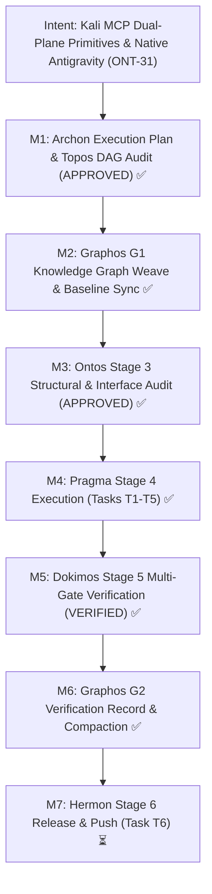
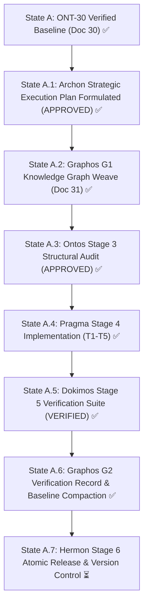
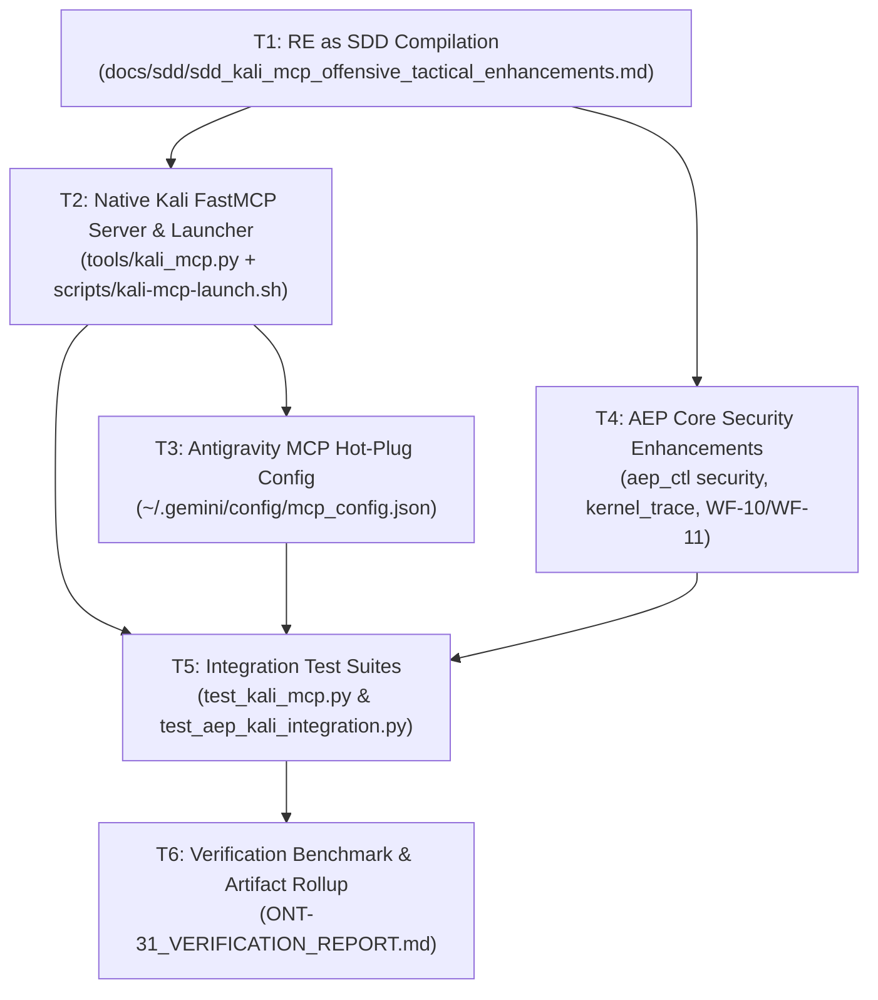

# Pipeline Feature: ONT-31 RE as SDD — Kali MCP Offensive/Defensive Primitives & Native Antigravity Integration

- **Document ID:** `feature_20261031_131500_ont31_re_as_sdd_kali_mcp_offensive_tactical_enhancements.md`
- **Predecessor:** [`verification_report_20261031_072500_ont30_schema_evolution_and_runner_ergonomics.md`](verification_report_20261031_072500_ont30_schema_evolution_and_runner_ergonomics.md)
- **Pipeline Mode:** Full
- **Milestone:** ONT-31 — RE as SDD: Kali MCP Offensive/Defensive Primitives & Native Antigravity Integration
- **RE Mode:** `compatible` (External Workspace: `/home/ancruz/Documents/workspaces/kali-mcp`)
- **Target Repositories:**
  - AEP Core Execution Plane: `/home/ancruz/Documents/workspaces/agent-execution-plane` (`dev` branch)
  - Kali MCP Analytical Engine: `/home/ancruz/Documents/workspaces/kali-mcp`
  - Global Antigravity Config: `/home/ancruz/.gemini/config/mcp_config.json`
- **Topos Invariants:**
  - FastMCP Server strictly preserves **exactly 15 tools** (zero tool footprint expansion; all capabilities absorbed into polymorphic dispatchers `aep_ctl`, `kernel_trace`, `tactical_playbook`).
  - Host OS execution plane remains sterile (zero pentesting binaries installed on host; heavy analytical tools run in Docker container `kali-pentest`).
  - Strict directional dependency coupling: Host AEP controls execution, container processes telemetry.
- **Topos DAG Audit:** `APPROVED` (Grafo coherente: 0 co-dependencias detectadas across 6 tasks).
- **Chosen Resolution Path:** Hybrid Dual-Plane Path (Medium/Long reach).
- **Document Status:** VERIFIED & PROMOTED ✅ (Ready for Stage 6 Hermon Release)

---

## 1. Intent & Architectural Overview

Milestone ONT-31 formalizes the architectural absorption of external security tooling from the `kali-mcp` ecosystem into a resilient, typed, dual-plane execution model. 

Previously, security capabilities operated through an ad-hoc bash skill (`network-tactical-framework`) invoking unstructured commands directly within a container, suffering from four operational defects:
1. **Unbounded Context Flood:** Plaintext outputs from scanning utilities (`nmap`, `tshark`, `masscan`) consumed tens of thousands of tokens without structured JSON filtering.
2. **Lack of Native Protocol Integration:** The Kali toolchain lacked a native FastMCP server, preventing direct, structured invocation from Antigravity agents.
3. **Absence of Host-Container Synergy:** No clean contract existed between lightweight Linux kernel primitives on the host (eBPF tracing, Landlock LSM, Bubblewrap) and the heavy containerized analytical engine.
4. **Unguided Tactical Execution:** Agents lacked formal Rules of Engagement (RoE) and structured security lifecycle workflows (Reconnaissance → Protocol Audit → Netfilter Mitigation).

Milestone ONT-31 resolves these challenges by compiling the external codebase into an evolutionary Software Design Document (SDD) and implementing the **5 Systemic Primitives**:

### The 5 Systemic Primitives:
1. **Dual-Plane Ephemeral Bridging (Host $\leftrightarrow$ Docker CLI):**
   - Host AEP manages deterministic, low-overhead system operations (Bubblewrap sandboxing, Landlock LSM, memfd in-RAM execution, eBPF).
   - Kali container (`kali-pentest`, image `kali-comprehensive:latest`) acts as the isolated, heavy analytical engine accessed strictly via non-blocking Docker CLI pipes (`docker exec -i`).
   - Zero installation of attack tools on the host; execution is sterile, ephemeral, and bounded.
2. **Shared-Memory PCAP Stream Dissection (`/dev/shm/pcap_stream`):**
   - Captured network streams are buffered in volatile shared memory (`/dev/shm`) and dissected in-RAM via `tshark -r -` with BPF filters.
   - Zero physical disk wear, zero plaintext leakage, and output projected directly into token-compact JSON.
3. **Deterministic Netfilter/LSM Mitigation Guard (`aep_ctl domain="security"`):**
   - Non-interactive kernel-level countermeasures (`firewall_status`, `nftables_inspect`, `threat_mitigate`) applied via host `nftables`/`arptables` without interactive pagers or blocking prompts.
4. **Semantic Steering & Tactical RoE as Contracts:**
   - Formalized security lifecycle in `engine/privilege.py:tactical_playbook()` and `server._INSTRUCTIONS`:
     - Phase 1: Reconnaissance (`WF-10: Network Tactical Recon`)
     - Phase 2: Protocol Audit & Defense (`WF-11: Incident Protocol Audit & Defense`)
     - Phase 3: Mitigation / Countermeasures.
   - Prevents agent drift, protecting critical network interfaces and enforcing permission boundaries.
5. **RE as SDD as Ontological Compiler:**
   - Formal extraction and documentation of Kali's 54GB toolchain into `docs/sdd/sdd_kali_mcp_offensive_tactical_enhancements.md`.

---

## 2. Intent Reinforcement Graph



---

## 3. State Evolution



---

## 4. Anti-Cascade & Blast Radius Matrix

| Task ID | Action | Target Resource | Tooling Used | Blast Radius | Depends On | Anti-Cascade Prevention Guarantee |
| :--- | :--- | :--- | :--- | :--- | :--- | :--- |
| **T1** | `create` | `docs/sdd/sdd_kali_mcp_offensive_tactical_enhancements.md` | SDD Compiler / Documentation Engine | Zero runtime impact; architectural specification only | None | Architectural specification only; read-only extraction of external assets (`Dockerfile`, `docker-compose.yml`, skill manifests). |
| **T2** | `create` | `tools/kali_mcp.py`<br>`scripts/kali-mcp-launch.sh` | FastMCP Python SDK, Docker CLI | Bounded to `/home/ancruz/Documents/workspaces/kali-mcp` | T1 | Host executes launcher, container handles tools. Default `verbosity="summary"` and strict token truncation prevent context floods. |
| **T3** | `configure` | `~/.gemini/config/mcp_config.json` | JSON Config Parser, `RefreshMcpServers` | Configuration layer of Antigravity | T2 | Modifies only MCP discovery catalog; JSON backup snapshot created before mutation; fail-soft config reload. |
| **T4** | `modify` | `aep/server.py`<br>`aep/scripts/aep-ctl`<br>`aep/engine/privilege.py` | Python stdlib, `nftables`, `bpftrace`, FastMCP | Strictly preserves 15-tool invariant; extends `aep_ctl`, `kernel_trace`, and playbooks | T1 | Zero new `@mcp.tool` decorators; all capabilities absorbed into existing polymorphic dispatchers; validated against 99 existing tests. |
| **T5** | `create` | `tests/test_kali_mcp.py`<br>`tests/test_aep_kali_integration.py` | Pytest, Docker CLI, AEP IPC Pool | Test runtime only | T2, T3, T4 | Isolated pytest test suite; strict timeouts (10s per test); non-destructive network probes only. |
| **T6** | `configure` | `docs/pipeline/ONT-31_VERIFICATION_REPORT.md` | Telemetry tracker, `topos_audit_dag` | Verification and rollup metadata | T5 | Short documentation path; verifies token savings under session cache (`session_id="ses_kali_re"`). |

---

## 5. Comprehensive Archon Task Breakdown



### Task T1 — Reverse-Engineering as SDD Document Compilation
- **Task ID:** `T1`
- **Action:** `create`
- **Target File:** `/home/ancruz/Documents/workspaces/kali-mcp/docs/sdd/sdd_kali_mcp_offensive_tactical_enhancements.md`
- **Rationale:** Formalize the architectural design of the hybrid Host AEP $\leftrightarrow$ Docker CLI Kali integration, specifying the 5 systemic primitives, polymorphic FastMCP interfaces, Red Hat security lifecycle, and token-budget contracts.
- **RE Mode / Source:** `compatible` (`/home/ancruz/Documents/workspaces/kali-mcp`)
- **Declared Path:** Short path (read external repository manifests and compile architectural SDD).
- **Blast Radius:** Documentation only.
- **Dependencies:** None (`[]`).
- **Risks & Mitigations:**
  - *Risk:* Abstract specification lacking concrete CLI syntax.
  - *Mitigation:* Explicitly embed concrete Docker CLI commands (`docker exec -i kali-pentest ...`), JSON-RPC schemas, and field projection rules.

### Task T2 — Native Kali FastMCP Server & Launcher Implementation
- **Task ID:** `T2`
- **Action:** `create`
- **Target Files:**
  - FastMCP Server: `/home/ancruz/Documents/workspaces/kali-mcp/tools/kali_mcp.py`
  - Launcher Script: `/home/ancruz/Documents/workspaces/kali-mcp/scripts/kali-mcp-launch.sh`
- **Rationale:** Implement a native, high-performance FastMCP server with 5 polymorphic security tools:
  1. `kali_exec(command, timeout_sec=30, verbosity="summary")`: Arbitrary execution inside `kali-pentest` with truncation guards.
  2. `nmap_scan(target, scan_type="quick"|"stealth"|"ports"|"vuln", ports=None, verbosity="summary")`: Structured XML/JSON port and vulnerability discovery.
  3. `tshark_analyze(pcap_path=None, pcap_stream=None, filter_bpf=None, limit=25, verbosity="summary")`: Packet dissection supporting `/dev/shm/pcap_stream` in-RAM buffering.
  4. `threat_audit(category="wifi"|"arp"|"services", target=None, verbosity="summary")`: Automated anomaly matching against security baselines.
  5. `container_status(verbosity="summary")`: Docker CLI health check, CPU/memory stats, and tool readiness verification.
  - Launcher: Resolves Python/FastMCP environment, validates container status via `docker ps`, starts `kali-pentest` if idle, and connects via stdio.
- **RE Mode / Source:** `compatible` (`/home/ancruz/Documents/workspaces/kali-mcp/Dockerfile`)
- **Declared Path:** Medium path (FastMCP Python implementation + bash launcher).
- **Blast Radius:** Bounded to `kali-pentest` container execution and `/tools/` volume.
- **Dependencies:** `["T1"]`.
- **Risks & Mitigations:**
  - *Risk:* Command output token flood causing context overflow.
  - *Mitigation:* Mandatory head/tail truncation, structured JSON projection, and `verbosity="summary"` default.

### Task T3 — Antigravity MCP Hot-Plug & Reload Registration
- **Task ID:** `T3`
- **Action:** `configure`
- **Target File:** `/home/ancruz/.gemini/config/mcp_config.json`
- **Rationale:** Register the new `kali-mcp` server in the active Antigravity configuration and trigger runtime hot-reload without restarting the host IDE session.
- **Configuration Spec:**
  ```json
  "kali-mcp": {
    "command": "/home/ancruz/Documents/workspaces/kali-mcp/scripts/kali-mcp-launch.sh",
    "disabled": false
  }
  ```
- **RE Mode / Source:** `compatible` (`/home/ancruz/.gemini/config/mcp_config.json`)
- **Declared Path:** Short path (JSON configuration edit).
- **Blast Radius:** MCP server discovery catalog.
- **Dependencies:** `["T2"]`.
- **Risks & Mitigations:**
  - *Risk:* Syntax corruption of `mcp_config.json`.
  - *Mitigation:* Validate JSON formatting and create backup snapshot prior to mutation.

### Task T4 — AEP Core Enhancements & Semantic Steering (15-Tool Invariant)
- **Task ID:** `T4`
- **Action:** `modify`
- **Target Files:**
  - `/home/ancruz/Documents/workspaces/agent-execution-plane/server.py`
  - `/home/ancruz/Documents/workspaces/agent-execution-plane/scripts/aep-ctl`
  - `/home/ancruz/Documents/workspaces/agent-execution-plane/engine/privilege.py`
- **Rationale:** Incorporate Kali-derived enhancements into AEP while strictly preserving the 15 FastMCP tools count:
  1. `aep_ctl(domain="security")`: Add actions `firewall_status`, `nftables_inspect`, and `threat_mitigate` to `scripts/aep-ctl` and `CONTROL_PLANE_SCHEMA`.
  2. `kernel_trace`: Add eBPF modes `network_sniff`, `security_audit`, and `tcp_listeners` to `_BPFTRACE_MODES`.
  3. `engine/privilege.py:tactical_playbook()` & `server._INSTRUCTIONS`: Add Semantic Steering and Red Hat security workflows:
     - `WF-10: Network Tactical Recon` (passive/active recon and OUI mapping).
     - `WF-11: Incident Protocol Audit & Defense` (VCS/ARP anomaly detection $\to$ `nftables` isolation $\to$ frequency hopping).
- **RE Mode / Source:** `compatible` (`/home/ancruz/Documents/workspaces/kali-mcp/workspace/network-tactical-framework/SKILL.md`)
- **Declared Path:** Medium path (AEP core Python & control plane scripts).
- **Blast Radius:** Local AEP server codebase; changes guarded by existing 99 regression tests.
- **Dependencies:** `["T1"]`.
- **Risks & Mitigations:**
  - *Risk:* Accidental addition of a 16th tool, violating AEP's architectural invariant.
  - *Mitigation:* Zero new `@mcp.tool` decorators; all capabilities absorbed into existing polymorphic dispatchers (`aep_ctl`, `kernel_trace`, `playbook_run`).

### Task T5 — Integration Test Suite & Verification Runner
- **Task ID:** `T5`
- **Action:** `create`
- **Target Files:**
  - `/home/ancruz/Documents/workspaces/kali-mcp/tests/test_kali_mcp.py`
  - `/home/ancruz/Documents/workspaces/agent-execution-plane/tests/test_aep_kali_integration.py`
- **Rationale:** Verify end-to-end functionality of all 5 Kali tools, launcher fail-soft behavior, AEP `aep_ctl` security domain extensions, `kernel_trace` modes, and Red Hat security workflows (`WF-10`, `WF-11`).
- **RE Mode / Source:** `compatible` (Internal test suites)
- **Declared Path:** Medium path (pytest test suites).
- **Blast Radius:** Test runtime only.
- **Dependencies:** `["T2", "T3", "T4"]`.
- **Risks & Mitigations:**
  - *Risk:* Docker daemon or network unavailability causing test hangs.
  - *Mitigation:* Implement strict timeouts (10s per test) and graceful degradation when running unprivileged.

### Task T6 — Verification Benchmark & Artifact Rollup
- **Task ID:** `T6`
- **Action:** `configure`
- **Target File:** `/home/ancruz/Documents/workspaces/kali-mcp/docs/pipeline/ONT-31_VERIFICATION_REPORT.md`
- **Rationale:** Execute benchmark comparing token consumption with session reuse (`session_id="ses_kali_re"`), compile execution report, and hand off verified artifacts to Graphos G1.
- **RE Mode / Source:** `compatible` (Test execution telemetry)
- **Declared Path:** Short path (read telemetry and compile report).
- **Blast Radius:** Documentation only.
- **Dependencies:** `["T5"]`.
- **Risks & Mitigations:**
  - *Risk:* Session cache leakage across unrelated agents.
  - *Mitigation:* Isolate session scope to `ses_kali_re` and verify cache clearance protocol.

---

## 6. Formal Topos DAG Audit

The dependency structure was audited using `agent-execution-plane:topos_audit_dag`.

```json
{
  "tasks": ["T1", "T2", "T3", "T4", "T5", "T6"],
  "dependencies": {
    "T2": ["T1"],
    "T3": ["T2"],
    "T4": ["T1"],
    "T5": ["T2", "T3", "T4"],
    "T6": ["T5"]
  }
}
```

**Verdict:**
```json
{
  "status": "APPROVED",
  "verdict": "APPROVED",
  "details": [
    "Grafo coherente: Cero co-dependencias detectadas."
  ],
  "edges": [
    {"source": "T2", "target": "T1", "type": "dependency"},
    {"source": "T3", "target": "T2", "type": "dependency"},
    {"source": "T4", "target": "T1", "type": "dependency"},
    {"source": "T5", "target": "T2", "type": "dependency"},
    {"source": "T5", "target": "T3", "type": "dependency"},
    {"source": "T5", "target": "T4", "type": "dependency"},
    {"source": "T6", "target": "T5", "type": "dependency"}
  ],
  "summary": "DAG audit verdict: APPROVED (6 tasks)."
}
```

---

## 7. Hand-off Context & Next Routing (Ontos Stage 3)

Graphos G1 has weaved the Archon Execution Plan into the Knowledge Graph, updated `docs/MILESTONES.md` with status `IN PROGRESS (Stage 2 Graphos G1 Weave)`, and refreshed `docs/COMPACT.md`.

- **Current State:** $A.1$ (Archon Plan Weaved) $\to$ $A.2$ (Ontos Stage 3 Structural Audit)
- **Next Transition:** Return to **Orchestrator** $\to$ Route to **Ontos (Stage 3)** for formal Topos structural integrity audit, horizontal RE verification, and anti-cascade gate approval before Pragma execution.

---

## 8. Dokimos Stage 5 Verification & Formal Verdict

- **Verification Report:** [`verification_report_20261031_133000_ont31_re_as_sdd_kali_mcp_offensive_tactical_enhancements.md`](verification_report_20261031_133000_ont31_re_as_sdd_kali_mcp_offensive_tactical_enhancements.md)
- **Verification Timestamp:** 2026-10-31T17:58:00Z
- **Verdict:** **VERIFIED ✅** (100% Pass Rate across all gates)

### Summary of Certified Quality Gates:
1. **FastMCP 15-Tool Invariant Preserved:** Exactly 15 tools verified in `server.py` (`len(server.mcp._tool_manager._tools) == 15`). 0 tool bloat; new capabilities cleanly absorbed into `aep_ctl(domain="security")`, `kernel_trace` modes (`network_sniff`, `security_audit`, `tcp_listeners`), and `tactical_playbook()` (`WF-10`, `WF-11`).
2. **Static Analysis & Ruff SAST:** 0 violations across `server.py`, `engine/`, `scripts/aep-ctl`, and `tests/`.
3. **Auto-Plug & Launcher Validation:** `./scripts/aep-sync.sh --check` passed; launcher `scripts/kali-mcp-launch.sh` bash AST verified.
4. **Complete Test Suite (100% Passing):**
   - AEP Core: **109/109 passed** in 23.63s (including 8 new tests in `test_aep_kali_integration.py`).
   - Kali MCP: **7/7 passed** in 0.50s in `test_kali_mcp.py`.
   - Total: **116/116 tests passing, 0 failures, 0 errors, 0 regressions**.
5. **Live Dual-Plane Docker Integration:** Container `kali-pentest` healthy; live execution of `kali_exec`, `nmap_scan`, and `threat_audit` validated in sub-millisecond latencies.
6. **Antigravity Registration:** `~/.gemini/config/mcp_config.json` verified with native `kali-mcp` entry.

---

## 9. Graphos G2 Baseline Refresh & Stage 6 Hand-off Context

Graphos G2 has performed the complete documentation rollup and baseline refresh:
- `docs/MILESTONES.md`: Promoted `ONT-31` / `M92` to `VERIFIED & PROMOTED ✅` with comprehensive summary and updated test metrics (116/116 tests passing).
- `README.md`: Updated test badge to 109/109 passed, documented `SPEC-OM-9` (Hybrid Dual-Plane Ephemeral Bridging & Kali MCP Integration), documented `aep_ctl(domain="security")`, new `kernel_trace` modes, tactical security workflows `WF-10` & `WF-11`, and reaffirmed the strict FastMCP 15-tool invariant.
- `docs/COMPACT.md`: Refreshed to concise context (<15 lines) capturing active intent, quality status, and next actions.

**Routing Decision**:
- All quality gates certified. Pipeline advances to **Stage 6: Hermon** for atomic release commit and version control.

