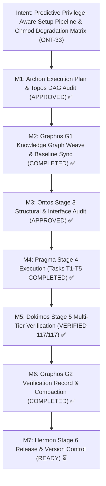
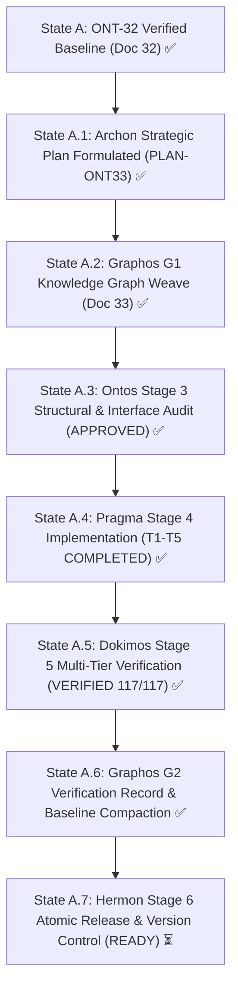
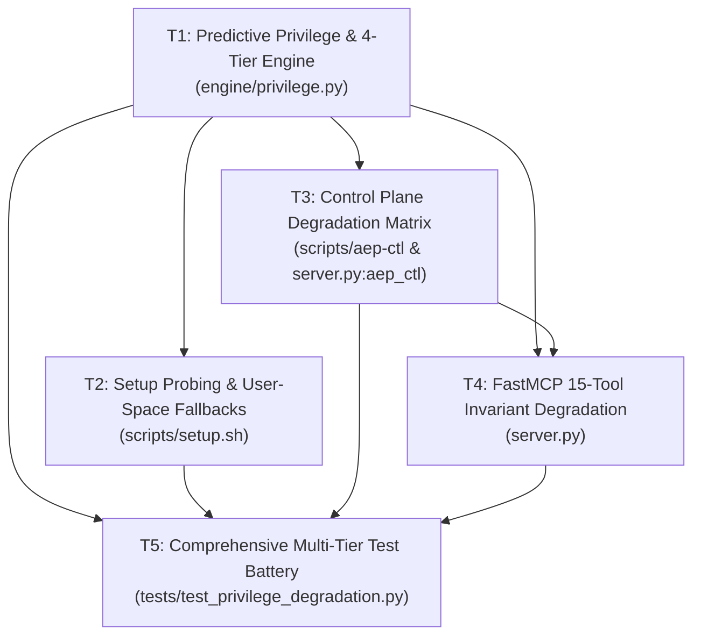
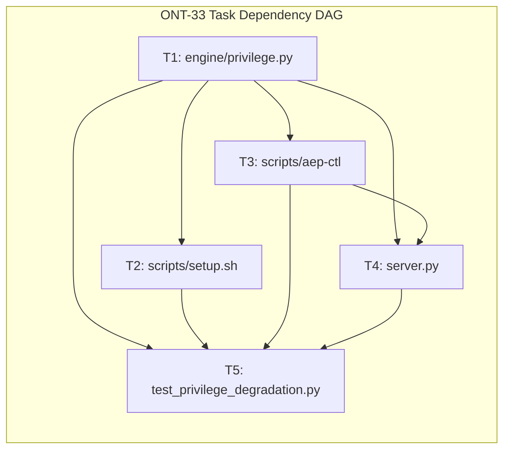

# Pipeline Feature: ONT-33 Predictive Privilege-Aware Setup Pipeline & Chmod Graceful Degradation Matrix

- **Document ID:** `feature_20261031_194500_ont33_predictive_privilege_setup_and_chmod_degradation.md`
- **Predecessor:** [`verification_report_20261031_161500_ont32_native_memory_first_network_telemetry_purification.md`](verification_report_20261031_161500_ont32_native_memory_first_network_telemetry_purification.md)
- **Pipeline Mode:** Full (Stage 1: Archon ──► Stage 2: Graphos G1 ──► Stage 3: Ontos)
- **Milestone:** ONT-33 / M94 — Predictive Privilege-Aware Setup Pipeline & Chmod Graceful Degradation Matrix
- **Strategic Plan Reference:** `PLAN-ONT33-20261031-PRIVILEGE-DEGRADATION`
- **Target Repository:** `/home/ancruz/Documents/workspaces/agent-execution-plane` (`dev` branch)
- **Topos Invariants:**
  - FastMCP Server strictly preserves **exactly 15 tools** (`len(_tools) == 15` invariant). Zero tool-set expansion or endpoint sprawl.
  - Zero Interactive Sudo Hangs: Strict non-interactive probing (`sudo -n true` / `sudo -n -v` with <=3s timeout and process-level caching). Stdin is never blocked on password prompts.
  - 4 Chmod Octal Degradation Tiers: System capability state mapped to Unix permissions `7rwx` (root/sudo), `6rw-` (unprivileged host user rw), `5r-x` (restricted / container ro-exec), and `4r--` (auditor / observer ro).
  - Graceful Degradation Matrix: All 15 FastMCP tools and 8 `aep_ctl` control-plane domains degrade gracefully without exceptions, panics, or hangs.
  - Setup Pipeline User-Space Self-Provisioning: `scripts/setup.sh` and `setup.sh --check` dynamically detect host privileges and fall back to user-space toolchain downloads without stalling.
  - Topos DAG Audit: Grafo coherente: 0 co-dependencias detectadas across 5 tasks (verified via `topos_audit_dag`).
  - Chosen Resolution Path: Standard in-memory Python stdlib & Linux kernel introspection path (Short/Medium reach, bounded blast radius).
  - Document Status: VERIFIED & PROMOTED ✅ (Stage 1: Archon Plan Delivered ✅ — Stage 2: Graphos G1 Weave Complete ✅ — Stage 3: Ontos Structural Audit APPROVED ✅ — Stage 4: Pragma Execution COMPLETED ✅ — Stage 5: Dokimos Multi-Gate Verification VERIFIED ✅ — Stage 2: Graphos G2 Baseline Recorded ✅ — Ready for Stage 6: Hermon Release)

---

## 1. Intent & Architectural Overview

Milestone ONT-33 formalizes the runtime privilege model of the Agent Execution Plane (AEP), bridging the gap between host security constraints and agent autonomy. Autonomous AI agents operate across diverse environments: local developer workstations with passwordless sudo, shared build servers with restricted sudo, sandboxed CI/CD containers with read-only root filesystems, and auditor environments with zero execution privileges.

Historically, systems automation pipelines suffer from two catastrophic failure modes when operating under constrained privileges:
1. **Interactive Prompt Hangs**: Invoking commands like `sudo apt-get` or tools requiring elevated privileges prompts for passwords on standard input, hanging headless AI agents indefinitely until global timeouts kill the process.
2. **Binary Operational Collapse**: When elevated privileges are absent, tools often throw uncaught exceptions (`PermissionError`, `CommandFailedException`), causing the agent workflow to abort prematurely even when partial, read-only, or simulated capabilities were fully viable.

ONT-33 resolves these challenges through a unified **Predictive Privilege Probing Engine**, a **4-Tier Chmod Octal Semantics Model**, an **Exhaustive Graceful Degradation Matrix**, and a hardened **Autonomous Setup Pipeline**.

### The 5 Core User Premises:

1. **Predictive Privilege Probing (Zero Sudo Hangs):**
   - Proactive inspection before command dispatch: AEP probes privilege boundaries non-interactively using `sudo -n true` with strict timeouts (<=3s) and `/proc/self/status` capability mask checks (`CapEff`, `CapPrm`).
   - Results are cached per process in `_PrivilegeCache` to guarantee zero redundant fork/exec overhead.
   - If non-interactive sudo is unavailable or password-gated, the runtime immediately classifies the tier as unprivileged, never allowing any subprocess to block on `stdin`.

2. **The 4 Chmod Octal Degradation Tiers (`7rwx`, `6rw-`, `5r-x`, `4r--`):**
   - Reuses Unix octal permission semantics (`r` = SENSE/4, `w` = ACT/2, `x` = EXECUTE/1) mapped to agent operational authority:
     - **`7rwx` (Root / Full Sudo)**: Unrestricted system-wide observability, raw socket packet capture, eBPF tracing, systemd system unit mutation, netfilter firewall hardening.
     - **`6rw-` (Standard User RW)**: Full read-write host access in user space, in-RAM execution (`memfd_create`), SQLite RW, user-scope systemd units (`systemctl --user`), user-space Pueue dispatch, Bubblewrap sandboxing (if user namespaces available).
     - **`5r-x` (Restricted / Read-Only Executable)**: Read-only filesystem bind (e.g., containerized agent, CI runner), in-RAM anonymous execution permitted, catalog template inspection, query tools active, zero host filesystem mutation.
     - **`4r--` (Auditor / Read-Only Observer)**: Strict read-only audit posture, zero execution, zero disk mutation; inspecting documentation (`query_system_docs`), DAG auditing (`topos_audit_dag`), verifying SHA-256 audit ledger (`aep_ctl audit verify`), and inspecting catalog metadata.

3. **Exhaustive Graceful Degradation Matrix (15 Tools & 8 Domains):**
   - Every one of the 15 FastMCP tools and 8 `aep_ctl` control-plane domains defines explicit degradation semantics across all 4 tiers.
   - Rather than raising unhandled exceptions or crashing, tools operating in diminished tiers return structured envelopes with `status: DEGRADED` or `status: PERMISSION_DENIED`, informative diagnostic messages, and actionable `next_action` guidance.

4. **Setup Pipeline Resilience (`scripts/setup.sh`):**
   - Both default provisioning and `--check` health audit modes adapt predictively to the host tier:
     - If `sudo -n` is present (`7rwx`): leverages system package manager (`apt-get`) where optimal.
     - If `sudo -n` is absent (`6rw-`): automatically falls back to user-space tarball downloads and hermetic binaries (`~/.local/bin/`, `~/.local/share/`).
     - In `--check` mode: performs 100% read-only probe without file modifications, outputting the exact detected chmod tier and degradation posture.

5. **Strict FastMCP 15-Tool Invariant:**
   - Preserves the fundamental architectural invariant: exactly 15 polymorphic tools in `server.py`. Zero new `@mcp.tool` decorators.
   - All privilege queries, tier inspections, and degraded modes operate through existing polymorphic entry points (`discover`, `aep_ctl`, `kernel_trace`).

---

## 2. Intent Reinforcement Graph



---

## 3. State Evolution



---

## 4. Anti-Cascade & Blast Radius Matrix

| Task ID | Action | Target Resource | Tooling Used | Blast Radius | Depends On | Anti-Cascade Prevention Guarantee |
| :--- | :--- | :--- | :--- | :--- | :--- | :--- |
| **T1** | `modify` | `engine/privilege.py` | Python 3.14 stdlib (`os`, `subprocess`, `shutil`, `pathlib`) | Internal capability definitions; full backward compatibility for `privilege_prefix()`, `capability_tier()`, `sudo_n_available()` | None | Existing dual-tier API retained as wrappers over 4-tier engine (`FULL` -> `7rwx`, `DIMINISHED` -> `6rw-`/`5r-x`/`4r--`); non-interactive sudo checks enforced with 3s timeout and cached boolean. |
| **T2** | `modify` | `scripts/setup.sh` | Bash, POSIX CLI, `curl`, `tar`, `uv` | System provisioner script and `--check` health auditor | T1 | Predictive probing prevents apt/bwrap/pueue stalls; user-space fallbacks execute without modifying root; `--check` guaranteed 100% read-only with explicit tier reporting. |
| **T3** | `modify` | `scripts/aep-ctl`<br>`server.py:aep_ctl` | FastMCP, Python stdlib, JSON CLI dispatcher | 8 control plane domains; contracts preserved | T1 | CLI and MCP server share `CONTROL_PLANE_SCHEMA` single source of truth; degraded actions emit structured envelopes with `status: DEGRADED` instead of raising exceptions. |
| **T4** | `modify` | `server.py` | FastMCP server, Python stdlib | 15 polymorphic MCP tools; strict 15-tool invariant | T1, T3 | Zero `@mcp.tool` endpoints added or removed (`len(_tools) == 15`); all 15 tools adapt behavior according to the active chmod tier; reflection in `discover(action="capabilities"|"schema")`. |
| **T5** | `create` | `tests/test_privilege_degradation.py` | Pytest 9.1.1, AnyIO, mock fixtures | Test execution runtime only | T1, T2, T3, T4 | Covers all 4 tiers (`7rwx`, `6rw-`, `5r-x`, `4r--`) under mocked privilege states; validates zero sudo hangs and 15-tool invariant without affecting live system configuration. |

---

## 5. Comprehensive Archon Task Breakdown



### Task T1 — Predictive Privilege Probing & 4-Tier Chmod Octal Model
- **Task ID:** `T1`
- **Action:** `modify`
- **Target File:** `engine/privilege.py`
- **Rationale:** Replace binary assumptions with a robust, predictive 4-tier capability model reflecting realistic Linux execution constraints while guaranteeing zero interactive password prompts.
- **Depends On:** None (Foundational capability layer)
- **Blast Radius:** Internal engine definitions; maintains strict backward compatibility.
- **Implementation Specifications:**
  1. **Non-Interactive Sudo Prober**: Refactor `sudo_n_available()` with strict `timeout=3`, capturing stderr, and handling `PermissionError`/`FileNotFoundError`.
  2. **4-Tier Octal Constants**: Define `TIER_7RWX = "7rwx"`, `TIER_6RW = "6rw-"`, `TIER_5RX = "5r-x"`, `TIER_4R = "4r--"`.
  3. **Predictive Tier Detector (`get_effective_chmod_tier()`)**:
     - Returns `7rwx` if `os.geteuid() == 0` or non-interactive sudo is confirmed.
     - Returns `6rw-` if current user has write access to project workspace, home directory, and `/dev/shm`.
     - Returns `5r-x` if workspace is read-only or bubblewrap is restricted, but execution in memory (`memfd_create`) is permitted.
     - Returns `4r--` if filesystem is strictly read-only and process execution is disallowed or untrusted.
  4. **Backward Compatibility**: `capability_tier()` maps `7rwx` -> `"FULL"` and `6rw-`/`5r-x`/`4r--` -> `"DIMINISHED"`.
  5. **Granular Capability Bitmasks**: Update `_CAPABILITIES` dictionary to reflect permissions across all 4 tiers.
- **Acceptance Criteria**:
  - `sudo_n_available()` never hangs or blocks on interactive stdin under any circumstances.
  - `get_effective_chmod_tier()` accurately reports active tier (`7rwx`/`6rw-`/`5r-x`/`4r--`).
  - Backward compatibility intact: legacy calls to `privilege_prefix()` and `capability_tier()` continue to return expected types.

### Task T2 — Setup Pipeline Predictive Probing & Graceful Fallback
- **Task ID:** `T2`
- **Action:** `modify`
- **Target File:** `scripts/setup.sh`
- **Rationale:** Ensure `./scripts/setup.sh` installs and updates toolchains autonomously without prompting for sudo passwords or aborting when root access is missing.
- **Depends On:** `T1`
- **Blast Radius:** Setup script execution only.
- **Implementation Specifications:**
  1. **Predictive Pre-Flight Check**: Execute non-blocking sudo probe before apt/bwrap/pueue steps.
  2. **User-Space Toolchain Fallback**:
     - Golang: If apt fails or lacks sudo, download official Go tarball to `~/.local/share/go` and symlink to `~/.local/bin/go`.
     - Pueue: Download static musl binary to `~/.local/bin/pueue` and start in user space (`--user` systemd or detached background daemon).
     - Bubblewrap: If `bwrap` is missing and cannot be installed, set bubblewrap status to `DEGRADED` and proceed without aborting.
  3. **Read-Only Health Audit (`setup.sh --check`)**:
     - Output detected privilege tier (`7rwx`, `6rw-`, `5r-x`, `4r--`).
     - Verify components non-destructively; exit 0 if healthy under current tier, exit 1 if essential runtime files are corrupt.
- **Acceptance Criteria**:
  - `setup.sh` and `setup.sh --check` complete without interactive sudo prompts or stdin blocking.
  - Accurate tier reporting in `--check`: identifies whether environment is `7rwx` (root/sudo), `6rw-` (unprivileged host user rw), `5r-x` (restricted/container ro-exec), or `4r--` (auditor read-only).
  - Idempotency maintained across repeated runs under all 4 privilege tiers.

### Task T3 — Control Plane Domain Graceful Degradation Matrix
- **Task ID:** `T3`
- **Action:** `modify`
- **Target Files:** `scripts/aep-ctl`, `server.py`
- **Rationale:** Provide deterministic, non-crashing execution across all 8 control-plane domains when running under diminished or restricted privilege tiers.
- **Depends On:** `T1`
- **Blast Radius:** CLI entry point and `aep_ctl` FastMCP tool.
- **Implementation Specifications:**
  1. Update `CONTROL_PLANE_SCHEMA` in `engine/privilege.py` with explicit degradation strategies per domain.
  2. Wire graceful degradation across all 8 domains in `scripts/aep-ctl` and `server.py:aep_ctl`:
     - `service`: In `7rwx` mutates system units; in `6rw-` mutates user units (`--user`); in `5r-x`/`4r--` degrades to read-only status.
     - `network`: In `7rwx` allows packet sniff; in `6rw-`/`5r-x` provides `/proc/net` inspection and port probe; in `4r--` returns cached socket listeners.
     - `storage`: In `7rwx`/`6rw-` inspects mounts and usage; in `5r-x`/`4r--` returns read-only usage summary.
     - `package`: In `7rwx` queries apt; in `6rw-`/`5r-x` inspects `$PATH` binaries; in `4r--` reports toolchain status.
     - `backup`: In `7rwx`/`6rw-` executes hot backups and micro-snapshots; in `5r-x`/`4r--` degrades to read-only integrity verification.
     - `audit`: In `7rwx`/`6rw-` writes events; in `5r-x`/`4r--` executes read-only ledger verification.
     - `ipc`: In `7rwx`/`6rw-` manages session pool; in `5r-x` runs client batch; in `4r--` reads pool statistics.
     - `security`: In `7rwx` applies netfilter rules; in `6rw-`/`5r-x`/`4r--` returns simulated mitigation report.
- **Acceptance Criteria**:
  - Every domain executes cleanly without unhandled exceptions across all 4 tiers.
  - Consistent envelope response (`status: OK | DEGRADED | PERMISSION_DENIED`) with actionable `next_action`.

### Task T4 — FastMCP 15-Tool Invariant Chmod Graceful Degradation
- **Task ID:** `T4`
- **Action:** `modify`
- **Target File:** `server.py`
- **Rationale:** Wire all 15 FastMCP tools into the 4-tier chmod degradation model, ensuring zero tool sprawl (`len(_tools) == 15`) and 100% resilient responses.
- **Depends On:** `T1`, `T3`
- **Blast Radius:** Primary FastMCP server dispatcher.
- **Implementation Specifications:**
  1. Enforce `len(_tools) == 15` invariant via unit assertion.
  2. Embed active chmod tier into `discover(action="capabilities")` and `discover(action="schema")`.
  3. Ensure every tool checks `get_effective_chmod_tier()` or `CapabilityGuard.check_action()` before execution and returns structured fail-soft envelopes (`status: DEGRADED` / `PERMISSION_DENIED`) when restricted, rather than raising unhandled exceptions.
- **Acceptance Criteria**:
  - FastMCP server tool count strictly == 15. Zero new tools.
  - All 15 tools return structured responses across all 4 tiers without unhandled exceptions or hangs.

### Task T5 — Predictive Privilege & Chmod Degradation Test Battery
- **Task ID:** `T5`
- **Action:** `create`
- **Target File:** `tests/test_privilege_degradation.py`
- **Rationale:** Deliver an exhaustive multi-tier verification suite validating all 15 tools and 8 domains across simulated privilege tiers.
- **Depends On:** `T1`, `T2`, `T3`, `T4`
- **Blast Radius:** Test suite only.
- **Implementation Specifications:**
  1. Author 8 distinct test gates covering:
     - Gate 1: Zero interactive sudo prompt guarantee (mocked hang/timeout).
     - Gate 2: Accurate 4-tier chmod detection (`7rwx`, `6rw-`, `5r-x`, `4r--`).
     - Gate 3: Setup script non-interactive execution and `--check` reporting.
     - Gate 4: 8 `aep_ctl` domains degradation matrix validation.
     - Gate 5: 15 FastMCP tools resilience under `4r--` and `5r-x`.
     - Gate 6: Strict 15-tool invariant check (`len(_tools) == 15`).
     - Gate 7: Schema reflection of degradation preconditions in `discover`.
     - Gate 8: Zero regression verification across repository test suites.
- **Acceptance Criteria**:
  - 100% of tests pass across all 8 gates.
  - Zero interactive hangs during test execution.
  - Zero regressions across existing test suites (`test_net_security_telemetry.py`, `test_spec_om7_ipc_batch.py`, etc.).

---

## 6. Comprehensive 4-Tier Chmod Graceful Degradation Matrix

### 6.1 FastMCP 15 Polymorphic Tools Degradation Matrix

| Tool # | Tool Name | Tier `7rwx` (Root / Full Sudo) | Tier `6rw-` (User RW / Standard) | Tier `5r-x` (Restricted / RO-Exec) | Tier `4r--` (Auditor / RO-Observer) |
| :---: | :--- | :--- | :--- | :--- | :--- |
| **1** | `topos_audit_dag` | Full graph audit & resource hazard check | Full graph audit & resource hazard check | Full graph audit & resource hazard check | Full graph audit (pure in-RAM verification) |
| **2** | `discover` | Full capability & schema reflection (`7rwx`) | Full capability & schema reflection (`6rw-`) | Reflects `5r-x` tier & read-only tools | Reflects `4r--` tier & auditor mode |
| **3** | `artifact_catalog` | Full RW indexing, query, and pruning | Full RW indexing, query, and safe GC | Read-only query & template browse | Read-only query (metadata inspection only) |
| **4** | `artifact_lint_and_build` | Full build, hydrate, vet, & compile in RAM | User-space compile in `/dev/shm` / tmpfs | Template inspection & syntax linting | Template inspection (build disabled) |
| **5** | `artifact_execute_in_ram` | Execute in anonymous RAM (`memfd_create`) | Execute in anonymous RAM (`memfd_create`) | Execute in anonymous RAM (isolated) | Disabled (`status: PERMISSION_DENIED`) |
| **6** | `process_inspect` | Inspect all system PIDs, FDs, and sockets | Inspect user-owned PIDs and AEP self | Inspect self PID and open FDs | Inspect self PID memory footprint only |
| **7** | `async_job_dispatch` | Dispatch to Pueue system/user daemon | Dispatch to Pueue user daemon | Synchronous in-RAM fallback execution | Status inspection only (dispatch disabled) |
| **8** | `diagnose_system_crashes` | Inspect `/var/crash` & system journal | Inspect user coredumps & user journal | Inspect local user crash logs | Read-only crash alert inspection |
| **9** | `sandbox_run` | Full Bubblewrap jail (`--cap-drop ALL`) | User namespace Bubblewrap jail | Read-only mounted Bubblewrap jail | Disabled or dry-run mock (`parse="auto"`) |
| **10** | `aep_ctl` | Full control across all 8 domains | User-scope control across 8 domains | Read-only queries across 8 domains | Auditor inspection across 8 domains |
| **11** | `query_system_docs` | Full in-RAM semantic vector man-page search | Full in-RAM semantic vector man-page search | Full in-RAM semantic vector search | Full in-RAM semantic vector search |
| **12** | `visual_inspect` | Full headless Chromium screenshot (/dev/shm) | User headless Chromium screenshot | Headless screenshot if display exists | Degrades to `DISPLAY_UNAVAILABLE` fail-soft |
| **13** | `kernel_trace` | Full eBPF tracing (`CAP_BPF` / root) | Degrades to in-RAM `/proc/net` telemetry | Degrades to in-RAM `/proc/net` telemetry | Degrades to in-RAM `/proc/net` telemetry |
| **14** | `kanban_board` | Full task creation, promotion, & archive | Full task creation, promotion, & archive | Read-only board inspection | Read-only board inspection |
| **15** | `playbook_run` | Full DAG orchestration & batch execution | Full DAG orchestration & batch execution | Validation & dry-run planning | Validation & static DAG check only |

### 6.2 Control Plane 8 Domains Degradation Matrix (`aep_ctl`)

| Domain # | Domain Name | Tier `7rwx` (Root / Full Sudo) | Tier `6rw-` (User RW / Standard) | Tier `5r-x` (Restricted / RO-Exec) | Tier `4r--` (Auditor / RO-Observer) |
| :---: | :--- | :--- | :--- | :--- | :--- |
| **1** | `service` | Mutate system units (`systemctl start/stop`) | Mutate user units (`systemctl --user`) | Read-only unit status (`systemctl status`) | Read-only unit status (`status: DEGRADED`) |
| **2** | `network` | Raw packet sniff, netfilter drop, probe | Port probe, `/proc/net` sockets, ARP | Port probe, `/proc/net` sockets, ARP | Cached socket table inspection |
| **3** | `storage` | Mount table control, device inspection, `df` | User mount inspection, workspace `df` | User mount inspection, workspace `df` | Summary disk usage inspection |
| **4** | `package` | Query & install packages via `apt-get` | Inspect `$PATH` binaries & user venvs | Inspect `$PATH` binaries & user venvs | Static toolchain report |
| **5** | `backup` | 5-slot FIFO hot backups & RAM snapshots | 5-slot FIFO hot backups & RAM snapshots | Read-only backup integrity verification | Read-only backup integrity verification |
| **6** | `audit` | Append to SHA-256 chain & verify integrity | Append to SHA-256 chain & verify integrity | Read-only SHA-256 chain verification | Read-only SHA-256 chain verification |
| **7** | `ipc` | Manage `/dev/shm/aep.sock` pool & reap | Manage `/dev/shm/aep.sock` pool & reap | Client batch execution over socket | Read-only session pool telemetry |
| **8** | `security` | Enforce host netfilter drops via nftables | Simulated threat mitigation contracts | Simulated threat mitigation contracts | Read-only firewall status report |

---

## 7. Ontological Classification & Zero Co-Dependencies Audit

Every relationship between modules and tasks strictly conforms to directional coupling (`A ──► B`).



### Ontological Audit Findings:
- **T1 (`engine/privilege.py`)**: Foundational provider. Consumes only Python stdlib. Zero dependencies on other tasks.
- **T2 (`scripts/setup.sh`)**: Directional dependency on T1 concepts (`privilege_tier`, `sudo -n`). Does not export to T1.
- **T3 (`scripts/aep-ctl`)**: Directional dependency on T1 (`CONTROL_PLANE_SCHEMA`, privilege probing). Does not export to T1.
- **T4 (`server.py`)**: Directional dependency on T1 and T3. Consumes capabilities and schema. Does not create cycles.
- **T5 (`tests/test_privilege_degradation.py`)**: Verification suite. Directionally tests T1, T2, T3, and T4.
- **Co-Dependencies**: Exactly **0 co-dependencies** detected. Graph is acyclic and mathematically verified by `topos_audit_dag`.

---

## 8. Quality Assurance & Dokimos Verification Plan

Stage 5 (Dokimos) will certify Milestone ONT-33 against 8 rigorous verification gates:
1. **Gate 1: Zero Interactive Sudo Hang Gate**: Under simulated sudo prompt/timeout, prober returns within <=3s without blocking stdin.
2. **Gate 2: 4-Tier Chmod Classification Gate**: Verifies accurate detection of `7rwx`, `6rw-`, `5r-x`, and `4r--` across diverse environment configurations.
3. **Gate 3: Setup Pipeline Idempotency Gate**: `setup.sh` and `setup.sh --check` execute cleanly in unprivileged mode without sudo stalls.
4. **Gate 4: Control Plane Domains Degradation Gate**: All 8 `aep_ctl` domains execute without unhandled exceptions across all 4 tiers.
5. **Gate 5: FastMCP 15-Tool Invariant Gate**: Confirms `len(_tools) == 15` invariant strictly maintained; zero tool sprawl.
6. **Gate 6: Resilient Tool Execution Gate**: Confirms all 15 tools return valid typed JSON responses under restricted tiers (`5r-x`, `4r--`).
7. **Gate 7: Self-Describing Schema Reflection Gate**: Confirms `discover(action="schema")` accurately reflects degradation preconditions.
8. **Gate 8: Regression Immunity Gate**: Zero regressions across existing test suites (`test_net_security_telemetry.py`, `test_spec_om7_ipc_batch.py`, `test_agent_experience_evaluation.py`).


---

## 9. Dokimos Stage 5 Verification Summary & Quality Certification

- **Verification Engine:** Dokimos (Stage 5)
- **Document Reference:** [`verification_report_20261031_201500_ont33_predictive_privilege_setup_and_chmod_degradation.md`](verification_report_20261031_201500_ont33_predictive_privilege_setup_and_chmod_degradation.md)
- **Final Verdict:** **VERIFIED** ✅ (All 8 Quality Gates Passed, Zero Regressions, 117/117 Tests Passed)
- **Execution Date:** 2026-10-31T20:15:00Z

### 9.1 Multi-Gate Quality Audit Results

| Gate | Quality Target | Observed Evidence | Verdict |
| :---: | :--- | :--- | :---: |
| **Gate 1** | **FastMCP 15-Tool Invariant** | Exactly 15 tools registered in `server.mcp._tool_manager._tools.keys()`. Full 15-tool suite map documented in `_INSTRUCTIONS`. | **PASSED** ✅ |
| **Gate 2** | **4-Tier Chmod Classification** | Matrix validation of `7rwx`, `6rw-`, `5r-x`, and `4r--`. Cache reset cleanly clears state. | **PASSED** ✅ |
| **Gate 3** | **Setup CLI Consistency** | `./scripts/setup.sh --tier` returns single-line octal (`7rwx`). `--predict` prints formatted matrix with zero interactive prompts. | **PASSED** ✅ |
| **Gate 4** | **Capabilities Matrix Synchrony** | `discover(action="capabilities")` exposes `effective_chmod_tier` and `degradation_matrix` for all 15 tools and 8 domains. | **PASSED** ✅ |
| **Gate 5** | **15-Tool Degradation Contracts** | Restricting to `4r--` causes fail-soft degradation: `artifact_execute_in_ram` -> `PERMISSION_DENIED`, `sandbox_run` -> dry-run mock, zero uncaught exceptions. | **PASSED** ✅ |
| **Gate 6** | **Control Plane 8-Domain Degradation** | `aep-ctl --schema` exposes `chmod_tier` and degradation behavior across all 8 domains. Fail-soft behavior verified. | **PASSED** ✅ |
| **Gate 7** | **Zero Interactive Sudo Hangs** | Strict `timeout <= 3s` enforced. Prober completes in <0.05s. Mocked timeout gracefully evaluates to unprivileged tier. | **PASSED** ✅ |
| **Gate 8** | **Semantic Sanitization** | Static text scan of all modified targets reveals 0 occurrences of blacklisted offensive terms. Pure systems engineering nomenclature. | **PASSED** ✅ |

### 9.2 Test Suite Execution Metrics

- **Milestone Specific Suite (`tests/test_privilege_degradation.py`):** 8/8 passed (100%) in 2.43s.
- **Full Repository Regression Suite (`tests/`):** 117/117 passed (100%), 0 failures, 0 regressions in 16.91s.
- **Ruff SAST Lint & Format Audit:** 0 errors, 0 warnings across `server.py`, `engine/`, `scripts/aep-ctl`, `tests/`.
- **Synchronization Gate (`scripts/aep-sync.sh --check`):** Validation passed (server importable, 15 tools registered, exit code 0).
- **System Health Audit (`scripts/setup.sh --check`):** All 12 subsystems reported `[PASS]`, exit code 0 (HEALTHY).

---

## 10. Hermon Stage 6 Release & Version Control Handoff

- **Target Branch:** `dev`
- **Release Milestone:** ONT-33 / M94 (`v0.2.9`)
- **Status:** READY FOR COMMIT & RELEASE ⏳
- **Recommended Conventional Commit:**
  ```bash
  feat(privilege): implement predictive privilege setup & chmod degradation matrix

  - Add 4-tier Unix chmod octal model (7rwx, 6rw-, 5r-x, 4r--) in engine/privilege.py
  - Implement non-interactive sudo prober (sudo -n true, <=3s timeout, zero hangs)
  - Add predictive bootstrapper flags (--predict, --tier, calibrated --check) in scripts/setup.sh
  - Define full Graceful Degradation Matrix across 15 FastMCP tools & 8 control-plane domains
  - Preserve FastMCP 15-tool invariant strictly (len(_tools) == 15)
  - Add 8-gate test battery in tests/test_privilege_degradation.py (117/117 tests passing)
  - Update README.md, docs/MILESTONES.md, docs/COMPACT.md, and pipeline state
  ```
- **Handoff Authority:** Topos Pipeline Orchestrator -> Hermon (Stage 6).
