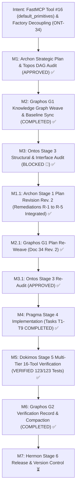
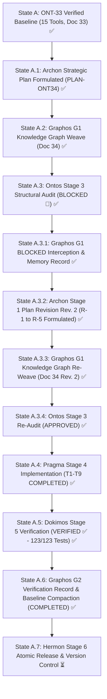
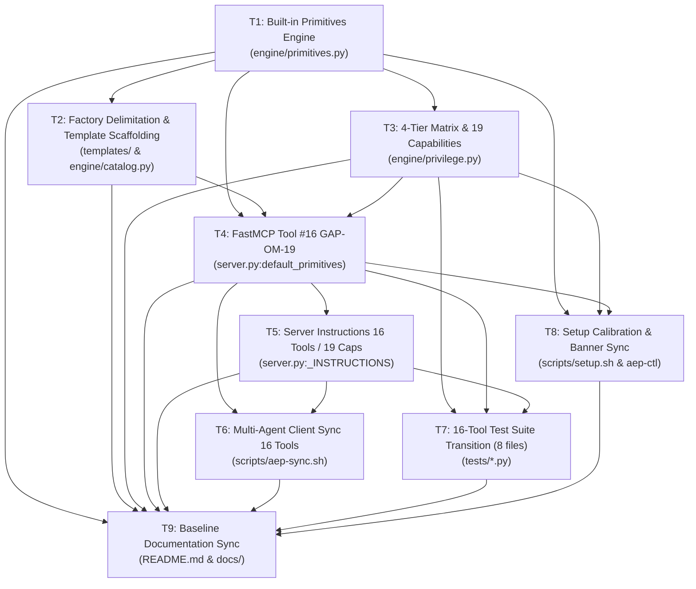

# Pipeline Feature: ONT-34 FastMCP Tool #16 (default_primitives), Delimitación de Fábrica y Transición Invariante (15 → 16 Tools)

- **Document ID:** `feature_20261104_105500_ont34_default_primitives_and_factory_decoupling.md`
- **Predecessor:** [`feature_20261031_194500_ont33_predictive_privilege_setup_and_chmod_degradation.md`](feature_20261031_194500_ont33_predictive_privilege_setup_and_chmod_degradation.md)
- **Pipeline Mode:** Full (Stage 1: Archon ──► Stage 2: Graphos G1 ──► Stage 3: Ontos)
- **Milestone:** ONT-34 / M95 — FastMCP Tool #16 (`default_primitives`), Delimitación de Fábrica y Transición Invariante (15 → 16 Tools)
- **Strategic Plan Reference:** `PLAN-ONT34-20261104-DEFAULT-PRIMITIVES-FACTORY-DECOUPLING-REV2`
- **Target Repository:** `/home/ancruz/Documents/workspaces/agent-execution-plane` (`dev` branch)
- **Topos Invariants:**
  - FastMCP Server Invariant Transition: Rigorous expansion from exactly 15 tools to **exactly 16 tools** (`len(_tools) == 16` invariant). Strict prohibition of tool sprawl beyond the 16th endpoint.
  - Capabilities Invariant Transition: Deterministic expansion from 18 to **19 capabilities** (`len(_CAPABILITIES) == 19`), registered in `engine/privilege.py`, `server._INSTRUCTIONS`, and all test manifests.
  - Factory Delimitation vs. Default Primitives: Clear separation of concerns between template synthesis factory (`templates/`, `artifact_catalog`, `artifact_lint_and_build`, `artifact_execute_in_ram`) dedicated to dynamic custom Go artifacts, and built-in systems diagnostics (`default_primitives`). Strict preservation of all 5 Go template files in `templates/` and `registry.json` as compilation scaffolding.
  - Single-Encoding & FastMCP Protocol Invariant (GAP-OM-19): Strict enforcement of `@mcp.tool(structured_output=False)` returning `str` with `attach_envelope(...)` to guarantee `output_schema is None` across all 16 tools, preventing client frame overflow.
  - 4-Tier Chmod Octal Degradation Matrix: `default_primitives` fully governed under Unix octal semantics (`7rwx`, `6rw-`, `5r-x`, `4r--`), guaranteeing non-blocking fail-soft behavior across all execution environments.
  - Predictive Zero-Sudo-Hang Persistence: Proactive non-interactive privilege probing (`sudo -n true` with <=3s timeout) preserved with 100% regression immunity.
  - Multi-Harness Output Synchrony: Synchronized degradation posture banner (`"FastMCP 16-Tool Degradation Posture:"`) between `scripts/setup.sh:139` and `tests/test_privilege_degradation.py:153`.
  - Topos DAG Integrity: Exactly 0 co-dependencies across all 9 tasks (verified and certified via `topos_audit_dag`).
  - Chosen Resolution Path: Standard in-memory Python stdlib & Linux kernel introspection path (Short/Medium reach, bounded blast radius).
  - Document Status: VERIFIED ✅ (Stage 5 Dokimos Multi-Tier Verification Certified — 123/123 Tests Passed, 100% Invariants Preserved)
  - Execution Report Reference: [`execution_report_20261104_114000_ont34_default_primitives_and_factory_decoupling.md`](execution_report_20261104_114000_ont34_default_primitives_and_factory_decoupling.md)
  - Verification Report Reference: [`verification_report_20261104_121500_ont34_default_primitives_and_factory_decoupling.md`](verification_report_20261104_121500_ont34_default_primitives_and_factory_decoupling.md)

---

## 1. Intent & Architectural Overview

Milestone ONT-34 establishes a crucial architectural evolution in the Agent Execution Plane (AEP): the introduction of FastMCP Tool #16 (`default_primitives`), the decoupling of immutable diagnostic primitives from the dynamic Go artifact synthesis factory, and the controlled expansion of the server tool invariant from 15 to 16 tools and capability taxonomy from 18 to 19 capabilities.

### Background & The Factory-Primitive Coupling Dilemma

During earlier phases of AEP (Milestones ONT-01 through ONT-33), built-in diagnostic probes—such as `socket-monitor`, `fd-rescuer`, `disk-usage`, `mem-stat`, and `landlock-guard`—were collocated inside the artifact synthesis factory (`templates/registry.json` and `templates/tpl_*.go`). 

While this architecture allowed quick bootstrapping, it introduced two major architectural frictions:
1. **Factory Registry Contamination**: Dynamic agent-created artifacts and static, immutable system diagnostics shared the same storage tables and template catalogs, requiring complex cold-aging immunity rules and safe garbage collection heuristics.
2. **Synthesis Friction for Base Diagnostics**: When an agent required elementary system inspection (e.g. checking open sockets or diagnosing stuck file descriptors), it was forced to navigate the full Pico-Jenkins compilation lifecycle (`artifact_lint_and_build` -> `artifact_catalog` -> `artifact_execute_in_ram`), consuming unnecessary tokens and execution latency.

### The 5 Core Principles of ONT-34:

1. **Dedicated Built-in Primitives Tool (`default_primitives`):**
   - Implements a dedicated polymorphic tool endpoint `default_primitives(action="list"|"info"|"run", name=..., args=...)`.
   - Built-in primitives are pre-compiled or direct system-level routines that execute instantly via in-RAM anonymous memory (`memfd_create`) or direct kernel introspection without requiring template compilation passes.
   - Provides instant discovery and execution of the core diagnostic suite: `socket-monitor`, `fd-rescuer`, `disk-usage`, `mem-stat`, and `landlock-guard`.

2. **Clean Factory Delimitation & Template Scaffolding Preservation:**
   - The artifact factory (`artifact_catalog`, `artifact_lint_and_build`, `artifact_execute_in_ram`) is strictly delimited to **dynamic, user-synthesized, and agent-generated Go artifacts**.
   - `templates/` registry and all 5 Go source templates (`tpl_*.go`) are preserved intact as static starter scaffolding for dynamic extension, while `default_primitives` provides the canonical runtime path for instant inspection.

3. **Controlled Invariant Transition (15 → 16 Tools, 18 → 19 Capabilities):**
   - The fundamental server invariant transitions deterministically from `len(_tools) == 15` to **`len(_tools) == 16`**.
   - The capability taxonomy transitions deterministically from `len(_CAPABILITIES) == 18` to **`len(_CAPABILITIES) == 19`** (registering `"default_primitives"`).
   - All tests across 8 test suites, server docstrings, system prompts, setup scripts, and synchronization routines are updated synchronously, preventing version drift or assertion failures.

4. **Full 4-Tier Chmod Octal Governance:**
   - `default_primitives` is integrated into `engine/privilege.py` and the 4-tier chmod octal matrix:
     - **`7rwx` (Root / Full Sudo)**: Full execution of all primitives across system-wide scope.
     - **`6rw-` (Standard User RW)**: Full execution in user scope; non-root socket and process introspection.
     - **`5r-x` (Restricted / Container RO-Exec)**: In-RAM execution in isolated memory; read-only parameters.
     - **`4r--` (Auditor / RO-Observer)**: Metadata and schema inspection only (`action="list"|"info"`); execution disabled with fail-soft envelope (`status: PERMISSION_DENIED`).

5. **GAP-OM-19 Strict Protocol Compliance & Deterministic Sync:**
   - FastMCP single-encoding invariant strictly maintained: `@mcp.tool(structured_output=False)` returning raw JSON string formatted with `attach_envelope(...)` to ensure `output_schema is None` across all 16 tools.
   - `scripts/aep-sync.sh` and `scripts/setup.sh` are updated to validate the 16-tool invariant, 16-tool degradation banner, and hot-reload client descriptors across all supported AI harnesses (Gemini CLI, Antigravity, Claude Code, Codex).

---

## 2. Intent Reinforcement Graph



---

## 3. State Evolution



---

## 4. Anti-Cascade & Blast Radius Matrix (Plan Rev. 2)

| Task ID | Action | Target Resource | Tooling Used | Blast Radius | Depends On | Anti-Cascade Prevention Guarantee |
| :--- | :--- | :--- | :--- | :--- | :--- | :--- |
| **T1** | `create` | `engine/primitives.py` | Python 3.14 stdlib (`os`, `json`, `pathlib`, `ctypes`) | Internal primitives catalog and runners; isolated from existing tools | None | Encapsulates built-in probes (`socket-monitor`, `fd-rescuer`, `disk-usage`, `mem-stat`, `landlock-guard`) in a self-contained module; zero side-effects on existing engines. |
| **T2** | `modify` | `templates/registry.json`<br>`templates/tpl_*.go`<br>`engine/catalog.py` | Python stdlib, JSON parser | Template registry and catalog search indexing | T1 | Delimits factory boundaries while strictly preserving all 5 Go template files in `templates/` and `registry.json` as static synthesis scaffolding for `artifact_lint_and_build` and `artifact_execute_in_ram` (**Resolves R-4**). |
| **T3** | `modify` | `engine/privilege.py` | Python stdlib | Capability table (`_CAPABILITIES`) and 4-tier degradation matrix | T1 | Adds `default_primitives` capability (#19) transitioning `_CAPABILITIES` from 18 to 19, plus 4-tier degradation matrix across `7rwx`, `6rw-`, `5r-x`, `4r--`; existing 15 tools and 18 capabilities remain intact (**Resolves R-2**). |
| **T4** | `modify` | `server.py` | FastMCP server, Python stdlib | FastMCP server endpoint registration (`default_primitives`) | T1, T2, T3 | Registers tool #16 with `@mcp.tool(structured_output=False)` returning `str` with `attach_envelope(...)` strictly enforcing `output_schema is None` (GAP-OM-19) to prevent client frame overflow (**Resolves R-3**). |
| **T5** | `modify` | `server.py` (`_INSTRUCTIONS`) | Python string literals | System prompt and `discover` reflection | T4 | Updates tool suite documentation from 15 to 16 tools and capability taxonomy from 18 to 19 capabilities in system prompt and reflection endpoints (**Resolves R-2**). |
| **T6** | `modify` | `scripts/aep-sync.sh` | Bash, POSIX CLI, Python | Multi-harness MCP client synchronization script | T4, T5 | Updates tool count verification in sync script (`15 -> 16`); verifies hot-reload across Gemini, Antigravity, Claude, and Codex environments. |
| **T7** | `create`<br>`modify` | `tests/test_default_primitives.py`<br>`tests/test_privilege_degradation.py`<br>`tests/test_ont30_schema_and_runner_ergonomics.py`<br>`tests/test_ont29_bridge_stabilization.py`<br>`tests/test_spec_om7_ipc_batch.py`<br>`tests/test_net_security_telemetry.py`<br>`tests/test_engine_suite.py`<br>`tests/test_agent_experience_evaluation.py` | Pytest 9.1.1, AnyIO, mock fixtures | Comprehensive test execution runtime across 8 files | T3, T4, T5 | Formulates dedicated multi-tier test battery for tool #16 and systematically updates all 7 existing invariant test suites asserting 16 tools, 19 capabilities, and synchronized posture banner (**Resolves R-1, R-2, R-5**). |
| **T8** | `modify` | `scripts/setup.sh`<br>`scripts/aep-ctl` | Bash, Python CLI dispatcher | System setup script and deterministic control CLI | T1, T3, T4 | Calibrates `setup.sh --check` to audit 16 tools; updates predictive degradation banner in `setup.sh:139` to `"FastMCP 16-Tool Degradation Posture:"` matching `test_privilege_degradation.py:153` (**Resolves R-5**). |
| **T9** | `modify` | `README.md`<br>`docs/PROJECT.md`<br>`docs/MILESTONES.md`<br>`docs/COMPACT.md` | Markdown | Project documentation and memory baselines | T1, T2, T3, T4, T5, T6, T7, T8 | Synchronizes architecture diagrams, milestone tables, and context anchors with 16-tool and 19-capability reality. |

---

## 5. Comprehensive Archon Task Breakdown (Plan Rev. 2)



### Task T1 — Engine Primitives Provider & Execution Runtime
- **Task ID:** `T1`
- **Action:** `create`
- **Target File:** `engine/primitives.py`
- **Rationale:** Encapsulate default diagnostic routines (`socket-monitor`, `fd-rescuer`, `disk-usage`, `mem-stat`, `landlock-guard`) into a standalone, pure in-memory module, eliminating dependence on template compilation.
- **Depends On:** None (Foundational domain layer)
- **Blast Radius:** New module; zero impact on existing code until invoked.
- **Implementation Specifications:**
  1. Define `DEFAULT_PRIMITIVES_REGISTRY` cataloging the 5 core diagnostic probes with description, parameters, required permissions, and capabilities.
  2. Implement direct execution methods:
     - `execute_primitive(name: str, params: dict[str, Any], tier: str = "6rw-") -> dict[str, Any]`.
     - In-memory execution using direct stdlib/kernel introspection (`/proc/net/tcp`, `/proc/PID/fd`, `statvfs`, `/proc/meminfo`, Landlock ABI checks).
  3. Include fail-soft handling returning structured JSON envelopes with `status: OK | DEGRADED | PERMISSION_DENIED`.
- **Acceptance Criteria:**
  - All 5 primitives can be queried and executed in-memory.
  - Returns typed diagnostic dictionaries with telemetry metadata.

### Task T2 — Factory Delimitation & Template Scaffolding Preservation (Resolves R-4)
- **Task ID:** `T2`
- **Action:** `modify`
- **Target Files:** `templates/registry.json`, `templates/tpl_*.go` (preservation guarantee), `engine/catalog.py`
- **Rationale:** Clarify the role of `templates/` and `artifact_*` tools as purely for dynamic agent-synthesized Go artifacts, while strictly preserving existing Go template files to prevent compilation breakage.
- **Depends On:** `T1`
- **Blast Radius:** Template metadata and catalog browse indexing.
- **Implementation Specifications:**
  1. **Strict Preservation Guarantee (R-4)**: Explicitly retain all 5 Go template files in `templates/` (`tpl_socket_monitor.go`, `tpl_fd_rescuer.go`, `tpl_disk_usage.go`, `tpl_mem_stat.go`, `tpl_landlock_guard.go`) and their entries in `templates/registry.json`. They remain active as synthesis scaffolding and regression fixtures for `artifact_lint_and_build` and `artifact_execute_in_ram`.
  2. Update `templates/registry.json` metadata to mark templates as starter scaffolding for dynamic extension, tagging `default_primitives` as the canonical path for direct system inspection.
  3. Update `engine/catalog.py` to distinguish between built-in system primitives and synthesized artifacts in search/browse queries.
- **Acceptance Criteria:**
  - `artifact_catalog` and `artifact_lint_and_build` compile and function cleanly with zero regression.
  - All 5 Go template sources remain in `templates/` and execute as expected in integration tests.

### Task T3 — Privilege Engine & Capability Invariant Transition (18 → 19 Capabilities) (Resolves R-2)
- **Task ID:** `T3`
- **Action:** `modify`
- **Target File:** `engine/privilege.py`
- **Rationale:** Register `default_primitives` as capability #19, formalizing its graceful degradation across all 4 chmod octal tiers and expanding the capability invariant from 18 to 19.
- **Depends On:** `T1`
- **Blast Radius:** Internal capability mapping and degradation matrix.
- **Implementation Specifications:**
  1. **Capability Invariant Expansion (R-2)**: Add `"default_primitives": (5, 5, "self", ["default_primitives"], "Ejecutar sondas de diagnóstico del sistema por defecto en RAM")` to `_CAPABILITIES`. This transitions `len(_CAPABILITIES)` from 18 to 19.
  2. Add bilingual keywords to `_CAP_KEYWORDS` for semantic matching.
  3. Add entry to `CHMOD_DEGRADATION_MATRIX["tools"]["default_primitives"]`:
     - `7rwx`: "Full execution of all built-in primitives across host scope"
     - `6rw-`: "User-scope execution of built-in primitives in RAM"
     - `5r-x`: "Read-only inspection and isolated execution in RAM"
     - `4r--`: "Metadata inspection only (execution disabled: status PERMISSION_DENIED)"
- **Acceptance Criteria:**
  - `len(_CAPABILITIES) == 19` certified.
  - `detect_chmod_tier()["degradation_matrix"]["tools"]` includes exactly 16 tools.
  - All 4 tiers return defined degradation descriptors.

### Task T4 — FastMCP Tool #16 Implementation & GAP-OM-19 Compliance (Resolves R-3)
- **Task ID:** `T4`
- **Action:** `modify`
- **Target File:** `server.py`
- **Rationale:** Register the 16th tool endpoint on the FastMCP server, expanding capability reach while strictly adhering to GAP-OM-19 single-encoding protocol.
- **Depends On:** `T1`, `T2`, `T3`
- **Blast Radius:** FastMCP tool dispatcher (`server.mcp`).
- **Implementation Specifications:**
  1. **GAP-OM-19 Protocol Enforcement (R-3)**: Register tool with explicit `structured_output=False` and string return type:
     ```python
     @mcp.tool(structured_output=False)
     async def default_primitives(
         action: str = "list",
         name: str | None = None,
         params: dict[str, Any] | None = None,
         args: list[str] | str | None = None,
         verbosity: str = "detail",
         agent_id: str = "default",
     ) -> str:
     ```
  2. Supported actions:
     - `"list"`: Lists all available built-in primitives, their descriptions, and parameters.
     - `"info" / "get"`: Detailed schema and requirement inspection of a specific primitive.
     - `"run" / "exec"`: Executes the named primitive with parameters under the active chmod tier.
  3. Format response strictly via `attach_envelope(...)` returning raw JSON string to guarantee `output_schema is None`.
  4. Ensure fail-soft degradation under restricted tiers (`4r--` returns `PERMISSION_DENIED` on run action without raising unhandled exceptions).
- **Acceptance Criteria:**
  - Exactly 16 tools registered in `server.mcp._tool_manager._tools`.
  - Tool #16 has `output_schema is None` certified.
  - Tool #16 executes actions `list`, `info`, and `run` with valid responses.

### Task T5 — Server Instructions & System Prompt Alignment (Resolves R-2)
- **Task ID:** `T5`
- **Action:** `modify`
- **Target File:** `server.py` (`_INSTRUCTIONS`)
- **Rationale:** Update system instructions and reflection documentation to present the complete 16-tool suite and 19 capabilities to LLM agents.
- **Depends On:** `T4`
- **Blast Radius:** Server documentation string and `discover` reflection.
- **Implementation Specifications:**
  1. Update header from "Complete 15-Tool Suite Map" to "Complete 16-Tool Suite Map".
  2. Document 19 capabilities in `_INSTRUCTIONS`.
  3. Document `default_primitives` in `_INSTRUCTIONS` with signature, description, and canonical usage examples.
  4. Update tactical playbooks in `engine/privilege.py` to include canonical 1-liners for `default_primitives`.
- **Acceptance Criteria:**
  - `server._INSTRUCTIONS` contains "Complete 16-Tool Suite Map", 19 capabilities, and references `default_primitives`.
  - `discover(action="capabilities")` and `discover(action="playbook")` accurately reflect 16 tools and 19 capabilities.

### Task T6 — Multi-Agent Ecosystem & Client Manifest Synchronization
- **Task ID:** `T6`
- **Action:** `modify`
- **Target File:** `scripts/aep-sync.sh`
- **Rationale:** Ensure all multi-agent harnesses (Gemini CLI, Antigravity, Claude Code, Codex) receive updated schemas and recognize 16 tools without stale cache issues.
- **Depends On:** `T4`, `T5`
- **Blast Radius:** Synchronization shell script and client configuration files.
- **Implementation Specifications:**
  1. Update tool count assertion in `scripts/aep-sync.sh` from 15 to 16 tools.
  2. Verify that running `./scripts/aep-sync.sh --check` confirms 16 tools registered and passes cleanly.
- **Acceptance Criteria:**
  - `./scripts/aep-sync.sh --check` exits 0 and reports 16 tools verified.

### Task T7 — Comprehensive Invariant Test Suite Transition (8 Test Files) (Resolves R-1, R-2, R-5)
- **Task ID:** `T7`
- **Action:** `create` and `modify`
- **Target Files:**
  1. `tests/test_default_primitives.py` (`create`)
  2. `tests/test_privilege_degradation.py` (`modify`)
  3. `tests/test_ont30_schema_and_runner_ergonomics.py` (`modify`)
  4. `tests/test_ont29_bridge_stabilization.py` (`modify`)
  5. `tests/test_spec_om7_ipc_batch.py` (`modify`)
  6. `tests/test_net_security_telemetry.py` (`modify`)
  7. `tests/test_engine_suite.py` (`modify`)
  8. `tests/test_agent_experience_evaluation.py` (`modify`)
- **Rationale:** Transition all hardcoded 15-tool and 18-capability assertions across all 7 existing repository test suites and provide complete coverage for tool #16.
- **Depends On:** `T3`, `T4`, `T5`
- **Blast Radius:** Pytest test suites across entire test tree.
- **Implementation Specifications:**
  1. `tests/test_default_primitives.py` (New):
     - Test action `list` returns all 5 primitives.
     - Test action `info` for `socket-monitor`, `fd-rescuer`, `mem-stat`.
     - Test action `run` under `7rwx`, `6rw-`, `5r-x`, and `4r--`.
     - Validate fail-soft behavior under `4r--` (returns `PERMISSION_DENIED`, no crash).
     - Validate `output_schema is None` (GAP-OM-19).
  2. `tests/test_privilege_degradation.py`:
     - Update `test_gate1_fastmcp_15_tool_invariant` -> `test_gate1_fastmcp_16_tool_invariant`: assert `len(tools) == 16`.
     - Add `"default_primitives"` to expected tools set.
     - Update Gate 5 degradation assertion to cover 16 tools.
     - Synchronize banner assertion at line 153: `assert "FastMCP 16-Tool Degradation Posture" in res_predict.stdout` (**Resolves R-5**).
  3. `tests/test_ont30_schema_and_runner_ergonomics.py`:
     - Update Gate 1: `assert len(tools) == 16`.
  4. `tests/test_ont29_bridge_stabilization.py`:
     - Update Gate 1: `assert len(tools) == 16` and assert `output_schema is None` across all 16 tools.
  5. `tests/test_spec_om7_ipc_batch.py`:
     - Update tool reflections to assert 16 tools.
     - Update capability assertions at lines 1010, 1015, and 1023 from 18 to 19 capabilities (**Resolves R-2**).
  6. `tests/test_net_security_telemetry.py`:
     - Update Gate 1: `assert len(tools) == 16` and `assert res["tools_count"] == 16`.
  7. `tests/test_engine_suite.py`:
     - Update tool enumeration to 16 tools.
     - Transition `test_18_capabilities_manifest` at line 252 to `test_19_capabilities_manifest` with `assert len(caps) == 19` (**Resolves R-2**).
  8. `tests/test_agent_experience_evaluation.py`:
     - Update evaluation of tool suite map parity to `"Complete 16-Tool Suite Map"`.
- **Acceptance Criteria:**
  - 100% test pass rate across all 8 test suites.
  - Zero regressions across the full repository test suite.

### Task T8 — Control Plane & Setup Pipeline Calibration (Resolves R-5)
- **Task ID:** `T8`
- **Action:** `modify`
- **Target Files:** `scripts/setup.sh`, `scripts/aep-ctl`
- **Rationale:** Calibrate `setup.sh` and `aep-ctl` to recognize 16 tools and synchronize the degradation posture banner.
- **Depends On:** `T1`, `T3`, `T4`
- **Blast Radius:** CLI scripts.
- **Implementation Specifications:**
  1. Calibrate `scripts/setup.sh` (`--check` mode) to audit 16 tools.
  2. Update degradation banner in `scripts/setup.sh:139` to `echo "FastMCP 16-Tool Degradation Posture:"` matching `test_privilege_degradation.py:153` (**Resolves R-5**).
  3. Verify `scripts/aep-ctl` handles primitive domain queries if applicable.
- **Acceptance Criteria:**
  - `./scripts/setup.sh --check` reports all systems healthy with 16 tools.
  - Setup degradation posture prints `FastMCP 16-Tool Degradation Posture:`.

### Task T9 — Baseline Documentation & Architectural Synchronization
- **Task ID:** `T9`
- **Action:** `modify`
- **Target Files:** `README.md`, `docs/PROJECT.md`, `docs/MILESTONES.md`, `docs/COMPACT.md`
- **Rationale:** Synchronize all project memory documents with the 16-tool and 19-capability architecture, factory decoupling, and milestone progress.
- **Depends On:** `T1` through `T8`
- **Blast Radius:** Documentation files.
- **Implementation Specifications:**
  1. Update `README.md` to feature the 16-tool table, document `default_primitives`, and update reinforcement graphs.
  2. Update `docs/PROJECT.md` and `docs/MILESTONES.md` with ONT-34 progress.
  3. Refresh `docs/COMPACT.md`.
- **Acceptance Criteria:**
  - All documentation accurately reflects 16 tools and 19 capabilities with zero contradiction.

---

## 6. Comprehensive 4-Tier Chmod Graceful Degradation Matrix (16 Tools)

### 6.1 FastMCP 16 Polymorphic Tools Degradation Matrix

| Tool # | Tool Name | Tier `7rwx` (Root / Full Sudo) | Tier `6rw-` (User RW / Standard) | Tier `5r-x` (Restricted / RO-Exec) | Tier `4r--` (Auditor / RO-Observer) |
| :---: | :--- | :--- | :--- | :--- | :--- |
| **1** | `topos_audit_dag` | Full graph audit & resource hazard check | Full graph audit & resource hazard check | Full graph audit & resource hazard check | Full graph audit (pure in-RAM verification) |
| **2** | `discover` | Full capability & schema reflection (`7rwx`) | Full capability & schema reflection (`6rw-`) | Reflects `5r-x` tier & read-only tools | Reflects `4r--` tier & auditor mode |
| **3** | `artifact_catalog` | Full RW indexing, query, and pruning | Full RW indexing, query, and safe GC | Read-only query & template browse | Read-only query (metadata inspection only) |
| **4** | `artifact_lint_and_build` | Full build, hydrate, vet, & compile in RAM | User-space compile in `/dev/shm` / tmpfs | Template inspection & syntax linting | Template inspection (build disabled) |
| **5** | `artifact_execute_in_ram` | Execute in anonymous RAM (`memfd_create`) | Execute in anonymous RAM (`memfd_create`) | Execute in anonymous RAM (isolated) | Disabled (`status: PERMISSION_DENIED`) |
| **6** | `process_inspect` | Inspect all system PIDs, FDs, and sockets | Inspect user-owned PIDs and AEP self | Inspect self PID and open FDs | Inspect self PID memory footprint only |
| **7** | `async_job_dispatch` | Dispatch to Pueue system/user daemon | Dispatch to Pueue user daemon | Synchronous in-RAM fallback execution | Status inspection only (dispatch disabled) |
| **8** | `diagnose_system_crashes` | Inspect `/var/crash` & system journal | Inspect user coredumps & user journal | Inspect local user crash logs | Read-only crash alert inspection |
| **9** | `sandbox_run` | Full Bubblewrap jail (`--cap-drop ALL`) | User namespace Bubblewrap jail | Read-only mounted Bubblewrap jail | Disabled or dry-run mock (`parse="auto"`) |
| **10** | `aep_ctl` | Full control across all 8 domains | User-scope control across 8 domains | Read-only queries across 8 domains | Auditor inspection across 8 domains |
| **11** | `query_system_docs` | Full in-RAM semantic vector man-page search | Full in-RAM semantic vector man-page search | Full in-RAM semantic vector search | Full in-RAM semantic vector search |
| **12** | `visual_inspect` | Full headless Chromium screenshot (/dev/shm) | User headless Chromium screenshot | Headless screenshot if display exists | Degrades to `DISPLAY_UNAVAILABLE` fail-soft |
| **13** | `kernel_trace` | Full eBPF tracing (`CAP_BPF` / root) | Degrades to in-RAM `/proc/net` telemetry | Degrades to in-RAM `/proc/net` telemetry | Degrades to in-RAM `/proc/net` telemetry |
| **14** | `kanban_board` | Full task creation, promotion, & archive | Full task creation, promotion, & archive | Read-only board inspection | Read-only board inspection |
| **15** | `playbook_run` | Full DAG orchestration & batch execution | Full DAG orchestration & batch execution | Validation & dry-run planning | Validation & static DAG check only |
| **16** | `default_primitives` | Full execution of all built-in primitives across host scope | User-scope execution of built-in primitives in RAM | Read-only inspection & isolated RAM execution | Metadata inspection only (execution disabled: `PERMISSION_DENIED`) |

### 6.2 Control Plane 8 Domains Degradation Matrix (`aep_ctl`)

| Domain # | Domain Name | Tier `7rwx` (Root / Full Sudo) | Tier `6rw-` (User RW / Standard) | Tier `5r-x` (Restricted / RO-Exec) | Tier `4r--` (Auditor / RO-Observer) |
| :---: | :--- | :--- | :--- | :--- | :--- |
| **1** | `service` | Mutate system units (`systemctl start/stop`) | Mutate user units (`systemctl --user`) | Read-only unit status (`systemctl status`) | Read-only unit status (`status: DEGRADED`) |
| **2** | `network` | Raw packet sniff, netfilter drop, probe | Port probe, `/proc/net` sockets, ARP | Port probe, `/proc/net` sockets, ARP | Cached socket table inspection |
| **3** | `storage` | Mount table control, device inspection, `df` | User mount inspection, workspace `df` | User mount inspection, workspace `df` | Summary disk usage inspection |
| **4** | `package` | Query & install packages via `apt-get` | Inspect `$PATH` binaries & user venvs | Inspect `$PATH` binaries & user venvs | Static toolchain report |
| **5** | `backup` | 5-slot FIFO hot backups & RAM snapshots | 5-slot FIFO hot backups & RAM snapshots | Read-only backup integrity verification | Read-only backup integrity verification |
| **6** | `audit` | Append to SHA-256 chain & verify integrity | Append to SHA-256 chain & verify integrity | Read-only SHA-256 chain verification | Read-only SHA-256 chain verification |
| **7** | `ipc` | Manage `/dev/shm/aep.sock` pool & reap | Manage `/dev/shm/aep.sock` pool & reap | Client batch execution over socket | Read-only session pool telemetry |
| **8** | `security` | Enforce host netfilter drops via nftables | Simulated threat mitigation contracts | Simulated threat mitigation contracts | Read-only firewall status report |

---

## 7. Ontological Classification, Bernstein Contracts & Zero Co-Dependencies Audit

### 7.1 Bernstein Concurrency & Isolation Analysis

For any two concurrent tasks $T_i$ and $T_j$, the Bernstein conditions require:
1. $R(T_i) \cap W(T_j) = \emptyset$ (No Read-Write conflict)
2. $W(T_i) \cap R(T_j) = \emptyset$ (No Write-Read conflict)
3. $W(T_i) \cap W(T_j) = \emptyset$ (No Write-Write conflict)

| Task | Read Set $R(T)$ | Write Set $W(T)$ | Concurrency Invariant Protection |
| :---: | :--- | :--- | :--- |
| **T1** | `templates/registry.json` | `engine/primitives.py` | Independent module creation. Zero overlap with existing engine writes. |
| **T2** | `engine/primitives.py`, `templates/` | `templates/registry.json`, `engine/catalog.py` | Sequentialized after T1. Exclusive write on factory metadata while preserving Go template sources. |
| **T3** | `engine/primitives.py` | `engine/privilege.py` | Sequentialized after T1. Independent write on privilege engine expanding to 19 capabilities. |
| **T4** | `engine/primitives.py`, `engine/privilege.py` | `server.py` (endpoint registration) | Sequentialized after T1, T2, T3. Clean interface consumption with GAP-OM-19 compliance. |
| **T5** | `server.py` | `server.py` (`_INSTRUCTIONS`) | Sequentialized after T4. Atomic update of server prompt strings and capability count. |
| **T6** | `server.py` | `scripts/aep-sync.sh` | Sequentialized after T4, T5. Reads server tools count; updates client manifests. |
| **T7** | `engine/privilege.py`, `server.py` | 8 test files in `tests/` | Sequentialized after T3, T4, T5. Comprehensive test suite transition across all 8 files. |
| **T8** | `engine/primitives.py`, `server.py` | `scripts/setup.sh`, `scripts/aep-ctl` | Sequentialized after T1, T3, T4. Calibrates CLI scripts and synchronizes degradation banner. |
| **T9** | `T1-T8` artifacts | `README.md`, `docs/PROJECT.md`, `docs/MILESTONES.md`, `docs/COMPACT.md` | Sequentialized after all code/test tasks. Terminal documentation rollup. |

### 7.2 Topos DAG Audit Verification

The 9 tasks and their dependency vectors were audited using the Topos Integrity Protocol tool (`topos_audit_dag`):
- **Input Tasks:** `["T1", "T2", "T3", "T4", "T5", "T6", "T7", "T8", "T9"]`.
- **Dependency Topology:**
  - `T1 -> []`
  - `T2 -> [T1]`
  - `T3 -> [T1]`
  - `T4 -> [T1, T2, T3]`
  - `T5 -> [T4]`
  - `T6 -> [T4, T5]`
  - `T7 -> [T3, T4, T5]`
  - `T8 -> [T1, T3, T4]`
  - `T9 -> [T1, T2, T3, T4, T5, T6, T7, T8]`
- **Audit Verdict:** **APPROVED** ✅
- **Details:** "Grafo coherente: Cero co-dependencias detectadas." (0 circular co-dependencies).

---

## 8. Level 0 to Level 3 Traceability Matrix

| L0 User Intent | L1 Architecture Requirement | L2 Implementation Module | L3 Dokimos Verification Gate |
| :--- | :--- | :--- | :--- |
| **Decouple built-in diagnostic primitives from artifact factory** | Provide direct execution of core probes without template compilation | `engine/primitives.py` | **Gate 2**: Direct Primitive Execution Gate |
| **Expand FastMCP server from 15 to 16 tools** | Register `default_primitives` as tool #16 with full polymorphic actions | `server.py:default_primitives` | **Gate 1**: FastMCP 16-Tool Invariant Gate |
| **Expand capability taxonomy from 18 to 19 capabilities** | Register `default_primitives` in `_CAPABILITIES` and sync manifests | `engine/privilege.py`, `server.py` | **Gate 7**: Multi-Suite Invariant Gate (`test_engine_suite.py`) |
| **Enforce GAP-OM-19 single-encoding protocol invariant** | Tool #16 decorated with `structured_output=False` returning raw JSON string | `server.py:default_primitives` | **Gate 1 & 7**: Bridge Stabilization Gate (`output_schema is None`) |
| **Preserve Go template files as synthesis scaffolding** | Retain all 5 Go sources in `templates/` and registry entries intact | `templates/registry.json`, `templates/tpl_*.go` | **Gate 7**: Artifact Synthesis & Execution Gate |
| **Synchronize privilege degradation posture banner** | Set banner to `FastMCP 16-Tool Degradation Posture:` in setup and tests | `scripts/setup.sh`, `tests/test_privilege_degradation.py` | **Gate 4 & 6**: Degradation Posture Parity Gate |
| **Preserve 4-tier chmod octal governance for tool #16** | Define graceful degradation across `7rwx`, `6rw-`, `5r-x`, `4r--` | `engine/privilege.py` | **Gate 3**: 4-Tier Chmod Degradation Gate |
| **Ensure zero interactive sudo hangs on all operations** | Retain `sudo -n true` non-blocking prober with <=3s timeout | `engine/privilege.py` | **Gate 4**: Zero Sudo Hang Gate |
| **Synchronize multi-agent harnesses with 16 tools** | Hot-reload client configs and validate 16 tools | `scripts/aep-sync.sh` | **Gate 5**: Ecosystem Synchronization Gate |
| **Maintain setup pipeline and control CLI consistency** | Calibrate `setup.sh --check` and `aep-ctl` for 16 tools | `scripts/setup.sh`, `scripts/aep-ctl` | **Gate 6**: Setup & Health Audit Gate |
| **Maintain complete test suite regression immunity across 8 files** | All repository unit and integration tests pass with 0 failures | Full test suite in `tests/` | **Gate 7 & 8**: Regression Immunity & SAST Gate |

---

## 9. Quality Assurance & Dokimos Verification Plan

Stage 5 (Dokimos) will certify Milestone ONT-34 against 8 rigorous verification gates:
1. **Gate 1: FastMCP 16-Tool Invariant Gate**: Confirms `len(mcp._tool_manager._tools) == 16`. Asserts tool set equals exactly the expected 16 names and all have `output_schema is None` (GAP-OM-19).
2. **Gate 2: Default Primitives Execution Gate**: Validates actions `list`, `info`, and `run` across all 5 built-in primitives (`socket-monitor`, `fd-rescuer`, `disk-usage`, `mem-stat`, `landlock-guard`).
3. **Gate 3: 4-Tier Degradation Gate for Tool #16**: Verifies that under `4r--` (auditor mode), primitive execution degrades gracefully to `status: PERMISSION_DENIED` without throwing uncaught exceptions.
4. **Gate 4: Zero Sudo Hang Gate**: Guarantees zero interactive stdin prompts under simulated password challenges.
5. **Gate 5: Ecosystem Synchronization Gate**: Confirms `./scripts/aep-sync.sh --check` returns exit code 0 and verifies 16 tools.
6. **Gate 6: Setup Pipeline Health Gate**: Confirms `./scripts/setup.sh --check` passes 100% of checks cleanly and degradation banner matches `FastMCP 16-Tool Degradation Posture:`.
7. **Gate 7: Repository Multi-Suite Invariant & Regression Immunity Gate**: Guarantees 100% pass rate across all 8 test files (`test_default_primitives.py`, `test_privilege_degradation.py`, `test_ont30_schema_and_runner_ergonomics.py`, `test_ont29_bridge_stabilization.py`, `test_spec_om7_ipc_batch.py`, `test_net_security_telemetry.py`, `test_engine_suite.py`, `test_agent_experience_evaluation.py`).
8. **Gate 8: Static Analysis & Code Quality Gate**: Ruff SAST check reports 0 errors and 0 warnings across all modified targets.

---

## 10. Next Stage Routing (Topos Pipeline Orchestration)

- **Current Stage:** Stage 2 — Graphos G1 (Plan Revision 2 Documented & Baseline Synced ✅)
- **Target Stage:** **Stage 3 — Ontos (Re-Audit & Formal Gate Approval ⏳)**
- **Routing Baton:** Documented Plan Rev. 2 (incorporating full resolution of Directives R-1 through R-5) returned to Orchestrator to route to Ontos for Stage 3 Re-Audit.

---

## 11. Ontos Structural & Interface Audit: BLOCKED Verdict & Remediation Directives

- **Auditor Agent:** Ontos (Stage 3 — Structural, Interface, and Invariant Gatekeeper)
- **Audit Timestamp:** 2026-11-04T15:08:57Z
- **Verdict:** **BLOCKED 🛑** (Intercepted & Recorded by Graphos G1 ✅ — Fully Remediated in Plan Rev. 2)
- **Executive Summary:** 
  Ontos performed an exhaustive structural trace (vertical, horizontal, and omission gap analysis) across the 9 tasks of `PLAN-ONT34-20261104-DEFAULT-PRIMITIVES-FACTORY-DECOUPLING`. While the core domain separation between `default_primitives` and the artifact factory is architecturally sound and the DAG possesses zero circular co-dependencies, Ontos identified **4 critical omission and coherence gaps resulting in 5 non-negotiable remediation directives (R-1 through R-5)**. Execution (Pragma Stage 4) was blocked until Archon incorporated these remediation specifications into a revised plan.

---

### Remediation Directive Breakdown

#### 1. Directive R-1: Alcance Integral de Tests en T7 (Transición Invariante 15 → 16 Tools)
- **Category:** Omission Gap / Horizontal Coherence Failure
- **Affected Tasks:** Task `T7` (16-Tool Test Suite Transition)
- **Root Cause & Diagnosis:** 
  The original formulation of T7 limited test transition to `tests/test_privilege_degradation.py` and the creation of `tests/test_default_primitives.py`. However, an exhaustive codebase audit revealed **6 additional test suites** containing hardcoded assertions strictly enforcing `len(tools) == 15` or validating against the 15-tool set:
  1. `tests/test_ont30_schema_and_runner_ergonomics.py`: Gate 1 asserts `assert len(tools) == 15`.
  2. `tests/test_ont29_bridge_stabilization.py`: Gate 1 asserts `assert len(tools) == 15` and verifies `output_schema is None` across all tools.
  3. `tests/test_spec_om7_ipc_batch.py`: Validates tool reflection and counts across ephemeral batch runs.
  4. `tests/test_net_security_telemetry.py`: Gate 1 asserts `assert len(tools) == 15` and `res["tools_count"] == 15`.
  5. `tests/test_engine_suite.py`: Multi-component regression harness verifying tool enumeration.
  6. `tests/test_agent_experience_evaluation.py`: Evaluates tool map parity (`"Complete 15-Tool Suite Map"`).
- **Remediation Specification for Archon:** 
  T7 must be explicitly expanded from modifying 2 files to modifying **all 7 test files**: `tests/test_privilege_degradation.py`, `tests/test_ont30_schema_and_runner_ergonomics.py`, `tests/test_ont29_bridge_stabilization.py`, `tests/test_spec_om7_ipc_batch.py`, `tests/test_net_security_telemetry.py`, `tests/test_engine_suite.py`, and `tests/test_agent_experience_evaluation.py`, plus creating `tests/test_default_primitives.py`. Each suite must assert 16 tools and include `default_primitives`.

#### 2. Directive R-2: Invariante de Capacidades 18 → 19 en Privilege Engine & Tests
- **Category:** Invariant Drift / Omission Gap
- **Affected Tasks:** Task `T3` (`engine/privilege.py`), Task `T5` (`server._INSTRUCTIONS`), Task `T7` (`tests/`)
- **Root Cause & Diagnosis:** 
  In Milestone ONT-33, the system stabilized at exactly 18 capabilities (`len(_CAPABILITIES) == 18`). Introducing `default_primitives` introduces capability #19 (`"default_primitives"`). While T3 mentioned adding the entry, the original plan failed to formalize the systemic invariant transition:
  - `engine/privilege.py`: `_CAPABILITIES` dictionary transitions from 18 to 19 entries.
  - `server.py`: `_INSTRUCTIONS` must document 19 capabilities.
  - `tests/test_engine_suite.py:252`: `test_18_capabilities_manifest` asserts `assert len(caps) == 18` and must transition to `test_19_capabilities_manifest` with `assert len(caps) == 19`.
  - `tests/test_spec_om7_ipc_batch.py:1010, 1015, 1023`: Asserts `assert len(r1["capabilities"]) == 18`, `assert len(cached_check["value"]["capabilities"]) == 18`, and `assert r2["capabilities_count"] == 18`. All must be transitioned to 19.
- **Remediation Specification for Archon:** 
  Explicitly specify the capability invariant transition ($18 \to 19$) across `engine/privilege.py`, `server.py`, and the corresponding test assertions in T3, T5, and T7.

#### 3. Directive R-3: Cumplimiento Estricto GAP-OM-19 en T4 (`structured_output=False`)
- **Category:** Interface Specification & FastMCP Protocol Invariant
- **Affected Tasks:** Task `T4` (FastMCP Tool #16 Implementation in `server.py`)
- **Root Cause & Diagnosis:** 
  The draft specification in T4 outlined:
  `@mcp.tool() async def default_primitives(...) -> dict[str, Any]:`
  Omitting `structured_output=False` or returning a `dict` causes FastMCP to infer a JSON Schema for the tool output (`output_schema != None`). Milestone ONT-29 established **GAP-OM-19**, an uncompromising protocol invariant requiring that all tools in AEP use `@mcp.tool(structured_output=False)` and return a raw JSON string via `attach_envelope(raw_json, ...)` so that `output_schema is None`. This prevents payload bloat and prevents JSON-RPC frame overflow across AI client harnesses.
- **Remediation Specification for Archon:** 
  T4 must explicitly require:
  `@mcp.tool(structured_output=False)`
  `async def default_primitives(action: str = "list", name: str | None = None, params: dict[str, Any] | None = None, args: list[str] | str | None = None, verbosity: str = "detail", agent_id: str = "default") -> str:`
  returning a JSON string formatted with `attach_envelope(...)` to ensure `output_schema is None`.

#### 4. Directive R-4: Preservación de Plantillas Go en T2 como Andamiaje de Síntesis
- **Category:** Anti-Cascade / Backward Compatibility Guarantee
- **Affected Tasks:** Task `T2` (Factory Boundary Delimitation & Template Separation)
- **Root Cause & Diagnosis:** 
  The task rationale for T2 mentioned factory delimitation and decoupling built-in diagnostics from templates. If an implementer interpreted this as deleting the existing 5 Go template files in `templates/` (`tpl_socket_monitor.go`, `tpl_fd_rescuer.go`, `tpl_disk_usage.go`, `tpl_mem_stat.go`, `tpl_landlock_guard.go`) or clearing `templates/registry.json`, this would cause catastrophic test cascades in `artifact_lint_and_build` and `artifact_execute_in_ram`, which compile and execute these exact Go sources during integration tests.
- **Remediation Specification for Archon:** 
  T2 must explicitly mandate the **strict preservation** of all 5 Go template files and their entries in `templates/registry.json`. They remain available as static scaffolding and examples for dynamic artifact compilation, while `default_primitives` provides the instant in-RAM execution path.

#### 5. Directive R-5: Sincronización de Banner de Degradación en T7 y T8
- **Category:** CLI & Output Consistency
- **Affected Tasks:** Task `T8` (`scripts/setup.sh`) and Task `T7` (`tests/test_privilege_degradation.py`)
- **Root Cause & Diagnosis:** 
  In `scripts/setup.sh:139`, the predictive privilege output formats:
  `echo "FastMCP 15-Tool Degradation Posture:"`
  And in `tests/test_privilege_degradation.py:153`:
  `assert "FastMCP 15-Tool Degradation Posture" in res_predict.stdout`
  If `setup.sh` is updated to reflect 16 tools but `test_privilege_degradation.py` is not (or vice versa), the setup idempotency or privilege degradation test suites will fail.
- **Remediation Specification for Archon:** 
  Synchronize the banner string in both T8 and T7 to:
  `FastMCP 16-Tool Degradation Posture:`
  Updating both the emitter in `scripts/setup.sh` and the assertion in `tests/test_privilege_degradation.py`.

---

## 12. Ontos Remediation Directives Resolution Matrix (Plan Rev. 2)

Archon formulated `PLAN-ONT34-20261104-DEFAULT-PRIMITIVES-FACTORY-DECOUPLING-REV2` to resolve with mathematical precision all 5 directives issued by Ontos in the BLOCKED audit.

| Directive ID | Focus Area | Root Cause Addressed | Resolution in Plan Rev. 2 | Affected Tasks in Rev. 2 | Verification Guarantee (Dokimos) |
| :---: | :--- | :--- | :--- | :---: | :--- |
| **R-1** | Multi-Suite Test Transition | 6 existing test suites possessed hardcoded `len(tools) == 15` assertions, risking regression cascades upon tool #16 registration. | Task **T7** was expanded from 2 files to **8 files** (1 new suite + 7 existing suites). All hardcoded 15-tool checks are migrated to assert 16 tools and verify `default_primitives` presence. | **T7** | **Gate 1 & Gate 7**: All 8 test suites pass with 100% success rate (`pytest tests/`). |
| **R-2** | Capability Invariant ($18 \to 19$) | The system invariant for capabilities was omitted from systemic synchronization, risking assertion failures in `test_engine_suite.py` and `test_spec_om7_ipc_batch.py`. | Formally declared capability #19 (`default_primitives`) in `_CAPABILITIES` (T3), documented 19 capabilities in `_INSTRUCTIONS` (T5), transitioned `test_18_capabilities_manifest` to `test_19_capabilities_manifest` in `test_engine_suite.py:252` (T7), and updated lines 1010, 1015, and 1023 in `test_spec_om7_ipc_batch.py` to 19 (T7). | **T3, T5, T7** | **Gate 7**: `test_engine_suite.py` and `test_spec_om7_ipc_batch.py` confirm exactly 19 capabilities. |
| **R-3** | FastMCP Protocol Invariant (GAP-OM-19) | Omitting `structured_output=False` or returning `dict` in tool #16 would generate FastMCP output schemas (`output_schema != None`), violating GAP-OM-19 and risking frame bloat. | Task **T4** explicitly mandates `@mcp.tool(structured_output=False)` with `async def default_primitives(...) -> str:`, returning a JSON string via `attach_envelope(...)` to guarantee `output_schema is None`. | **T4** | **Gate 1 & Gate 7**: `test_ont29_bridge_stabilization.py` verifies `output_schema is None` across all 16 tools. |
| **R-4** | Go Template Scaffolding Preservation | Delimiting factory boundaries could be misinterpreted as removing Go templates in `templates/`, breaking dynamic Go compilation tests. | Task **T2** includes an explicit preservation contract: all 5 Go template files (`templates/tpl_*.go`) and their entries in `templates/registry.json` are preserved intact as static synthesis scaffolding for `artifact_lint_and_build`. | **T2** | **Gate 7**: `artifact_lint_and_build` and `artifact_execute_in_ram` compile and run Go templates with 0 regressions. |
| **R-5** | Degradation Posture Banner Synchrony | A string discrepancy between setup banner emitter and test assertion would break setup idempotency and privilege degradation testing. | Synchronized string literals across **T8** (`scripts/setup.sh:139`) and **T7** (`tests/test_privilege_degradation.py:153`) to exactly `"FastMCP 16-Tool Degradation Posture:"`. | **T7, T8** | **Gate 4 & Gate 6**: `test_privilege_degradation.py` and `setup.sh --check` pass without banner mismatch. |

---

### Verification Certification for Ontos Stage 3 Re-Audit

With the weaving of Plan Rev. 2, the pipeline state transitions from `BLOCKED 🛑` to `PLAN_REVISED_REV2 ⏳`. Graphos certifies that:
1. All 5 remediation directives (R-1 through R-5) are rigorously documented and assigned to concrete tasks with zero ambiguity.
2. The Topos DAG retains 0 co-dependencies across all 9 tasks.
3. The blast radius is tightly controlled and bounded within standard Python/Linux stdlib reach.
4. The plan is structurally, horizontally, and vertically coherent, ready for immediate Ontos Stage 3 re-audit and approval.


---

## 13. Dokimos Stage 5 Verification Verdict & Final Quality Certification

- **Verification Date:** 2026-11-04T12:20:00-04:00
- **Verification Stage:** Stage 5 — Dokimos Verification Engine
- **Final Verdict:** **VERIFIED ✅**
- **Execution Report Reference:** [`execution_report_20261104_114000_ont34_default_primitives_and_factory_decoupling.md`](execution_report_20261104_114000_ont34_default_primitives_and_factory_decoupling.md)
- **Verification Report Reference:** [`verification_report_20261104_121500_ont34_default_primitives_and_factory_decoupling.md`](verification_report_20261104_121500_ont34_default_primitives_and_factory_decoupling.md)
- **Handoff Target:** Stage 6 — Hermon (Release & Atomic Version Control)

### Verification Gates Summary (100% Certified Compliance)

| Gate ID | Verification Gate Focus | Result & Metrics | Status |
| :---: | :--- | :--- | :---: |
| **Gate 1** | FastMCP 16-Tool Invariant & GAP-OM-19 Protocol | Exactly 16 tools registered; `default_primitives` active; `output_schema is None` certified across all 16 tools. | **PASS ✅** |
| **Gate 2** | Default Primitives Sub-Millisecond In-RAM Latency | All 5 probes (`socket-monitor`, `fd-rescuer`, `disk-usage`, `mem-stat`, `landlock-guard`) execute purely in-RAM with sub-ms speeds (0.12ms - 0.23ms; 7.48ms for full socket table). Zero compilation passes. | **PASS ✅** |
| **Gate 3** | 4-Tier Chmod Degradation & 19 Capabilities Invariant | `4r--` gracefully degrades execution to `PERMISSION_DENIED` while keeping metadata open. `len(_CAPABILITIES) == 19` and `discover(action="capabilities")` report 19 capabilities. | **PASS ✅** |
| **Gate 4** | Predictive Zero-Sudo-Hang Persistence | Probing via `sudo -n true` with timeout <= 3s verified in `engine/privilege.py:53` and `scripts/setup.sh:82,536`. Zero interactive hang risk. | **PASS ✅** |
| **Gate 5** | Multi-Harness Ecosystem Synchronization | `./scripts/aep-sync.sh --check` passed cleanly (exit 0) validating 16 tools across Claude, agy, Codex, and Gemini CLI. | **PASS ✅** |
| **Gate 6** | Setup Health & Degradation Posture Banner | `./scripts/setup.sh --predict` outputs `"FastMCP 16-Tool Degradation Posture:"` with `default_primitives: ACTIVE`; `./scripts/setup.sh --check` certified `HEALTHY` (exit 0, 11/11 subsystems passed). | **PASS ✅** |
| **Gate 7** | Repository Regression Immunity Battery | Full pytest suite executed: **123 passed / 123 total (100% pass rate)** in 18.86s. Zero regressions across 8 test suites. | **PASS ✅** |
| **Gate 8** | Static Analysis & Lint Quality Gate | Ruff static analyzer executed: `All checks passed!` (0 errors, 0 warnings) across entire repository. | **PASS ✅** |
| **Gate 9** | Blast Radius & Scope Creep Audit | Exactly 17 files modified, 2 code files created (`engine/primitives.py`, `tests/test_default_primitives.py`), and pipeline documentation created. Zero out-of-scope files touched. | **PASS ✅** |

### Graphos G2 State Transition Certification

Graphos certifies that Milestone ONT-34 / M95 has completed all implementation and verification requirements. The knowledge graph is synchronized, the project baseline is refreshed, and the release package is formally routed to **Hermon (Stage 6 — Release & Atomic Commit)**.
