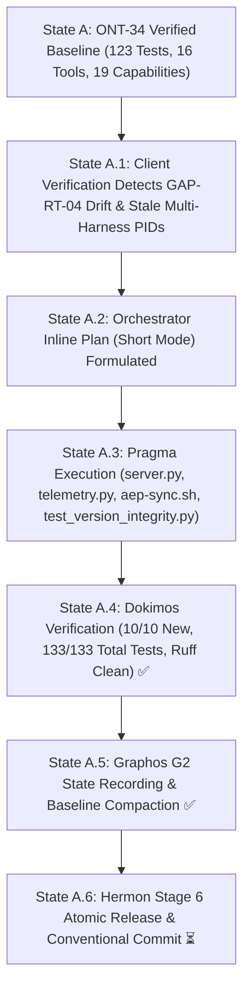

# Pipeline Feature: ONT-35 Version Stamp Integrity (GAP-RT-04), Multi-Harness Sync (GAP-RT-03) & Sandbox Ergonomics

- **Document ID:** `feature_20261104_133000_ont35_version_stamp_integrity_and_sync.md`
- **Predecessor:** [`feature_20261104_105500_ont34_default_primitives_and_factory_decoupling.md`](feature_20261104_105500_ont34_default_primitives_and_factory_decoupling.md)
- **Pipeline Mode:** Short (Orchestrator Inline Plan ──► Pragma Stage 4 ──► Dokimos Stage 5 ──► Graphos G2 Stage 2 ──► Hermon Stage 6)
- **Milestone:** ONT-35 / M96 — Version Stamp Integrity (GAP-RT-04), Multi-Harness Sync (GAP-RT-03) & Sandbox Ergonomics
- **Target Repository:** `/home/ancruz/Documents/workspaces/agent-execution-plane` (`dev` branch)
- **Topos Invariants:**
  - **Version Stamp Freeze at Import (GAP-RT-04):** `LOADED_COMMIT` and source hash are frozen at server import time. At call time, `repo_head` is evaluated, computing `stale: bool = (LOADED_COMMIT != repo_head)`. When stale, severity is elevated to `WARN` and `next_action` contains PID and restart instructions.
  - **Multi-Harness Process Observability (GAP-RT-03):** `./scripts/aep-sync.sh --audit` scans running instances across all harnesses (Antigravity, Claude Code, Codex, Gemini CLI), detecting stale PID drift without killing processes destructively.
  - **Sandbox Ergonomics & Ruff Diagnostics:** Structured parsing in `_parse_ruff_output` distinguishing `check` (violations, fixable) and `format` (would_reformat, reformatted); `sandbox_run` brief output cap with `stdout_tail` (20 lines), `stdout_bytes`, and `truncated: True`; auto-mount for `uv` binary and cache.
  - **Single-Encoding & FastMCP Protocol Invariant (GAP-OM-19):** Preserved across all 16 tools with `attach_envelope(...)` and `output_schema is None`.
  - **Blast Radius & Scope Confinement:** Strictly bounded to `server.py`, `engine/telemetry.py`, `scripts/aep-sync.sh`, and `tests/test_version_integrity.py`.
  - **Zero Regressions:** 133/133 tests passing (100% pass rate across 10 test suites, 0 Ruff SAST errors).
  - **Document Status:** VERIFIED ✅ (Stage 5 Dokimos Multi-Tier Verification Certified)
  - **Verification Report Reference:** [`verification_report_20261104_133500_ont35_version_stamp_integrity_and_sync.md`](verification_report_20261104_133500_ont35_version_stamp_integrity_and_sync.md)
  - **Consumer Verification Reference:** [`../reports/2026-11-04_aep_ont30_34_consumer_verification.md`](../reports/2026-11-04_aep_ont30_34_consumer_verification.md)

---

## 1. Intent & Architectural Overview

Milestone ONT-35 resolves critical runtime lifecycle and ergonomics gaps identified during real-world external consumer verification (Iteration 4 in Chrysalis Bridge):

1. **GAP-RT-04 (Version Stamp Integrity):** Previously, `server.py::_get_git_commit()` invoked `git rev-parse --short HEAD` dynamically on each call. Consequently, long-running agent processes running pre-ONT-34 bytecode reported the newest repository HEAD commit while only exposing 18 capabilities, making it impossible for drift detectors or agents to recognize that the running process was stale. ONT-35 freezes `LOADED_COMMIT` and source SHA-256 at module import time, comparing it against `repo_head` on demand to assert `stale: bool` gracefully.
2. **GAP-RT-03 (Multi-Harness Stale Instance Lifecycle):** When multiple agents (Antigravity `agy`, Claude Code, Codex) run concurrent AEP instances, background processes do not automatically reload when git commits occur. `./scripts/aep-sync.sh --audit` now introspects `/proc` to map running PIDs to their parent harness, comparing execution start timestamps against repository commits and printing actionable, non-destructive restart commands.
3. **Sandbox Runner Ergonomics:**
   - `_parse_ruff_output` splits composite outputs into structured sub-dictionaries (`check` and `format`).
   - `sandbox_run` with `verbosity="brief"` caps verbose standard output to 20 tail lines while returning `stdout_bytes` and `truncated: True`, cutting token overhead by up to 50% for adversarial and test probes.
   - Transparently auto-mounts `uv` binary and `UV_CACHE_DIR` when present.
   - Emphasizes explicit `env={...}` injection in tool docstrings to avoid subshell `env` prefix overhead.

---

## 2. State Evolution Diagram

---

## 3. Resolution Path & Blast Radius

- **Chosen Path:** Standard Linux /proc inspection, runtime module import freeze, and typed envelope telemetry enhancement.
- **Blast Radius Analysis:**
  - `server.py`: +210 / -57 lines (import freeze, `stale` calculation, ruff parser, brief truncation, uv mounts).
  - `engine/telemetry.py`: +5 / -1 lines (allow `severity` override in `attach_envelope`).
  - `scripts/aep-sync.sh`: +41 / -10 lines (`--audit` harness inspection and restart hints).
  - `tests/test_version_integrity.py`: +237 lines (10 dedicated tests covering all GAP-RT-04 and ergonomics behaviors).
- **Tool Reach:** In-RAM memory, Python stdlib, bubblewrap mount arguments, POSIX shell.
- **Impact Outside Scope:** 0 lines altered. Zero regressions in existing 123 tests.

---

## 4. Verification Summary (Dokimos Stage 5)

Dokimos executed the full test battery on 2026-11-04T13:35:00-04:00:
- `tests/test_version_integrity.py`: 10 passed in 0.29s (100%).
- Full suite `tests/`: 133 passed, 6 warnings in 15.52s (100% pass rate).
- SAST: `ruff check .` passed with 0 errors and 0 warnings.
- Sync check: `./scripts/aep-sync.sh --check` passed with code 0.
- Audit check: `./scripts/aep-sync.sh --audit` passed with code 0.
- Verdict: **VERIFIED ✅**.

---

## 5. Next Routing Actions

- Transition to **Hermon (Stage 6 — Release Engine)** for atomic release commit and synchronization.
