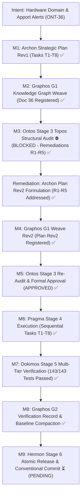
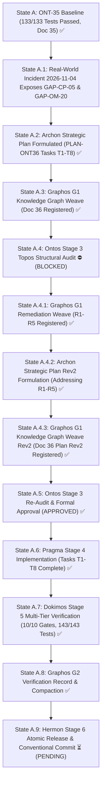
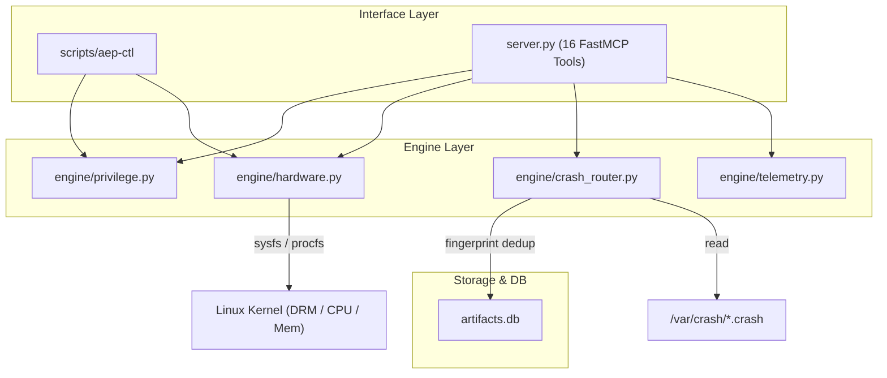
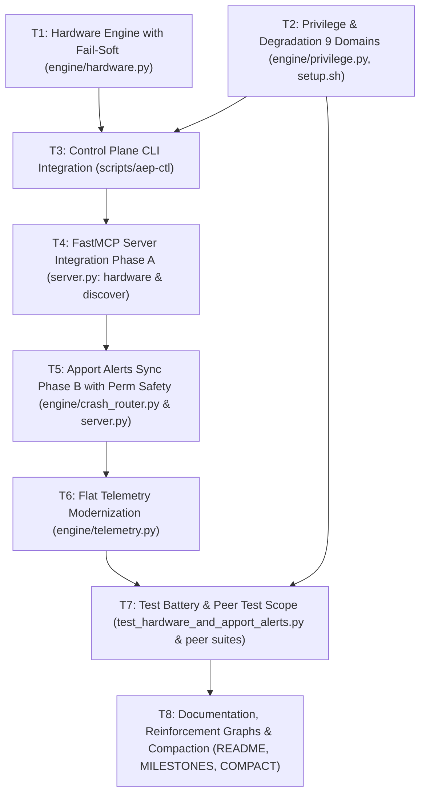

# Pipeline Feature: ONT-36 Hardware Domain & Accelerator Admission (GAP-CP-05) and Apport Crash Alerts Synchronization (GAP-OM-20)

- **Document ID:** `feature_20261105_025500_ont36_hardware_domain_and_apport_alerts.md`
- **Predecessor:** [`feature_20261104_133000_ont35_version_stamp_integrity_and_sync.md`](feature_20261104_133000_ont35_version_stamp_integrity_and_sync.md)
- **Pipeline Mode:** Full (Stage 1: Archon ──► Stage 2: Graphos G1 ──► Stage 3: Ontos ──► Stage 4: Pragma ──► Stage 5: Dokimos ──► Stage 2: Graphos G2 ──► Stage 6: Hermon)
- **Milestone:** ONT-36 / M97 — Hardware Domain & Accelerator Admission (GAP-CP-05) and Apport Crash Alerts Synchronization (GAP-OM-20)
- **Strategic Plan Reference:** `PLAN-ONT36-20261105-HARDWARE-DOMAIN-AND-APPORT-ALERTS-REV2`
- **Target Repository:** `/home/ancruz/Documents/workspaces/agent-execution-plane` (`dev` branch)
- **Topos Invariants:**
  - **FastMCP 16-Tool Invariant Preservation:** Strictly preserve exactly 16 polymorphic FastMCP tools (`len(_tools) == 16`). No new tool endpoints may be introduced; `hardware` is integrated as a domain under the existing polymorphic `aep_ctl` tool.
  - **Pre-Flight Desktop Safety Margin (GAP-CP-05):** Mandatory 4096 MiB desktop safety margin on GTT/VRAM admission in `engine/hardware.py` to prevent desktop compositor crashes (Xorg/Wayland/GNOME Shell SIGABRT).
  - **4-Tier Chmod Degradation Governance:** Hardware domain governed by the 4-tier Unix chmod octal model (`7rwx`, `6rw-`, `5r-x`, `4r--`) in `engine/privilege.py` (`CONTROL_PLANE_SCHEMA` and `CHMOD_DEGRADATION_MATRIX`), expanding control plane domains from 8 to 9.
  - **Apport Forensics Parity (GAP-OM-20):** `diagnose_system_crashes(action="alerts")` must sync `/var/crash/*.crash` files, extract metadata (`ExecutablePath`, `Signal`, `Date`), deduplicate via fingerprint (`apport:<file>:<mtime>`) into `artifacts.db`, and return `status: "OK"` with `source: "apport"` when `coredumpctl` is absent on Debian/Ubuntu.
  - **Single-Encoding & Flat Telemetry Protocol (GAP-OM-19):** Modernize `engine/telemetry.py::attach_envelope` so that compact/summary modes omit redundant nested `envelope` structures, emitting lightweight `t: {"ms": ..., "tok": ...}` stubs across all tools.
  - **Chosen Resolution Path:** Standard in-memory Python stdlib & Linux kernel sysfs/procfs path (Short/Medium reach, bounded blast radius).
  - **Document Status:** `VERIFIED ✅ (Stage 5: Dokimos Multi-Tier Verification Complete)`
  - **Stage 5 Dokimos Verification Report:** [`verification_report_20261105_040000_ont36_hardware_domain_and_apport_alerts.md`](verification_report_20261105_040000_ont36_hardware_domain_and_apport_alerts.md)
  - **Consumer Verification Reference:** [`../reports/2026-11-04_aep_ont30_34_consumer_verification.md`](../reports/2026-11-04_aep_ont30_34_consumer_verification.md)

---

## 1. Intent & Architectural Overview

Milestone ONT-36 addresses two operational gaps identified during real-world consumer testing on 2026-11-04 (Chrysalis Bridge Iteration 4):

### 1.1 GAP-CP-05: Hardware Domain & Pre-Flight Accelerator Admission

On 2026-11-04 at 13:59:34, an autonomous agent launched `llama-server` (Gemma 4 26B-A4B Q4_0, 14.6 GB, `-ngl 99`, ctx 16k) targeting a shared AMD Radeon 780M iGPU. The device possessed only 1 GiB dedicated VRAM carve-out + ~15 GiB GTT shared with the host desktop compositor. The workload exhausted GTT memory, triggering kernel DRM error `amdgpu: [drm] *ERROR* Not enough memory for command submission!`, which caused Mesa `libgallium` to abort in `gnome-shell` (SIGABRT). GDM restarted the graphical session and terminated all active agent harnesses.

Because Linux cgroups cannot dynamically throttle or restrict AMDGPU GTT allocations, pre-flight resource admission is the sole protective barrier. ONT-36 introduces:
- A new polymorphic control plane domain `hardware` under `aep_ctl` (`inventory`, `accelerators`, `admit`).
- A dedicated engine module `engine/hardware.py` inspecting sysfs (`/sys/class/drm/card*/device/mem_info_{vram,gtt}_*`, `/proc/cpuinfo`, `/proc/meminfo`).
- Mandatory enforcement of a **4096 MiB desktop safety margin** on all accelerator admission queries, returning `{admit: bool, vram_free_mib, gtt_free_mib, margin_mib, reason}`.
- Optional `accelerators` summary block in `discover(action="capabilities")` for agent self-orientation.

### 1.2 GAP-OM-20: Apport Crash Alerts Synchronization & Envelope Deduplication

During crash investigation following the incident:
1. `diagnose_system_crashes(action="alerts", verbosity="summary")` reported `pending_count: 0` and `status: "DEGRADED"` with `"coredumpctl ausente; enrutador inerte"`, failing to notify the caller of the critical `gnome-shell` crash located in `/var/crash/_usr_bin_gnome-shell.1000.crash`. While `action="diagnose"` contained an Apport fallback, `action="alerts"` completely lacked it.
2. `diagnose_system_crashes` was still returning legacy duplicated envelopes (`payload["envelope"]`.mirroring top-level keys plus full `telemetry` dict) in summary/brief modes, costing 625 bytes / 156 tokens even for zero-alert responses.

ONT-36 rectifies both defects:
- `engine/crash_router.py` parses `/var/crash/*.crash` headers (`ExecutablePath`, `Signal`, `Date`), deduplicates by `apport:<filename>:<mtime>`, inserts into `artifacts.db`, and returns `status: "OK"` with `source: "apport"`.
- `engine/telemetry.py::attach_envelope` omits redundant nested `envelope` in compact modes and emits the standardized lightweight `t: {"ms": ..., "tok": ...}` stub.

---

## 2. Intent Reinforcement Graph

---

## 3. State Evolution

---

## 4. Topos Dependency Analysis & Co-Dependency Audit

- **Directional Analysis:**
  - `engine/hardware.py` is a leaf dependency module (imports only stdlib `os`, `pathlib`, `json`, `shutil`). Direction: `server.py` → `hardware.py`, `aep-ctl` → `hardware.py`. **Directional Coupling: Valid.**
  - `engine/crash_router.py` depends on `engine/db.py` and `engine/privilege.py`. Direction: `server.py` → `crash_router.py` → `artifacts.db`. **Directional Coupling: Valid.**
  - `engine/telemetry.py` remains a leaf module with zero internal dependencies. **Directional Coupling: Valid.**
- **Co-Dependency Audit:** Exactly 0 mutual cycles or co-dependencies exist between `engine/hardware.py`, `engine/crash_router.py`, `engine/privilege.py`, and `server.py`.

---

## 5. Resolution Path & Blast Radius

- **Chosen Path:** Standard Linux `/sys` and `/proc` hardware introspection, Apport `/var/crash` header extraction with permission fallbacks, SQLite fingerprint upsert, and FastMCP typed polymorphic domain dispatch.
- **Blast Radius Estimate:**
  - `engine/hardware.py`: ~260 lines (new leaf engine module).
  - `engine/privilege.py`: ~45 lines modified (schema and degradation matrix 8 → 9 domains).
  - `scripts/setup.sh`: ~5 lines modified (9 domains banner).
  - `engine/crash_router.py`: ~65 lines modified (permission-safe apport reader + dedup).
  - `engine/telemetry.py`: ~25 lines modified (flat `t` stub for compact modes).
  - `scripts/aep-ctl`: ~60 lines modified (hardware domain CLI subcommands).
  - `server.py`: ~55 lines modified (hardware domain routing + apport fallback in alerts).
  - `tests/test_hardware_and_apport_alerts.py`: ~280 lines (new test suite, 8 gates).
  - `tests/test_privilege_degradation.py`: ~5 lines modified (assert domain count 9).
  - `tests/test_net_security_telemetry.py`: ~5 lines modified (assert domain count 9).
  - `tests/test_agent_experience_evaluation.py`: ~20 lines modified (flat telemetry assertions).
  - Documentation (`README.md`, `MILESTONES.md`, `COMPACT.md`): ~100 lines modified.
- **Tool Reach:** In-RAM Python stdlib, sysfs/procfs read access, SQLite WAL read/write.
- **Safety Boundary:** Strict desktop safety margin of 4096 MiB enforced on all GPU/GTT admissions; fail-soft degradation on restricted/auditor tiers.

---

## 6. Stage 3 Ontos Structural Audit Findings & Remediations

- **Audit Timestamp:** `2026-11-05T03:06:00Z`
- **Auditor:** Ontos Agent (Stage 3 Topos Structural & Compliance Audit)
- **Verdict:** `BLOCKED 🛑` (Transitioned to Archon for Rev2 formulation)
- **Audit Basis:** Topos Integrity Protocol (Horizontal Trace, Vertical Trace, Omission Detection, Gap Cascade Prevention).

### Remediation Requirements:
- **R-1 (Horizontal Trace):** Update scope of peer test suites (`tests/test_privilege_degradation.py:172`, `tests/test_net_security_telemetry.py:227`) and `scripts/setup.sh:142` to reflect expansion from 8 to 9 control plane domains.
- **R-2 (Horizontal Trace & Regression Shield):** Update scope of test assertions in `tests/test_agent_experience_evaluation.py` (lines 156, 206, 212, 222, 236) to assert flat keys + `t` stub for summary calls or specify `verbosity="detail"`.
- **R-3 (Vertical Trace & Robustness):** Enforce fail-soft behavior in `engine/hardware.py` for non-AMD, Intel, NVIDIA, or headless CI container environments lacking DRM sysfs nodes (`{status: "DEGRADED", accelerators: [], reason: "no_drm_devices_detected"}`).
- **R-4 (Omission Detection):** Enforce permission-resilient `/var/crash` file parsing in `engine/crash_router.py` using `try-except (PermissionError, OSError)` with `os.stat` fallback for root-owned or unreadable files.
- **R-5 (Gap Cascade Prevention):** Establish strict sequential execution ordering for `server.py` edits: Phase A (T4: hardware domain & discover capabilities) must precede Phase B (T5: apport alerts fallback).

---

## 7. Remediation Incorporation Matrix (Archon Plan Rev2)

Archon Plan Rev2 (`PLAN-ONT36-20261105-HARDWARE-DOMAIN-AND-APPORT-ALERTS-REV2`) addresses 100% of Ontos remediations:

| Remediation Item | Target Tasks | Ontos Audit Requirement | Plan Rev2 Resolution & Contract |
| :--- | :--- | :--- | :--- |
| **R-1** | **T2, T7** | Expand peer test suites and banner checks from 8 to 9 domains. | Updated Task T2 to modify `scripts/setup.sh:142` to `"9 Domains Fail-Soft Degradation"`. Expanded Task T7 to update assertions in `tests/test_privilege_degradation.py:172` and `tests/test_net_security_telemetry.py:227` from `== 8` to `== 9`. |
| **R-2** | **T6, T7** | Prevent regression in `test_agent_experience_evaluation.py` due to flat telemetry modernization. | Updated Task T6 to standardize flat `t` envelope format. Expanded Task T7 to update the 5 assertion sites in `tests/test_agent_experience_evaluation.py` (lines 156, 206, 212, 222, 236) to assert flat keys + `t` stub or `verbosity="detail"`. |
| **R-3** | **T1, T7** | Prevent `FileNotFoundError`/crashes on non-AMD or headless CI systems. | Mandated in Task T1 that `probe_accelerators()` and `probe_hardware_inventory()` wrap DRM sysfs traversal in defensive checks; if DRM sysfs is missing or unreadable, return `{status: "DEGRADED", accelerators: [], reason: "no_drm_devices_detected"}`. In `admit_accelerator()`, fail-closed with diagnostic reason without throwing unhandled exceptions. Tested in Gate 4 of Task T7. |
| **R-4** | **T5, T7** | Prevent `PermissionError` on restricted `/var/crash/*.crash` files. | Mandated in Task T5 that header parsing in `engine/crash_router.py` wraps file `open()` in `try-except (PermissionError, OSError)`. For unreadable files, extract metadata via `os.stat` fallback (`mtime`, `size`, `owner`) or report as unparsed alert. Tested in Gate 6 of Task T7. |
| **R-5** | **T4, T5** | Prevent concurrency collision and merge regressions in `server.py`. | Formatted the Execution DAG to enforce strict sequential execution: Task T4 (hardware domain routing and discover capabilities) executes and verifies first, followed by Task T5 (apport alert fallback routing in `server.py`). |

---

## 8. Execution Plan Rev2 & Task Breakdown (Archon Tasks T1 to T8)

### 8.1 Execution DAG (Directed Acyclic Graph)

### 8.2 Task Specifications

| Task | Target Module(s) | Description & Contracts | Dependencies | Expected Outputs | Blast Radius |
| :--- | :--- | :--- | :--- | :--- | :--- |
| **T1** | `engine/hardware.py` | Create dedicated hardware inspection & accelerator admission engine. Enforce fail-soft handling on non-AMD GPUs, Intel, NVIDIA, or headless CI systems lacking DRM sysfs (`{status: "DEGRADED", accelerators: [], reason: "no_drm_devices_detected"}`) **[R-3]**. Enforce pre-flight 4096 MiB desktop safety margin on GTT/VRAM in `admit_accelerator(device, req_mib, margin_mib=4096)`. | None (Leaf) | `probe_hardware_inventory()`, `probe_accelerators()`, `admit_accelerator()`. | New file (~260 lines). Leaf engine module. |
| **T2** | `engine/privilege.py`, `scripts/setup.sh` | Register `hardware` domain in `CONTROL_PLANE_SCHEMA` & `CHMOD_DEGRADATION_MATRIX` across 4 tiers (`7rwx`, `6rw-`, `5r-x`, `4r--`). Update `scripts/setup.sh:142` banner string to `"9 Domains Fail-Soft Degradation" **[R-1]**. | None | Updated schema and degradation matrix (8 → 9 domains); updated banner in `setup.sh`. | +45 / -2 lines in `privilege.py`, +2 / -2 lines in `setup.sh`. |
| **T3** | `scripts/aep-ctl` | Implement `domain_hardware(action, name, ...)` in control plane CLI (`inventory`, `accelerators`, `admit`). Enforce 4096 MiB safety margin default and typed JSON contracts. | T1, T2 | Subcommands `aep-ctl hardware <inventory\|accelerators\|admit>` functional with error remediation hints. | +60 / -2 lines in `scripts/aep-ctl`. |
| **T4** | `server.py` (Phase A) | Route `aep_ctl(domain="hardware")` & expose `accelerators` in `discover(action="capabilities")`. Strictly preserve 16 FastMCP tools invariant (`len(_tools) == 16`). Executed strictly prior to T5 to prevent syntax collisions in `server.py` **[R-5]**. | T1, T2, T3 | FastMCP polymorphic domain dispatch to `hardware`; `capabilities` response includes `accelerators`. | +40 / -5 lines in `server.py`. |
| **T5** | `engine/crash_router.py`, `server.py` (Phase B) | Apport crash alerts synchronization in `artifacts.db` with fingerprint dedup (`apport:<file>:<mtime>`) and `status: "OK"` fallback when coredumpctl is absent. Implement permission-safe header reader with `try-except (PermissionError, OSError)` and `os.stat` fallback **[R-4]**. Wire fallback into `server.py::diagnose_system_crashes(action="alerts")` sequentially after T4 **[R-5]**. | T4 | Pending alerts populated from `/var/crash`; zero unhandled exceptions on root-owned crashes. | +65 / -10 lines in `crash_router.py`, +15 / -5 lines in `server.py`. |
| **T6** | `engine/telemetry.py` | Modernize `attach_envelope` to omit redundant nested `envelope` in compact modes (`summary`, `brief`, `terse`, `cached`) and emit standard `t: {"ms": ..., "tok": ...}` stub across all 16 tools **[R-2]**. | T4, T5 | Flat JSON response shape; ~50-80% token savings on high-frequency queries. | +25 / -15 lines in `engine/telemetry.py`. |
| **T7** | `tests/test_hardware_and_apport_alerts.py`, `tests/test_privilege_degradation.py`, `tests/test_net_security_telemetry.py`, `tests/test_agent_experience_evaluation.py` | Dedicated 8-gate test battery for hardware admission, degradation matrix, apport sync, and 16-tool invariant. Update peer test assertions for 9 domains in `test_privilege_degradation.py:172` and `test_net_security_telemetry.py:227` **[R-1]**. Update 5 assertion sites in `test_agent_experience_evaluation.py` for flat telemetry format **[R-2]**. Verify fail-soft sysfs **[R-3]** and permission resilience **[R-4]**. | T1-T6 | >= 10 new passing tests; repository-wide >= 143 passing tests (100% pass rate). | New test file (~280 lines), +30 lines in peer test suites. |
| **T8** | `README.md`, `docs/MILESTONES.md`, `docs/COMPACT.md` | Systemic documentation update, reinforcement graph refresh, context anchor registration, and compaction baseline maintenance. | T7 | Fully synchronized project baseline with ONT-36 verification entries. | Documentation updates only. |

---

## 9. Next Routing Actions

- **Stage 5 Dokimos Verification:** `VERIFIED ✅` (All 10 milestone gates passed, 143/143 full repo tests passed, 0 regressions, 0 lint/SAST errors, 16 FastMCP tools invariant preserved). Reference: [`verification_report_20261105_040000_ont36_hardware_domain_and_apport_alerts.md`](verification_report_20261105_040000_ont36_hardware_domain_and_apport_alerts.md).
- **Stage 2 Graphos G2 Documentation:** `RECORDED & COMPACTED ✅` (State evolution, reinforcement graphs, `docs/MILESTONES.md`, and `docs/COMPACT.md` updated).
- **Next Transition:** Return to Orchestrator ──► **Hermon (Stage 6 — Commit & Push)** for atomic conventional release.
