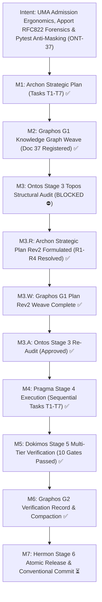
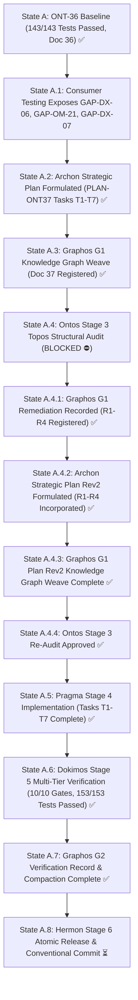
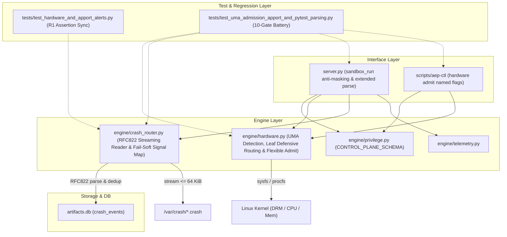
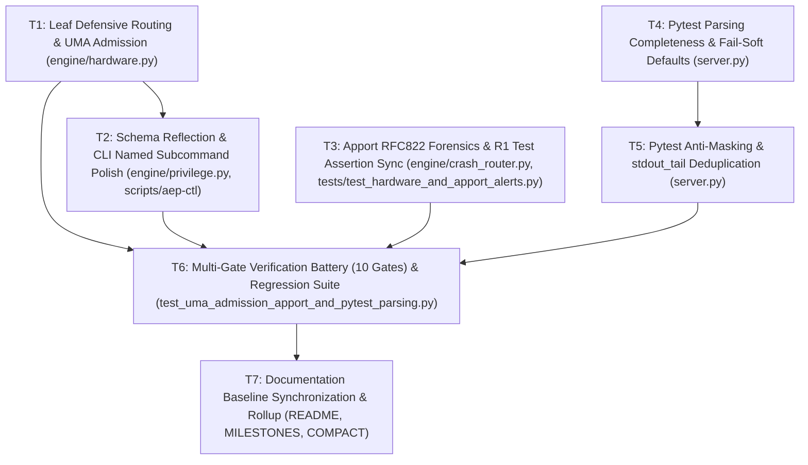

# Pipeline Feature: ONT-37 UMA-Aware Hardware Admission Ergonomics (GAP-DX-06), Apport RFC822 Header Forensics (GAP-OM-21), and Sandbox Pytest Parsing Completeness & Anti-Masking (GAP-DX-07)

- **Document ID:** `feature_20261105_042500_ont37_uma_admission_apport_rfc822_pytest_parsing.md`
- **Predecessor:** [`feature_20261105_025500_ont36_hardware_domain_and_apport_alerts.md`](feature_20261105_025500_ont36_hardware_domain_and_apport_alerts.md)
- **Pipeline Mode:** Full (Stage 1: Archon ──► Stage 2: Graphos G1 ──► Stage 3: Ontos ──► Stage 4: Pragma ──► Stage 5: Dokimos ──► Stage 2: Graphos G2 ──► Stage 6: Hermon)
- **Milestone:** ONT-37 / M98 — UMA-Aware Hardware Admission Ergonomics (GAP-DX-06), Apport RFC822 Header Forensics (GAP-OM-21), and Sandbox Pytest Parsing Completeness & Anti-Masking (GAP-DX-07)
- **Strategic Plan Reference:** `PLAN-ONT37-20261105-UMA-ADMISSION-APPORT-RFC822-PYTEST-PARSING-REV2`
- **Target Repository:** `/home/ancruz/Documents/workspaces/agent-execution-plane` (`dev` branch)
- **Topos Invariants:**
  - **FastMCP 16-Tool Invariant Preservation:** Strictly preserve exactly 16 polymorphic FastMCP tools (`len(_tools) == 16`). No new tool endpoints may be introduced.
  - **UMA-Aware Accelerator Admission (GAP-DX-06 & Remediation R2):** In `engine/hardware.py`, auto-detect Unified Memory Architecture (UMA) / APUs (`vram_total_mib <= 2048` and `gtt_total_mib > vram_total_mib * 2`). When an unqualified single memory request is submitted on a UMA device, route to GTT rather than carve-out VRAM, enforcing the mandatory 4096 MiB desktop safety margin. Support named parameters (`params={"vram_mib": ..., "gtt_mib": ...}`) and flexible numeric arguments. Leaf defensive routing: if `device` is numeric/digits (`str(device).isdigit()`), interpret as `req_mib = int(device)` and set `device = None` (auto-selecting default accelerator card). Provide actionable `next_action` on rejection. Reflect schema in `CONTROL_PLANE_SCHEMA["hardware"]` and `scripts/aep-ctl`.
  - **Apport RFC822 Streaming Header Forensics & Fail-Soft Mapping (GAP-OM-21 & Remediation R3):** In `engine/crash_router.py`, implement a streaming parser capped at 64 KiB (`65536` bytes) to prevent memory saturation on multi-hundred megabyte crash files containing base64 `CoreDump`. Parse standard RFC822 headers (`Signal`, `ProcCmdline`, `Pid`, `ExecutablePath`, `Date`). Map integer signal numbers to POSIX names via `signal.Signals(int(sig)).name` (e.g. `6` ──► `"SIGABRT"`), wrapped in fail-soft `try...except (ValueError, TypeError)` falling back to `str(sig)`.
  - **Existing Test Regression Continuity (Remediation R1):** In `tests/test_hardware_and_apport_alerts.py:273`, synchronize Gate 6 assertion to accept both POSIX signal names and raw integers (`alert_ok["signal"] in ("11", "SIGSEGV")`), preserving 143/143 existing test continuity.
  - **Sandbox Pytest Parsing Completeness & Anti-Masking (GAP-DX-07 & Remediation R4):** In `server.py::_parse_pytest_output`, extract `deselected`, `xfailed`, `xpassed`, and coverage percentage (`TOTAL ... XX%`) with explicit fail-soft defaults (`0` or `None`). When `parse="pytest"` and exit code is 0, contrast against test summary; if `failed > 0` or `errors > 0`, force `status = "EXEC_FAILED"`, set `exit_code_masked = True`, and alert the caller that failures were masked by a shell pipeline. Deduplicate consecutive identical lines in `stdout_tail` under `verbosity="brief"` mode.
  - **4-Tier Chmod Degradation Governance:** Hardware domain and diagnostic primitives governed under the 4-tier Unix chmod model (`7rwx`, `6rw-`, `5r-x`, `4r--`) in `engine/privilege.py`.
  - **Chosen Resolution Path:** Standard in-memory Python stdlib, Linux kernel sysfs/procfs inspection, Apport RFC822 stream parsing, and pytest output regex extraction (Short/Medium reach, bounded blast radius).
  - **Execution Report Reference:** [`execution_report_20261105_050000_ont37_uma_admission_apport_rfc822_pytest_parsing.md`](execution_report_20261105_050000_ont37_uma_admission_apport_rfc822_pytest_parsing.md)
  - **Verification Report Reference:** [`verification_report_20261105_051500_ont37_uma_admission_apport_rfc822_pytest_parsing.md`](verification_report_20261105_051500_ont37_uma_admission_apport_rfc822_pytest_parsing.md)
  - **Document Status:** `VERIFIED ✅ (All 10 Dedicated Gates Passed, 153/153 Suite Passed, 0 Regressions, 16 FastMCP Invariant Preserved)`
  - **Consumer Verification Reference:** [`../reports/2026-11-05_aep_ont36_consumer_verification.md`](../reports/2026-11-05_aep_ont36_consumer_verification.md)

---

## 1. Intent & Architectural Overview

Milestone ONT-37 resolves critical ergonomic and forensic gaps uncovered during real-world consumer testing on 2026-11-05 (Chrysalis Bridge Iteration 5, commit `c04f838`):

### 1.1 GAP-DX-06: UMA-Aware Hardware Admission Ergonomics

During consumer evaluation on an AMD Ryzen 9 8945HS with Radeon 780M iGPU (1 GiB carve-out VRAM, 15,179 MiB GTT shared with the desktop):
- When calling `aep_ctl(domain="hardware", action="admit", name="card1", args=["6144"])`, the admission engine loaded the entire 6144 MiB against VRAM, causing an immediate rejection (`insufficient_vram: requested 6144 MiB, free 454 MiB`), even though 10,957 MiB of GTT remained available after the 4096 MiB safety margin.
- Because positional arguments were undocumented and non-intuitive (`args=[req_vram, req_gtt]`), autonomous agents falsely concluded that the workload "did not fit" on the hardware.
- Furthermore, passing numeric arguments in `name` or `device` (e.g. `name="6144"`) triggered `device_6144_not_found`.
- **ONT-37 Resolution:**
  1. Detect UMA when `vram_total_mib <= 2048` and `gtt_total_mib > vram_total_mib * 2`.
  2. For UMA devices, auto-route unqualified requests to GTT (`allocated_to="gtt"`, `is_uma=True`).
  3. Support named parameters: `params={"vram_mib": ..., "gtt_mib": ...}` and `params={"req_mib": ...}`.
  4. Leaf defensive routing: auto-cast numeric `device` parameter to `req_mib = int(device)` and select default accelerator.
  5. Emit actionable `next_action` on rejection indicating UMA architecture.
  6. Reflect full admission signature in `CONTROL_PLANE_SCHEMA["hardware"]` and `scripts/aep-ctl`.

### 1.2 GAP-OM-21: Apport RFC822 Header Forensics

In crash alerts generated by `diagnose_system_crashes(action="alerts")`:
- Crash alerts for `/var/crash/_usr_bin_gnome-shell.1000.crash` returned `signal: "UNKNOWN"`, `pid: null`, and `cmdline: null`.
- Apport `.crash` files format headers in standard RFC822 text format (`Signal: 6`, `Pid: 1234`, `ProcCmdline: /usr/bin/gnome-shell`).
- Losing the signal number hindered triage, as agents could not distinguish driver assertion crashes (SIGABRT = 6) from illegal memory dereferences (SIGSEGV = 11).
- **ONT-37 Resolution:**
  1. Parse standard RFC822 headers line-by-line using a streaming reader capped at 64 KiB (`65536` bytes), stopping before large base64 `CoreDump` blobs.
  2. Map signal numbers to POSIX names using `signal.Signals(int(sig)).name` (e.g. `6` ──► `"SIGABRT"`), wrapped in fail-soft `try...except (ValueError, TypeError)` falling back to `str(sig)`.
  3. Synchronize `tests/test_hardware_and_apport_alerts.py:273` to assert `alert_ok["signal"] in ("11", "SIGSEGV")` preserving 143/143 existing test continuity.
  4. Populate `signal`, `pid`, and `cmdline` in `artifacts.db` and return alerts.

### 1.3 GAP-DX-07: Sandbox Pytest Parsing Completeness & Anti-Masking

During test automation in `sandbox_run(parse="pytest")`:
- The parser only extracted `passed`, `failed`, `errors`, and `skipped`, omitting `deselected`, `xfailed`, `xpassed`, and test coverage percentage.
- When an agent ran tests via a piped command (e.g. `pytest -x ... | tail`), the pipeline exit code was 0 despite test failures, causing `sandbox_run` to report `status: "SUCCESS"`.
- Consecutive identical lines in `stdout_tail` cluttered logs in `verbosity="brief"` mode.
- **ONT-37 Resolution:**
  1. Extract `deselected`, `xfailed`, `xpassed`, and `coverage` from pytest summary output with fail-soft defaults (`0` or `None`).
  2. Implement anti-masking: if `parse == "pytest"`, exit code is 0, but `failed > 0` or `errors > 0`, override status to `"EXEC_FAILED"`, set `exit_code_masked = True`, and emit an anti-masking warning.
  3. Deduplicate consecutive identical lines in `stdout_tail` under brief mode.

---

## 2. Intent Reinforcement Graph



---

## 3. State Evolution



---

## 4. Topos Dependency Analysis & Co-Dependency Audit



- **Directional Trace Analysis:**
  - `engine/hardware.py` remains a pure stdlib leaf module. Direction: `server.py` ──► `hardware.py`, `aep-ctl` ──► `hardware.py`. Incorporates R2 leaf defensive routing directly in `admit_accelerator`. **Valid directional coupling.**
  - `engine/crash_router.py` imports `signal` stdlib module for POSIX mapping with fail-soft fallback (R3). Direction: `server.py` ──► `crash_router.py` ──► `artifacts.db`. Synchronizes with existing Gate 6 test in `tests/test_hardware_and_apport_alerts.py:273` (R1). **Valid directional coupling.**
  - `server.py` enhances runner parsing and anti-masking internally within `_parse_pytest_output` and `sandbox_run` with fail-soft metric defaults (R4). **Valid.**
- **Co-Dependency Audit:** Exactly 0 circular cycles or co-dependencies exist between `engine/hardware.py`, `engine/crash_router.py`, `engine/privilege.py`, and `server.py`.

---

## 5. Resolution Path & Blast Radius

- **Chosen Path:** Standard in-memory Python stdlib (`signal`, `re`, `pathlib`), Linux kernel `/sys` and `/proc` hardware introspection, Apport RFC822 streaming reader with 64 KiB cap, fail-soft signal and metric mapping, and FastMCP typed polymorphic domain dispatch.
- **Blast Radius Estimate:**
  - `engine/hardware.py`: ~85 lines modified (UMA detection, unqualified GTT routing, leaf numeric device defensive routing, flexible parameter handling, actionable next_action).
  - `engine/privilege.py`: ~25 lines modified (schema reflection for `hardware.admit` named parameters and UMA notes).
  - `scripts/aep-ctl`: ~35 lines modified (`hardware admit` named argument parsing `--vram`, `--gtt`, `--margin`).
  - `engine/crash_router.py`: ~50 lines modified (64 KiB streaming reader, RFC822 `Signal`, `ProcCmdline`, `Pid` parsing, fail-soft POSIX signal name conversion).
  - `tests/test_hardware_and_apport_alerts.py`: ~5 lines modified (R1 Gate 6 assertion sync: `alert_ok["signal"] in ("11", "SIGSEGV")`).
  - `server.py`: ~70 lines modified (pytest parse completeness: `deselected`, `xfailed`, `xpassed`, `coverage` with fail-soft defaults; anti-masking override `exit_code_masked=True`; `stdout_tail` line deduplication).
  - `tests/test_uma_admission_apport_and_pytest_parsing.py`: ~320 lines (new test suite, 10 gates).
  - Documentation (`README.md`, `MILESTONES.md`, `COMPACT.md`): ~60 lines modified.
- **Tool Reach:** In-RAM Python stdlib, sysfs/procfs read access, SQLite WAL read/write.
- **Safety Boundary:** Strict desktop safety margin of 4096 MiB enforced on all GPU/GTT admissions; fail-soft degradation on restricted/auditor tiers; memory-capped streaming on large crash files; leaf defensive input normalization.

---

## 6. Execution Plan & Task Breakdown (Archon Plan Rev2: Tasks T1 to T7)

### 6.1 Execution DAG (Directed Acyclic Graph)



### 6.2 Task Specifications (Rev2)

| Task | Target Module(s) | Description & Contracts | Dependencies | Expected Outputs | Blast Radius |
| :--- | :--- | :--- | :--- | :--- | :--- |
| **T1** | `engine/hardware.py` | Detect UMA (`vram_total_mib <= 2048 and gtt_total_mib > vram_total_mib * 2`). Auto-route unqualified requests (`req_mib` or single arg) to GTT on UMA devices with `allocated_to="gtt"`, enforcing the 4096 MiB safety margin. Support named parameters (`params={"vram_mib": ..., "gtt_mib": ...}`) and flexible numeric arguments. **Remediation R2 Leaf Defensive Routing:** If `device` is numeric or digits (`str(device).isdigit()`), defensive routing interprets it as `req_mib = int(device)` and resets `device = None` (auto-selecting default card). Emit actionable `next_action` on rejection indicating UMA architecture. | None (Leaf) | `is_uma` detection, auto-routed GTT admission, numeric device leaf fallback, actionable `next_action`. | ~85 lines modified in `engine/hardware.py`. |
| **T2** | `engine/privilege.py`, `scripts/aep-ctl` | Reflect `hardware.admit` named parameters (`vram_mib`, `gtt_mib`, `req_mib`, `margin_mib`) and UMA behavior in `CONTROL_PLANE_SCHEMA["hardware"]`. Update `scripts/aep-ctl` hardware subcommand parser to support `--vram`, `--gtt`, `--margin` named flags and positional auto-detection. | T1 | Schema reflection in `aep_ctl(action="schema")`; CLI support for named/positional admit args. | ~25 lines in `privilege.py`, ~35 lines in `scripts/aep-ctl`. |
| **T3** | `engine/crash_router.py`, `tests/test_hardware_and_apport_alerts.py` | Implement streaming RFC822 header parser capped at 64 KiB (`65536` bytes) for `/var/crash/*.crash` files, halting before multiline base64 blobs. Extract `Signal`, `ProcCmdline`, `Pid`, `ExecutablePath`, `Date`. Map numeric signal to POSIX name via `signal.Signals(int(sig)).name` (e.g. `6` ──► `"SIGABRT"`). **Remediation R3 Fail-Soft Signal Mapping:** Wrap `signal.Signals(int(sig)).name` in `try...except (ValueError, TypeError)`, falling back gracefully to `str(sig)` or `"UNKNOWN"`. Populate `signal`, `pid`, `cmdline` in `artifacts.db` and alerts. **Remediation R1 Test Regression Sync:** Synchronize `tests/test_hardware_and_apport_alerts.py:273` assertion to `assert alert_ok["signal"] in ("11", "SIGSEGV")` to preserve 143/143 existing test continuity. | None | Complete crash telemetry with POSIX signal names, fail-soft mapping, memory-safe reader, and 100% existing test continuity. | ~50 lines in `crash_router.py`, ~5 lines in `test_hardware_and_apport_alerts.py`. |
| **T4** | `server.py` | In `_parse_pytest_output`, extract `deselected`, `xfailed`, `xpassed`, and test coverage percentage (`TOTAL ... XX%`). **Remediation R4 Fail-Soft Pytest Defaults:** Ensure `_parse_pytest_output` provides explicit fail-soft defaults for all new metrics: `deselected: 0`, `xfailed: 0`, `xpassed: 0`, `coverage: None`. Expose extended metrics in parsed output dict. | None | Complete test metric breakdown in `sandbox_run` parsed payload with zero `KeyError` risk. | ~35 lines modified in `server.py`. |
| **T5** | `server.py` | Implement anti-masking check in `sandbox_run`: if `parse == "pytest"`, exit code is 0, but `failed > 0` or `errors > 0`, override status to `"EXEC_FAILED"`, set `exit_code_masked = True`, and emit an alert in summary/next_action. Deduplicate consecutive identical lines in `stdout_tail` under `verbosity="brief"` mode. | T4 | Reliable failure detection despite shell pipes (`| tail`); clean concise `stdout_tail`. | ~35 lines modified in `server.py`. |
| **T6** | `tests/test_uma_admission_apport_and_pytest_parsing.py` | Create dedicated 10-gate test battery testing: Gate 1 (UMA detection), Gate 2 (GTT auto-routing), Gate 3 (dGPU VRAM routing), Gate 4 (named parameters & R2 leaf numeric device fallback), Gate 5 (actionable rejection next_action), Gate 6 (schema reflection), Gate 7 (Apport RFC822 streaming & R3 fail-soft signal mapping), Gate 8 (pytest parse completeness & R4 fail-soft defaults), Gate 9 (anti-masking override & deduplication), and Gate 10 (16-tool FastMCP invariant). Verify 100% pass across full regression test suite (143/143 + 10 = >= 153 passing tests). | T1, T2, T3, T5 | >= 10 new passing tests; 100% pass rate across entire regression test suite. | New test file (~320 lines). |
| **T7** | `README.md`, `docs/MILESTONES.md`, `docs/COMPACT.md` | Systemic documentation update, reinforcement graph refresh, context anchor registration, and compaction baseline maintenance. | T6 | Synchronized project baseline with ONT-37 entries. | Documentation updates only. |

---

## 7. Stage 3 Ontos Topos Audit Report & Remediation Items

- **Audit Verdict:** `BLOCKED ⛔`
- **Auditor:** Ontos (Stage 3 Structural Audit)
- **Status Transition:** `PLANNED ⏳` ──► `BLOCKED 🛑 (Remediation Required)` ──► `PLAN REV2 FORMULATED ✅` ──► `PENDING_RE_AUDIT ⏳`
- **Interception Point:** Graphos G1 Post-Ontos Interception & Plan Rev2 Weave (Full Mode)

### 7.1 Remediation Specifications (R1 to R4)

1. **R1 — Existing Test Regression Synchronization (`tests/test_hardware_and_apport_alerts.py:273`):**
   - **Finding:** Task T3 converts Apport signal numbers from raw strings/integers to POSIX signal names (e.g., `11` ──► `"SIGSEGV"`). Existing Gate 6 test in `tests/test_hardware_and_apport_alerts.py:273` explicitly asserts:
     ```python
     assert alert_ok["signal"] == "11"
     ```
     Deploying T3 without updating this assertion causes a regression breaking 143/143 existing test continuity.
   - **Remediation Contract:** Archon Rev2 must explicitly schedule synchronization of `tests/test_hardware_and_apport_alerts.py:273` to assert `alert_ok["signal"] in ("11", "SIGSEGV")` (or `== "SIGSEGV"`), guaranteeing backward compatibility and 100% regression suite pass.

2. **R2 — Leaf Defensive Numeric Device Routing (`engine/hardware.py::admit_accelerator`):**
   - **Finding:** Consumers or agents calling `admit_accelerator(device="6144")` or `name="6144"` trigger `device_6144_not_found` if defensive routing is only implemented in `aep-ctl` or `server.py`.
   - **Remediation Contract:** In `engine/hardware.py::admit_accelerator`, if `device` is numeric or digits (`str(device).isdigit()`), defensive routing must interpret it as `req_mib = int(device)` and reset `device = None` (auto-selecting default card).

3. **R3 — Fail-Soft Signal Name Mapping (`engine/crash_router.py`):**
   - **Finding:** Calling `signal.Signals(int(sig)).name` directly on unknown or non-standard kernel signal numbers (e.g. real-time signals or malformed Apport headers) raises `ValueError`, crashing the crash sync loop.
   - **Remediation Contract:** Wrap `signal.Signals(int(sig)).name` in a robust `try...except (ValueError, TypeError)` block, falling back gracefully to `str(sig)` or `"UNKNOWN"`.

4. **R4 — Fail-Soft Pytest Metric Defaults (`server.py::_parse_pytest_output`):**
   - **Finding:** If pytest outputs non-standard summaries or is invoked with custom plugins, missing regex groups could produce missing dictionary keys in parsed outputs.
   - **Remediation Contract:** Ensure `_parse_pytest_output` provides explicit fail-soft defaults for all new metrics: `deselected: 0`, `xfailed: 0`, `xpassed: 0`, `coverage: None`.

### 7.2 Plan Rev2 Remediation Incorporation Matrix

| Remediation Item | Target Module(s) | Task Mapping | Architectural Resolution in Plan Rev2 | Verification Gate |
| :--- | :--- | :--- | :--- | :--- |
| **R1 (Test Regression Sync)** | `tests/test_hardware_and_apport_alerts.py:273` | T3, T6 | Synchronize Gate 6 test assertion to accept both POSIX signal names and raw integers: `assert alert_ok["signal"] in ("11", "SIGSEGV")`. Preserves 143/143 existing test continuity. | Gate 6 & Gate 7 / Full Test Suite |
| **R2 (Leaf Defensive Routing)** | `engine/hardware.py::admit_accelerator` | T1 | If `device` is numeric/digits (`str(device).isdigit()`), defensive routing interprets it as `req_mib = int(device)` and resets `device = None` (auto-selecting default accelerator card). Prevents `device_6144_not_found` at engine core leaf. | Gate 4 |
| **R3 (Fail-Soft Signal Mapping)** | `engine/crash_router.py` | T3 | Wrap `signal.Signals(int(sig)).name` in `try...except (ValueError, TypeError)` with graceful fallback to `str(sig)` or `"UNKNOWN"`. Protects against unexpected or real-time signals without crashing. | Gate 7 |
| **R4 (Fail-Soft Pytest Metric Defaults)** | `server.py::_parse_pytest_output` | T4 | Ensure `_parse_pytest_output` provides explicit fail-soft defaults for all new keys: `deselected: 0`, `xfailed: 0`, `xpassed: 0`, `coverage: None`. Eliminates `KeyError` risk on non-standard output. | Gate 8 |

---

## 8. Stage 5 Dokimos Verification & Formal Verdict

- **Verification Report Reference:** [`docs/pipeline/verification_report_20261105_051500_ont37_uma_admission_apport_rfc822_pytest_parsing.md`](verification_report_20261105_051500_ont37_uma_admission_apport_rfc822_pytest_parsing.md)
- **Execution Report Reference:** [`docs/pipeline/execution_report_20261105_050000_ont37_uma_admission_apport_rfc822_pytest_parsing.md`](execution_report_20261105_050000_ont37_uma_admission_apport_rfc822_pytest_parsing.md)
- **Verdict:** **VERIFIED ✅**
- **Test Results Summary:**
  - Dedicated ONT-37 Test Battery (`tests/test_uma_admission_apport_and_pytest_parsing.py`): **10/10 passed** (0.39s, 100% pass rate).
  - Peer ONT-36 Test Battery (`tests/test_hardware_and_apport_alerts.py`): **10/10 passed** (0.50s, 100% pass rate).
  - Full Repository Test Suite (`pytest tests/ -v`): **153/153 passed** (20.98s, 100% pass rate, 0 regressions, 0 failures).
- **Invariants Verified:**
  - **FastMCP 16-Tool Invariant:** Strictly preserved (`len(_tools) == 16`). Zero tool proliferation.
  - **UMA-Aware Accelerator Admission:** Unqualified requests auto-route to GTT on UMA devices; 4096 MiB desktop safety margin preserved; leaf defensive routing handles numeric device arguments.
  - **Apport RFC822 Forensics:** 64 KiB streaming cap halts before multiline base64 blobs; signal conversion maps integer signals to POSIX names (`SIGABRT`, `SIGSEGV`) with fail-soft fallback.
  - **Pytest Parsing Completeness & Anti-Masking:** `_parse_pytest_output` extracts `deselected`, `xfailed`, `xpassed`, and `coverage` with fail-soft defaults; `sandbox_run` intercepts exit code 0 when tests report failures, overriding to `EXEC_FAILED` with `exit_code_masked: true`.
  - **Line Deduplication:** Repeated consecutive lines collapsed cleanly in brief/terse `stdout_tail`.
- **Static Analysis & SAST:** Ruff 0.12.x clean (0 errors, 0 warnings across full codebase).
- **Ecosystem Sync:** `./scripts/aep-sync.sh --check` clean (exit code 0).
- **Remediations R1-R4 Status:** All 4 Ontos remediation items completely satisfied and verified.

---

## 9. Next Routing Actions

- **Current Stage:** Stage 2: Graphos G2 Verification Record Complete.
- **Routing Decision:** Return to Orchestrator ──► **Hermon (Stage 6 — Atomic Release & Conventional Commit)** to execute conventional commit, update changelog/release notes, and finalize Milestone ONT-37.
