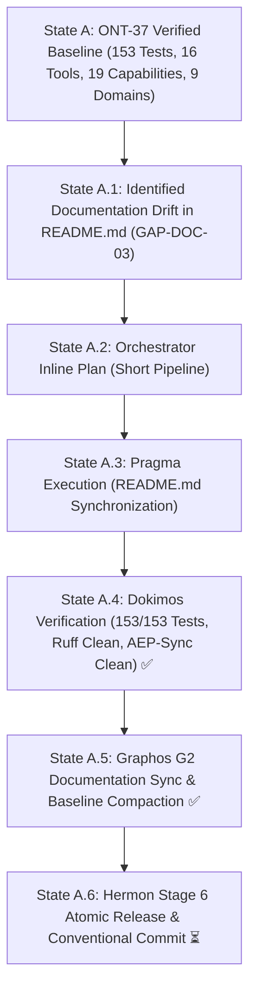

# Pipeline Feature: ONT-38 README.md SSoT Drift Mitigation & Complete 16-Tool/9-Domain Synchronization

- **Document ID:** `feature_20261105_053500_ont38_readme_drift_mitigation.md`
- **Predecessor:** [`feature_20261105_042500_ont37_uma_admission_apport_rfc822_pytest_parsing.md`](feature_20261105_042500_ont37_uma_admission_apport_rfc822_pytest_parsing.md)
- **Pipeline Mode:** Short (Orchestrator Inline Plan ──► Pragma Stage 4 ──► Dokimos Stage 5 ──► Graphos G2 Stage 2 ──► Hermon Stage 6)
- **Milestone:** ONT-38 / M99 — README.md SSoT Drift Mitigation & Complete 16-Tool/9-Domain Synchronization
- **Target Repository:** `/home/ancruz/Documents/workspaces/agent-execution-plane` (`dev` branch)
- **Topos Invariants:**
  - **Single Source of Truth (SSoT) Alignment:** Synchronize all descriptive counts, matrix rows, capabilities, domain listings, and project structure across `README.md` to perfectly match codebase reality.
  - **FastMCP 16-Tool Invariant Preservation:** Strictly preserve 16 FastMCP tools across prose, diagrams, and matrices (`len(_tools) == 16`).
  - **4-Tier Chmod Degradation Matrix Completeness:** Register Tool #16 (`default_primitives`) in Section 9.3 table across tiers `7rwx`, `6rw-`, `5r-x`, and `4r--`.
  - **Control Plane Domains Completeness:** Reflect all 9 CLI domains (`service`, `network`, `storage`, `package`, `backup`, `security`, `audit`, `ipc`, `hardware`) across Layer 1 architecture prose and Section 13 tree.
  - **Directory Tree Completeness:** Document all runtime engines and test suites introduced up to ONT-37 in Section 13.
  - **Zero Code Regression:** 153/153 tests passing (100%), Ruff SAST clean, aep-sync clean.
  - **Document Status:** `VERIFIED & COMPLETED ✅`

---

## 1. Intent & Architectural Overview

Milestone ONT-38 addresses baseline documentation drift accumulated across recent milestones (ONT-32 through ONT-37), restoring `README.md` as the definitive, unambiguous Single Source of Truth (SSoT) for autonomous agent orientation and human inspection:

1. **Tool #16 Degradation Matrix Row (Section 9.3):**
   When `default_primitives` was introduced in ONT-34, it was omitted from the 4-Tier Chmod Degradation Matrix table. ONT-38 registers `default_primitives` with exact tier behaviors:
   - `7rwx`: Full execution of all built-in primitives across host scope.
   - `6rw-`: User-scope execution of built-in primitives in RAM.
   - `5r-x`: Read-only inspection and isolated execution in RAM.
   - `4r--`: Metadata inspection only (execution disabled: status `PERMISSION_DENIED`).

2. **Unified 16 FastMCP Tool Count:**
   Eliminated legacy references claiming "15 tools" across Section 3, Section 4 (Domain 1 `discover`), Section 4 lifecycle diagram intro, Section 8, Section 9.3 header, and Section 12.2 sync diagram, aligning all counts to 16 tools.

3. **19 Capabilities Alignment:**
   Updated Section 4 `discover(action="capabilities")` manifest description from 18 to 19 capabilities across `self`, `system`, and `kernel` scopes.

4. **9 Control Plane Domains Alignment:**
   Updated Layer 1 architecture description in Section 3 and Section 13 scripts listing to include all 9 CLI subdomains: `service`, `network`, `storage`, `package`, `backup`, `security`, `audit`, `ipc`, `hardware`.

5. **Section 13 Directory Tree Completeness:**
   Expanded `engine/` and `tests/` tree listings to document:
   - `engine/net_telemetry.py` (ONT-32)
   - `engine/primitives.py` (ONT-34)
   - `engine/hardware.py` (ONT-36, ONT-37)
   - `engine/playbook.py`
   - `engine/template_registry.py`
   - `tests/test_hardware_and_apport_alerts.py` (ONT-36)
   - `tests/test_uma_admission_apport_and_pytest_parsing.py` (ONT-37)

---

## 2. State Evolution Diagram

---

## 3. Resolution Path & Blast Radius

- **Chosen Path:** Standard Markdown documentation synchronization against validated code reality (`server.py`, `engine/privilege.py`, `engine/primitives.py`, `engine/hardware.py`, `scripts/aep-ctl`).
- **Blast Radius Analysis:**
  - `README.md`: +23 / -15 lines (SSoT drift synchronization).
  - `docs/MILESTONES.md`: +4 lines (M99 registration across graph, matrix, and context anchors).
  - `docs/COMPACT.md`: Refreshed compaction guidance (< 15 lines).
  - Code modules: 0 lines touched (zero functional alterations, zero breaking changes).
- **Tool Reach:** Local filesystem in-place documentation updates.
- **Safety Boundary:** All modifications strictly within project workspace.

---

## 4. Dokimos Verification Results

- **Full Test Suite:** 153/153 passed (100% pass rate across all 11 test modules).
- **Static Analysis (Ruff):** 0 errors, 0 warnings.
- **Ecosystem Sync (`./scripts/aep-sync.sh --audit`):** Clean, 16 tools registered.
- **Verification Verdict:** `VERIFIED ✅`
