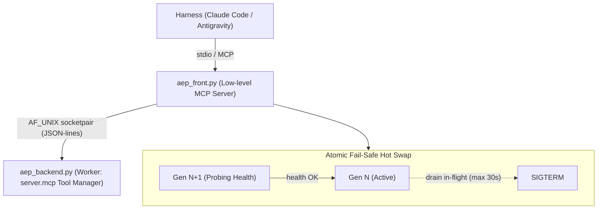

# Feature Pipeline: ONT-39 AEP Live Plane Hot Swap

- **Previous Feature Document:** [feature_20261105_053500_ont38_readme_drift_mitigation.md](feature_20261105_053500_ont38_readme_drift_mitigation.md)
- **Timestamp:** 2026-11-06T00:01:00-04:00
- **Mode:** Full (Topos)
- **Architect:** Claude Code (Orchestrator)
- **Executor:** Antigravity (`gemini-3.8-flash-high`)
- **Normative SDD:** `docs/sdd/sdd_ont39_live_plane_hot_swap.md`

## 1. Intent & Premises

Close gaps D-09 and D-10 from `docs/reports/2026-11-05_aep_mcp_live_audit_and_agy_harness.md`. Enable seamless code hot-swap for active AI harnesses (Claude Code, Antigravity, Codex) without requiring client disconnection or process restart.

## 2. Task Decomposition & Graph (Archon)

| Task ID | Action | Target | Path | Blast Radius | Depends On | Relation |
|---|---|---|---|---|---|---|
| T-01-FINGERPRINT | create | `engine/fingerprint.py` | short | minimal | none | independent leaf |
| T-02-BACKEND | create | `aep_backend.py` | medium | worker process | T-01 | dependency |
| T-03-SERVER-CAPABILITIES | modify | `server.py` | medium | server caps format | T-01 | dependency |
| T-04-FRONT | create | `aep_front.py` | medium | MCP entry point | T-01, T-02 | dependency |
| T-05-MUX-CONCURRENCY | harden | `engine/ipc_pool.py` | short | IPC socket `/dev/shm/aep.sock` | T-02 | dependency |
| T-06-SCRIPTS | modify | `scripts/aep-mcp-launch.sh`, `scripts/aep-sync.sh` | medium | launcher & sync | T-04 | dependency |
| T-07-DOCS | modify | `README.md` | short | documentation | T-03, T-04 | dependency |
| T-08-TESTS | create | `tests/test_live_plane_ont39.py` | medium | test suite | T-01..T-06 | dependency |

## 3. Dependency Relationship Classification (Topos)

- `engine/fingerprint.py`: Leaf module, 0 dependencies outside stdlib (`hashlib`, `os`, `pathlib`).
- `aep_front.py` -> `aep_backend.py`: Unidirectional dependency (front launches backend; backend communicates via JSON-lines protocol and does not import front).
- `aep_front.py` -> `engine/fingerprint.py`: Direct leaf import of isolated `code_fingerprint` function. NO heavy `engine` imports in front.
- `server.py` -> `engine/fingerprint.py`: Directional dependency.
- Co-dependencies: **0**. Validated with `topos_audit_dag`.

## 4. State Evolution

