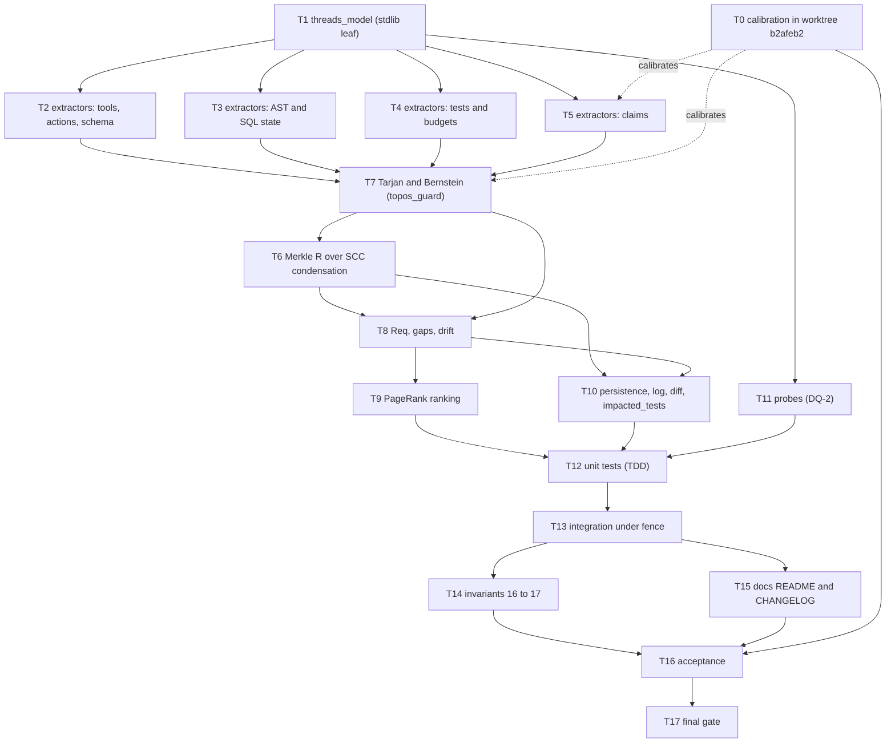
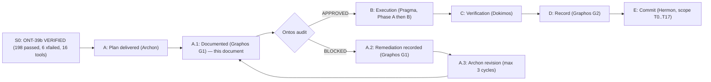
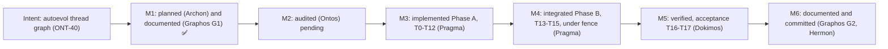
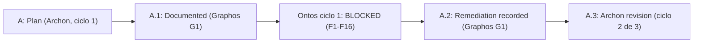
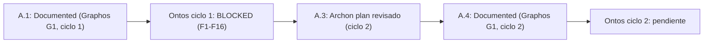

# Pipeline Feature: ONT-40 `autoevol` Thread Graph (read-only, tool 17)

- **Previous Feature Document:** [feature_20261106_000100_ont39_live_plane_hot_swap.md](feature_20261106_000100_ont39_live_plane_hot_swap.md)
- **Timestamp:** 2026-11-06T01:12:49 (local)
- **Mode:** Full (Topos)
- **Stage:** 2 — Graphos G1 (Weave & Record) and G2 (verdict recorded, §16).
- **Architect:** Archon (plan delivered by the orchestrator)
- **Normative SDD:** `docs/sdd/sdd_ont40_autoevol_thread_graph.md` (§0–§8; §7 and §8 are working-tree changes, see §10)
- **Baseline:** `dev`, HEAD `3515a22` (pushed to `origin/dev`), ONT-39b VERIFIED (198 passed, 6 xfailed)
- **Pipeline verdict:** VERIFIED (Dokimos) for ONT-40 + ONT-40b; Ontos cycle 2 APPROVED. See §16. Commit pending (Hermon).

## 1. Intent & Premises

**Intent:** give AEP a read-only, deterministic view of its own structure and promises: a thread graph (`engine/threads.py`) with Merkle integrity over the SCC condensation, gap detection by omission (`Req(t)`), drift between declared claims and measured reality, PageRank-weighted prioritization, and an audit trail of graph generations. Exposed as tool 17, `autoevol(action=graph|gaps|thread|log|diff)`.

**Premises applied (CLAUDE.md):**
- **P0:** the tool detects, specifies, validates and promotes; the model writes the patch. In ONT-40 nothing writes to the tree.
- **P1:** the highest-reach path that stays inside authorization. Static extraction is the default; live probes are opt-in (DQ-2). Privilege changes are not requested.
- **P2:** Full mode, so Ontos audits the plan before Pragma runs.
- **Topos:** every relation is classified (dependency, interdependency or co-dependency). Co-dependencies block.

**Invariant that changes:** 16 → 17 tools (user decision, SDD §0). The capability count stays at 19 (DQ-4).

## 2. Chosen Resolution Path, Tool Reach and Blast Radius

| Item | Value |
|---|---|
| Path | Full (long): Archon → Graphos G1 → Ontos → Pragma → Dokimos → Graphos G2 → Hermon |
| Execution style | Phase A (new modules, no server coupling) → Phase B (integration under `.aep_swap_fence`) → Phase C (acceptance) |
| Plan blast radius | `engine/threads_model.py`, `engine/threads_extractors.py`, `engine/threads.py` (new); `server.py` (tool 17, lazy import); `engine/privilege.py` (capability reads, 19 caps); `schemas/database.sql` (`threads_gen`, ledger rows); `scripts/aep-sync.sh` (`==17`); `scripts/setup.sh`; `tests/` (invariants 16→17 and new suites); `README.md`, `CHANGELOG.md` |
| Runtime reach | Read-only in `4r--`. Persistence (`threads_gen`, ledger) only with tier ≥ `6rw-` (DQ-3). Probes run `python -I` in the target tree, 10 s timeout, temporary DB |
| Live-plane reach | Phase B edits `server.py` while the hot-swap is live, so the fence applies |
| Documentation pass of this activation | `docs/pipeline/` (this file, rollup), `README.md` §10.3, `docs/MILESTONES.md`, `docs/STATE.md`, `docs/COMPACT.md`, `docs/PROJECT.md`. No code. No commit. No remote |

## 3. Task Decomposition (T0..T17)

| ID | Action | Target | Path | Blast radius | Depends on | Phase |
|---|---|---|---|---|---|---|
| T0 | calibrate | worktree `b2afeb2` (measure false co-dependencies from lazy imports, `ast.dump` version, record `py_version`) | short | isolated worktree | none (informs T5 and T7) | A |
| T1 | create | `engine/threads_model.py` (stdlib leaf: node and edge types, `Req(t)`) | short | minimal | none | A |
| T2 | create | extractors: tools, actions and schema (FastMCP registry, dispatch tables, `CONTROL_PLANE_SCHEMA`) | medium | AST read of `server.py` | T1 | A |
| T3 | create | extractors: AST functions and writes, SQL state (DDL in `schemas/database.sql`) | medium | AST read | T1 | A |
| T4 | create | extractors: tests and budgets (pytest collection via AST, `tests/test_token_budgets.py`) | medium | AST read | T1 | A |
| T5 | create | extractors: claims (Markdown anchors, docstrings, numeric and contract patterns) | medium | read of README and docs | T1 (and T0) | A |
| T7 | create | Tarjan (iterative) and Bernstein delegated to `topos_guard` without modifying it | medium | read-only use of `engine/topos_guard.py` | T2, T3, T4, T5 | A |
| T6 | create | Merkle root `R` over the SCC condensation | short | `R` must be deterministic | **T7** (see O-1) | A |
| T8 | create | `Req(t)` → gaps, drift `D = G_declared △ G_observed` | medium | graph read | T6, T7 | A |
| T9 | create | ranking: PageRank (0.85, 50 iterations) × severity × reach | short | ranking only | T8 | A |
| T10 | create | persistence `threads_gen` and ledger (tier ≥ `6rw-`), `log`, `diff`, `impacted_tests` (SDD §8) | medium | SQLite via `engine/db.py`, ledger via `engine/security.py` | T6, T8 | A |
| T11 | create | probes layer (`probe=True`, DQ-2): observations outside `R`, own `obs_hash` | medium | subprocess `python -I`, timeout 10 s, temporary DB | T1 | A |
| T12 | create | unit tests, TDD, including the AST test that forbids `threads` importing `server` | medium | `tests/` | T9, T10, T11 | A |
| T13 | modify | integration: `privilege` (19 caps), `server.py` tool 17 (lazy import), `schemas/database.sql`, `scripts/aep-sync.sh` (`==17`), `scripts/setup.sh` | medium-high | server, privilege, DDL, sync | T12 | B (fence) |
| T14 | modify | invariants 16 → 17 in the listed tests (see O-3) | short | `tests/` | T13 | B |
| T15 | modify | `README.md` and `CHANGELOG.md`, with historical markers (DQ-5) | short | docs | T13 | B |
| T16 | verify | acceptance (SDD §6, corrected by DQ-1), section 5 below | medium | read-only; worktree `b2afeb2` | T0, T14, T15 | C |
| T17 | verify | final gate: pytest, ruff, `aep-sync.sh --check`, Semgrep | short | none | T16 | C |

## 4. Dependency Relationship Classification (Topos)

| From | To | Category | Basis |
|---|---|---|---|
| `threads` | `threads_extractors` | dependency | plan |
| `threads_extractors` | `threads_model` | dependency | plan |
| `threads` | `threads_model` | dependency | plan |
| `threads` | `topos_guard` | dependency | plan (Bernstein delegated, not modified) |
| `threads` | `security` | dependency | plan (`sanitize_dict` on the ledger) |
| `threads` | `db` | dependency | plan (`get_db_connection`) |
| `threads` | `fingerprint` | dependency | plan |
| `threads` | `privilege` | dependency | **inferred** from SDD §1.1 (`_CAPABILITIES` read). Not listed in the plan. See O-7 |
| `server` | `threads` | dependency | plan (lazy import in tool 17) |
| `server` ↔ `privilege` | interdependency | mutual contract | plan (both modified in T13; explicit interface) |
| `threads` → `server` | **forbidden** | n/a | AST test in T12. No edge may exist |
| Co-dependencies declared | **0** | valid | plan |

Relations classified as co-dependency: none declared. Ontos must confirm the static graph after T0 calibration (lazy imports are the main risk, see §7).

## 5. Acceptance (SDD §6, corrected by DQ-1)

1. On `b2afeb2` (pre-L1), `gaps` must rediscover, without manual input: D-11, D-12 and D-14 (static), and D-01 and D-08 (by probes).
2. On HEAD: D-08, D-11, D-12 and D-14 are **absent** (already closed). D-01 is **present** (open until L3, xfail strict). This corrects SDD §6.2 per DQ-1.
3. A `SyntaxError`, or a new function without a test, appears as a gap with the correct reach.
4. `R` is deterministic: two extractions of the same tree give the same `R`, and `R` changes with any semantic change.
5. `graph` in terse mode costs under 300 tokens. Full extraction takes under 2 s (static path).
6. The AST test passes: `threads` does not import `server`.

## 6. Task DAG

Phase A is T0 to T12. Phase B is T13 to T15 under `.aep_swap_fence`. Phase C is T16 and T17.

## 7. Risks

| Risk | Mitigation (as planned) | Handling in ONT-40 |
|---|---|---|
| False co-dependencies from lazy imports | T0 measures the rate on `b2afeb2` | Reported, does not block ONT-40 |
| `ast.dump` output varies across Python versions | Record `py_version` in each generation | Recorded in `threads_gen` |
| False positives in claims | Strict patterns in T5, with tests | Monitored in T16 |
| Heuristic coverage | Strong for tools and actions; weak for functions | Stated as a limit in `gaps` output |
| Secrets in the ledger | `sanitize_dict`; never keys matching key, token, pass, auth, cred | Tested in T10 |
| Hot-swap during T13 | `.aep_swap_fence` plus quiescence (ONT-39b D-20) | Required for Phase B |

## 8. Decisions

| ID | Decision | Owner |
|---|---|---|
| DQ-1 | SDD §6.2 corrected: on HEAD, D-08, D-11, D-12 and D-14 absent; D-01 present (xfail strict until L3) | Orchestrator |
| DQ-2 | Probes layer approved (`probe=True`): `python -I` subprocess, 10 s timeout, read-only, temporary DB. Observations sit **outside `R`** with their own `obs_hash` | Orchestrator |
| DQ-3 | `threads_gen` and the ledger persist only at tier ≥ `6rw-`. At `4r--` the result returns with `persisted:false` | Orchestrator |
| DQ-4 | `autoevol` joins the `topos_audit` capability. Stays at 19 capabilities and 17 tools | Orchestrator |
| DQ-5 | Explicit historical markers: `(histórico)`, `(historical)` or `<!-- aep:hist -->`. The CHANGELOG is excluded from claims | Orchestrator |
| AP-1 | **Auto-push authorized by the user** under ONT-42 conditions: tier `7rwx` or `6rw-`, reachable remote, `verify` = ACCEPT, tests green. Pushes `autoevol/<gap>` and fast-forwards `dev`. Never `--force`, never `main`, never rewrites history. A failed push is reported and not retried with force | User |

Design principle recorded from the user (SDD §7): only an agent that can evaluate itself can evolve a tool that evolves it. The console is a limit; the agent uses the highest reach it has.

## 9. Observations for Ontos (recorded, not resolved)

- **O-1 Ordering edge.** The plan states "Merkle over the SCC condensation", which needs Tarjan first. The plan numbers T6 before T7. Recorded as edge `T7 → T6`. Ontos to confirm.
- **O-2 Premise tension.** SDD §1 and the plan say extraction runs "without executing code". DQ-2 probes execute `python -I` in the target tree. Proposed reading: static extraction is the default, and probes are opt-in, outside `R`, time-limited and read-only. Ontos to confirm the wording of the premise.
- **O-3 Tests not enumerated.** T14 refers to "the listed tests", but the plan does not list them. Archon or Ontos must enumerate them (for example by grepping the 16-tool invariant) before Pragma starts.
- **O-4 Uncommitted SDD changes.** `docs/sdd/sdd_ont40_autoevol_thread_graph.md` is tracked since `6a0601d`. Sections §7 and §8 are uncommitted working-tree changes (24 insertions). The SDD must be committed by Hermon before Phase B, or the normative source differs from HEAD.
- **O-5 Path of setup.** The plan names `setup.sh`. The file is `scripts/setup.sh`. T13 uses the real path.
- **O-6 Overdue rollup.** Eleven chain documents (ONT-29 to ONT-39) had no `feature_rollup.md` consolidation. Resolved in this activation (see `feature_rollup.md`, section "Rollup 2").
- **O-7 Inferred edge.** `threads → privilege` comes from SDD §1.1 and is not in the plan. Ontos to confirm it as a dependency and add it to the plan.
- **O-8 Probe fail-open or fail-closed.** Not specified in the plan. A probe timeout must be reported as an observation, not as a gap. Ontos to confirm.

## 10. Documentation Baseline (this activation)

- `git`: repository present, no init required.
- `README.md`: present. It had **no reinforcement graph**, so §10.3 was added with the ONT-39 and ONT-40 intent graphs.
- `docs/`: present. `PROJECT.md`, `MILESTONES.md`, `STATE.md`, `COMPACT.md` updated. `docs/sdd/` holds the normative SDD.
- `docs/STATE.md` correction: the SDD is **tracked** since `6a0601d`. Only §7 and §8 are uncommitted. The stale phrase «sin seguimiento en git» is replaced.
- Status of ONT-40 is now **EN PLAN (Full), plan tejido por G1**.

## 11. State Evolution

## 12. Routing

**Verdict:** none yet. This is a G1 record.
**Next step for the orchestrator:** invoke **Ontos** with this document, the SDD (including the §7 and §8 working-tree changes), and observations O-1 to O-8.
**Routing after Ontos:** APPROVED → Pragma (Phase A first, with the fence reserved for Phase B). BLOCKED → Graphos G1 → Archon.
**Pipeline metrics so far:** mode Full; Archon↔Ontos cycles 0; Pragma↔Dokimos cycles 0; approximation ratio not applicable.

## 13. Reinforcement Graph (ONT-40)

## 14. Auditoría Ontos ciclo 1: BLOCKED

- **Veredicto:** BLOCKED (ciclo 1 de 3). Sin commit. Sin correcciones aplicadas en este registro.
- **Ruta de vuelta:** Graphos G1 → Archon (revisión del plan, ciclo 2).
- **Estado de Fase A/B/C:** ninguna tarea iniciada. Pragma no ha sido invocado.

| ID | Severidad | Hallazgo | Acción requerida para Archon |
|---|---|---|---|
| F1 | BLOCKER | Referencias 16 → 17 incompletas: `test_net_security_telemetry.py:33,223`; `test_agent_experience_evaluation.py:202,456`; `test_engine_suite.py:402` (`expected_16_tools`); `test_uma_admission_apport_and_pytest_parsing.py:373`; `test_ont30_schema_and_runner_ergonomics.py:35`; `test_hardware_and_apport_alerts.py:41`; `test_privilege_degradation.py:49,71,171`; `test_spec_om7_ipc_batch.py:302`; `scripts/aep-sync.sh:47`; `scripts/setup.sh:139`; `_INSTRUCTIONS`; `README.md` | Enumerar cada referencia en el plan (cierra O-3) y añadir un gate `grep` que falle si queda un «16 tools» residual |
| F2 | BLOCKER | Cinco tablas en `engine/privilege.py` deben ampliarse con `autoevol`: `_CAPABILITIES`, keywords, `CHMOD_DEGRADATION_MATRIX` (tools), `_CAP_BINARIES`, `_CAP_TACTICAL`. Además: persistencia gateada por acción mediante `capability_tier`; `log` y `diff` toleran la ausencia de `threads_gen`; `INVALID_ACTION` para `spec`, `verify`, `heal` y `evolve` (fuera de ONT-40) | Incluir las cinco tablas en T13 y definir la matriz tier × acción |
| F3 | BLOCKER | Protocolo de T13 incompleto: falta orden de edición, refresco del `.aep_swap_fence`, borrado en `finally`, rollback con `git checkout` y verificación con `discover`. Punto de retorno: commit solo de documentación antes de T13 | Escribir el protocolo de T13 como pasos ordenados con su rollback |
| F4 | BLOCKER | Concurrencia de persistencia: orden de locks `_AUDIT_LOCK` → `transaction_immediate`; `INSERT OR IGNORE` por `R` (persistir solo si `R` cambia); tests con BD temporal; `R` en columnas propias pasando por `sanitize_dict` | Fijar el orden de locks y el esquema de `threads_gen` en T10 |
| F5 | BLOCKER | Probes (T11): solo con tier ≥ `5r-x`; entorno en lista blanca; `HOME`, BD y socket en un tmpdir; preferir el jail de `sandbox_run`; test de que no se toca `/dev/shm/aep*`; timeout fail-open | Reescribir T11 con estas restricciones y su test |
| F6 | MAJOR | Aristas de observación fuera del SCC: las aristas `observes` no forman parte de SCC ni de Merkle; T0 es dependencia dura, con limpieza del worktree | T1 añade la arista `observes`; T2 la excluye de SCC; T0 pasa a dependencia dura de T5 y T7 |
| F7 | MAJOR | Worktree `b2afeb2` y su limpieza: el fixture debe vivir fuera del repo | T0 en tmpdir, con `finally`, `remove --force` y `prune` |
| F8 | MAJOR | `autoevol.json` de Antigravity y test de `tools_changed` | Añadir a T18 |
| F9 | MAJOR | Dispatch de playbook | Definir en T14 |
| F10 | MAJOR | Envelope y budget de `autoevol` en modo terse, por debajo de 300 tokens | Test de budget en T14 y T17 |
| F11 | MAJOR | Determinismo de `R`: `PYTHONHASHSEED` y rutas distintas | Test en T3 y T17 |
| F12 | MAJOR | `autoevol` sin gaps propios: la tool debe detectar sus propios gaps | Regla en T8, criterio en T17 |
| F13 | MINOR | Renumeración de tareas | Renumeración T0..T18 (sección 15) |
| F14 | MINOR | Premisa «sin ejecutar código» frente a probes | Probes solo en T12, fuera de R |
| F15 | MINOR | Rendimiento de extracción (frío <2 s) | Criterio en T17 |
| F16 | MINOR | Tool awareness del servidor | Documentado en T16 |

### 14.1 Observaciones vigentes

O-1 a O-8 de la sección 9 siguen abiertas. F6 cierra parcialmente O-1. F2 cubre la arista `threads → privilege` (O-7). F14 y F5 cierran parcialmente O-2 y O-8. F1 cierra O-3.

### 14.2 State evolution

## 15. Plan revisado ciclo 2 (Archon)

- **Entrega:** plan revisado de ONT-40 por Archon tras el BLOCKED del ciclo 1. Sin commit. Pendiente de re-auditoría de Ontos (ciclo 2 de 3).
- **Renumeración:** T0..T18 (F13 de la tabla de la sección 14). La numeración F6–F16 de la sección 14 se alinea con la lista del coordinador.

### 15.1 Fase A (isolation: worktree, archivos nuevos, sin efecto en el plano vivo)

| ID | Contenido |
|---|---|
| T0 | Calibración y fixture del worktree `b2afeb2` en un tmpdir fuera del repo. `finally`, `git worktree remove --force` y `prune` (F7) |
| T1 | Modelo con arista `observes`, fuera de SCC y de Merkle (F6) |
| T2 | Tarjan y Bernstein propio. `ToposGuard` solo como oráculo de paridad en tests |
| T3 | Merkle `R` sobre la condensación de SCC, sin PageRank. Registra `py_version`. Determinismo con `PYTHONHASHSEED` y ruta distinta (F11) |
| T4 | Extractor de tools y acciones. `_PLANNED_ACTIONS` sin nodos |
| T5 | Extractor AST (funciones, escrituras, estado SQL) |
| T6 | Extractor de claims, con marcador histórico (DQ-5) |
| T7 | Extractor de tests y budgets |
| T8 | `Req(t)`, gaps y drift. `autoevol` sin excepción propia (F12) |
| T9 | PageRank redondeado a 6 decimales e `impacted_tests` |
| T10 | `analyze` y caché por hash de insumos más `code_fingerprint` |
| T11 | Persistencia: `_AUDIT_LOCK` → `transaction_immediate`; `INSERT OR IGNORE` sobre `root_hash UNIQUE`; el ledger se escribe solo si `R` cambia; columnas propias pasando por `sanitize_dict` (F4). Gate octal ≥ 6 con `get_effective_chmod_tier`. `log` y `diff` solo lectura y tolerantes a la ausencia de `threads_gen` |
| T12 | Probes (F5, F14): octal ≥ 5; entorno en lista blanca; `HOME`, `AEP_POOL_DIR` y `AEP_SOCKET_PATH` en tmpdir; `AEP_FORCE_TIER=4r--`; `python -I`; timeout de 10 s fail-open; test de que `/dev/shm` queda intacto |
| T13 | TDD: tests unitarios de las tareas anteriores |

### 15.2 Fase B (bajo `.aep_swap_fence`)

| ID | Contenido |
|---|---|
| T14 | Protocolo de integración (F2, F3, F9, F10). Orden: `privilege` (5 tablas) → `schemas/database.sql` → `threads*` → `server.py` al final. Fence refrescado. Borrado en `finally`. Rollback: `git checkout` y borrado de `threads*` sin seguimiento, más verificación con `discover`. Presupuesto del manifest con margen de 38 bytes: se recorta texto, no se sube el límite. Dispatch de playbook. `INVALID_ACTION` para `spec`, `verify`, `heal` y `evolve` |
| T15 | Invariante 16 → 17 exhaustivo y gate `tests/test_ont40_invariant_gate.py` (F1) |
| T16 | Documentación y criterio 7 (sin gaps propios) (F12, F16) |
| T17 | Aceptación. `b2afeb2`: D-11, D-12 y D-14 estáticos; D-01 y D-08 por probes. HEAD: D-01 presente, el resto ausente. Determinismo con `PYTHONHASHSEED` y ruta distinta. `SCC_codep = ∅`. Budget de `graph` terse < 300 tokens. Extracción en frío < 2 s. Test de imports (F7, F10, F11, F15) |
| T18 | Puerta final. `autoevol.json` de Antigravity y test de `tools_changed` (F8). Semgrep y agy, con omisión registrada si no están disponibles |

### 15.3 DAG revisado (resumen)

- T0 → T5, T7 (dependencia dura, F6).
- T1 → T2 → T3 → T8 → T9 → T10 → T11 → T12 → T13.
- Fase B: T13 → T14 → T15 → T16 → T17 → T18. Fase B solo se abre tras `git commit` de documentación (punto de retorno).

### 15.4 Trazabilidad F1..F16

| Hallazgo | Tarea(s) |
|---|---|
| F1 BLOCKER, referencias 16 → 17 | T15 |
| F2 BLOCKER, 5 tablas de privilege y gate por acción | T14 |
| F3 BLOCKER, protocolo de T13 | T14 |
| F4 BLOCKER, locks y persistencia | T11 |
| F5 BLOCKER, restricciones de probes | T12 |
| F6 MAJOR, aristas observes y T0 | T1, T2 |
| F7 MAJOR, worktree y limpieza | T0, T17 |
| F8 MAJOR, Antigravity y `tools_changed` | T18 |
| F9 MAJOR, dispatch de playbook | T14 |
| F10 MAJOR, envelope y budget | T14, T17 |
| F11 MAJOR, determinismo de R | T3, T17 |
| F12 MAJOR, sin gaps propios | T8, T16, T17 |
| F13 MINOR, renumeración | sección 15 |
| F14 MINOR, premisa de probes | T12 |
| F15 MINOR, rendimiento | T17 |
| F16 MINOR, tool awareness | T16 |

### 15.5 State evolution

## 16. Veredicto VERIFIED + ONT-40b

- **Veredicto:** VERIFIED (Dokimos), registrado por Graphos G2. Este registro no contiene commit: el commit lo hace Hermon (M5 pendiente).
- **Modo y ruta:** Full. Archon (2 ciclos) → Graphos G1 → Ontos (ciclo 1 BLOCKED; ciclo 2 APPROVED con C1-C7) → Pragma en `isolation: "worktree"` (T0-T18, bajo `.aep_swap_fence`; un corte por límite de turnos y uno por límite de la API, reanudados) → Dokimos → Graphos G2.
- **Implementación aterrizada:** commits `68e0af9..90886d9` en `dev`, por fast-forward bajo `.aep_swap_fence`.
- **Árbol de trabajo sin commit (ONT-40b):** `aep_front.py`, `server.py`, `engine/threads.py`, `engine/threads_extractors.py`, `engine/threads_model.py`, `engine/threads_probes.py`, `docs/sdd/sdd_ont39_live_plane_hot_swap.md`, seis tests modificados y `tests/conftest.py` (nuevo). Lista según `git status` de la sesión.
- **Tool reach y blast radius:** sin cambio de alcance respecto a §2. ONT-40b toca el front (`aep_front.py`), por lo que el orquestador debe reconectar `/mcp`.

### 16.1 ONT-40b: correcciones aplicadas

| ID | Tipo | Cambio | Evidencia |
|---|---|---|---|
| D-22 | Entorno de tests | `AEP_SWAP_FENCE_PATH` y `tests/conftest.py` aíslan el fence. Los tests pisaban el fence real y fallaban con uno presente (5+3 tests). | Corridas con fence real presente |
| D-23 | Grafo | Aristas `alias_of` por AST: 23 alias; gaps 132 → 103 | Dokimos verificó 22 alias correctos (ver 16.5) |
| H1 | Seguridad | Probes fail-closed: sin jail solo con root propio y bwrap sin arrancar; root ajeno → `unavailable_no_jail` | Probes sin tocar el estado real |
| H2 | Test | Test de fd con línea base estabilizada, `== 0` | Test ejecutado en ambas corridas |
| H3 | Grafo | Alias sobre todas las `ACTION_VARS` | Incluido en 22 alias verificados |
| H5 | Documentación | Docstring de 17 tools; nota sobre `select_fields` en la docstring | Gate de documentación |

H4 no figura en el registro de entrada y no se documenta aquí.

### 16.2 Evidencia (reportada por Dokimos y el orquestador; Graphos no la re-ejecutó)

- Dokimos: dos corridas con 258 passed y 6 xfailed. Evidencia final: pytest 261 passed, 6 xfailed (70 s); ruff limpio; `aep-sync --check` OK.
- R idéntica con `PYTHONHASHSEED` 1 y 2 y con otra ruta. Ledger íntegro con 841 bloques. Ningún test debilitado.
- En vivo desde Claude Code: `autoevol` aparece sin reconexión (`tools/list_changed`). `graph` terse: 79 tokens, 0.75 s, R=`8ba2590799f9…`, 1047 nodos, 0 codep, 0 own_gaps, 103 gaps.
- Aceptación T17: redescubrió D-01, D-08, D-11, D-12 y D-14 en `b2afeb2`.

### 16.3 Riesgos y pendientes

- **Riesgo aceptado:** el 37 % de las funciones públicas está cubierto solo por alcance transitivo (sobreaproximación declarada). Se refina en ONT-41.
- Reconexión `/mcp` del orquestador (`aep_front.py` cambió por D-22).
- `autoevol.json` de Antigravity: pendiente de verificar tras un `aep-sync` real.
- ONT-41 (spec/verify/heal/fix_test) y L3 (D-01..D-05) como primer ciclo de autoevolución.

### 16.4 Métricas

- Archon↔Ontos: 2 ciclos (BLOCKED → APPROVED con C1-C7).
- Pragma↔Dokimos: 1 ciclo de fix (H1-H5) más D-22 y D-23 detectados al aterrizar.
- Ratio de aproximación: 37 % de cobertura solo transitiva (declarado).

### 16.5 Discrepancias observadas en el registro de entrada

- D-23 cita 23 alias; la verificación de Dokimos cita 22 alias correctos. Se registra la diferencia sin resolverla: conviene confirmarla antes del commit de Hermon.
- H4 no aparece en ninguna lista del encargo.

### 16.6 Routing

Veredicto VERIFIED → Hermon: commit de ONT-40 y ONT-40b (scope T0..T18 y D-22/D-23/H1-H5). Sin push y sin `--force`. Después, ONT-41.

### 16.7 State evolution

```mermaid
flowchart LR
    G1["A.1: Documented (Graphos G1, ciclo 1)"] --> O1["Ontos ciclo 1: BLOCKED (F1-F16)"]
    O1 --> A2["A.3: Archon plan revisado (ciclo 2)"]
    A2 --> O2["Ontos ciclo 2: APPROVED (C1-C7)"]
    O2 --> PA["B: Pragma T0-T18 (worktree, fence)"]
    PA --> LA["Aterrizaje 68e0af9..90886d9 (fast-forward)"]
    LA --> D1["Dokimos: D-22, D-23, H1-H5 detectados"]
    D1 --> PF["Pragma fix ciclo 1 (ONT-40b, sin commit)"]
    PF --> D2["Dokimos: VERIFIED"]
    D2 --> G2["D: Graphos G2 (este registro)"]
    G2 --> H["E: Hermon commit (M5 pendiente)"]
```

