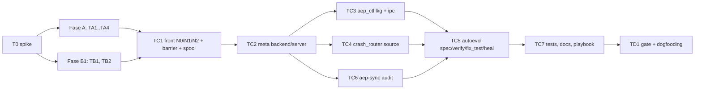
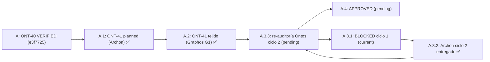
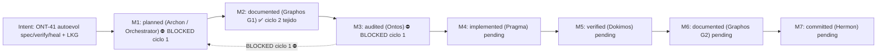
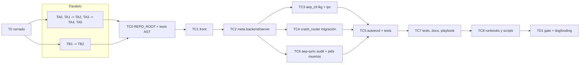

# Pipeline Feature: ONT-41 `autoevol` spec / verify / heal, LKG and live-plane self-heal

- **Previous Feature Document:** [feature_20261106_011249_ont40_autoevol.md](feature_20261106_011249_ont40_autoevol.md)
- **Timestamp:** 2026-11-06T08:08:56 (local)
- **Mode:** Full (Topos)
- **Stage:** 2 — Graphos G1 (Weave & Record). Documented plan delivered to the orchestrator for Ontos.
- **Architect:** Archon (plan delivered by the orchestrator; facts verified against `e3f7725`)
- **Baseline:** `dev` = `origin/dev` = `e3f7725` (ONT-40 VERIFIED; ONT-40b committed as `a61b3f1`)
- **Budget constraints:** max 12 turns, no commit (Hermon not invoked)
- **Status:** EN PLAN (Full), plan revisado ciclo 2 entregado por Archon, pendiente de re-auditoría de Ontos (ciclo 2 de 3). No code written.
- **Normative SDD:** not supplied in this G1 activation. Acceptance is therefore carried in §5 as the plan states it; Ontos must confirm the SDD reference.

## 1. Intent & Premises

**Intent:** evolve `autoevol` from a read-only view (ONT-40) into a closed loop that can specify, verify and heal the code it observes, while the live plane keeps serving through a self-heal path that does not depend on the code it is repairing. ONT-41 covers `spec`, `verify`, `heal`, the Last-Known-Good (LKG) snapshot, and the live-plane fixes that make heal safe.

**Out of scope (ONT-42):** `evolve`, auto-commit and auto-push. AP-1 from the user stands: auto-push only in ONT-42, tier `>= 6rw-`, verify ACCEPT, tests green, never `--force`, never `main`.

**Premises applied (CLAUDE.md):**
- **P0:** `autoevol` detects, specifies, validates and promotes. The model writes the patch. Heal proposes at file level with hunks; it does not apply without the `apply` tier.
- **P1:** heavy checks run inside `sandbox_run`; the front stays free of engine imports so its reach is minimal.
- **P2:** Full mode, no stage skipped.

## 2. Chosen Resolution Path, Tool Reach and Blast Radius

- **Path:** Full (long path with worktree parallelism). Phase A and Phase B1 run in parallel worktrees; Phase C is serial because it touches the live plane.
- **Tool reach:**
  - `sandbox_run` (pytest inside bubblewrap, `git archive` + static `analyze`), timeout 120 s.
  - `async_job_dispatch` for suites above 40 tests or with `async_` markers (PENDING + job).
  - File-state on `/dev/shm` (`aep_front_<pid>.json`, `aep_autoevol/<cycle_id>.json`, TTL 1 h).
  - LKG store `lkg/<sha256[:16]>/` with manifest, last 3 kept.
- **Blast radius (S):** `aep_front.py` (SPOF, not hot-swappable), `aep_backend.py`, `server.py`, `engine/threads_*`, new `engine/aep_lkg.py`, `engine/crash_router.py` (migration), `aep_ctl`, `scripts/aep-sync.sh`, the SQLite schema (aditive migration), tests and docs.
- **Sub-agent inheritance:** Pragma tracks A and B1 inherit `isolation: "worktree"`; each declares its own write set. Dokimos inherits `sandbox_run`.

## 3. Verified Facts (Archon, against `e3f7725`)

| ID | Fact | Consequence |
|---|---|---|
| F1 | The current fingerprint uses mtime. | LKG needs a content hash (sha256). |
| F2 | `PROJECT_DIR` in `server.py` points to the repo. Under an LKG backend it would point to the snapshot. | Set `AEP_REPO_ROOT` and force `stale` when serving from LKG. |
| F3 | The swap only happens on front-initiated calls. | The barrier lives in the front (TC1). |
| F4 | Respawn has no backoff (`N2` in `get_or_start_backend`). | Add backoff in the front. |
| F5 | `crash_events` has no `source` column. | Additive migration plus a JSONL spool written by the front. |
| F6 | `aep.sock` is not per front. | Front state file `/dev/shm/aep_front_<pid>.json`. |
| F7 | `threads_gen` stores only `{node_hash, gap_ids}`. | Persistence of the new fields is needed for heal and verify. |
| F8 | `omission_gaps` skips functions with weak coverage. | The coverage layer (TA1) must include direct/transitive without changing R or gaps. |
| F9 | `forbidden_edge` prohibits `threads -> server`. | The runner is injected into `threads_verify`. |
| F10 | `aep_front.py` is not watched; there is no hot-swap of the front; tests use a subprocess. | The front is changed only in Phase C, with a subprocess test. |
| F11 | `_PLANNED_ACTIONS` contains `spec`, `verify`, `heal` as placeholders; `evolve` stays. | Remove the three from the planned list; keep `evolve` for ONT-42. |

## 4. Decisions Accepted by the Orchestrator (DQ-1..DQ-9)

| ID | Decision |
|---|---|
| DQ-1 | LKG: `lkg/<sha256 of content [:16]>/` plus manifest; keep the last 3. |
| DQ-2 | `fix_test` state lives in `/dev/shm/aep_autoevol/<cycle_id>.json` (TTL 1 h, survives hot-swap). The ledger is written only on the terminal verdict with tier `>= 6rw-`. |
| DQ-3 | `cycle_id = sha256(gap | base_R | nonce)[:12]`. The counter lives in the file. EXHAUSTED on the 3rd iteration. A new cycle is refused for 10 min unless restart. |
| DQ-4 | Suites with more than 40 tests or `async_` markers go to `async_job_dispatch` (PENDING + job). |
| DQ-5 | Default base = `git archive HEAD` + static `analyze`. `fix_test` freezes the base at iteration 0. |
| DQ-6 | Heal is file-level (the file that hosts the thread), with hunks. |
| DQ-7 | `verify` returns `REJECT NO_DIRECT_COVERAGE` for public functions changed without a direct test. Private functions only warn. |
| DQ-8 | Gap record N0: `{type, file, line, msg, fingerprint}`. |
| DQ-9 | Tiers: `spec >= 4r--`, `verify` and `fix_test >= 5r-x`, `heal` read `>= 4r--`, `apply >= 6rw-`. |

## 5. Acceptance (as stated in the plan)

- `autoevol` exposes `spec`, `verify`, `heal` with the tiers of DQ-9 and the N0 record of DQ-8.
- LKG snapshot is content-addressed, keeps 3 generations, and its manifest survives `aep_ctl lkg_restore`.
- A front-initiated swap is blocked while a fix cycle holds the barrier; the front's state file is readable by `aep-sync --audit`.
- Public changed functions without direct coverage return `REJECT NO_DIRECT_COVERAGE`; private ones return a warning.
- Dogfooding (TD1): `autoevol` runs against AEP itself after the harness reconnects (`/mcp`).
- Regression: ONT-40 R and gaps (`132 -> 103`) unchanged by TA1 alone. D-01..D-05 are **not** fixed here (xfail strict stays).

## 6. Task Decomposition and DAG

| Task | Track | Action | Depends on |
|---|---|---|---|
| T0 | Spike | pytest inside `sandbox_run`; `git archive` + `analyze`; timeout check | — |
| TA1 | A (worktree) | Coverage layer direct/transitive; R and gaps unchanged | T0 |
| TA2 | A | `threads_spec.py` | T0 |
| TA3 | A | `threads_verify.py` (compare, decide, cycle state machine; injected runner) | T0 |
| TA4 | A | Tests for A | TA1, TA2, TA3 |
| TB1 | B1 (worktree, parallel) | `aep_lkg.py` (stdlib only, outside the fingerprint) | T0 |
| TB2 | B1 | `threads_heal.py` | TB1 |
| TC1 | C (serial) | Front: N0/N1/N2, barrier, spool, state file | A, B1 |
| TC2 | C | Backend/server meta (non-default values only, `AEP_REPO_ROOT`) | TC1 |
| TC3 | C | `aep_ctl` backup `lkg_status` / `lkg_diff` / `lkg_restore` + plane IPC status | TC2 |
| TC4 | C | `crash_router` with `source` migration + spool ingestion | TC2 |
| TC6 | C | `aep-sync --audit` with state files (D-24, legacy fallback) | TC2 |
| TC5 | C | `autoevol` spec / verify / fix_test / heal + budgets | TC3, TC4, TC6 |
| TC7 | C | Tests, docs, self-heal playbook | TC5 |
| TD1 | D | Final gate + live dogfooding after reconnect | TC7 |

## 7. Topos Relationship Matrix (Graphos classification of the plan; Ontos confirms)

| Pair | Relation | Classification | Contract / note |
|---|---|---|---|
| front ↔ backend | ↔ | Interdependency | `set_meta` + new keys; both sides in plan (TC1, TC2) |
| front → `aep_lkg` | → | Dependency | Front consumes LKG; LKG has no knowledge of front |
| backend/server → `aep_lkg` | → | Dependency | Same, stdlib only |
| `threads_heal` → `aep_lkg` | → | Dependency | Heal reads snapshots |
| `server.autoevol` → `threads_spec` / `threads_verify` / `threads_heal` | → | Dependency | Only the server orchestrates |
| `threads_*` → `server` | → | **FORBIDDEN** | Would close a cycle; enforced by `forbidden_edge` and runner injection (F9) |
| front → `engine/threads` or `engine/*` | → | **FORBIDDEN** | Enforced by AST gate; front stays minimal |
| front (spool, state file) ↔ `crash_router` | ↔ | Interdependency | File contract (JSONL spool + migration `source`); both in TC1/TC4 |
| front state file ↔ `aep-sync --audit` | ↔ | Interdependency | File contract; both in TC1/TC6 |
| `threads_verify` → sandbox runner | → | Dependency (injected) | No direct import of the runner |
| `autoevol` → `aep_ctl` (lkg ops) | → | Dependency | Operations on the LKG store only |

**Co-dependency:** none identified. Per CLAUDE.md, a co-dependency would block the plan; Ontos must re-verify.

## 8. Risks

| Risk | Mitigation in plan |
|---|---|
| Sandbox viability for pytest and `git archive` | T0 spike gates everything else |
| Front is a SPOF and is not hot-swapped | Phase C is serial; subprocess test; `/mcp` reconnect step in TD1 |
| LKG boot closure (pyproject / config) | Explicit in TB1 and TC2 review |
| `stale=false` served from LKG | Force `stale` when serving LKG (F2) |
| New actions treated as gaps of their own | `_PLANNED_ACTIONS` cleaned (F11) |
| Terse budgets | Budgets defined in TC5, checked by Dokimos |
| 50 MB cap on the snapshot | LKG keeps 3; size check in TB1 |
| Scope creep into D-01..D-05 | Not fixed; xfail strict stays |
| Evolve / auto-commit / auto-push | Deferred to ONT-42 |

## 9. Observations for Ontos (recorded, not resolved)

- The T0 spike is the only gate for the sandbox assumption. If `sandbox_run` cannot run pytest within 120 s, DQ-4 (async dispatch) becomes the default path, and the plan must be revised (Archon).
- `TB2` depends on the LKG format of `TB1`; the DAG shows them in one track, so the internal order inside B1 must be explicit in Pragma's plan.
- The SDD for ONT-41 is not in this G1 input. Ontos should request it before approval.
- Several facts reference ONT-40 items (AP-1, D-23 alias count). The D-23 discrepancy (23 cited, 22 confirmed by Dokimos) is still open in `docs/COMPACT.md` history; it does not block ONT-41.

## 10. Documentation Baseline (this activation)

- Git: repository present (`dev`), no `init` needed. No commit made.
- `README.md`: existing; reinforcement graph is regenerated at G2 VERIFIED, not at G1, per the decision graph.
- `docs/STATE.md`: updated (ONT-41 EN PLAN). Corrected a stale line: ONT-40b is committed as `a61b3f1`, not pending.
- `docs/COMPACT.md`: regenerated (under 15 lines).
- `docs/MILESTONES.md`: not touched at G1; ONT-41 milestones M1..M2 are added at G2.
- Chain: this doc links to `feature_20261106_011249_ont40_autoevol.md`. Rollup: `feature_rollup.md` covers ONT-29..ONT-39. Docs since then: ONT-40 (011249) and ONT-41 (this doc), so the 5th-document rollup is not yet due (assumption: chain counted from the last rollup).

## 11. State Evolution

## 12. Routing

Graphos G1 → **Orchestrator** → **Ontos** (Full, audit of this plan before any code). Ontos returned BLOCKED (ciclo 1/3); the loop goes Graphos G1 (records it, state A.3.1) → Orchestrator → **Archon** (ciclo 2, revisión del plan). Pragma is not invoked.

## 13. Reinforcement Graph (ONT-41)

## 14. Auditoría Ontos ciclo 1: BLOCKED

**Veredicto:** BLOCKED (ciclo 1 de 3). Ruta: Graphos G1 registra → Orchestrator → Archon (ciclo 2). T0 queda resuelto por el orquestador (viable), por lo que no bloquea.

**Nota de trazabilidad:** esta sección recoge el resumen del veredicto recibido del coordinador. El informe íntegro de Ontos no está en la entrada de G1; los identificadores MAJOR y los B1..B5 se registran tal como llegaron. Archon debe contrastarlos contra el informe íntegro de Ontos antes de revisar el plan.

### 14.1 BLOCKERs

| ID | Hallazgo | Remediación exigida a Archon |
|---|---|---|
| B1 | `aep_lkg` debe quedar fuera del fingerprint; el front necesita gate y degradación fail-open. | Fijar el gate del módulo y el comportamiento fail-open del front si el LKG no carga. |
| B2 | El LKG debe ser un árbol autocontenido (templates, `scripts/aep-ctl`, pyproject, schemas). Los anclajes `__file__` de fingerprint, catalog, hydrator, template_registry, privilege, threads_probes y aep_backend deben resolverse dentro del snapshot; `AEP_REPO_ROOT` solo para datos. | Inventariar cada anclaje `__file__` y declarar su resolución dentro del snapshot frente a `AEP_REPO_ROOT`. |
| B3 | Seguridad del restore: traversal, symlinks, `O_NOFOLLOW`, verificación sha del manifest, permisos 0700, dry-run. | Especificar la validación de rutas y el flujo de restore con dry-run por defecto. |
| B4 | Spool y `/dev/shm`: 0600/0700, `O_EXCL|O_NOFOLLOW`, comprobación de uid, whitelist, SQL parametrizado, `cycle_id` generado por el servidor. | Especificar permisos, apertura segura, validación de uid y whitelist, y origen del `cycle_id`. |
| B5 | Falta la tarea de runbooks y scripts. | Añadir la tarea (Fase C o TC7) con su dependencia. |

### 14.2 MAJORs

| ID | Hallazgo | Remediación exigida a Archon |
|---|---|---|
| M-1 | La migración debe ir en `database.sql` y `crash_router` debe ser idempotente. | Migración en `database.sql` y prueba de idempotencia. |
| M-2 | Ramas de la barrera: fence, quiescencia, `failed_fp`; sin `verify` desde LKG. | Definir cada rama y prohibir `verify` cuando se sirve desde LKG. |
| M-3 | N2 (backoff) con reloj inyectado. | Inyectar el reloj en el backoff y testearlo. |
| M-4 | Cascada LKG: `SERVING_LKG`, `stale`, `schema_hash`. | Definir estados y condiciones de transición. |
| M-5 | `EXHAUSTED` debe registrarse con tier `< 6`. | Registrar el estado y la regla de tier. |
| M-6 | Tests de `INVALID_ACTION` y del gate. | Añadir tests dedicados en TA4/TC7. |
| M-7 | Spike de pytest dentro de bwrap. | Ya cubierto por T0 (resuelto: viable). Mantener como test de regresión. |

### 14.3 Evidencia de T0 (orquestador)

- pytest dentro de bwrap: 13 passed / 6 xfailed; 42 s para 19 tests.
- `git archive` + `analyze`: 1.3 s.
- Clamp de 120 s en `server.py:1504`.

### 14.4 Impacto en el plan

- Cambian TB1 (aep_lkg con gate y árbol autocontenido), TC1 (fail-open, ramas de barrera, reloj inyectado), TC2 (anclajes `__file__` y `AEP_REPO_ROOT` solo para datos), TC4 (migración en `database.sql`), TC5 (EXHAUSTED tier, cascada LKG), TC6 (sin cambios de fondo), TC7 (runbooks B5).
- Ruta: Archon ciclo 2 → Ontos (ciclo 2 de 3).
- El DAG del §6 se mantiene hasta que Archon entregue el plan revisado; no se ejecuta Pragma sobre este plan.

### 14.5 State Evolution

A.3 → A.3.1 BLOCKED ciclo 1 → A.3.2 Archon ciclo 2 (pendiente).

## 15. Plan revisado ciclo 2 (Archon)

**Entrega:** Archon ciclo 2 entregó el plan revisado. Este G1 lo registra; el informe íntegro de Archon no está en la entrada, así que las tablas siguientes reproducen el contenido recibido del coordinador. Ontos debe re-auditar (ciclo 2 de 3).

### 15.1 Anclajes `__file__` (C) y `AEP_REPO_ROOT` (D)

Regla: `REPO_ROOT = AEP_REPO_ROOT` solo en los sitios D (datos). Los sitios C se quedan en `__file__` (código). Bajo LKG, un anclaje C a un módulo de confianza fuerza fail-closed.

| Sitio | Clase | Resolución |
|---|---|---|
| `server.py:256` | D | `AEP_REPO_ROOT` |
| `server.py:592` | D | `AEP_REPO_ROOT` |
| `server.py:4972` | D | `AEP_REPO_ROOT` |
| `privilege.py:103` | D | `AEP_REPO_ROOT` |
| fingerprint de disco del backend | D | `AEP_REPO_ROOT` |
| `threads_probes` (trusted) | C | `__file__`; bajo LKG, fail-closed |
| resto de anclajes `__file__` (fingerprint, catalog, hydrator, template_registry, privilege, aep_backend) | C | `__file__` (dentro del snapshot) |

### 15.2 Conjunto del LKG

Set vigilado + `templates/**` + `schemas/*` + `scripts/aep-ctl` + `pyproject.toml`.

### 15.3 Tareas: nuevas y cambios

| Tarea | Cambio |
|---|---|
| TA0 (nueva) | El grafo cubre `aep_lkg.py`; `own_gaps = 0`. |
| TA5 (nueva) | `events.jsonl` append-only en `/dev/shm`, espejado al ledger con tier `>= 6rw-`. |
| TC0 (nueva) | `REPO_ROOT` + tests AST de anclajes C/D. |
| TC8 (nueva) | Runbooks y scripts. |
| TA3 (Δ) | Estados de la barrera; `REJECT SERVING_LKG`; sandbox fail-closed; `cycle_id` del servidor; sin base inventada. |
| TB1 (Δ) | Restore seguro; `manifest_sha`; `LKG_MODULE_HASH`. |
| TC1 (Δ) | Import con try/except; reloj inyectado; cascada `SERVING_LKG`; permisos. |
| TC4 (Δ) | Migración autoritativa idempotente. |
| TC5 (Δ) | Tests y gate en la misma tarea. |
| TC6 (Δ) | Pids muertos. |

### 15.4 T0 cerrado

N = 20 tests por iteración. Si una iteración supera 20 tests o 60 s, pasa a `async`.

### 15.5 Trazabilidad

Los identificadores B1-B5 y M-1..M-7 de §14 no coinciden con el esquema M1-M8 y m1-m3 que usa Archon. Se registran ambos esquemas. Los contenidos de M8, m1, m2 y m3 no llegaron en la entrada de G1; quedan marcados para que Ontos los confirme.

| Hallazgo | Tarea(s) | Nota |
|---|---|---|
| B1 (gate y fail-open del front) | TB1, TC1 | |
| B2 (árbol autocontenido, anclajes) | TC0, TB1, TC2 | Anclajes en 15.1 |
| B3 (seguridad del restore) | TB1 | |
| B4 (spool y `/dev/shm`) | TC1, TA5 | Permisos y `cycle_id` del servidor en TA3 |
| B5 (runbooks y scripts) | TC8 | |
| M-1 (migración idempotente) | TC4 | |
| M-2 (ramas de la barrera) | TA3, TC1 | |
| M-3 (reloj inyectado en N2) | TC1 | |
| M-4 (cascada LKG) | TC1 | |
| M-5 (EXHAUSTED tier `< 6`) | TA3 | |
| M-6 (tests `INVALID_ACTION` y gate) | TA4, TC5 | |
| M-7 (spike pytest bwrap) | T0 | Cerrado |
| M1-M8, m1-m3 (esquema de Archon) | Pendiente de confirmar | Contenido no recibido en G1 |

### 15.6 DAG revisado

### 15.7 Enrutado

Graphos G1 → Orchestrator → Ontos (re-auditoría ciclo 2 de 3). Pragma no se invoca sobre este plan.

#### §15 addendum (orquestador): contenido de M8, m1-m3 (numeración de Archon)
| ID | Hallazgo | Tarea | Criterio |
|---|---|---|---|
| M8 | Sandbox sin bwrap | TA3 | `REJECT SANDBOX_UNAVAILABLE` para árboles no confiables. En el árbol propio se permite un subproceso plano solo si bwrap falló al arrancar (stderr `bwrap:`), y la respuesta lo marca con `unsandboxed:true` |
| m1 | Presupuesto terse en SERVING_LKG | TC1 | Un test comprueba `discover terse <= 400` tokens en ese estado |
| m2 | Archivos de estado de pids muertos | TC6, TC8 | Se ignoran y se limpian; las instancias sin archivo reciben la etiqueta fallback `legacy/unknown` |
| m3 | Cascada de herramientas sin git | TA3 | La base es un snapshot del árbol (iteración 0) o se devuelve `BASE_UNAVAILABLE`. Nunca se inventa una base |

## 16. Auditoría Ontos ciclo 2: APPROVED con condiciones, y enmienda del orquestador (vinculante para Pragma)

| Cond. | Decisión incorporada al plan |
|---|---|
| **C1 (MAJOR, obligatoria)** | **Opción (a):** `aep_lkg.py` se copia dentro de `tree/` del LKG. Está en `files` del manifest, verificado por sha, pero queda fuera del hash del fingerprint. Así el árbol LKG es autocontenido: un backend que arranca desde LKG importa su propio `aep_lkg` y nunca depende del repo para curarse. El directorio `lkg/` vive en el **data home** (`~/.local/share/agent-os/lkg`, resuelto por una función `lkg_home()` que usa `AEP_DATA_HOME` o `Path.home()`), **nunca** anclado a `__file__` ni a la raíz del código. `scripts/aep-ctl` lo resuelve igual. Test: arranque desde LKG, luego `autoevol(heal)` en dry-run y `aep_ctl backup lkg_status` funcionando. Afecta a TB1, TC0 y TC3. |
| **TA5 (MAJOR)** | `events_<uid>.jsonl` (uno por uid, el mismo esquema que el contador). Cada línea lleva `ts` y un `nonce` (`secrets.token_hex(4)`), así que el hash de línea es único. Rotación a 1 MB o 5000 líneas (se conserva `.1`). El espejado al ledger se hace en la siguiente llamada con tier ≥ `6rw-`, idempotente por hash. Un EXHAUSTED en tier < 6 queda en el JSONL hasta entonces; está documentado en el docstring y en el SDD. |
| **TC0 (MINOR)** | Se desarrolla en un worktree y se aterriza de una vez. Criterio: sin `AEP_REPO_ROOT`, los payloads son idénticos (test de regresión). |
| **TD1 (MINOR)** | Antes de pedir la reconexión: se crea el tag `pre-ont41-front` sobre el commit previo a TC1, y el informe documenta el rollback `git checkout pre-ont41-front -- aep_front.py`. La validación por subproceso del front cubre el arranque, cada rama de la barrera y N2 con reloj falso. |
| **SERVING_LKG (MINOR)** | `spec` y `heal` en lectura usan `REPO_ROOT` como base y son solo análisis estático, sin ejecución. Cualquier ejecución sobre el repo real bajo LKG pasa por el jail fail-closed. |

**Estado:** APPROVED. Siguiente paso: Pragma, con la Fase A y la Fase B1 en worktrees paralelos y después la Fase C en serie.
