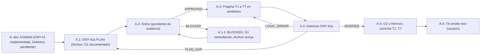
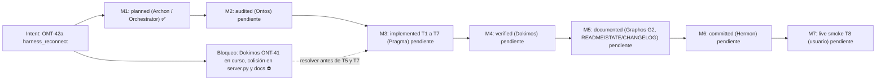
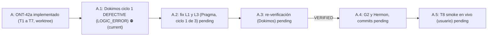

# Pipeline Feature: ONT-42a `harness_reconnect` (RE-as-SDD, recarga del front MCP del orquestador)

- **Previous Feature Document:** [feature_20261106_080856_ont41_autoevol_heal.md](feature_20261106_080856_ont41_autoevol_heal.md)
- **Timestamp:** 2026-11-06T17:23:15Z (UTC)
- **Mode:** Full (Topos)
- **Stage:** 2 — Graphos G1 (Weave & Record). Plan documentado y entregado al orquestador para Ontos.
- **Architect:** Archon (plan Execution Plan, Stage 1). Fuente: `/tmp/claude-1000/-home-ancruz-Documents-workspaces-agent-execution-plane/35ca3808-1a4d-4b75-ac5d-4ce0a6c2d86b/scratchpad/ont42a_plan.md`
- **Baseline:** `dev` en `37eb60d` (commit `docs(ONT-41)`), rama `dev`, árbol de trabajo limpio al inicio de la activación G1.
- **Chain position:** documento 14 de la cadena desde el rollup 2. El próximo rollup (`feature_rollup.md`) toca en el documento 15 (ver §13).
- **Status:** PLANIFICADO. Pendiente de auditoría de Ontos (Full, Stage 3). No se ha escrito código. No se ha hecho commit.
- **Decisiones del orquestador incorporadas:**
  - Pregunta abierta 1 (typed-prompt hazard): **ACEPTAR y documentar como limitación** (`caveats` en el output de `plan` y SDD §Validate). No se usa Ctrl-U no verificado.
  - Pregunta abierta 2 (sysctl `dev.tty.legacy_tiocsti` y alcance de `sudo -n`): la resuelve Pragma en modo solo lectura dentro de T2, antes de escribir el helper.
- **Restricciones de esta activación:** no se editan `README.md`, `docs/STATE.md` ni `CHANGELOG.md` (se actualizan en G2/T7, por colisión con Dokimos ONT-41). No hay commit (Hermon). `engine/_ont39_probe_transient.py` no se toca (en el árbol actual no existe; `git status` limpio).

## 1. Intent & Premises

**Intent:** permitir que el orquestador (Claude Code) recargue su propio front MCP `agent-execution-plane` sin que el usuario teclee `/mcp reconnect <server>`. La primitiva inyecta ese comando en el TTY del harness mediante `TIOCSTI`, con la ventana de sysctl más corta posible. Es la respuesta RE-as-SDD a un problema operativo real de ONT-41: tras un hot-swap o un `aep_front.py` cambiado, el front sigue sirviendo el código antiguo hasta que el harness reconecta.

**Fuera de alcance:** matar el PID del front, `/mcp reconnect all`, automatización GUI (ydotool, xdotool, wtype), y cualquier cambio en `aep_front.py`. Estas rutas se descartaron en la fase de RE (ver SDD T1).

**Premisas aplicadas (CLAUDE.md):**
- **P0:** el usuario decide el diseño. La inyección de teclas en un TTY se trata como acción irreversible y de alto alcance: queda detrás de tier 7rwx, `confirm=true` y un flag explícito en `execute`. `plan` es gratuito.
- **P1:** la ruta es media (medium path) en T2 y T5 (sysctl global y TTY real). Pragma no puede ejecutar contra el sysctl ni un TTY real en tests. El helper se prueba solo con dobles.
- **P2:** Full mode. No se omite ninguna etapa.
- **Topos:** la función de decisión es pura y recibe sus dependencias por parámetro. No hay ciclo con `server.py`.

## 2. Chosen Resolution Path, Tool Reach and Blast Radius

- **Placement:** `aep_ctl(domain="ipc", action="harness_reconnect")`, con la lógica en el nuevo `engine/harness_reconnect.py`. Se rechazó `autoevol(action="heal")`: `autoevol` juzga hilos de código y es de solo lectura en tiers bajos. Inyectar teclas rompería ese invariante. El dominio `ipc` ya gestiona la sesión y el socket entre el plano y sus clientes.
- **Path por tarea:** short en T1, T2 (parte pura), T3, T4, T5 (D-25), T6, T7. Medium en T2 (helper sysctl/TIOCSTI) y T8 (smoke test en vivo, controlado por el usuario).
- **Tool reach:**
  - Stdlib: `os`, `subprocess`, `fcntl`. No se necesita skill, MCP server ni paquete nuevo (la Tool Awareness Cascade se resuelve en el paso 1).
  - `sudo -n` (sin prompt de contraseña), con timeout en cada subproceso.
  - `/proc` para la ascendencia del proceso y el TTY (`resolve_tty`).
  - Lockfile `flock` en `$XDG_RUNTIME_DIR`.
  - Ledger de auditoría (escritor SHA-256 encadenado; Pragma debe localizarlo con grep).
  - Herramientas de Dokimos: `pytest` y `ruff` en venv.
- **Blast radius (S):**
  - Modo `plan`: solo lectura.
  - Modo `execute`: un sysctl global de kernel durante menos de 2 s, y pulsaciones de teclado en un único TTY derivado de la ascendencia del proceso.
  - Archivos: `engine/harness_reconnect.py` (nuevo), `engine/privilege.py` (schema ipc), `server.py` (branch ipc y D-25), `engine/threads_heal.py` (`next_action`), `tests/test_ont42a_harness_reconnect.py` (nuevo), `tests/conftest.py`, `README.md`, `CHANGELOG.md`, `docs/STATE.md`, `docs/sdd/sdd_ont42a_harness_reconnect.md` (nuevo).
- **Sub-agent inheritance:** Pragma hereda la herramienta de consola y los MCP del padre. Los worktrees de sandbox no heredan el acceso a `sudo -n` ni al TTY real.

## 3. Verified Facts and Discrepancies (Graphos, read-only, HEAD `37eb60d`)

Verificado por lectura de archivos en el árbol:

| ID | Hecho | Estado |
|---|---|---|
| F1 | `server.py`, `engine/privilege.py`, `engine/threads_heal.py`, `tests/conftest.py`, `aep_front.py`, `aep_lkg.py` existen. | Confirmado |
| F2 | `engine/harness_reconnect.py` no existe (es el nuevo módulo). `docs/sdd/` existe. | Confirmado (esperado) |
| F3 | `engine/_ont39_probe_transient.py` no existe en el árbol. El plan lo menciona como archivo sin trackear. | Discrepancia menor. No afecta. No se toca. |
| F4 | `CONTROL_PLANE_SCHEMA` está en `engine/privilege.py` L509. | Confirmado |
| F5 | El test de schema que cita el plan (`test_agent_experience_evaluation.py` L43) está en L37 como `test_control_plane_schema_is_machine_discoverable`. Hay además `test_control_plane_schema_matches_advertised_mcp_domains` en L87. | Discrepancia de línea. Pragma debe leer ambos tests. |
| F6 | El plan cita `is_stale = fp_stale or serving_from == "lkg"` en `server.py` ~L623–627. El código real (`server.py` ~L623–627) es `is_stale = commit_stale or fp_stale or live_meta["serving_from"] == "lkg"`, y el nombre no es `front_stale`. | **Discrepancia material para D-25.** La intención del plan (`commit_stale` solo informativo) sigue siendo válida, pero la expresión de partida es distinta. Pragma debe partir del código real. Ver §6 (T5). |
| F7 | El plan asume `/dev/shm` como almacén de estado del front (`aep_front_<pid>.json`). Se confirmará en T2 junto con el resto de la lectura. | Pendiente (Pragma) |
| F8 | `dev.tty.legacy_tiocsti` y el alcance de `sudo -n` NO se han comprobado. Es la pregunta abierta 2. | Pendiente (Pragma, T2, solo lectura) |

Nota de estado: ONT-41 está implementado en `dev` (477 passed, 6 xfailed) pero su Dokimos está pendiente. Ver §7.

## 4. Plan Decisions (summary of Archon's plan)

**Parámetros (`params`).** `mode` ∈ {`plan`, `execute`}, `confirm` (bool), `server` (opcional, solo cross-check del nombre derivado). No hay parámetros libres `tty`, `pid` ni `payload`.

**Arquitectura de inyección:**
- `execute` lanza un único helper privilegiado con `sudo -n`. El helper es un script fijo incluido en el módulo (`HELPER_SCRIPT`) y recibe por argv `[tty_path, payload_bytes_hex]`.
- Orden dentro del helper:
  1. leer el valor original del sysctl;
  2. instalar `trap ... EXIT` para restaurarlo;
  3. fijar `dev.tty.legacy_tiocsti=1`;
  4. abrir el TTY y llamar `ioctl(TIOCSTI)` por carácter;
  5. restaurar el sysctl.
- La ventana la impone el propio proceso del helper, no el padre Python. Así un crash o un kill entre set y restore no deja el sysctl abierto. El `finally` de Python vuelve a leer el sysctl y verifica que coincide con el original. Si no coincide: `FAIL` con `severity=CRITICAL` y entrada de auditoría.
- Concurrencia: `fcntl.flock` sobre un lockfile en `$XDG_RUNTIME_DIR`. Una sola inyección a la vez.
- Tabla de comandos: `HARNESS_RECONNECT = {"claude": "/mcp reconnect {server}"}`. Otro harness resuelve a `unknown`, con ruta `manual` y una nota.
- Nombre del servidor: se lee de la configuración del harness o del entorno. Si no se puede derivar, se usa el literal `agent-execution-plane`, validado con `^[a-z0-9][a-z0-9_-]{0,63}$`.

**D-25 (intención).** `front_stale` pasa a ser el disparador de recarga, y `commit_stale` queda informativo en un campo `commit_drift` que solo se emite cuando es verdadero. El texto de `next_action` distingue deriva solo de docs (sin reinicio) de deriva de fingerprint. Si `front_stale` es verdadero, apunta a `harness_reconnect`. Ver F6 sobre la expresión real.

## 5. Topos Classification

| Relación | Clase | Nota |
|---|---|---|
| `server.py` (ipc) → `engine/harness_reconnect` | Dependency | El motor no conoce `server`. Las entradas se inyectan: tier, `front_stale`, `run_cmd`, `proc_root`. |
| `harness_reconnect` → `engine/privilege` (tier) | Dependency | Uso de solo lectura de `get_effective_chmod_tier`. |
| `harness_reconnect` → ledger de auditoría | Dependency | Mismo escritor que `aep_ctl audit`. |
| `CONTROL_PLANE_SCHEMA` ↔ branch ipc de `aep_ctl` | Interdependency | Se editan juntos (schema, branch y lista de acciones). Test de schema en `test_agent_experience_evaluation.py`. |
| Lógica de stale de `discover` (`server.py`) ↔ `next_action` de `threads_heal`/`autoevol` | Interdependency | Ambos deben usar la misma definición de stale. |
| `aep_front.py` `is_front_stale` | Dependency (solo lectura) | `aep_front.py` NO se edita. |
| Co-dependency | Ninguna encontrada | El motor recibe todo por parámetros, así que no hay ciclo con `server`. |

- **Vertical trace:** detección (`_is_front_stale`, `serving_from`) → árbol de decisión del motor → helper privilegiado (kernel) → harness → verificación con `discover`. La última capa es el smoke test T8.
- **Horizontal trace:** peers que comparten `_get_live_meta` y el payload de `discover`: `tests/test_ont41_front.py`, `tests/test_ont41_meta.py`, `tests/test_token_budgets.py`.
  - El `discover` en modo terse debe seguir por debajo de 400 tokens, así que `commit_drift` solo se emite cuando es verdadero.
  - El resumen del playbook está en 2990/3000 bytes. El playbook NO recibe texto nuevo. Si el test de presupuesto falla, se acorta una frase existente. No se amplía.
- **Gap cascade:** corregir D-25 no debe ocultar un estado stale real. T1 mantiene `fp_stale` y `serving_from == "lkg"` como únicos disparadores, y su test cubre un commit solo de docs y un commit que cambia código.
- **Omisiones cerradas en las tareas:** sysctl ausente en el kernel (se trata como `unsupported`, no como error); TTY que no es pty; harness no encontrado en la ascendencia; harness de otro uid; `front_stale=false` → no-op; prompt de contraseña de sudo (solo `sudo -n`); helper colgado (timeout, y el trap restaura); entrada de auditoría en cada intento de `execute`, incluidos los rechazados; `aep-sync --audit` podría marcar `legacy_tiocsti=1` (extra opcional en T6, solo si el cambio es pequeño).

## 6. Tasks (one commit per task; worktree; Conventional Commits, scope `ONT-42a`)

| id | Acción | Objetivo | Depende de | Riesgo / ruta |
|---|---|---|---|---|
| T1 | create | `docs/sdd/sdd_ont42a_harness_reconnect.md`: Specify (traza de inferencia), Plan (placement, árbol, helper), Tasks, Validate (tests de aceptación y limitaciones). `re_source: orchestrator-inference-trace-2026-11-06`, `re_mode: compatible`. Incluye la tabla de harness y las rutas descartadas. | ninguna | short, solo docs |
| T2 | create | `engine/harness_reconnect.py`: funciones puras con dependencias inyectables. `find_harness(proc_root, pid)`, `resolve_tty(pid)`, `decision_tree(...)` → plan con `recommended_route` ∈ {`noop`, `manual`, `tty_inject`, `gui_unsupported`}, `build_payload(harness, server)` con allowlist, `execute(...)` con gates en orden tier → confirm → front_stale → ascendencia → allowlist → flock → helper → verify → audit. Todo fail-closed. Constante `HELPER_SCRIPT`. Pragma resuelve F7 y F8 aquí, en solo lectura. | T1 | medium path. Nunca ejecuta en tests. |
| T3 | modify | `engine/privilege.py`: acción `harness_reconnect` en el schema ipc. `privilege_tier` 7rwx para `execute`, DIMINISHED para `plan`. Entrada de precondición. | T2 | interdep con T4. Mismo commit que T4, o commits adyacentes con los tests al final. |
| T4 | modify | `server.py`: branch ipc de `aep_ctl` y gate de tier. Despacho al motor con adaptadores reales (`sudo -n`, `/proc`). Salida compacta con `verbosity=summary`. `execute` llama al ledger de auditoría. | T2, T3 | short |
| T5 | modify | `server.py` ~L623–700 (D-25) y `next_action` de `engine/threads_heal.py`. `heal` y `discover` emiten el puntero al plan de `harness_reconnect` cuando hay `front_stale`. | T4 | **colisión con Dokimos ONT-41.** Re-leer `server.py` antes de editar (F6). |
| T6 | create/modify | `tests/test_ont42a_harness_reconnect.py`, `tests/conftest.py`. Fixture autouse `isolated_harness_reconnect`: fuerza `AEP_HARNESS_RECONNECT_DRY=1`, stubs de `run_cmd` y `proc_root`, y falla el test si se escribe `/proc/sys/dev/tty/legacy_tiocsti` o se abre `/dev/pts/*`. Casos: tier<7 rechazado, sin confirm, objetivo fuera de la ascendencia, payload fuera de la allowlist, `front_stale=false` no-op, harness desconocido → manual, GNOME Wayland → gui no soportado, lock activo → gui bloqueado, sysctl restaurado cuando el helper lanza o agota el timeout, fallo de verificación de restauración → CRITICAL, contención de flock, D-25 (commit solo de docs → `stale=false`), schema y presupuesto de discover. | T2–T5 | short |
| T7 | modify | `README.md` (§9.2b pasa a N0–N4, tabla de acciones ipc), `CHANGELOG.md`, `docs/STATE.md`, línea `_INSTRUCTIONS` del server. N4 documentado: `plan` libre; `execute` requiere 7rwx, `confirm=true` y lleva el riesgo de TIOCSTI. El resumen del playbook NO se amplía. | T6 | **colisión con Dokimos (README/STATE).** Ver §7. |
| T8 | verify | Smoke test en vivo (controlado por el usuario). Tras merge a `dev` y reload del usuario: `plan` → `execute confirm=true` → `discover terse` muestra `front_stale=false`, un PID nuevo y `sysctl == 0`. Pragma NO lo ejecuta sin supervisión. Requiere consentimiento del usuario en cada ejecución. | T7 | medium path. Toca el sysctl real y el TTY real. |

**Orden de commits sugerido:** T1 → T2+T6a (motor y sus tests unitarios) → T3+T4 → T5 → T6b → T7. Pragma tiene 50 turnos, así que cada commit debe quedar por debajo de unos 8 turnos. Los tests se ejecutan por commit con `pytest -q tests/test_ont42a_harness_reconnect.py` y `ruff check`.

## 7. Collisions with Parallel Dokimos ONT-41 (dev)

Archivos potencialmente compartidos, que Dokimos podría corregir o editar:
- `server.py` (región de discover/stale y cualquier corrección relacionada con `lkg`);
- `tests/test_ont41_front.py`, `tests/test_ont41_meta.py`;
- `docs/STATE.md`, `README.md` §9.2b, `CHANGELOG.md`.

Mitigación:
- Pragma trabaja en un worktree creado desde el `dev` actual y hace rebase sobre `dev` antes de T5 y T7.
- T1, T2, T3 y T6 tocan archivos sin motivo para Dokimos, así que van primero.
- T5 y T7 van al final. Si Dokimos cambió la región de stale, T5 debe re-leer `server.py` antes de editar.
- Este documento NO edita `README.md`, `docs/STATE.md` ni `CHANGELOG.md`. Esas ediciones se hacen en G2/T7, cuando el estado de Dokimos sea conocido.

## 8. Caveats and Known Limitations (decided)

1. **Typed-prompt hazard (ACEPTADO por el orquestador).** Si el usuario tiene un prompt a medio escribir en el harness, el texto inyectado se añade a ese prompt, y el `\r` final lo envía todo. No se usa Ctrl-U porque su comportamiento en Claude Code no está verificado. Este riesgo se declara en el campo `caveats` del output de `plan` y en SDD §Validate. Opciones descartadas por ahora: rechazar cuando el TTY no está inactivo (no es detectable de forma fiable).
2. **TIOCSTI es una capacidad del kernel de bajo nivel.** Su disponibilidad depende de `dev.tty.legacy_tiocsti` (pendiente de F8). Si el sysctl no existe, `tty_inject` pasa a `unsupported` y la ruta cae a `manual`.
3. **Ventana de sysctl global.** Dura menos de 2 s. La restauración la garantiza el trap del helper y la verifica el `finally`. Un fallo de verificación se reporta como CRITICAL.
4. **Sin pruebas reales de inyección en CI.** Los tests usan solo dobles. La validación real es T8, con consentimiento del usuario.

## 9. Validate (acceptance)

- Todos los tests nuevos pasan, más los 477 existentes, sin regresiones.
- `ruff check` limpio.
- Los tests de presupuesto de tokens (`test_token_budgets.py`) siguen en verde.
- `dev.tty.legacy_tiocsti` vuelve a su valor original tras la suite completa. Pragma lo comprueba antes y después (solo lectura).
- La ascendencia del front real resuelve al harness real en modo `plan` (smoke test de solo lectura, permitido en cualquier tier).
- Limitaciones de §8 presentes en `caveats` y en SDD §Validate.

## 10. Decisions Taken

| Fecha | Decisión | Por quién |
|---|---|---|
| 2026-11-06 | Placement en `aep_ctl(domain="ipc", action="harness_reconnect")`, no en `autoevol heal`. | Archon (plan), aceptado en G1 |
| 2026-11-06 | Typed-prompt hazard: ACEPTAR y documentar como limitación. No usar Ctrl-U no verificado. | Orquestador |
| 2026-11-06 | Pregunta 2 (sysctl y `sudo -n`): la resuelve Pragma en solo lectura en T2. | Orquestador |
| 2026-11-06 | No editar README, STATE ni CHANGELOG en G1. Se hace en G2/T7. | Orquestador |
| 2026-11-06 | Sin commit en esta activación. Hermon commitea tras VERIFIED. | Orquestador |

## 11. State Evolution

Estado actual: **A.1 documentado**. Siguiente: A.2 (Ontos).

## 12. Reinforcement Graph (intent ONT-42a)

## 13. Chain and Rollup Check

- Este documento es el 14.º de la cadena desde el rollup 2 (`feature_rollup.md`, sección "Rollup 2"). El documento 13 es `feature_20261106_080856_ont41_autoevol_heal.md`.
- El rollup se dispara en el documento 15. No corresponde generar `feature_rollup.md` ahora. El próximo documento (el 15.º) debe ir acompañado del rollup.

## 14. Routing (Orchestrator)

- Este documento se entrega al orquestador. Siguiente destino: **Ontos** (Stage 3, Full). Ontos audita el plan completo, incluido el path y el blast radius de cada tarea (P1).
- Puntos de atención para Ontos: F6 (expresión real de D-25 frente al plan), F3 y F5 (discrepancias menores de referencias), y la clasificación de la interdependencia `CONTROL_PLANE_SCHEMA` ↔ branch ipc.
- Pragma no se invoca hasta que Ontos apruebe. No hay ejecución en esta activación.

## 15. Veredicto Dokimos ONT-42a, ciclo de fix 1: DEFECTIVE (LOGIC_ERROR) (Graphos G2)

- **Fuente:** `/tmp/claude-1000/-home-ancruz-Documents-workspaces-agent-execution-plane/35ca3808-1a4d-4b75-ac5d-4ce0a6c2d86b/scratchpad/dokimos_c2.md`
- **Commit verificado:** `52393aa` (dev, con `849ed6d` y `2bd37c0`, `d42d467`, `9bbb568` de ONT-42a integrados).
- **Clasificación:** LOGIC_ERROR. Ruta: Graphos G2, luego Pragma. Ciclo de fix 1 de 3.
- **Tests Dokimos:** `tests/test_dokimos_ont42a_findings.py` (xfail estricto L1, L3) y `tests/test_dokimos_ont41_c2_e2e.py` (xfail estricto F7 de ONT-41).

### 15.1 Contrastes C1 a C14 (plan de Ontos)

C1, C2, C4 a C11, C13 y C14 cumplidos. **C3 incumplido por L1.** Dos puntos menores sin bloqueo: el restore del sysctl no se reintenta si queda `sysctl_not_restored` (solo reporta CRITICAL), y el lockfile no usa `O_NOFOLLOW`.

### 15.2 Hallazgos

| ID | Sev. | Estado | Evidencia | Fix Specification (vinculante para Pragma) |
|---|---|---|---|---|
| **L1** | high, **bloqueante** | Confirmado en vivo | `find_harness` exige `basename(exe) == "claude"`. Claude Code instala `.../claude/versions/2.1.318`. `find_harness('/proc', 821422)` y `('/proc', 112908)` dan `harness_not_in_ancestry`. El TTY sí resuelve (`/dev/pts/2`, major 136). Código: `engine/harness_reconnect.py:85`. | En `find_harness`, aceptar `exe` si el basename es `claude`, o si el path casa con `^/.+/claude/versions/\d+\.\d+\.\d+$`. Mantener uid y ascendencia real. No usar comm ni argv. Test: `test_l1_find_harness_recognises_versioned_claude_binary` (xfail estricto). Los negativos (fuera de `claude/versions/`, versión no semver, traversal, semver incompleto) ya pasan y deben seguir pasando. |
| **L2** | n/a | **Refutado** como defecto independiente | `build_plan` resuelve harness y tty antes de `decision_tree`. Con `front_stale=false` los reporta. Lo confirma `test_l2_plan_reports_ancestry_even_when_route_is_noop` (pasa). `execute` hace NOOP antes de la ancestría, correcto. | Ninguna. Se resuelve con L1. |
| **L3** | low, intermitente | Confirmado (2 de 5 ejecuciones) | Huérfanos `aep_backend.py` (pids 825740 y 833686) tras `test_n2_cold_broken_disk_serves_lkg_then_recovers`. Causa 1: `reap_backends_of(root)` solo casa `root/aep_backend.py`, y los backends servidos desde LKG viven en `tmp_path/front_state/data/lkg/*/tree/aep_backend.py`. Causa 2: la promoción lanza `asyncio.create_task(_drain_and_terminate(old_conn))`, que no corre si `asyncio.run` cierra antes. | En el fixture `tree`, reapear todo `aep_backend.py` bajo `str(tmp_path)`, no solo bajo `root`. Opcional: `await _drain_and_terminate` en `shutdown()`. Test: `test_l3_reaper_covers_lkg_tree_backends` (xfail estricto, determinista). Observación abierta: el huérfano sobrevive a la muerte del front con 17 hilos esperando. No reproducido en backend aislado (sale al EOF). Pragma puede valorar `os._exit(0)` tras `asyncio.run(worker.run())` en `aep_backend.py`. |

### 15.3 Procesos y límites respetados

- Ejecuciones: `execute` real no ejecutado. No se tocó el sysctl ni un TTY. No se ejecutó `pueue clean`. No hay push.
- Suite: 547 passed, 6 xfailed (3 xfail estrictos de Dokimos: L1, L3, F7 de ONT-41). ruff limpio.
- Semgrep: no ejecutado en este ciclo.
- Dokimos approximation ratio: no reportado.

### 15.4 Enrutado

Graphos G2 → Orchestrator → **Pragma** (LOGIC_ERROR, L1 y L3). No se invoca Archon (sin PLAN_GAP). Cuando Pragma corrija L1 y L3, los xfail estrictos fallarán a propósito: hay que retirar sus marcadores. Hermon no se invoca hasta VERIFIED. T8 (smoke en vivo) sigue user-gated.

### 15.5 State Evolution

### 15.6 Reinforcement Graph (intent ONT-42a, actualizado)

```mermaid
flowchart LR
    I["Intent: ONT-42a harness_reconnect"] --> M1["M1: planned (Archon / Orchestrator) ✅"]
    M1 --> M2["M2: audited (Ontos) ✅"]
    M2 --> M3["M3: implemented T1 a T7 (Pragma) ✅ en worktree"]
    M3 --> M4["M4: verified (Dokimos) ⛔ DEFECTIVE ciclo 1 de 3 (L1, L3)"]
    M4 -. "LOGIC_ERROR" .-> M3
    M4 --> M5["M5: documented (Graphos G2, README/STATE/CHANGELOG) pending"]
    M5 --> M6["M6: committed (Hermon) pending"]
    M6 --> M7["M7: live smoke T8 (usuario) pending"]
```

