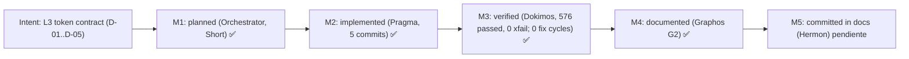

# Pipeline Feature: L3 Contrato de tokens (D-01..D-05) y backlog de autoevol (AE-1..AE-6)

- **Previous Feature Document:** [feature_20261106_172315_ont42a_harness_reconnect.md](feature_20261106_172315_ont42a_harness_reconnect.md)
- **Timestamp:** 2026-11-06T18:16:08Z (UTC)
- **Mode:** Short (primer ciclo real de autoevol; sin Archon ni Ontos; plan inline del orquestador)
- **Stage:** 2 — Graphos G2 (Weave & Record) tras veredicto VERIFIED de Dokimos.
- **Baseline:** `dev` @ `e36a608`, árbol con `?? .claude/` (no versionado, fuera de alcance).
- **Status:** L3 VERIFIED. Commit de documentación en `dev` (`docs(pipeline): record L3 VERIFIED and autoevol AE-1..AE-6 backlog`). Sin push.

## 1. Intent & Premises

Cerrar los hallazgos de contrato de respuesta D-01..D-05 de `docs/reports/2026-11-05_aep_mcp_live_audit_and_agy_harness.md` (fase 2 de la hoja de ruta, §5). Premisa de negocio: el agente consumidor paga tokens por cada byte de respuesta; `summary` debe ser realmente compacto y `detail` debe conservar la forma completa.

Este documento también registra el primer ciclo real de `autoevol` (Short) y su backlog de fallos observados (AE-1..AE-6), que son insumo de ONT-42.

## 2. Chosen Resolution Path, Tool Reach and Blast Radius

- **Camino elegido:** Short. Orquestador planifica inline; Pragma ejecuta; Dokimos verifica en vivo; Graphos G2 registra.
- **Tool reach:** `discover`, `aep_ctl`, `playbook_run`, `artifact_catalog`, `kanban_board`, `autoevol` (lectura y verificación); Bash/pytest/ruff en el repositorio.
- **Blast radius:** forma JSON de las respuestas `summary` de `discover(schema)`, `aep_ctl(schema|ipc status)`, `discover(playbook)` y el sobre de `playbook_run`, `artifact_catalog`, `kanban_board`. `detail` sin cambios. Riesgo declarado: consumidores externos (chrysalis-bridge) que lean `envelope`/`telemetry` en `summary`.

## 3. Verified Facts (reportados por el orquestador y Dokimos, en vivo)

| ID | Commit | Resultado medido | Veredicto |
|---|---|---|---|
| D-01 | `4af584d` | `discover(schema, summary)`: 18 k → 2 170 tokens (`{tool:{params,actions}}`) | ✅ |
| D-04 | `5999cb1` | `aep_ctl(schema, summary)`: 3.8 k → 1 332 tokens (precondiciones en `defaults` + excepciones) | ✅ |
| D-05 | `9b2f11e` | `aep_ctl(ipc status)`: 458 → 312 tokens; `mux.pool` duplicado eliminado fuera de `detail` | ✅ |
| D-02 | `e36a608` | `playbook_run`, `artifact_catalog`, `kanban_board` en `summary`: sin `envelope` ni `telemetry` | ✅ |
| D-03 | `8068f8b` | `select_fields` devuelve `unresolved_fields` para rutas inexistentes; rutas indexadas conservan `list` | ✅ |

Transversal: `detail` intacto; ningún consumidor interno roto; suite **576 passed, 0 xfail** (antes 562 passed / 6 xfailed); `ruff` limpio. Pragma↔Dokimos: **0 ciclos de fix**.

Autoevol (primer ciclo real en vivo): `autoevol(gaps)` pasó de 103 a 97 gaps abiertos. Cuenta los gaps correctamente, pero no pudo juzgar ninguno de los D-01..D-05 de forma autónoma.

## 4. Decisions Taken

- **Decisión del usuario:** L3 se registra como VERIFIED con D-01..D-05 cerrados; el backlog AE-1..AE-6 y D-01b quedan como insumo de ONT-42 y son **bloqueantes para `autoevol evolve` y auto-commit**.
- **Decisión del usuario:** T8 (smoke en vivo `execute` de harness_reconnect) sigue **user-gated**.
- **Decisión de Graphos:** no se crea `feature_rollup.md` en este documento (ver §9).

## 5. Backlog (insumo ONT-42)

Hallazgos y causas tal como los reporta el orquestador. La columna "Acción propuesta" es una inferencia de Graphos (supuesto), no validada por Ontos ni Archon.

| ID | Sev | Hallazgo | Evidencia | Acción propuesta (supuesto) |
|---|:-:|---|---|---|
| D-01b | LOW | 4 tools no exponen `actions` en `summary` de `discover(schema)`: `artifact_lint_and_build`, `async_job_dispatch`, `default_primitives`, `autoevol` | Salida de `discover(schema, summary)` | Constante `_TOOL_ACTIONS` + test que fije la forma de las 17 tools |
| AE-1 | A | La spec de `autoevol` no acepta referencia corta de D-01 | Spec rechazada con ref corta | Aceptar alias corto de hallazgo además del ID completo |
| AE-2 | A | La spec no apunta al código que debe cambiar | Spec sin `file:line` de destino | Exigir `target_path` y símbolo en la spec |
| AE-3 | A | `verify`/`fix_test` con root sin `.venv` devuelve `SANDBOX_UNAVAILABLE` siempre | Causa confirmada: falta fallback al `.venv` canónico | Resolver `.venv` canónico cuando el root no tiene venv |
| AE-4 | A | `fix_test` no avanza: `awaiting reload`, `consumed:false` perpetuo | Estado observado en el ciclo | Revisar la condición de consumo y el reload del front |
| AE-5 | M | El ranking de gaps entierra `open_discrepancy` | Orden de `autoevol(gaps)` | Ponderar `open_discrepancy` por encima de omisiones genéricas |
| AE-6 | M | `autoevol` no predice tests que fijan comportamiento viejo | `impacted_tests` no incluyó los tests que fijaban la forma antigua | Marcar tests con aserciones sobre forma legacy como impactados por cambio de contrato |

Conclusión: autoevol cuenta gaps bien, pero **no es aún juez autónomo**. ONT-42 debe cerrar AE-1..AE-6 y D-01b antes de `evolve` o auto-commit.

## 6. Commits (orden de `git log`, uno por hallazgo)

| Hallazgo | Commit | Superficie afectada |
|---|---|---|
| D-01 | `4af584d` | `discover(schema, summary)` |
| D-04 | `5999cb1` | `aep_ctl(schema, summary)` |
| D-05 | `9b2f11e` | `aep_ctl(ipc status)` |
| D-03 | `8068f8b` | `select_fields` |
| D-02 | `e36a608` | sobre de respuesta de `playbook_run`, `artifact_catalog`, `kanban_board` |

Topos: no se ha auditado el grafo de dependencias de estos cambios en esta activación; no se registran dependencias nuevas como hechos. Supuesto: los cinco cambios comparten el contrato de `summary`, por lo que deben revisarse juntos en ONT-42.

## 7. State Evolution

## 8. Reinforcement Graph (intent L3)

## 9. Chain and Rollup Check

- **Cadena desde Rollup 2 (ONT-29..ONT-39):** ONT-40 (1), ONT-41 (2), ONT-42a (3), L3 (4).
- **Regla cada 5.º documento:** este documento es el 4.º; el 5.º (siguiente activación de Graphos) dispara `feature_rollup.md`. No hay rollup pendiente hoy.

## 10. Routing (Orchestrator)

- Veredicto VERIFIED → Hermon (commit de documentación únicamente, sin push).
- Próximo bloque: ONT-42 (AE-1..AE-6 + D-01b) antes de `autoevol evolve` y auto-commit.
- User-gated: T8 (smoke en vivo de `execute`), push de `dev`.
