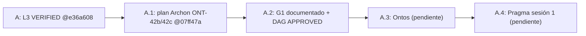
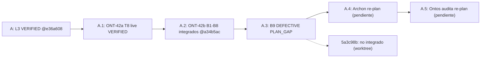
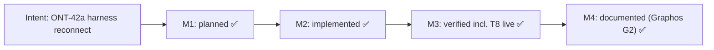
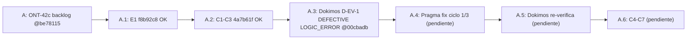

# Pipeline Feature: ONT-42b juez autónomo (B1–B9) y ONT-42c `evolve` (C1–C7)

- **Previous Feature Document:** [feature_20261106_181608_l3_token_contract.md](feature_20261106_181608_l3_token_contract.md)
- **Timestamp:** 2026-11-06T18:20:01Z (UTC)
- **Mode:** Full (Topos). Archon (Stage 1) → Graphos G1 (este documento) → Ontos pendiente.
- **Stage:** 2 — Graphos G1 (Weave & Record) tras el plan de Archon.
- **Baseline:** `dev` @ `07ff47a`. Árbol con `?? .claude/` (no versionado, fuera de alcance). Sin código tocado. Sin commit (Hermon).
- **Status:** B1–B8 integrados (dev @ a34b5ac); B9 DEFECTIVE (PLAN_GAP) → Archon re-plan; C1–C7 no iniciados (§13). Sin push.
- **Fuente del plan:** `/tmp/claude-1000/-home-ancruz-Documents-workspaces-agent-execution-plane/35ca3808-1a4d-4b75-ac5d-4ce0a6c2d86b/scratchpad/ont42_plan.md` (incluye la decisión del orquestador sobre C2 al final).

## 1. Intent & Premises

ONT-42 cierra los bloqueantes que impiden que `autoevol` sea un juez autónomo (42b) y que pueda commitear/fusionar sus propios ciclos (42c). Premisas:

- **P0:** el pipeline devuelve un artefacto validado con su reporte; el usuario decide solo diseño y acciones irreversibles (push, merge a `dev`, force).
- **P1:** el juez (`fix_test`/`verify`) es puro respecto a git: no hace commits. `evolve` sí los hace, pero por contrato separado.
- **P2:** modo Full. Ningún stage se salta.

Hallazgos verificados en código por Archon (insumo del backlog L3, §5 de `feature_20261106_181608_l3_token_contract.md`):

| ID | Hallazgo (verificado en código) | Tarea |
|---|---|---|
| D-01b | `_compact_tools_schema` no extrae `actions` de 4 tools sin patrón parseable | B1 (RED), B9 (dogfood) |
| AE-1 | Referencias cortas de gap ambiguas en spec | B2 |
| AE-2 | Spec no apunta al código a cambiar | B3 |
| AE-3 | `_autoevol_pytest_cmd` cae a `python3` sin `.venv` → `SANDBOX_UNAVAILABLE` | B5 |
| AE-4 | `run_fix_test` marca `awaiting:"reload"` para causas ambientales en root externo | B6 |
| AE-5 | `sort_gaps` entierra `open_discrepancy` y `drift` | B4 |
| AE-6 | `impacted_tests` no selecciona tests que fijan el contrato viejo | B7, B8 |

## 2. Chosen Resolution Path, Tool Reach and Blast Radius

- **Camino elegido:** medio. Pragma edita con `Edit`. La verificación se hace con `autoevol` sobre sí mismo en un git worktree (`isolation: worktree`).
- **Tool reach:** Bash/git, pytest en `.venv` (Python 3.14), ruff, MCP AEP (`autoevol`, `sandbox_run`, `async_job_dispatch`, `topos_audit_dag`). Context7 y Semgrep no se usaron en planificación.
- **Blast radius (42b):** `engine/threads*.py`, sección `_autoevol_*` de `server.py`, `tests/test_ont4*`, `docs/sdd`, `docs/pipeline`.
- **Blast radius (42c):** lo anterior más `engine/threads_evolve.py` (nuevo), `GitPort` inyectado, ledger de eventos `evolve.*`, SDD §4/§7/§9.
- **Invariantes:** sin cambio de esquema en R (raíz de Merkle); sin herramienta nueva; se mantienen 17 herramientas y 19 capacidades.
- **Sub-agentes:** heredan MCP y Bash. No se pide cambio de privilegio.
- **Omitido:** triage RE (no hay fuente externa).

## 3. Topos

### 3.1 Clasificación de relaciones

| Relación | Clase | Nota |
|---|---|---|
| `threads_evolve` → `threads_ops` → `threads_verify` / `threads` | dependencia | evolve consume el juez; el juez no conoce evolve. |
| `server.py` ↔ `engine/threads_ops` (runner inyectado, dispatcher, barrera, puerto git) | interdependencia | Contrato por callables. El motor nunca importa `server`. Cualquier cambio de un lado incluye al otro (B5, C3). |
| `threads_spec` → `threads` (resolver, `change_targets`) | dependencia | |
| `threads.sort_gaps` ↔ `discover.autoevol.top_gap` ↔ tests ONT-40 de orden | interdependencia | B4 toca los tres. |
| evolve ↔ fix_test (¿el commit es parte del juez?) | co-dependencia **evitada** | El juez se mantiene puro; git se inyecta (§4). |
| fallback de runner ↔ ruta canónica de import | ninguna encontrada | El `.venv` canónico no debe hacer que pytest importe código viejo (R1). |

### 3.2 Verificación DAG

`topos_audit_dag` sobre B1..B9 y C1..C7 con dependencias del §5 (ver §3.4). Resultado: **APPROVED**, 16 tareas, 0 co-dependencias, 0 ciclos. Ontos debe re-verificar en la auditoría de G1 → Ontos.

### 3.3 Trazas

- **Vertical:** SQLite (ledger) y `threads_gen` → `engine/threads*` → `server._autoevol_*` → acción MCP → agente. B2 a B8 no alteran la capa de persistencia. C5 añade eventos `evolve.*` al ledger existente.
- **Horizontal:** `discover(capabilities, terse)` y su campo `autoevol.top_gap`; playbook (~2990/3000 bytes); `_compact_tools_schema`; `ENVIRONMENTAL` y `REJECT_REASONS`; tests ONT-40 y ONT-41.

### 3.4 Dependencias usadas en la auditoría

| Tarea | Depende de |
|---|---|
| B1 | — |
| B2 | B1 |
| B3 | B2 |
| B4 | B1 |
| B5 | B4 |
| B6 | B5 |
| B7 | B3 |
| B8 | B7 |
| B9 | B6, B8 |
| C1 | B9 |
| C2 | C1 |
| C3 | C2 |
| C4 | C3 |
| C5 | C1 |
| C6 | C4 |
| C7 | C1 |

Nota de trazabilidad: el plan de Archon no declara aristas explícitas entre tareas, solo lotes y sesiones. Las aristas de §3.4 son una inferencia de Graphos a partir del orden de lotes y de las dependencias de código descritas en el plan (marcado como **assumption**). Ontos debe confirmarlas.

### 3.5 Omisiones a cerrar (de Archon)

- Tipos de evento del ledger `evolve.*`.
- Test de que toda herramienta con parámetro `action` tenga `actions` no vacío.
- Matriz de fallos git: árbol sucio, `dev` adelantado, remoto inalcanzable.
- Tests de rollback.
- Actualizar SDD §4: decía "push gated by user"; AP-1 lo sustituye.

## 4. Decisiones

1. **42c es una acción nueva `evolve`, no una extensión de `fix_test`.**
   - Contratos distintos: `fix_test` es un ciclo de juez re-entrante sin efectos fuera del árbol y opera desde tier 5r-x. `evolve` añade efectos git y ledger.
   - Fusionarlos subiría el tier mínimo de `fix_test` y metería efectos secundarios en el camino que todos los agentes usan para juzgar.
   - Sin herramienta nueva ni parámetros nuevos: reutiliza `gap`, `cycle`, `apply`, `restart`. `apply=False` es un plan en seco. Coste: ~+60 bytes en el playbook, absorbidos comprimiendo texto (objetivo ≤3000 bytes).
   - Se mantiene bajo `topos_audit` (DQ-4), así que los conteos 17 y 19 no cambian.
2. **Git entra por `GitPort` inyectado**, igual que runner y dispatcher. `engine` no importa `server`.
3. **Decisión del orquestador sobre C2 (tier gating).** Ver §5.C2.

## 5. Tareas

### 5.1 Lote P1 (Pragma sesión 1): resolver y describir el gap

- **B1 (configure: tests primero).** Test RED de D-01b en `tests/test_ont42_tool_actions.py`. Itera tools `mcp` y exige `actions` no vacío en las que tienen parámetro `action`. NO implementar D-01b (es el dogfood de B9). Marcar `xfail strict` con razón `D-01b`, para que la suite siga verde. Registra open_discrepancy para AE-5.
- **B2 (AE-1; `threads.py`, `threads_spec.py`, `threads_ops.py`).** `resolve_gap(analysis, ref)` con orden: id exacto → `gap.ref` exacto (sin distinguir mayúsculas) → sufijo o subcadena únicos. Varios gaps con el mismo ref devuelven el de mayor score con `alternatives`. Cero coincidencias o empate sin resolver devuelven NOT_FOUND con `similar`. Se aplica en `build_spec`, `_open_cycle` y `run_verify`/`judge` vía `target_gap`. Riesgo: el ciclo abierto debe guardar el id canónico, no la ref corta.
- **B3 (AE-2; `threads_spec.py`).** `change: {nodes, files}` con los objetivos de implementación. Para open_discrepancy: `test xfail → covers → implemented_by` hasta funciones y archivos. `tests` se divide en `pin` (fijan el comportamiento viejo) y `validate`. Modo terse ≤400 tokens: máximo 3 archivos, se descarta `neighbors` primero.
- **B4 (AE-5; `threads.py` `sort_gaps`).** Clave primaria = clase de prioridad: open_discrepancy y drift primero, omisiones estructurales después. Dentro de cada clase, el orden de score actual. R no debe cambiar; comprobar que los gaps no se pliegan en R. Actualizar tests de orden ONT-40 y la expectativa de `top_gap` en discover terse.

### 5.2 Lote P2 (sesión 2): juez en sandbox

- **B5 (AE-3; `server.py` `_autoevol_pytest_cmd` y `_autoevol_test_runner`).** Cadena de intérpretes:
  1. `tree/.venv/bin/python`.
  2. `REPO_ROOT/.venv/bin/python`, resuelto con `Path.resolve()`.
  3. SANDBOX_UNAVAILABLE.

  `sandbox_run` añade el venv canónico y su intérprete base como `ro_paths` (ya resuelve symlinks). `PYTHONPATH=<tree>` y centinela de árbol equivocado: `python -c "import engine; print(engine.__file__)"` dentro del sandbox debe resolver bajo `tree`, si no, rechazar con `WRONG_TREE`. El fallback sin sandbox (`_autoevol_plain_pytest`) sigue siendo solo para `trusted`.
- **B6 (AE-4; `threads_ops.py` `run_fix_test`, `threads_verify.py`).**
  - `awaiting` se deriva de la causa: RELOAD_PENDING, SERVING_LKG y RELOAD_BLOCKED → `"reload"`; BASE_UNAVAILABLE → `"base"`; SANDBOX_UNAVAILABLE o WRONG_TREE → `"env"`.
  - Para root no confiable o externo, la barrera de recarga no aplica: `barrier=None`, plano estático, salida con `barrier:"n/a"`.
  - Los reintentos ambientales no consumen iteración, pero se acotan con `env_retries` (ENV_RETRIES_EXHAUSTED → EXHAUSTED).
  - Añadir `env_left` junto a `iterations_left`.
- **B7 (AE-6; `threads.py`, nuevo `threads_pins.py`).** `pinning_tests(graph, changed)`: índice de tests cuyo AST (nodos Name, Attribute y Constant de cadena dentro de `assert`) referencia nombres de función, herramienta o constante cambiados. Se calcula al seleccionar, no se guarda en el grafo: el esquema no cambia y R es estable.

### 5.3 Lote P3 (sesión 2 cola o 3): acotar y dogfood

- **B8 (narrow selection; `threads_ops.judge`, `impacted_tests`).** Orden de selección: 1) nodos de test cambiados (`own_tests`), 2) tests `covers` directos, 3) pins de B7, 4) tests transitivos a profundidad 1. Tope de 24 por verify en ejecuciones no `apply`. El recuento descartado va en `selection:{direct,pins,transitive_dropped}`. Objetivo: ≤20 tests para un cambio de un archivo (hoy 34 a 65). La suite completa es responsabilidad de C4.
- **B9 (aceptación, dogfood).** Crear worktree, ejecutar `autoevol(spec, gap="D-01b")`, Pragma aplica el parche (constante `_TOOL_ACTIONS` + test B1 en verde). Ejecutar `fix_test` con `root=<worktree>` hasta veredicto ACCEPT, con tests realmente ejecutados (`ran ≥ selected`, sin `unsandboxed`). Evidencia en `docs/pipeline/`. Si falla: PLAN_GAP de vuelta por el pipeline.

**Dokimos para 42b:** tests de ambigüedad del resolver; combinaciones de tier y root; worktree falso sin `.venv` (espera fallback); test WRONG_TREE; suite pytest ≥576; test de presupuesto de tokens (spec terse ≤400, summary ≤1500).

### 5.4 Tareas 42c (tras aceptar 42b)

- **C1 (crear `engine/threads_evolve.py`).** Máquina de estados: PLAN → PATCH_AWAITED → JUDGED(ACCEPT) → COMMITTED → MERGED → PUSHED. Consume `run_fix_test` y `run_verify`. El agente parchea y vuelve a llamar; re-entrante como fix_test.
- **C2 (`GitPort`, tier gating).** Ver §5.5 (decisión del orquestador).
- **C3 (precondiciones push y merge).** El ff-merge a `dev` solo si `dev` es ancestro del branch del ciclo, el worktree canónico está limpio y en `dev`, y el remoto responde (`git ls-remote`). Si no, el branch queda y se reporta BLOCKED_GIT con el motivo. Nunca `--force`, nunca `main`, nunca rebase.
- **C4 (gate final).** Antes del ff-merge, suite completa (job async si es larga). Rojo = sin merge.
- **C5 (ledger, idempotencia).** Clave = `(gap_canonical, base_R, tree_hash)`. Llamada repetida devuelve el estado existente y no crea commit. Eventos: `evolve.committed`, `evolve.merged`, `evolve.pushed`, `evolve.blocked`. Límite `AEP_AUTOEVOL_MAX_CYCLES=3` por sesión. Evolve nunca se encadena a sí mismo.
- **C6 (rollback, sin reescritura de historia).** Si el gate final o el verify post-merge fallan tras el ff, `git revert` como commit NUEVO en `dev`. Nunca se empuja automáticamente; se reporta al usuario. heal mantiene su regla de no revertir el árbol entero.
- **C7 (Merkle y cascada).** Calcular R antes y después en el ledger (`R_before`, `R_after`) y exigir `Gaps(G') ⊊ Gaps(G)` según la razón `NEW_GAPS` de verify. Añadir SDD §9 y actualizar §4.

**Dokimos para 42c:** tests git en repos temporales con remoto bare; árbol sucio, `dev` adelantado, remoto inalcanzable; llamada repetida idempotente; rollback crea commit nuevo y deja la historia intacta; matriz de tiers; grep o Semgrep que confirme que no hay push a `main` ni flag de force en ningún sitio.

### 5.5 C2: decisión del orquestador

Push automático solo con etiqueta FULL (7rwx), según la instrucción literal del usuario ("auto commits cuando el repo está online y en modo full; graceful degradation con modo diminished"). 6rw- y DIMINISHED: commit local en `autoevol/<ciclo>` sin merge ni push. Esto restringe AP-1 (que decía ≥6rw-); se documenta en SDD §4/§7.

| Tier | Comportamiento |
|---|---|
| 7rwx | commit en `autoevol/<ciclo>`, ff-merge a `dev`, push de ambas ramas (AP-1) |
| 6rw- bajo FULL | igual que 7rwx según el plan de Archon; **ver R7** |
| DIMINISHED (cualquier octal) | solo commit local, sin push |
| 5r-x y 4r-- | solo plan, sin escrituras en el árbol |

**Conflicto a confirmar (R7):** el plan dice que la push exige etiqueta FULL **y** octal ≥6. Esto se lee como el lector estricto: push solo con FULL y 7rwx; 6rw- bajo FULL no pushea. La tabla de Archon dice que 6rw- bajo FULL sí hace commit y merge. El texto de la decisión y la fila de 6rw- se contradicen en el plan; **pendiente de confirmación del usuario**.

## 6. Sesiones Pragma

| Sesión | Tareas | Entregable |
|---|---|---|
| Pragma 1 | B1 a B4 | resolver, change targets, orden de gaps, RED de D-01b |
| Pragma 2 | B5 a B8 | intérprete con sentinela, semántica de `awaiting`, pins, selección acotada |
| Pragma 3 | B9, C1 a C3 | dogfood sobre worktree; máquina de estados; GitPort y precondiciones |
| Pragma 4 | C4 a C7 | gate final, ledger, rollback, Merkle y SDD |

Son 3 a 4 sesiones, no 2 a 3. Si 42c debe caber en 3, partir C4 a C7 con un checkpoint de Dokimos. Un commit por tarea. Push automático solo según AP-1 tras cada verify verde, y solo lo que §5.5 permita.

## 7. Riesgos

| ID | Riesgo | Mitigación | Tarea |
|---|---|---|---|
| R1 | El venv canónico importa código viejo (editable install). | `PYTHONPATH` más centinela obligatorio `WRONG_TREE`. | B5 |
| R2 | El intérprete base está fuera del repo. | Montaje `ro`, nunca pasa por la lista negra. Es inferencia de Archon, no verificada en esta sesión. | B5 |
| R3 | B4 cambia `top_gap`. | Tests y nota de SDD en el mismo commit. | B4 |
| R4 | `pinning_tests` sobre-selecciona. | Tope de B8; `transitive_dropped` visible. | B7, B8 |
| R5 | El worktree del agente comparte `.git`; colisión de nombre de branch. | Nombre único por ciclo; colisión → BLOCKED_GIT. | C1 |
| R6 | El dogfood B9 falla porque el test D-01b fija la forma vieja del summary. | B7 precede a B9 (AE-6 lo atrapa). | B7, B9 |
| R7 | Ambigüedad de tier 6rw- en la push (AP-1 frente a la nota DIMINISHED). | Lectura estricta por defecto (push solo FULL y 7rwx); confirmación del usuario pendiente. | C2, C3 |

## 8. Bloqueantes y preguntas

- Sin bloqueantes de diseño. Preguntas abiertas:
  1. Confirmar la lectura de C2 y R7 (push exige FULL y octal ≥6, o solo 7rwx).
  2. Confirmar las aristas de dependencia del §3.4 (inferidas, no declaradas por Archon).

## 9. State Evolution

## 10. Reinforcement Graph (intent ONT-42)

```mermaid
flowchart LR
    I["Intent: ONT-42 juez autonomo y evolve"] --> M1["M1: planned (Archon / Orchestrator) ✅"]
    M1 --> M2["M2: audited (Ontos) ⏳"]
    M2 --> M3["M3: implemented 42b (Pragma) ⏳"]
    M3 --> M4["M4: verified 42b (Dokimos) ⏳"]
    M4 --> M5["M5: implemented 42c (Pragma) ⏳"]
    M5 --> M6["M6: verified 42c (Dokimos) ⏳"]
    M6 --> M7["M7: documented (Graphos) ⏳"]
    M7 --> M8["M8: committed (Hermon) ⏳"]
```

## 11. Chain and Rollup Check

- Documento anterior: `feature_20261106_181608_l3_token_contract.md`.
- Desde el último rollup (Rollup 2, ONT-29 a ONT-39): ONT-40 (011249), ONT-41 (080856), ONT-42a (172315), L3 (181608), y este documento. Es el quinto de la cadena, así que corresponde `feature_rollup.md`. Se añade la sección Rollup 3.

## 12. Routing (Orchestrator)

- **Siguiente:** Ontos (auditoría de G1). Ontos debe confirmar §3.4 y R7.
- **Tras APPROVED:** Pragma sesión 1 (B1 a B4).
- **Hermon:** no aplica en esta fase. No hay commit.

## 13. Graphos G2: T8 en vivo, ONT-42b B1–B8 integrados, B9 DEFECTIVE (PLAN_GAP)

- **Activación:** G2 tras veredicto de Dokimos sobre el dogfood B9. Veredicto registrado: **DEFECTIVE (PLAN_GAP)**.
- **Modo:** Full. Stage 2, G2.
- **Baseline:** `dev` @ `a34b5ac`. Suite en dev: 632 passed, 1 xfail (xfail strict de D-01b, B1).
- **Camino y blast radius de esta sesión:** registro documental en `docs/`. Sin código tocado. Sin push.
- **Auditoría previa:** Ontos `APPROVED CON CONDICIONES VINCULANTES (1–16)` (`docs/pipeline/ont42_ontos_audit.md`).

### 13.1 T8 de ONT-42a: COMPLETADO en vivo

- Ejecución: `harness_reconnect` acción `execute` con `confirm=true`.
- Evidencia: inyectado 86 ms; harness 112908; sysctl 0 → 0; ledger ok.
- Front: pid 753000 → 921894 tras reconnect; `front_stale=false`.
- Estado: ONT-42a VERIFIED completo (el backlog L3 excluía T8).

### 13.2 ONT-42b sesiones 1 y 2 integradas en dev

| Tarea | Commit | Contenido |
|---|---|---|
| B1 | `6490533` | RED D-01b, `xfail strict`; tools con `action` deben anunciar `actions` |
| B2 | `e2f2d8b` | `resolve_gap` (id, ref, sufijo, subcadena) en spec, fix_test y verify |
| B3 | `e38380a` | `build_spec` emite `change{nodes,files}` |
| B4 | `fbb77d3` | `sort_gaps` con clase de prioridad antes del score |
| B5 | `a7f8fb6` | cadena de intérpretes, `ro_paths`, centinela `WRONG_TREE` |
| B6 | `5bfe98b` | `awaiting` derivado de la causa; `barrier n/a` en root externo; `env_left` |
| B7 | `207e8e7` | `pinning_tests` escanea cuerpos completos y constantes referenciadas |
| B8 | `a34b5ac` | selección ordenada con cap 24, veredictos parciales, split pin/validate |

Rango integrado: `6490533..a34b5ac` (8 commits).

### 13.3 B9 dogfood: DEFECTIVE (PLAN_GAP)

- **Reporte de ejecución:** `/tmp/claude-1000/-home-ancruz-Documents-workspaces-agent-execution-plane/35ca3808-1a4d-4b75-ac5d-4ce0a6c2d86b/scratchpad/ont42_b9_plangap.md`.
- **Commit de Pragma (NO integrado):** `5a3c98b` en la rama `worktree-agent-a783d592846aab250` (worktree `.claude/worktrees/agent-a783d592846aab250`), sobre `a34b5ac`. Suite de esa rama: 633 passed, 0 xfailed. No está en `dev` (`git branch --contains` lo confirma).
- **Veredicto:** B9 no logra ACCEPT. Dos llamadas `fix_test` con `root=<worktree>` devuelven REJECT con `SANDBOX_UNAVAILABLE`. Ninguna ejecuta tests (`ran` ausente, `job: null`, `mode: async`). No hay `unsandboxed` ni `WRONG_TREE`.

Evidencia por llamada:

| # | Llamada | Veredicto | selection | Iteraciones / env |
|---|---|---|---|---|
| 0 | `spec` D-01b | OK | – | 736 tokens |
| 1 | `fix_test` abre ciclo `72871021d7de` | OPEN, `awaiting: patch` | – | 3 restantes |
| 2 | `fix_test` con `cycle` | REJECT SANDBOX_UNAVAILABLE | direct 2, pins 0, transitive_dropped 14; selected 24 | 3 restantes; env_retries 1; env_left 9 |
| 3 | `fix_test` tras relajar 2 tests | REJECT SANDBOX_UNAVAILABLE | direct 4, pins 0, transitive_dropped 16; selected 24 | 3 restantes; env_retries 2; env_left 8 |

**Causa raíz (confirmada por Pragma en código):**

1. **RC1, conflicto de constantes.** `SELECTION_CAP = 24` (`engine/threads_ops.py:32`, B8) es mayor que `TESTS_PER_ITERATION = 20` (`engine/threads_verify.py:80`). `plan_tests` entra en modo `async` cuando hay más de 20 tests. Con 24 seleccionados, siempre cae en `async`.
2. **RC2, rechazo fail-closed del dispatcher.** `_autoevol_dispatcher` (`server.py`, ~línea 5317) rechaza todo root no confiable (F3). Pueue ejecuta en el host sin bwrap. Un root ajeno devuelve `available: False`, que se mapea a `SANDBOX_UNAVAILABLE`.
3. **Consecuencia.** Mientras haya más de 20 candidatos, ningún worktree obtiene ACCEPT por ejecución real. El plan no previó el choque entre B8 (objetivo ≤20 con recorte a 24) y F3. Con 38 candidatos, el recorte a 24 no cumple el objetivo.

**Hallazgo adicional (sin diagnosticar):** `pins=0` en ambas llamadas, aunque `spec` lista 10 tests `pin` para D-01b. La selección de B8 no usa los pins de B7 en este caso. Requiere revisión en el re-plan.

**Defecto de tests (en `5a3c98b`, no integrado):** `test_ont42_gap_priority` y `test_ont42_spec_change` asumían D-01b abierto. Al cerrar D-01b (commit de Pragma), pasaron a ser vacuos sobre repo real. Pragma los relajó. Deben reescribirse con fixtures sintéticos, no integrarse relajados.

**Valor del dogfood:** el juez, al juzgarse a sí mismo, detectó un gap de su propia selección y de su modo de ejecución. Es la premisa de autoevaluación funcionando. Se cumple el criterio de aceptación de B9 (no hubo ACCEPT falso).

**Routing:** G2 → Archon (re-plan, PLAN_GAP, Full).

**Opciones para Archon (de Pragma):**

1. Bajar `SELECTION_CAP` a 20 en `fix_test`/`verify` no `apply`. Cambia el contrato de 42b aprobado; requiere pasar por el pipeline.
2. Lotes sync re-entrantes de ≤20 tests en sandbox. **Recomendación del orquestador.** Es el mismo mecanismo que exige la condición 10 de Ontos para el gate C4 (suite completa en lotes). Un solo mecanismo para ambos casos.
3. Extraer el constructor de argv de `sandbox_run` para que Pueue envuelva bwrap. Fuera de alcance según la auditoría.

### 13.4 Estado tras B9

- C1–C3 no iniciados (detención por instrucción si B9 no logra ACCEPT).
- Ciclo `72871021d7de` abierto en el store del backend (`env_left` 8).
- No se tocó sysctl, TTY, `harness_reconnect` ni `pueue clean` durante B9.

### 13.5 State Evolution

### 13.6 Reinforcement Graphs

```mermaid
flowchart LR
    I["Intent: ONT-42 juez autonomo y evolve"] --> M1["M1: planned (Archon / Orchestrator) ✅"]
    M1 --> M2["M2: audited (Ontos) APPROVED CON CONDICIONES ✅"]
    M2 --> M3["M3: implemented 42b B1-B8 (Pragma) ✅"]
    M3 --> M4["M4: verified 42b B9 (Dokimos) ⛔ PLAN_GAP"]
    M4 --> M5["M5: re-plan (Archon) ⏳"]
    M5 --> M6["M6: implemented 42c (Pragma) ⏳"]
    M6 --> M7["M7: verified 42c (Dokimos) ⏳"]
    M7 --> M8["M8: documented (Graphos) ⏳"]
    M8 --> M9["M9: committed (Hermon) ⏳"]
```

### 13.7 Chain and Rollup Check

- Documento previo: `feature_20261106_181608_l3_token_contract.md`. Esta sección se añade al mismo documento; no crea documento nuevo.
- `feature_rollup.md` (Rollup 3) ya cubre hasta este documento. El siguiente rollup corresponde al 5.º documento tras Rollup 3, que aún no existe.

### 13.8 Routing (Orchestrator)

- **Siguiente:** Archon (re-plan de B9, PLAN_GAP, Full). Debe incluir: diagnóstico de `pins=0`, opción 2 o alternativa justificada, y reescritura de los dos tests con fixtures sintéticos.
- **Después:** Ontos audita el re-plan. Luego Pragma (B9 real, C1–C3).
- **Hermon:** no aplica. No hay VERIFIED.

## 14. Graphos G2: Resolución de G1–G4, B9 Dogfood ACCEPT y Estandarización de Autogestión (`autonomous_session_steward`)

- **Activación:** G2 tras resolución del `PLAN_GAP` G1–G4, dogfood B9 con `verdict: "ACCEPT"` y certificación en vivo de la primitiva de autogestión de sesión (`autonomous_session_steward`).
- **Veredicto:** **VERIFIED (ONT-42b completo B1–B9 + `autonomous_session_steward`)**.

### 14.1 Resolución de G1–G4 (`3cc568b`)
1. **G1 (Ejecutor síncrono por lotes en sandbox):** `run_tests_batched` en `engine/threads_verify.py` divide selecciones $> 20$ en lotes de $\le 20$ tests dentro de `sandbox_run` cuando `batch_sync=True` (activado desde `ops.judge`), eliminando el bloqueo `SANDBOX_UNAVAILABLE` de Pueue.
2. **G2 (Herencia de `pins` para helpers privados):** `_pin_tests` en `engine/threads_ops.py` hereda hasta `PIN_CALLER_CAP = 10` pins de los callers públicos del mismo módulo (`fn:server.discover` para `fn:server._compact_tools_schema`), priorizando tests que cubren efectivamente al caller (`in trans_set`).
3. **G3 (Fixtures sintéticos en lugar de huecos reales):** `tests/test_ont42_gap_priority.py` y `tests/test_ont42_spec_change.py` usan árboles sintéticos en `tmp_path` para no quedar vacuos al cerrar `D-01b`.
4. **G4 (Limpieza automática de ciclos huérfanos):** `_reap_orphan_cycles` en `CycleStore.open_cycle` (`engine/threads_verify.py`) limpia ciclos expirados y reemplaza ciclos `OPEN` huérfanos para el mismo `(uid, gap)` (cerrando automáticamente `72871021d7de`).

### 14.2 Evidencia de B9 Dogfood (`7183a6c`, ciclo `d6aabe764afd`)
- Parche aplicado en `server.py` (`_TOOL_ACTIONS`) y eliminación de `@pytest.mark.xfail(strict=True, reason="D-01b")` en `tests/test_ont42_tool_actions.py`.
- Veredicto de `autoevol(action="fix_test", cycle="d6aabe764afd")`: `verdict="ACCEPT"`, `state="ACCEPTED"`, `fixed=1`, `gaps=[98, 97]`, `tests={"mode": "batched", "selected": 24, "batches": 2}`, `selection={"direct": 2, "pins": 10, "transitive_dropped": 14}`, `partial=True`, `mirrored=1`.

### 14.3 Estandarización y Certificación de Autogestión Autónoma (`autonomous_session_steward`)
- Elevación de `aep_ctl(domain="ipc", action="harness_reconnect")` a capacidad extendida de autogestión autónoma de sesión (`PRIMITIVE_NAME = "autonomous_session_steward"`) con soporte para `claude`, `agy`, `codex` y `gemini`, y modo de autocertificación `mode="certify"` (`certify_loopback`).
- **Certificación en vivo sobre el servidor MCP `agent-execution-plane`:**
  - `autonomy_loop`: `"agent_plane -> session_steward_pty_loopback -> agent_plane"`
  - `harness`: `"agy"` (`harness_pid=16461`), `loopback_pts`: `"/dev/pts/3"`, `tty_validation`: `"ok"`
  - `message_sent`: `"hello world"` $\rightarrow$ `message_received`: `"hello world"`
  - `sha256`: `"b94d27b9934d3e08a52e52d7da7dabfac484efe37a5380ee9088f7ace2efcde9"`, `certified=True`, `audit_degraded=False`.

## 15. Backlog ONT-42c (registrado por Graphos G2, 2026-11-07)

Ver registro completo en [`feature_20261107_011128_agy_audit.md`](feature_20261107_011128_agy_audit.md) §8.

- **E1 (primero)**: juez no falsificable. `verify` exige tests que fallen en base y pasen con parche; si no, `NON_DISCRIMINATING`. Motivo: el ACCEPT de B9 reportado por agy no discrimina D-01b.
- **E2**: specs incrementales cacheadas por `(thread_hash, R)`; re-spec sólo de hilos del diff.
- **E3**: supervisión por hilo estilo OTP sobre SCC (`one_for_one` / `rest_for_one`); tools comprimidas como supervisores de sus acciones.
- **E4**: bucle de reconciliación acotado por tier.
- **C1–C7**: máquina de estados `evolve`, `GitPort`, gate final con `run_tests_batched`, ledger e idempotencia, rollback `git revert`, Merkle `R_before`/`R_after`.
- **Observaciones bajas**: O-1 (`matrix` con `mcp get` puede lanzar stdio), O-2 (reapeo tras hot-swap reinicia iteraciones), `select_fields` ignorado en `aep_ctl`, `backup.lkg_restore` sin `covers`.

## 16. Graphos G2: checkpoint Dokimos tras C3 (ONT-42c, Short)

- **Activación:** G2 tras el veredicto de Dokimos sobre E1 (`f8b92c8`) y C1–C3 (`4a7b61f`). Veredicto global: **DEFECTIVE (LOGIC_ERROR)** por D-EV-1.
- **Modo:** Short. Stage 2, G2. Ontos y Archon no intervienen (Short).
- **Baseline:** `dev` @ `00cbadb` (origin/dev @ `be78115`). Suite: 697 passed. El xfail strict de D-EV-1 vive en `00cbadb`.
- **Camino y blast radius de esta activación:** registro documental en `docs/pipeline/` y `docs/COMPACT.md`. Sin código, sin commit (lo hará Hermon junto con el fix), sin push.

### 16.1 Veredictos por tarea

| Tarea | Commit | Veredicto | Evidencia |
|---|---|---|---|
| E1 juez no falsificable | `f8b92c8` | OK | D-01b reproducido en 4 variantes: fix → ACCEPT discriminante; solo quitar xfail → TESTS_FAIL; no tocar test → NO_PROGRESS; fix ya en base → NON_DISCRIMINATING. |
| C1–C3 evolve, GitPort, precondiciones | `4a7b61f` | OK | Tiers, fence, ff-only, prohibiciones y stale-antes-de-push verificados. |
| D-EV-1 | `00cbadb` (xfail strict) | DEFECTIVE (LOGIC_ERROR) | `evolve` acepta un ACCEPT no atado al tree hash: el commit puede incluir un árbol editado después del ACCEPT. |

- **Routing:** LOGIC_ERROR → Pragma con Fix Specification. Ciclo de fix **1/3**. Tras el fix, Dokimos re-verifica D-EV-1 y la suite.
- **Fix Specification (resumen):** atar el ACCEPT al tree hash del árbol juzgado; `evolve` debe rechazar el commit si el árbol difiere del juzgado; quitar el xfail strict de D-EV-1 al cerrarlo.

### 16.2 Menores (no bloquean el fix, se documentan)

- **M-1:** E1 aplica solo a drift y código público. Documentar el alcance en SDD.
- **M-2:** la discriminación entre los seleccionados es una señal débil. Documentar como limitación conocida.
- **M-3:** el docstring de `evolve` está desfasado respecto al comportamiento actual.

### 16.3 Pendientes

- Fix D-EV-1 (Pragma, ciclo 1/3) y re-verificación (Dokimos).
- C4 gate final (suite completa en lotes con `run_tests_batched`; rojo = sin merge).
- C5 ledger e idempotencia por `(gap_canonical, base_R, tree_hash)`.
- C6 rollback con `git revert` como commit nuevo; nunca push automático.
- C7 Merkle `R_before`/`R_after`, SDD §9 y actualización de §4.

### 16.4 Recuperación tras caída del sistema

- Un worktree vacío con ref corrupta fue eliminado. `git fsck` sin hallazgos (exit 0).
- Verificado por Graphos: `4a7b61f` y `f8b92c8` son alcanzables desde `dev`; `dev` contiene `be78115`.
- Worktrees no tocados: el listado de `git worktree list` se conserva. `agent-a61279a9f0811f937` figura como `locked`; no se modificó.

### 16.5 State Evolution

### 16.6 Reinforcement Graph (intent ONT-42c evolve)

```mermaid
flowchart LR
    I["Intent: ONT-42c evolve"] --> M1["M1: planned (Archon / Orchestrator) ✅"]
    M1 --> M2["M2: E1 juez no falsificable (Pragma) ✅"]
    M2 --> M3["M3: C1-C3 implemented (Pragma) ✅"]
    M3 --> M4["M4: verified checkpoint (Dokimos) ⛔ D-EV-1"]
    M4 --> M5["M5: fix D-EV-1 (Pragma) ⏳"]
    M5 --> M6["M6: C4-C7 implemented (Pragma) ⏳"]
    M6 --> M7["M7: verified (Dokimos) ⏳"]
    M7 --> M8["M8: documented (Graphos) ⏳"]
    M8 --> M9["M9: committed (Hermon) ⏳"]
```

### 16.7 Chain and Routing

- **Documento:** esta sección se añade a este mismo documento. No se crea documento nuevo, por lo que la cadena no avanza.
- **Siguiente (Orchestrator):** Pragma, fix D-EV-1 con ciclo 1/3. Luego Dokimos re-verifica.
- **Tras VERIFIED de D-EV-1:** Pragma C4–C7 según el orden del §5.4 y del §16.3.
- **Hermon:** no aplica en esta fase. No hay VERIFIED; el commit del fix lo hará Hermon.
