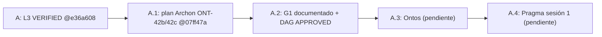

# Pipeline Feature: ONT-42b juez autónomo (B1–B9) y ONT-42c `evolve` (C1–C7)

- **Previous Feature Document:** [feature_20261106_181608_l3_token_contract.md](feature_20261106_181608_l3_token_contract.md)
- **Timestamp:** 2026-11-06T18:20:01Z (UTC)
- **Mode:** Full (Topos). Archon (Stage 1) → Graphos G1 (este documento) → Ontos pendiente.
- **Stage:** 2 — Graphos G1 (Weave & Record) tras el plan de Archon.
- **Baseline:** `dev` @ `07ff47a`. Árbol con `?? .claude/` (no versionado, fuera de alcance). Sin código tocado. Sin commit (Hermon).
- **Status:** PLANNED. Pendiente de auditoría Ontos (G1 → Ontos). Sin push.
- **Fuente del plan:** `/tmp/claude-1000/-home-ancruz-Documents-workspaces-agent-execution-plane/35ca3808-1a4d-4b75-ac5d-4ce0a6c2d86b/scratchpad/ont42_plan.md` (incluye la decisión del orquestador sobre C2 al final).

## 1. Intent & Premises

ONT-42 cierra los bloqueantes que impiden que `autoevol` sea un juez autónomo (42b) y que pueda commitear/fusionar sus propios ciclos (42c). Premisas:

- **P0:** el pipeline devuelve un artefacto validado con su reporte; el usuario decide solo diseño y acciones irreversibles (push, merge a `dev`, force).
- **P1:** el juez (`fix_test`/`verify`) es puro respecto a git: no hace commits. `evolve` sí los hace, pero por contrato separado.
- **P2:** modo Full. Ningún stage se salta.

Hallazgos verificados en código por Archon (insumo del backlog L3, §5 de `feature_20261106_181608_l3_token_contract.md`):

| ID | Hallazgo (verificado en código) | Tarea |
|---|---|---|
| D-01b | `_compact_tools_schema` no extrae `actions` de 4 tools sin patrón parseable | B1 (RED), B9 (dogfood) |
| AE-1 | Referencias cortas de gap ambiguas en spec | B2 |
| AE-2 | Spec no apunta al código a cambiar | B3 |
| AE-3 | `_autoevol_pytest_cmd` cae a `python3` sin `.venv` → `SANDBOX_UNAVAILABLE` | B5 |
| AE-4 | `run_fix_test` marca `awaiting:"reload"` para causas ambientales en root externo | B6 |
| AE-5 | `sort_gaps` entierra `open_discrepancy` y `drift` | B4 |
| AE-6 | `impacted_tests` no selecciona tests que fijan el contrato viejo | B7, B8 |

## 2. Chosen Resolution Path, Tool Reach and Blast Radius

- **Camino elegido:** medio. Pragma edita con `Edit`. La verificación se hace con `autoevol` sobre sí mismo en un git worktree (`isolation: worktree`).
- **Tool reach:** Bash/git, pytest en `.venv` (Python 3.14), ruff, MCP AEP (`autoevol`, `sandbox_run`, `async_job_dispatch`, `topos_audit_dag`). Context7 y Semgrep no se usaron en planificación.
- **Blast radius (42b):** `engine/threads*.py`, sección `_autoevol_*` de `server.py`, `tests/test_ont4*`, `docs/sdd`, `docs/pipeline`.
- **Blast radius (42c):** lo anterior más `engine/threads_evolve.py` (nuevo), `GitPort` inyectado, ledger de eventos `evolve.*`, SDD §4/§7/§9.
- **Invariantes:** sin cambio de esquema en R (raíz de Merkle); sin herramienta nueva; se mantienen 17 herramientas y 19 capacidades.
- **Sub-agentes:** heredan MCP y Bash. No se pide cambio de privilegio.
- **Omitido:** triage RE (no hay fuente externa).

## 3. Topos

### 3.1 Clasificación de relaciones

| Relación | Clase | Nota |
|---|---|---|
| `threads_evolve` → `threads_ops` → `threads_verify` / `threads` | dependencia | evolve consume el juez; el juez no conoce evolve. |
| `server.py` ↔ `engine/threads_ops` (runner inyectado, dispatcher, barrera, puerto git) | interdependencia | Contrato por callables. El motor nunca importa `server`. Cualquier cambio de un lado incluye al otro (B5, C3). |
| `threads_spec` → `threads` (resolver, `change_targets`) | dependencia | |
| `threads.sort_gaps` ↔ `discover.autoevol.top_gap` ↔ tests ONT-40 de orden | interdependencia | B4 toca los tres. |
| evolve ↔ fix_test (¿el commit es parte del juez?) | co-dependencia **evitada** | El juez se mantiene puro; git se inyecta (§4). |
| fallback de runner ↔ ruta canónica de import | ninguna encontrada | El `.venv` canónico no debe hacer que pytest importe código viejo (R1). |

### 3.2 Verificación DAG

`topos_audit_dag` sobre B1..B9 y C1..C7 con dependencias del §5 (ver §3.4). Resultado: **APPROVED**, 16 tareas, 0 co-dependencias, 0 ciclos. Ontos debe re-verificar en la auditoría de G1 → Ontos.

### 3.3 Trazas

- **Vertical:** SQLite (ledger) y `threads_gen` → `engine/threads*` → `server._autoevol_*` → acción MCP → agente. B2 a B8 no alteran la capa de persistencia. C5 añade eventos `evolve.*` al ledger existente.
- **Horizontal:** `discover(capabilities, terse)` y su campo `autoevol.top_gap`; playbook (~2990/3000 bytes); `_compact_tools_schema`; `ENVIRONMENTAL` y `REJECT_REASONS`; tests ONT-40 y ONT-41.

### 3.4 Dependencias usadas en la auditoría

| Tarea | Depende de |
|---|---|
| B1 | — |
| B2 | B1 |
| B3 | B2 |
| B4 | B1 |
| B5 | B4 |
| B6 | B5 |
| B7 | B3 |
| B8 | B7 |
| B9 | B6, B8 |
| C1 | B9 |
| C2 | C1 |
| C3 | C2 |
| C4 | C3 |
| C5 | C1 |
| C6 | C4 |
| C7 | C1 |

Nota de trazabilidad: el plan de Archon no declara aristas explícitas entre tareas, solo lotes y sesiones. Las aristas de §3.4 son una inferencia de Graphos a partir del orden de lotes y de las dependencias de código descritas en el plan (marcado como **assumption**). Ontos debe confirmarlas.

### 3.5 Omisiones a cerrar (de Archon)

- Tipos de evento del ledger `evolve.*`.
- Test de que toda herramienta con parámetro `action` tenga `actions` no vacío.
- Matriz de fallos git: árbol sucio, `dev` adelantado, remoto inalcanzable.
- Tests de rollback.
- Actualizar SDD §4: decía "push gated by user"; AP-1 lo sustituye.

## 4. Decisiones

1. **42c es una acción nueva `evolve`, no una extensión de `fix_test`.**
   - Contratos distintos: `fix_test` es un ciclo de juez re-entrante sin efectos fuera del árbol y opera desde tier 5r-x. `evolve` añade efectos git y ledger.
   - Fusionarlos subiría el tier mínimo de `fix_test` y metería efectos secundarios en el camino que todos los agentes usan para juzgar.
   - Sin herramienta nueva ni parámetros nuevos: reutiliza `gap`, `cycle`, `apply`, `restart`. `apply=False` es un plan en seco. Coste: ~+60 bytes en el playbook, absorbidos comprimiendo texto (objetivo ≤3000 bytes).
   - Se mantiene bajo `topos_audit` (DQ-4), así que los conteos 17 y 19 no cambian.
2. **Git entra por `GitPort` inyectado**, igual que runner y dispatcher. `engine` no importa `server`.
3. **Decisión del orquestador sobre C2 (tier gating).** Ver §5.C2.

## 5. Tareas

### 5.1 Lote P1 (Pragma sesión 1): resolver y describir el gap

- **B1 (configure: tests primero).** Test RED de D-01b en `tests/test_ont42_tool_actions.py`. Itera tools `mcp` y exige `actions` no vacío en las que tienen parámetro `action`. NO implementar D-01b (es el dogfood de B9). Marcar `xfail strict` con razón `D-01b`, para que la suite siga verde. Registra open_discrepancy para AE-5.
- **B2 (AE-1; `threads.py`, `threads_spec.py`, `threads_ops.py`).** `resolve_gap(analysis, ref)` con orden: id exacto → `gap.ref` exacto (sin distinguir mayúsculas) → sufijo o subcadena únicos. Varios gaps con el mismo ref devuelven el de mayor score con `alternatives`. Cero coincidencias o empate sin resolver devuelven NOT_FOUND con `similar`. Se aplica en `build_spec`, `_open_cycle` y `run_verify`/`judge` vía `target_gap`. Riesgo: el ciclo abierto debe guardar el id canónico, no la ref corta.
- **B3 (AE-2; `threads_spec.py`).** `change: {nodes, files}` con los objetivos de implementación. Para open_discrepancy: `test xfail → covers → implemented_by` hasta funciones y archivos. `tests` se divide en `pin` (fijan el comportamiento viejo) y `validate`. Modo terse ≤400 tokens: máximo 3 archivos, se descarta `neighbors` primero.
- **B4 (AE-5; `threads.py` `sort_gaps`).** Clave primaria = clase de prioridad: open_discrepancy y drift primero, omisiones estructurales después. Dentro de cada clase, el orden de score actual. R no debe cambiar; comprobar que los gaps no se pliegan en R. Actualizar tests de orden ONT-40 y la expectativa de `top_gap` en discover terse.

### 5.2 Lote P2 (sesión 2): juez en sandbox

- **B5 (AE-3; `server.py` `_autoevol_pytest_cmd` y `_autoevol_test_runner`).** Cadena de intérpretes:
  1. `tree/.venv/bin/python`.
  2. `REPO_ROOT/.venv/bin/python`, resuelto con `Path.resolve()`.
  3. SANDBOX_UNAVAILABLE.

  `sandbox_run` añade el venv canónico y su intérprete base como `ro_paths` (ya resuelve symlinks). `PYTHONPATH=<tree>` y centinela de árbol equivocado: `python -c "import engine; print(engine.__file__)"` dentro del sandbox debe resolver bajo `tree`, si no, rechazar con `WRONG_TREE`. El fallback sin sandbox (`_autoevol_plain_pytest`) sigue siendo solo para `trusted`.
- **B6 (AE-4; `threads_ops.py` `run_fix_test`, `threads_verify.py`).**
  - `awaiting` se deriva de la causa: RELOAD_PENDING, SERVING_LKG y RELOAD_BLOCKED → `"reload"`; BASE_UNAVAILABLE → `"base"`; SANDBOX_UNAVAILABLE o WRONG_TREE → `"env"`.
  - Para root no confiable o externo, la barrera de recarga no aplica: `barrier=None`, plano estático, salida con `barrier:"n/a"`.
  - Los reintentos ambientales no consumen iteración, pero se acotan con `env_retries` (ENV_RETRIES_EXHAUSTED → EXHAUSTED).
  - Añadir `env_left` junto a `iterations_left`.
- **B7 (AE-6; `threads.py`, nuevo `threads_pins.py`).** `pinning_tests(graph, changed)`: índice de tests cuyo AST (nodos Name, Attribute y Constant de cadena dentro de `assert`) referencia nombres de función, herramienta o constante cambiados. Se calcula al seleccionar, no se guarda en el grafo: el esquema no cambia y R es estable.

### 5.3 Lote P3 (sesión 2 cola o 3): acotar y dogfood

- **B8 (narrow selection; `threads_ops.judge`, `impacted_tests`).** Orden de selección: 1) nodos de test cambiados (`own_tests`), 2) tests `covers` directos, 3) pins de B7, 4) tests transitivos a profundidad 1. Tope de 24 por verify en ejecuciones no `apply`. El recuento descartado va en `selection:{direct,pins,transitive_dropped}`. Objetivo: ≤20 tests para un cambio de un archivo (hoy 34 a 65). La suite completa es responsabilidad de C4.
- **B9 (aceptación, dogfood).** Crear worktree, ejecutar `autoevol(spec, gap="D-01b")`, Pragma aplica el parche (constante `_TOOL_ACTIONS` + test B1 en verde). Ejecutar `fix_test` con `root=<worktree>` hasta veredicto ACCEPT, con tests realmente ejecutados (`ran ≥ selected`, sin `unsandboxed`). Evidencia en `docs/pipeline/`. Si falla: PLAN_GAP de vuelta por el pipeline.

**Dokimos para 42b:** tests de ambigüedad del resolver; combinaciones de tier y root; worktree falso sin `.venv` (espera fallback); test WRONG_TREE; suite pytest ≥576; test de presupuesto de tokens (spec terse ≤400, summary ≤1500).

### 5.4 Tareas 42c (tras aceptar 42b)

- **C1 (crear `engine/threads_evolve.py`).** Máquina de estados: PLAN → PATCH_AWAITED → JUDGED(ACCEPT) → COMMITTED → MERGED → PUSHED. Consume `run_fix_test` y `run_verify`. El agente parchea y vuelve a llamar; re-entrante como fix_test.
- **C2 (`GitPort`, tier gating).** Ver §5.5 (decisión del orquestador).
- **C3 (precondiciones push y merge).** El ff-merge a `dev` solo si `dev` es ancestro del branch del ciclo, el worktree canónico está limpio y en `dev`, y el remoto responde (`git ls-remote`). Si no, el branch queda y se reporta BLOCKED_GIT con el motivo. Nunca `--force`, nunca `main`, nunca rebase.
- **C4 (gate final).** Antes del ff-merge, suite completa (job async si es larga). Rojo = sin merge.
- **C5 (ledger, idempotencia).** Clave = `(gap_canonical, base_R, tree_hash)`. Llamada repetida devuelve el estado existente y no crea commit. Eventos: `evolve.committed`, `evolve.merged`, `evolve.pushed`, `evolve.blocked`. Límite `AEP_AUTOEVOL_MAX_CYCLES=3` por sesión. Evolve nunca se encadena a sí mismo.
- **C6 (rollback, sin reescritura de historia).** Si el gate final o el verify post-merge fallan tras el ff, `git revert` como commit NUEVO en `dev`. Nunca se empuja automáticamente; se reporta al usuario. heal mantiene su regla de no revertir el árbol entero.
- **C7 (Merkle y cascada).** Calcular R antes y después en el ledger (`R_before`, `R_after`) y exigir `Gaps(G') ⊊ Gaps(G)` según la razón `NEW_GAPS` de verify. Añadir SDD §9 y actualizar §4.

**Dokimos para 42c:** tests git en repos temporales con remoto bare; árbol sucio, `dev` adelantado, remoto inalcanzable; llamada repetida idempotente; rollback crea commit nuevo y deja la historia intacta; matriz de tiers; grep o Semgrep que confirme que no hay push a `main` ni flag de force en ningún sitio.

### 5.5 C2: decisión del orquestador

Push automático solo con etiqueta FULL (7rwx), según la instrucción literal del usuario ("auto commits cuando el repo está online y en modo full; graceful degradation con modo diminished"). 6rw- y DIMINISHED: commit local en `autoevol/<ciclo>` sin merge ni push. Esto restringe AP-1 (que decía ≥6rw-); se documenta en SDD §4/§7.

| Tier | Comportamiento |
|---|---|
| 7rwx | commit en `autoevol/<ciclo>`, ff-merge a `dev`, push de ambas ramas (AP-1) |
| 6rw- bajo FULL | igual que 7rwx según el plan de Archon; **ver R7** |
| DIMINISHED (cualquier octal) | solo commit local, sin push |
| 5r-x y 4r-- | solo plan, sin escrituras en el árbol |

**Conflicto a confirmar (R7):** el plan dice que la push exige etiqueta FULL **y** octal ≥6. Esto se lee como el lector estricto: push solo con FULL y 7rwx; 6rw- bajo FULL no pushea. La tabla de Archon dice que 6rw- bajo FULL sí hace commit y merge. El texto de la decisión y la fila de 6rw- se contradicen en el plan; **pendiente de confirmación del usuario**.

## 6. Sesiones Pragma

| Sesión | Tareas | Entregable |
|---|---|---|
| Pragma 1 | B1 a B4 | resolver, change targets, orden de gaps, RED de D-01b |
| Pragma 2 | B5 a B8 | intérprete con sentinela, semántica de `awaiting`, pins, selección acotada |
| Pragma 3 | B9, C1 a C3 | dogfood sobre worktree; máquina de estados; GitPort y precondiciones |
| Pragma 4 | C4 a C7 | gate final, ledger, rollback, Merkle y SDD |

Son 3 a 4 sesiones, no 2 a 3. Si 42c debe caber en 3, partir C4 a C7 con un checkpoint de Dokimos. Un commit por tarea. Push automático solo según AP-1 tras cada verify verde, y solo lo que §5.5 permita.

## 7. Riesgos

| ID | Riesgo | Mitigación | Tarea |
|---|---|---|---|
| R1 | El venv canónico importa código viejo (editable install). | `PYTHONPATH` más centinela obligatorio `WRONG_TREE`. | B5 |
| R2 | El intérprete base está fuera del repo. | Montaje `ro`, nunca pasa por la lista negra. Es inferencia de Archon, no verificada en esta sesión. | B5 |
| R3 | B4 cambia `top_gap`. | Tests y nota de SDD en el mismo commit. | B4 |
| R4 | `pinning_tests` sobre-selecciona. | Tope de B8; `transitive_dropped` visible. | B7, B8 |
| R5 | El worktree del agente comparte `.git`; colisión de nombre de branch. | Nombre único por ciclo; colisión → BLOCKED_GIT. | C1 |
| R6 | El dogfood B9 falla porque el test D-01b fija la forma vieja del summary. | B7 precede a B9 (AE-6 lo atrapa). | B7, B9 |
| R7 | Ambigüedad de tier 6rw- en la push (AP-1 frente a la nota DIMINISHED). | Lectura estricta por defecto (push solo FULL y 7rwx); confirmación del usuario pendiente. | C2, C3 |

## 8. Bloqueantes y preguntas

- Sin bloqueantes de diseño. Preguntas abiertas:
  1. Confirmar la lectura de C2 y R7 (push exige FULL y octal ≥6, o solo 7rwx).
  2. Confirmar las aristas de dependencia del §3.4 (inferidas, no declaradas por Archon).

## 9. State Evolution

## 10. Reinforcement Graph (intent ONT-42)

```mermaid
flowchart LR
    I["Intent: ONT-42 juez autonomo y evolve"] --> M1["M1: planned (Archon / Orchestrator) ✅"]
    M1 --> M2["M2: audited (Ontos) ⏳"]
    M2 --> M3["M3: implemented 42b (Pragma) ⏳"]
    M3 --> M4["M4: verified 42b (Dokimos) ⏳"]
    M4 --> M5["M5: implemented 42c (Pragma) ⏳"]
    M5 --> M6["M6: verified 42c (Dokimos) ⏳"]
    M6 --> M7["M7: documented (Graphos) ⏳"]
    M7 --> M8["M8: committed (Hermon) ⏳"]
```

## 11. Chain and Rollup Check

- Documento anterior: `feature_20261106_181608_l3_token_contract.md`.
- Desde el último rollup (Rollup 2, ONT-29 a ONT-39): ONT-40 (011249), ONT-41 (080856), ONT-42a (172315), L3 (181608), y este documento. Es el quinto de la cadena, así que corresponde `feature_rollup.md`. Se añade la sección Rollup 3.

## 12. Routing (Orchestrator)

- **Siguiente:** Ontos (auditoría de G1). Ontos debe confirmar §3.4 y R7.
- **Tras APPROVED:** Pragma sesión 1 (B1 a B4).
- **Hermon:** no aplica en esta fase. No hay commit.
