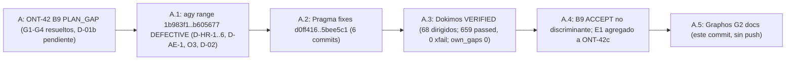
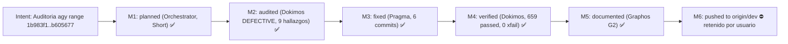
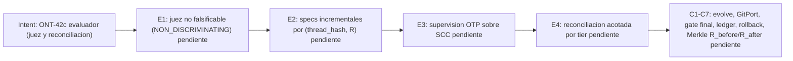

# Feature: Auditoría del rango de commits directos de Antigravity (1b983f1..b605677)

- **Documento**: `feature_20261107_011128_agy_audit.md`
- **Pipeline mode**: **Short** (orquestador en modo inline; Archon y Ontos omitidos por política de costos del usuario)
- **Stage**: Graphos G2 (post-Dokimos), VERIFIED tras ciclo Dokimos → Pragma → Dokimos
- **Repositorio**: `agent-execution-plane`, rama `dev` @ `5bee5c1` (origin/dev @ `b605677`, sin push)
- **Anterior en la cadena**: [`feature_20261106_182001_ont42_judge_evolve.md`](feature_20261106_182001_ont42_judge_evolve.md)
- **Autor**: Graphos (Universal State Manager & Knowledge Graph Custodian)

---

## 1. Intent y premisas

- **Intent**: verificar la integridad de los 7 commits directos realizados por Antigravity (agy) sobre `dev` en el rango `1b983f1..b605677`, sin pasar por el pipeline, y cerrar los defectos hallados.
- **Premisa de juez**: el veredicto de `autoevol verify` sólo se considera evidencia si discrimina (ver §6, B9).
- **Decisión del usuario (2026-11-07)**: AEP recarga únicamente su propia sesión (ancestría estricta); nunca sesiones ajenas.
- **Decisión del usuario (2026-11-07)**: el modo **Short** es el modo por defecto del pipeline por costos.

## 2. Resolution path, tool reach y blast radius

| Ítem | Valor |
|------|-------|
| Path | Short: Dokimos (auditoría) → Pragma (fixes) → Dokimos (re-verificación) → Graphos G2 → documentación |
| Tool reach de Dokimos | sandbox de tests (`sandbox_run`), `autoevol` (`verify`, `log`, `graph`), lectura de repositorio |
| Blast radius de los fixes | `server.py`, `engine/threads*.py`, `engine/ipc*` / `scripts/aep-ctl` (dominio `ipc`), `engine/backup.py`, tests asociados |
| Blast radius de este commit | sólo `docs/` y `README.md` (sin código, sin config) |
| Sub-agentes | Pragma y Dokimos heredaron la misma reach; no hubo nuevos privilegios |

## 3. Hallazgos de Dokimos (veredicto inicial: DEFECTIVE)

| ID | Severidad | Hallazgo | Estado tras Pragma |
|----|-----------|----------|--------------------|
| D-HR-1 | Crítico | Peer lookup no ancestro: `find_harness` podía devolver procesos que no son ancestros reales | Cerrado (`d0ff416`); peers pasan a conteo informativo |
| D-HR-2 | Alto | `certify` / `matrix` sin gates de reach (requerían ≥ 5r-x), con helper y CLIs externos por defecto | Cerrado (`8644bcc`): gates ≥ 5r-x, sin helper ni CLIs externos por defecto; tests O3 directos |
| D-HR-3 | Alto | Allowlist del helper demasiado amplia | Cerrado (`1d1a777`): allowlist sólo reconnect |
| D-HR-4 | Alto | `CERTIFIED` tautológico (certificaba sin ruta de kernel) | Cerrado (`1d1a777`): certify es pty loopback sin privilegio; nunca `CERTIFIED` sin ruta de kernel |
| D-HR-5 | Medio | `rpc reload` reportaba OK sin verificación | Cerrado (`dd5975e`): nunca OK sin verificar |
| D-HR-6 | Medio | Variables de entorno `AEP_AGY_RPC_URL` / `CODEX_HOME` influían en el comportamiento | Cerrado (`dd5975e`, docs en `5bee5c1`): variables eliminadas; comandos no verificados por defecto son manuales |
| D-AE-1 | Medio | Extractor de `autoevol` ciego a `ipc` / `backup` (no recorría dicts anidados) | Cerrado (`5bee5c1`): recorre dicts anidados; baseline de gaps 103 → 122 por visibilidad |
| O3 | Bajo | Cobertura directa insuficiente de certify/matrix | Cerrado (`8644bcc`) |
| D-02 | Medio | Reaper de ciclos podía reapear ciclos vivos | Cerrado (`642d2cd`): sólo expirados o `OPEN` con dueño muerto |

## 4. Fixes de Pragma (rango `d0ff416..5bee5c1`)

1. `d0ff416` fix(audit): D-HR-1 `find_harness` devuelve sólo ancestros reales.
2. `1d1a777` fix(audit): D-HR-3/4 allowlist del helper sólo reconnect; certify como pty loopback sin privilegio.
3. `dd5975e` fix(audit): D-HR-5/6 rpc reload nunca OK sin verificar; se eliminan `AEP_AGY_RPC_URL` y `CODEX_HOME`.
4. `8644bcc` fix(audit): D-HR-2 certify/matrix con gates ≥ 5r-x; O3 tests directos.
5. `642d2cd` fix(audit): D-02 reap sólo de ciclos expirados o `OPEN` con dueño muerto.
6. `5bee5c1` fix(audit): D-AE-1 extractor recursivo de dicts anidados (ipc/backup visibles); baseline de gaps 103 → 122; docs D-HR-6.

## 5. Verificación de Dokimos (veredicto final: VERIFIED)

- **Tests dirigidos**: 68 pasando.
- **Suite completa**: **659 passed, 0 xfail**.
- **autoevol gaps**: 94 → 122 (aumento por visibilidad de `ipc` / `backup`, no por regresión).
- **own_gaps**: 0.
- Evidencia reportada por Dokimos; no reproducida por Graphos.

## 6. Caso B9: ACCEPT de agy no reproducible

- El `verify` que agy reportó como ACCEPT para B9 (D-01b) **no discrimina**: no falla en base y pasa con parche de forma verificable.
- El fix de D-01b **sí funciona** según pytest (suite dirigida y completa).
- Conclusión: el juez actual no es falsificable. Se registra como **E1** del backlog ONT-42c (prioridad 1).

## 7. Decisiones del usuario

1. AEP sólo recarga su propia sesión (ancestría estricta); nunca sesiones ajenas.
2. Modo Short por defecto por costos; Full queda para cambios de alto blast radius o si el usuario lo pide.
3. Push retenido: este commit no se publica en origin.

## 8. Backlog ONT-42c (añadir a ONT-42)

Evaluador (prioridad en este orden):
- **E1 (primero)**: juez no falsificable. `verify` exige tests que fallen en base y pasen con el parche; si no, veredicto `NON_DISCRIMINATING`.
- **E2**: specs incrementales cacheadas por `(thread_hash, R)`; re-spec sólo de hilos del diff.
- **E3**: supervisión por hilo estilo OTP sobre SCC (`one_for_one` / `rest_for_one`); tools comprimidas como supervisores de sus acciones.
- **E4**: bucle de reconciliación acotado por tier.

Pendientes de ONT-42c tras E1: **C1–C7** (según `docs/COMPACT.md`).

Observaciones bajas:
- **O-1**: `matrix` con `mcp get` puede lanzar el stdio del server; documentar.
- **O-2**: el reapeo tras hot-swap reinicia el presupuesto de iteraciones; usar `boot_id` o heredar `iteration`.
- `aep_ctl` ignora `select_fields`: proyectar o devolver `PARAM_ERROR`.
- `backup.lkg_restore` sin `covers`.

## 9. State evolution

## 10. Reinforcement graphs

## 11. Chain and rollup check

- Documentos desde el último rollup (`feature_rollup.md`, Documentos 1–24): 16 documentos de ONT-21 a ONT-42 más este.
- El rollup estaba vencido. Se añade un **catch-up rollup** en `feature_rollup.md` para cubrir el tramo.

## 12. Routing (Orchestrator)

- VERIFIED → Hermon para versionado. En esta sesión el usuario fijó que el commit de docs lo hace Graphos y que no hay push.
- Siguiente ruta de trabajo: ONT-42c E1 (Pragma, con Archon u orquestador según modo).
