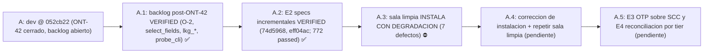

# Feature: Backlog post-ONT-42, E2 specs incrementales y hallazgos de instalación en sala limpia

- **Documento**: `feature_20261107_104734_e2_backlog_install.md`
- **Pipeline mode**: **Short** (orquestador en modo inline; Archon y Ontos omitidos por política de costos del usuario)
- **Stage**: Graphos G2 (post-Dokimos), VERIFIED para backlog y E2; hallazgos de instalación registrados sin cierre
- **Repositorio**: `agent-execution-plane`, rama `dev` @ `eff04ac` (origin/dev @ `00eafb0`, sin push)
- **Anterior en la cadena**: [`feature_20261107_011128_agy_audit.md`](feature_20261107_011128_agy_audit.md)
- **Autor**: Graphos (Universal State Manager & Knowledge Graph Custodian)

---

## 1. Intent y premisas

- **Intents**:
  - (A) backlog post-ONT-42 (`cbe7cde..052cb22`): cerrar los pendientes de bajo riesgo listados en `docs/STATE.md`.
  - (B) E2 del backlog ONT-42c: specs incrementales por hilo (`74d5968`, `eff04ac`).
  - (C) prueba de instalación en sala limpia: verificar que la instalación funciona desde cero, sin depender del estado del host.
- **Decisión del orquestador (A, O-2)**: tras un reapeo (reap) del ciclo huérfano, el presupuesto de ciclo (iteración, `env_retries`) se hereda. Se hereda también con `restart=True`, por ser la opción más segura. No se salta el tope ni el lock `EXHAUSTED`.
- **Premisa de juez (B)**: la spec generada es sólo informativa. El juez (`autoevol verify`) no la usa como entrada, por lo que una caché de specs no altera veredictos.
- **Premisa de instalación (C)**: el instalador debe degradar de forma controlada y explícita. Un banner de éxito no puede aparecer con 0 clientes MCP conectados.

## 2. Resolution path, tool reach y blast radius

| Ítem | Valor |
|------|-------|
| Path | Short: Dokimos (verificación A y B, prueba en sala limpia) → Graphos G2 → documentación |
| Tool reach de Dokimos | sandbox de tests (`sandbox_run`), `autoevol` (`verify`, `log`, `graph`), Docker para la sala limpia (Ubuntu 26.04, usuario no root, tier `6rw-`) |
| Blast radius de A y B | `engine/threads*.py` (caché de specs, `stale_specs` en diff), `server.py` (`autoevol`, `aep_ctl`), `engine/backup.py` (cobertura `lkg_*`), `engine/ipc*` (herencia de presupuesto), `scripts/aep-ctl`, tests asociados, matriz de documentación de `probe_cli` |
| Blast radius de C | sólo lectura de resultados; ningún cambio de código se hizo como parte de esta prueba |
| Blast radius de este commit | sólo `docs/` y `README.md` (sin código, sin config, sin `scripts/setup.sh`) |
| Sub-agentes | Dokimos heredó la misma reach; no hubo nuevos privilegios ni escalado de permisos |

## 3. Backlog post-ONT-42 (A): VERIFIED

Commits `cbe7cde..052cb22`:

| Commit | Ítem | Resultado |
|--------|------|-----------|
| `87cab16` | `aep_ctl` ignoraba `select_fields` | Corregido vía `project_fields`; VERIFIED |
| `0306303` | Cobertura de `backup.lkg_restore`, `lkg_status`, `lkg_diff` por `aep_ctl` | Tests añadidos; VERIFIED |
| `828b071` | Documentación de la matriz: `probe_cli` puede arrancar el servidor MCP por stdio (O-1) | Documentado; VERIFIED |
| `d6d75bf` | O-2: el presupuesto de ciclo (iteración, `env_retries`) se reiniciaba tras hot-swap | Herencia del presupuesto tras reapeo; VERIFIED |
| `052cb22` | Orden de imports en tests de recuperación de `evolve` | Estilo; VERIFIED |

Tests de `recovered: true` y `state_unverified` añadidos en el mismo backlog (reportados VERIFIED por Dokimos).

## 4. E2 specs incrementales (B): VERIFIED

Commits `74d5968` (caché incremental) y `eff04ac` (ruff: orden de imports y formato).

- **Clave de caché**: `node_hash` de los hilos del gap.
- **Salida**: `cache: hit | miss` en la respuesta de `spec`; `stale_specs` en `diff`.
- **Fail-open**: un fallo de caché no bloquea la generación de la spec.
- **Tier**: en tier < 6 no se escribe caché.
- **Medición en vivo**: miss 1337 ms, hit 367 ms.
- **Suite**: 772 passed (reportado por Dokimos; antes 754).

**Endurecimientos opcionales, registrados en el backlog (no bloqueantes):**
1. Incluir el `node_hash` de tests y pins en la clave de caché. Hoy un cambio sólo en tests podría servir una spec obsoleta.
2. Validar la forma del objeto devuelto por `_lookup` antes de servir un `hit`.

## 5. Prueba de instalación en sala limpia (C): hallazgos, corrección en curso

Entorno: Docker Ubuntu 26.04, usuario no root, tier `6rw-`.

**Veredicto de la prueba: INSTALA CON DEGRADACIÓN CONTROLADA.** La instalación termina, pero con siete defectos:

| # | Defecto | Efecto observado |
|---|---------|------------------|
| 1 | Canario no sembrado | `--check` reporta FAIL |
| 2 | `aep-ctl` requiere `python3` sin declararlo ni comprobarlo | Falla en hosts sin `python3` |
| 3 | Chromium sin sus librerías | Fallo en la capacidad de navegador |
| 4 | `sandbox_run` sin `bwrap` | `ERROR` en lugar de degradación explícita |
| 5 | `curl` sin `-f`; Go borrado antes de verificar | Descarga de error HTML tratada como binario válido; verificación posterior no alcanzable |
| 6 | Arquitectura fija `amd64` | Fallo en hosts `arm64` |
| 7 | Banner de éxito con 0 clientes MCP | Falso positivo de instalación |

Además se registran:
- Descargas sin checksum y sin versión fija.
- `uv.lock` presente pero no usado por la instalación.

**Estado**: corrección en curso (la realiza el agente que edita `scripts/setup.sh`; este registro no lo toca). Pendiente: repetir la prueba en sala limpia tras la corrección.

Fuente: informe de la prueba reportado en esta sesión. Graphos no reejecutó la instalación.

## 6. Veredictos

| Intent | Veredicto | Fuente | Pendiente |
|--------|-----------|--------|-----------|
| A. Backlog post-ONT-42 | VERIFIED | Dokimos | ninguno |
| B. E2 specs incrementales | VERIFIED (suite 772 passed) | Dokimos | endurecimientos 1 y 2 (opcionales) |
| C. Instalación en sala limpia | INSTALA CON DEGRADACIÓN CONTROLADA (7 defectos) | Prueba en sala limpia | corrección y repetición |

## 7. Evolución de estado (A → A.1 → A.2)

## 8. Cambios de documentación en este registro

- `docs/pipeline/feature_20261107_104734_e2_backlog_install.md` (este documento).
- `docs/STATE.md`: encabezado, hecho y pendientes.
- `docs/MILESTONES.md`: backlog post-ONT-42, E2 y sala limpia.
- `docs/COMPACT.md`: guía de compactación vigente.
- `README.md`: badge de tests (772 passed) y grafo de reforzamiento de §10.3 (E2).

## 9. Próximas acciones

1. Corrección de la instalación (los 7 defectos y las descargas con checksum y versión fija), y repetición de la prueba en sala limpia.
2. E3: supervisión OTP sobre SCC.
3. E4: reconciliación acotada por tier.
4. Endurecimientos opcionales de E2 (clave con tests y pins; validación de `_lookup`).

**Nota de cadena**: desde el último rollup (`feature_rollup.md`, Documentos 1–24) la cadena tiene más de cinco documentos sin rollup. El rollup queda pendiente como deuda de documentación; no se generó en este registro.

## 10. Restricciones vigentes

- Push a `origin/dev`: user-gated; no se hizo push.
- `resolve-revert` sólo por CLI humano con `--confirm`.
- `recovered: true` sólo con prueba git y testigo del gate.
- Modelo de amenaza: el gate no protege contra un adversario con el mismo uid (SDD §9).
