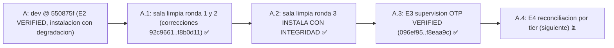

# Feature: Integridad de instalación en sala limpia (3 rondas) y E3 supervisión OTP

- **Documento**: `feature_20261107_113335_install_integrity_e3.md`
- **Pipeline mode**: **Short** (orquestador en modo inline; Archon y Ontos omitidos por política de costos del usuario)
- **Stage**: Graphos G2 (post-Dokimos), VERIFIED para instalación (ronda 3) y E3
- **Repositorio**: `agent-execution-plane`, rama `dev` @ `f8eaa9c` (origin/dev @ `550875f`, 24 commits por delante, sin push)
- **Anterior en la cadena**: [`feature_20261107_104734_e2_backlog_install.md`](feature_20261107_104734_e2_backlog_install.md)
- **Autor**: Graphos (Universal State Manager & Knowledge Graph Custodian)

---

## 1. Intent y premisas

- **Intents**:
  - (C) integridad de la instalación: que `scripts/setup.sh` instale desde cero sin depender del host, con descargas verificadas y degradación explícita.
  - (E3) supervisión OTP sobre el grafo de hilos (SCC) para el heal de `autoevol`.
- **Premisa de instalación**: una descarga que no coincide con su checksum se descarta, nunca se instala, y el instalador degrada con aviso.
- **Premisa de supervisión (E3)**: `rest_for_one` reinicia sólo a los consumidores realmente rotos, el resto se conserva con `preserved`.

## 2. Resolution path, tool reach y blast radius

| Ítem | Valor |
|------|-------|
| Path | Short: Pragma (corrección de instalación y E3) → Dokimos (sala limpia en Docker y tests) → Graphos G2 → documentación |
| Tool reach de Dokimos | Docker Ubuntu 26.04 (usuario no root, sin sudo, sin python3 de sistema), `git bundle`, `sandbox_run`, `autoevol` |
| Blast radius de instalación | `scripts/setup.sh`, `scripts/aep-sync.sh`, `scripts/aep-ctl`, `server.py` (`aep_ctl` vía `sys.executable`), `engine/setup*` (descargas, checksums, DB 0600, dir 0700) |
| Blast radius de E3 | `engine/threads_supervise.py`, `engine/threads_heal.py`, `tests/test_e3_supervise.py`; aislamiento de tests `om7` (`9c6a913`: kanban, catalog y `TEMP_BIN_DIR`) |
| Blast radius de este commit | sólo `docs/` y `README.md`. Sin código, sin config, sin `scripts/setup.sh`. Fuera de alcance: `.claude/` (no versionado, no se incluye) |
| Sub-agentes | Dokimos heredó la misma reach; sin nuevos privilegios ni escalado de permisos |

## 3. Integridad de instalación (C): VERIFIED en la ronda 3

Tres rondas en sala limpia. Informe completo: `docs/reports/2026-11-07_aep_clean_room_install_retest.md` (commits `b6c50c4`, `81ba56b`).

| Ronda | Veredicto | Correcciones |
|-------|-----------|--------------|
| 1 | DEGRADACIÓN CONTROLADA (7 bugs, descargas sin checksum) | `92c9661..aa468e1` |
| 2 | DEGRADACIÓN CONTROLADA (3 bugs menores; x86_64 + arm64, checksums alterados, Go previo conservado) | `10b8608..f8b0d11` (trap de `aep-sync`, `sys.executable` en `aep_ctl`, golangci-lint v2.15.0, checksum frente a descarga, DB 0600 y dir 0700) |
| 3 | **INSTALA CON INTEGRIDAD** (x86_64; `--check` HEALTHY) | ninguna |

Verificado en la ronda 3:
- Primera instalación exit 0 sin el aviso «el registro MCP falló»; `aep-sync.sh` exit 0.
- `--check` HEALTHY; WARN sólo por `bwrap` ausente y 0 clientes MCP (ambos esperados en la sala).
- golangci-lint v2.15.0 con SHA-256 oficial; lint real sobre las sondas Go en módulo temporal.
- `aep_ctl` vía cliente MCP stdio sin python3 de sistema (`initialize`, `schema`, `storage mounts`).
- Checksum de pueue alterado: descarga descartada, degrada con aviso, exit 0.
- Permisos: `~/.local/share/agent-os` 700; `artifacts.db` 600.

Versiones fijadas: uv 0.13.7, Go 1.26.10, golangci-lint v2.15.0, pueue v4.0.4 (SHA calculado; sin checksum oficial publicado para este pin).

Observaciones abiertas de la ronda 3 (no bloqueantes):
- (a) las sondas Go de `diagnostic/go/<sonda>/` no tienen `go.mod`; `golangci-lint run ./...` sobre ellas falla. El producto lintea por archivo y no se ve afectado.
- (b) la rama de descarga fallida con red caída (exit 1) no se ejercitó; sólo la de checksum.
- (c) pytest no se ejecutó en la ronda 3. La cifra de suite de este registro procede de Dokimos sobre el código, no de la sala.

## 4. E3 supervisión OTP sobre SCC (VERIFIED)

| Commit | Ítem |
|--------|------|
| `096ef95` | Árbol de supervisión tipo OTP para el heal de `autoevol` (`one_for_one` / `rest_for_one`) |
| `9118a19` | `rest_for_one` reinicia sólo a los consumidores rotos por el contrato restaurado; el resto `preserved` |
| `7dbfcca` | Estrategia calculada sobre unidades planificadas; se reportan archivos omitidos y `partial_unit` |
| `f8eaa9c` | Clasificador `restore` / `identical` / `out_of_lkg`. Defecto hallado por el orquestador en producción y corregido |

- **Test intermitente aislado (`9c6a913`)**: causa = singletons reales (kanban, catalog, `TEMP_BIN_DIR`) compartidos con pytest concurrente. Corregido aislando esos recursos en las pruebas `om7` de concurrencia IPC.
- **Suite**: 805 tests recolectados (verificado por Graphos con `pytest --collect-only`); 805 passed reportado por Dokimos; ruff limpio (reportado).

## 5. Backlog abierto

- Sondas Go sin `go.mod`; errcheck en `socket-monitor` (1) y `landlock-guard` (4).
- Endurecimientos opcionales de la caché E2 (clave con `node_hash` de tests y pins; validación de la forma de `_lookup`).
- LKG antiguo (`622fa0a7…`): conviene refrescarlo.
- `ruff format` pendiente en 76 archivos.
- `feature_rollup.md` vencido: la cadena supera los cinco documentos desde el último rollup. Deuda registrada; no generada en este registro.

## 6. Veredictos

| Intent | Veredicto | Fuente | Pendiente |
|--------|-----------|--------|-----------|
| C. Integridad de instalación | INSTALA CON INTEGRIDAD (ronda 3) | Prueba en sala limpia | backlog de sondas Go y ruff format |
| E3. Supervisión OTP sobre SCC | VERIFIED (805 tests) | Dokimos | backlog menor (errcheck, LKG) |
| E4. Reconciliación acotada por tier | pendiente | , | siguiente en el orden |

## 7. Evolución de estado (A → A.1 → A.2)

## 8. Cambios de documentación en este registro

- `docs/pipeline/feature_20261107_113335_install_integrity_e3.md` (este documento).
- `docs/STATE.md`: encabezado, hecho y pendientes.
- `docs/MILESTONES.md`: sección 7 (instalación ronda 3 y E3) y estado de la sección 6.
- `docs/COMPACT.md`: guía de compactación vigente.
- `README.md`: badge de tests (805 passed) y grafos de reforzamiento de §10.3 (E3 e integridad de instalación).

## 9. Próximas acciones

1. E4: reconciliación acotada por tier (Archon en Full; orquestador en Short).
2. Backlog de instalación: sondas Go con `go.mod` y errcheck; prueba de descarga fallida con red caída.
3. Refrescar el LKG antiguo y ejecutar `ruff format` sobre los 76 archivos pendientes (decisión del usuario sobre alcance).
4. Rollup `feature_rollup.md` (deuda documental).

**Restricciones vigentes**: push a `origin/dev` user-gated (no se hizo push; 24 commits locales por delante). `resolve-revert` sólo por CLI humano con `--confirm`. `recovered: true` sólo con prueba git y testigo del gate. Modelo de amenaza: el gate no protege contra un adversario con el mismo uid (SDD §9).
