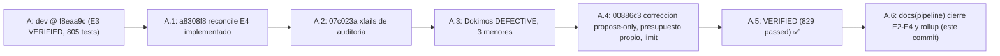

# Feature: E4 reconciliación acotada por tier (autoevol `reconcile`) y cierre del plan E2–E4

- **Documento**: `feature_20261107_115813_e4_reconcile.md`
- **Pipeline mode**: **Short** (orquestador en modo inline; Archon y Ontos omitidos por política de costos del usuario)
- **Stage**: Graphos G2 (post-Dokimos), VERIFIED tras un ciclo de corrección
- **Repositorio**: `agent-execution-plane`, rama `dev` @ `00886c3` (origin/dev @ `b6b5e66`; push retenido, sin push)
- **Anterior en la cadena**: [`feature_20261107_113335_install_integrity_e3.md`](feature_20261107_113335_install_integrity_e3.md)
- **Autor**: Graphos (Universal State Manager & Knowledge Graph Custodian)

---

## 1. Intent y premisas

- **Intent**: E4, reconciliación de `autoevol` acotada por tier. Un controlador bajo demanda, al estilo Kubernetes, compara lo deseado (claims, presupuestos, specs cacheadas E2) con lo observado (drift, discrepancias abiertas, gaps, estado del plano vivo) y emite propuestas deterministas.
- **Premisa de tier**: el tier se resuelve en cada llamada y nunca se cachea. Tier < 6 no escribe nada.
- **Premisa de autoridad**: reconcile sólo PROPONE. Abrir ciclos exige opt-in explícito. Ninguna ruta de reconcile hace commit, merge, push ni `heal apply`.
- **Cierre del plan E2–E4**: con E4 VERIFIED, el plan de autohealing E2–E4 queda cerrado.

## 2. Resolution path, tool reach y blast radius

| Ítem | Valor |
|------|-------|
| Path | Short: Pragma (`a8308f8`, `07c023a`, `00886c3`) → Dokimos (suite, ruff, primer pase DEFECTIVE → corrección → VERIFIED) → Graphos G2 → documentación |
| Tool reach de Pragma | Repositorio, venv `~/.local/share/agent-os/venv`, `pytest`, `ruff`, `sandbox_run` |
| Tool reach de Dokimos | Suite completa de pytest, ruff, lectura de ledger y eventos `reconcile.*` en pruebas |
| Blast radius de E4 | `engine/threads_reconcile.py` (nuevo, puro), `engine/threads.py`, `engine/threads_ledger.py`, `engine/threads_spec_cache.py`, `engine/threads_extractors.py` (fusión de kwargs del sitio de llamada), `server.py` (acción `autoevol(action="reconcile")` y `reconcile_top` en `discover` terse), `tests/test_e4_reconcile.py`, `tests/test_audit_e4.py`, `tests/test_ont41_coverage.py` |
| Blast radius de documentación | sólo `docs/` y `README.md` (este commit) |
| Sub-agentes | Pragma y Dokimos heredaron la misma reach; sin nuevos privilegios ni escalado de permisos |

## 3. Qué se entregó (E4)

- **Módulo puro** `engine/threads_reconcile.py`: sin efectos laterales; todos los efectos llegan inyectados. Salida: `{gap, kind, action: heal|spec|evolve|report, reason, tier_required}`, máximo `MAX_PROPOSALS = 10`.
- **Política por tier** (`policy`):
  - 7rwx: `heal` en dry-run (nunca apply) y ciclos `fix_test` / `evolve` sólo en plan (`apply=False`).
  - 6rw-: ciclos sólo en plan, sin `heal`.
  - 5r-x y 4r--: sólo informe, cero escrituras. No se abre el ledger.
- **Opt-in de apertura**: `open_cycles=true` (argumento) o `AEP_RECONCILE_OPEN=1`. Sin opt-in sólo se continúan ciclos ya vivos.
- **Presupuesto propio**: `AEP_RECONCILE_MAX_OPENS` (entero >= 1; ausente o inválido => 1 por ventana de 24 h). Cuenta sólo eventos `reconcile.opened`, independiente del tope de `evolve` (`AEP_AUTOEVOL_MAX_CYCLES`). Como máximo un ciclo nuevo por llamada.
- **`limit` honrado**: `proposals[:min(limit, MAX_PROPOSALS)]`.
- **Idempotencia**: misma entrada, mismas propuestas. Un gap con ciclo vivo abierto por reconcile se continúa, no se duplica.
- **Eventos**: `reconcile.run`, `reconcile.opened`, `reconcile.capped` en el ledger, sólo con tier >= 6rw-.
- **Descubrimiento**: `discover(capabilities, terse)` añade `reconcile_top` (solo lectura, <= 1 propuesta, nunca ejecuta).

## 4. Verificación y veredictos

| Paso | Commit | Resultado |
|------|--------|-----------|
| Implementación E4 | `a8308f8` | Entregado (módulo puro, acción, eventos, README y SDD 9.1) |
| Xfails de auditoría | `07c023a` | Xfails estrictos para límite, presupuesto de apertura y covers reenviados por helpers |
| Primer pase Dokimos | (sobre `a8308f8`) | **DEFECTIVE**: 3 menores, sin hallazgos de seguridad |
| Corrección (1 ciclo) | `00886c3` | Propose-only por defecto, presupuesto propio, `limit` honrado, fusión de kwargs de helpers (gaps 122 → 120) |
| Segundo pase Dokimos | `00886c3` | **VERIFIED** |

- Suite: **829 passed** (reportado por Dokimos; recolección verificada en esta sesión: 829 tests collected).
- Ruff: limpio (reportado).
- Asumido (no verificado en esta sesión): las tres observaciones del primer pase corresponden a D-E4-1, D-E4-2 y D-E4-3 del mensaje de `00886c3`.

**Garantías verificadas por Dokimos:**
- Ningún tier hace commit, merge, push ni `heal apply` desde reconcile.
- Tier < 6 no escribe (ni ledger ni disco).
- Propose-only por defecto: abrir ciclos requiere opt-in explícito.
- El presupuesto de apertura es propio y acotado por ventana de 24 h.

## 5. Variables de entorno nuevas

| Variable | Defecto | Efecto |
|----------|---------|--------|
| `AEP_RECONCILE_OPEN` | ausente (no abre) | `1` habilita abrir ciclos en `reconcile` sin pasar `open_cycles=true` |
| `AEP_RECONCILE_MAX_OPENS` | `1` por ventana de 24 h | Máximo de eventos `reconcile.opened` en la ventana; valores inválidos o < 1 caen a 1 |

Documentadas en `README.md` (fila de `autoevol` en §4), `docs/sdd/sdd_ont40_autoevol_thread_graph.md` §9.1 y `engine/threads_reconcile.py`. La variable preexistente `AEP_AUTOEVOL_MAX_CYCLES` (defecto 3) sigue vigente y no cambia.

## 6. Backlog abierto (no bloqueante)

- Refrescar el LKG antiguo (`622fa0a7…`).
- Sondas Go sin `go.mod` y errcheck (`socket-monitor`, `landlock-guard`).
- Endurecer la caché E2: incluir `node_hash` de tests y pins en la clave; validar la forma del hit en `_lookup`.
- `ruff format` pendiente en ~80 archivos (decisión de alcance del usuario).
- Test unitario de helper multi-sitio (cubrir directamente la fusión de kwargs de `_collect_test_refs`).

## 7. Evolución de estado (A → A.1 → A.2)

## 8. Estado del plan E2–E4

| Milestone | Intent | Agente | Estado |
|-----------|--------|--------|--------|
| E2 | Specs incrementales (caché `node_hash`, `stale_specs`, fail-open) | Pragma / Dokimos | ✅ VERIFIED (`74d5968`, `eff04ac`) |
| E3 | Supervisión OTP sobre SCC | Pragma / Dokimos | ✅ VERIFIED (`096ef95..f8eaa9c`) |
| E4 | Reconciliación acotada por tier | Pragma / Dokimos | ✅ VERIFIED (`a8308f8`, `07c023a`, `00886c3`; 829 passed) |
| Cierre | Plan de autohealing E2–E4 | Graphos G2 | ✅ cerrado con este registro |

## 9. Cambios de documentación en este registro

- `docs/pipeline/feature_20261107_115813_e4_reconcile.md` (este documento).
- `docs/pipeline/feature_rollup.md`: rollup atrasado (sección "Rollup 5").
- `docs/STATE.md`, `docs/MILESTONES.md` (sección 8), `docs/COMPACT.md`.
- `README.md`: badge de tests (829 passed) y §10.3 (E4 y cierre E2–E4).

## 10. Próximas acciones

1. Decidir con el usuario si se publica (push a `origin/dev` es user-gated; `git rev-list --count origin/dev..dev` = 3 al cierre, es decir, `a8308f8`, `07c023a` y `00886c3`; el registro previo citaba 24 por delante de `550875f`, ya superado).
2. Backlog de §6, en el orden que el usuario decida.

**Restricciones vigentes**: push a `origin/dev` user-gated. Modo Short por defecto. `resolve-revert` sólo por CLI humano con `--confirm`. `recovered: true` sólo con prueba git y testigo del gate. Reconcile sólo propone salvo opt-in explícito.

[↑ Back to top](#top)
