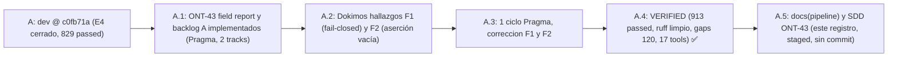

# Feature: ONT-43 field report (cuarentena de fallos reales hacia `autoevol`) y backlog track A (E2, sondas Go, setup sin red)

- **Documento**: `feature_20261107_135303_ont43_field_report.md`
- **Pipeline mode**: **Short** (orquestador en modo inline; Archon y Ontos omitidos por política de costos del usuario)
- **Stage**: Graphos G2 (post-Dokimos), **VERIFIED** tras un ciclo de corrección
- **Repositorio**: `agent-execution-plane`, worktree `integ-ont43`, rama `integ/ont43-backlog`, base `dev` @ `c0fb71a`
- **Estado de git al cerrar**: cambios de código y tests **staged, sin commit** (Hermon no invocado: el usuario retuvo el commit). Esta documentación también queda staged.
- **Anterior en la cadena**: [`feature_20261107_115813_e4_reconcile.md`](feature_20261107_115813_e4_reconcile.md)
- **Autor**: Graphos (Universal State Manager & Knowledge Graph Custodian)

---

## 1. Intent y premisas

- **Intent ONT-43**: cerrar la brecha por la que los fallos reales de herramientas en tiempo de ejecución nunca llegaban a `autoevol`. Un usuario que dice "mi tool no funciona con X" debía tener una vía para convertir ese fallo en un gap verificable, sin que el texto del error pudiera abrir un ciclo ni tocar código.
- **Intent backlog (track A)**: endurecer la caché E2 de specs, cerrar la deuda de fusión de kwargs de helpers, reconciliar las sondas Go con su lint, y blindar el setup sin red.
- **Premisa de amenaza**: el texto de error y la observación son **dato no confiable** (pueden traer prompt injection). Un reporte **nunca** abre un ciclo ni modifica código.
- **Premisa de autoridad**: `autoevol(action="report")` sólo registra candidatos y promueve por reproducción. Abrir ciclos sigue exigiendo el opt-in y el tope de `reconcile` (E4).
- **Premisa de fallo cerrado**: la promoción corre siempre en `bwrap`. Si el sandbox no está disponible, la promoción falla cerrada (`SANDBOX_UNAVAILABLE`); nunca se ejecuta sin aislamiento.

## 2. Resolution path, tool reach y blast radius

| Ítem | Valor |
|------|-------|
| Path | Short: orquestador (plan inline) → Pragma (2 tracks paralelos en worktrees: field report y backlog A) → Dokimos (suite completa, ruff, hallazgos F1 y F2 → 1 ciclo Pragma → VERIFIED) → Graphos G2 → documentación |
| Tool reach de Pragma | Repositorio, venv `~/.local/share/agent-os/venv`, `pytest`, `ruff`, `bwrap` (sandbox), `git` (worktrees temporales) |
| Tool reach de Dokimos | Suite completa de pytest, ruff, `bwrap` real (pruebas de `tests/test_ont43_adversarial.py`), lectura del ledger y eventos `field.*` / `reconcile.*` en pruebas |
| Blast radius de ONT-43 (código) | `engine/telemetry.py` (señal `evol_hint` en sobres de error), `engine/threads_field.py` (nuevo: cuarentena y promoción), `engine/threads.py` (gap `field_discrepancy` vía `set_field_provider`, fuera de la raíz Merkle R), `engine/threads_reconcile.py` (una línea: `field_discrepancy` entra en `DRIFT_KINDS`), `server.py` (acción `autoevol(action="report")`, cableado del proveedor de sigs promovidas) |
| Blast radius del backlog A | `engine/threads_spec_cache.py` y `engine/threads_spec.py` (caché E2: `cover_hash` y validación de forma del hit), `engine/threads_extractors.py` (fusión de kwargs de helpers multi-sitio) |
| Blast radius de documentación | sólo `docs/` y `README.md` (este registro y su SDD) |
| Sub-agentes | Pragma y Dokimos heredaron la misma reach; sin nuevos privilegios ni escalado de permisos. HEAD sigue en `c0fb71a` (sin commit ni push en este tramo) |
| Limpieza de worktrees | 20 worktrees obsoletos limpiados (reportado por el orquestador); el worktree `a783d592846aab250` (ONT-42b B9, dogfood BLOCKED) se conserva por decisión del usuario |

## 3. Qué se entregó

### 3.1 ONT-43 field report

1. **Señal `evol_hint` en sobres de error** (`engine/telemetry.py`):
   - Sólo se emite para estados de fallo de herramienta: `ERROR`, `*_ERROR` (p. ej. `PARAM_ERROR`), `EXEC_FAILED`, `FAILED`. Es una **lista blanca**, no "severidad ERROR": las denegaciones de política (`PERMISSION_DENIED`, `TIER_DENIED`, `BLOCKED`, `REJECTED`, ...) quedan fuera por construcción, y `INVALID_ACTION` / `NOT_FOUND` son errores del llamador.
   - `sig = sha256(tool|action|status|error_class)[:12]`. Ningún texto crudo participa.
   - `error_class` sale de una clave explícita (`error_class`, `error_type`, `exception`) o del **primer token** de `error`, nunca del mensaje.
   - Omitido en modos `terse`, `brief` y `cached`. Nunca se emite sobre `autoevol(action="report")` para evitar auto-realimentación.
2. **Cuarentena** (`engine/threads_field.py`, nuevo):
   - `record_report` (tier >= 5r-x): sólo escribe en el JSONL de eventos. Texto libre saneado (`sanitize_dict`) y truncado a 300 caracteres por campo; se guarda como dato y no se re-emite en respuestas.
   - Dedupe por `sig`: una firma repetida suma una ocurrencia, no crea candidato nuevo.
   - Tope `AEP_FIELD_MAX_REPORTS` (defecto 20 firmas nuevas por ventana de 24 h). Por encima del tope responde `CAPPED` y no guarda nada.
   - `promote_report` (tier >= 6rw-): el repro debe ser `tests/field/test_fr_<sig>.py::<nombre>`, con `@pytest.mark.xfail(strict=True, reason="FR-<sig> ...")` **de la misma firma**. Se ejecuta **sólo ese test** en `bwrap`, y debe dar exactamente 1 `xfailed` y ningún otro resultado.
3. **Promoción por reproducción** (`autoevol(action="report", sig, repro_test, report)`):
   - XFAIL real: estado `PROMOTED`, la firma entra en `promoted_sigs`.
   - Test que pasa o no colecta: `REJECTED_NO_REPRO` (reintentable con otro repro).
   - `trusted=False` en la ruta de promoción: siempre fail-closed. Sandbox caído: `SANDBOX_UNAVAILABLE` (corrección F1).
4. **Normalización al grafo** (`engine/threads.py`, `server.py`):
   - Gap `field_discrepancy` sólo para firmas promovidas, vía `set_field_provider` (server -> threads). Es un overlay **fuera de la raíz Merkle R** y fuera de la caché: el estado es externo.
   - `threads_reconcile.DRIFT_KINDS` lo trata como drift: reconcile propone `spec` / `evolve` para él.
   - Abrir ciclos sigue exigiendo `open_cycles=true` o `AEP_RECONCILE_OPEN=1`, y el cupo `AEP_RECONCILE_MAX_OPENS`.
   - `open_discrepancy` (D-xx) sigue en `REPORT`: no cambia de clase.

### 3.2 Backlog track A

- **Caché E2 endurecida** (`engine/threads_spec_cache.py`, `engine/threads_spec.py`): la clave incluye `cover_hash` (ids y hash de contenido de los tests impactados y de los pins). Un cambio en los tests que cubren o fijan el nodo invalida el hit aunque los hilos propios no cambien. Un hit con forma inválida (`_valid_spec`: `status == OK`, claves y tipos que `build_spec` siempre emite) se trata como **miss**.
- **Fusión de kwargs de helpers multi-sitio**: prueba directa añadida (`tests/test_threads_helper_kwargs_merge.py`). Sin defecto nuevo: el comportamiento ya era correcto desde E4.
- **Sondas Go**: el hallazgo de errcheck ya estaba resuelto. Se **descartó** añadir `go.mod`: el build compila un archivo único y reestructurar rompería el glob `tpl_*.go`. En su lugar, `tests/test_go_probes_lint.py` crea un `go.mod` temporal para el lint.
- **Setup sin red** (`tests/test_setup_no_network.py`): sin red falla cerrado, no deja binarios parciales, y el detector de prerequisitos no ve el toolchain (comprobado).

## 4. Verificación y veredictos

| Paso | Resultado |
|------|-----------|
| Implementación ONT-43 y backlog A | Pragma en 2 tracks paralelos (worktrees separados) |
| Primer pase Dokimos | Hallazgos **F1** (promoción sin fallo cerrado cuando `bwrap` cae: debe responder `SANDBOX_UNAVAILABLE`) y **F2** (aserción vacía en una prueba de cobertura) |
| Corrección (1 ciclo) | Pragma corrige F1 y F2; Dokimos re-verifica |
| Veredicto final | **VERIFIED** |
| Suite | **913 passed** (baseline 829). Recolección verificada en esta sesión: 913 tests collected |
| Ruff | `All checks passed!` (verificado en esta sesión) |
| Gaps | **120** (baseline 120, sin cambio) |
| Herramientas | **17** tools / **19** capacidades, sin cambio |
| claim_drift | Ninguno |

**Desglose de pruebas nuevas (verificado con `pytest --collect-only`):**

| Archivo | Tests |
|---------|-------|
| `tests/test_ont43_field_report.py` | 48 |
| `tests/test_ont43_adversarial.py` | 11 (inyección, traversal, firmas malformadas, `bwrap` real sin red y de sólo lectura, fail-closed) |
| `tests/test_e2_spec_cache.py` | 17 |
| `tests/test_threads_helper_kwargs_merge.py` | 3 |
| `tests/test_go_probes_lint.py` | 11 |
| `tests/test_setup_no_network.py` | 1 |

**Garantías verificadas por Dokimos:**
- Un reporte nunca abre un ciclo ni modifica código.
- La promoción es fail-closed: sin `bwrap`, no hay ejecución.
- Sólo se ejecuta el test de repro indicado, con exactamente 1 XFAIL.
- Un fallo de política (denegación) nunca genera `evol_hint`.

## 5. Variables de entorno nuevas

| Variable | Defecto | Efecto |
|----------|---------|--------|
| `AEP_FIELD_MAX_REPORTS` | `20` firmas nuevas por 24 h | Tope de candidatos nuevos en la ventana. Valores inválidos o < 1 caen a 20 |

Las variables de reconcile (`AEP_RECONCILE_OPEN`, `AEP_RECONCILE_MAX_OPENS`) y `AEP_AUTOEVOL_MAX_CYCLES` no cambian.

## 6. Riesgos residuales (aceptados y documentados)

1. **XFAIL prueba que falla, no por qué razón.** Un test `xfail(strict)` que falla por un `ImportError` o un `NameError` también da XFAIL. La promoción exige el marcador de la misma firma y exactamente 1 XFAIL, pero no valida la causa. Mitigación parcial: el reporte exige `expected` y `observed`, y la revisión humana del repro es parte del flujo.
2. **`tests/field/conftest.py` se ejecuta.** Pytest carga el `conftest.py` del directorio del repro antes del test. Ese contenido corre dentro del sandbox, con su red y sistema de archivos restringidos, pero es código del repro. Hoy el directorio `tests/field/` **no existe en el repositorio**: lo crea quien presenta el repro, y por eso la cuarentena trata el repro como código no confiable.
3. **Colisión de firmas por primer token.** `error_class` usa el primer token del error cuando no hay clave explícita. Dos fallos distintos que empiecen igual colapsan en una firma: precisión de dedupe, no seguridad. Es el coste de no usar el mensaje.
4. **`threads_spec.py` sin texto específico para `field_discrepancy`.** La especificación mini-SDD de un gap `field_discrepancy` usa la plantilla genérica de drift. Pendiente en backlog.

## 7. Evolución de estado (A → A.1 → A.2)

## 8. Estado de los milestones

| Milestone | Intent | Agente | Estado |
|-----------|--------|--------|--------|
| M1 | Señal `evol_hint` en sobres de error (lista blanca, sig sin texto) | Pragma / Dokimos | ✅ VERIFIED |
| M2 | Cuarentena `threads_field.py` (dedupe, tope 20/24 h, texto inerte) | Pragma / Dokimos | ✅ VERIFIED |
| M3 | Promoción por reproducción `autoevol(report)` en `bwrap`, fail-closed | Pragma / Dokimos | ✅ VERIFIED (F1 corregido) |
| M4 | Normalización: gap `field_discrepancy` fuera de R, drift en reconcile | Pragma / Dokimos | ✅ VERIFIED (threads_spec.py: texto pendiente) |
| M5 | Caché E2 endurecida (`cover_hash`, hit malformado = miss) | Pragma / Dokimos | ✅ VERIFIED (cierra backlog E2 de §6 del registro E4) |
| M6 | Sondas Go: lint con `go.mod` temporal (sin `go.mod` real) | Pragma / Dokimos | ✅ VERIFIED (errcheck ya resuelto) |
| M7 | Setup sin red: falla cerrado, sin binarios parciales | Pragma / Dokimos | ✅ VERIFIED |
| M8 | Documentación y SDD ONT-43 | Graphos G2 | ✅ este registro |
| M9 | Commit | Hermon | ⏳ retenido por el usuario (sin commit) |

## 9. Métricas de la ejecución

- **Modo**: Short.
- **Bucle Pragma↔Dokimos**: 1 ciclo (F1 fail-closed, F2 aserción vacía).
- **Bucle Archon↔Ontos**: no aplica (Short).
- **Tracks paralelos**: 2 (ONT-43 y backlog A), cada uno en su worktree.
- **Aproximación de Dokimos**: no reportada por Dokimos en el veredicto.
- **Duración total**: no medida en este registro.

## 10. Backlog (no bloqueante)

Actualizado respecto al registro E4 (§6 de `feature_20261107_115813_e4_reconcile.md`):

- **Resuelto en este tramo**: endurecimiento de la caché E2 (`node_hash` de tests y pins en la clave; validación de la forma del hit); prueba de fusión de kwargs de helpers multi-sitio; errcheck en sondas Go; `go.mod` descartado.
- **Pendiente**:
  - Refrescar el LKG antiguo (`622fa0a7…`).
  - `ruff format` pendiente en ~85 archivos (decisión de alcance del usuario).
  - Texto específico para `field_discrepancy` en `engine/threads_spec.py`.
  - Ciclo `482c9115f84a`: caduca por TTL (sin acción).
  - Worktree `a783d592846aab250` (ONT-42b B9, dogfood BLOCKED): conservado por decisión del usuario.
  - Descarga fallida con red caída: no ejercitada.

## 11. Cambios de documentación en este registro

- `docs/pipeline/feature_20261107_135303_ont43_field_report.md` (este documento).
- `docs/sdd/sdd_ont43_field_report.md` (especificación: modelo de amenaza, máquina de estados, tiers, variables, cierre natural).
- `docs/pipeline/feature_rollup.md`: sección "Rollup 6" (pedida explícitamente; ver nota en ella).
- `docs/STATE.md`, `docs/MILESTONES.md` (sección 9), `docs/COMPACT.md`.
- `README.md`: badge de tests (913 passed), acción `report` en la fila de `autoevol` (§4), y registro ONT-43 en §10.3.

## 12. Próximas acciones

1. El usuario decide el commit (Hermon, sólo tras su autorización). Los cambios están staged en `integ/ont43-backlog`.
2. Publicación: `push` a `origin/dev` es user-gated; no se hace sin autorización.
3. Backlog de §10, en el orden que el usuario decida.

**Restricciones vigentes**: commit y push user-gated. Modo Short por defecto. `resolve-revert` sólo por CLI humano con `--confirm`. `recovered: true` sólo con prueba git y testigo del gate. Reconcile sólo propone salvo opt-in explícito. Un reporte de campo nunca abre ciclos.

[↑ Back to top](#top)
